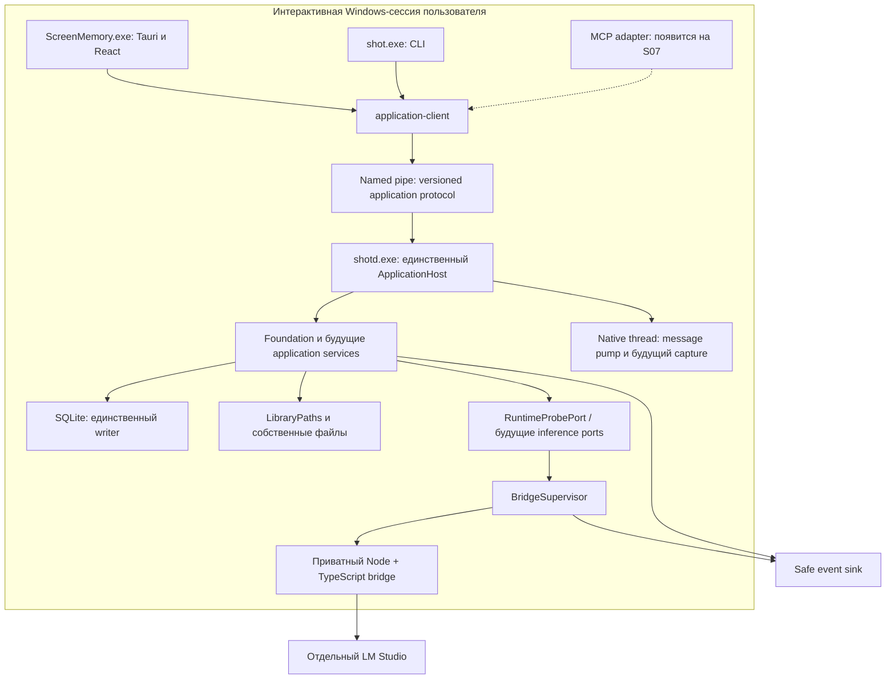
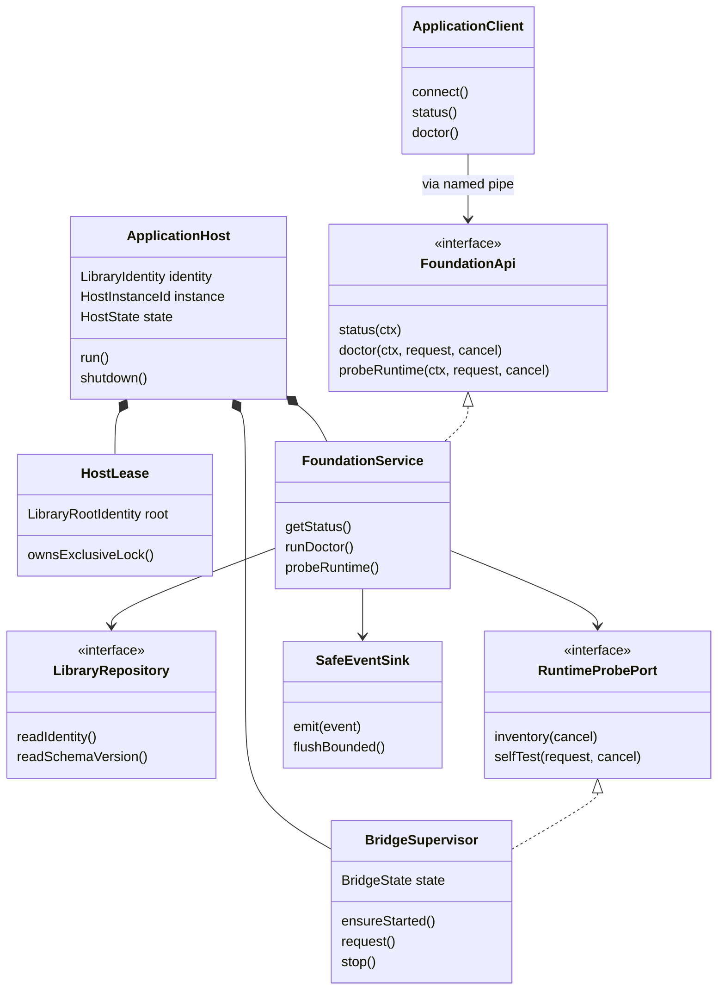
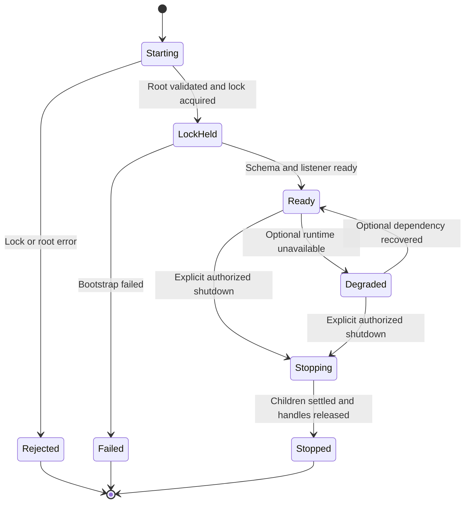
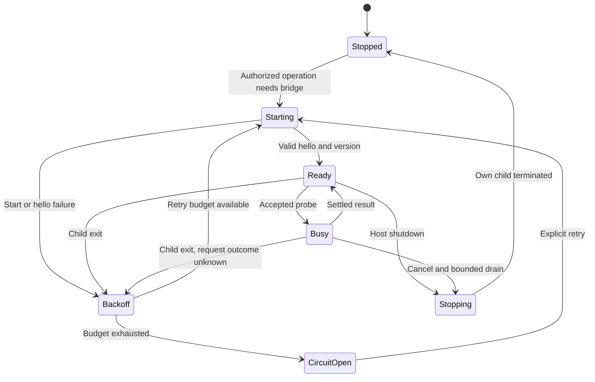
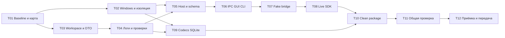

## S01: что должно появиться после первого этапа 🧭

Первый этап превращает выбранный open-source проект в **проверенную, изолированную и воспроизводимо собираемую основу ScreenMemory**. Его результат — не очередной перечень будущих возможностей и ещё не готовая библиотека скриншотов. Результат — работающие фундаментальные связи, на которых можно безопасно строить захват, импорт, локальный AI и поиск.

К завершению S01 существует отдельный Windows-процесс `shotd`, к которому подключаются минимальный CLI и небольшое диагностическое GUI. Проверены единственность владельца библиотеки, локальный протокол, запуск LM Studio SDK вне WebView, поставка приватного Node runtime, нативная сборка WebP/AVIF и SQLite с FTS5/sqlite-vec. Логи, тесты и доказательства выполнения сопровождают эту работу с начала, а не появляются перед релизом.

**Этот файл — первый из восьми детальных планов.** Он подчиняется общему плану v3 и не заменяет планы S02–S08. Внутренние задачи `S01-T01…S01-T12` — подразделы одного этапа, а не дополнительные крупные этапы или отдельные плановые документы.

> [!important] План и выполненная работа — разные сущности
> Документ содержит проектные решения, сигнатуры и проверяемые задания. Во время его подготовки прочитаны master v3, несколько ключевых файлов фиксированного Inspector и официальные технические источники. Репозиторий приложения не изменялся, Windows-сборка, модели и аппаратные тесты не запускались. Все незаполненные результаты проверок остаются `NOT_RUN`, а не подразумеваемым `PASS`.

### Как пользоваться документом 📚

| Раздел | Для чего нужен |
|---|---|
| [1. Границы и обязательства](#scope) | Что S01 обязан доказать и что не должен реализовывать |
| [2. Реальная основа Inspector](#upstream) | Какие исходники изучать и что нельзя наследовать без проверки |
| [3. Windows и фиксация зависимостей](#toolchain) | Сборка, версии, лицензии и чистое окружение |
| [4. Процессы и границы модулей](#architecture) | Host, клиенты, native thread, bridge и ownership |
| [5. Контракты S01](#contracts) | DTO, сигнатуры, ошибки, авторизация и cancellation |
| [6. Host и локальный IPC](#host) | Запуск, блокировка библиотеки, handshake и завершение |
| [7. Минимальные данные](#storage) | Начальные миграции и правила доступа к хранилищу |
| [8. LM Studio SDK bridge](#bridge) | Приватный процесс, fake/live проверки, реальные capabilities |
| [9. Кодеки и SQLite](#native-probes) | Ограниченные технические исследования вместо преждевременных модулей |
| [10. GUI и CLI первого этапа](#entrypoints) | Небольшой, но настоящий сквозной сценарий |
| [11. Логирование и диагностика](#observability) | События, ограничения, redaction, doctor |
| [12. Тесты и CI](#testing) | Fixtures, команды, отказные сценарии, доказательства |
| [13. Исполняемые задачи](#tasks) | Порядок работы, тесты, коммиты и промежуточные результаты |
| [14. Приёмка и передача](#acceptance) | Блокирующие проверки, отчёт и входы S02 |
| [15. Трассируемость и решения](#traceability) | Связь с master и запрет незаметного изменения требований |
| [16. Источники](#sources) | Проверенные первичные материалы |

<a id="scope"></a>
## 1. Границы этапа и обязательства перед остальным продуктом 🎯

### 1.1. Входы и ожидаемые выходы 📦

Обязательные входы — master v3, доступ к исходникам Inspector и Windows x64-стенд. Базовая проверочная ОС — Windows 11 в интерактивной пользовательской сессии. Наличие macOS/Linux-машины полезно для чистой логики, но не заменяет Windows-gate.

| Вход | Как используется | Что получается на выходе |
|---|---|---|
| Master v3, §§ 2–5, 14–18 | Определяет границы, IDs, процессы и качество | Матрица соответствия S01 без пересмотра состава V1 |
| Inspector, SHA `fa314915273e2cb91006fa284e5dd48fa90aff3a` | Фиксированная точка аудита, не обещание «самый стабильный релиз» | `upstream-map.md`, минимальная изоляция, проверка исходной Windows-сборки |
| Windows x64 с MSVC и WebView2 | Сборка и проверка нативного поведения | Environment manifest и воспроизводимые команды |
| Подтверждённый доступ к LM Studio | Только разрешённые live-probes | Compatibility report SDK/runtime, не готовый ModelManager |
| Синтетические изображения и временные БД | Проверка кодеков и sqlite-vec | Независимые Windows proof-тесты |

Ключевые исполняемые результаты: `shotd.exe`, `shot.exe`, минимальная Tauri-оболочка и приватный Node/bridge-комплект. Сначала они могут запускаться из build/staging-каталога. Полноценный подписанный установщик остаётся задачей S08; ранняя проверка комплектности пакета — обязательна уже здесь.

### 1.2. Обязательный scope S01 ✅

| Область | Обязательство S01 | Когда появится полная возможность |
|---|---|---|
| Донор | Закрепить SHA, проверить сборку и изолировать identity/данные/побочные процессы | Дальнейшее извлечение screenshot-подсистемы — S02 |
| Архитектура | Один host, общий клиент, отсутствие AI в React | Все use cases добавляются S02–S07 |
| IPC | Реальный Windows named pipe, version handshake, безопасный framing | Полный каталог application API — по следующим этапам |
| Host | Единственность владельца, basic lifecycle, минимальная schema, предсказуемые paths | Durable jobs/model leases — S04 |
| SDK | Запуск вне GUI, fake bridge и ограниченный настоящий запрос | Download manager, TTL и каталог всех пресетов — S04 |
| Изображения | Доказать WebP exact lossless и AVIF encode/decode на Windows | Каноническое хранилище и transform pipeline — S02/S03 |
| Поиск | Доказать встраивание FTS5 и sqlite-vec минимальным запросом | Поисковая модель, фильтры, RRF и relevance — S06 |
| Интерфейсы | Status/doctor и состояние соединения в GUI/CLI | Полный поиск, галерея и MCP — S07 |
| Качество | Логи, CI, fake clock/runtime, fixtures, negative tests, отчёт | Набор проверок расширяется на каждом этапе |

В S01 **не создаются** production-импорт папок, полный screenshot persistence, пользовательская taxonomy, очередь обработки коллекции, semantic UI, scheduler, облачный provider или реальный MCP-сервер. Тестовый вызов модели не выдаётся за реализованный AI-анализ библиотеки. Кодековый probe не является готовым `ImportService`.

### 1.3. Требования, которые нельзя потерять при выборе основы 🧷

Фундамент обязан оставлять прямой путь ко всем согласованным функциям: четыре capture-режима; собственный неизменяемый файл; файлы и рекурсивные папки через drop zone; WebP **и** AVIF; метаданные происхождения; уменьшение до 1024/2048 перед моделью; экспорт с пределом 1000 и сохранением пропорций; ручные правки; отложенный AI; поиск по приложению; CLI/MCP с путями и изображениями.

Поэтому выбор S01 запрещено оправдывать фразой «пока просто уберём AVIF» или «CLI потом будет просить React загрузить модель». Ограниченный prototype может не содержать функцию, но архитектурное решение не должно делать её невозможной или зависимой от другого интерфейса.

Неизменные решения master: Windows-first, LM Studio как единственный runtime V1, одна выбранная Gemma для vision, один Qwen0.6B для embeddings, named-pipe host, SDK bridge с поставляемым Node, независимость сохранения от AI и отсутствие скрытой облачной передачи.

### 1.4. Успех S01 и честные ограничения 🚦

`foundation-alpha` считается принятой только после обязательных Windows-, packaging-, protocol-, codec- и SDK-проверок. Отсутствие стенда допускает состояние `IMPLEMENTED / WINDOWS_NOT_VERIFIED`, но не `ACCEPTED`.

Полная сертификация E2B/E4B/12B, всех Advanced KV-комбинаций и качества описаний не переносится на S01. Здесь нужен один жизнеспособный путь: выбранный реальный vision-артефакт, Qwen embedding, опубликованный SDK, приватный Node и минимальный end-to-end без GUI. Остальные model presets проверяются на S04 и перед рекламируемым выпуском.

<a id="upstream"></a>
## 2. Inspector Rust: исходная карта и безопасный аудит 🔬

### 2.1. Зафиксированная точка исследования 📌

Исследуемый commit:

```text
pepperonas/inspector-rust
fa314915273e2cb91006fa284e5dd48fa90aff3a
```

`AGENTS.md` размещает общую логику в `core/rust-lib`, общий frontend — в `core/frontend`, а platform shells описывает как тонкие оболочки. В том же документе есть предупреждение о непроверенных в реальной Windows отдельных native-путях. Это основание для Windows-тестов, а не повод считать проект непригодным. [SRC-01]

Исходный `package.json` содержит `dev:win`, `build:win`, `check` через Bash и `posttest`, обновляющий badges. Поэтому новый verification pipeline не должен механически наследовать root scripts: проверка не должна незаметно менять документацию и требовать Bash в обычной Windows-сессии. [SRC-02]

### 2.2. Карта исходников и решения о переиспользовании 🗺️

Таблица — начальная карта для исполнителя. Для файлов, не перечитанных в рамках текущего плана целиком, точные зависимости и номера строк уточняются на закреплённом SHA. Наличие пути в master не равнозначно завершённому построчному аудиту.

| Исходный путь | Что проверять | Направление решения | Доказательство S01 |
|---|---|---|---|
| `Cargo.toml`, `Cargo.lock` | Workspace members, платформенные зависимости, native build scripts | Сохранить lock до объяснимых изменений; новый workspace отделить | Build log + dependency inventory |
| `package.json`, `pnpm-lock.yaml` | Реальные команды, scripts с побочными эффектами, versions | Заменить orchestration на безопасные Windows-команды | Script map; verify не меняет tracked files |
| `win/src-tauri/src/main.rs` | Вход в общий `run` | Использовать как reference shell, не будущий host | Call graph запуска |
| `win/src-tauri/tauri.conf.json` | Identifier, CSP, asset scopes, bundle targets | Отдельная identity и минимальные permissions | Config diff; forbidden-namespace test |
| `core/rust-lib/src/lib.rs` | Setup, managed states, plugins, watchers, background threads | Выделить composition root; не запускать весь исходный комбайн | Startup side-effect inventory |
| `core/rust-lib/src/commands.rs` | `run_screenshot_pipeline`, `run_capture_pipeline`, frontmost/hide/capture | Аудировать всю цепочку до freeze; переносить позже как use case | Sequence map исходного поведения |
| `core/rust-lib/src/region_picker.rs` | GDI freeze, overlay, result, cancel, FFI cleanup | Кандидат native adapter S02 | Минимальный Windows menu smoke и найденные риски |
| `core/rust-lib/src/hotkey.rs` | Callback, hide/focus, регистрация, lifetime | Позднее host-native dispatcher, не привязка к React | Карта владельца hotkeys |
| `core/rust-lib/src/screenshot_preview.rs` | Pending/saved, pin, temp cleanup | UI переиспользовать; сохранность отделить | Где и когда создаются/удаляются файлы |
| `core/rust-lib/src/screenshot_editor.rs` | Экспорт правок и запись в history | Позднее создавать новую asset version | Список зависимостей от старой history |
| `core/rust-lib/src/frontmost_app.rs` и `tracking/os/windows.rs` | Windows/macOS различия, path/PID/title | Извлечь Windows context без запуска time tracking | Контракт данных, null/unknown cases |
| `core/rust-lib/src/ocr.rs` | Реальная Windows-реализация против комментариев | Adapter S05; не запускать весь OCR сейчас | Статус проверки API/зависимостей |
| `core/rust-lib/src/db.rs`, `models.rs` | Clipboard data, retention, base64, crypto coupling | Не делать старую history нашей library schema | Запрет чтения/изменения старой БД |
| `core/frontend/src/App.tsx`, `lib/ipc.ts` | Входы, скрытые панели, вызовы commands | Не переносить всю product logic в новый GUI | Список реально переиспользуемых компонентов |
| `win/src-tauri/capabilities/` | Разрешённые окна/команды/plugins | Начать с allowlist нужных операций | Security fixture и smoke IPC |

> [!warning] Правильный picker не доказывает правильность всего hotkey-пути
> В проверенном `run_capture_pipeline` до `mode.capture()` вызываются получение имени приложения и `hide_popup`. Следовательно, проверять нужно callback → pipeline → native capture, а не только порядок `BitBlt`/создания overlay в одном модуле. [SRC-04]

### 2.3. Уже обнаруженные расхождения, которые необходимо учитывать 🧾

В `win/README.md` некоторые screenshot/OCR строки всё ещё обозначены как planned/stub. Список prereqs и команд полезен, но таблица feature status не заменяет исходники. Путь выходного MSI тоже проверяется по фактическому Cargo/Tauri build output, а не принимается на веру. [SRC-03]

В Windows `tauri.conf.json` исследованной версии установлены `csp: null`, идентификатор оригинального продукта, MSI target и asset scopes с исходными каталогами. Новый shell не должен автоматически наследовать эти разрешения и identity. Это конкретная задача изоляции, а не утверждение, что сам исходный файл был эксплуатационно проверен на уязвимости. [SRC-05]

Предварительные риски picker из master — unchecked Win32 results, cleanup на ранних ошибках, типизированная обработка `GetMessage`, cancellation и mixed DPI. S01 регистрирует их в `capture-audit.json`; полноценные исправления и regression matrix принадлежат S02. Если риск не даёт даже безопасно выполнить baseline smoke, выполняется минимальный исправляющий patch с отдельным commit и сравнением до/после.

### 2.4. Изоляция до первого запуска форка 🔐

Сначала допускается **сборка** исходного SHA. Его первый runtime-запуск выполняется только в чистой VM/тестовой Windows-учётной записи без личного clipboard и важных настроек. Запуск необработанного комбайна в основной пользовательской среде не является безопасным baseline.

Перед запуском нового `foundation-alpha` должны быть отделены:

| Поверхность | Обязательное правило |
|---|---|
| Product/app identifier | Новый идентификатор проекта, не `io.celox.inspector-rust` |
| Data/cache/config root | Свои `ScreenMemory` / `ScreenMemory.Dev`, не `InspectorRust` |
| WebView profile и asset scopes | Только собственные каталоги и нужные ресурсы |
| SecretStore namespace | Отдельные ключи; оригинальные credentials не читаются |
| Autostart, shortcut, updater | Оригинальные registration/endpoints не используются; автозапуск выключен |
| Named windows/classes/locks | Новые имена; не конфликтуют с установленным Inspector |
| Background features | Clipboard watcher, time tracking, audio/Bluetooth, network features не стартуют |
| Retention | Нет запуска старой очистки истории поверх новой библиотеки |
| Tests | Только временные каталоги/синтетика, никакой случайной домашней папки |

Лицензионные уведомления о заимствованном коде сохраняются. Отделение бренда и идентификаторов не разрешает удалять copyright. Проверка зависимостей выполняется отдельно от лицензии самого донора; это inventory и release compliance, а не индивидуальное юридическое заключение. [SRC-06]

### 2.5. Стратегия форка без тотальной переписи ✂️

Исходный SHA остаётся воспроизводимой точкой сравнения в отдельном worktree. В основной ветке появляются новый минимальный host/client/shell и постепенно извлекаемые модули. История Git сохраняет происхождение кода; отдельный detached worktree позволяет собирать старую структуру после изменения нового workspace.

Не требуется сначала удалить сотни файлов, переименовать все панели и переписать старый frontend. Но новый `shotd` не должен импортировать общий `inspector_rust_core::run()` только ради одного picker: это снова запустит чужой composition root. Нужный модуль выделяется или оборачивается вместе с минимальными зависимостями.

`upstream-map.md` для каждой переносимой единицы хранит исходный SHA/path/symbol, новое размещение, решение `keep/wrap/adapt/replace/exclude`, причину и проверку. В переносимом коде сохраняется notice, а поведенческие изменения отмечаются отдельно от механического перемещения.

<a id="toolchain"></a>
## 3. Windows toolchain и воспроизводимость сборки 🪟

### 3.1. Три разные среды 🔧

| Среда | Что установлено | Что проверяется |
|---|---|---|
| Development / CI | Git, Rust MSVC, Build Tools/SDK, Node/pnpm, CMake и зависимости выбранных codecs, WebView2 | Можно собрать и проверить исходники |
| Clean runtime | Собранный комплект ScreenMemory, необходимые redistributables/WebView2 | Программа работает без Rust, Node, Python, pnpm в пользовательском PATH |
| Live AI | Clean/development runtime плюс отдельно LM Studio и разрешённые model artifacts | SDK реально работает с vision/embedding на закреплённой связке |

Tauri документирует необходимость Microsoft C++ Build Tools и WebView2, а Rust для Windows должен использовать MSVC target. Эти зависимости относятся к сборке/desktop shell; AI inference остаётся во внешнем LM Studio. [SRC-07]

### 3.2. Политика версий 📌

Не используется бессрочная инструкция «установить latest». Сначала фиксируется известный baseline проекта, затем подбирается поддержанная связка и записываются точные версии.

| Компонент | Исходное направление | Что обязательно закрепить |
|---|---|---|
| Rust | Stable MSVC, edition донора не менять без причины | Точную версию в `rust-toolchain.toml`, target `x86_64-pc-windows-msvc`, rustfmt/clippy |
| Node | Node 24 LTS как стартовый кандидат нового bridge | Patch version, официальный archive URL, SHA256, license |
| pnpm | Major 10, совместимый с проектом | Точный `packageManager`, lockfile format |
| Tauri/React/Vite/TS | Сначала совместимые locked версии, без массового обновления | Cargo/pnpm lock и все feature flags |
| LM Studio SDK | Опубликованный npm package, а не случайный Git `main` | Версию и integrity из lock, фактически доступные типы/методы |
| LM Studio/backend | Установленный runtime на стенде | Версию desktop/server и inference engine, режим/GPU |
| SQLite/sqlite-vec | Встроенный SQLite и статическое расширение | Crate versions, effective SQLite/vec versions, compile flags |
| WebP/AVIF | Собираемые на MSVC адаптеры с явными controls | C library/codec revisions, build options, runtime deps |
| Windows | Windows 11 x64 | Build number, scaling, display topology, GPU/driver для live test |

По официальной таблице Node на дату подготовки Node 24 и 22 находятся в LTS, а Node 20 — EOL. Поэтому историческое «Node 20» в donor-инструкции не становится выбором нового поставляемого runtime. Совместимость Node 24 с закреплёнными пакетами должна быть проверена, а patch не объявляется проверенным до запуска. [SRC-08]

**До приёмки S01 у выбранной рабочей связки не остаётся `latest`, `*`, пустых hashes или `TBD` версий.** В этом плане версия, требующая реальной сборки, намеренно не подменена выдуманным номером: её выбор и фиксация — результат задач T02/T08/T09.

### 3.3. Environment manifest 🧾

В `docs/progress/S01/environment.json` записываются OS/build/architecture, версии инструментов, GPU/driver при наличии, physical display sizes/scales, locale, shell и ограничения стенда. В public/redacted варианте нет имени пользователя, SID в открытом виде, серийного номера машины и абсолютного личного data root.

Build manifest содержит исходный commit, dirty state, master hash, versions, lockfile hashes, native feature flags, состав runtime resources и SHA256 выходных файлов. Совпадение входов должно давать воспроизводимый процесс сборки; побайтная идентичность подписанных PE-файлов не обещается без отдельной настройки reproducible builds.

### 3.4. Проверочные команды окружения 💻

Каждая команда запускается отдельно, из обозначенного рабочего каталога. Наличие Node в текущем окружении ещё не доказывает работоспособность приватного Node в пакете.

```powershell
git --version
```

```powershell
rustc -Vv
```

```powershell
cargo --version
```

```powershell
rustup show active-toolchain
```

```powershell
node --version
```

```powershell
pnpm --version
```

```powershell
cmake --version
```

`cl.exe` проверяется из Developer PowerShell/инициализированной MSVC-среды. Отсутствие `cl` в обычном терминале не даёт права вслепую переустанавливать Build Tools: сначала проверяется обнаружение установленного toolchain.

### 3.5. Native-зависимости и supply chain 📦

Все native downloads/build steps перечисляются в inventory. Проверяются `build.rs`, npm lifecycle scripts, извлечение архивов, сетевые загрузки ONNX/моделей/кодеков. `onlyBuiltDependencies` или аналогичный allowlist добавляется осознанно; запрет script нельзя обходить отключением всех защит.

Отдельный `scripts/bootstrap-native.ps1` получает только закреплённые артефакты, проверяет hash и подготавливает native build. Обычный `verify.ps1` не скачивает модель, не устанавливает LM Studio и не обновляет зависимости. Первый dependency bootstrap может использовать сеть; после заполнения кеша должен существовать проверяемый offline build path.

Секреты подписи и права публикации S01 не нужны. Удалённый fork, push, release и правки пользовательского PATH не выполняются автоматически по факту работы над планом.

<a id="architecture"></a>
## 4. Архитектура S01: один host и тонкие точки входа 🧱

### 4.1. Процессы и направления вызовов 🔗



`shotd` работает от обычного пользователя в интерактивной сессии, **не** как Windows Service в Session 0 и **не** с постоянным elevated token. GUI можно закрыть, а host остаётся доступным CLI и последующим jobs. Отказ Node/LM Studio меняет состояние AI, но не права собственности на библиотеку и не существование host.

В S01 native thread создаётся как техническая граница и проходит простой dispatch/stop smoke. Полный hotkey/capture adapter реализуется на S02. Ни один фоновый SDK-load не помещается в message loop этого потока.

### 4.2. Что принадлежит каждому компоненту 🧩

| Компонент | Владеет | Не владеет |
|---|---|---|
| `domain` | IDs, значения, чистые ограничения, безопасные enums | IO, SQLite, SDK, Tauri |
| `application` | Use cases, порты, общая политика, формирование безопасных результатов | Нативные handles, GUI events, SDK objects |
| `protocol` | DTO, wire version, error envelope, JSON Schema | DB query или model selection |
| `application-client` | Named-pipe calls, reconnect, request IDs, timeout ожидания | Записью в БД и отдельной AI-очередью |
| `infrastructure` | SQLite opener, paths, logs, bridge transport, probes | Решением, какие пользовательские поля заменить |
| `platform-windows` | OS identity, locks, pipe ACL, native message loop | Категориями, embedding logic, GUI state |
| `host` | Composition root, single owner, lifecycle, dispatcher | React-компонентами |
| `cli` | Разбор аргументов и формат результата | Второй реализацией status/doctor/search |
| Tauri shell | Команды GUI → application-client | Прямым доступом к SDK/БД и секретам |
| `lmstudio-bridge` | Адаптация SDK, отдельный transport, технические capabilities | Файлами канона, persistent jobs, библиотечными migrations |

Composition root находится только в host. В частности, GUI не создаёт свой `LibraryRepository`, CLI не открывает production SQLite, а bridge не начинает анализировать новую папку, потому что «так быстрее».

### 4.3. Начальная структура репозитория 📂

```text
repository/
├── Cargo.toml / Cargo.lock / rust-toolchain.toml
├── package.json / pnpm-workspace.yaml / pnpm-lock.yaml
├── crates/
│   ├── domain/src/{ids.rs, values.rs, lib.rs}
│   ├── protocol/src/{application.rs, bridge.rs, errors.rs, lib.rs}
│   ├── application/src/{foundation.rs, diagnostics.rs, ports.rs, lib.rs}
│   ├── infrastructure/src/
│   │   ├── sqlite/{mod.rs, migrations.rs, extensions.rs}
│   │   ├── runtime/{mod.rs, bridge_client.rs, supervisor.rs}
│   │   ├── logging/{mod.rs, events.rs, redact.rs}
│   │   └── paths.rs
│   ├── platform-windows/src/{identity.rs, locking.rs, pipes.rs, native_loop.rs}
│   ├── application-client/src/{client.rs, bootstrap.rs, lib.rs}
│   ├── host/src/{main.rs, bootstrap.rs, dispatcher.rs, shutdown.rs}
│   ├── cli/src/{main.rs, args.rs, output.rs}
│   └── test-support/src/{clock.rs, fake_runtime.rs, fixtures.rs}
├── app/
│   ├── src-tauri/
│   └── frontend/src/{features/foundation/, generated/, shared/}
├── packages/lmstudio-bridge/
│   ├── src/{main.ts, framing.ts, dispatcher.ts, probe.ts, safe-log.ts}
│   └── test/{protocol.test.ts, fake-sdk.test.ts}
├── native/sm-codec/              # только если выбран C-shim путь из §9
├── tools/{contracts/, probes/}
├── migrations/0001_foundation.sql
├── schemas/{application-v1.json, bridge-v1.json}
├── tests/{fixtures/, contracts/, integration/, windows/, packaging/}
├── scripts/
├── docs/
│   ├── plans/                   # master + восемь планов, не новые крупные этапы
│   ├── adr/
│   └── progress/S01/
└── THIRD_PARTY_NOTICES.md
```

Создаются только используемые modules/crates. `mcp`, полноценный `search` и большие пустые деревья jobs пока не нужны. Старые файлы Inspector могут оставаться в истории/исходном worktree, но не должны тянуться в новый executable через скрытый dependency edge.

Отдельные crates нужны не ради количества папок: `protocol` и `application-client` должны независимо переиспользоваться CLI/Tauri/MCP; `domain` — проверяться без ОС; `platform-windows` — локализовать `unsafe` и OS types. Разрешено объединить внутренние infrastructure-модули, но запрещено устранить эти границы зависимостей.

### 4.4. Диаграмма structs и traits 🧬



Здесь нет наследования GUI от «базового приложения». Интерфейсы реализуются адаптерами, а lifetime lock/child process принадлежит конкретному owner.

### 4.5. Исполнение и ограничения параллелизма 🧵

Host содержит Tokio runtime для IPC и ожиданий, отдельный native message thread и выделенный SQLite worker с одним writer connection. Блокирующая работа кодеков выполняется вне native loop и async executor. На S01 codec-probes последовательны; полноценные permits и worker budgets появляются S03/S04.

Нельзя удерживать SQLite mutex или транзакцию во время SDK-запроса. Нельзя выполнять `recv()` блокирующего канала внутри основного async task. Передача Win32 handle между потоками выполняется только через конкретную проверенную ownership-модель; `unsafe impl Send` не служит универсальным обходом компилятора.

Host не становится глобальным «mutex на всё». Status и подключение второго клиента должны отвечать, пока fake-runtime намеренно задерживает ответ. Это одна из обязательных проверок архитектуры S01.

<a id="contracts"></a>
## 5. Контракты первого этапа: типы, сообщения и ошибки 📐

### 5.1. Небольшой публичный API вместо пустого универсального Core 🔧

На S01 реализуется настоящий минимальный набор операций: состояние host, базовая диагностика и явно разрешённый runtime self-test. API не содержит фиктивных `search()` и `capture()`, возвращающих успех без реализации. Будущие операции master добавляются по этапам; неизвестный метод сейчас получает `METHOD_NOT_SUPPORTED`.

Ниже определён **целевой собственный контракт**, который следует перенести в код и проверить компилятором. Это не существующие методы Inspector или LM Studio. В сигнатурах используется `async_trait`; показаны ключевые public-типы, а не готовая реализация транспорта.

```rust
use async_trait::async_trait;
use serde::{Deserialize, Serialize};
use tokio_util::sync::CancellationToken;
use uuid::Uuid;

pub type LibraryId = Uuid;
pub type RequestId = Uuid;
pub type HostInstanceId = Uuid;

#[derive(Clone, Copy, Serialize, Deserialize)]
pub struct ProtocolVersion {
    pub major: u16,
    pub minor: u16,
}

#[derive(Clone, Copy, Serialize, Deserialize)]
#[serde(rename_all = "snake_case")]
pub enum HostState {
    Starting,
    Ready,
    Degraded,
    Stopping,
}

#[derive(Clone, Copy, Serialize, Deserialize)]
#[serde(rename_all = "SCREAMING_SNAKE_CASE")]
pub enum CheckOutcome {
    Passed,
    Failed,
    Blocked,
    NotRun,
    Unsupported,
}

#[derive(Clone, Serialize, Deserialize)]
pub struct CheckResult {
    pub check_id: String,
    pub outcome: CheckOutcome,
    pub safe_code: Option<String>,
    pub duration_ms: Option<u32>,
    pub evidence_id: Option<Uuid>,
}

#[derive(Clone, Serialize, Deserialize)]
pub struct HostStatus {
    pub host_instance_id: HostInstanceId,
    pub library_id: LibraryId,
    pub build_id: String,
    pub protocol: ProtocolVersion,
    pub state: HostState,
    pub schema_version: u32,
    pub ai_enabled: bool,
    pub bridge_state: String,
    pub available_methods: Vec<String>,
}

#[derive(Clone, Serialize, Deserialize)]
#[serde(deny_unknown_fields)]
pub struct DoctorRequest {
    pub include_runtime_inventory: bool,
}

#[derive(Clone, Serialize, Deserialize)]
pub struct DoctorReport {
    pub report_id: Uuid,
    pub host: HostStatus,
    pub checks: Vec<CheckResult>,
}

#[derive(Clone, Copy, Serialize, Deserialize)]
#[serde(rename_all = "snake_case")]
pub enum ProbeFixture {
    SyntheticMenuV1,
    EmbeddingTextV1,
}

#[derive(Clone, Serialize, Deserialize)]
#[serde(deny_unknown_fields)]
pub struct RuntimeProbeRequest {
    pub fixture: ProbeFixture,
    pub profile_id: String,
    pub allow_model_load: bool,
    pub consent_id: Uuid,
}

#[derive(Clone, Serialize, Deserialize)]
pub struct RuntimeProbeReport {
    pub probe_id: Uuid,
    pub checks: Vec<CheckResult>,
    pub compatibility_evidence_id: Uuid,
}

// Internal: создаётся host после проверки соединения и credentials.
// Этот тип НЕ десериализуется из request.params.
pub struct RequestContext {
    pub request_id: RequestId,
    pub correlation_id: Uuid,
    pub principal_id: Uuid,
    pub granted_scopes: Vec<Scope>,
}

#[derive(Clone, Copy, PartialEq, Eq)]
pub enum Scope {
    ReadStatus,
    RunDoctor,
    ReadRuntimeInventory,
    RunAiProbe,
    LoadModelForProbe,
    ManageHost,
}

#[derive(Clone, Serialize, Deserialize)]
pub struct AppError {
    pub code: String,
    pub safe_message: String,
    pub request_id: RequestId,
    pub retryable: bool,
}

#[async_trait]
pub trait FoundationApi: Send + Sync {
    async fn status(
        &self,
        ctx: RequestContext,
    ) -> Result<HostStatus, AppError>;

    async fn doctor(
        &self,
        ctx: RequestContext,
        request: DoctorRequest,
        cancel: CancellationToken,
    ) -> Result<DoctorReport, AppError>;

    async fn probe_runtime(
        &self,
        ctx: RequestContext,
        request: RuntimeProbeRequest,
        cancel: CancellationToken,
    ) -> Result<RuntimeProbeReport, AppError>;
}
```

В transport DTO используются конкретные enum для bridge state и error codes; сокращение `String` в двух диагностических полях выше не разрешает бесконтрольный словарь значений. Реестр кодов фиксируется в `schemas/foundation-errors.schema.json`. Идентификаторы профиля ограничены 128 символами, build ID — 128, имя метода — 96; свободные тексты ошибок ограничены 512 символами и формируются из безопасных шаблонов.

`consent_id` не является случайным UUID, который любой клиент может сочинить. Он ссылается на краткоживущее разрешение, созданное host после подтверждённого действия локального владельца. Запрос проверяет principal, разрешённые fixture/profile, срок и policy epoch. Полный пользовательский onboarding будет S07; на S01 его заменяет явная developer-команда подтверждения в тестовой библиотеке.

Узкие операции локального управления имеют отдельный trait. Они необходимы для честного consent-gated self-test, а не для обхода AI off:

```rust
use async_trait::async_trait;
use serde::{Deserialize, Serialize};
use uuid::Uuid;

#[derive(Clone, Serialize, Deserialize)]
#[serde(deny_unknown_fields)]
pub struct AiPolicyPatch {
    // На wire — decimal string; валидатор диапазона используется при decode.
    pub expected_revision: String,
    pub enabled: bool,
}

#[derive(Clone, Serialize, Deserialize)]
pub struct AiPolicyView {
    pub revision: String,
    pub enabled: bool,
}

#[derive(Clone, Serialize, Deserialize)]
#[serde(deny_unknown_fields)]
pub struct AuthorizeProbeRequest {
    pub fixture: ProbeFixture,
    pub profile_id: String,
    pub allow_load: bool,
    pub lifetime_seconds: u16,
}

#[derive(Clone, Serialize, Deserialize)]
pub struct ProbeConsentReceipt {
    pub consent_id: Uuid,
    pub expires_at: String,
    pub policy_revision: String,
}

#[derive(Clone, Serialize, Deserialize)]
pub struct ShutdownReceipt {
    pub host_instance_id: HostInstanceId,
    pub state: HostState,
}

#[async_trait]
pub trait FoundationControlApi: Send + Sync {
    async fn set_ai_policy(
        &self, ctx: RequestContext, patch: AiPolicyPatch,
    ) -> Result<AiPolicyView, AppError>;

    async fn authorize_probe(
        &self, ctx: RequestContext, request: AuthorizeProbeRequest,
    ) -> Result<ProbeConsentReceipt, AppError>;

    async fn request_shutdown(
        &self, ctx: RequestContext,
    ) -> Result<ShutdownReceipt, AppError>;
}
```

Этот фрагмент расположен в отдельном модуле и импортирует общие `ProbeFixture`, `RequestContext`, `AppError`, `HostState`, `HostInstanceId` из protocol/application; повторяющиеся imports двух блоков не означают копирование их в один Rust-модуль. Срок consent валидируется в пределах 1…300 секунд. Привилегия `ManageHost` включает owner-only изменение foundation AI policy и создание probe consent; обычный MCP/read-only principal её не получает. Receipt shutdown означает принятую остановку, а не уже освобождённые все handles: окончание проверяется по процессу/endpoint.

### 5.2. Единственный источник схем 📚

Rust-типы в `crates/protocol` служат источником JSON Schema; generator на базе закреплённого `schemars` формирует схемы и TypeScript-типы. TypeScript проверяет входящие сообщения runtime-валидатором, а не только TS-типами. Исходный toolchain генерации: `schemars` → JSON Schema draft 2020-12 → `json-schema-to-typescript`; runtime-валидация TS — `Ajv` в режиме 2020-12 со strict schema. Версии закрепляются на T03, а пригодность преобразования проверяется общими positive/negative fixtures. Если генератор не сохраняет контракт union/nullable/ограничений, источник истины остаётся JSON Schema; замена генератора оформляется без изменения wire-формата. Для Schemars dialect задаётся явно, а не берётся меняющийся default; Ajv использует соответствующий отдельный класс 2020-12. [SRC-26], [SRC-27], [SRC-28]

Схемы и сгенерированный код хранятся в репозитории. `verify-contracts.ps1` регенерирует их во временный каталог, сравнивает с tracked версиями и падает при отличиях. Генератор не переписывает файл перед сравнением так, чтобы скрыть рассинхронизацию.

Общие правила сериализации:

| Значение | Wire-представление | Причина |
|---|---|---|
| UUID | Строка стандартного формата | Одинаково для Rust и TypeScript |
| UTC time | RFC 3339 с `Z` | Время события, не строка локального UI |
| Длительности/размеры S01 | Целое неотрицательное число с верхним пределом | Исключить NaN, отрицательные значения и переполнение |
| Будущая `u64 revision` | Десятичная строка в versioned DTO | Не терять точность в JavaScript Number |
| Optional | Отсутствие допускается только схемой; null имеет явный смысл | Не смешивать unknown и пустое значение |
| Credentials | Отдельный handshake, не поля прикладного вызова | Не распространять секреты через каждый handler |
| Binary/pixels | Не включаются в status/doctor | Нет многомегабайтного base64 в диагностике |

Изменение wire-представления требует protocol fixture и changelog контракта. Отсутствие `record` API в S01 не мешает заранее зафиксировать представление revision, но не требует создавать все будущие сущности.

### 5.3. Framing и версии 🔌

Application protocol и bridge protocol имеют **разные** номера версий. Для обоих исходная версия — `1.0`. Транспорт передаёт четыре байта little-endian `u32` длины, за которыми следует указанное количество байтов UTF-8 JSON. Перевод строки не является границей сообщения.

| Параметр S01 | Значение |
|---|---|
| Максимальный обычный frame | 4 MiB, проверка длины до allocation |
| Максимальный handshake | 8 KiB |
| Handshake timeout | 3 секунды |
| Одновременные requests на соединение | Не более 8 |
| Одновременные application clients | Не более 16 |
| Совокупный бюджет принимаемых/queued frame buffers | 16 MiB на host; получение memory permit до allocation |
| Максимальная JSON-вложенность | 64 |
| Запись в соединение | Один сериализованный writer; frame-байты не перемешиваются |
| Незавершённые кадры при EOF | `PROTOCOL_TRUNCATED_FRAME`, закрытие соединения |

Дополнительно ограничиваются входные очереди, размер ответа и скорость malformed-сообщений. Большие будущие asset-потоки не реализуются обходом frame limit; их контракт принадлежит S07. Fragmentation, несколько кадров в одном read и UTF-8 на границе read покрываются тестами.

Handshake согласует protocol version, library ID, host instance ID и capabilities. До успешной авторизации доступны только безопасный отказ или сведения, необходимые для завершения handshake; библиотечные paths и runtime inventory не раскрываются. Неизвестный major — отказ. Для minor допускаются только явно совместимые capabilities; не следует считать любой больший minor автоматически совместимым.

Прикладной frame после handshake выглядит так:

```json
{
  "protocol": {"major": 1, "minor": 0},
  "request_id": "01900000-0000-7000-8000-000000000101",
  "library_id": "01900000-0000-7000-8000-000000000001",
  "method": "system.status",
  "timeout_ms": 3000,
  "params": {}
}
```

Ответ имеет ровно один из взаимоисключающих вариантов `result` или `error`. Это tagged union в схемах, а не объект, где оба поля nullable и могут оказаться заполнены вместе.

```json
{
  "request_id": "01900000-0000-7000-8000-000000000101",
  "kind": "error",
  "error": {
    "code": "PROTOCOL_MISMATCH",
    "safe_message": "Версии клиента и host несовместимы.",
    "retryable": false
  }
}
```

Request IDs уникальны в рамках соединения. Повтор уже активного ID отклоняется, а не запускает вторую операцию. На S01 нет общепродуктового exactly-once RPC: автоматически повторяются только безопасные reads. Runtime self-test после неоднозначного обрыва не запускается повторно без нового явного запроса.

### 5.4. Авторизация без доверия к строке «я GUI» 🔐

Windows-проверка peer ограничивает соединение текущим logon/session. Дополнительно используется локальное enrollment: host создаёт случайный owner credential, а клиенты получают его из отдельного Windows SecretStore namespace, привязанного к library ID. При передаче credential не попадает в argv, URL, обычные логи или `params`. У host хранится проверяемое представление credential; сравнение выполняется безопасной библиотечной функцией.

Секрет генерируется криптографическим RNG, содержит не менее 256 бит случайности. Хранение — OS Credential Manager через адаптер `SecretStore`; plaintext fallback в settings запрещён. Невозможность сохранить/получить credential — отдельный `CREDENTIAL_STORE_UNAVAILABLE`, а не повод открыть pipe всем процессам.

**Это защита от неверного клиента, других пользователей и случайного расширения полномочий, но не sandbox от вредоносной программы с теми же правами пользователя.** Такой процесс потенциально имеет доступ к пользовательским файлам и credential store. Полная изоляция от него не обещается.

Внутри API права задаёт аутентифицированный principal, не `client_kind`. Поле «CLI/GUI/MCP» годится только для безопасной диагностики и UX. На S01 работают owner profile и тестовый read-only profile; S07 добавит MCP-токены с ограниченными scopes. MCP-адаптер не получает право незаметно подставить owner credential вместо выданного ему ограниченного профиля.

### 5.5. Отмена, timeout и отсутствие ложных гарантий ⏳

`CancellationToken` создаётся для конкретной операции; `request.cancel` может воздействовать только на запрос того же principal/соединения. Разрыв GUI-соединения не останавливает host. Для кратких S01-probes разрыв инициирует отмену ожидания и best-effort отмену соответствующего SDK-вызова; будущие durable jobs S04 живут независимо от клиента.

Timeout означает **окончание разрешённого ожидания**, а не доказательство, что LM Studio физически перестал считать. Report различает `cancel_requested`, `cancel_acknowledged` и `backend_state_unknown`. Пока backend outcome не согласован, тот же probe не перезапускается автоматически, а используемый instance не выгружается вслепую.

| Ситуация | Внешний code | Что обязательно не происходит |
|---|---|---|
| Неизвестный метод | `METHOD_NOT_SUPPORTED` | Нет фиктивного успешного результата |
| Неправильная схема/длина | `INVALID_REQUEST` / `FRAME_TOO_LARGE` | Нет большого allocation до проверки |
| Чужой principal/scope | `PERMISSION_DENIED` | Не вызывается application handler |
| Другая библиотека/major | `LIBRARY_MISMATCH` / `PROTOCOL_MISMATCH` | Не читается и не мигрируется чужая БД |
| Второй владелец | `HOST_ALREADY_RUNNING` | Не открывается writer connection |
| Повреждённая/слишком новая schema | `SCHEMA_INCOMPATIBLE` | Нет автоматического «ремонта» удалением БД |
| Нет runtime | `RUNTIME_UNAVAILABLE` | Базовый host не падает |
| Модель не установлена | `MODEL_NOT_INSTALLED` | Нет скрытого download |
| AI запрещён | `AI_DISABLED` | Нет load/inference |
| Параметр не поддержан | `MODEL_CONFIG_UNSUPPORTED` | Нет silent substitution |
| Bridge умер | `BRIDGE_UNAVAILABLE` | Не завершается LM Studio или весь host |
| Истёкло ожидание | `WAIT_TIMEOUT` | Не утверждается завершение backend |

Внутренние SDK/Win32 исключения преобразуются в эти коды. Они могут храниться в ограниченном диагностическом evidence после redaction, но не являются автоматически безопасным пользовательским сообщением.

<a id="host"></a>
## 6. Host: запуск, единственный владелец и локальный IPC 🧱

### 6.1. Корень библиотеки и lock 🗝️

`LibraryRootResolver` принимает путь только из установленной конфигурации либо явного `--data-dir` для тестовой среды. Он получает абсолютный нормализованный путь, проверяет локальный NTFS-том, отделение от каталогов Inspector и запрещённые reparse/alias-сценарии. Не следует сравнивать roots только как строки с разным регистром: идентичность подтверждается открытым каталогом/volume-file identity, где доступно.

Внутри root находится постоянный lock-файл `host.lock`. `HostLease` открывает его и удерживает exclusive byte-range lock в течение жизни host. Lock получается **до открытия SQLite writer**. Содержимое PID-файла — лишь диагностика, не механизм взаимного исключения. Путь lock-файла не удаляется при обычном завершении: иначе появляется риск двух разных файлов по одному имени. Механизмы byte-range locking документированы Windows; конкретный wrapper и cleanup проверяются на S01. [SRC-24]

Второй процесс не ждёт бесконечно: после короткой проверки соединяется с существующим host либо возвращает конфликт. Наличие lock без доступного IPC может означать старт, зависание или чужую сессию; оно не даёт права убить процесс по одному PID. После crash повторный запуск получает lock только когда ОС действительно освободила его.

До появления UI переключения библиотек поддерживается один выбранный production root. Тестовые roots независимы. Два host для разных test roots допустимы; два host для одного root, в том числе через альтернативное написание пути, запрещены. Вторая Windows-сессия того же пользователя не должна параллельно открыть тот же root: это проверяет filesystem lock, а session-isolated pipe сообщает понятное ограничение.

### 6.2. Безопасное создание named pipe 🪟

Имя pipe содержит продуктовый namespace, protocol major, непубличный hash root identity и session discriminator; оно не раскрывает полный исходный путь. Безопасность обеспечивается не секретностью имени, а security descriptor, проверкой peer и enrollment.

Windows default security descriptor не подходит как осознанная граница: документация описывает права чтения для Everyone/anonymous при default DACL. Проект передаёт собственный descriptor с logon SID и минимальными правами клиента. `FILE_GENERIC_WRITE` не используется без разбора, поскольку включает право создания экземпляра pipe. [SRC-09]

Выбранный implementation path — `tokio::net::windows::named_pipe` с byte mode, `reject_remote_clients(true)` и явными security attributes. Первый server instance создаётся с `first_pipe_instance(true)`; последующие instance этого же слушателя — с false. Guard существующего endpoint удерживается так, чтобы при reconnect не возникало окна захвата имени сторонним процессом. В Tokio есть соответствующие настройки и raw-security entrypoint; unsafe-обёртка изолируется и тестируется. [SRC-10]

Security descriptor не получает широкий user-SID grant «в дополнение» к session grant без анализа: ACE обычно разрешают доступ объединением, а не логическим пересечением. Тест обязан подтвердить недоступность из другой logon session. Дополнительно проверяются peer PID/session/token, а клиент проверяет ожидаемую identity сервера и фиксированный installed path. Эти проверки не рекламируются как защита от уже захваченной учётной записи.

### 6.3. Последовательность запуска ⚙️

Порядок запуска фиксирован:

1. Разобрать bootstrap-аргументы без пользовательских side effects; настроить безопасный stderr до доступности file log.
2. Разрешить data root и runtime resource paths; проверить namespace и ограничения файловой системы.
3. Получить `HostLease`; при конфликте не открывать БД.
4. Зарегистрировать встроенные SQLite extensions один раз, открыть connection, проверить/применить foundation migration.
5. Инициализировать credential/session policy, структурированные логи и minimal services.
6. Создать secure pipe listener, затем опубликовать `host.ready` и разрешить подключения.
7. Оставить bridge остановленным до явно требующей его операции; модели не загружать.

Эти семь действий — алгоритм bootstrap, не семь дополнительных этапов проекта. Если шаг провален, rollback освобождает только уже приобретённые ресурсы и не удаляет библиотеку.

```mermaid
sequenceDiagram
    participant G as GUI или CLI
    participant C as ApplicationClient
    participant H as shotd
    participant L as HostLease
    participant D as SQLite worker
    participant B as SDK bridge
    G->>C: status с разрешённым host autostart
    C->>C: Проверить endpoint
    C->>H: Запустить фиксированный shotd
    H->>L: Acquire exclusive root lock
    L-->>H: Lock held
    H->>D: Проверить schema и identity
    D-->>H: Library identity
    H->>H: Secure listener ready
    C->>H: Handshake и credential
    H-->>C: Session и methods
    C->>H: system.status
    H-->>C: Ready, bridge stopped, AI off
    C-->>G: Типизированный status
    Note over B: Процесс не запускался; model calls равны нулю
```

`host.ready` означает, что фундамент способен обслуживать разрешённые запросы. Оно не означает установленную Gemma, реализованный capture или полностью готовый semantic index.

### 6.4. Гонка автозапуска и потеря процесса 🔁

```mermaid
sequenceDiagram
    participant A as CLI A
    participant B as GUI B
    participant H1 as Host кандидат 1
    participant H2 as Host кандидат 2
    participant L as Library lock
    A->>H1: Start
    B->>H2: Start
    H1->>L: Try acquire
    L-->>H1: Acquired
    H2->>L: Try acquire
    L-->>H2: Conflict
    H2-->>B: HOST_ALREADY_RUNNING
    B->>H1: Retry connect с bounded backoff
    A->>H1: Connect
    H1-->>A: Тот же host_instance_id
    H1-->>B: Тот же host_instance_id
    Note over H2,L: Второй writer не создаётся; нет force unlock
```

Client connect использует bounded backoff в пределах 5 секунд при известном старте. По истечении — `HOST_START_TIMEOUT`, а не бесконечное кручение индикатора. При неизвестном error автозапуск не вызывается снова и снова. Повторный клиент не перенастраивает библиотеку первого host через свои default options.

### 6.5. Состояния и остановка 🚦



Закрытие GUI или выход CLI — не `shutdown`. Явная остановка host прекращает приём новых операций, отмечает stopping, запрашивает cancellation активных S01-probes, ждёт ограниченное время и завершает только собственный bridge. Контрольный grace budget — 5 секунд для foundation shutdown; если внешний backend не подтвердил прекращение работы, outcome остаётся unknown и это отражается в report.

Нельзя применять `taskkill /IM node.exe`, `taskkill /IM LM Studio.exe` или любую другую остановку по общему имени. Supervisor управляет только тем child process, handle которого создал сам. LM Studio — внешний сервис пользователя; его процесс никогда не принадлежит shutdown-цепочке ScreenMemory.

После shutdown закрываются writer/listener, выполняется bounded log flush, освобождается lock. Для crash-path тест проверяет последующий старт и отсутствие второго живого owner. Полная согласованная остановка durable jobs, upgrades и backup расширит этот порядок на S04/S08.

<a id="storage"></a>
## 7. Минимальное хранилище и миграции S01 💾

### 7.1. Что хранится уже сейчас, а что ещё отсутствует 🗃️

На первом этапе нужны identity библиотеки, версия схемы и безопасные базовые settings. Production-таблиц изображений, AI-runs, vectors и jobs ещё нет. SQLite/vec proof выполняется в отдельной временной БД. Это предотвращает ситуацию, когда тестовый вектор или synthetic screenshot случайно становится пользовательской записью.

Начальная миграция `0001_foundation.sql` определяет:

```sql
CREATE TABLE schema_migrations (
    version       INTEGER PRIMARY KEY CHECK (version > 0),
    name          TEXT NOT NULL,
    checksum      TEXT NOT NULL,
    applied_at    TEXT NOT NULL
);

CREATE TABLE library_meta (
    singleton     INTEGER PRIMARY KEY CHECK (singleton = 1),
    library_id    TEXT NOT NULL UNIQUE,
    format_major  INTEGER NOT NULL CHECK (format_major > 0),
    created_at    TEXT NOT NULL
);

CREATE TABLE library_settings (
    key           TEXT PRIMARY KEY,
    value_json    TEXT NOT NULL,
    revision      INTEGER NOT NULL CHECK (revision > 0)
);
```

JSON в settings валидируется прикладной схемой до записи. Foundation seeds: AI выключен, никакого autostart моделей, runtime endpoint не взят из произвольного чужого окружения. Secret values не находятся в этой таблице; хранится только разрешённая ссылка на SecretStore.

Таблица migrations создаётся bootstrap-кодом мигратора; запись о версии 1 и остальные DDL выполняются одной контролируемой транзакцией. В реализации нельзя буквально запускать приведённый `CREATE TABLE schema_migrations` второй раз: migrator различает новую и существующую БД и проверяет её состояние. Это задаётся отдельным unit/integration case.

### 7.2. Правила соединений и транзакций 🔒

Foundation connection включает foreign keys, `journal_mode=WAL`, `synchronous=FULL`, `busy_timeout=5000`. После установки pragmas проверяются возвращённые значения. Рабочая БД находится на локальном томе; WAL требует совместной памяти процессов на одной машине, поэтому network root не объявляется поддержанным. [SRC-21]

`LibraryRepository` вызывается через выделенный worker. Ни один CLI/GUI handler не открывает production БД напрямую. Status получает snapshot необходимых значений; он не должен ожидать долгого fake-runtime request. Миграции выполняются до ready, а не параллельно с обычными командами.

Schema version больше поддержанной, checksum mismatch, неизвестная migration и невалидный `library_id` — жёсткий отказ с диагностикой. Не допускаются `catch all` вокруг ALTER TABLE и «при любой ошибке создать новую пустую БД». Повторное открытие уже мигрированной библиотеки ничего не меняет.

### 7.3. Порты хранения 🔧

Целевые сигнатуры foundation-инфраструктуры:

```rust
use std::path::{Path, PathBuf};

pub struct LibraryRootIdentity {
    pub canonical_path: PathBuf,
    pub volume_identity: String,
    pub directory_identity: String,
}

pub struct SchemaSnapshot {
    pub library_id: uuid::Uuid,
    pub schema_version: u32,
    pub format_major: u32,
}

pub trait FoundationRepository: Send + Sync {
    fn schema_snapshot(&self) -> Result<SchemaSnapshot, StorageError>;
    fn read_ai_enabled(&self) -> Result<bool, StorageError>;
}

pub enum StorageError {
    RootRejected,
    LockConflict,
    PermissionDenied,
    SchemaIncompatible,
    MigrationFailed,
    IntegrityFailed,
    Unavailable,
}

pub trait LibraryRootResolver: Send + Sync {
    fn resolve(&self, requested: &Path)
        -> Result<LibraryRootIdentity, StorageError>;
}
```

`LibraryRootIdentity` — internal type и не отправляется в status без права на пути. `FoundationRepository` представляет worker-facing интерфейс; async facade отправляет запрос worker, а не выполняет его синхронно в Tokio-thread. Практическое имя внутреннего repository-port может отличаться от общей class diagram, но суть ownership сохраняется.

### 7.4. Проверка до расширения схемы 🧪

Обязательны: новая БД; повторный запуск; неизвестная версия; неверный checksum; отказ в доступе; rollback при ошибке миграции; запуск второго owner; Unicode/root alias. Тесты используют временные каталоги, а не только SQLite `:memory:`. После намеренно неудачной миграции счётчик применённых версий не увеличивается.

Filesystem probes создают и удаляют **только свои** файлы с уникальным operation ID в разрешённом test/probe root. Начальный doctor не чистит staging, не запускает VACUUM, не «исправляет» migration checksum и не удаляет ничего из будущего canonical store.

<a id="bridge"></a>
## 8. LM Studio SDK: независимый bridge и раннее доказательство 🔌

### 8.1. Роль bridge в S01 🧩

Bridge проверяет техническую возможность управления локальным AI из общего host. Он **не** содержит логику категорий библиотеки, пользовательских описаний, индексации, очереди или удаления файлов. В S01 ему достаточно protocol handshake, inventory, двух ограниченных self-tests и корректного завершения.

Порты master `VisionInference`, `TextEmbedding` и `ModelLifecycle` остаются раздельными. Foundation `RuntimeProbePort` использует их минимальное подмножество. Production mapping Download/acquire/TTL и всех Advanced-параметров появится S04, а описание пользовательской картинки — S05.

Публичный SDK различает поиск/получение модели и явный load нового instance. Приложение не может считать каждый вызов `.model()` безопасным чтением inventory: он может привести к загрузке. В probe-инвентаризации используются только методы перечисления, подтверждённые закреплённым SDK. [SRC-11]

### 8.2. Пакет и запуск без пользовательского Node 📦

Ожидаемый staging-комплект:

```text
foundation-dist/
├── ScreenMemory.exe
├── shotd.exe
├── shot.exe
├── resources/
│   ├── node/win-x64/node.exe
│   ├── node/LICENSE
│   ├── lmstudio-bridge/index.mjs
│   ├── lmstudio-bridge/package.json
│   ├── lmstudio-bridge/runtime-dependencies/   # только если нужны bundle
│   ├── schemas/
│   ├── probe-fixtures/
│   └── runtime-manifest.json
└── THIRD_PARTY_NOTICES.md
```

Наличие папки `runtime-dependencies` определяется фактическим bundle, а не предположением, что все SDK dynamic imports можно без проверки упаковать в один файл. Решение о `esbuild`/другом сборщике фиксируется после Windows smoke. Удаление dev `node_modules` не должно ломать packaged bridge.

Tauri умеет включать внешние бинарники и ресурсы. В выбранной архитектуре их lifecycle принадлежит `shotd`, поэтому GUI не обязано запускать Node через frontend shell plugin. Staging/installer лишь доставляет ресурсы в известные места. [SRC-22]

`RuntimeResourceLocator` получает manifest рядом с установленным бинарником, разрешает только относительные пути внутри package root и проверяет обязательные hashes. Child запускается по абсолютному пути: `node.exe` → фиксированный `index.mjs`, без `cmd /c`, PowerShell, поиска в текущей папке или `PATH`.

Окружение child фильтруется. `NODE_OPTIONS`, `NODE_PATH`, preload-переменные и неожиданные provider credentials не наследуются. Сохраняются только необходимые проверенные Windows-переменные и разрешённая конфигурация. Секрет передаётся отдельно через private initialization message; не через argv и не через постоянный файл в resources. Рабочий каталог — собственный runtime каталог, а не папка импортируемого изображения.

### 8.3. Протокол bridge и supervisor 🧵

Bridge protocol использует framing §5, но свою version/schema. Allowlist S01:

| Метод | Назначение | Может запустить модель? |
|---|---|---|
| `bridge.hello` | Версия bridge/SDK/Node и capabilities | Нет |
| `runtime.inventory` | Перечень доступных артефактов/instance по безопасному API | Нет |
| `probe.vision` | Ограниченный тест фиксированного PNG по подтверждённому профилю | Только с разрешением |
| `probe.embedding` | Embedding фиксированного текста по профилю | Только с разрешением |
| `request.cancel` | Отмена конкретного owned запроса | Не создаёт модель |
| `bridge.shutdown` | Завершение собственного child | Не завершает LM Studio |

Bridge принимает вход только из pipe, унаследованного от host. У него нет общедоступного HTTP-порта и интерфейса чтения произвольного файла. Fixture path формирует host из известного manifest; клиент передаёт enum fixture, а не `C:\...`.

Supervisor выполняет one-flight start: десять запросов запуска bridge не создают десять Node-процессов. При сбое старт повторяется не более трёх раз за 60 секунд с паузами 0,5 / 2 / 5 секунд, затем действует circuit-open до явного retry. Это ограничение запуска, **не автоматическое повторение неизвестно завершившегося inference**.



Из stdout читаются только framed messages. Любой `console.log()` dependency, баннер или stack trace в этом канале — protocol failure, а не строка, которую парсер пытается угадать и пропустить. SDK logger настраивается на stderr/безопасный sink; неуправляемый dependency output выявляется protocol test. Stderr тоже bounded и проходит redaction.

### 8.4. Контракт TypeScript-адаптера 🔧

Это собственные интерфейсы bridge. Названия SDK-методов намеренно не размазаны по интерфейсам GUI и Rust.

```typescript
export type ProbeKind = "vision" | "embedding";

export interface BridgeBuildInfo {
  protocolMajor: number;
  protocolMinor: number;
  bridgeBuildId: string;
  nodeVersion: string;
  sdkVersion: string;
}

export interface ProbeCancellation {
  signal: AbortSignal;
}

export interface ProbeProfile {
  profileId: string;
  modelKey: string;
  contextLength: number;
  maxGenerationTokens: number;
  kCacheType: string;
  vCacheType: string;
  flashAttention: boolean;
  reasoning: "off" | "budget" | "backend_default";
  reasoningBudgetTokens: number | null;
}

export interface ProbeInput {
  requestId: string;
  kind: ProbeKind;
  fixtureId: "synthetic-menu-v1" | "embedding-text-v1";
  profile: ProbeProfile;
  allowLoad: boolean;
}

export interface RuntimeInventory {
  models: Array<{
    modelKey: string;
    type: "vision" | "embedding" | "unknown";
    loadedInstanceIds: string[];
  }>;
}

export interface ProbeOutput {
  requestId: string;
  outcome: "passed" | "failed" | "blocked" | "unsupported";
  safeCode: string | null;
  usage: {
    inputTokens: number | null;
    outputTokens: number | null;
    reasoningTokens: number | null;
  };
  appliedConfig: Record<string, string | number | boolean | null>;
  unverifiableFields: string[];
  validatedResultRef: string | null;
}

export interface LmStudioProbeAdapter {
  inventory(cancel: ProbeCancellation): Promise<RuntimeInventory>;
  run(input: ProbeInput, cancel: ProbeCancellation): Promise<ProbeOutput>;
  shutdown(): Promise<void>;
}
```

Реальный DTO генерируется/валидируется общей схемой. `Record` разрешает только заранее перечисленные config keys; это не туннель для любого SDK JSON. `validatedResultRef` — ID собственного защищённого evidence, не произвольный путь от модели. Adapter errors преобразуются в safe codes, а `AbortSignal` действительно связывается с доступным SDK cancellation или честным состоянием «ожидание отменено».

### 8.5. Настоящие live-probes, необходимые для закрытия S01 🧪

Достаточный набор включает **обе роли**: один проверенный Gemma vision-артефакт и Qwen3-Embedding-0.6B. Нет требования уже на S01 загрузить три Gemma одновременно или провести полный benchmark. Точная модель определяется installed manifest; альтернативный артефакт указывается явно, а не подменяется под прежним названием.

| Проверка | Вход | Что должно быть доказано |
|---|---|---|
| Inventory без load | LM Studio с известным inventory | Перечисление не создало новый instance |
| Vision без GUI | Синтетическое меню PNG, профиль F16/F16 | SDK принимает image, возвращает завершённый структурированный объект |
| Embedding без GUI | Фиксированная строка, Qwen0.6B | Реальный finite вектор размерности 1024 и ненулевой нормы |
| Config readback | Запрошенный context/cache/лимит | Разделены requested, доступный applied и unknown |
| Закрытие GUI во время probe | Искусственная задержка/реальный запрос | Host/bridge не зависят от React lifetime |
| Runtime down | Выключенный LM Studio | Safe failure; status/doctor/storage продолжают работать |
| Child crash | Прерван только собственный Node | Нет падения host, нет повторного бесконтрольного load |
| Packaging | Node отсутствует в PATH | Использован именно поставленный runtime, не dev-установка |

Live-probe выполняется только после включения AI **в тестовой библиотеке**, разрешения model load и согласия на использование установленного артефакта. Master AI off не обходится особым названием команды `doctor`. При missing model проверка получает BLOCKED; скачивание — отдельное подтверждённое действие оператора до production Download manager S04.

Для теста предпочтительно создать собственный instance с уникальным prefix `screenmemory-probe-…`. По завершении он выгружается через API при подтверждённом владении. Уже загруженный чужой экземпляр не перенастраивается и не выгружается. При аварии ownership evidence сохраняется; cleanup сначала сверяет instance, а не делает unload всех моделей.

Embedding вызывается через отдельный embedding namespace SDK, а не через chat endpoint с просьбой «вернуть вектор». Официальный SDK предоставляет модель embedding и метод `embed`; размерность и значения проверяются дополнительно. [SRC-14]

### 8.6. Vision, structured output и формат картинки 🖼️

Официальная image-input документация LM Studio перечисляет PNG, JPEG и WebP. Из этого не следует, что canonical AVIF можно напрямую передавать runtime. Для S01 vision fixture всегда PNG; архитектурный путь S03/S05 — подготовленный PNG/JPEG derivative из любого поддержанного канона. [SRC-12]

Probe использует schema с `title`, `description`, `category_id`; тестовый category catalog фиксирован, например одна допустимая категория или null. Структурированный режим предоставляется SDK, но завершение, stop reason и результат всё равно валидируются приложением. Прерванная генерация не становится PASS только потому, что была запрошена схема. [SRC-13]

Вместо оценки «описание понравилось» проверяются JSON-валидность, правильные поля, завершённость и хотя бы один заранее заданный читаемый факт синтетической картинки. Полноценная оценка качества 80 изображений принадлежит S05. Здесь нужно подтвердить путь **image → SDK → model → structured response → Rust**, а не сделать вывод о качестве всего семейства Gemma.

### 8.7. KV-cache и reasoning: проверяется интерфейс, не обещается магия 🎛️

Baseline load — F16/F16, context 8192 при достаточном budget, Flash Attention по поддержке. Дополнительный ограниченный probe Q8/Q8 нужен для ранней проверки параметров, а не сертификации всех cache types. SDK документирует раздельные K/V поля и ограничение V-квантования через Flash Attention; применимость зависит от конкретной runtime-связки. [SRC-15]

Для full foundation probe используется максимум 4000 токенов **всей** генерации. Режим thinking off проверяется только поддержанным механизмом. В закреплённом исходнике SDK присутствует экспериментальный `reasoningBudget`; он зависит от runtime/chat template, а `false` означает отсутствие ограничения, не выключение reasoning. Наличие поля в исходнике не доказывает его наличие в опубликованном npm package. [SRC-16]

Compatibility report разделяет четыре уровня:

| Уровень | Что известно | Можно ли поставить «параметр применён»? |
|---|---|---|
| `sdk_declared` | Поле существует в установленном SDK | Нет |
| `backend_advertised` | Backend сообщает поддержку | Пока нет |
| `applied_readback` | Получена фактическая конфигурация instance | Да, только для подтверждённых полей |
| `behavior_verified` | Целевой тест подтвердил наблюдаемое поведение | Да, в границах данного теста |

Если reasoning tokens не сообщаются, бюджет 100 нельзя считать проверенным по одной короткой фразе ответа. Неподдержанный экспериментальный budget в S01 записывается как риск для S04 и не маскируется. При этом обязательный базовый vision+structured pipeline должен работать; полная поддержка advertised пресетов регулируется gates S04/V1.

### 8.8. Compatibility evidence 🧾

Файл `docs/progress/S01/runtime-compatibility.json` содержит:

```json
{
  "schema_version": 1,
  "stage": "S01",
  "status": "NOT_RUN",
  "versions": {
    "node": null,
    "sdk": null,
    "lm_studio": null,
    "inference_backend": null
  },
  "vision_artifact": null,
  "embedding_artifact": null,
  "requested_profile": null,
  "applied_profile": null,
  "unverifiable_fields": [],
  "checks": [],
  "owned_instances_created": [],
  "cleanup_outcome": "NOT_RUN"
}
```

Во время исполнения сюда добавляются реальные версии/hashes, commands, outcomes, usage и evidence IDs. Fixture answers содержат только синтетические данные и могут лежать в закрытой тестовой папке; operational log не получает их автоматически.

<a id="native-probes"></a>
## 9. Ранние Windows-проверки кодеков и SQLite 🧪

### 9.1. Почему эти проверки входят в первый этап 🧭

Выбор WebP/AVIF и sqlite-vec уже является частью продукта. Откладывать выяснение «собирается ли это под Windows вообще» до построения всей библиотеки рискованно. S01 создаёт узкие probes с реальными нативными зависимостями; S03 и S06 позже превратят доказанный путь в полноценные сервисы.

Каждый probe живёт в `tools/probes` или отдельном test crate, использует временный root, отдаёт machine-readable report и ненулевой exit при ошибке. Он не регистрирует себя как feature библиотеки, не добавляет меню в основной GUI и не меняет production schema.

### 9.2. Выбранный первоначальный путь кодеков 🗜️

**Стартовое решение для проверки:** WebP через advanced API libwebp; AVIF через libavif с libaom и явным управлением chroma/alpha/quality. Небольшой собственный C shim с устойчивым ABI скрывает конкретные native-структуры от остальной Rust-логики. Конкретные версии, flags и лицензии закрепляются на T09; это кандидат реализации до прохождения MSVC-пробы, не утверждение об уже успешной сборке.

libwebp нужен advanced config, поскольку `exact=1` сохраняет RGB полностью прозрачных пикселей в lossless режиме. «Decode выглядит одинаково» недостаточно для promised exact RGBA round-trip. [SRC-17]

libavif предназначен для encode/decode AVIF и допускает выбор codec/build-конфигурации. В нашем адаптере поддержка нужных параметров подтверждается probe; не предполагается, что каждый Rust-wrapper открывает их полностью. [SRC-18]

Native shim собирается отдельно, например `native/sm-codec`, через закреплённый CMake toolchain. По возможности используются собственные небольшие FFI-объявления для своего ABI, чтобы не добавлять генерацию bindings/Clang без необходимости. Статическая линковка codec-библиотеки не доказывает отсутствия зависимости от MSVC runtime: фактические DLL/redistributables проверяются в clean staging.

### 9.3. Граница FFI и память 🧷

У codec wrapper обязательны проверка размеров/stride, переполнения, buffer length, alpha, lifetime и гарантированное освобождение результата. Буфер освобождается тем же native allocator, которым выделен; Rust не делает `Vec::from_raw_parts` для неизвестного внешнего allocation.

Пример собственного ABI, **не API libavif/libwebp**:

```c
#include <stddef.h>
#include <stdint.h>

typedef struct {
    uint8_t *data;
    size_t length;
} SmOwnedBytes;

typedef struct {
    uint32_t width;
    uint32_t height;
    size_t stride;
    const uint8_t *rgba;
    size_t rgba_length;
} SmRgbaView;

int32_t sm_webp_encode_exact_lossless(
    const SmRgbaView *input,
    SmOwnedBytes *output
);

int32_t sm_avif_encode_quality_444(
    const SmRgbaView *input,
    uint32_t quality,
    uint32_t speed,
    SmOwnedBytes *output
);

void sm_owned_bytes_free(SmOwnedBytes *buffer);
```

Перед первым вызовом output нулевой; при любом non-zero status shim оставляет либо корректно освобождаемый объект, либо нулевой результат. Отдельный decoder API и безопасный Rust RAII-wrapper входят в T09. Ошибки C не содержат исходный путь/пиксели. Неверный вход завершается кодом ошибки до обращения за пределы буфера.

### 9.4. Codec corpus и критерии 🖼️

| Fixture | Что проверяется |
|---|---|
| 1×1 непрозрачный и прозрачный pixel | Граничные размеры и alpha |
| 257×129 RGBA с ненулевым RGB при alpha=0 | WebP exact и невыравненный row stride |
| Синтетическая светлая/тёмная UI-таблица | Читаемость текста и цветные контуры |
| 3840×2160 и 5120×2880 synthetic images | Работа с 4K/5K, длительность и память |
| Portrait и extreme aspect | Сохранение dimensions без неявного crop |
| Усечённый bitstream, неверная длина buffer | Контролируемый decoder/FFI failure |

Для WebP lossless decoded RGBA должен совпасть с исходными **нормализованными** пикселями побайтно. Для AVIF профиль lossy: сравнение по хешу RGBA не является корректной проверкой. Проверяются dimensions, alpha, выбранный 4:4:4, корректный цвет на fixture и зарегистрированные параметры encoder. Alpha кодируется без потерь, если выбранный codec/API поддерживает отдельную настройку; неподдержанный параметр не помечается применённым.

RGB distortion AVIF измеряется и заносится в report; на S01 не вводится выдуманный универсальный порог «quality90 всегда достаточно». Финальная проверка UI-читаемости и выбор speed/quantizer принадлежат S03. Но AVIF обязан реально кодироваться и декодироваться собранным Windows-комплектом уже здесь.

В каждый момент работает один дорогой encoder. Guards не превышают master-пределы 96 MP/1 GiB рабочих decoded buffers; конкретный probe может устанавливать более строгий предел. Unsupported format/huge image не разрешают неконтролируемый allocation. Профили и encoder versions сохраняются в evidence, а не угадываются по расширению файла.

### 9.5. Встраивание SQLite и sqlite-vec 🗄️

Выбран путь `rusqlite` с bundled SQLite и `sqlite-vec` со статической регистрацией расширения. Официальный Rust integration описывает компиляцию C-части и подключение `sqlite3_vec_init`. Регистрация выполняется один раз **до открытия нужных connections**; unsafe adapter изолируется, ABI сверяется по закреплённым bindings. Пользовательское `load_extension` произвольного пути через CLI/MCP не добавляется. [SRC-19]

Probe обязан выполнить настоящий FTS-query и vector query, а не только вывести строку версии. FTS5 имеет собственный tokenizer/query syntax, поэтому простой `LIKE` не засчитывается как proof FTS. [SRC-20]

Последовательность проверки: открыть временную БД → получить `sqlite_version()` и `vec_version()` → создать временные FTS5/vec0 таблицы → вставить fixtures → выполнить запросы → проверить результаты → закрыть и повторно открыть БД → повторить запрос.

Пример FTS-fixture:

```sql
CREATE VIRTUAL TABLE probe_fts USING fts5(title, description);
```

```sql
INSERT INTO probe_fts(rowid, title, description)
VALUES (1, 'Cache settings', 'Qwen context menu'),
       (2, 'Photo import', 'Camera metadata');
```

```sql
SELECT rowid FROM probe_fts WHERE probe_fts MATCH 'Qwen';
```

Ожидается ровно rowid1. Probe также передаёт небезопасный/невалидный query как данные и убеждается, что ошибка не приводит к исполнению другого SQL.

Для vector proof сначала используются маленькие заранее нормализованные векторы, затем отдельная проверка dimension1024. `vec0` предоставляет KNN и metadata filtering; точная допустимая SQL-форма проверяется на выбранной версии, не выводится из названия SQLite. [SRC-25]

```sql
CREATE VIRTUAL TABLE probe_vec USING vec0(
    record_id INTEGER PRIMARY KEY,
    embedding FLOAT[3] distance_metric=cosine,
    application_key INTEGER
);
```

Вставляются A=(1,0,0), app1; B=(0,1,0), app2; C=(0,0,1), app1. При query A без фильтра первым должен быть A. При `application_key=2` результатом должен быть B, хотя глобально он не ближайший. Это ранняя проверка, что фильтр выполняется **внутри** candidate selection. Полный search planner master остаётся S06.

Дополнительно проверяются 1024 finite float32, отказ неверной размерности, rollback после insert, удаление тестовой записи и отсутствие утечки extension registration на reconnect. Два процесса не используют эту временную БД как новую общую production library.

### 9.6. Выход технических probes 📊

`native-compatibility.json` фиксирует source revisions, compiler/linker, feature flags, effective versions, outputs/checksums, dimensions/alpha/chroma, время и observed dependencies. Результаты отделяются от будущих performance targets. В случае неподдержанного параметра записываются причина и выбранный corrective action, а не «успешно, кроме AVIF».

Провал MSVC build, неработающий AVIF decoder или отсутствующий vec0 является блокером foundation gate. Исполнитель может выбрать другой узкий adapter после сравнения и ADR, но не исключить согласованную возможность из V1 без изменения master.

<a id="entrypoints"></a>
## 10. Минимальные GUI и CLI: настоящие входы, а не макеты 🖥️

### 10.1. Диагностическое окно S01 🪟

Tauri-оболочка первого этапа показывает connection state, build/protocol versions, host instance ID, library ID, schema, AI policy и bridge state. Достаточны кнопки «Подключиться», «Проверить основу» и «Открыть диагностический отчёт». Полноценные поиск, галерея, drop zone и настройки моделей остаются своим этапам.

| Состояние | Что видит человек | Что делает приложение |
|---|---|---|
| Host не запущен | Возможность подключиться/запустить | Использует фиксированный host path |
| Connecting | Ограниченный по времени прогресс | Нет model calls |
| Ready | Реальные версии и ID | Status через общий client |
| Runtime unavailable | Основа работает, AI недоступен | Не выдаёт ошибку всего приложения |
| Protocol mismatch | Требуется совместимая сборка | Не пытается угадывать формат ответа |
| Root/credential error | Понятный безопасный code | Не создаёт другую библиотеку молча |

Экран не должен показывать выдуманные «0 изображений проиндексировано», когда image schema ещё не существует. Доступность незавершённых функций отражается как «не реализовано на этом этапе», не как выполненное действие с пустым результатом.

При закрытии окна во время probe результат остаётся в host/evidence. Повторное открытие подключается к тому же instance. React не импортирует `@lmstudio/sdk`, SQLite-библиотеку или native capture binding; Tauri handler вызывает `application-client`.

### 10.2. CLI S01 💻

Целевые команды ниже появляются в T06/T08. Они не объявляются уже установленными на машине. Базовый набор не смешивается с будущим полноценным `shot search/import/export`.

```powershell
shot --version
```

```powershell
shot status --json
```

```powershell
shot status --no-start --json
```

```powershell
shot doctor --json
```

```powershell
shot doctor --runtime-inventory --json
```

```powershell
shot host stop --json
```

Обычный doctor не делает load/inference; inventory разрешается отдельным scope и использует read-only runtime methods. `--no-start` запрещает только старт host, а не подменяет AI policy. Если без start host отсутствует, возвращается code4 и безопасный error object.

Live AI запускается через `scripts/verify-runtime-live.ps1`: скрипт требует явный выбор тестового data root, installed model keys и флаг подтверждения нагрузки. Он сначала проверяет/подтверждённо включает AI в **этой** библиотеке, получает bounded consent, затем использует тот же `probe_runtime` API. Здесь нет скрытого developer endpoint, отключающего policy; права и consent проверяются обычным host.

Для этих операций на S01 добавляются узкие owner-only configuration methods: `foundation.set_ai_policy` и `foundation.authorize_probe`. Их контракты содержат expected policy revision, новые значения, scope/fixture/profile/expiry и не предоставляют произвольного редактирования БД. Consent живёт в памяти host не дольше 5 минут и не переносится через restart. После live-suite скрипт возвращает прежнюю policy, если её revision не была изменена другим разрешённым действием; конфликт показывается, а не затирается.

### 10.3. Машинный вывод и паритет 🔄

`--json` печатает один JSON в stdout. Логи и progress — stderr; banner, цветовые escape-последовательности и «подключаюсь…» в stdout запрещены. Exit codes наследуются из master: 0 успех; 2 аргументы; 4 host/runtime; 6 permissions/policy; 7 processing/storage; 8 ожидание. Неиспользуемые пока 3/5 сохраняются за not-found/revision conflict.

Протокольный success и содержимое report различаются. `doctor` может успешно вернуть report с optional-runtime warning. Но провал обязательной локальной проверки должен дать non-zero exit команды/verification script. Отсутствие LM Studio при выключенном AI не считается отказом базовой screenshot foundation.

Минимальный parity test вызывает status/doctor напрямую через application fixture, из CLI и из GUI handler. Сравниваются нормализованные поля и side effects: одинаковый library/host ID, нет model load, нет второго writer. Это ранняя часть `T-ARCH-01`, а не утверждение о готовом MCP. Будущий MCP будет использовать тот же client и ограниченную identity.

<a id="observability"></a>
## 11. Логирование, метрики и самодиагностика с первого коммита 📊

### 11.1. Назначение логов и владелец записи 🧭

Логи должны отвечать на четыре вопроса: какой запрос пришёл, каким компонентом выполнен, сколько занял времени и почему завершился именно так. Содержимое скриншота для этих ответов обычно не требуется.

Host — основной persistent log writer. Bridge отдаёт безопасные события host через диагностический канал; CLI и GUI до соединения пишут ограниченную диагностику в stderr/свой временный sink, но не создают независимые бесконтрольные архивы. События разных компонентов объединяются correlation ID, а не совпадением текста сообщения.

Формат файла — JSONL. В dev-консоли допустимо human-readable представление **того же** event, без второго незащищённого `Debug` dump. UTC используется для календарной привязки, монотонные часы — для duration.

### 11.2. Схема события и безопасные поля 📝

```json
{
  "schema_version": 1,
  "timestamp": "2026-09-27T10:00:00.000Z",
  "level": "INFO",
  "component": "host",
  "event": "request.completed",
  "build_id": "example-build",
  "host_instance_id": "01900000-0000-7000-8000-000000000010",
  "request_id": "01900000-0000-7000-8000-000000000101",
  "correlation_id": "01900000-0000-7000-8000-000000000201",
  "operation": "system.status",
  "duration_ms": 3,
  "outcome": "succeeded",
  "safe_code": null
}
```

Пример не является замером. Optional tokens/memory и duration незапущенной проверки остаются null. Везде различаются error code приложения, Win32 numeric code при необходимости и безопасное пояснение. В обычном event нет произвольного `details: any`.

| Компонент | Минимальный словарь S01 | Обязательные дополнительные сведения |
|---|---|---|
| Bootstrap | `host.started`, `host.ready`, `host.failed`, `host.stopped` | build/protocol, стадия startup, safe code |
| Ownership | `host.lock_acquired`, `host.lock_conflict`, `host.lock_released` | opaque library/root identity, без личного path |
| IPC | `protocol.connected`, `protocol.denied`, `protocol.mismatch`, `request.completed` | request/session IDs, версия, method, duration |
| Storage | `migration.checked`, `migration.applied`, `migration.failed` | old/new schema, migration checksum |
| Bridge | `bridge.start_requested`, `bridge.ready`, `bridge.exited`, `bridge.restart_blocked` | child instance ID, SDK version, restart count |
| Probes | `probe.started`, `probe.completed`, `probe.blocked` | fixture/profile IDs, outcome, evidence ID |
| Native | `codec.probe_completed`, `sqlite.probe_completed` | versions, dimensions/counts, safe result |
| Policy | `permission.denied`, `ai.policy_changed`, `probe.consent_created` | principal ID, revision, scope names, без credential |
| Logging | `log.events_dropped`, `log.rotation_completed`, `log.sink_failed` | число событий/файлов, причина |

Один request имеет один terminal event. Если процесс аварийно завершился раньше, это видно как отсутствие terminal и последующий crash report; лог не фабрикует успешное окончание во время recovery.

### 11.3. Ограничение объёма и неблокирующий путь 🧵

Event queue bounded, исходно до 8192 небольших событий. При переполнении низкоприоритетные события допускается агрегировать/терять с увеличением dropped counter; нельзя блокировать будущий capture-thread записью файла. WARN/ERROR получают приоритет, но не превращаются в бесконечную очередь. При недоступном диске используется bounded stderr fallback без рекурсивного логирования ошибки логгера.

Ротация наследует master: не более 5 файлов по 10 MiB и не старше 14 дней. Эти ограничения действуют одновременно; хранение всей истории за 14 дней не гарантируется. Частота progress-событий ограничена примерно одним в секунду, terminal event не подавляется.

Тесты ротации используют маленькие test limits и fake clock, а не записывают десятки мегабайт ради каждого unit-теста. При shutdown выполняется flush с лимитом времени; зависший log sink не удерживает host бесконечно. Состояние dropped/sink_failed видно в doctor.

### 11.4. Redaction: allowlist важнее регулярных выражений 🔐

В operational logs, включая DEBUG/TRACE, **не попадают**: credentials, API keys, auth headers, base64/pixels, prompt, модельное reasoning, полный response, OCR, query text, title окна, исходные пути, GPS, camera serial. Разрешены длины, размеры, безопасные IDs и фиксированные перечисления.

Основная защита — типизированный `SafeEvent` и отсутствие чувствительных fields в его API. Regex-redaction служит вторым слоем для внешних ошибок, а не основным основанием уверенности. Объект request/SDK exception не реализует автоматический «логировать всё через Debug» в production path.

Тестовые canary-секреты помещаются в SDK error, header, filename, Unicode path, model response и fake prompt. После обычной операции и ошибки проверяются **все** stdout/stderr/log/report, предназначенные для стандартной диагностики. Не только отсутствие строки `sk-...`, но и отсутствие произвольного нестандартного токена. Report с полными synthetic results хранится отдельно и помечается как test evidence.

Content-diagnostics из master — отдельный явный режим с ограничением времени и правами на материалы. Полный support bundle будет S08. На S01 достаточно запретить незаметное включение content-dumps и описать будущую границу; не нужно создавать сборщик личных screenshot-архивов ради отладки foundation.

### 11.5. Doctor: что он реально проверяет 🩺

Базовый doctor проверяет соединение, host/library identity, root capabilities, schema checksum, SQLite/extension availability, resource manifest, credential store readiness и log sink. Проверка записи выполняется безопасным собственным probe-файлом, не перезаписью canonical или исходника.

Runtime inventory — явно выбранная дополнительная проверка без load. Live inference — отдельный consent-gated suite §8. Отсутствующие возможности следующих этапов выводятся `NOT_IMPLEMENTED_IN_STAGE`, а не `PASSED` и не обязательно как поломка foundation.

| Условие | Severity | Результат |
|---|---|---|
| Библиотека доступна, LM Studio отсутствует, AI off | Warning для optional AI | Foundation healthy |
| Credential store недоступен | Error | Отказ безопасного client connection, без plaintext fallback |
| SDK файл не совпал с package hash | Error | Bridge не запускается |
| Schema неизвестна/повреждена | Error | Host не переходит в Ready |
| Native probe ещё не выполнялся | Not run | Не выдаётся compatibility claim |
| Логи временно переполнены | Warning/error по факту | Host жив, счётчик dropped events доступен |

Self-check не осуществляет неявное восстановление данных. Диагностика и corrective action — разные команды с разной стоимостью и полномочиями.

<a id="testing"></a>
## 12. Тестовая стратегия S01 и воспроизводимая проверка 🧪

### 12.1. Наборы проверок и необходимая среда 🧬

| Suite | Содержание | Среда | Блокирует приёмку S01? |
|---|---|---|---|
| `foundation-offline` | Типы, framing, ошибки, schema, policy, redaction, fake bridge | Build environment; без LLM/сети | Да |
| `foundation-windows` | Root lock, named pipe ACL/session, реальные процессы, native packaging | Windows x64 | Да |
| `upstream-capture-baseline` | Ограниченная проверка dropdown-пути и ресурсов | Интерактивная Windows 11 | Да как выполненный audit; исправление всех cases — S02 |
| `native-codecs-sqlite` | WebP exact, AVIF, FTS/vec0, reopen | MSVC build и runtime package | Да |
| `runtime-live` | Реальные vision/embedding без GUI и проверка capabilities | Разрешённый LM Studio/model стенд | Да для рабочего основного пути |
| `package-foundation-clean` | Host/CLI/GUI/private Node/codecs без dev PATH | Чистая Windows VM/учётная запись | Да |

Hosted Windows CI подтверждает компиляцию и часть process-тестов, но не автоматически наличие интерактивного desktop с нужными окнами, DPI и GPU. Отдельный Windows11-стенд обязателен для native capture baseline. Linux unit job может проверять portability domain/protocol, но не закрывает Windows-проверку.

Fake runtime не выдаётся за live runtime. Он нужен для детерминированных ошибок, задержек, policy и crash paths; настоящий probe нужен для совместимости SDK/моделей и упаковки.

### 12.2. Fixtures и контроль побочных эффектов 🧰

Fixtures находятся в `tests/fixtures/s01` и имеют manifest: ID, purpose, generation script/seed, checksum и разрешённые проверки. Используются синтетические изображения, локальная HTML-страница с select/autocomplete, небольшое native test-window с dropdown и фиктивные ошибки с canary-данными.

Ни одна fixture не читается из Downloads, браузерного профиля, рабочего clipboard или личной коллекции изображений. Model input берётся только из versioned synthetic fixture. Тестовый native screenshot по необходимости захватывает только выделенное тестовое окно на чистом рабочем столе.

`FakeClock`, `FakeRuntime`, `SpyModelCalls`, `FailingLogSink` и `CrashableBridge` предоставляют управляемые сценарии. Clock возвращает calendar/monotonic отдельно. Spy считает inventory/load/inference/unload по instance ID. Fake bridge умеет дробить кадры, задерживать hello, возвращать неправильную схему, писать мусор в stdout и завершаться в заданной точке.

### 12.3. Каталог воспроизводимых cases 📋

Каждый case хранит **Arrange → Act → Assert**, команды и evidence. Ниже указан обязательный набор, а не готовые результаты. Префикс `S01-*` относится к локальным тестам этого плана; master IDs объединяют их в межэтапные группы.

| ID | Исходные условия и действие | Наблюдаемый критерий |
|---|---|---|
| **S01-UP-01** | Проверить fixed upstream SHA, license и lockfiles | SHA совпадает; изменения baseline отсутствуют либо оформлены patch-коммитом |
| **S01-UP-02** | Запустить изолированный foundation рядом с test Inspector | Разные roots/identity; original DB/credentials не читаются и не меняются |
| **S01-BLD-01** | Clean checkout, закреплённые versions, обычная Windows-сборка | Команды завершаются успешно, exact versions и artifacts записаны |
| **S01-BLD-02** | Выполнить verify на чистом tracked tree | Verify не изменил README/badges/lockfiles |
| **S01-HOST-01** | Одновременно стартовать два host одного root | Только один owner/writer; второй соединяется либо возвращает conflict |
| **S01-HOST-02** | Использовать другой регистр/alias того же root | Второй owner не появляется |
| **S01-HOST-03** | Аварийно завершить host, затем запустить снова | Lock получен после освобождения ОС; schema/identity не потеряны |
| **S01-HOST-04** | Закрыть GUI при активном fake probe | Host и CLI status живы; нет второго bridge при reconnect |
| **S01-HOST-05** | Открыть недоступный/UNC/запрещённый root | Явный отказ; не создана случайная альтернативная библиотека |
| **S01-IPC-01** | Один frame передать по байту, затем два за один write | Каждый request разобран ровно один раз |
| **S01-IPC-02** | Объявить oversized length/невалидный UTF-8/глубокий JSON | Refusal до дорогого allocation; соединение безопасно закрыто |
| **S01-IPC-03** | Wrong major/library, неизвестный method/parameter | Стабильные codes, handler не вызван |
| **S01-IPC-04** | Восемь parallel requests, один задержан | Ответы коррелируются; быстрый status не ждёт весь fake probe |
| **S01-SEC-01** | Другой Windows user/logon session подключается к pipe | Отказ на security boundary, отсутствуют библиотечные сведения |
| **S01-SEC-02** | Read-only credential заявляет `client_kind=gui` и просит probe | Нет повышения scopes, ноль model calls |
| **S01-SEC-03** | Просроченный/чужой consent или AI off | `PERMISSION_DENIED`/`AI_DISABLED`; никаких load/inference |
| **S01-DB-01** | Новая БД, повторный start | Одна identity и migration; defaults безопасны |
| **S01-DB-02** | Ошибка посреди migration/checksum mismatch/newer schema | Rollback/отказ; нет удаления или обнуления БД |
| **S01-BRG-01** | Десять запросов при остановленном bridge | Один child; остальные ждут тот же startup outcome |
| **S01-BRG-02** | Fake child: bad hello, stdout garbage, crash | Safe failure; bounded restart; host остаётся доступным |
| **S01-BRG-03** | Probe timeout и поздний ответ | Нет двойного terminal/publication; backend outcome честно unknown при необходимости |
| **S01-BRG-04** | Подложить node.exe в cwd/PATH, задать NODE_OPTIONS | Использован package runtime без постороннего preload |
| **S01-RT-01** | Inventory при выключенном AI | Нет изменения loaded instances |
| **S01-RT-02** | Fixed PNG → выбранная Gemma → structured response, GUI закрыт | Реальный валидный результат и минимум один контрольный видимый факт |
| **S01-RT-03** | Qwen0.6B embed fixed text, GUI закрыт | 1024 finite components, ненулевая норма, корректный model key |
| **S01-RT-04** | F16 baseline и Q8/budget probe при поддержке | Requested/applied/unknown различимы; нет поддельного подтверждения |
| **S01-RT-05** | Есть чужой loaded instance, выполнить owned probe | Чужой instance/config не изменён; cleanup только своего |
| **S01-CODEC-01** | WebP exact lossless RGBA fixture | Равенство decoded normalized pixels, включая alpha0 RGB |
| **S01-CODEC-02** | AVIF encode/decode 444/alpha на Windows | Корректные dimensions/alpha/color, реальные options и версии |
| **S01-CODEC-03** | Bad buffers/truncated file/giant dimensions | Контролируемый отказ; нет panic/неограниченного memory growth |
| **S01-SQL-01** | FTS + vec0 insert/query/reopen | Правильные IDs, versions; extension доступно после reopen |
| **S01-SQL-02** | Filtered KNN и wrong dimension, rollback | Фильтр до top-k, ошибка не повреждает valid rows |
| **S01-LOG-01** | Canary в SDK exception/path/prompt/header | Canary отсутствует во всех обычных logs/stdout/stderr |
| **S01-LOG-02** | Small rotation limits, очередь full, sink failed | Bounded files/queue, dropped visible, host не завис |
| **S01-CLI-01** | JSON success/error, wrong args, отсутствующий host | Один parseable JSON и ожидаемый exit code |
| **S01-CLI-02** | Doctor через CLI/GUI/direct fixture | Одинаковые normalized results и side effects |
| **S01-VER-01** | Подпроцесс намеренно возвращает exit7 | Общий verify возвращает non-zero и FAIL evidence |
| **S01-CAP-01** | Native dropdown, Explorer menu, browser select в isolated donor | Сохранён фактический результат каждого case; ошибки не скрыты |
| **S01-PKG-01** | Clean staging без системного Node/dev dependencies | Host/CLI/GUI/bridge/native probes реально запускаются |
| **S01-PKG-02** | Удалить/испортить обязательный runtime resource | Понятный package integrity failure, нет fallback к PATH |

Для S01-CAP-01 главное — честно исследовать baseline и определить вход S02. Неработающий один класс меню не должен быть записан как «все menus поддержаны»; выявленный дефект становится обязательной задачей S02. Если фундамент вообще не даёт безопасно запустить capture или требует замены базовой технологии, S01 блокируется до ограниченного feasibility-решения.

### 12.4. Проверки конкурентности и независимый self-review 🔍

Сценарий единственного owner запускается не один раз вручную, а серией не менее 50 гонок с варьируемыми задержками. Framing проходит property cases для случайного разбиения байтов и malformed payload. Размеры/property limits проверяются до выделения памяти.

Защитные tests обязаны ловить нарушение guard. В отдельном локальном mutation/failpoint прогоне временно отключаются по одному: root lock, scope check, frame length guard, exception redaction, проверка native exit code. Соответствующий test должен стать красным. Это не постоянные обходы в production build; mutations откатываются, итоговый tree остаётся чистым.

Reviewer читает diff и сопоставляет outputs с требованиями. В отчёт заносятся найденные дефекты и их исправления. Второй агент, который только пересказал summary первого, не считается независимой проверкой. Недоступная Windows/GPU-среда отмечается явно.

### 12.5. CI без скрытых зависимостей 🚦

На PR запускаются Rust format/clippy/tests, frontend+bridge typecheck/lint/unit, protocol-schema regeneration check, source/isolation checks и Windows build. Network/model live suite запускается вручную в доверенной среде с явным выбором; credentials не выдаются произвольным fork PR и test script из недоверенного branch.

Hosted runner image фиксируется, например Windows Server 2022 image как initial CI target, а его actual image version записывается в evidence. Это не заменяет пользовательский Windows11-стенд. Native artifacts cache keyed по toolchain/lock/native manifests; непроверенный старый кеш не переиспользуется после смены версии.

CI artifacts включают sanitized test reports, build manifest и hashes. Размерные ограничения artifacts и срок хранения задаются в workflow. Модели, реальные screenshot-файлы и credentials не входят в upload glob.

### 12.6. Реальные команды и Windows-wrapper 💻

К моменту завершения T03 root scripts должны иметь однозначный смысл: `pnpm typecheck`, `pnpm lint`, `pnpm test` проверяют **и** frontend, **и** bridge, завершаются, не переходят в watch и не запускают `posttest` с перезаписью badges. Отсутствие ожидаемого workspace package/script — ошибка, не повод использовать `--if-present` и получить ложный успех.

Отдельные команды проверки:

```powershell
cargo fmt --all -- --check
```

```powershell
cargo clippy --workspace --all-targets --locked -- -D warnings
```

```powershell
cargo test --workspace --locked
```

```powershell
pnpm install --frozen-lockfile
```

```powershell
pnpm typecheck
```

```powershell
pnpm lint
```

```powershell
pnpm test
```

Команда установки относится к подготовке зависимостей. Обычный offline verify не должен незаметно скачивать недостающие пакеты; ему предшествует явный bootstrap. Если workspace сохраняет OS-specific shell members донора, production `--workspace` сначала нормализуется на T03; baseline donor-проверки выполняются отдельно, без подавления несовместимых ошибок.

В PowerShell нельзя полагаться только на `$ErrorActionPreference = 'Stop'` для ошибок внешних программ: проверка native exit code должна быть явной. Поведение native error preference зависит от версии/настроек PowerShell. [SRC-23]

Минимальный обязательный паттерн собственного скрипта:

```powershell
$ErrorActionPreference = 'Stop'

function Invoke-CheckedNative {
    param(
        [Parameter(Mandatory = $true)][string]$FilePath,
        [string[]]$ArgumentList = @()
    )

    & $FilePath @ArgumentList
    $code = $LASTEXITCODE
    if ($code -ne 0) {
        throw "Native step failed with exit code $code."
    }
}

try {
    Invoke-CheckedNative -FilePath 'cargo' -ArgumentList @(
        'fmt', '--all', '--', '--check'
    )
    Invoke-CheckedNative -FilePath 'cargo' -ArgumentList @(
        'test', '--workspace', '--locked'
    )
    exit 0
}
catch {
    Write-Error 'Verification failed; inspect the sanitized step report.'
    exit 1
}
```

Это иллюстрация fail-fast семантики, не полный `verify.ps1`. Полный runner пишет start/end/exit/cwd/tool versions и evidence каждого шага, не включает секреты в записанные args, учитывает stderr и возвращает non-zero при failed mandatory step. Test S01-VER-01 проверяет именно wrapper, а не только отдельную команду.

### 12.7. Набор скриптов, который создаётся на S01 🛠️

| Скрипт | Контракт |
|---|---|
| `bootstrap-native.ps1` | Явная подготовка pinned native dependencies с проверкой hashes |
| `verify.ps1` | Offline foundation checks; никакого model download/load |
| `verify-contracts.ps1` | Генерация в temp, сравнение схем, positive/negative fixtures |
| `verify-windows-live.ps1` | Native lock/IPC и ограниченный capture baseline; environment checks |
| `verify-runtime-live.ps1` | Consent-gated SDK live tests; параметры test root/model keys обязательны |
| `package-windows.ps1 -Mode Foundation` | Staging-комплект и manifest, не публичный release/installer |
| `verify-foundation-package.ps1` | Проверка staged artifacts без dev PATH и cwd-зависимостей |

Скрипты создаются задачами этапа. Ни один отсутствующий файл не описывается как уже выполняемый. В README каждое invocation имеет cwd, prerequisite и ожидаемый output. На чистой машине при отсутствии нужного redistributable возвращается выявленная зависимость; её установка не маскируется наличием toolchain разработчика.

### 12.8. Доказательства и измерения 📏

Для каждого executed test записываются command/args без секретов, cwd alias, UTC start, monotonic duration, exit code, expected/actual, outcome и artifact IDs. Raw и public-redacted manifests разделяются при необходимости. `NOT_RUN` требует причины и недостающей среды.

S01 измеряет startup→ready, status round-trip, bridge cold start, cold/warm runtime probe, codec timings и ресурсы. Для повторяемых коротких операций снимаются не менее 30 samples и p50/p95; холодные тяжёлые операции допускают меньший sample size, который явно указан. Будущий budget capture из master не объявляется достигнутым на основании одного снимка.

Плановый ориентир responsiveness foundation — тёплый `system.status` p95 до 100 ms на указанном стенде даже при ожидающем fake AI. Это проектная цель для выявления global lock, а не обещание характеристик любой Windows-машины. CPU/RAM/VRAM host, bridge и LM Studio измеряются отдельно; неизвестные значения остаются unknown.

<a id="tasks"></a>
## 13. Исполняемые задачи S01: порядок, проверки и коммиты 🚧

### 13.1. Карта зависимости задач 🗺️

Каждая задача заканчивается небольшим проверяемым результатом. Независимые codec/SDK probes можно выполнять параллельно после согласования контрактов, но нельзя принимать этап до общего integration и clean-package gate.



**Общее правило:** happy-path, failure-path, лог-события и минимальный test появляются в одном логическом срезе. Тестирование не откладывается целиком в T11; там собираются уже работающие проверки.

### S01-T01. Зафиксировать исходники, требования и карту донора 📌

**Вход:** master v3 с проверенным SHA256 и upstream commit. **Результат:** неизменяемая точка сравнения, понятная source map и initial dependency inventory. Удалённый fork или публикация не требуются.

Исполнитель проверяет hash master, создаёт branch/worktree baseline и читает реальные entrypoints, package scripts, Tauri config, startup modules, capture pipeline и storage. В `upstream-map.md` указывает пути/символы, а не только список возможностей README. Отличает `reviewed`, `referenced_by_master` и `not_reviewed`; неизвестный dependency graph не заполняется догадками.

В inventory перечисляются Rust/JS/native зависимости, потенциальные build downloads, встроенные model assets и licenses. В initial ADR-001 фиксируется donor strategy: постепенно выделяемые модули, без общего `run()` в новом host. Из `AGENTS.md` наследуются полезные conventions, но не неверное для нашей задачи ограничение «все tests только in-memory».

| Контроль | Содержание |
|---|---|
| Изменения | `docs/adr/001-upstream-strategy.md`, `docs/progress/S01/upstream-map.md`, dependency inventory |
| Проверки | S01-UP-01, начальная S01-BLD-02 |
| Доказательства | SHA, lockfile hashes, таблица reviewed files/symbols, разрешённые downloads |
| Коммит | `docs(audit): pin Inspector baseline and map foundation dependencies` |

**Готово:** другой исполнитель может открыть именно тот upstream и понять, какие куски переиспользуются, какие исключаются и где документация расходится с кодом. Все copyright notices сохранены.

### S01-T02. Поднять Windows baseline и отделить форк 🪟

**Зависимость:** T01. **Результат:** исходная Windows-сборка в изолированной среде и новый namespace до первого обычного запуска foundation.

Сначала фиксируются toolchain versions и выполняется donor build без массового upgrade. При ошибке сохраняется точная команда/exit/output, проверяется native dependency, а не меняется половина versions наугад. Устранение baseline blocker оформляется отдельным patch-коммитом; original SHA остаётся доступным в worktree.

Затем отделяются app ID, data/cache/WebView/secret paths, Windows classes/locks, autostart и bundle identity. Оригинальные updater endpoints не активируются. Новый startup не запускает clipboard/time/audio/network подсистемы. Baseline capture выполняется только на чистом тестовом рабочем столе: native dropdown, Explorer context menu, browser select; при доступности добавляется mixed-DPI наблюдение.

| Контроль | Содержание |
|---|---|
| Изменения | Новый shell/config namespace, environment manifest, ограниченный donor audit harness |
| Проверки | S01-UP-02, S01-BLD-01, S01-CAP-01 |
| События | Bootstrap log, donor probe start/end, безопасные native error codes |
| Доказательства | Build outputs, screenshot fixture outcomes, список исключённых startup features |
| Коммиты | `build(windows): establish isolated reproducible donor baseline`; `fix(isolation): separate app data identity and startup effects` |

**Готово:** foundation можно запускать, не рискуя оригинальной history/credentials. Для capture существует фактическая baseline matrix с PASS/FAIL, а не безусловная галочка по наличию `BitBlt` в исходниках.

### S01-T03. Выделить workspace, порты и versioned DTO 🧱

**Зависимость:** T01. **Результат:** компилируемый минимальный domain/application/protocol/client/host skeleton с закреплёнными границами.

Создаются только необходимые crates/packages. Старые OS shells и комбайн-код остаются в baseline worktree или исключённых workspace members, если мешают проверке `--workspace`. Названия новых Rust-пакетов получают project prefix; например `sm-domain`, `sm-application`, `sm-protocol`, `sm-client`, `sm-host`. Бинарники сохраняют `shotd`, `shot`, `ScreenMemory`.

Реализуются DTO/валидаторы §5, единый error registry и schema generator. Отдельным dependency test запрещаются Tauri/SQLite/Win32/SDK зависимости внутри domain и прямой SDK импорт frontend. Root pnpm scripts проверяют frontend и bridge без watch/posttest mutations.

| Контроль | Содержание |
|---|---|
| Изменения | Workspace manifests, contracts/schema fixtures, common FoundationApi, ADR-002 |
| Проверки | DTO positive/negative, S01-IPC-03 на dispatch fixture, S01-BLD-02 |
| Доказательства | Generated schema hash, dependency boundary check, compile/typecheck reports |
| Коммит | `refactor(foundation): introduce typed application boundaries and protocol schemas` |

**Готово:** сигнатуры согласованы между Rust и TS; нет заглушек будущего поиска, выдающих success. Скрипты имеют устойчивые имена, на которые могут ссылаться остальные задачи.

### S01-T04. Ввести логи, test harness и fail-fast verification 🧪

**Зависимость:** T03. **Результат:** качество проверяется ещё до host/SDK integration.

Создаются `SafeEventSink`, redaction wrappers, bounded logger, fake clock, fake runtime, canary fixtures и базовый `verify.ps1`. Настраиваются JSONL/console sinks, counters dropped events и фиксированный словарь codes. Framework не принимает arbitrary request/exception object как готовый log event.

Verification runner сохраняет step result и немедленно обнаруживает native non-zero. В него инъецируется fake executable/script с exit7; зелёный результат после такой инъекции запрещает дальнейшую приёмку. Schemas regeneration проверяется в temp, а не overwrite-first.

| Контроль | Содержание |
|---|---|
| Изменения | Observability module, test support, `verify.ps1`, `verify-contracts.ps1` |
| Проверки | S01-LOG-01/02, S01-VER-01, initial contract tests |
| События | Request lifecycle, sink failure/overflow, verification outcomes |
| Доказательства | Redaction scan, rotation tests, deliberate failed runner transcript |
| Коммит | `test(foundation): add safe logging fixtures and fail-fast Windows verification` |

**Готово:** ошибка автоматически становится видимой и не раскрывает содержимое. Следующие задачи используют существующие logs/tests, а не откладывают их до финального рефакторинга.

### S01-T05. Реализовать host ownership, foundation schema и lifecycle 🔒

**Зависимости:** T02–T04. **Результат:** `shotd` безопасно стартует, владеет одним root и корректно завершает собственные ресурсы.

Реализуются `LibraryRootResolver`, `HostLease`, bootstrap state machine, migration worker, secure local settings и safe startup diagnostics. Library ID появляется один раз; повторный старт сохраняет его. OS lock не подменяется файлом с PID. Root-alias тесты выполняются по реальной файловой системе.

Дополнительно реализуются stub-free status snapshots и interface для будущего native message loop. Пока capture ещё не вынесен, не нужно запускать все hotkeys Inspector: ownership закреплено архитектурно, полная функциональность будет S02.

| Контроль | Содержание |
|---|---|
| Изменения | Host composition root, root/lock adapters, migration0001, shutdown coordinator |
| Проверки | S01-HOST-01/02/03/05, S01-DB-01/02 |
| События | Host/lock/schema lifecycle |
| Доказательства | 50-start race summary, crash-restart trace, migration rollback state |
| Коммит | `feat(host): enforce single library ownership and foundation lifecycle` |

**Готово:** только один writer может обслуживать root; после ошибки миграции нет уничтоженной библиотеки, после crash нет вечного «занято по старому PID».

### S01-T06. Соединить named pipe, общий client, минимальные CLI и GUI 🔗

**Зависимость:** T05. **Результат:** первое реальное сквозное действие через разные входы.

Реализуются secure pipe creation, peer verification, enrollment, framed transport, method registry, version handshake и dispatch. `ApplicationClient` один для CLI и Rust-части GUI. Добавляются status/doctor, owner-only stop и узкие foundation policy/consent methods; privacy/scopes проверяет host.

Небольшое Tauri-окно показывает реальное состояние, а CLI печатает один JSON. При одновременном startup обоих клиентов выбирается один host. `--data-dir` разрешается как явный global параметр для тестового root; без него используется сохранённая конфигурация. В tests обход production namespace не скрывается environment magic.

| Контроль | Содержание |
|---|---|
| Изменения | `platform-windows/ipc`, application-client, CLI handlers, GUI status feature |
| Проверки | S01-IPC-01…04, S01-SEC-01…03, S01-CLI-01/02, S01-HOST-04 |
| События | Protocol connected/denied/mismatch, request completed |
| Доказательства | GUI/CLI одинаковый host ID, negative ACL/session results, framed fuzz samples |
| Коммит | `feat(ipc): connect GUI and CLI to one permissioned Windows host` |

**Готово:** закрытие GUI не прекращает работу CLI; строка `client_kind=gui` не даёт privileges; malformed data не запускает SDK и не выделяет неограниченную память.

### S01-T07. Создать и изолировать fake SDK bridge 🧵

**Зависимость:** T06. **Результат:** процессная граница проверена до обращения к настоящей модели.

Создаются bridge protocol, `BridgeSupervisor`, resource locator и fake adapter. Child стартует только по необходимости, из фиксированного package path. Неправильный hello, версия, stdout garbage, зависание и crash проходят общую обработку. Start singleflight и restart budget тестируются с fake clock.

Реализуется cancellation status без обещания физического прекращения неизвестного backend. Одновременно status/doctor отвечают, пока fake inference задержан. На этом шаге никакой LM Studio/model download не требуется.

| Контроль | Содержание |
|---|---|
| Изменения | `packages/lmstudio-bridge`, Rust supervisor, bridge schemas, ADR-003 |
| Проверки | S01-BRG-01…04, S01-HOST-04, S01-LOG-01 |
| События | Bridge start/ready/exited/restart blocked, probe outcome |
| Доказательства | Child count, request correlation trace, timeout/late response report |
| Коммит | `feat(runtime): supervise a private framed SDK bridge outside the GUI` |

**Готово:** Node не становится обязательным GUI-процессом, fake crash не роняет host, нет автоматической отправки неизвестно завершённого запроса повторно.

### S01-T08. Подтвердить настоящий LM Studio SDK вне GUI 🤖

**Зависимость:** T07. **Результат:** проверенная основная runtime-связка и явные ограничения поддержки.

Выбираются published SDK version и pinned Node24 patch, фиксируются integrity и реальный API mapping. Устанавливается test connection к разрешённому LM Studio. Inventory не вызывает `.model()` как read shortcut. В тестовой библиотеке явно включается AI и разрешается нагрузка; отсутствующие веса не скачиваются молча.

Запускаются synthetic PNG→Gemma→structured response и text→Qwen1024. Снимаются model keys, instance ownership, applied config и usage. F16 baseline обязателен; Q8/reasoningBudget100 используются для ранней capability-проверки с honest unknown/unsupported. Закрытый GUI и restart bridge — часть live evidence.

| Контроль | Содержание |
|---|---|
| Изменения | Real `LmStudioProbeAdapter`, approved test profiles, runtime-live script |
| Проверки | S01-RT-01…05, S01-BRG-03, S01-SEC-03 |
| События | Runtime inventory, owned probe start/end/cleanup, config verification |
| Доказательства | `runtime-compatibility.json`, validated synthetic outputs, ownership trace |
| Коммит | `test(runtime): prove standalone LM Studio vision and embedding integration` |

**Готово:** реальный запрос проходит полный путь без React. Поле из исходника SDK не выдаётся за применённый runtime flag. Неудачный cleanup не скрывается за успешным AI-result.

### S01-T09. Доказать MSVC-путь WebP, AVIF, FTS5 и sqlite-vec 🗜️

**Зависимости:** T02–T04; можно выполнять параллельно с T07/T08. **Результат:** кодеки и расширение реально собираются и выполняют минимальные операции.

Фиксируются native versions/hashes/build options. Через C shim или обоснованный равнозначный wrapper проверяются exact WebP и AVIF444 с alpha. Создаются safe RAII wrappers; некорректные input buffers не проходят в native encoder без проверки.

SQLite extensions регистрируются до connections. Выполняются FTS и filtered vec0 queries, dimension1024 validation, rollback и reopen. Для native-libraries определяется фактический список runtime зависимостей. Никакая проверка не опирается на установленный вручную image converter из PATH.

| Контроль | Содержание |
|---|---|
| Изменения | `native/sm-codec`, codec/SQLite probes, bootstrap-native manifest |
| Проверки | S01-CODEC-01…03, S01-SQL-01/02 |
| События | Codec/SQLite probe completion, safe native failures |
| Доказательства | `native-compatibility.json`, outputs/checksums, MSVC/linker logs, runtime dependency list |
| Коммит | `test(native): prove Windows WebP AVIF and SQLite vector support` |

**Готово:** AVIF — проверенный путь, не checkbox «потом». SQLite/vec — работающие queries, не только присутствие crate в Cargo.toml. Производственная обработка картинок и поиск пока не реализуются.

### S01-T10. Собрать staging и запустить без dev-окружения 📦

**Зависимости:** T08–T09. **Результат:** комплект foundation не зависит от установленного Node/Python/Rust и случайных cwd/PATH.

`package-windows.ps1 -Mode Foundation` собирает binaries/resources/native deps, создаёт manifest и hashes. В package входят только требуемые компоненты; ONNX-модель вырезания фона, memes, time tracker и прочее наследство не попадают туда по glob всего donor tree.

Комплект переносится на чистый Windows-стенд. Проверяются статус/GUI/CLI, private bridge, codec/SQLite probes и error при missing resource. На машине без LM Studio нужен нормальный optional-runtime отказ; liveAI smoke повторяется на чистом по devtools стенде с отдельно установленным LM Studio.

| Контроль | Содержание |
|---|---|
| Изменения | Resource manifest, staging script, package verifier, notices |
| Проверки | S01-PKG-01/02, S01-BRG-04, S01-CLI-01, native/runtime subset |
| События | Resource verified/rejected, package startup outcome |
| Доказательства | Состав staging, hashes, очищенный PATH manifest, clean-machine transcript |
| Коммит | `build(foundation): package private runtime and verify clean Windows execution` |

**Готово:** присутствие `node.exe` подтверждено фактическим запуском. WiX/MSI донора не превращается в обязательство двух установщиков. Финальный NSIS installer/signing остаётся S08.

### S01-T11. Собрать общую regression/CI и провести отказные проверки 🚦

**Зависимость:** T10; CI-каркас уже существует с T04. **Результат:** все ранние проверки запускаются согласованно и действительно ломаются при ошибке.

Workflow использует fixed toolchain и явные suite manifests. Перепроверяются race, malformed frames, permissions, policy-off, redaction, migration rollback, child crash и missingresources. Проверяется чистота tracked tree после verify. Проводятся guard mutations §12.4 и независимый review unsafe/native/process boundaries.

Нельзя закрыть flaky test добавлением широкого sleep или `continue-on-error` без выяснения причины. Повтор запуска для исследования допустим, но test, прошедший только с пятого раза, остаётся известной проблемой до исправления/обоснования.

| Контроль | Содержание |
|---|---|
| Изменения | CI workflows, test manifests, aggregated verification report |
| Проверки | Полный обязательный каталог §12.3 в соответствующих средах |
| События | Verification outcomes и safe failed-step summaries |
| Доказательства | Green обязательный run + отдельный доказанный negative-run + review notes |
| Коммит | `ci(foundation): enforce protocol isolation packaging and failure gates` |

**Готово:** aggregate result не скрывает пропуски. Tests с отсутствующим стендом обозначены NOT_RUN и блокируют соответствующий gate, а не входят в зелёный процент покрытия.

### S01-T12. Оформить приёмку и передать доказанную основу S02 🧾

**Зависимость:** T11. **Результат:** `foundation-alpha` с полным manifest либо честный BLOCKED-report.

Сверяются requirement/task/test/evidence mappings, версии, known limitations и source provenance. В result.md указывается фактический сценарий без GUI, codec/sqlite proof и baseline capture findings. Обновляются ADR001–003 и принятые уточнения транспорта/данных; незавершённые future features не получают VERIFIED.

Последний принятый **code commit** фиксируется отдельно от commit отчёта: документ не может заранее содержать собственный будущий SHA. Release/tag/push выполняются только в рамках разрешённого workflow; подготовка плана сама по себе не означает публикацию.

| Контроль | Содержание |
|---|---|
| Изменения | Result.md/result.json, artifact manifest, handoff, checklist, ADR decisions |
| Проверки | Gate completeness, evidence existence/checksums, no secrets, reviewer decision |
| Доказательства | Один воспроизводимый accepted checkpoint и список конкретных блокеров при их наличии |
| Коммит | `docs(progress): record S01 foundation evidence and S02 handoff` |

**Готово:** следующий этап получает проверенные binaries/контракты/fixtures и конкретные native риски. Документ не заканчивается расплывчатым «дальше всё просто».

<a id="acceptance"></a>
## 14. Приёмка этапа и описание промежуточного результата ✅

### 14.1. Обязательные gates 📋

| Gate | Условие закрытия | Минимальное доказательство |
|---|---|---|
| **G01 — Baseline** | SHA/license/source map закреплены; исходный Windows build исследован | Upstream manifest + build report |
| **G02 — Isolation** | Нет обращения к исходной history/credentials/нежелательным startup systems | Namespace/isolation tests и source review |
| **G03 — One host** | GUI/CLI обслуживает один owner; crash/restart и aliases проверены | Race suite + host IDs + DB state |
| **G04 — IPC/security** | Framing, version, ACL/session, credentials, scopes проходят negative cases | Protocol/security reports |
| **G05 — SDK independence** | Реальные vision/embedding работают без открытого GUI | Runtime compatibility + validated synthetic evidence |
| **G06 — Native dependencies** | WebP exact, AVIF encode/decode, FTS/vec0 работают MSVC-пакетом | Native report + checksums/query results |
| **G07 — Clean package** | Нет зависимости от dev Node/Python/Rust/PATH | Clean Windows transcript и package manifest |
| **G08 — Quality loop** | Логи безопасны, wrapper ловит failure, CI не меняет source tree | Canary scan, rotation, intentional exit7 test |
| **G09 — Capture feasibility** | Выполнен ограниченный реальный menu baseline; риски/путь исправления понятны | Case-by-case matrix, не только README |
| **G10 — Handoff** | Все mandatory outcomes подтверждены, report и reviewer complete | Result.md/json + accepted code commit |

У `G05` baseline vision/embedding обязательны; experimental reasoning readback может иметь `UNSUPPORTED/NOT_VERIFIABLE` с конкретным выводом для S04. Это не отменяет V1 requirement и не позволяет рекламировать непроверенный флаг. У `G09` дефекты отдельных menu classes переходят в S02; отсутствие вообще жизнеспособного capture-пути не закрывается одной записью в backlog.

### 14.2. Финальный чеклист исполнителя 🧷

- [ ] Master v3 идентифицирован hash; правила и число этапов сохранены.
- [ ] Upstream SHA/notice и карта заимствований зафиксированы.
- [ ] Форк не использует данные, credentials, updater и background-комбайн оригинала.
- [ ] Версии compiler/SDK/Node/codecs/SQLite закреплены и соответствуют evidence.
- [ ] Один root имеет ровно одного writer; второй процесс и alias не обходят lock.
- [ ] GUI и CLI обращаются к общим application services через один client.
- [ ] Wire DTO, schema generator и runtime validators синхронизированы.
- [ ] Ошибки протокола, permissions и consent не запускают handlers/models.
- [ ] Обычные startup/status/doctor работают без загрузки моделей.
- [ ] SDK-probes прошли без React; model ownership и cleanup отражены честно.
- [ ] WebP exact и AVIF реально проходят Windows round-trip.
- [ ] FTS5 и sqlite-vec выполняют настоящие запросы, включая filter/dimension failure.
- [ ] Private Node/resources проверены в чистом staging без dev PATH.
- [ ] Логи не содержат canary secrets/контента; rotation/overflow ограничены.
- [ ] Verify-подпроцесс с exit7 делает общий run красным.
- [ ] Windows baseline capture выполнен; его ограничения не скрыты.
- [ ] Ошибки/отмены/повторные вызовы имеют evidence, а не только happy-path demo.
- [ ] Reviewer прочитал diff и verified outputs; NOT_RUN не переименованы в PASS.
- [ ] Существует воспроизводимый accepted checkpoint или конкретный BLOCKED-report.

### 14.3. Формат отчёта этапа 📊

Документы результата создаются **при реализации**, а не существуют автоматически после чтения этого плана. Они не являются дополнительными крупными планами сверх согласованных восьми.

```text
 docs/progress/S01/
 ├── result.md
 ├── result.json
 ├── environment.json
 ├── upstream-map.md
 ├── dependencies.json
 ├── runtime-compatibility.json
 ├── native-compatibility.json
 ├── artifacts.json
 └── evidence/                       # по ссылкам/ID, с лимитами хранения
```

Каждый factual результат связывается с command/exit/outcome и artifact hash. Ожидаемое и фактическое поведение разделены. Пример незаполненного шаблона:

```json
{
  "schema_version": 1,
  "stage": "S01",
  "plan_version": "1.0",
  "master_version": "3.0",
  "status": "NOT_STARTED",
  "baseline_commit": "fa314915273e2cb91006fa284e5dd48fa90aff3a",
  "accepted_code_commit": null,
  "report_commit": null,
  "environment_manifest": null,
  "gates": [
    {"id": "G01", "outcome": "NOT_RUN", "evidence": []},
    {"id": "G05", "outcome": "NOT_RUN", "evidence": []},
    {"id": "G07", "outcome": "NOT_RUN", "evidence": []}
  ],
  "checks": [],
  "measurements": [],
  "artifacts": [],
  "known_limitations": [],
  "blockers": [],
  "review": {"status": "NOT_RUN", "evidence": null},
  "handoff": {"next_stage": "S02", "contracts": [], "open_native_findings": []}
}
```

В полном `gates[]` обязательны G01–G10; сокращённый пример показывает структуру, не состав готового отчёта. `checks[]` включает test ID, suite, executed command, exit code, ожидаемый/фактический результат, duration, outcome и evidence ID. Поле `measurements[]` содержит sample size и метод, не только число миллисекунд.

### 14.4. Демонстрация принятой foundation-alpha 🎬

На чистом Windows-стенде запускается минимальный GUI. Он показывает host/library ID. Затем CLI получает тот же ID; второй конкурентный host не становится writer. GUI закрывается, а CLI doctor продолжает работать. При выключенном LM Studio foundation сообщает optional-runtime недоступность, не падает и не скачивает модель.

После явного включения AI в тестовой библиотеке выполняются synthetic vision и embedding через private SDK bridge. Ответ и vector validation фиксируются в evidence. Следом запускаются codec и SQLite probes. Подмена runtime resource вызывает понятный отказ, а намеренно падающий verification step делает весь aggregate test красным. Обычные логи остаются без canary-секретов.

Это **ожидаемый сценарий демонстрации**, не описание уже проведённого запуска. В отчёте исполнителя каждый пункт заменяется наблюдением и доказательством.

### 14.5. Что именно получает S02 📤

| Передаваемый элемент | Зачем нужен следующему этапу |
|---|---|
| Исходный и новый checkpoint | Сравнить старый capture с извлечённым native adapter |
| Host/client/protocol contract | Подключить capture без второго владельца и новой IPC-схемы |
| Native message-thread boundary | Разместить горячие клавиши и overlay вне React |
| Root lock и foundation migration | Расширить library schema без параллельных writers |
| WebP exact adapter/proof | Построить durable canonical save, не выбирать codec заново |
| AVIF proof | Не заблокировать S03 ошибочной платформенной зависимостью |
| SDK bridge proof | Не задерживать capture ради runtime и не помещать SDK в GUI |
| Logging/test support | Измерять hotkey→freeze и внедрять capture failure tests |
| Menu baseline findings | Исправить реальные проблемы: callback/focus/FFI/DPI, а не воображаемые |
| Outstanding limitations | Знать конкретные непроверенные комбинации, а не получать пустой «всё готово» |

Ни production queue, ни полный индекс, ни модели библиотеки не требуются для старта S02. Их интерфейсные границы уже защищены, а реализации добавляются последовательно.

<a id="traceability"></a>
## 15. Трассируемость, ADR и контроль изменений 🧭

### 15.1. Master requirement → задача → тест → evidence 🔗

| Master ID / обязательство | Объём закрытия S01 | Задачи | Cases | Evidence при исполнении |
|---|---|---|---|---|
| **API-01 / T-ARCH-01** | One host, общий client, минимальный GUI/CLI; полный MCP позже | T03, T05–T07, T10–T11 | HOST-01…04, IPC-01…04, CLI-02 | Host/protocol/parity reports |
| **OPS-01 / T-OPS-01** | Логи, CI, self-check, тесты, отчёты и коммиты с начала | T01, T04, T11–T12 | LOG-01/02, VER-01, BLD-02 | Redaction/runner/CI manifests |
| **RT-01 / T-RT-01** | SDK вне GUI и упаковка доказаны; production runtime S04 | T07–T08, T10 | BRG-01…04, RT-01…05, PKG-01/02 | Runtime compatibility + clean package |
| **IMG-01 / T-IMG-01** | Только codec feasibility; canonical service ещё не готов | T09–T10 | CODEC-01…03 | Native compatibility и fixture output |
| **CAP-02 / T-CAP-02** | Ограниченный фактический donor baseline, не полная сертификация | T02 | CAP-01 | Case-by-case menu matrix |
| **SEC-01** | Базовая IPC/session/scopes boundary; полный agent policy S07 | T05–T07, T11 | SEC-01…03, IPC-02/03 | Security negative tests |
| **IDX-01** | Только SQLite/vec встраивание; настоящий индекс S06 | T09 | SQL-01/02, RT-03 | SQL query/dimension proof |
| **OPS-02** | Только ранняя комплектность; installer/upgrade S08 | T10 | PKG-01/02 | Staging manifest, не release certificate |
| **WebP/AVIF и 1024/2048 V1** | Выбор зависимости не исключает обязательные форматы/размеры | T01, T09, T12 | Codec feasibility | ADR и handoff restrictions |

В колонке Cases опущен повторяющийся префикс `S01-`. Частичная проверка не поднимает весь master requirement до VERIFIED: например готовый codec probe не доказывает durable canonical ingestion. В матрице сохраняется состояние `FOUNDATION_PROVED / FULL_ACCEPTANCE_AT_S03`, а не общий зелёный статус без уточнения.

### 15.2. Решения, которые необходимо оформить 📝

| Решение | Статус направления | Где фиксируется и проверяется |
|---|---|---|
| Donor isolation и постепенное извлечение | Задано master | ADR-001 + T01/T02 |
| Один user-session host и общая прикладная логика | Задано master | ADR-002 + T05/T06 |
| Private TypeScript SDK bridge + bundled Node | Задано master | ADR-003 + T07/T08/T10 |
| Byte framing, limits, versions, peer/credential policy | Уточнение S01 без изменения scope | Protocol contract + security appendix ADR-002 |
| Минимальная schema и root lock | Уточнение S01 | Foundation schema contract + migration tests |
| Libwebp advanced и libavif/libaom через shim | Начальный implementation candidate | Native decision note + T09 evidence |
| Published versions вместо «main точно умеет» | Обязательная quality policy | Compatibility manifests |
| Безопасные outputs/fixtures/логирование | Задано master, раскрыто S01 | Event schema + redaction tests |

Если codec candidate не проходит, рассматривается другой адаптер с теми же требованиями. Если необходимо изменить один host, SDK вне GUI, наличие AVIF V1 или другие межэтапные решения — это изменение master, а не скрытый локальный workaround.

ADR может быть приложением к текущему плану на этапе проектирования и отдельным repository artifact при реализации. Это не увеличивает число детальных **планов этапов**: их остаётся восемь.

### 15.3. Что не должно появиться «заодно» 🚫

На этом этапе не внедряются постоянная запись экрана, мониторинг clipboard, системная служба с admin-правами, общий HTTP server на всех interfaces, автоматическое скачивание моделей, cloud fallback, execution произвольной shell-команды из SDK-конфига или прямой доступ MCP к filesystem без scopes.

Не требуется переделывать проект в набор микросервисов. `shotd` и узкий bridge — локальные процессы с чётким разделением языков/runtime; domain/application остаются обычными библиотечными модулями. Новые пустые crates и интерфейсы добавляются только при реальной границе, а не для увеличения архитектурной схемы.

**Смысл завершённого S01:** дальнейшая работа начинается с доказанных точек соединения, а не с набора надежд. Появляется контролируемый Windows-фундамент, пригодный для S02–S08, но первая часть плана не присваивает себе результаты следующих семи.

<a id="sources"></a>
## 16. Источники и происхождение решений 🔗

### 16.1. Главный источник требований 📘

**MASTER:** `ScreenMemory_Full_Development_Plan_v3.md`, версия 3.0, 27 сентября 2026 года. Этот план прочитан для подготовки S01; hash указан в YAML. Наиболее важны §§ 4–5, 14–18 и паспорт S01. Документ S01 не меняет исходные требования и не создаёт дополнительные крупные этапы.

Предыдущие обсуждения используются для смысла продукта: удобный capture без потери меню, собственное постоянное хранилище, отключаемый AI, поиск, GUI/CLI/MCP и модульность. При расхождении с ранними оптимистичными утверждениями о готовности библиотек применяется более строгий master v3 и фактическая проверка.

### 16.2. Проверенные первичные материалы 📚

Источники проверялись при подготовке 27 сентября 2026 года. Ссылки `main`/`latest` отражают документацию и не заменяют versions из будущего execution manifest. Код Inspector рассматривается на фиксированном SHA. Во время разработки каждое dependency решение повторно сверяется с выбранной опубликованной версией.

| ID | Источник | Для чего использован |
|---|---|---|
| [SRC-01] | Inspector `AGENTS.md`, pinned SHA | Границы донора, scripts и Windows runtime-unverified |
| [SRC-02] | Inspector `package.json`, pinned SHA | Реальные scripts, Bash dependency и posttest side effect |
| [SRC-03] | Inspector Windows README, pinned SHA | Build prerequisites и расхождения feature status |
| [SRC-04] | Inspector `commands.rs`, pinned SHA | Действия до native capture и необходимость whole-path audit |
| [SRC-05] | Inspector Windows Tauri config, pinned SHA | Identity, CSP, asset scopes и MSI target |
| [SRC-06] | Inspector LICENSE, pinned SHA | Уведомления и условия MIT исходного проекта |
| [SRC-07] | Tauri prerequisites | Windows MSVC/WebView2 и build environment |
| [SRC-08] | Node.js releases | LTS/EOL-линии; необходимость выбрать поддержанный pinned runtime |
| [SRC-09] | Microsoft Named Pipe Security | DACL, logon SID, права и границы доступа |
| [SRC-10] | Tokio ServerOptions | Конкретный путь настройки named pipe и security attributes |
| [SRC-11] | LM Studio loading/unloading | Model/load/instance, нежелательный implicit load, lifecycle |
| [SRC-12] | LM Studio image input | Подготовка картинок; не предполагать AVIF input |
| [SRC-13] | LM Studio structured response | Формат структурированной генерации и необходимость валидации |
| [SRC-14] | LM Studio embedding | Отдельный runtime путь для текстовых embeddings |
| [SRC-15] | LM Studio load config | Раздельные K/V настройки и Flash Attention |
| [SRC-16] | SDK prediction config, pinned SHA | Experimental reasoningBudget и maxTokens |
| [SRC-17] | Google WebP FAQ | Lossless/alpha/exact и границы формата |
| [SRC-18] | AOMedia libavif | Выбранный candidate encode/decode build path |
| [SRC-19] | sqlite-vec Rust integration | Статическая регистрация C-расширения из Rust |
| [SRC-20] | SQLite FTS5 | Реальный полнотекстовый индекс и запрос |
| [SRC-21] | SQLite WAL | Требования к месту активной БД и concurrency |
| [SRC-22] | Tauri external binaries | Доставка приватных runtime-компонентов |
| [SRC-23] | PowerShell preference variables | Явная обработка native exit codes |
| [SRC-24] | Microsoft file locking | Основа lock-wrapper, не PID-file эвристика |
| [SRC-25] | sqlite-vec KNN | Vector query и проверка filtering до top-k |
| [SRC-26] | Schemars API | Генерация JSON Schema и явная настройка dialect |
| [SRC-27] | Ajv JSON Schema | Runtime-валидация draft 2020-12 |
| [SRC-28] | json-schema-to-typescript | Генерация TS-деклараций из schema, проверяемая fixtures |

[SRC-01]: https://github.com/pepperonas/inspector-rust/blob/fa314915273e2cb91006fa284e5dd48fa90aff3a/AGENTS.md
[SRC-02]: https://github.com/pepperonas/inspector-rust/blob/fa314915273e2cb91006fa284e5dd48fa90aff3a/package.json
[SRC-03]: https://github.com/pepperonas/inspector-rust/blob/fa314915273e2cb91006fa284e5dd48fa90aff3a/win/README.md
[SRC-04]: https://github.com/pepperonas/inspector-rust/blob/fa314915273e2cb91006fa284e5dd48fa90aff3a/core/rust-lib/src/commands.rs
[SRC-05]: https://github.com/pepperonas/inspector-rust/blob/fa314915273e2cb91006fa284e5dd48fa90aff3a/win/src-tauri/tauri.conf.json
[SRC-06]: https://github.com/pepperonas/inspector-rust/blob/fa314915273e2cb91006fa284e5dd48fa90aff3a/LICENSE
[SRC-07]: https://v2.tauri.app/start/prerequisites/
[SRC-08]: https://nodejs.org/en/about/previous-releases
[SRC-09]: https://learn.microsoft.com/en-us/windows/win32/ipc/named-pipe-security-and-access-rights
[SRC-10]: https://docs.rs/tokio/latest/tokio/net/windows/named_pipe/struct.ServerOptions.html
[SRC-11]: https://lmstudio.ai/docs/typescript/manage-models/loading
[SRC-12]: https://lmstudio.ai/docs/typescript/llm-prediction/image-input
[SRC-13]: https://lmstudio.ai/docs/typescript/llm-prediction/structured-response
[SRC-14]: https://lmstudio.ai/docs/typescript/embedding
[SRC-15]: https://lmstudio.ai/docs/typescript/api-reference/llm-load-model-config
[SRC-16]: https://github.com/lmstudio-ai/lmstudio-js/blob/d733f45b41f96143a460b0bcdf74e8b1f1c82fb2/packages/lms-shared-types/src/llm/LLMPredictionConfig.ts
[SRC-17]: https://developers.google.com/speed/webp/faq
[SRC-18]: https://github.com/AOMediaCodec/libavif
[SRC-19]: https://alexgarcia.xyz/sqlite-vec/rust.html
[SRC-20]: https://www.sqlite.org/fts5.html
[SRC-21]: https://www.sqlite.org/wal.html
[SRC-22]: https://v2.tauri.app/develop/sidecar/
[SRC-23]: https://learn.microsoft.com/en-us/powershell/module/microsoft.powershell.core/about/about_preference_variables?view=powershell-7.6
[SRC-24]: https://learn.microsoft.com/en-us/windows/win32/fileio/locking-and-unlocking-byte-ranges-in-files
[SRC-25]: https://alexgarcia.xyz/sqlite-vec/features/knn.html
[SRC-26]: https://docs.rs/schemars/latest/schemars/generate/struct.SchemaSettings.html
[SRC-27]: https://ajv.js.org/json-schema.html
[SRC-28]: https://github.com/bcherny/json-schema-to-typescript

### 16.3. Статус доказательств этого документа 🧾

В рамках подготовки выполнены чтение master и доступных первичных источников, структурирование решений и проверка целостности самого Markdown. Приведённые compile/native/model/CI тесты являются заданиями для реализации. Их отсутствие в текущем окружении не скрывается выдуманными численными результатами или зелёными чекбоксами.

**Следующий план серии:** `ScreenMemory_S02_Capture_Library.md` — отдельно запрашиваемая детализация захвата и надёжного сохранения. Он должен использовать принятые фактические результаты S01, а до их появления различать обязательный контракт и ещё не проверенную платформенную реализацию.
