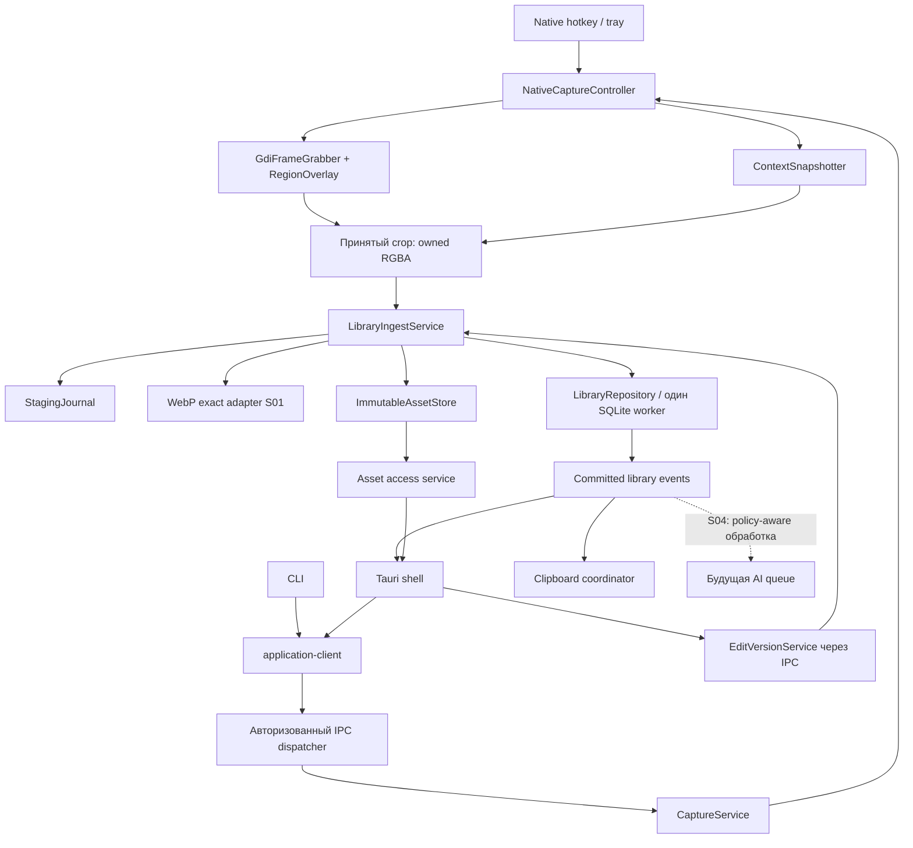
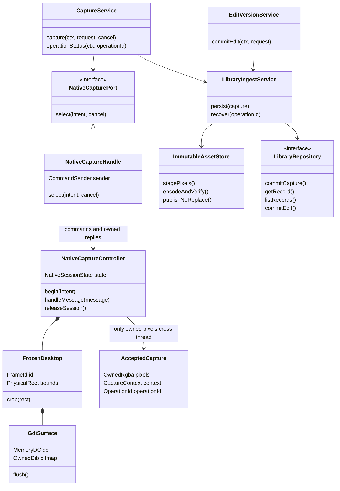
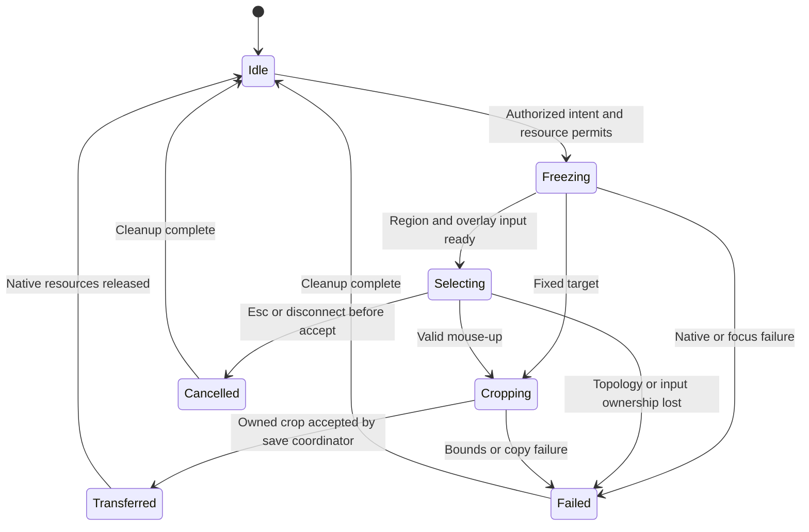
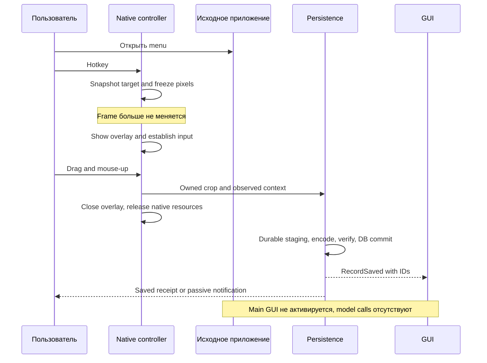
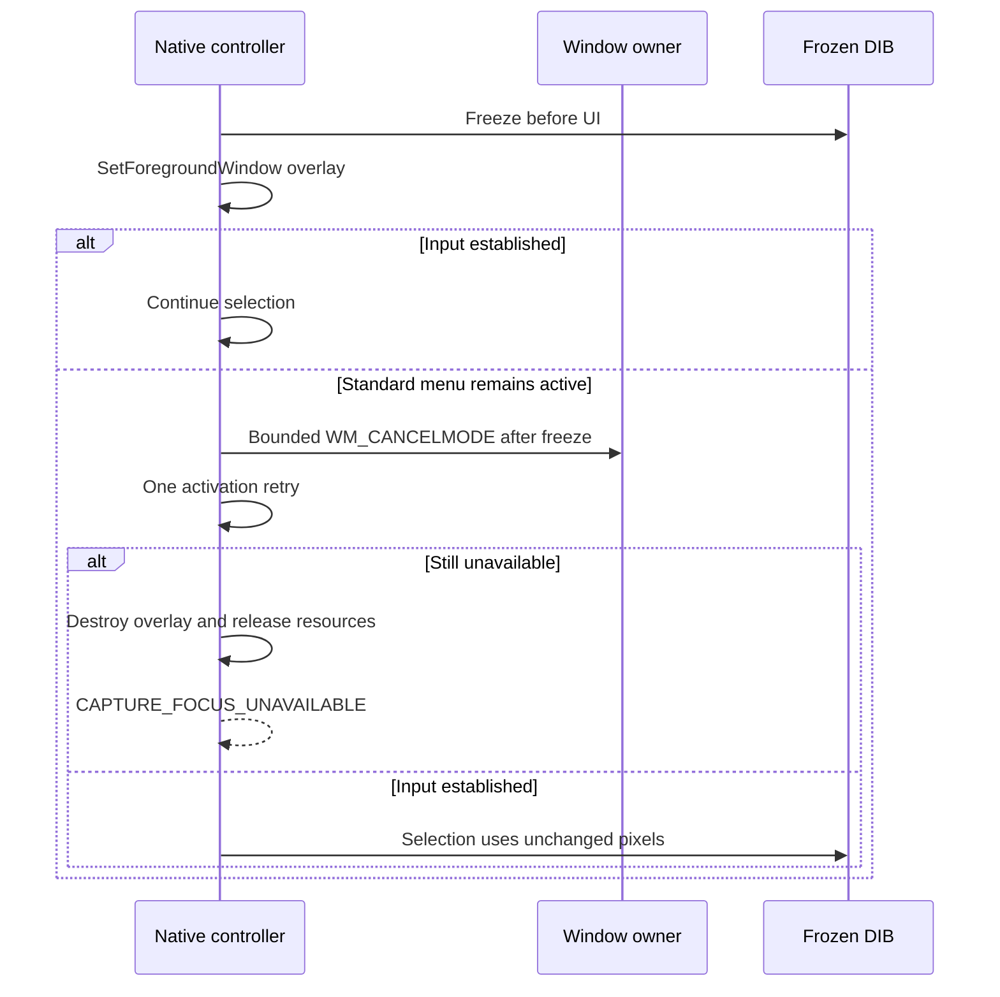
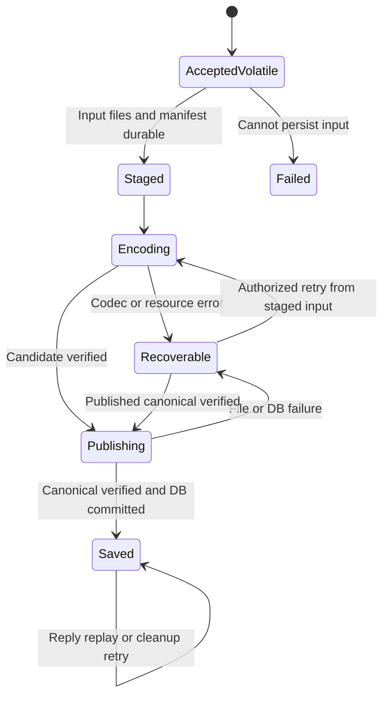
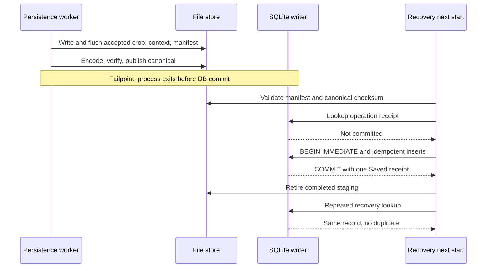
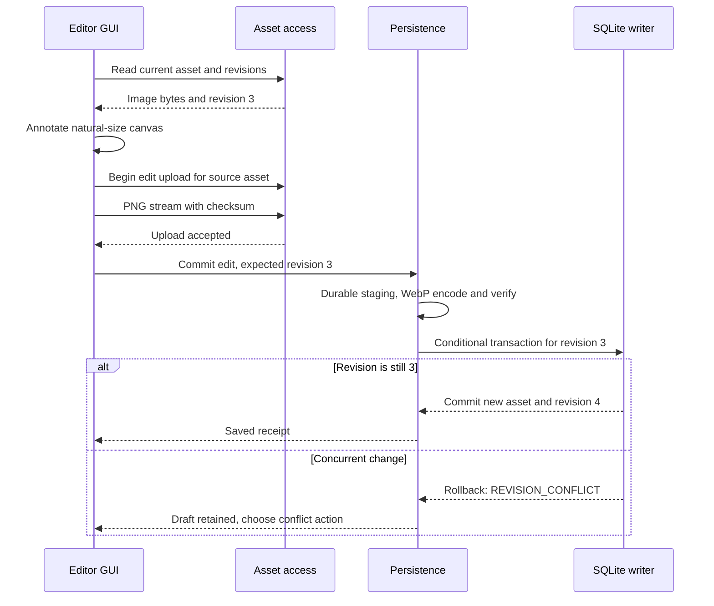
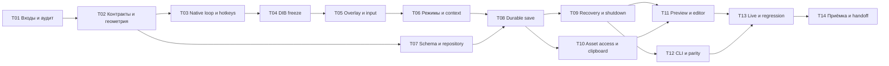

## S02: скриншот уже полезен, даже когда AI выключен 📸

Второй этап должен дать работающую Windows-утилиту: открыть меню, нажать хоткей, выделить его на замороженном экране, получить собственный сохранённый файл и снова открыть его после перезапуска. Для активного окна, текущего монитора и всего рабочего стола выделение не требуется. GUI показывает библиотеку, preview и редактор; CLI получает снимок через тот же host. Ни одна из этих операций не требует LM Studio.

Основная инженерная работа этапа — **правильно зафиксировать пиксели, не потерять происхождение изображения и не объявить сохранённым то, что существует только в памяти или clipboard**. AI, импорт папок и семантический поиск не должны заслонять этот фундамент.

Это **документ 2 из 8**, подчинённый master v3 и контрактам S01. Задачи `S02-T01…S02-T14` — внутренние части одного крупного этапа. Самостоятельные дополнительные планы сейчас не создаются. ADR, тестовые отчёты и manifests ниже — артефакты будущей реализации, а не ещё несколько планов этапов.

> [!important] Что является результатом подготовки этого файла
> Сверены master v3 и S01, перечитаны ключевые Windows-исходники закреплённого Inspector, проверены официальные контракты Win32, SQLite и WebP. Разработка приложения, сборка Windows, захват реального рабочего стола и аппаратные измерения не выполнялись. Численные бюджеты, сигнатуры и сценарии ниже — спецификация для исполнителя; незапущенные проверки имеют статус `NOT_RUN`.

### Навигация по документу 📚

| Раздел | Назначение |
|---|---|
| [1. Scope и входы S01](#scope) | Что реализуется, что передаётся следующим этапам, входные доказательства |
| [2. Аудит донора](#upstream) | Конкретные файлы, обнаруженные риски и решения о переносе |
| [3. Поведение захвата](#behavior) | Четыре режима, хоткей против GUI-клика, собственные окна, ограничения |
| [4. Архитектура](#architecture) | Компоненты, structs/traits, ownership и потоки |
| [5. Контракты и DTO](#contracts) | Команды, результаты, состояния, права, версии и ошибки |
| [6. Геометрия и контекст](#geometry) | Physical pixels, DPI, мониторы, принадлежность приложения |
| [7. Win32 capture adapter](#native) | DIB, overlay, event loop, focus, input и RAII |
| [8. Сохранение и recovery](#persistence) | Staging, canonical, commit, идемпотентность и сбои |
| [9. Схема SQLite](#database) | Миграция, ограничения, queries и транзакции |
| [10. Assets, preview и редактор](#assets) | Безопасное чтение, версии правок, clipboard и UI |
| [11. Минимальные интерфейсы](#interfaces) | GUI, tray, CLI и контракт будущего MCP |
| [12. Наблюдаемость](#observability) | События, метрики, безопасные логи и doctor |
| [13. Проверки и fixtures](#testing) | Unit, native, fault, integration, performance и mutation |
| [14. Задачи и коммиты](#tasks) | Четырнадцать исполняемых задач с результатами и зависимостями |
| [15. Команды проверки](#commands) | Windows scripts, отчёты, правила ненулевого exit |
| [16. Приёмка и handoff](#acceptance) | Gates, checklist, отчёт и конкретные входы S03–S07 |
| [17. Трассируемость и ADR](#traceability) | Master requirements → задачи → тесты → evidence |
| [18. Источники](#sources) | Внутренние планы и проверенные первичные документы |

<a id="scope"></a>
## 1. Scope S02 и обязательства перед следующими этапами 🎯

### 1.1. Запускаемый результат и граница готовности 📦

Выходная контрольная точка — `capture-library-alpha`. На целевой Windows x64 должны работать четыре capture-режима, собственная WebP-библиотека, метаданные, защищённое сохранение, повторное открытие, базовый список и preview, закрепление снимка, адаптированный редактор и CLI `capture/list/get`. Архитектурный владелец остаётся прежним: один пользовательский `shotd`, а GUI и CLI используют `application-client`. [PLAN-M], [PLAN-1]

| Входит в S02 | Не входит в S02, но остаётся обязательством продукта |
|---|---|
| Region / ActiveWindow / CurrentMonitor / AllMonitors | Рекурсивные папки и drop zone — S03 |
| Freeze до вмешательства UI, безопасная отмена, хоткеи | Production AVIF и выбор WebP/AVIF — S03; feasibility уже проверяется S01 |
| CaptureContext с датой, временем, target, sources и provenance | EXIF/XMP/GPS импортированных фото — S03 |
| Полноразмерный WebP exact lossless без скрытого resize | Общие export/resize 1000 и inference 1024/2048 — S03 |
| Records/assets, relative paths, staging и recovery | Durable AI queue, модели, KV/TTL — S04 |
| Preview/pin/editor на собственных immutable assets | OCR, описания, категории, ручные текстовые overrides — S05 |
| Минимальные GUI и CLI с тем же host | FTS5 + sqlite-vec + embeddings — S06; полный GUI/CLI/MCP — S07 |
| Логи, тесты, fault injection и evidence | Полный backup/restore/purge и установщик — S08 |

S02 не переносит AVIF или 2048 «на когда-нибудь». Они имеют конкретного владельца S03. В этом этапе нельзя показывать неработающий AVIF-переключатель или выдавать отсутствие реализации за fallback на WebP.

Полезные инструменты редактора донора сохраняются через отдельный адаптер. Если конкретный инструмент неисправен, дефект фиксируется; его нельзя незаметно удалить из интерфейса и отметить весь `CAP-06` проверенным. Полировка UI остаётся S07, но сохранность версий — уже S02.

### 1.2. Что принимается из первого этапа 🧷

| Вход | Минимальное доказательство перед началом production-работ |
|---|---|
| Master v3 и S01 | Версии и SHA256 совпадают с YAML этого плана либо оформлено согласованное изменение |
| `foundation-alpha` | Реальный accepted code commit, а не только наличие плана S01 |
| Windows toolchain | Environment manifest, locked Cargo/pnpm/native dependencies, рабочий build |
| Host и IPC | Один writer/root lock; `status`, `doctor`, auth, protocol fixtures и безопасный reconnect |
| Native thread | Рабочий message pump, dispatch/stop; нет фоновых model calls в native loop |
| Codec proof | Выбранный WebP exact adapter и его Windows round-trip; результаты AVIF proof для S03 |
| Donor audit | `upstream-map.md`, `capture-audit.json`, дефекты hotkey/focus/FFI/DPI |
| Качество | Fake clock/runtime, event sink, redaction, verify scripts, temporary-root fixtures |

Отсутствие фактического S01-report не запрещает проектировать S02, но **не позволяет исполнителю считать эти входы уже готовыми**. Пропущенный обязательный foundation gate помечается `BLOCKED`; восстанавливать архитектуру по догадке вместо проверки входного commit нельзя.

### 1.3. Непереговорные инварианты 🔒

**Пиксели раньше интерфейса.** Для hotkey-пути никакие `hide`, `show`, `activate`, synthetic clicks, model load, запись в SQLite или синхронный file log не предшествуют freeze. Допускаются только короткая проверка доступности и snapshot цели.

**Один снимок, один момент.** После выделения изображение вырезается из исходного frozen buffer. Позднее повторное чтение экрана для улучшения качества, контекста или удаления собственной панели запрещено.

**Одна библиотека, один writer.** UI не создаёт запись самостоятельно. `Saved` публикуется только после проверенного канонического файла и подтверждённой транзакции.

**Отмена не равна удалению.** Esc до принятия изображения отменяет capture. После принятия кадра закрытие preview, выход CLI и отключение GUI не удаляют изображение и не отменяют его сохранение.

**Канон не является кешем.** Ни preview, ни лимит истории, ни старый clipboard cleaner не владеют каноническим файлом. Пока нет явного разрешённого удаления, файл остаётся в библиотеке.

**Статические входы будущего AI — настоящие данные.** Время, приложение, title и геометрия имеют источник/момент наблюдения. Неизвестное приложение не превращается в последнее известное, а старый HWND не становится действующей командой.

<a id="upstream"></a>
## 2. Аудит Inspector и план переноса 🔬

### 2.1. Точка сравнения и проверенные участки 📌

Для сравнения используется исходный SHA `fa314915273e2cb91006fa284e5dd48fa90aff3a`. Для исполнения используется **новый accepted commit S01**. Это два разных значения: исходный SHA не является commit готового ScreenMemory.

При подготовке S02 прочитаны Windows-реализация `region_picker.rs`, `run_capture_pipeline` из `commands.rs` и Windows `tracking/os/windows.rs`. Остальные пути из S01 проверяются исполнителем на принятом code checkpoint; им не приписывается завершённый построчный аудит. [SRC-01], [SRC-02], [SRC-03]

| Исходный модуль / символ | Что использовать | Что изменить | Новое размещение |
|---|---|---|---|
| `region_picker.rs::win_impl` | Идею freeze → native overlay → crop | DIB/lifetimes, event loop, ошибки, bounds, независимость от Tauri | `platform-windows/capture/` |
| `commands.rs::run_capture_pipeline` | Карту существующих UI-связей | Не переносить старое hide-before-capture, cache/save semantics и history coupling | `application/capture.rs`, `application/library.rs` |
| `hotkey.rs` | Перечень shortcuts и UX | Единственный owner в native host; нет вызова всего donor popup | `platform-windows/capture/hotkeys.rs` |
| `screenshot_preview.rs` | Компоновку preview и pin | `Pending.path` заменить на committed RecordId/AssetId; закрытие не удаляет канон | Tauri preview adapter |
| `screenshot_editor.rs` и React editor | Annotation UX | Выход становится новой asset version; нет записи в Downloads/history вместо библиотеки | Edit service + UI adapter |
| `tracking/os/windows.rs::frontmost` | Win32-сведения о PID/EXE/title | Не запускать tracker; bounded path buffer, timestamps, null/provenance | `platform-windows/context/` |
| `db.rs`, `models.rs` | Только reference поведения донора | Не использовать clipboard schema, base64 payload и prune по 1000 | Новая миграция S02 |

### 2.2. Дефекты и риски, требующие конкретных действий 🧯

| Наблюдение в исходнике | Почему важно | Решение S02 и проверка |
|---|---|---|
| До `mode.capture()` вызывается `hide_popup` | Фокус/меню могли измениться ещё до правильного picker | Native hotkey вызывает новый controller без этого шага; `S02-CAP-01` |
| У ряда GDI-вызовов результат игнорируется | Ошибка может выглядеть как пустое/чёрное изображение с успехом | Типизированный error mapping для каждого acquisition/blit; `S02-FFI-01` |
| `GetDIBits` вызван до восстановления ранее выбранного bitmap | Документация требует, чтобы bitmap не был выбран в DC при этом вызове | Новый путь через top-down DIB section; временный DDB-fallback исправляет deselect; `S02-FFI-02` [SRC-04] |
| `GetMessageW(...).as_bool()` не различает −1 и положительный результат | Ошибка очереди может не завершить loop корректно | Разбирать три исхода отдельно; `S02-NAT-02` [SRC-05] |
| `PostQuitMessage` используется для окончания выделения | В долгоживущем native thread это завершит весь message pump | Окончание session через собственное событие; WM_QUIT только для shutdown |
| Cleanup находится в конце функции после fallible `CreateWindowExW` | Ранний выход обходит ручное освобождение ресурсов | RAII/единый session cleanup; negative cases на каждой точке отказа |
| PNG/temp name содержит время до секунды | Несколько действий могут адресовать один файл | UUID для operation/record/asset; timestamp не является ключом |
| Pinned branch удаляет temp, опираясь на комментарий о history | Из комментария нельзя вывести доказанное постоянное сохранение | Сначала canonical+DB; preview вообще не участвует в сохранности |
| `frontmost()` использует ограниченный buffer пути и не хранит наблюдение | Long path/исчезнувший процесс дают неполные сведения | Bounded retry buffer и явное missing/denied/stale |

Пункты про pin и history описывают **необходимость проверки**, а не объявляют доказанную потерю данных во всём Inspector. Участок pipeline проверен, но глобальное взаимодействие clipboard watcher и других модулей не исполнялось. Для нового продукта неопределённость устраняется собственным контрактом сохранности. [SRC-02]

> [!note] Перенос и исправление — разные commits
> Механическое извлечение native-кода выполняется отдельно от изменения DIB, message loop и file commit. Это позволяет reviewer понять, какая строчка действительно изменила поведение.

<a id="behavior"></a>
## 3. Пользовательское поведение: четыре режима без неоднозначностей 🪟

### 3.1. Семантика цели 📐

| Режим | Цель | Что сохраняется | Не обещается |
|---|---|---|---|
| `region` | Прямоугольник, выбранный на замороженном desktop | Ровно crop из первого кадра | Автоматическое определение смысла картинки на этом этапе |
| `window` | Зафиксированное активное внешнее окно; при явном GUI-вызове — проверенная последняя внешняя цель | Видимый экранный прямоугольник окна, обрезанный к desktop | Восстановление закрытых другими окнами пикселей; popup вне rect |
| `monitor` | Монитор под курсором в момент capture | Весь `rcMonitor`, включая taskbar, не только work area | Скрытая подмена на основной монитор |
| `desktop` | Bounding rectangle всех подключённых дисплеев | Общая картинка; геометрические промежутки детерминированы | Аппаратно атомарный снимок всех мониторов в один scanout |

Для `window` основной rect берётся через `DwmGetWindowAttribute(DWMWA_EXTENDED_FRAME_BOUNDS)`, при недоступности — `GetWindowRect` с указанием fallback. Первый способ исключает невидимые resize borders, а `GetWindowRect` подвержен DPI virtualization; масштабировать DWM bounds повторно нельзя. [SRC-06]

Промежутки между мониторами заполняются непрозрачным чёрным и помечаются как `non_display_regions`. При зеркальном расположении пересекающиеся monitor rects не удваивают размер. Shadow и скруглённые углы не вырезаются в прозрачную фигуру: контракт S02 — прямоугольный видимый снимок.

`window` не сводит цель к корневому owner автоматически: активное отдельное диалоговое окно остаётся отдельной целью. Owner chain используется для атрибуции приложения, а не для незаметного расширения изображения до главного окна.

### 3.2. Хоткей, GUI и CLI — разные моменты наблюдения ⏱️

**Хоткей:** цель и пиксели фиксируются непосредственно в native dispatcher. Нельзя сначала открыть наш поиск, а затем искать прежнее активное приложение.

**Кнопка GUI/tray:** уже состоявшийся клик мог закрыть меню чужой программы. Этот факт нельзя исправить очередным API. Для `window` используется последний наблюдённый внешний target после проверки его живой identity; собственное окно скрывается только в явно выбранном GUI-flow, затем цель наблюдается заново. Такой flow не маркируется `hotkey_preserving` и не получает обещание сохранения меню до клика.

**CLI:** активным может оказаться терминал, из которого выполнена команда. Это честный результат режима `window`. S02 не принимает исторический `--hwnd` и не выбирает произвольное окно по одному названию процесса. Для иной цели в будущем применяется выданный host короткоживущий target token с правами.

Одинаковая core-логика не требует скрывать различия инициаторов. `CaptureContext.trigger` и `target_resolution` сохраняют выбранную семантику. Клиент не может объявить себя native hotkey простой строкой аргумента; trigger устанавливает доверенный host adapter.

### 3.3. Собственные окна приложения и первичный кадр 🪞

Исходное правило S02 — **видимое на экране входит в freeze**, включая собственный старый preview, если он перекрывает область. Нельзя скрывать панели до hotkey-freeze ради красивой картинки: это разрушает исходное требование. Сам новый selection overlay не попадёт в кадр, потому что появится позже.

Исключение собственных top-level окон через `WDA_EXCLUDEFROMCAPTURE` допускается как отдельно проверенный режим, не как гарантия GDI и не как обязательный silent default. API применяется только к окнам собственного процесса; следовательно, host не «исключает» Tauri-окно одним произвольным HWND — действие должно выполнить его owner. [SRC-07]

В S02 не реализуется дорисовка перекрытых пикселей из другого кадра. Пользователь может закрыть старый preview **до открытия нужного меню**; закрытие preview не удаляет сохранённую картинку.

### 3.4. Настройки без захвата чужих сочетаний клавиш ⌨️

Все четыре capture action доступны в tray и CLI. В исходном профиле предлагается `Ctrl+Shift+S` для области; остальные хоткеи могут оставаться неназначенными до выбора пользователя. Это уменьшает вероятность присвоить привычные команды редактора или браузера. Уже обсуждавшиеся `Ctrl+Shift+W/F/M` — примеры, не обязательные безусловные defaults.

Hotkey registry использует `RegisterHotKey` и `MOD_NOREPEAT`, проверяет результат и владеет unregister. Повтор физически удержанной клавиши не размножает capture. F12 и зарезервированные системные комбинации не предлагаются как надёжные назначения. [SRC-08]

При переназначении одного action новая комбинация сначала регистрируется под временным slot, старая сохраняется. Затем транзакционно записывается setting; при успехе старая снимается, при ошибке новая отменяется. Конфликт с другим приложением не маскируется статусом «сохранено». Swap двух внутренних bindings — отдельная сериализованная операция с rollback, не последовательность двух случайных unregister.

### 3.5. Границы поддержки и отказ без обмана 🛡️

При закрытой/неинтерактивной сессии, secure desktop, недоступной цели или сбое GDI возвращается объяснимый отказ. Приложение не повышает себе права, не обходит DRM и не отключает защиту контента. Чёрные пиксели могут быть настоящей картинкой; нельзя объявлять весь чёрный кадр ошибкой или, наоборот, по успешному `BitBlt` обещать отсутствие защищённых областей.

S02 принимает SDR-путь. HDR-состояние, если обнаружено, отражается предупреждением `COLOR_NOT_CERTIFIED`; неподдержанный режим может быть отклонён до обещания корректных цветов. GDI-blit сам не выполняет ICM color management. Архивную точность HDR или wide-gamut S02 не заявляет. [SRC-09]

> [!important] «Любое меню» — цель UX, а не доказанный результат всех приложений
> Приёмка идёт по конкретной native/browser/Electron/IDE-матрице. Если обязательный case не сохраняет меню или первый drag теряется, этап не получает PASS только потому, что другая программа работает.


<a id="architecture"></a>
## 4. Архитектура: capture не проходит через React 🧱

### 4.1. Компоненты и владельцы 🧩



`CaptureService` и native controller не дублируют сценарий. Service авторизует запрос, определяет options и idempotency; controller выполняет короткую OS-сессию. Для настоящего hotkey те же application policies доступны как заранее проверенный snapshot в памяти, поэтому native callback не ждёт RPC к самому себе и SQL до freeze.

Сам `LibraryIngestService` не показывает окна. Возврат `SavedReceipt` может уведомить GUI, но успешность сохранения не зависит от того, запущен ли GUI и прочитал ли он event.

### 4.2. Structs/traits и lifetime 🧬



`HDC`, `HBITMAP`, `HWND`, selection guards и window state живут в native thread. После выбора наружу передаются owned bytes и обычные значения. Нельзя объявить `unsafe impl Send` для всего frozen frame ради удобства отправки в async task. DIB освобождается после завершения использования overlay; frame памяти не хранится до запуска модели.

### 4.3. Разделение потоков и ресурсные бюджеты 🧵

| Исполнитель | Работа | Что запрещено |
|---|---|---|
| Native thread из S01 | WM_HOTKEY, freeze, overlay, mouse/key events, короткие Win32 context calls | SQL, encode WebP, network, длительный sleep, загрузка модели |
| Tokio tasks | IPC, orchestration, ожидание результатов, bounded progress | Блокирующий file/codec вызов без выноса на worker |
| Один ingest/codec worker S02 | Staging, WebP, проверка, запись файлов | Неограниченное параллельное декодирование |
| SQLite worker S01 | Короткие транзакции, reads, commit guards | Ожидание пользователя или модели под транзакцией |
| GUI/WebView | Список, preview, zoom и annotation canvas | Прямой SQL, самостоятельное сохранение канона, SDK |

Одновременно допускается **одна native capture session** и до **двух принятых save-операций**, включая исполняемую. Слот сохранения резервируется неблокирующе до freeze. Если слотов или memory permits нет, новый hotkey получает `CAPTURE_BACKPRESSURE` без открытия overlay и без постановки «снимка текущего окна» на очередь через неизвестное время.

Глобальный лимит управляемых decoded buffers наследуется из master: 1 GiB. Дополнительно действуют 96 MP и реальные пределы выбранного кодека. DIB, crop, encoder working set и decode-verification учитываются по пиковым фазам, а не только по размеру итогового WebP. Приёмка проверяет наблюдаемую память и permit accounting отдельно: лимит внутренних буферов не является обещанием лимита RSS процесса.

Слот не удерживает native loop до окончания WebP. После копирования crop и безопасной передачи ownership native session освобождается; следующий capture разрешается при наличии второго слота. Большой frozen desktop не дублируется ради thumbnail, editor или будущего AI.

### 4.4. Целевая структура добавляемого кода 📂

```text
crates/
  domain/src/
    capture/{geometry.rs, context.rs, state.rs}
    library/{record.rs, asset.rs, operation.rs, revisions.rs}
  application/src/
    capture.rs
    library/{ingest.rs, reads.rs, recovery.rs, edit.rs}
    assets.rs
    ports/{capture.rs, image_codec.rs, file_store.rs, library_repository.rs}
  platform-windows/src/
    capture/{mod.rs, controller.rs, gdi.rs, overlay.rs, input.rs, handles.rs}
    context/{windows.rs, monitors.rs, attribution.rs}
    hotkeys.rs
    clipboard.rs
  infrastructure/src/
    files/{paths.rs, journal.rs, publish.rs, cache.rs}
    images/{webp.rs, thumbnail.rs}
    sqlite/library_repository.rs
  protocol/src/{capture.rs, library.rs, assets.rs}
  application-client/src/{capture.rs, library.rs, assets.rs}
  host/src/dispatch/{capture.rs, library.rs, assets.rs}
app/frontend/src/features/
  capture/
  library-basic/
  screenshot-preview/
  screenshot-editor/
migrations/0002_capture_library.sql
tests/{capture/, library/, faults/, windows/, contracts/}
```

Имена модулей уточняют S01; физическое разбиение crates не увеличивается без реальной причины. Старые `commands.rs` на тысячи строк не воспроизводятся. UI adapter содержит только DTO validation, вызов client и преобразование состояния для отображения.

<a id="contracts"></a>
## 5. Контракты S02, права и семантика завершения 📐

### 5.1. Совместимость с S01 🔌

Application protocol расширяется с `1.0` до **`1.1`** с capability negotiation; bridge protocol не меняется. Старые status/doctor сохраняют поведение. Клиент, не согласовавший capture/library capabilities, получает `METHOD_NOT_SUPPORTED`, а не объект другой формы.

Общие `RequestContext`, `AppError`, IDs и правила сериализации остаются из S01. Внутренние revisions — целые, допустимые для SQLite; **на wire все revisions и 64-bit sequence/byte counters идут десятичными строками**, чтобы TypeScript не терял точность. Width/height и ограниченные счётчики — проверенные числа. HWND хранится только как диагностическая hex-строка, не как исполняемый параметр API.

Сигнатуры ниже — проектные публичные контракты ScreenMemory. Они не являются существующими методами Inspector. Полные Rust modules, schema generation и compile checks создаются в S02-T02; производственные реализации здесь не утверждаются.

### 5.2. Capture DTO и результаты 🔧

```rust
use async_trait::async_trait;
use serde::{Deserialize, Serialize};
use tokio_util::sync::CancellationToken;
use uuid::Uuid;
use crate::{RequestContext, AppError}; // общие типы S01

pub type OperationId = Uuid;
pub type RecordId = Uuid;
pub type AssetId = Uuid;
pub type SessionId = Uuid;

#[derive(Clone, Copy, Serialize, Deserialize)]
#[serde(rename_all = "snake_case")]
pub enum CaptureMode { Region, Window, Monitor, Desktop }

#[derive(Clone, Copy, Serialize, Deserialize)]
#[serde(rename_all = "snake_case")]
pub enum TargetPolicy { ForegroundAtExecution, LastExternalWindow }

#[derive(Clone, Copy, Serialize, Deserialize)]
#[serde(rename_all = "snake_case")]
pub enum ClipboardIntent { FollowSettings, Copy, Skip }

#[derive(Clone, Serialize, Deserialize)]
#[serde(deny_unknown_fields)]
pub struct CaptureRequest {
    pub operation_id: OperationId,
    pub mode: CaptureMode,
    pub target_policy: TargetPolicy,
    pub clipboard: ClipboardIntent,
}

#[derive(Clone, Serialize, Deserialize)]
#[serde(tag = "status", rename_all = "snake_case")]
pub enum CaptureOutcome {
    Saved { receipt: SavedReceipt },
    Cancelled { operation_id: OperationId, reason: CancelReason },
}

#[derive(Clone, Copy, Serialize, Deserialize)]
#[serde(rename_all = "snake_case")]
pub enum CancelReason { Escape, EmptySelection, ExplicitRequest, ClientDisconnected }

#[derive(Clone, Serialize, Deserialize)]
pub struct SavedReceipt {
    pub operation_id: OperationId,
    pub record_id: RecordId,
    pub asset_id: AssetId,
    pub record_revision: String,
    pub asset_revision: String,
    pub canonical_mime: String,
    pub width: u32,
    pub height: u32,
    pub byte_size: String,
    pub canonical_sha256: String,
    pub library_event_seq: String,
    pub warnings: Vec<String>,
}

#[async_trait]
pub trait CaptureApi: Send + Sync {
    async fn capture(
        &self, ctx: RequestContext, request: CaptureRequest,
        cancel: CancellationToken,
    ) -> Result<CaptureOutcome, AppError>;

    async fn operation_status(
        &self, ctx: RequestContext, operation_id: OperationId,
    ) -> Result<CaptureOperationView, AppError>;
}

#[derive(Clone, Serialize, Deserialize)]
pub struct CaptureOperationView {
    pub operation_id: OperationId,
    pub state: OperationState,
    pub durable_input: bool,
    pub saved_receipt: Option<SavedReceipt>,
    pub safe_error_code: Option<String>,
}

#[derive(Clone, Copy, Serialize, Deserialize)]
#[serde(rename_all = "snake_case")]
pub enum OperationState {
    Selecting, AcceptedVolatile, Staged, Encoding, Publishing,
    Saved, Recoverable, Failed, Cancelled,
}
```

`LastExternalWindow` допустим только для `window` и авторизованной локальной UI-команды; для прочих mode возвращается `INVALID_CAPTURE_OPTIONS`. Право не выдаётся через поле `target_policy`. Hotkey использует `ForegroundAtExecution`; host сам определяет доверенный trigger.

`SavedReceipt` не содержит абсолютный путь по умолчанию. Paths запрашиваются через разрешённый `get`, иначе `read_metadata` случайно раскрывал бы структуру пользовательского диска.

Ошибка возвращается в общем error envelope S01. Recoverable состояние хранится за `operation_id` и показывается через status; наличие staged input **не превращает ошибку канонизации в `Saved`**. Для повторной попытки используется `capture.retry_save`, не повторный снимок экрана.

### 5.3. Геометрические значения и принятый кадр 🧬

```rust
use std::sync::Arc;
use uuid::Uuid;

#[derive(Clone, Copy, Debug, PartialEq, Eq)]
pub struct PhysicalPoint { pub x: i32, pub y: i32 }

#[derive(Clone, Copy, Debug, PartialEq, Eq)]
pub struct PhysicalRect {
    pub x: i32,
    pub y: i32,
    pub width: u32,
    pub height: u32,
}

pub struct OwnedRgba {
    pub width: u32,
    pub height: u32,
    pub stride: usize,
    pub bytes: Vec<u8>,
}

pub struct AcceptedCapture {
    pub operation_id: Uuid,
    pub record_id: Uuid,
    pub asset_id: Uuid,
    pub frame_id: Uuid,
    pub pixels: OwnedRgba,
    pub context: CaptureContext,
    pub settings_revision: u64,
}

pub struct CapturedTime {
    pub frozen_at_utc: chrono::DateTime<chrono::Utc>,
    pub local_offset_minutes: i16,
    pub freeze_duration_us: u64,
    pub native_queue_delay_us: Option<u64>,
}

pub struct CaptureContext {
    pub schema_version: u16,
    pub mode: CaptureMode,
    pub trigger: CaptureTrigger,
    pub time: CapturedTime,
    pub desktop_bounds: PhysicalRect,
    pub target_bounds: Option<PhysicalRect>,
    pub selected_bounds: PhysicalRect,
    pub topology_id: String,
    pub monitors: Vec<MonitorSnapshot>,
    pub foreground: Option<WindowObservation>,
    pub sources: Vec<WindowObservation>,
    pub attribution: Attribution,
    pub warnings: Vec<String>,
}

pub enum CaptureTrigger { NativeHotkey, LocalGui, LocalTray, Cli }
pub enum Attribution { ConfirmedTarget, GeometricDominant, Multiple, Unknown }

pub struct MonitorSnapshot {
    pub key: String,
    pub rect: PhysicalRect,
    pub dpi_x: Option<u32>,
    pub dpi_y: Option<u32>,
    pub is_primary: bool,
}

pub struct WindowObservation {
    pub observation_id: Uuid,
    pub observed_at_utc: chrono::DateTime<chrono::Utc>,
    pub phase: ObservationPhase,
    pub diagnostic_hwnd: String,
    pub pid: u32,
    pub process_started_at_utc: Option<chrono::DateTime<chrono::Utc>>,
    pub process_name: Option<String>,
    pub executable_path: Option<std::path::PathBuf>,
    pub window_title: Option<String>,
    pub rect: PhysicalRect,
    pub app_identity: Option<String>,
    pub freshness: ObservationFreshness,
}

pub enum ObservationPhase { BeforeFreeze, AfterFreezeBeforeOverlay, AfterSelection }
pub enum ObservationFreshness { Consistent, BestEffort, Stale, Unavailable }
```

Этот блок находится в domain/application modules и использует общие `CaptureMode`; `Arc` применим для неизменяемых metadata, но pixels передаются перемещением. Наличие `PathBuf` в internal context не требует отправлять путь всем клиентам: DTO projection выполняется в host с проверкой прав.

`OwnedRgba` имеет конструктор с проверкой `width,height>0`, `stride>=width*4`, длины и overflow. Для нормализованного input сохранения S02 используется packed RGBA со stride `width*4`. Деструктор обычного Vec освобождает собственную память; pointer на GDI memory нельзя превращать в такой Vec.

### 5.4. Library API и запись новой версии 🗃️

```rust
#[derive(Clone, Serialize, Deserialize)]
#[serde(deny_unknown_fields)]
pub struct ListRecordsRequest {
    pub limit: u16,
    pub cursor: Option<String>,
    pub application_id: Option<Uuid>,
}

#[derive(Clone, Serialize, Deserialize)]
#[serde(deny_unknown_fields)]
pub struct GetRecordRequest {
    pub record_id: RecordId,
    pub include_paths: bool,
    pub include_capture_context: bool,
}

#[derive(Clone, Serialize, Deserialize)]
pub struct RecordSummary {
    pub id: RecordId,
    pub title: String,
    pub captured_at_utc: Option<String>,
    pub ingested_at_utc: String,
    pub current_asset_id: AssetId,
    pub width: u32,
    pub height: u32,
    pub record_revision: String,
    pub asset_revision: String,
}

#[derive(Clone, Serialize, Deserialize)]
pub struct RecordPage {
    pub items: Vec<RecordSummary>,
    pub next_cursor: Option<String>,
    pub snapshot_seq: String,
}

#[derive(Clone, Serialize, Deserialize)]
pub struct RecordView {
    pub summary: RecordSummary,
    pub canonical_asset_id: AssetId,
    pub assets: Vec<AssetView>,
    pub capture_context: Option<serde_json::Value>,
    pub canonical_path: Option<String>,
    pub current_asset_path: Option<String>,
}

#[derive(Clone, Serialize, Deserialize)]
pub struct AssetView {
    pub id: AssetId,
    pub role: String,
    pub mime: String,
    pub width: u32,
    pub height: u32,
    pub byte_size: String,
    pub sha256: String,
    pub integrity_state: String,
}

#[derive(Clone, Serialize, Deserialize)]
#[serde(deny_unknown_fields)]
pub struct CommitEditRequest {
    pub operation_id: OperationId,
    pub record_id: RecordId,
    pub source_asset_id: AssetId,
    pub expected_record_revision: String,
    pub expected_asset_revision: String,
    pub upload_id: Uuid,
    pub make_current: bool,
}

#[async_trait]
pub trait LibraryApi: Send + Sync {
    async fn list_records(&self, ctx: RequestContext, req: ListRecordsRequest)
        -> Result<RecordPage, AppError>;
    async fn get_record(&self, ctx: RequestContext, req: GetRecordRequest)
        -> Result<RecordView, AppError>;
    async fn commit_edit(&self, ctx: RequestContext, req: CommitEditRequest)
        -> Result<SavedReceipt, AppError>;
    async fn retry_save(&self, ctx: RequestContext, operation_id: OperationId)
        -> Result<CaptureOperationView, AppError>;
}
```

`captured_at_utc` в общей карточке nullable для будущего импорта; для S02 screenshot он всегда заполнен. У перечислений MIME/role/integrity и capture-context должен быть закрытый schema vocabulary; `String`/`Value` в сокращённой проекции выше не означает принятия произвольного JSON из WebView. Generated schema включает отдельную `CaptureContextView` с фильтруемыми чувствительными полями.

`title` S02 — технический fallback, не AI-описание: тип снимка, время и подтверждённый app label при наличии. AI/user text fields будут отдельной миграцией S05. `content_revision` резервируется в record, но индекс и embeddings на этом этапе не создаются.

### 5.5. Внутренние порты и транзакционные границы 🧰

```rust
#[async_trait]
pub trait NativeCapturePort: Send + Sync {
    async fn select(
        &self, intent: NativeCaptureIntent, cancel: CancellationToken,
    ) -> Result<NativeSelection, CaptureError>;
}

pub enum NativeSelection {
    Accepted(AcceptedCapture),
    Cancelled(CancelReason),
}

#[async_trait]
pub trait CapturePersistence: Send + Sync {
    async fn persist(&self, input: AcceptedCapture)
        -> Result<SavedReceipt, PersistenceError>;
    async fn recover(&self, operation_id: OperationId)
        -> Result<RecoveryOutcome, PersistenceError>;
}

// Worker-facing порт: вызывается только внутри выделенного SQLite worker.
pub trait CaptureRepository {
    fn commit_new_capture(&mut self, cmd: CommitNewCapture)
        -> Result<CommittedRecord, StorageError>;
    fn commit_edited_asset(&mut self, cmd: CommitEditedAsset)
        -> Result<CommittedRecord, StorageError>;
    fn lookup_operation(&mut self, principal: Uuid, operation_id: OperationId)
        -> Result<Option<StoredOperation>, StorageError>;
}
```

Служебные типы `NativeCaptureIntent`, `CommitNewCapture`, `CommitEditedAsset`, `StoredOperation`, `CommittedRecord`, `RecoveryOutcome` описывают payload соответствующих алгоритмов §§6–9 и объявляются вместе с их реализацией. `NativeCapturePort` — Send+Sync facade, **не** разрешение перемещать GDI handles: facade отправляет сообщения thread-confined controller и получает owned result.

Для файловых операций и codec есть cancellation до commit boundary. Сам confirmed commit не откатывается из-за разрыва UI. Долгий save не удерживает SQL transaction: она начинается лишь с готовым проверенным asset.

### 5.6. Новые права и ошибки 🚦

| Capability/scope | Операции |
|---|---|
| `capture_screen` | Новый захват, просмотр собственной незавершённой capture operation |
| `read_metadata` | list/get basic fields |
| `read_images` | Чтение принадлежащего записи asset/preview |
| `read_paths` | Canonical/current absolute path; исходных файлов в S02 ещё нет |
| `read_source_metadata` | Подробный context с EXE path/диагностическими полями |
| `write_image_versions` | Commit новой редакторской версии |
| `manage_capture` | Hotkeys, preview/clipboard preferences |
| `recover_library` | Явный retry сохранения и разрешённые recovery actions |

Native hotkey действует как заранее enrolled local-owner action. Добавление scope не выдаёт его существующему read-only principal автоматически. Все права проверяются host. Новые UI-кнопки не заменяют эту проверку.

| Код | Семантика / ожидаемое поведение |
|---|---|
| `CAPTURE_BUSY`, `CAPTURE_BACKPRESSURE` | Нет второго overlay и отложенного capture другой сцены |
| `CAPTURE_TARGET_LOST`, `CAPTURE_UNAVAILABLE` | Цель исчезла или среда недоступна; другой HWND не подставляется |
| `CAPTURE_TOPOLOGY_CHANGED` | Геометрия изменилась во время выбора; требуется новый сознательный capture |
| `CAPTURE_FOCUS_UNAVAILABLE` | Overlay не получил управляемый input; никакого невидимого зависания |
| `CAPTURE_GDI_FAILED` | Ошибка конкретного native шага, safe phase + numeric OS code |
| `IMAGE_LIMIT_EXCEEDED`, `CANONICAL_SIZE_UNSUPPORTED` | Не уменьшается исходник тайно и не создаётся повреждённый файл |
| `STORAGE_FULL`, `STORAGE_PERMISSION_DENIED` | Не показывается Saved; при принятом staging доступен retry |
| `ASSET_INTEGRITY_FAILED` | Файл не совпадает с принятым asset, не подменяется новой пустой картинкой |
| `IDEMPOTENCY_CONFLICT` | Повтор operation ID с другими смысловыми параметрами |
| `OPERATION_STATE_UNKNOWN` | Нет доказательств завершения; автоматический новый capture запрещён |
| `REVISION_CONFLICT` | Исходная версия редактора устарела; current не перезаписывается |
| `ASSET_NOT_FOUND`, `ASSET_TRANSFER_EXPIRED` | Явная ошибка чтения/трансфера, не чёрный preview |
| `WAIT_TIMEOUT` | Клиент перестал ждать; durable save может продолжаться |

Предварительный численный Win32 code не логируется через сырой текст исключения с path/window title. Error envelope S01 остаётся стабильным; operation ID можно получить из запроса/безопасного ответа и отдельно проверить состояние.


<a id="geometry"></a>
## 6. Геометрия, DPI и происхождение снимка 📐

### 6.1. Единственная система координат capture 🗺️

Внутри capture все координаты означают **физические пиксели виртуального рабочего стола**. CSS-пиксели Tauri, DIP и размеры React-компонента сюда не передаются. `PhysicalRect` задаётся полуоткрытым диапазоном `[x, x + width) × [y, y + height)`; отрицательные `x/y` допустимы, нулевые размеры результата — нет.

Преобразование global → buffer выполняется ровно один раз: из глобальных координат вычитается origin frozen desktop. Масштаб Windows 150% не означает дополнительное умножение уже физических координат на 1,5.

| Объект примера | Геометрия |
|---|---|
| Левый 4K-монитор | `(-3840, 0, 3840, 2160)` |
| Правый основной 4K-монитор | `(0, 0, 3840, 2160)` |
| Frozen desktop | `(-3840, 0, 7680, 2160)` |
| Глобальное выделение | От `(-2400, 200)` до `(-1400, 800)` |
| Rect в frozen buffer | `(1440, 200, 1000, 600)` |
| Сохранённое изображение | `1000 × 600`, без масштабирования |

Алгоритм выделения сначала сортирует endpoints, затем пересекает прямоугольник с desktop bounds и только после этого вычисляет размеры. Независимый clamp координат и первоначальной ширины недопустим: при выходе курсора за левый край он может дать слишком широкую область.

```text
left   = max(min(start_x, end_x), desktop_left)
top    = max(min(start_y, end_y), desktop_top)
right  = min(max(start_x, end_x), desktop_right)
bottom = min(max(start_y, end_y), desktop_bottom)

если right <= left или bottom <= top: EmptySelection
width  = right - left
height = bottom - top
buffer_x = left - desktop_left
buffer_y = top  - desktop_top
```

Вычисления сумм, разностей и размеров буферов выполняются проверенной арифметикой как минимум `i64/u64`; преобразование к Win32 `i32` и `usize` — после проверки диапазона. `abs(i32::MIN)` и переполнение `width * height * 4` не должны приводить к panic или малому allocation с последующей записью за пределы.

### 6.2. DPI-awareness и конфигурация дисплеев 🪟

Для `shotd` выбирается manifest `PerMonitorV2`; он применяется **до создания скрытого utility window и overlay**. GUI имеет собственную корректную DPI-конфигурацию. Microsoft рекомендует задавать default awareness через manifest; попытка поменять его после появления окон не является надёжной исправляющей мерой. [SRC-10]

`DisplayTopology` содержит snapshot monitor rects, effective DPI, primary flag и hash нормализованной геометрии. `HMONITOR` не становится постоянным ID библиотеки: сохраняется собственный monitor key плюс наблюдённые свойства. Для `CurrentMonitor` используется точка курсора при начале операции и `MonitorFromPoint` с политикой явного отсутствия результата, а не автоматического выбора primary. [SRC-11]

Геометрия обновляется при display-change событиях. Перед freeze проверяется применимость кеша; после freeze сохраняется именно использованный snapshot. Если экран отключён или перестроен **до принятия выделения**, операция завершается `CAPTURE_TOPOLOGY_CHANGED`. Если кадр уже принят, его сохранение продолжается с прежней геометрией.

`WM_DPICHANGED` не даёт права растянуть виртуальный canvas как обычное окно по suggested rect. Native adapter повторно проверяет topology: при неизменной физической геометрии можно обновить размеры шрифта подсказки, при изменённой — безопасно отменить выбор. Окончательная crop-геометрия никогда не вычисляется из размеров растянутого preview.

В initial native adapter координаты mouse message извлекаются как signed значения, а не через unsigned LOWORD/HIWORD. Для canvas с гранью более 32767 вводится явный `CAPTURE_UNAVAILABLE` до overlay, пока отдельный проверенный input path не устранит 16-bit ограничение mouse LPARAM; PNG/WebP-лимит и это ограничение — разные проверки. Для сверхширокого virtual desktop необходимо проверить лимиты native canvas и WebP. В S02 нельзя сохранить WebP с гранью больше 16383; запрещено молча уменьшить все мониторы до поддержанного размера. Для Region маленький итоговый crop может быть допустим при более широком framebuffer, если сам capture backend и memory guards способны его обработать. [SRC-12]

### 6.3. Какие метаданные собираются до и после freeze ⏱️

| Фаза | Допустимые действия | Что специально исключается |
|---|---|---|
| До freeze | Timestamp, cursor, foreground HWND/PID, target rect, topology, короткая проверка ресурсов | EXE metadata, UIA, OCR, DB, сеть, model load, синхронный file log |
| После freeze, до overlay | Ограниченный window geometry snapshot и доступный caption цели | Обход всего дерева accessibility и чтение всех процессов |
| После выделения | Уточнение только относящихся к снимку process/path/title данных | Повторный снимок рабочего стола и изменение старых пикселей |
| При сохранении | UTC/offset, provenance, nullable поля, схема контекста | Подмена отсутствующей информации «последним известным значением» |

Свойства окна и пиксели нельзя получить одной общей транзакцией ОС. Поэтому у каждого `WindowObservation` есть `observed_at`, фаза и `freshness`. `captured_at` относится к freeze, а `ingested_at` — к committed библиотечной записи. Время завершения медленного кодирования не становится временем снимка.

Caption другого процесса можно читать через `GetWindowTextW`; это не универсальный способ прочитать текст всех controls. Внутри своего процесса вызов имеет другую механику сообщений, поэтому собственные caption берутся из registry приложения, а не через потенциально блокирующий обход. [SRC-13]

Для title используется bounded UTF-16 buffer, исходный предел — 4096 UTF-16 units с флагом truncation. Для process path — динамический bounded buffer до 32768 UTF-16 units и `PROCESS_QUERY_LIMITED_INFORMATION`. Недоступный elevated/защищённый процесс даёт `null` и причину, а не запрос на постоянный запуск ScreenMemory от администратора.

Перед поздним уточнением сверяются HWND, PID и при доступности время создания процесса. Если HWND повторно использован, обновление не принимается. Если окно исчезло, уже захваченные пиксели сохраняются с неполным context. Ошибка дополнительных метаданных не уничтожает снимок.

### 6.4. Foreground не всегда является источником области 🏷️

Регион на втором мониторе может принадлежать другому приложению. CaptureContext поэтому содержит отдельный foreground и `sources[]`; фильтр приложения позднее опирается на подтверждённые/помеченные источники, а не только на последний foreground.

Для S02 выбирается ограниченная геометрическая атрибуция. Сразу после freeze снимаются видимые top-level rects, Z-order и lightweight identity. Бюджет обхода — до 512 окон и 8 ms между последовательными вызовами. Это **бюджет нашего обхода, не обещание прервать зависший системный вызов ровно через 8 ms**. При достижении ограничения snapshot помечается truncated. Заголовки и EXE paths всех окон не сохраняются; уточняются лишь выбранные кандидаты, максимум 16.

Для непрозрачных прямоугольных окон кандидатная видимая площадь рассчитывается с учётом перекрытия более высокими окнами. Region одного известного приложения может получить `GeometricDominant`, если подтверждённая доля не меньше 90%; это эвристика площади, не вероятность истинности. При нескольких заметных источниках — `Multiple`. Layered/прозрачные/нестандартные регионы, неполный snapshot или отсутствие надёжной identity ведут к `Unknown`/best-effort, а не к фиктивной точной атрибуции.

`ConfirmedTarget` используется для заранее выбранного window target, но означает идентичность **цели**, не доказательство отсутствия чужих перекрывающих пикселей. Popup owner chain обходится ограниченно, с детектором цикла; исходный popup/диалог не заменяется главным окном для размера capture.

В БД остаются связи только снимка с его источниками. Снимок списка всех открытых окон не превращается в фоновый журнал приложений. Проверочная сцена с двумя непрозрачными окнами должна распознаваться, иначе реализация, всегда возвращающая `Unknown`, не проходит `T-META-01`.

### 6.5. Последнее внешнее окно для GUI-команды 🧭

`LastExternalTargetCache` хранит в памяти последнюю внешнюю foreground identity, excluding host и зарегистрированные GUI-процессы ScreenMemory. Для обновления подходит узкий `EVENT_SYSTEM_FOREGROUND` hook с `WINEVENT_OUTOFCONTEXT`; callback только обновляет короткое наблюдение. Для таких hooks нужен message loop, а callback требует защиты от reentrancy. [SRC-14]

Это не тайм-трекер: нет записи длительности использования приложений, обхода браузерных вкладок или постоянного сохранения окон. При нажатии GUI-кнопки cached target обязательно проверяется заново на существование/identity/видимость. Исторический HWND из сохранённой карточки никогда не служит этим кешем.

Смена foreground на собственное окно не затирает last external target. Если target уничтожен, скрыт или принадлежит другой сессии, команда возвращает `CAPTURE_TARGET_LOST`. Программа не выбирает соседнее окно «похожего приложения» автоматически.

### 6.6. Контекст будущего AI не расширяет скрытое хранение 🛡️

В S02 сохраняется выбранное изображение и его metadata. Полный desktop buffer освобождается после формирования accepted crop. Никаких full-frame файлов «на будущее» не создаётся.

Расширение S05 сможет получить optional context crop из того же frame через отдельную разрешённую политику. Оно не меняет интерфейс сохранности основного asset. При отложенной обработке несохранённый дополнительный контекст будет честно отсутствовать; приложение не снимет новый рабочий стол и не выдаст его за старый.

<a id="native"></a>
## 7. Windows adapter: frozen DIB, input и lifetime 🦀

### 7.1. Выбранный путь получения пикселей 🖼️

Основной backend S02 — **GDI с 32-bit top-down `CreateDIBSection`**, а не полное переписывание на WGC/DXGI. DIB позволяет получить пиксели через собственный pointer; перед CPU-доступом требуется синхронизация GDI. Выбранная последовательность использует `GdiFlush`, проверяет результат и только после этого читает память. [SRC-15]

Последовательность native freeze:

1. Проверить target/topology, capture slot и memory permit без ожидания свободного ресурса.
2. Создать desktop DC guard, compatible memory DC и top-down 32-bit DIB; проверить handles и pointer.
3. Выбрать DIB в memory DC, сохранив исходный объект в `SelectedBitmapGuard`.
4. Выполнить единственный screen blit; выбранный ROP и layered-window поведение зафиксировать в profile/evidence.
5. Выполнить `GdiFlush`, зафиксировать `frame_id` и freeze timestamp.
6. Только теперь создавать/показывать overlay либо формировать fixed crop.

ROP-кандидат для проверок — `SRCCOPY | CAPTUREBLT | NOMIRRORBITMAP`. Флаги не выбираются по принципу «больше — лучше»: обязательные fixtures подтверждают layered content и отсутствие зеркалирования. При ограничениях конкретной конфигурации используется явный tested profile с предупреждением, а не тихая потеря слоёв. [SRC-09]

Вход DIB рассматривается как BGRX, а не как надёжный premultiplied RGBA. При создании owned crop выполняются перестановка B/R, alpha=255 и детерминированная заливка промежутков между дисплеями. Курсор в S02 специально не дорисовывается. Картинка пользователя не содержит затемнение overlay, рамку выделения и размерную подпись.

Необязательно сначала кодировать весь desktop в PNG и декодировать его обратно. Из DIB копируются только нужные строки crop в `OwnedRgba`; WebP-кодирование выполняется позже worker. При fallback на DDB/`GetDIBits` bitmap должен быть предварительно deselected — это обязательное условие соответствующего Win32 API. [SRC-04]

### 7.2. RAII вместо cleanup по счастливому пути 🧷

| Ресурс | Владелец | Завершение и ограничения |
|---|---|---|
| Desktop DC из `GetDC` | Native thread | `ReleaseDC` с соответствующим owner; не `DeleteDC` |
| Memory DC | Native thread | `DeleteDC` после восстановления выбранных объектов |
| DIB/HBITMAP | `OwnedBitmap` | `DeleteObject`, только после deselect и прекращения чтения pointer |
| Старый selected bitmap | Borrowed handle в guard | Восстановить; не удалять как свой |
| Stock brush/cursor | Borrowed | Не освобождать как созданный объект |
| Overlay HWND | Native controller | Завершить input, уничтожить окно, затем освободить привязанное состояние |
| Mouse capture | `MouseCaptureGuard` | Release только своего захвата; обработать внешнюю потерю |
| OwnedRgba | Persistence operation | Обычная Rust ownership; не ссылка в уже уничтоженный DIB |
| WebP output | Codec wrapper S01 | Освободить тем allocator/ABI, который выделил |

Для каждого fallible шага существует failpoint после успешного acquisition. Ошибка `CreateWindowExW`, неудачный blit или отмена не могут перескочить через освобождение DC/bitmap. `Drop` не паникует. Ошибка cleanup регистрируется безопасным событием и проверяется через counters.

`HWND/HDC/HBITMAP` не отправляются в Tokio-worker посредством безусловного `unsafe impl Send`. Между потоками передаются commands, IDs и owned pixel buffers. Большой frozen frame остаётся в native owner до завершения выделения и копирования crop.

### 7.3. Постоянный message loop вместо потока на каждый снимок 🧵

Native thread S01 расширяется одним controller. Скрытое top-level utility window создаётся при старте adapter, а не при нажатии capture. Оно принимает hotkeys и необходимые broadcast/session/display notifications. Использование только message-only window требует отдельного механизма системных уведомлений; нельзя предполагать, что оно получает любой broadcast.

Selection overlay создаётся после freeze и уничтожается отдельно. `PostQuitMessage` вызывается **только при остановке всего native thread**, не на Esc и не на отпускании мыши. `GetMessage` разбирается как три случая: положительное значение — dispatch; ноль — штатное завершение; `-1` — ошибка. [SRC-05]

Callback получает стабильный pointer на owner state. Вызовы, которые могут повторно войти в window procedure, выполняются после снятия mutable borrow. Нельзя держать `RefCell::borrow_mut()` и затем вызвать `ReleaseCapture`/`DestroyWindow`, которые способны привести к вложенным сообщениям.

На FFI boundary panic не проходит наружу. Обработчик записывает минимальный failure flag, завершает активную сессию контролируемой ошибкой и передаёт cleanup owner. Состояние, повреждённое panic, не переиспользуется в следующем capture под видом исправного.

### 7.4. Отрисовка frozen overlay ✂️

Overlay — native `WS_POPUP` поверх виртуального рабочего стола. Он рисует исходный frozen DIB и поверх него selection chrome. Рамка и затемнение относятся к destination DC; base DIB после freeze не изменяется.

Рамка отражает физические размеры будущего crop. При движении без начала drag лишняя перерисовка полного 8K canvas не выполняется. После изменения выделения invalidation объединяется обычной message loop; принудительное repaint на каждое событие мыши не должно блокировать input. Оптимизация dirty rectangles допустима после correctness tests.

Для воспроизводимости запрещено читать пиксель экрана при каждом `WM_PAINT`. Repaint чужого приложения после freeze не меняет содержимое overlay. При `window/monitor/desktop` overlay не появляется вообще.

### 7.5. Focus и открытые меню: точная граница риска 🎛️

Правильный порядок freeze защищает изображение меню, но **не гарантирует автоматически работу первого drag**. Windows ограничивает `SetForegroundWindow`, в том числе при активных меню. Возвращённый false нельзя игнорировать и считать overlay полноценно активным. [SRC-16]

Базовый путь: после freeze показать overlay → запросить foreground → проверить полученный input state. При активном стандартном menu допускается один ограниченный fallback: отправить `WM_CANCELMODE` зафиксированному внешнему menu/foreground owner и повторить активацию. Это делается **только после freeze**. Стандартный обработчик этого сообщения отменяет menu mode и освобождает mouse capture, но кастомное приложение может вести себя иначе. [SRC-17]

Fallback отправляется конкретному проверенному окну, никогда `HWND_BROADCAST`; используется `SendMessageTimeoutW` с `SMTO_ABORTIFHUNG | SMTO_ERRORONEXIT`, без `SMTO_NOTIMEOUTIFNOTHUNG`, исходный timeout — 50 ms. Для окна собственного native thread такой путь не используется: shared-queue вызов может не подчиняться timeout. Код не предполагает, что нулевой return обязательно сопровождается достоверным `GetLastError`. [SRC-18]

Это **проверяемое решение adapter**, а не универсальный обход Windows focus policy. Если меню/права приложения не позволяют получить предсказуемый input, операция закрывает overlay и сообщает `CAPTURE_FOCUS_UNAVAILABLE`; обязательный case остаётся непройденным до исправления. Не добавляются synthetic clicks, `AttachThreadInput`-цепочки, постоянный input hook с блокировкой пользовательских действий или бесконечное перетягивание фокуса.

После capture программа не активирует главное GUI. Возврат foreground исходному окну допускается как best-effort только если именно overlay всё ещё владеет focus и target остаётся живым. Если пользователь сам переключился в другое приложение, ScreenMemory не возвращает его насильно назад.

### 7.6. Mouse capture, Esc и системная отмена 🖱️

При `WM_LBUTTONDOWN` controller фиксирует start, получает mouse capture на overlay и проверяет фактического владельца через `GetCapture`. `SetCapture` возвращает предыдущего владельца; NULL сам по себе не означает отказ. После drag capture освобождается. [SRC-19]

`WM_LBUTTONUP` переводит сессию в finishing **до** `ReleaseCapture`. Затем rect валидируется, формируется owned crop, закрывается overlay и начинается persistence. `WM_CAPTURECHANGED`, вызванный собственным release, не отменяет уже принятый кадр второй раз.

| Событие | Поведение до принятия crop | Поведение после принятия crop |
|---|---|---|
| Esc / явный Cancel | Закрыть overlay, освободить buffer, вернуть Cancelled | Не удаляет принятое изображение; отмена ожидания отделена от сохранения |
| Потеря focus по действию пользователя | Безопасно отменить незавершённый выбор | Save продолжается |
| Внешняя потеря mouse capture | Отменить drag и сессию с диагностической причиной | Не переигрывать finishing |
| `WM_DISPLAYCHANGE`, несовместимая DPI/topology | `CAPTURE_TOPOLOGY_CHANGED` | Сохранить принятый crop со старым context |
| Session lock / suspend | Закрыть активный overlay; не снимать secure desktop | Сохранить доступный accepted input либо оставить recovery manifest |
| Close GUI | Сам по себе не мешает native hotkey-сессии host | Не отменяет save |
| Разрыв CLI capture-соединения | Запросить отмену именно его интерактивной сессии | Не откатывает принятый crop |

У нулевого drag нет второго screenshot по текущему курсору. Он завершается `Cancelled(EmptySelection)`. Правый клик в S02 не создаёт контекстное меню поверх overlay; можно использовать его как явно описанную альтернативу Cancel, но обязательным остаётся Esc.

### 7.7. Состояния native controller 🚦



`Transferred` не означает Saved. Native capture slot уже можно освободить, но save slot и memory permit принадлежат persistence operation. Не более двух accepted saves одновременно находятся в bounded очереди этапа; третий capture получает backpressure до freeze, а не теряется после выделения.

### 7.8. Успешный и отказный сценарии 🔄





Вторая диаграмма описывает разрешённую recovery-попытку focus, не обещание, что Windows обязательно разрешит её. Эта ветка требует настоящего теста первого drag и Esc в меню каждого обязательного класса.


<a id="persistence"></a>
## 8. Сохранение: от принятого crop до подтверждённой записи 💾

### 8.1. Три разных обещания пользователю 🧭

**Принят в памяти** означает, что пользователь закончил выделение и host владеет `OwnedRgba`. Этот буфер ещё может потеряться при аварийном завершении процесса. **Принят в staging** означает, что собственные входные данные и manifest записаны и подтверждены файловым слоем. **Сохранён** означает, что канонический файл проверен и библиотечная транзакция завершена.

Появление preview, успешное копирование в clipboard, запись PNG во временную папку и возвращение из codec не равны Saved. UI использует эти состояния буквально, а не рисует зелёную галочку на первом положительном callback.

| Состояние | Что уже существует | Что допускается утверждать |
|---|---|---|
| `accepted_volatile` | Owned crop и context в памяти host | «Подготавливается сохранение» |
| `staged` | Проверяемый snapshot в собственной staging-папке | «Данные приняты, готовится файл» |
| `encoding` / `publishing` | Создаётся либо проверяется canonical | Сохранение ещё не завершено |
| `saved` | Canonical + record + receipt committed | «Сохранено» |
| `recoverable` | Есть durable input, итоговая запись не завершена | «Не удалось завершить, доступен повтор» |

### 8.2. Идентификаторы до первого дискового файла 🏷️

У операции сразу есть `operation_id`, `record_id`, `asset_id` и `frame_id`. Для native hotkey IDs генерирует host. Для CLI operation ID может быть создан клиентом до отправки — это позволяет восстановить результат после потери ответа.

Idempotency key связывается с библиотекой, аутентифицированным principal, kind операции и fingerprint смысловых параметров. Два сознательных нажатия хоткея всегда создают разные operation IDs. Одинаковые пиксели не объединяют два capture-события. Повтор передачи **той же операции** не создаёт новый снимок.

`request_id` транспортного вызова и `operation_id` не смешиваются: retry соединения имеет новый request ID, но тот же operation ID. Fingerprint не включает время повторной отправки и не меняется от нового correlation ID. В него входят mode, target policy, clipboard intent и значимые согласованные настройки изображения.

Native hotkey всегда создаёт новое доверенное operation ID и регистрирует его в памяти: запрос к SQLite не добавляется перед freeze. Lookup ранее известного ID из CLI выполняется на application-пути до отправки новой native-команды; он не влияет на hotkey fast path. При неизвестном outcome клиент сначала вызывает `capture.operation_status`, а не повторно снимает экран. Если операция не дошла до durable staging и host упал, прошлый volatile crop восстановить нельзя. Ответ `OPERATION_STATE_UNKNOWN` не позволяет автоматически сфотографировать уже другую сцену под прежним ID.

### 8.3. Собственный snapshot принятого изображения 📥

S02 использует staging полного **выбранного crop**, не полного virtual desktop. Исходный format staging — packed RGBA bytes с отдельным JSON context и manifest. Это внутренний формат восстановления, не новый пользовательский формат хранения.

```text
staging/<operation-uuid>/
├── pixels.rgba
├── context.json
├── manifest.json
├── canonical.webp.tmp       # может отсутствовать до encoder
└── publish.json             # появляется при подготовке публикации
```

Manifest schema version 1 хранит library ID, principal ID, IDs операции/record/asset/frame, kind, dimensions, packed stride, byte length, `pixels_sha256`, `context_sha256`, requested encoder fingerprint, capture time и границу достигнутого состояния. Предельный размер manifest/context определяется схемой; исходные guards — 64 KiB manifest и 256 KiB context. Credentials туда не записываются.

Алгоритм staging: создать уникальный operation directory → записать `pixels.rgba.tmp` потоково с hash → записать `context.json.tmp` → завершить и flush оба файла → переименовать в стабильные имена → записать/flush временный manifest → опубликовать manifest последним. Только после этого `durable_input=true`.

Исполнитель проверяет реальные гарантии выбранных Rust/Win32 file wrappers. `FlushFileBuffers` относится к файловым handles; нельзя применять его вслепую к named pipe и блокировать протокол ожиданием клиента. Подтверждение системного flush не обещает исправность накопителя, firmware и питания. [SRC-20]

Все имена выводятся из проверенных UUID и фиксированного layout. Recovery не доверяет произвольному `path` из повреждённого manifest и не разрешает выход из library root. Создание и открытие не следуют reparse points, неожиданно появившимся в собственном staging.

### 8.4. Канонический WebP без изменения исходных размеров 🗜️

Используется выбранный и проверенный в S01 codec adapter: lossless WebP, `exact=1`, полный размер, normalized RGBA. Ограничения dimensions и byte budget проверяются до вызова native encoder. Профиль `webp-lossless-v1` включает фактическую версию libwebp и все значимые encoder options; extension файла не является доказательством профиля. [PLAN-1], [SRC-12]

После encode выполняется bounded decode-check. Требуются совпадение dimensions, корректный MIME, допустимая длина и точное совпадение decoded normalized RGBA с входом. `canonical_sha256` вычисляется по закодированным файлам, `pixels_sha256` — по исходным нормализованным пикселям; это разные hashes.

Работа codec выполняется вне native loop и SQLite worker. Memory accounting учитывает одновременно вход, encoder temporaries и проверочный decode. Большой снимок не должен внезапно создать по три неучтённых копии на Rust/FFI/GUI. Если reserve недостаточен, очередь ждёт освобождения уже принятого save slot; не запускаются дополнительные encoder threads.

### 8.5. Публикация файла и транзакция библиотеки 🔐

Перед публикацией `publish.json` фиксирует canonical relative path, bytes, MIME, dimensions, hashes и предназначенные IDs. Временный canonical завершается, flush и decode-check уже выполнены.

Файл перемещается внутри **того же NTFS-тома** в `assets/canonical/<prefix>/<asset-id>.webp`. Выбранный adapter проверяет no-overwrite. Для Win32-пути может использоваться `MoveFileExW` с `MOVEFILE_WRITE_THROUGH`, но без `MOVEFILE_COPY_ALLOWED` и без автоматического `MOVEFILE_REPLACE_EXISTING`. Cross-volume copy/delete не подменяет атомарную публикацию по одному имени. [SRC-21]

Существующий destination при повторе операции переиспользуется только после совпадения library/asset/operation identity и checksum. Несовпадающий файл — `ASSET_INTEGRITY_FAILED`; он не перезаписывается и не скрывается новым случайным именем.

После готовности файла SQLite worker выполняет короткий `BEGIN IMMEDIATE`:

```text
проверить существующий operation receipt
→ вставить record и immutable asset
→ записать capture context и application relations
→ записать operation state/receipt
→ добавить library event с sequence
→ COMMIT
```

Никакие GDI-вызовы, encode, disk-copy или сетевые ожидания не находятся внутри этой транзакции. SQLite поддерживает один writer, а `BEGIN IMMEDIATE` получает право записи до серии изменений. Конкретные busy/error outcomes должны быть обработаны, а не превращены в бесконечный retry. [SRC-22]

`SavedReceipt` становится доступен только после успешного commit. File/DB transaction общей не существует — согласование обеспечивается manifest и идемпотентным recovery. Включённый для критической записи WAL/FULL наследуется из S01 и проверяется на connection, а не предполагается по конфигу. [SRC-23]

### 8.6. Что происходит после Saved 🪟

Библиотечное событие создаётся в той же DB transaction, что и запись. Его sequence позволяет GUI после reconnect получить изменения или перечитать список. Публикация event во внешнее соединение может задержаться/повториться; это не создаёт второй record.

Preview, звук, system notification и clipboard выполняются **после** Saved. Ошибка любого из них добавляет warning/diagnostic event, но не откатывает канон. Закреплённый preview может оставаться на старой записи; новый снимок всё равно присутствует в библиотеке.

Уборка завершённого staging выполняется специальной процедурой после повторной проверки committed operation и canonical. Она идемпотентна. Staging в состоянии `recoverable` не удаляется по возрасту и не попадает в общий cache cleaner. Автоматическая очистка исходной clipboard history Inspector исключена.

### 8.7. Идемпотентность на границе процесса 🔁

| Повтор | Решение |
|---|---|
| Тот же operation ID уже Selecting | Присоединить ожидание/status либо вернуть текущее состояние; второй overlay не создавать |
| Тот же operation ID уже Saved | Вернуть сохранённый receipt; повторный capture/clipboard не выполнять |
| Тот же operation ID в Recoverable | Показать состояние; retry-save выполняется отдельной явной командой |
| Другие параметры под тем же ID | `IDEMPOTENCY_CONFLICT` |
| Другой principal спрашивает чужую операцию | Отказ без раскрытия её context/пути |
| Новый hotkey с одинаковыми пикселями | Новые record/asset/operation IDs |
| Потерян ответ после COMMIT | Lookup возвращает исходную запись и sequence |

Повторное копирование в clipboard не входит в replay Saved receipt: иначе восстановление CLI-соединения могло бы перезаписать актуальный clipboard пользователя. Оно доступно отдельным сознательным действием.

### 8.8. Recovery при запуске и по кнопке 🛠️

После захвата root lock и применения schema host сначала reconciles известные незавершённые operations. Recovery worker один; он использует те же codec/file/repository ports, а не альтернативную реализацию сохранения.

Алгоритм проверки каждого operation:

1. Проверить расположение, версию manifest, library ID, UUID, dimensions/length guards и hashes входных файлов.
2. Проверить DB receipt по operation ID. Если Saved уже committed, проверить canonical и выполнить только недоделанную cleanup/event reconciliation.
3. Если canonical опубликован, а DB receipt отсутствует, проверить `publish.json` и файл, затем идемпотентно завершить транзакцию.
4. Если есть только валидный staged input, повторить encode/publish по сохранённому encoder profile либо оставить recoverable при несовместимом profile.
5. Если input/manifest повреждён, отразить quarantined/recoverable item без удаления и без попытки читать указанные им внешние пути.

Для edit operation recovery дополнительно повторяет сохранённый expected-revision guard. Он не назначает current автоматически при конфликте с более новой версией: input остаётся recoverable draft. Повторный recovery не создаёт новых record IDs и не использует текущие настройки вместо сохранённого snapshot профиля. Смена WebP/AVIF на S03 не перекодирует старую pending operation незаметно.

Незавершённый `.tmp` без опубликованного manifest **не имеет статуса durable accepted**. Но неизвестные файлы не удаляются автоматически только потому, что старые: recovery отображает их как обнаруженные неполные элементы для безопасного разбирательства. Аналогично canonical, на который пока нет ссылки БД, сначала сверяется с manifests и только потом может попасть в отдельную проверку orphan, не в безусловный purge.

S02 не создаёт общую AI queue ради recovery. Нужны один bounded persistence coordinator и durable `ingest_operations`. Их журнальные границы передаются S04, чтобы будущий scheduler не дублировал уже сохранённую операцию.

### 8.9. Матрица сбоев между файловой системой и SQLite 🧪

| Failpoint | Состояние после перезапуска | Обязательный результат |
|---|---|---|
| F01: до записи staging | Только volatile input потерян | Нет ложного Saved; старый кадр не переснимается автоматически |
| F02: середина `pixels.rgba.tmp` | Неполный input | Не декодировать как полный; report без удаления канона |
| F03: данные записаны, manifest не опубликован | Incomplete operation | Не выдавать durable accepted; не читать произвольные пути |
| F04: manifest опубликован | Валидный staged input | Восстановить encode с теми же IDs |
| F05: encoder завершился ошибкой | Input сохранён | Recoverable; повтор без участия исходного экрана |
| F06: canonical опубликован, DB transaction ещё нет | Проверяемый orphan-кандидат + journal | Дозавершить ровно один record |
| F07: ошибка до SQLite COMMIT | SQL rollback, файл/manifest остаются | Повтор idempotent; частично вставленные rows не видны |
| F08: COMMIT успешен, ответ потерян | Record и receipt существуют | Status/replay возвращает исходный Saved |
| F09: сбой cleanup staging | Canonical и record существуют | Только повтор cleanup; второй record не появляется |
| F10: committed canonical повреждён извне | Integrity mismatch | Явный asset error; не пустой preview и не автоматическая замена |

Failpoints выполняются на синтетике в отдельном data root. Process-kill тест не доказывает устойчивость к любому аппаратному сбою питания; отчёт различает проверенную модель отказа и физические ограничения накопителя.

### 8.10. Отмена, shutdown и сохранение принятого input 🚦

До принятия crop cancellation завершает native selection. После границы принятия persistence получает собственный token жизненного цикла host, не token GUI request. Клиент может перестать ждать, но не превращает принятый кадр в мусор.

При «Выйти полностью» host запрещает новые capture, отменяет активное незавершённое выделение и переводит accepted saves на безопасную границу. Для volatile input приоритет — durable staging; после него encoder можно остановить между безопасными шагами и восстановить при следующем запуске.

Исходный foundation shutdown budget S01 не становится разрешением потерять новый volatile crop. В S02 coordinator сообщает `SHUTDOWN_PENDING_SAVE`, если за grace interval безопасная граница не достигнута; GUI показывает причину. Принудительное завершение ОС/пользователем может потерять ещё не staged input — это не скрывается. Host не освобождает writer/root lock, пока собственный активный save worker продолжает изменять библиотеку.






<a id="database"></a>
## 9. SQLite: первая настоящая схема библиотеки 🗄️

### 9.1. Миграция S02 расширяет foundation, а не заменяет его 🧱

После `0001_foundation.sql` из S01 добавляется `0002_capture_library.sql`. Таблицы `library_meta`, `library_settings` и `schema_migrations` не создаются заново. Старые migration checksums не изменяются. Применение версии 2 и её регистрация выполняются существующим migrator в одной транзакции.

Внешние IDs — UUID strings, внутренний `record_pk` нужен для порядка и будущих FTS/vec projection. Внутренние revisions ограничены положительным signed SQLite INTEGER; приложение не обещает поддержать весь диапазон Rust u64 в SQLite. На wire используется оговорённая десятичная строка.

Ниже — конкретная проектная DDL-основа. Она должна войти в migration fixture, пройти SQLite integration tests и сверку со schema S01. JSON-поля дополнительно валидируются собственными JSON Schema: `json_valid` проверяет синтаксис, а не продуктовую семантику.

```sql
-- 0002_capture_library.sql
CREATE TABLE records (
    record_pk          INTEGER PRIMARY KEY AUTOINCREMENT,
    id                 TEXT NOT NULL UNIQUE,
    source_kind        TEXT NOT NULL
                       CHECK (source_kind IN ('screenshot', 'imported_image')),
    ingested_at_utc    TEXT NOT NULL,
    ingested_at_ms     INTEGER NOT NULL,
    captured_at_utc    TEXT,
    fallback_title     TEXT NOT NULL CHECK (length(fallback_title) BETWEEN 1 AND 160),
    original_asset_id  TEXT NOT NULL,
    current_asset_id   TEXT NOT NULL,
    record_revision   INTEGER NOT NULL DEFAULT 1 CHECK (record_revision > 0),
    content_revision  INTEGER NOT NULL DEFAULT 1 CHECK (content_revision > 0),
    asset_revision    INTEGER NOT NULL DEFAULT 1 CHECK (asset_revision > 0),
    deleted_at_utc    TEXT,
    FOREIGN KEY (id, original_asset_id)
        REFERENCES assets(record_id, id) DEFERRABLE INITIALLY DEFERRED,
    FOREIGN KEY (id, current_asset_id)
        REFERENCES assets(record_id, id) DEFERRABLE INITIALLY DEFERRED
);

CREATE TABLE assets (
    id                  TEXT PRIMARY KEY,
    record_id           TEXT NOT NULL,
    role                TEXT NOT NULL CHECK (role IN ('canonical', 'edited')),
    version_no          INTEGER NOT NULL CHECK (version_no > 0),
    parent_asset_id     TEXT,
    relative_path      TEXT NOT NULL UNIQUE,
    format             TEXT NOT NULL CHECK (format IN ('webp', 'avif')),
    mime               TEXT NOT NULL,
    width              INTEGER NOT NULL CHECK (width > 0 AND width <= 2147483647),
    height             INTEGER NOT NULL CHECK (height > 0 AND height <= 2147483647),
    byte_size          INTEGER NOT NULL CHECK (byte_size > 0),
    canonical_sha256   TEXT NOT NULL CHECK (length(canonical_sha256) = 64),
    pixels_sha256      TEXT NOT NULL CHECK (length(pixels_sha256) = 64),
    encoder_profile    TEXT NOT NULL,
    encoder_fingerprint TEXT NOT NULL,
    created_at_utc     TEXT NOT NULL,
    integrity_state   TEXT NOT NULL DEFAULT 'verified'
                       CHECK (integrity_state IN ('verified', 'missing', 'mismatch', 'unchecked')),
    UNIQUE(record_id, id),
    UNIQUE(record_id, version_no),
    FOREIGN KEY(record_id) REFERENCES records(id) DEFERRABLE INITIALLY DEFERRED,
    FOREIGN KEY(record_id, parent_asset_id)
        REFERENCES assets(record_id, id) DEFERRABLE INITIALLY DEFERRED,
    CHECK ((format = 'webp' AND mime = 'image/webp') OR
           (format = 'avif' AND mime = 'image/avif')),
    CHECK ((role = 'canonical' AND parent_asset_id IS NULL) OR
           (role = 'edited' AND parent_asset_id IS NOT NULL))
);

CREATE UNIQUE INDEX one_original_canonical_per_record
    ON assets(record_id) WHERE role = 'canonical';

CREATE TABLE capture_contexts (
    record_id       TEXT PRIMARY KEY REFERENCES records(id),
    frame_id        TEXT NOT NULL,
    schema_version  INTEGER NOT NULL CHECK (schema_version > 0),
    capture_mode    TEXT NOT NULL CHECK (capture_mode IN ('region', 'window', 'monitor', 'desktop')),
    frozen_at_utc   TEXT NOT NULL,
    utc_offset_min  INTEGER NOT NULL CHECK (utc_offset_min BETWEEN -840 AND 840),
    context_json    TEXT NOT NULL CHECK (json_valid(context_json))
);

CREATE TABLE applications (
    app_pk          INTEGER PRIMARY KEY AUTOINCREMENT,
    id              TEXT NOT NULL UNIQUE,
    app_key         TEXT NOT NULL UNIQUE,
    display_name    TEXT NOT NULL,
    identity_kind   TEXT NOT NULL CHECK (identity_kind IN ('executable_path', 'package_identity')),
    identity_value  TEXT NOT NULL,
    first_seen_utc  TEXT NOT NULL
);

CREATE TABLE record_applications (
    record_id       TEXT NOT NULL REFERENCES records(id),
    application_id  TEXT NOT NULL REFERENCES applications(id),
    attribution     TEXT NOT NULL CHECK (attribution IN ('confirmed_target', 'geometric_dominant', 'multiple')),
    is_foreground   INTEGER NOT NULL CHECK (is_foreground IN (0,1)),
    PRIMARY KEY (record_id, application_id)
);

CREATE TABLE ingest_operations (
    operation_id       TEXT PRIMARY KEY,
    principal_id       TEXT NOT NULL,
    kind               TEXT NOT NULL CHECK (kind IN ('capture', 'edit')),
    request_fingerprint TEXT NOT NULL,
    planned_record_id  TEXT NOT NULL,
    planned_asset_id   TEXT NOT NULL,
    record_id          TEXT REFERENCES records(id),
    state              TEXT NOT NULL CHECK (state IN
                       ('staged', 'encoding', 'publishing', 'saved', 'recoverable', 'failed')),
    manifest_version   INTEGER NOT NULL CHECK (manifest_version > 0),
    safe_error_code    TEXT,
    receipt_json       TEXT CHECK (receipt_json IS NULL OR json_valid(receipt_json)),
    created_at_utc     TEXT NOT NULL,
    updated_at_utc     TEXT NOT NULL,
    CHECK (state != 'saved' OR (record_id IS NOT NULL AND receipt_json IS NOT NULL))
);

CREATE TABLE library_events (
    sequence          INTEGER PRIMARY KEY AUTOINCREMENT,
    operation_id      TEXT NOT NULL REFERENCES ingest_operations(operation_id),
    event_kind        TEXT NOT NULL CHECK (event_kind IN ('record.saved', 'asset.version_added', 'asset.current_changed')),
    record_id         TEXT NOT NULL REFERENCES records(id),
    asset_id          TEXT NOT NULL REFERENCES assets(id),
    record_revision  INTEGER NOT NULL CHECK (record_revision > 0),
    asset_revision   INTEGER NOT NULL CHECK (asset_revision > 0),
    occurred_at_utc   TEXT NOT NULL,
    UNIQUE(operation_id, event_kind)
);

CREATE INDEX records_recent ON records(record_pk DESC) WHERE deleted_at_utc IS NULL;
CREATE INDEX records_captured_at ON records(captured_at_utc);
CREATE INDEX record_apps_lookup ON record_applications(application_id, record_id);
CREATE INDEX operations_state ON ingest_operations(state, updated_at_utc);
CREATE INDEX events_record ON library_events(record_id, sequence);

CREATE TRIGGER assets_immutable_content
BEFORE UPDATE OF id, record_id, role, version_no, parent_asset_id, relative_path,
                 format, mime, width, height, byte_size, canonical_sha256,
                 pixels_sha256, encoder_profile, encoder_fingerprint, created_at_utc
ON assets
BEGIN
    SELECT RAISE(ABORT, 'ASSET_IMMUTABLE');
END;
```

Схема допускает будущий `avif` и `imported_image`, но **S02 capabilities не заявляют их реализованными**. Наличие enum в DDL не создаёт fake feature. Лимит WebP 16383 и bounded path/hash validation применяются при создании asset; constraint ширины таблицы не заменяет codec guard.

Связи record → current/original asset и asset → record циклические, поэтому используется deferred foreign key: обе стороны вставляются в одной транзакции, а целостность обязательна при commit. Это документированная возможность SQLite; её необходимо проверить с `foreign_keys=ON`. [SRC-24]

Дополнительно application validator гарантирует: original asset имеет role canonical и version1; edited parent принадлежит тому же record; declared `planned_record_id/planned_asset_id` совпадают с committed IDs; `capture_contexts` существует для screenshot. Source identity приложения нормализуется, но совпадение display name само по себе не сливает разные executables.

### 9.2. Почему нет отдельных пустых AI-таблиц 🧩

На этом этапе не создаются фиктивные descriptions, categories, embeddings и processing jobs. `fallback_title` — техническая подпись вида «Снимок области · 27.09.2026 11:25», а не AI-описание. В S05 effective fields будут рассчитаны из user override / принятого AI / этого fallback.

`content_revision` существует как совместимая граница домена, но S02 не строит поисковый документ. Добавление редакторской версии увеличивает record revision; изменение current asset увеличивает asset revision. Старый future index при появлении соответствующего модуля сможет стать stale по этим версиям. Сейчас не изображается несуществующее «успешно проиндексировано».

`deleted_at_utc` резервирует совместимый tombstone. Пользовательский purge и retention S08 здесь не реализуются. Схема и репозиторий не содержат trigger удаления файла с диска, а приложение не выдаёт UI действия «удалить навсегда» без полного безопасного сервиса.

### 9.3. Транзакционный алгоритм нового capture 🔐

Worker сначала ищет сохранённую операцию. При replay совпадают principal и fingerprint, после чего возвращается прежний receipt. При новой публикации он вставляет record с заранее выделенными asset IDs, затем asset, context и app relations. Deferred FK позволяют этот порядок, но не разрешают оставить commit с отсутствующим asset.

Состояние operation сначала устанавливается `publishing` с валидным manifest version. Вставляется `record.saved` event, получается sequence, формируется receipt и обновляется operation до `saved` **внутри той же транзакции**. Таким образом, нет промежуточного видимого Saved без receipt и нет receipt с выдуманным event sequence.

Перед COMMIT проверяются row counts и ожидаемые IDs. После COMMIT worker возвращает собственные значения из принятой транзакции. Исключение при отправке ответа не откатывает уже завершённый commit.

### 9.4. Сохранение редакторской версии с revision guard ✏️

Новый файл версии уже проверен и опубликован по новому immutable path. Транзакция читает record/current identity, сравнивает expected revisions и вставляет новый asset с parent asset. Если `make_current=true`, применяется условное обновление:

```sql
UPDATE records
SET current_asset_id = :new_asset_id,
    record_revision = record_revision + 1,
    asset_revision = asset_revision + 1
WHERE id = :record_id
  AND record_revision = :expected_record_revision
  AND asset_revision = :expected_asset_revision
  AND deleted_at_utc IS NULL;
```

Успех требует ровно одной изменённой строки. Ноль — `REVISION_CONFLICT`/not-found после безопасного уточнения, а не перезапись последней версии. При `make_current=false` добавляется версия и увеличивается только record revision, current asset и asset revision не меняются.

Новому asset выделяется следующий `version_no` на SQLite writer внутри транзакции; GUI не угадывает номер как `versions.length + 1`. SQL failure оставляет staged editor input доступным для повторного решения конфликта. Поздний commit старого редактора не может стать current без явного повторного выбора на актуальных revisions.

### 9.5. Базовый list/get без преждевременного поиска 🔎

`list` сортирует committed records по `record_pk DESC`; это порядок добавления, не обещание сортировки по времени самой сцены. В карточке отдельно видны captured и ingested time. Для стабильного просмотра cursor содержит snapshot upper PK, last PK, hash filters и library/protocol identity. Новые записи не сдвигают уже начатую страницу; явный refresh начинает новый snapshot.

```sql
SELECT id, fallback_title, current_asset_id, captured_at_utc,
       ingested_at_utc, record_revision, asset_revision, record_pk
FROM records
WHERE deleted_at_utc IS NULL
  AND record_pk <= :snapshot_upper_pk
  AND record_pk < :before_pk
ORDER BY record_pk DESC
LIMIT :limit;
```

Первая страница использует согласованный верхний предел вместо бесконечного integer. Все параметры bind, limit по умолчанию 30 и максимум 200. Для фильтра application применяется `EXISTS` через `record_applications`, чтобы несколько источников не дублировали строку. Cursor валидируется; клиент не может прислать SQL-условие в base64 и получить исполнение.

`get` возвращает metadata и descriptors asset, не все image bytes. Абсолютные пути выводятся из root + validated relative path только по scope. Если путь в БД повреждён и выходит за root, это integrity error, не разрешение открыть чужой файл.

### 9.6. Миграции, события и восстановимость 🧾

Migration tests включают upgrade из реальной foundation fixture, повторное открытие, неверный checksum, rollback при DDL-ошибке, новые foreign keys и отсутствие изменения `library_id`/AI policy. Никакое падение миграции не исправляется удалением старой БД.

Library events — небольшой durable feed с IDs и revisions, не лог пикселей. GUI может получить изменения по sequence; если он отстал, ему разрешается полное обновление списка. Event delivery не запускает обработку AI в S02. На S04 подписчик обработает только допустимые committed записи по действующей политике, с собственной идемпотентностью.

Служебный state `integrity_state` может изменяться doctor/read-path при обнаружении missing/mismatch. Это не обход immutable trigger: содержимое файла, путь, размеры и hashes не переписываются. Исправление повреждённого asset требует проверенного восстановления либо новой версии, не смены checksum «на тот, что сейчас на диске».


<a id="assets"></a>
## 10. Assets, preview, редактор и clipboard 🖼️

### 10.1. Минимальный доступ к изображениям нужен уже S02 🔌

Metadata IPC сохраняет framing и предел 4 MiB S01. Для preview/editor добавляется узкая negotiated capability **`asset_transfer_v1`**. Это необходимое уточнение S02: полноценные MCP image/resource delivery, export negotiation и внешние клиентские форматы остаются S07, но базовый GUI должен действительно увидеть свой снимок уже сейчас.

Не допускаются бесконечный base64 в `get_record`, общий HTTP-порт для чтения любого пути или прямой обход host из React. Asset access является отдельным разрешённым действием по RecordId/AssetId.

```rust
#[derive(Clone, Serialize, Deserialize)]
#[serde(rename_all = "snake_case")]
pub enum AssetReadVariant { Current, Original, Thumbnail, Explicit }

#[derive(Clone, Serialize, Deserialize)]
#[serde(deny_unknown_fields)]
pub struct BeginAssetReadRequest {
    pub record_id: RecordId,
    pub asset_id: Option<AssetId>,
    pub variant: AssetReadVariant,
}

#[derive(Clone, Serialize, Deserialize)]
pub struct AssetReadGrant {
    pub transfer_id: uuid::Uuid,
    pub transfer_protocol: u16,
    pub endpoint: String,
    pub nonce: String,
    pub mime: String,
    pub byte_size: String,
    pub sha256: String,
    pub expires_at_utc: String,
}

#[derive(Clone, Serialize, Deserialize)]
#[serde(deny_unknown_fields)]
pub struct BeginEditUploadRequest {
    pub operation_id: OperationId,
    pub record_id: RecordId,
    pub source_asset_id: AssetId,
    pub expected_record_revision: String,
    pub expected_asset_revision: String,
    pub expected_png_bytes: String,
    pub expected_png_sha256: String,
}

#[derive(Clone, Serialize, Deserialize)]
pub struct EditUploadGrant {
    pub upload_id: uuid::Uuid,
    pub endpoint: String,
    pub nonce: String,
    pub expires_at_utc: String,
    pub max_bytes: String,
}

#[async_trait]
pub trait AssetAccessApi: Send + Sync {
    async fn begin_read(
        &self, ctx: RequestContext, request: BeginAssetReadRequest,
    ) -> Result<AssetReadGrant, AppError>;

    async fn begin_edit_upload(
        &self, ctx: RequestContext, request: BeginEditUploadRequest,
    ) -> Result<EditUploadGrant, AppError>;
}
```

`Explicit` требует `asset_id` и проверку принадлежности asset записи. Для `Current`, `Original` и `Thumbnail` поле `asset_id` должно отсутствовать; thumbnail строится от current asset. Таким образом, две конфликтующие инструкции выбора не принимаются. Типы импортируют общие IDs/traits из §5, а не создают второй словарь сущностей. Grant содержит чувствительную capability: nonce и endpoint не попадают в обычный log, analytics и `get`-ответ другим клиентам.

### 10.2. Устройство ограниченного локального transfer 🔐

Host создаёт отдельный одноразовый named-pipe endpoint с той же session ACL/peer verification, что и application pipe. Grant привязан к principal, library, record, конкретному asset, направлению read/write и ожидаемой длине. Случайный nonce — не менее 256 бит. Его нельзя заменить строкой `client_kind=gui`.

Первый transfer frame — ограниченный JSON handshake с version, transfer ID и nonce, затем передаются **ровно объявленные raw bytes**, без вложения в обычный metadata JSON. Transport version — отдельный `1`, wire length исходного файла — decimal string. Передача читает/пишет блоки по 64 KiB, не создавая Vec размером со весь file ради IPC.

Начальные ограничения: установить соединение за 30 секунд после выдачи grant; idle timeout 10 секунд; один serial writer на stream; максимум два simultaneous asset transfer на host; buffers всех transfer до 1 MiB. Лимит закодированного upload — 512 MiB, дополнительно проверяются decoded dimensions/memory budget. Это ceilings, не обещание принять любой файл такого размера.

Прочитанное количество байт и SHA256 сверяются с descriptor. Усечённая передача или лишние bytes делают результат невалидным. Внутренний control outcome сообщает завершение, а не только факт открытия pipe. Grant одноразовый; при reconnect клиент запрашивает новый read grant. Повторный edit upload использует operation semantics, но не переиспользует захваченный nonce.

Host держит reader lease на asset/derivative до закрытия stream. В S02 канон и так не очищается автоматически; lease нужен для правильной дальнейшей интеграции export/cache cleaner. Разрыв клиента освобождает lease и ограниченные buffers, но не удаляет каноническое изображение.

### 10.3. Tauri и миниатюры без раскрытия всего filesystem 🪟

Tauri backend запрашивает grant через `application-client`, получает bytes и отдаёт их собственному ограниченному asset protocol handler. React оперирует RecordId/AssetId/безопасным URL, а не произвольным `file://` path. `read_images` позволяет получить пиксели, но не даёт неявный `read_paths`.

Для списка строится маленький derivative thumbnail с максимумом 320 по большей стороне, без upscale. Он не заменяет canonical, не становится входом редактора и может быть пересоздан. Алгоритм scale/clamp соответствует master; на S03 он войдёт в общий `ImageTransformService` для 1000/1024/2048, а не будет реализован второй раз.

Thumbnail key включает canonical SHA, transform version и target dimensions. Изменение current asset не переиспользует thumbnail предыдущей версии только потому, что RecordId совпадает. Неудачная генерация thumbnail показывает placeholder с причиной, но не делает сохранённую запись ошибочной.

В списке лениво загружаются только видимые thumbnails. Большой bitmap открывается по выбору. Число открытых editor/preview ограничено, декодированные GUI-buffers учитываются в отдельной оценке памяти, не прячутся в показателе Rust host. Недостаточный budget редактора приводит к понятному отказу открыть full-resolution canvas; исходный asset не уменьшается тайно ради формы.

### 10.4. Preview не принимает решение о сохранности 📌

Preview получает только `SavedReceipt`/committed asset. Его кнопка закрытия означает скрыть окно. Кнопка pin удерживает конкретные RecordId/AssetId, не глобальный mutable `Pending.path`. Новые снимки не заменяют файл закреплённой карточки.

Состояния preview: loading, visible, pinned, asset unavailable, closed. В S02 разрешён один закреплённый preview; последующие снимки отражаются библиотечным статусом/ненавязчивым уведомлением, а не удаляются ради единственного свободного preview slot.

`show preview` не вызывает activation поискового окна. Если GUI полностью закрыто, host сохраняет снимок и при разрешённой настройке может запустить GUI в режиме passive preview. Отказ запуска не влияет на receipt. CLI имеет возможность работать без preview вообще.

### 10.5. Редактор создаёт версию, а не изменяет оригинал ✏️

Из донора переносятся полезные annotation tools, фактический перечень проверяется в S01 source map: стрелка/линия, текст, прямоугольник/эллипс, highlight, blur/pixelation, redact и нумерованные отметки. Шорткаты переводятся в платформенную схему Windows; undo/redo и Save проверяются отдельно от рендеринга.

Редактор получает full-resolution source asset и запоминает `record_revision`/`asset_revision`. Canvas имеет natural pixel dimensions; CSS отвечает только за отображение. S02 сохраняет размер кадра при аннотации; произвольное изменение размера относится к transform/export S03.

При Save renderer создаёт PNG, передаёт его в разрешённый upload и затем вызывает `commit_edit`. Upload не является публичным импортом произвольных изображений: он ограничен PNG, исходной записью, ожидаемыми dimensions, policy и memory guards. Host повторно проверяет signature, dimensions, checksum и декодирование, не доверяя MIME frontend.

PNG staging является durable входом edit operation после upload commit. Из него создаётся новый WebP exact asset в `assets/edits/<prefix>/<asset-id>.webp`. Исходный canonical остаётся неизменным. Успешный `make_current=true` публикует новую current version; обычный viewport update не сохраняет новую версию автоматически.



При конфликте предлагаются перечитать текущую версию или осознанно сохранить подготовленное изображение отдельной версией с новыми expected revisions. Нельзя автоматически заменить конфликтующий current. Новое осознанное решение после конфликта получает новый operation ID и, при новой публикации, новый asset ID; оно может использовать сохранённый разрешённый draft как вход. Повтор прежнего operation ID с изменёнными expected revisions запрещён общим idempotency contract. Незавершённый draft не очищается обычным thumbnail TTL, пока пользователь не решил его судьбу.

> [!warning] Замазать пиксели и удалить старые данные — разные действия
> Original canonical остаётся в истории. Blur/redact в новой версии не означает физического удаления старых пикселей; на будущих этапах это также касается OCR, AI-описаний, индексов и backup. S02 не рекламирует безопасное стирание после обычной кнопки Save.

### 10.6. Clipboard: полезный побочный результат, а не хранилище 📋

По настройке capture может копировать снимок в системный clipboard. Это одноразовая запись по пользовательскому действию, **не включение clipboard watcher**. Источник копирования — только что сохранённый asset/принятые соответствующие pixels; отсутствие свободного clipboard не отменяет Saved.

Стартовый Windows adapter использует стандартный bitmap-формат `CF_DIBV5`, при необходимости совместимый зарегистрированный PNG format. Clipboard ownership относится к конкретному native utility HWND. После успешного `SetClipboardData` память принадлежит системе; при неуспехе её должен освободить наш guard. Эти пути различаются в RAII. [SRC-25]

Чтобы медленный encode не затёр новое ручное копирование, при capture фиксируется clipboard sequence. Перед auto-copy sequence повторно проверяется под открытым clipboard; при стороннем изменении auto-copy пропускается с warning. Дополнительно capture generation не позволяет более старому медленному снимку перезаписать результат нового. Явное нажатие «Копировать» — новое пользовательское намерение и может заменить текущий clipboard.

Занятый clipboard обрабатывается короткими отложенными попытками, например 20/50/100 ms, через dispatch/timer, а не сном native loop. После исчерпания попыток остаётся `CLIPBOARD_UNAVAILABLE` warning и рабочий файл в библиотеке. Сохранность не зависит от того, насколько охотно чужой процесс освобождает clipboard.


<a id="interfaces"></a>
## 11. GUI, tray и CLI второго этапа 🖥️

### 11.1. Минимальный GUI уже работает с реальными records 🔎

S02 расширяет foundation window, но не пытается закончить весь дизайн S07. Главное содержимое — недавние снимки, выбранный preview, сведения о времени/режиме/приложении и состояния сохранения. Строка полноценного semantic search пока отсутствует либо явно недоступна; она не возвращает пустые результаты под видом работающего поиска.

| Поверхность | Обязательное поведение S02 |
|---|---|
| Список | Недавние committed records, thumbnail, технический title, capture time, app/source, pagination |
| Детальная карточка | Original/current, dimensions, дата capture и дата добавления, context quality, безопасный запрос путей |
| Capture menu | Все четыре режима и объяснение цели window/monitor; не обещает вернуть меню после GUI-клика |
| Preview/pin | Закрытие не удаляет, pin не мешает новому сохранению |
| Editor | Natural-size canvas, используемые donor tools, undo/redo, immutable Save, конфликт revisions |
| Настройки capture | Переназначение, конфликт хоткея, clipboard/preview switch |
| Recovery surface | Staged/recoverable/failed отдельно; безопасный Retry Save и просмотр причины |
| Foundation diagnostics | Status/doctor работают как в S01; runtime не требуется для capture |

Данные meta/context раскрываются по правам. У неизвестного приложения видна подпись «Не определено», а не автоматически Chrome/Explorer. Paths доступны по отдельному действию. Canonical/current path подписаны раздельно; исходного внешнего пути у screenshot нет, и пустой путь не подменяется EXE.

### 11.2. Состояния, которые нельзя заменить одной красной плашкой 🚦

Нужно различать: нет снимков; идёт выбор; сохранение в памяти; durable staging; запись сохранена; save recoverable; disk full; target исчез; изменилась topology; asset missing/corrupt; нет прав; недоступен host; несовместим protocol; editor revision conflict.

Сохранение не открывает диалог «введите имя файла» после каждого снимка. Имена canonical основаны на UUID. Поиск/категории/AI-подписи появятся позднее, но базовый capture уже должен работать по схеме «нажал → выделил → сохранено».

Закрытие окна GUI не отправляет `host.stop`. «Выйти полностью» — отдельное действие с согласованной остановкой. Статус save при этом проверяется host, а не теряется в React component unmount.

### 11.3. Tray принадлежит native host 📌

В tray достаточно: открыть библиотеку; снять область; снять активное внешнее окно; снять монитор; снять весь desktop; настройки capture; диагностика; выйти полностью. Tray использует те же application services и имеет те же ограничения GUI-клика.

Обработка `WM_HOTKEY` находится не в React. При закрытом GUI четыре режима через native hotkeys/CLI продолжают работать. Если одно сочетание не удалось зарегистрировать, остальные действия остаются доступными; статус сообщает конкретный конфликт, не ошибку всего приложения.

### 11.4. CLI: небольшой, но завершённый набор 💻

Команды ниже — **целевые команды S02**, а не утверждение, что они уже установлены. Они добавляются к status/doctor/host-control S01 и используют общий application-client. Названия фиксируются в schema/examples и должны совпасть с `--help`.

```powershell
shot capture --mode region --json
```

```powershell
shot capture --mode window --json
```

```powershell
shot capture --mode monitor --json
```

```powershell
shot capture --mode desktop --json
```

```powershell
shot capture --mode region --operation-id 01900000-0000-7000-8000-000000000201 --json
```

```powershell
shot list --limit 30 --json
```

```powershell
shot get 01900000-0000-7000-8000-000000000001 --include-paths --json
```

```powershell
shot get 01900000-0000-7000-8000-000000000001 --canonical-path-only
```

```powershell
shot operations get 01900000-0000-7000-8000-000000000201 --json
```

```powershell
shot operations retry-save 01900000-0000-7000-8000-000000000201 --json
```

```powershell
shot doctor --json
```

`operations get/retry-save` — уточнение S02 для существующего persistence lifecycle. Они не являются scheduler CLI будущего S04. Retry Save работает с уже принятым input и **не снимает экран повторно**. Операции принадлежат principal; чужая операция не раскрывается по угадываемому ID.

`--canonical-path-only` возвращает original canonical, не текущую edited version. `--include-paths` в JSON возвращает оба явно названных пути. Комбинация path-only с `--json` отклоняется. Вывод path не запускает проводник/браузер и не открывает сеть.

### 11.5. Пример результата и коды завершения 🧾

Следующий пример иллюстрирует wire-форму; UUID, hash и время демонстрационные, не результат запуска.

```json
{
  "status": "saved",
  "receipt": {
    "operation_id": "01900000-0000-7000-8000-000000000201",
    "record_id": "01900000-0000-7000-8000-000000000001",
    "asset_id": "01900000-0000-7000-8000-000000000101",
    "record_revision": "1",
    "asset_revision": "1",
    "canonical_mime": "image/webp",
    "width": 1000,
    "height": 600,
    "byte_size": "48271",
    "canonical_sha256": "0000000000000000000000000000000000000000000000000000000000000000",
    "library_event_seq": "12",
    "warnings": []
  }
}
```

`--json` печатает один документ. Progress и диагностика идут в stderr. Выделение области может ждать действий человека; его client wait limit задаётся отдельно от трёхсекундного IPC handshake S01. Истечение wait не превращает незавершённый save в несуществующий. CLI возвращает operation ID и code8, после чего возможен status lookup.

| Exit code | S02-семантика |
|---|---|
| 0 | Saved / read success / нормальная пользовательская Cancelled |
| 2 | Неверные аргументы, сочетание опций, схема или пределы |
| 3 | Record/asset/operation не найден при известном состоянии |
| 4 | Host/protocol недоступен или несовместим |
| 5 | Revision conflict |
| 6 | Permissions/policy отказ |
| 7 | Capture/GDI/сохранение/целостность завершились ошибкой |
| 8 | Истекло ожидание; accepted persistence может ещё выполняться |

Проверка `doctor` не запускает модели. Отсутствие LM Studio на машине не даёт code7 для исправной capture-библиотеки. Для normal capture ни native host, ни CLI не вызывают SDK даже при доступной модели.

### 11.6. Паритет и граница MCP 🔄

Тот же сохранённый record должен одинаково читаться из GUI и CLI. Сравниваются IDs, revisions, metadata, paths по правам, а не случайный layout. Полноценного MCP в S02 нет; его будущий adapter получает уже защищённые application operations и `asset_transfer_v1` как локальный способ чтения, но добавит собственные resource/image ответы только на S07.

Ни GUI, ни CLI не открывают production SQLite. Рендерер не вычисляет SHA канона как источник истины и не назначает record ID сам после успешного drag. Он получает результат от host, в том числе когда сохранение завершилось после закрытия окна.


<a id="observability"></a>
## 12. Наблюдаемость, диагностика и самопроверка 📊

### 12.1. Логи уже существуют: S02 добавляет события, а не второй logger 🧭

Сохраняются event schema, JSONL, redaction и rotation S01/master. Host — основной persistent writer. Native adapter не создаёт отдельный файл на каждый screenshot и не выводит raw Win32 exception в UI. Общими связями служат correlation ID, operation ID, record ID, asset ID и frame ID.

До freeze выполняются только дешёвые отметки времени и запись небольшого event-кода в bounded memory ring. Сериализация JSON, formatting caption и file IO происходят после критического участка. Если logger переполнен, он не задерживает горячую клавишу; dropped-events counter отражает потерю диагностических событий, но не потерю данных библиотеки.

### 12.2. Словарь событий и полезные поля 🧾

| Event | Когда возникает | Полезные поля без содержимого |
|---|---|---|
| `capture.requested` | Принят разрешённый intent | operation, trigger, mode, native queue delay |
| `capture.rejected` | Busy/backpressure/permissions | safe code, phase |
| `capture.frozen` | Пиксели доступны после синхронизации | frame ID, physical dimensions, topology hash, duration |
| `capture.input_ready` | Overlay готов к drag/Esc | activation outcome, fallback-used, duration |
| `capture.selected` | Crop принят | width/height, selection duration, metadata quality |
| `capture.cancelled` | До принятия | reason, resource-release outcome |
| `capture.staged` | Durable input manifest опубликован | hashes/IDs, bytes, stage duration |
| `asset.encode_completed` | Кодек закончил работу | encoder fingerprint, duration, output bytes |
| `asset.verified` | Decode/hash проверки прошли | asset ID, checksum result, dimensions |
| `asset.committed` | File + DB связаны | operation, record, asset, event sequence |
| `asset.recovery` | Проверка/дозавершение | previous phase, action, outcome |
| `capture.saved` | Receipt доступен | total persistence duration, warning codes |
| `capture.failed` | Контролируемый отказ | safe error code, durable_input, retryability |
| `asset.version_added` | Commit редакторской версии | source/current asset IDs, revisions |
| `revision.conflict` | Устаревший редактор | expected/actual revision, без изображения |
| `asset.read_completed` | Разрешённый stream завершён | byte count, transfer duration, outcome |
| `clipboard.copy_skipped` | Старый intent или чужая запись | sequence/generation mismatch code |
| `preview.display_failed` | Ошибка GUI после Saved | record ID и safe code, без rollback |

Значения неизвестных метрик — null/отсутствие по схеме, не выдуманный ноль. Bytes/hashes могут использоваться в диагностике, но имя окна, полный EXE path, pixels/base64 и raw context туда не добавляются. Даже INFO-сообщение вида «Captured C:\Users\…» нарушает эту политику.

### 12.3. Метрики: не смешивать freeze и время человека ⏱️

| Метрика | Начало → конец | Назначение |
|---|---|---|
| `native_queue_delay` | Доступная отметка получения input → dispatch | Отдельная оценка очереди ОС, если измерима |
| `target_snapshot_us` | Начало minimal snapshot → готовая цель | Проверка лишних действий до freeze |
| `freeze_us` | Начало чтения сцены → GDI synchronized frame | Собственная цена capture |
| `hotkey_dispatch_to_frozen_us` | Вход native handler → frozen | Стабильная программная метрика |
| `overlay_ready_us` | Frozen → input-ready overlay | Цена metadata snapshot/focus/отрисовки |
| `human_selection_ms` | Input-ready → mouse-up/Esc | Не относится к скорости screenshot engine |
| `accepted_to_staged_ms` | Owned crop → durable manifest | Окно уязвимости volatile input |
| `encode_ms`, `verify_ms` | Отдельные codec участки | Не прятать в native latency |
| `commit_ms` | BEGIN → COMMIT | Цена DB worker и contention |
| `accepted_to_saved_ms` | Принят crop → committed receipt | Пользовательская задержка сохранения |
| `owned_buffers_bytes`, `gdi_handles_owned` | Gauges по ресурсным guards | Утечки и соблюдение limits |

Все длительности измеряются монотонными часами. UTC предназначен для сопоставления событий и метаданных, не для вычитания при переводе системных часов. Программный timestamp dispatch не объявляется точным моментом физического замыкания клавиши; методика p95 в отчёте должна указывать, от какой точки он считается.

### 12.4. Doctor второго этапа 🩺

Базовый doctor добавляет: schema2, доступность canonical/staging directories, наличие зарегистрированных хоткеев и их конфликтов, native thread state, количество recoverable operations, доступность WebP adapter, проверку нескольких известных file references и неизменность library identity.

Обычный doctor не делает screenshot, не открывает overlay, не копирует clipboard, не включает модель и не удаляет staging. Более дорогой integrity scan запускается явно с progress; он может обновить наблюдённый integrity status, но не менять canonical checksum под фактические повреждённые байты.

Диагностика нативного handle-count и memory capture выполняется в test/deep режиме. Нет постоянного тяжёлого polling всех системных окон/процессов ради зелёного индикатора в tray.

### 12.5. Redaction, content diagnostics и ротация 🔒

По умолчанию любые уровни логов, включая DEBUG, не содержат изображений, captions, EXE/source absolute paths, полных context JSON, clipboard contents, keys и nonces. Сохраняются правила master: до 5 файлов по 10 MiB и максимум 14 дней по возрасту; это совместные пределы, а не гарантия 14 дней истории.

Отдельный content-diagnostics режим может сохранять только явно разрешённые материалы на ограниченное время. Его включение не должно происходить автоматически при ошибке GDI. Для тестов используются синтетические captions и известные canary-secrets; обычные логи проверяются автоматическим поиском их отсутствия.

Сохранённое изображение в библиотеке — не диагностический лог. Политика приватности запрещает копировать его второй раз в support bundle без подтверждения. Одна capture operation не создаёт скрытую папку полных desktop frames.

<a id="testing"></a>
## 13. Тесты: доказать поведение, а не наличие кода 🧪

### 13.1. Набор suites и обязательная среда 🧬

| Suite | Состав | Среда | Результат |
|---|---|---|---|
| `s02-offline` | Geometry, DTO/schema, policies, hashing, idempotency, logs | Обычный dev/CI, fake native/runtime | Unit/property report |
| `s02-storage` | Schema2, real temp files, manifests, canonical round-trip, reopen | Реальная файловая система; Windows NTFS для release gate | File/DB evidence |
| `s02-faults` | Crash/failpoints, late responses, conflicts, incomplete upload | Изолированный test root, subprocess runner | State/count/checksum assertions |
| `s02-windows-live` | Меню, focus, первый drag, mode/DPI/topology/input | Интерактивная Windows 11 x64 | Native case matrix |
| `s02-interfaces` | Minimal GUI/CLI, image stream, pin/editor, auth | Windows staging-комплект и synthetic library | Parity + machine output |
| `s02-performance` | Freeze, encode/save, buffers/handles, idle | Зафиксированный аппаратный стенд | Raw samples, p50/p95, environment |

Отсутствие интерактивного desktop у CI не закрывает live-gate. Fake GDI не доказывает, что реальная выпадающая менюха осталась в кадре. Аналогично screenshot зелёного терминала не заменяет проверку file hash и числа записей.

### 13.2. Fixtures и тестовый desktop 🖼️

**Native fixture** — отдельное маленькое Win32-приложение с фиксированным меню, combo box, context menu, tooltip, owned dialog и меняющейся цветовой/текстовой меткой кадра. Оно умеет по тестовому управлению перерисовать сцену после сигнала freeze, чтобы доказать отсутствие второго capture. Управляющий тестовый канал недоступен в production build ScreenMemory.

**Browser fixture** — локальная статическая страница с HTML select, autocomplete и контролируемыми карточками; отдельный case проверяет собственное меню браузера. **Electron/IDE fixture** — установленная закреплённая версия редактора с контекстным меню. Версии приложений входят в environment manifest.

**Storage fixtures** — 1×1, 257×129, 3840×2160, 5120×2880, два 4K desktop, portrait, opaque BGRA и RGBA с ненулевым RGB при alpha=0, damaged PNG/WebP и размеры выше limits. Все изображения синтетические; camera/личные скриншоты не нужны.

После `freeze` fixture меняет метку со значения A на B. Сохранённый crop должен содержать A. Проверяется пиксельная область/контрольный паттерн; OCR не является тестовым oracle. Сам signal «freeze completed» недостаточен: в fail-mutant, где crop берётся вторым screenshot, тест обязан увидеть B и упасть.

### 13.3. Каталог проверок: capture, геометрия и native lifetime ✅

| ID | Arrange / Act | Проверяемый результат |
|---|---|---|
| **S02-CAP-01** | Открыть fixture menu, hotkey, после freeze перерисовать сцену | Overlay появился после freeze; crop содержит первый frame A |
| **S02-CAP-02** | Win32 dropdown/context/tooltip | Все видимые контрольные элементы остаются; первый drag и Esc работают |
| **S02-CAP-03** | HTML select/autocomplete, browser menu, IDE/Electron menu | Case-by-case PASS/FAIL с versions, без обобщения по одному приложению |
| **S02-CAP-04** | Отдельный active dialog, overlapped window, popup вне rect | Window contract соблюдён, scope не расширен до root owner |
| **S02-CAP-05** | Курсор на secondary monitor; затем desktop | Monitor выбран по cursor snapshot; desktop включает всю согласованную topology |
| **S02-CAP-06** | Старый pinned preview перекрывает сцену | WYSIWYG policy соблюдена; нового overlay на исходном frame нет |
| **S02-CAP-07** | Menu capture удерживает input; SetForeground отказ | Проверенный bounded fallback либо явный отказ с cleanup; нет двойного клика |
| **S02-CAP-08** | Второй hotkey/CLI запрос во время выбора | Один overlay; новый запрос Busy, старый не уничтожен |
| **S02-GEO-01** | Negative origin, drag во всех четырёх направлениях | Одинаковый корректный crop и точные physical bounds |
| **S02-GEO-02** | Два 4K с 100/150/200% scaling, monitor слева/сверху | Нет двойного scale, shift или неверного размера |
| **S02-GEO-03** | Выход за bounds, 0-area, крайние i32/size inputs | Clip endpoints до width; overflow отклонён; не появляется panic |
| **S02-GEO-04** | Отключить/переставить монитор при overlay | Контролируемый topology отказ, нет зависшего окна |
| **S02-NAT-01** | Серия из 500 capture/cancel | Ни линейного роста owned GDI handles, ни retained frozen buffers |
| **S02-NAT-02** | Fake GetMessage возвращает positive/0/-1 | Dispatch/stop/error различаются; Esc не завершает native thread |
| **S02-NAT-03** | Потеря mouse capture, release reentrancy, Alt+Tab | Нет double-finish и потерянного cleanup |
| **S02-FFI-01** | Failpoint после каждого приобретённого DC/bitmap/window | Всё ранее приобретённое освобождено ровно один раз |
| **S02-FFI-02** | DIB odd width, stale alpha, GDI sync, DDB fallback | Верный RGB/alpha, pointer читается после flush, bitmap deselected для GetDIBits |
| **S02-FFI-03** | Panic/failure в synthetic WndProc branch | Нет unwind через ABI и повторного использования повреждённого state |
| **S02-HK-01** | Конфликт OS binding, DB failure при переназначении, internal swap | Старый working binding сохранён/восстановлен; UI показывает фактическую регистрацию |

Native baseline включает хотя бы 100 повторных отмен и полную серию 500 смешанных операций. Сценарии не требуют 500 полноразмерных 5K файлов: основная нагрузка может использовать маленький crop, но отдельные full-desktop save cases обязательны.

### 13.4. Контекст, целостность и recovery 🔐

| ID | Arrange / Act | Проверяемый результат |
|---|---|---|
| **S02-CTX-01** | Foreground меняется после freeze | Metadata не заменяется новым foreground, observation phase видима |
| **S02-CTX-02** | Crop другого непрозрачного приложения / двух приложений | Правильные sources или обоснованное multiple; не механический foreground |
| **S02-CTX-03** | Target уничтожен, PID/handle identity устарела, process access denied | Best-effort/null либо lost-target по моменту сбоя; pixels не теряются после accept |
| **S02-CTX-04** | Синтетический секрет в title/path | В context доступен по правам; обычные logs его не содержат |
| **S02-DATA-01** | Codec slow; preview/clipboard успешно/неуспешно | Saved только после canonical+DB; UI-побочные эффекты не управляют файлом |
| **S02-DATA-02** | F01…F10, затем два recovery подряд | Число records, IDs, checksums и states соответствуют таблице §8.9 |
| **S02-DATA-03** | Одна operation доставлена дважды; затем два новых одинаковых capture | Replay даёт один record, новые намерения — два records |
| **S02-DATA-04** | Disk full/access denied на staging, canonical и DB | Нет ложного Saved; durable input удержан там, где он был принят |
| **S02-DATA-05** | Попытка UPDATE immutable asset / overwrite same path | Контролируемый отказ, initial checksum не изменён |
| **S02-DATA-06** | Закрыть preview, превысить прежний history limit, запустить cache cleanup | Ни один canonical не удалён; старый donor retention не работает |
| **S02-DATA-07** | Migration1→2, повтор, unknown checksum, injected DDL failure | Identity/settings сохранены; rollback корректен; нет пустой новой БД вместо старой |
| **S02-DATA-08** | Удалить/испортить committed canonical тестовым harness | Get/read сообщает integrity failure, не рисует чёрную «успешную» картинку |
| **S02-DATA-09** | Путь traversal/reparse в повреждённом manifest/DB | Внешний файл не читается/не меняется, операция quarantined |
| **S02-DATA-10** | Shutdown сразу после accept, затем после staging | Volatile input защищён до безопасной границы; staged save восстановим |

**Глубокий сценарий F08:** выполнить commit, оборвать соединение до receipt, перезапустить CLI с тем же operation ID. Сравнить RecordId, AssetId, event sequence и file hash с DB fixture. Новый screenshot, второй sound/copy и новая библиотечная запись не должны появиться.

**Глубокий сценарий F06:** убить тестовый host после canonical rename, но до DB transaction. На первом restart восстановить один record. На втором restart проверить отсутствие второй записи, дополнительного canonical и повторного текущего clipboard side effect.

**Глубокий сценарий границы отмены:** остановить worker перед staging barrier, закрыть GUI после native acceptance и затем разрешить worker продолжиться. Снимок сохраняется. В отдельном case Esc до acceptance не создаёт staging/record. Эти две операции не должны использовать одинаковую логику отмены.

### 13.5. Изображения, editor и точки входа 🖥️

| ID | Arrange / Act | Проверяемый результат |
|---|---|---|
| **S02-IMG-01** | WebP exact corpus, включая transparent RGB для codec | RGBA round-trip exact; screen alpha нормализована; dimensions full-size |
| **S02-EDIT-01** | Аннотация и Save; открыть original и current | Два immutable assets, правильный parent, current revision изменена |
| **S02-EDIT-02** | Два editor окна/clients сохраняют из одной revision | Один guarded current commit, второй конфликт; draft не потерян |
| **S02-EDIT-03** | PNG upload с чужим record, неверным hash/MIME/dimensions/length | Отказ до публикации; никакого arbitrary file import |
| **S02-EDIT-04** | Redact часть картинки, открыть историю | Original сохранён; UI не обещает его стирание |
| **S02-IO-01** | Read-only/no-image principal получает/повторяет чужой nonce | Отказ без bytes и путей; grant одноразовый |
| **S02-IO-02** | Stream оборван/превышен/усечён, consumer не читает | Bounded memory/idle timeout, lease освобождён, canonical не удалён |
| **S02-IO-03** | Много transfer запросов на 5K asset | Limits соблюдены; status/metadata IPC не зависает |
| **S02-IO-04** | `read_images` без `read_paths`/source scope | Пиксели доступны, абсолютные пути/context secrets не раскрыты |
| **S02-CLIP-01** | Во время encode пользователь копирует новый текст; два save завершаются наоборот | Старый auto-copy не перезаписывает новое намерение |
| **S02-CLIP-02** | Clipboard занят / SetClipboardData fail/success | Файлы saved; HGLOBAL освобождён при fail, не double-free при success |
| **S02-UI-01** | Pin старого preview, новый screenshot, закрыть GUI, restart | Обе записи и нужные версии остаются |
| **S02-UI-02** | Capture при скрытом GUI | Сохранение не активирует main window и не требует renderer |
| **S02-UI-03** | Список/деталь на русском, длинный caption, missing asset | Layout читаем, nullable/error различимы, нет fake AI state |
| **S02-CLI-01** | Success/cancel/error, `--json` | Один валидный JSON, правильный exit, logs только stderr |
| **S02-CLI-02** | Timeout после accept, `operations get/retry-save` | Нет второго screenshot, есть original operation outcome |
| **S02-CLI-03** | Path-only/JSON conflict и denied read_paths | Аргументы/permissions валидируются одинаково host/client |
| **S02-CLI-04** | GUI закрыто, модели/LM Studio отсутствуют | Capture/list/get/doctor работают; SDK calls равны нулю |
| **S02-LOG-01** | Canary secrets в title/error/path/transfer nonce | Ни один не появился в ordinary logs/support summary |
| **S02-LOG-02** | Slow sink/log queue full и смена системных часов | Freeze не ждёт file log, duration не отрицательная, drops учитываются |

**Глубокий сценарий editor race:** редактор A читает revision3 и готовит правку; редактор B публикует revision4; A заканчивает encode. Условная транзакция A должна отклонить текущую подмену. Проверяется не только error toast, но и `current_asset_id`, immutable original SHA, число version rows и сохранность draft A.

### 13.6. Performance и ресурсные границы ⏱️

| ID | Нагрузка | Критерий |
|---|---|---|
| **S02-PERF-01** | Один SDR-монитор и отдельно два 3840×2160 | Master targets p95 hotkey→frozen ≤150/300 ms по документированной методике |
| **S02-PERF-02** | 4K/5K и серия capture при медленном codec | Memory permits/backpressure работают; нет unbounded buffers/encoders |
| **S02-PERF-03** | Host idle, GUI закрыто, AI absent | Нет постоянного тяжёлого polling/тайного inference |
| **S02-PERF-04** | 500 capture/cancel и reconnect assets | Нет линейного роста owned handles и удержанных больших allocations |

Замеры включают не менее 100 samples каждого основного warm режима после отдельного warm-up; cold start снимается отдельно. Raw samples не выбрасываются ради красивого p95. Отчёт фиксирует Windows build, GPU/driver, monitor topology/scaling, power state, build profile, фоновые приложения и источник timestamp.

Сравниваются baseline до извлечения и новый adapter в одинаковых условиях. Несовпадение стендов не выдаётся за ускорение. Время human selection исключается. Capture, codec, DB, preview и clipboard latency представлены раздельно.

Для leak test важны собственные allocation/handle counters и отсутствие устойчивого линейного тренда process metrics после прогрева. Требование «RSS должен вернуться ровно к исходному байту» некорректно для allocator/cache; однако неудалённый DIB после каждого Esc — безусловный дефект.

### 13.7. Mutation и независимая самопроверка 🔍

Минимальные mutation cases: переместить freeze после overlay; убрать crop bounds check; разрешить второй native session; отключить revision guard; признать Saved до COMMIT; удалить staging до завершения; повторить capture при replay; пропустить scope проверки asset read. Каждый mutant должен сломать соответствующий тест.

Reviewer проверяет diff и evidence, а не только отчёт автора. Особое внимание — `unsafe`, ownership DIB/HGLOBAL, SQL deferred constraints, no-overwrite, shutdown boundary, private path access и соединение UI с host. Самостоятельно выбранная узкая выборка native menu/fault cases повторяется reviewer на тестовом root.

Если Windows/live-case не запущен, outcome `NOT_RUN`. Не допускается заменять его PASS комментариями «должно работать, API стандартный» или «в Inspector это уже было». Эти проверки и есть причина выделить capture/library в самостоятельный этап.


<a id="tasks"></a>
## 14. Исполняемые задачи S02 и коммиты 🚧

### 14.1. Порядок и параллельные границы 🧭

Все задачи ниже относятся к одному второму этапу. Выполняются небольшие вертикальные срезы с тестами; отдельная «неделя написания тестов после всего кода» не планируется. Native и storage могут развиваться параллельно после фиксации shared DTO, но соединяются только через один согласованный `AcceptedCapture`/receipt контракт.



Приведённые commit messages — рекомендуемые границы изменений, не обязательство уместить большую задачу в один commit. Механическое перемещение donor-файла и исправление поведения лучше разделять, чтобы reviewer мог увидеть каждое изменение.

### S02-T01. Принять S01 и составить конкретный capture backlog 🔬

**Зависимость:** проверяемый `foundation-alpha`. Исполнитель сверяет master/S01 hashes, accepted SHA, native/codec reports, root isolation и script contracts. Повторно читает именно переносимые donor symbols и фиксирует отличие текущего S01-кода от исходного SHA.

| Контроль | Содержание |
|---|---|
| Изменения | `upstream-map.md`, `capture-audit.json`, входной environment, S02 scope/evidence manifests |
| Проверки | Build/status/doctor baseline; короткий native menu smoke в изолированной сессии |
| Логи | Результаты входных checks, безопасные версии и code IDs |
| Коммит | `docs(capture): record S01 handoff and native audit findings` |
| Результат | Нет неизвестных владельцев hotkeys/DB/preview; каждый дефект имеет задачу |

**Готово:** подтверждённые входы отделены от NOT_RUN; нет запуска необработанного Inspector над личным clipboard или старой БД. При отсутствии реального accepted S01 фиксируется blocker, а не придумывается рабочий checkpoint.

### S02-T02. Зафиксировать DTO, scopes и pure geometry 📐

**Зависимость:** T01. Вводятся `CaptureRequest/Outcome`, `SavedReceipt`, context types, library read/edit DTO, operation states, schema errors и negotiated app protocol1.1. Pure geometry отделяется от Win32.

| Контроль | Содержание |
|---|---|
| Изменения | `domain/capture.rs`, `domain/geometry.rs`, `protocol/capture.rs`, `protocol/library.rs`, schemas/generated fixtures |
| Проверки | S02-GEO-01/03; schema positive/negative; u64 decimal-string boundary; denied scope |
| Логи | Invalid request safe codes без params dump |
| Коммит | `feat(protocol): define capture library contracts and physical geometry` |
| Результат | Rust/TS видят одинаковую форму и семантику, bounds проверяются без ОС |

**Готово:** schema generation не теряет nullable/union/limits, invalid options не достигают native handler. Физические пиксели нельзя спутать с CSS scale через общий безымянный tuple.

### S02-T03. Расширить native loop, hotkeys и DPI bootstrap ⌨️

**Зависимость:** T02. Реализуются utility window, регистрация global hotkeys, диспетчеризация на существующий native thread, PMv2 manifest, capture slot и контролируемое завершение. Будущий capture handler пока может быть fixture adapter, но не фиктивным Saved API.

| Контроль | Содержание |
|---|---|
| Изменения | `platform-windows/native_loop.rs`, `capture/hotkeys.rs`, manifest, capture settings facade |
| Проверки | S02-NAT-02, S02-HK-01, повторное нажатие и host shutdown |
| Логи | Registration success/conflict, native ready/stopping, безопасный mode |
| Коммит | `feat(capture): own hotkeys and DPI-aware native dispatch in host` |
| Результат | GUI не владеет capture, Esc будущего overlay не завершит message pump |

**Готово:** конфликты назначения и rollback настроек проверены; native loop отвечает при занятом SQLite/fake runtime. Ни одна модель не загружается от самого запуска host.

### S02-T04. Реализовать frozen DIB и ресурсные guards 🖼️

**Зависимость:** T03, WebP proof S01 как независимая будущая граница. Из donor переносится только native capture idea; ручной cleanup заменяется RAII. Создаются `FrozenDesktop`, checked DIB helpers и owned crop conversion.

| Контроль | Содержание |
|---|---|
| Изменения | `capture/gdi.rs`, `capture/resources.rs`, `capture/frame.rs` |
| Проверки | S02-FFI-01/02/03; fixed-frame pixels; alpha/order/stride; allocation limits |
| Логи | Freeze timing, safe failed phase, acquired/released counters |
| Коммит | `refactor(capture): freeze desktop into checked thread-owned DIB` |
| Результат | Пиксели доступны без PNG round-trip и без переноса GDI pointers в worker |

**Готово:** каждый acquisition failure освобождает предыдущие ресурсы; base frame не меняется от UI drawing. Native code можно проверить без всего donor composition root.

### S02-T05. Сделать overlay, первый drag и безопасную отмену ✂️

**Зависимость:** T04. Добавляются selection window, frame painting, rect chrome, focus acquisition, bounded menu fallback, mouse capture и финализация состояния без `PostQuitMessage` на каждый снимок.

| Контроль | Содержание |
|---|---|
| Изменения | `capture/overlay.rs`, `capture/input.rs`, state machine |
| Проверки | S02-CAP-01/02/07/08; S02-NAT-03; Esc, 0-area, capture loss |
| Логи | input-ready/fallback, selected/cancelled, resource completion |
| Коммит | `feat(capture): select regions on immutable frame with safe input lifecycle` |
| Результат | Открытое меню есть на картинке, первый drag работает, отмена дешёвая |

**Готово:** реальные Win32 меню прошли тест; focus failure не оставляет невидимое topmost окно. Никакие fake mouse clicks не добавлены ради прохождения одного примера.

### S02-T06. Завершить четыре режима и CaptureContext 🪟

**Зависимость:** T05. Реализуются fixed crops window/monitor/desktop, target semantics, topology snapshot, source attribution и bounded metadata enrichment. Foreground hook используется только для last external target, не как time tracker.

| Контроль | Содержание |
|---|---|
| Изменения | `capture/targets.rs`, `capture/context.rs`, `capture/topology.rs`, `domain/application_identity.rs` |
| Проверки | S02-CAP-03…06, GEO-02/04, CTX-01…04 |
| Логи | target quality/topology warnings и durations без title/path |
| Коммит | `feat(capture): support window monitor desktop and observed context` |
| Результат | Режимы и metadata соответствуют снимку, unknown допускается честно |

**Готово:** secondary monitor не маркируется всегда foreground app; текущий диалог не заменяется главным owner. Клик GUI и native hotkey имеют описанные различия.

### S02-T07. Ввести schema2 и библиотечный repository 🗄️

**Зависимость:** T02; может идти параллельно T03–T06. Реализуются migration2, records/assets, context/app relations, operation receipts и library event sequence. Добавляются immutable constraints и worker-facing commit methods.

| Контроль | Содержание |
|---|---|
| Изменения | `migrations/0002_capture_library.sql`, `infrastructure/sqlite/library.rs`, repository ports |
| Проверки | S02-DATA-05/07; deferred FK, duplicate IDs, partial transaction rollback |
| Логи | migration applied/failure; commit timing и safe code |
| Коммит | `feat(library): add immutable asset schema and guarded repository` |
| Результат | Данные проходят реальные constraints; GUI/CLI не открывают writer |

**Готово:** upgrade из S01 и reopen прошли; AI policy/library ID сохранены. Тестовый fixture не остаётся в production library после проверки.

### S02-T08. Соединить accepted crop с durable canonical save 💾

**Зависимость:** T06 + T07. Вводится bounded persistence coordinator, staging snapshot, WebP exact encode/decode verification, same-volume no-overwrite publication и short DB commit. Выдаётся настоящий Saved receipt.

| Контроль | Содержание |
|---|---|
| Изменения | `application/capture.rs`, `application/library.rs`, `infrastructure/files/staging.rs`, `canonical.rs` |
| Проверки | S02-DATA-01/03/04/05, IMG-01; отсутствие model calls и DB-lock во время encode |
| Логи | accepted/staged/encode/verified/committed/saved и memory permits |
| Коммит | `feat(storage): persist capture through staging and verified canonical commit` |
| Результат | Снимок можно открыть после restart без clipboard и внешнего source |

**Готово:** Saved появляется только после commit. Slow codec не замораживает IPC/native loop; третья непомещающаяся операция получает явный backpressure.

### S02-T09. Реализовать recovery, идемпотентность и безопасную остановку 🔁

**Зависимость:** T08. Добавляются journal reconciliation, operation status/retry-save, manifest validation, replay committed result и shutdown barrier для volatile input.

| Контроль | Содержание |
|---|---|
| Изменения | `application/recovery.rs`, `files/recovery.rs`, host startup/shutdown integration |
| Проверки | S02-DATA-02/03/09/10; F01…F10; twice-recovery; lost reply |
| Логи | Recovery action/outcome, pending shutdown и safe failures |
| Коммит | `feat(recovery): reconcile interrupted captures without recapture or duplicates` |
| Результат | Принятый staged crop восстанавливается, а прошлый экран не снимается повторно |

**Готово:** каждый failpoint имеет проверку counts/IDs/hashes. Неизвестные staging/canonical файлы не удаляются автоматически, пока не выяснено происхождение.

### S02-T10. Добавить разрешённый asset transfer и clipboard 📋

**Зависимость:** T08, auth/protocol S01. Реализуется `AssetAccessApi`, одноразовые read/edit-upload grants, private bounded streams, reader leases и одноразовый clipboard adapter.

| Контроль | Содержание |
|---|---|
| Изменения | `application/assets.rs`, transfer protocol, Windows pipe adapter, `capture/clipboard.rs` |
| Проверки | S02-IO-01…04, CLIP-01/02, malformed/expired nonce и stream EOF |
| Логи | Transfer outcome/counters, copy skipped/failure без bytes/nonce |
| Коммит | `feat(assets): add scoped local image transfer and safe clipboard copy` |
| Результат | GUI получает реальные pixels без arbitrary-path API и огромного metadata JSON |

**Готово:** read_images не выдаёт paths, upload не обходит право на редактирование, старый auto-copy не затирает новое пользовательское копирование.

### S02-T11. Подключить список, preview, pin и immutable editor 🖥️

**Зависимость:** T09 + T10. Минимальный GUI читает records через client, строит thumbnails, показывает versions/recovery и адаптирует annotation tools. Закрытие preview больше не вызывает удаление файла.

| Контроль | Содержание |
|---|---|
| Изменения | `frontend/features/library`, `preview`, `editor`, thin Tauri handlers, commit_edit service |
| Проверки | S02-UI-01…03, EDIT-01…04; original/current hash, stale revision |
| Логи | Preview failures после Saved; version commit/conflict |
| Коммит | `feat(gui): browse saved captures and preserve immutable edit versions` |
| Результат | Первый полезный GUI без AI, pin не ломает следующий screenshot |

**Готово:** редактирование сохраняет естественные размеры и original. Не используется старый clipboard history repository как обход новой schema.

### S02-T12. Завершить CLI и межинтерфейсный сценарий 💻

**Зависимость:** T09; image-read cases используют T10. Добавляются capture/list/get/operations, output/path flags, wait semantics и стабильные exit codes. CLI читает тот же host, даже если GUI отсутствует.

| Контроль | Содержание |
|---|---|
| Изменения | `cli/args.rs`, `cli/output.rs`, application-client bindings, help/examples |
| Проверки | S02-CLI-01…04, direct API↔CLI↔GUI normalized parity |
| Логи | Только stderr для CLI, correlation ID/error code |
| Коммит | `feat(cli): expose capture library and recoverable operation commands` |
| Результат | Агент/скрипт получает запись и путь без GUI и без модели |

**Готово:** stdout валидный, timeout не создаёт повторного capture, `--canonical-path-only` однозначен. Полные MCP/search/export команды не выдаются за реализованные.

### S02-T13. Провести Windows, fault и performance приёмку 🧪

**Зависимость:** T11 + T12. Выполняется весь stage regression, native menu matrix, mixed DPI/two4K, 500-cycle handles, секреты в логах, shutdown и isolation. Проверяется staging-комплект, а не только dev launcher.

| Контроль | Содержание |
|---|---|
| Изменения | Verification scripts, fixtures, regression fixes без смешивания с новыми фичами |
| Проверки | Все mandatory S02 cases; отдельные PERF/LOG/FFI suites |
| Логи | Raw timings, safe failure phases, no-secret scan, test outcomes |
| Коммит | `test(capture): verify Windows menus durability interfaces and resource limits` |
| Результат | Доказательства либо конкретные блокеры, не субъективное «кажется быстро» |

**Готово:** every mandatory case имеет PASS/FAIL/NOT_RUN и путь evidence. Пропущенный native стенд не повышается до PASS по unit coverage.

### S02-T14. Оформить контрольную точку и передать входы S03 🧾

**Зависимость:** T13. Сверяются requirements/tasks/tests, actual versions, schema/protocol, commits и ограничения. Reviewer проверяет финальный checkpoint, а не предыдущую случайную сборку.

| Контроль | Содержание |
|---|---|
| Изменения | `docs/progress/S02/result.md/json`, gate manifest, ADR004/005 и handoff |
| Проверки | Evidence exists/hashes, clean tracked diff, no secrets, scope completeness |
| Коммит | `docs(progress): record S02 capture library evidence and handoff` |
| Результат | Принятый `capture-library-alpha` либо честный BLOCKED с точными причинами |

**Готово:** следующий этап знает schema2, read/persistence ports, codec profile, recovery boundaries и native limitations. Архив исходных байтов WebP и словесное обещание «сохранение есть» не заменяют эти контракты.

<a id="commands"></a>
## 15. Проверочные команды и автоматизация 🛠️

### 15.1. Команды запускаются из реального workspace 💻

Ниже перечислены базовые команды quality gate; root pnpm scripts должны уже быть нормализованы S01. Они не должны запускать donor `posttest` с переписыванием badges. `--locked`/frozen lock запрещают незаметное обновление dependencies во время приёмки.

```powershell
cargo fmt --all -- --check
```

```powershell
cargo clippy --workspace --all-targets --locked -- -D warnings
```

```powershell
cargo test --workspace --locked
```

```powershell
pnpm install --frozen-lockfile
```

```powershell
pnpm typecheck
```

```powershell
pnpm lint
```

```powershell
pnpm test
```

Платформенные live-tests не включаются скрыто в обычный `cargo test` и не запускают реальные hotkeys над случайным desktop. Они находятся в отдельном explicitly selected suite. Ноль обнаруженных тестов при указанном фильтре не считается успешно выполненной suite.

### 15.2. Scripts, которые необходимо создать на S02 📦

| Script | Контракт |
|---|---|
| `scripts/verify-s02.ps1` | `-Suite Offline\|Storage\|Faults\|WindowsLive\|Interfaces\|Performance\|All`, явный test root, manifest outcomes |
| `scripts/verify-capture-windows.ps1` | Интерактивная fixture-сессия, `-AllowDesktopCapture`, env/topology log; не запускается случайно на hosted CI |
| `scripts/verify-capture-faults.ps1` | Создаёт свои test roots, запускает/останавливает только собственные child PIDs на заданных failpoints |
| `scripts/measure-capture.ps1` | Raw sample capture, monotonic source, warm/cold, handles/buffers, неизменённый corpus |
| `scripts/verify-capture-package.ps1` | Проверка staging GUI/host/CLI/native-codec без dev PATH |

Команды этих scripts — целевой контракт после их реализации в T13. Параметры и `--help` проверяются контрактным тестом. Пример live-запуска требует отдельного пустого тестового каталога и осознанного разрешения:

```powershell
.\scripts\verify-s02.ps1 -Suite WindowsLive -DataRoot "D:\ScreenMemoryTests\S02" -AllowDesktopCapture
```

```powershell
.\scripts\verify-s02.ps1 -Suite Faults -DataRoot "D:\ScreenMemoryTests\S02-Faults"
```

```powershell
.\scripts\verify-s02.ps1 -Suite Performance -DataRoot "D:\ScreenMemoryTests\S02-Perf" -AllowDesktopCapture
```

`DataRoot` не выбирается по умолчанию как production library. Script проверяет marker своего test root; существующий немаркированный непустой каталог отклоняется. Удаление fixtures ограничивается собственным run directory. Не используются `taskkill /IM shotd.exe`, очистка всей AppData или остановка процессов по общему имени.

### 15.3. Когда verification wrapper обязан завершиться ошибкой 🚨

Wrapper проверяет `$LASTEXITCODE` каждого native subprocess; сам PowerShell `$ErrorActionPreference='Stop'` не заменяет это правило для всех внешних команд. При ненулевом коде обязательного шага итоговый exit ненулевой. Test failures, отсутствие ожидаемого report, ноль выполненных cases и несовпадение artifact hash — отдельные причины FAIL.

Для выбранной обязательной suite NOT_RUN/BLOCKED также запрещают общий зелёный outcome. Режим Offline может успешно завершиться без WindowsLive, но его report явно описывает ограниченный scope. Он не называется «S02 принят».

CI сохраняет JUnit/JSON reports, stderr, raw metrics и редактированный environment manifest. Для больших файлов fixture достаточно reproducible generator seed и checksums, если это не мешает reviewer повторить тест. Canary/personal-data scan проходит до публикации artifacts.


<a id="acceptance"></a>
## 16. Приёмка, self-review и передача следующему этапу ✅

### 16.1. Блокирующие gates S02 🚦

| Gate | Что должно быть доказано | Основное evidence |
|---|---|---|
| **G01 — Совместимость основы** | Принят S01, root/identity/DB/протокол не задвоены | S01 handoff, environment, schema/protocol diff |
| **G02 — Первый frozen frame** | Menu сохранено до UI, нет повторного capture, первый drag и Esc работают | Native fixture/movie/trace + pixel assertions |
| **G03 — Четыре режима и геометрия** | Window/monitor/desktop/region, negative coordinates и mixed DPI | Windows case matrix и property results |
| **G04 — Достоверный context** | Foreground/source/date/target различаются; неизвестное не выдумано | Context fixtures и observed-phase report |
| **G05 — Надёжный save** | Canonical verified + DB committed; F01…F10/replay/recovery | File/DB fault report, IDs, hashes, counts |
| **G06 — Независимая библиотека** | Preview/pin/clipboard/GUI close не владеют сохранностью | Restart/pinned-preview tests и no-retention scan |
| **G07 — Immutable editing** | Original не меняется, current guarded, draft conflict безопасен | Editor race tests, hashes, version rows |
| **G08 — Общие интерфейсы и права** | CLI/GUI используют host; streams/paths/scopes защищены | Parity/JSON/security/transfer reports |
| **G09 — Качество и ресурсы** | Логи безопасны, CI честный, 500 циклов/latency budgets проверены | Redaction, raw metrics, handle counters, staging smoke |
| **G10 — Завершённая передача** | Все mandatory cases проверены, reviewer подписал checkpoint | Result.md/json, code SHA, artifact manifest, handoff |

`ACCEPTED` требует выполнения всех gates, а не среднего процента PASS. Если нет двухмониторного стенда или не удалось проверить первый drag в обязательной IDE, результат остаётся `READY_FOR_REVIEW/BLOCKED` с конкретным пропущенным case. Отдельные независимые задачи S03 могут проектироваться, но зависимость от принятого capture не выдаётся за закрытую.

### 16.2. Чеклист исполнителя и reviewer 📋

- [ ] Проверены actual master/S01 hashes и accepted code baseline; число крупных этапов осталось восемь.
- [ ] Host, native controller, writer и SDK bridge имеют прежних единственных владельцев.
- [ ] Полный callback → freeze → overlay путь проверен; не только одна функция `BitBlt`.
- [ ] В active menu корректны и пиксели, и первый drag, и Esc; нет synthetic clicks.
- [ ] Mixed DPI, negative coordinates, вторичный monitor и отдельный dialog дали верные размеры.
- [ ] Ни один accepted crop не переснимается при save/retry/recovery.
- [ ] Saved означает проверенный файл и commit, а не temp/clipboard/preview.
- [ ] Same-operation replay не создаёт дубль; разные сознательные capture не сливаются по pixels.
- [ ] Canonical paths относительны внутри БД; внешний absolute path выдаётся только разрешённо.
- [ ] Старые history pruning/watcher/thread/update paths Inspector не работают в новой библиотеке.
- [ ] Preview/pin/clipboard/закрытие GUI не удаляют изображение.
- [ ] Редактор сохраняет новую immutable version и проверяет expected revisions.
- [ ] Asset reads/uploads проверяют principal/nonce/limits/length/hash; bytes не идут через metadata JSON.
- [ ] Обычный doctor/capture/list/get не запускает модель, даже если LM Studio установлен.
- [ ] Логи содержат operation/phase/timing, но не pixels/title/path/nonce/canary secrets.
- [ ] Все обязательные suites дали reports и реальные exit codes; ноль тестов не засчитан как PASS.
- [ ] Применимые mutations действительно ломают тесты; fault/recovery выполнены дважды.
- [ ] Windows staging-комплект запускается не только из dev terminal.
- [ ] Self-review и отдельная reviewer-проверка ссылаются на один final code SHA.
- [ ] Известные ограничения и handoff S03/S04/S05/S07 написаны явно.

### 16.3. Ожидаемая демонстрация этапа 🎬

На чистом тестовом root запускается `shotd`; GUI может быть закрыто, LM Studio отсутствует. В fixture открывается dropdown. После hotkey и выделения появляется saved receipt; карта содержит capture time, mode и правильный source либо объяснимый provenance. Preview закрепляется. Второй capture сохраняется отдельно, даже если первый preview всё ещё виден.

Через CLI читаются обе записи и разрешённый canonical path. Host перезапускается: изображения остаются. Одна запись открывается в editor, новая аннотация становится current, а original сохраняет исходный checksum. Контролируемый конфликт двух editor операций не перезаписывает более новую версию.

Затем test harness прерывает третью операцию после canonical publish, но до DB commit. После recovery появляется ровно одна правильная запись. На повторном restart дубля нет. Падение clipboard/preview демонстрируется отдельно и не меняет число saved records.

Это сценарий **будущей приёмки**, а не выполненный при написании данного плана запуск. В отчёте каждый его участок заменяется фактическим наблюдением, report и checksum.

### 16.4. Форма промежуточного отчёта 🧾

В `docs/progress/S02/` создаются:

```text
result.md / result.json
input-manifest.json
upstream-map.md / capture-audit.json
schema-manifest.json / protocol-changes.md
windows-matrix.csv
capture-latency.csv / resource-cycles.csv
fault-results.json / recovery-evidence/
interface-parity.json / redaction-report.json
artifact-manifest.json
handoff.md
```

Это implementation evidence, не дополнительные плановые документы. Private сырые изображения и sensitive logs не публикуются автоматически. Для synthetic fixtures публикация определяется test-artifact policy.

Шаблон machine-readable отчёта:

```json
{
  "schema_version": 1,
  "stage": "S02",
  "plan_document": "ScreenMemory_S02_Capture_Library.md",
  "status": "NOT_STARTED",
  "master_sha256": "c238bcf79f8ceb907060599649b823c72cffa1d3b39f6f14f66664b7537398a6",
  "s01_plan_sha256": "5497a8f9fdd2e63cab0f06e31b92655471543a049379adb55209b3c1170c978c",
  "upstream_audit_sha": "fa314915273e2cb91006fa284e5dd48fa90aff3a",
  "s01_accepted_code_commit": null,
  "candidate_code_commit": null,
  "accepted_code_commit": null,
  "environment_manifest": null,
  "expected_checkpoint": "capture-library-alpha",
  "gates": [],
  "checks": [],
  "measurements": [],
  "artifacts": [],
  "known_limitations": [],
  "blockers": [],
  "review": {"status": "NOT_RUN", "evidence": null},
  "handoff": {"next_stage": "S03", "contracts": [], "notes": []}
}
```

Каждая запись `checks[]` содержит test ID, suite, exact command/cwd, tool versions, exit code, expected/observed outcome, duration, evidence path/hash. `gates[]` включает G01…G10, а не произвольные три удачных случая. `measurements[]` хранит методику/sample size/cold-warm и ссылку на raw samples.

`result.md` дополнительно описывает пользовательское поведение, изменённые модули/signatures/schema, дефекты self-review, исправления, оставшиеся ограничения и commit manifest. Формулировка «план выполнен» без этих свидетельств не закрывает этап.

### 16.5. Что получает каждый следующий этап 📤

| Получатель | Передаваемый контракт/компонент | Что ему нельзя переизобретать |
|---|---|---|
| **S03** | `ImageRecord/ImageAsset`, schema2, canonical writer, staging/recovery, image transfer, WebP exact | Второй собственный file store, новый writer, другое значение Saved |
| **S03** | Geometry/thumbnail resize primitive и full-resolution assets | Скрытое уменьшение канона ради будущих 1024/2048/1000 |
| **S04** | Committed events, operation IDs, accepted/staged boundary, memory permits | Запуск AI до сохранения или повторный capture по retry job |
| **S05** | CaptureContext с provenance/times, original/current assets и revisions | Выдачу last foreground за источник любого crop, overwrite original |
| **S06** | Stable UUID/record_pk, app relations, captured/ingested dates | Нестабильную привязку индекса к названию файла/процесса |
| **S07** | Общий API/client, разрешённый asset read, базовый CLI и UI states | Чтение БД или SDK из React, второй поиск/очередь в MCP |
| **S08** | Durable manifests, fault cases, immutable references и observed integrity | Удаление canonical/staging через обычный cache cleanup |

S03 расширит вход с capture на файлы/папки и добавит AVIF. При этом accepted ingestion всё равно завершается теми же правилами канонического владения. S04 подключит policy-aware jobs после committed event; в S02 ранний model warm-up не имитируется пустым вызовом и не запускается.

<a id="traceability"></a>
## 17. Трассируемость, ADR и контроль изменений 🧭

### 17.1. Master requirement → задачи → cases 🔗

В таблице сокращён префикс `S02-` у cases и задач. Полные IDs находятся в каталоге тестов и task headings. Evidence создаётся при исполнении; перечисление файла не означает, что он уже существует.

| Master requirement / проверка | Объём закрытия S02 | Задачи | Cases | Evidence |
|---|---|---|---|---|
| **CAP-01 / T-CAP-01** | Freeze до UI, crop из того же frame | T03–T05 | CAP-01, FFI-02 | Pixel assertion и native ordering trace |
| **CAP-02 / T-CAP-02** | Обязательная matrix меню, drag, Esc | T05–T06, T13 | CAP-02/03/07 | Windows matrix с versions |
| **CAP-03 / T-CAP-03** | Четыре режима и точная цель | T06 | CAP-04/05 | Mode fixtures и размеры |
| **CAP-04 / T-CAP-04** | Mixed DPI/negative/two4K/drag | T02/T06/T13 | GEO-01…04 | Geometry tests + live topology |
| **CAP-05 / T-CAP-05** | Hotkeys/repeat/cancel/conflicts | T03/T05 | HK-01, CAP-08, NAT-02/03 | Registration/rollback/input outcomes |
| **CAP-06 / T-CAP-06** | Preview/pin/editor не теряют записи | T10–T11 | UI-01/02, EDIT-01…04, DATA-06 | Version hashes и restart tests |
| **CTX-01/02 / T-META-01** | Время/target/sources и provenance | T06 | CTX-01…04 | Context corpus |
| **LIB-02 / T-DATA-02** | Durable staging/commit/recovery | T07–T09 | DATA-01…04/09/10 | F01…F10, twice-recovery |
| **LIB-03 / T-DATA-03** | Нет automatic canonical pruning | T08/T11/T13 | DATA-05/06 | Retention negative tests |
| **IMG-01 / T-IMG-01** | WebP full-size exact; AVIF production остаётся S03 | T08 | IMG-01, DATA-05 | Codec fingerprints и decoded checksums |
| **API-01 / T-ARCH-01** | GUI/CLI на общем host, capture без GUI | T02/T10–T12 | CLI-04, UI-02, IO-01…04 | Headless/parity report |
| **OPS-01 / T-OPS-01** | Логи/CI/self-review с начала этапа | Все, особенно T01/T13/T14 | LOG-01/02 и verify-negative cases | Reports, code SHA, no-secret scan |
| **SEC-01** | Scopes/session/paths для новых capture/asset APIs | T02/T10/T12/T13 | IO-01/04, DATA-09, CLI-03 | Unauthorized access matrix |
| **OPS-02** | Только staging capture smoke; full installer S08 | T13 | Windows staging smoke | Artifact manifest, не release certificate |

`CTX-03` (optional context image для AI), `LIB-01` (независимость от внешнего импортного source), `IMG-02/03` (общий resize/export), runtime/search/MCP/release requirements здесь **не отмечаются VERIFIED**. Для них сохраняются проверенные границы и следующий stage owner.

### 17.2. Решения, которые фиксируются в репозитории 📝

| Решение | Связь с master/S01 | Доказательство принятия |
|---|---|---|
| Один native controller внутри shotd | Уточняет ADR-002, не переносит capture в GUI | Closed-GUI/native lifecycle tests |
| GDI top-down DIB и RAII | Реализует capture foundation, не исключает будущий backend | FFI/first-frame/latency cases |
| Раздельные foreground и region sources | Реализует CTX-02 | Controlled two-app scene |
| Immutable full-size WebP канон | ADR-004; AVIF V1 остаётся S03 | Exact round-trip, no-overwrite |
| Staging manifest + short DB commit | ADR-005 | F01…F10 и repeat recovery |
| App protocol1.1 + узкий asset transfer | Дополнение к S01 для нужного preview/editor | Schema fixtures, scopes, bounded streams |
| Editor версия с expected revisions | Подготавливает общий revision model | Concurrent editor commit |
| Preview/clipboard после Saved | Исправляет donor coupling, сохраняет product invariant | Pinned/clipboard-failure tests |

Если конкретный Win32 backend не проходит обязательную matrix, допускается ограниченный corrective spike с одним критерием успеха. Замена backend не даёт права убрать сохранение меню или изменить Saved semantics. Если для решения требуется менять межэтапный контракт, оформляется change note и обновляются master/S01 references — не скрытая правка одной реализации.

### 17.3. Что не добавляется «заодно» 🚫

На S02 не внедряются continuous screen recording, наблюдение clipboard, OCR/vision на каждом кадре, каталог Gemini/Gemma в React, автоматическая загрузка моделей, общий HTTP filesystem server, arbitrary historical HWND capture, cloud fallback, scheduler или неизвестные UI панели донора.

Неизменность собственного файла не означает невозможности будущего явного удаления. Она означает, что **сохранность не зависит от временного окна, внешнего исходника, AI или старого лимита истории**. Эти же правила должны пережить импорт, индексацию и MCP на следующих этапах.

**Смысл завершённого S02:** приложение уже полезно как Windows-скриншотилка и собственная библиотека. Быстрый снимок, реальные metadata, безопасная запись, сохранённые версии и доступ без GUI доказаны отдельно от будущей интеллектуальной обработки.

<a id="sources"></a>
## 18. Источники и статус технических оснований 🔗

### 18.1. Источники требований 📘

**[PLAN-M]** — `ScreenMemory_Full_Development_Plan_v3.md`, версия3.0; hash в YAML. Особенно важны §§4–7, 13–18 и паспорт S02. **[PLAN-1]** — `ScreenMemory_S01_Foundation_Architecture.md`, версия1.0; hash в YAML. Использованы host/native/IPC contracts, schema0001, codec proof, logging/verification и S02 handoff.

Планы задают контракт, а не доказывают существование приложения. Исходники Inspector изучены на фиксированном audit SHA, не на неопределённой «последней» ветке. Чтение source и документации не заменяет Windows/live-tests.

### 18.2. Проверенные первичные материалы 📚

Технические источники сверялись при подготовке 27 сентября 2026 года. При реализации locked версии bindings/кодеков из принятого S01 проверяются повторно. Номера будущих code commits и результаты hardware tests намеренно не подменяются предположениями.

| Ссылка | Источник | Что использовано |
|---|---|---|
| [SRC-01] | Inspector `region_picker.rs`, pinned SHA | Freeze/overlay, manual GDI lifetime, message loop, DDB extraction |
| [SRC-02] | Inspector `commands.rs`, pinned SHA | Hide-before-capture, temp/preview/history coupling |
| [SRC-03] | Inspector `tracking/os/windows.rs`, pinned SHA | Foreground/title/PID/path и границы повторного использования |
| [SRC-04] | Microsoft GetDIBits | Требование deselect bitmap перед чтением |
| [SRC-05] | Microsoft GetMessage | Три разных outcome message loop |
| [SRC-06] | Microsoft GetWindowRect | DPI virtualization, invisible borders и DWM bounds |
| [SRC-07] | Microsoft SetWindowDisplayAffinity | Ограничения исключения собственного окна из capture |
| [SRC-08] | Microsoft RegisterHotKey | Регистрация, MOD_NOREPEAT и ограничения сочетаний |
| [SRC-09] | Microsoft BitBlt | Blit/ROP flags, layered content и отсутствие ICM |
| [SRC-10] | Microsoft DPI default awareness | Manifest и настройка до окон |
| [SRC-11] | Microsoft MonitorFromPoint | Выбор монитора по координате |
| [SRC-12] | Google WebP FAQ | Lossless/exact и максимальная грань |
| [SRC-13] | Microsoft GetWindowTextW | Caption и отличие от произвольного текста controls |
| [SRC-14] | Microsoft SetWinEventHook | Out-of-context delivery, message loop и reentrancy |
| [SRC-15] | Microsoft CreateDIBSection | Direct bits, lifetime и GdiFlush |
| [SRC-16] | Microsoft SetForegroundWindow | Ограничения foreground, включая активные меню |
| [SRC-17] | Microsoft WM_CANCELMODE | Отмена стандартного menu mode/mouse capture |
| [SRC-18] | Microsoft SendMessageTimeoutW | Bounded message attempt и ограничения timeout |
| [SRC-19] | Microsoft SetCapture | Previous HWND return, foreground/input ownership |
| [SRC-20] | Microsoft FlushFileBuffers | Flush файлов и особенности handles |
| [SRC-21] | Microsoft MoveFileExW | Rename flags, cross-volume copy/delete и write-through |
| [SRC-22] | SQLite transactions | BEGIN IMMEDIATE и границы writer transaction |
| [SRC-23] | SQLite synchronous pragma | Durability settings при WAL |
| [SRC-24] | SQLite foreign keys | Deferred constraints и commit-time integrity |
| [SRC-25] | Microsoft SetClipboardData | Передача ownership памяти системе |

Все существенные собственные алгоритмы — постановки задач этого документа: выбранный focus fallback, journal protocol, scopes, asset transfer, schema и budgets должны быть реализованы и проверены. Они не выдаются за готовые функции сторонней библиотеки.

[PLAN-M]: ScreenMemory_Full_Development_Plan_v3.md "Общий план v3, источник требований"
[PLAN-1]: ScreenMemory_S01_Foundation_Architecture.md "Детальный план S01, источник контрактов foundation"
[SRC-01]: https://github.com/pepperonas/inspector-rust/blob/fa314915273e2cb91006fa284e5dd48fa90aff3a/core/rust-lib/src/region_picker.rs
[SRC-02]: https://github.com/pepperonas/inspector-rust/blob/fa314915273e2cb91006fa284e5dd48fa90aff3a/core/rust-lib/src/commands.rs
[SRC-03]: https://github.com/pepperonas/inspector-rust/blob/fa314915273e2cb91006fa284e5dd48fa90aff3a/core/rust-lib/src/tracking/os/windows.rs
[SRC-04]: https://learn.microsoft.com/en-us/windows/win32/api/wingdi/nf-wingdi-getdibits
[SRC-05]: https://learn.microsoft.com/en-us/windows/win32/api/winuser/nf-winuser-getmessage
[SRC-06]: https://learn.microsoft.com/en-us/windows/win32/api/winuser/nf-winuser-getwindowrect
[SRC-07]: https://learn.microsoft.com/en-us/windows/win32/api/winuser/nf-winuser-setwindowdisplayaffinity
[SRC-08]: https://learn.microsoft.com/en-us/windows/win32/api/winuser/nf-winuser-registerhotkey
[SRC-09]: https://learn.microsoft.com/en-us/windows/win32/api/wingdi/nf-wingdi-bitblt
[SRC-10]: https://learn.microsoft.com/en-us/windows/win32/hidpi/setting-the-default-dpi-awareness-for-a-process
[SRC-11]: https://learn.microsoft.com/en-us/windows/win32/api/winuser/nf-winuser-monitorfrompoint
[SRC-12]: https://developers.google.com/speed/webp/faq
[SRC-13]: https://learn.microsoft.com/en-us/windows/win32/api/winuser/nf-winuser-getwindowtextw
[SRC-14]: https://learn.microsoft.com/en-us/windows/win32/api/winuser/nf-winuser-setwineventhook
[SRC-15]: https://learn.microsoft.com/en-us/windows/win32/api/wingdi/nf-wingdi-createdibsection
[SRC-16]: https://learn.microsoft.com/en-us/windows/win32/api/winuser/nf-winuser-setforegroundwindow
[SRC-17]: https://learn.microsoft.com/en-us/windows/win32/winmsg/wm-cancelmode
[SRC-18]: https://learn.microsoft.com/en-us/windows/win32/api/winuser/nf-winuser-sendmessagetimeoutw
[SRC-19]: https://learn.microsoft.com/en-us/windows/win32/api/winuser/nf-winuser-setcapture
[SRC-20]: https://learn.microsoft.com/en-us/windows/win32/api/fileapi/nf-fileapi-flushfilebuffers
[SRC-21]: https://learn.microsoft.com/en-us/windows/win32/api/winbase/nf-winbase-movefileexw
[SRC-22]: https://www.sqlite.org/lang_transaction.html
[SRC-23]: https://www.sqlite.org/pragma.html#pragma_synchronous
[SRC-24]: https://www.sqlite.org/foreignkeys.html
[SRC-25]: https://learn.microsoft.com/en-us/windows/win32/api/winuser/nf-winuser-setclipboarddata
