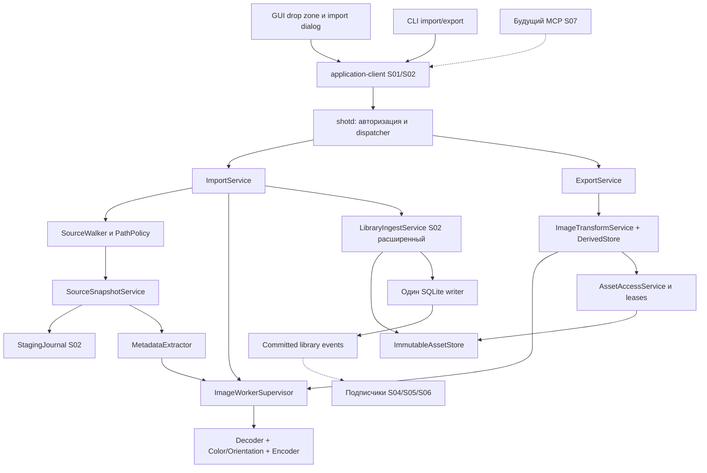
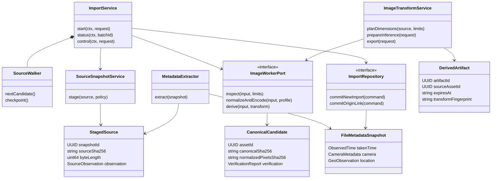
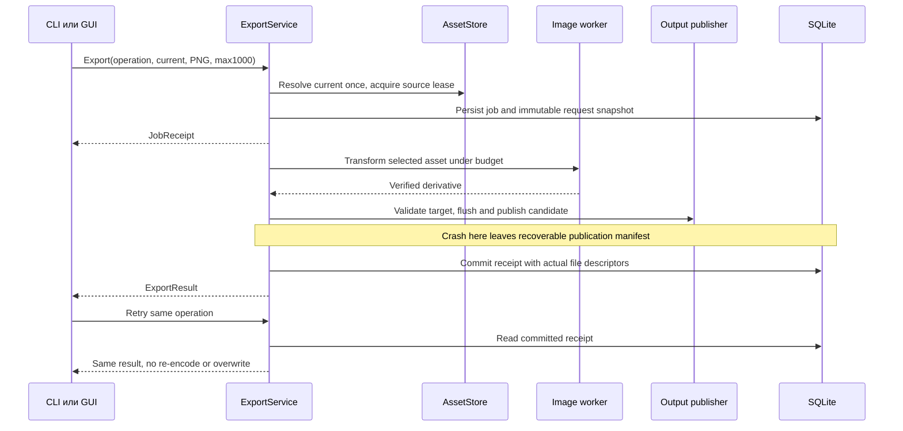
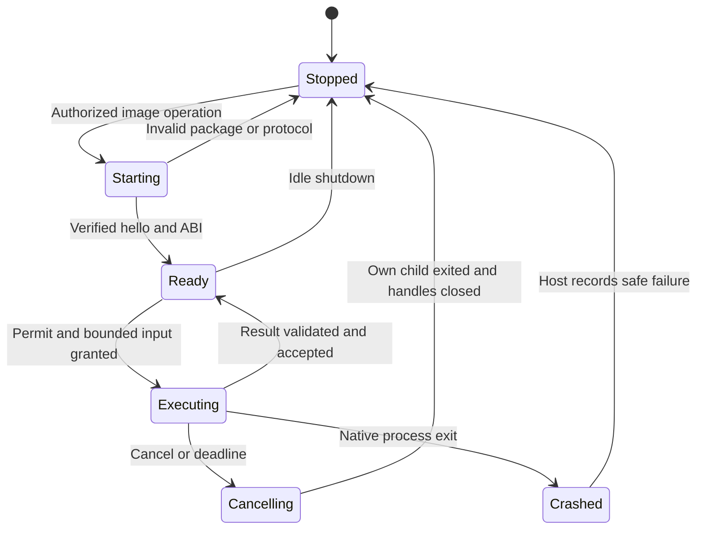

## S03: изображение становится частью собственной библиотеки 🖼️

Третий этап добавляет второй полноценный способ наполнения ScreenMemory: файлы и папки перетаскиваются в приложение, подпапки обходятся рекурсивно, поддержанные изображения получают собственные канонические файлы WebP или AVIF. Внешний исходник после успешного импорта больше не нужен для просмотра, дальнейшего AI-анализа или экспорта. При этом сохраняются сведения о происхождении: абсолютные пути, время файла, дата съёмки, камера и геопозиция, если они действительно присутствуют.

Тот же этап создаёт **единый механизм преобразования изображений**: миниатюры, входы будущей vision-модели с максимальной стороной 1024/2048 и экспорт, например PNG не больше 1000 пикселей по любой стороне. Изменение размера относится к производной версии. Оно не уменьшает канон и не перезаписывает внешнюю фотографию.

**Документ 3 из 8** детализирует только S03. Задачи `S03-T01…S03-T14` находятся внутри этого этапа. Отчёты, схемы, ADR и manifests — артефакты исполнения, а не дополнительные крупные планы.

> [!important] Спецификация, а не отчёт о готовом приложении
> Проверены соответствующие контракты master v3, S01 и S02, а также первичные материалы по кодекам, Windows-файлам, метаданным, Tauri и SQLite. Фактический accepted code checkpoint S02 не предоставлен. Windows-приложение, кодеки и импорт не запускались. Сигнатуры и DDL ниже — конкретные проектные задания; при исполнении они должны пройти компиляцию, миграционные тесты и аппаратную приёмку. Результаты `PASS` не подразумеваются.

### Навигация 📚

| Раздел | Содержание |
|---|---|
| [1. Граница и входы](#scope) | Что появляется на S03, что наследуется, что остаётся S04–S08 |
| [2. Решения и инварианты](#decisions) | Канон, происхождение, форматы, повторный импорт и отсутствие скрытого AI |
| [3. Архитектура и ownership](#architecture) | Общие сервисы, image worker, файл/БД, компонентная и class-диаграммы |
| [4. Контракты API](#contracts) | Импорт, состояния, пути, экспорт, права, ошибки и совместимость |
| [5. Обход папок и snapshot](#ingestion) | Reparse points, ограничения, исходные байты, progress и отмена |
| [6. Метаданные](#metadata) | EXIF/XMP, даты, GPS, камера, provenance, privacy |
| [7. Нормализация и кодеки](#codecs) | Orientation, sRGB, WebP exact, AVIF 4:4:4, проверка результата |
| [8. Публикация и дубликаты](#persistence) | Общий commit S02, origins, recovery и профиль операции |
| [9. SQLite и миграция](#database) | Расширение schema 2, строгие таблицы, rebuilding constraints и индексы |
| [10. Общий resize](#transforms) | Целочисленная геометрия, alpha, канон/thumbnail/inference |
| [11. Экспорт и выдача](#export) | Форматы, пути, no-overwrite, metadata, TTL и reader leases |
| [12. GUI и CLI](#interfaces) | Drop zone, карточка источника, настройки, команды и будущий MCP |
| [13. Ресурсы и восстановление](#operations) | Ограниченная нагрузка, worker, pause/cancel/retry, handoff очереди |
| [14. Логирование и doctor](#observability) | События, приватность, метрики, диагностические проверки |
| [15. Тесты и fixtures](#testing) | Arrange/act/assert, failure matrix, property, Windows и качество |
| [16. Задачи и коммиты](#tasks) | Порядок реализации, критерии готовности, результаты подзадач |
| [17. Приёмка и передача](#acceptance) | Verification, gates, checklist, evidence, следующий этап |
| [18. Трассируемость и источники](#traceability) | Требования → задачи → тесты; первичные документы |

<a id="scope"></a>
## 1. Граница этапа и входы предыдущих работ 🎯

### 1.1. Проверяемый результат 📦

Контрольная точка — `image-library-alpha`. После её приёмки приложение без запущенного LM Studio принимает папку изображений, показывает честный пофайловый отчёт, хранит свои версии в выбранном формате, показывает метаданные и экспортирует изображения через общий сервис. Скриншоты S02 продолжают работать, в том числе во время фонового импорта.

| Обязательство S03 | Конкретный результат | Не подменять следующим |
|---|---|---|
| Drop zone | Настоящее перетаскивание одного/нескольких файлов и папок | Один textbox с путём вместо drag-and-drop |
| Рекурсивный импорт | Подпапки, streaming discovery, прогресс, явные пропуски | Незаметная обработка только верхнего каталога |
| Собственный канон | WebP **и** AVIF, полный принятый размер | Ссылка на внешний файл или thumbnail вместо внутреннего файла |
| Источник | Абсолютный путь, корень импорта, даты, file hash, metadata snapshot | Текущее приложение, из которого перетаскивали файл, как «автор фотографии» |
| Метаданные | EXIF/XMP в определённом наборе, camera/time/GPS, provenance | Обещание поддержать любой proprietary MakerNote |
| Transform | Общая функция для 320, 1000, 1024, 2048; без upscale и искажения пропорций | Несколько разных resize-реализаций в CLI, GUI и SDK |
| Export | PNG/JPEG/WebP/AVIF, временный или пользовательский destination | Перезапись канона либо выдача исходного пути как готового экспорта |
| Независимость от AI | Все перечисленные действия работают при AI off | Автоматическая загрузка Gemma после drop в этом этапе |
| Интерфейсы | Базовые GUI/CLI и разрешённое получение путей/bytes | Готовый MCP или полный search UX, которые относятся к S07 |

Production OCR/описания/категории появляются на S05; управление LM Studio и общая очередь AI — на S04; FTS5/semantic retrieval — на S06. S03 готовит для них данные и события, но не рисует фиктивный статус «проиндексировано».

### 1.2. Входной checklist S02 🧷

| Вход | Что проверить перед изменениями |
|---|---|
| Master v3, S01, S02 | Версии и hashes из YAML; любые согласованные изменения перечислены |
| Accepted S02 code | Реальный commit, passing foundation/capture/storage tests; отсутствие отчёта не считается готовностью |
| `shotd` и `application-client` | Один writer, root lock, scopes, IPC1.1, asset transfer 1 |
| `records/assets` schema 2 | Имена, CHECK/FK/triggers и migration checksum соответствуют принятой реализации |
| Persistence S02 | Staging → encode → verify → no-replace publish → DB commit → receipt |
| `ImmutableAssetStore` | Проверенные relative paths, безопасное открытие, hashes, отсутствие prune канона |
| Preview/editor | Original/current semantics и immutable edited versions |
| Codec S01 | Реальные WebP exact и AVIF probes, native ABI, версии и packaging manifest |
| Quality foundation | Общие логи, memory permits, fake clock/runtime, failpoints, Windows scripts |

S03 не создаёт вторую library DB, второй host, альтернативный asset store или новый механизм выдачи изображений только ради импорта. Если фактический S02 отличается от проектного контракта, сначала оформляется совместимый mapping/изменение, затем пишутся миграции.

### 1.3. Известные ограничения schema 2, которые нужно расширить 🔬

В S02 таблица `records` уже допускает `imported_image`, а `assets` — `avif`. Но `ingest_operations.kind` ограничен `capture/edit`, а `library_events.event_kind` — событиями снимка и редактора. Просто начать отправлять строку `import` нельзя: необходима явная миграция ограничений. [PLAN-2, §9]

Assets принадлежат конкретному record через составные FK, а content-поля защищены immutable trigger. Поэтому **KeepBoth в S03 создаёт отдельный record и отдельный asset-файл**. Физическая дедупликация нескольких record на один asset возможна позднее только после отдельного изменения этой модели, а не через обход FK.

`pixels_sha256` schema 2 означает hash **нормализованного входа кодирования**. Для lossless WebP он совпадает с decoded pixels; для lossy AVIF такого равенства нет. Смысл существующего поля не меняется. Добавляется описание verification с отдельным hash декодированного результата.

<a id="decisions"></a>
## 2. Однозначные решения S03 и инварианты 🔒

### 2.1. Три источника и четыре вида файла 🗂️

| Объект | Роль | Кто владеет | Автоматическое удаление |
|---|---|---|---|
| Внешний source | Исходные пользовательские байты | Пользователь/внешняя программа | Никогда со стороны ScreenMemory |
| Accepted source snapshot | Восстановимый вход незавершённого импорта | Persistence coordinator | Только после подтверждённого результата либо явного отказа от принятого input |
| Canonical / edited asset | Постоянное изображение библиотеки | Library service | Не по возрасту, лимиту истории или TTL |
| Derived thumbnail/inference/export | Производная версия конкретного asset | Derived service | Только по реестру и после проверки leases; пользовательский export не очищается |

«Остаётся в приложении» означает наличие собственного файла после `Saved`, а не бессрочное хранение всех исходных байтов JPEG/камеры. При выбранном lossy AVIF изображение преобразуется с потерями; UI заранее сообщает это. Исходные metadata сохраняются отдельно и не зависят от того, переписал ли encoder EXIF.

### 2.2. Решения по умолчанию ⚙️

| Настройка | Значение S03 | Почему это часть контракта |
|---|---|---|
| Canonical profile | `webp-lossless-v1` | Совпадает с S02; сохранение UI без потерь относительно normalized input |
| Второй профиль | `avif-quality-v1`, quality 90, 4:4:4, alpha lossless | Реально доступен в V1; не называется lossless для RGB |
| Изменение профиля | Только новые операции | Незавершённая операция восстанавливается со своим snapshot настроек |
| Дубликаты файлов | Reuse existing record + новая origin occurrence | Путь и факт импорта не теряются |
| Дубликаты capture | Не сливаются | Два сознательных снимка — два события |
| RAW/анимация | Явный пропуск | Первый кадр/RAW-preview не выдаётся за целое изображение |
| Recursive | Включён для папок | Отключение возможно только явным параметром |
| Reparse/junction/symlink | Не обходить | Исключение циклов, скрытого выхода из roots и самoимпорта |
| Untagged RGB/gray | Assume sRGB с provenance | Неизвестный профиль не выдаётся за измеренный |
| HDR/неподдержанный цвет | Needs conversion, не молчаливый SDR | Требуется явное решение, а не неверные цвета с зелёной галочкой |
| Inference derivative | Max side1024; вариант 2048 также доступен | Не менять canonical; подготовка ещё не означает вызов модели |
| Export metadata | Strip private/source metadata | Передача GPS и paths требует отдельного действия |
| Temporary export | 24 часа от успешной публикации | Receipt содержит срок; reader lease защищает чтение |

### 2.3. Проверяемые инварианты 🧭

**I01 — сохранность.** Ответ об успешном импорте требует проверенного канона, provenance и committed record либо committed linkage к уже существующему проверенному канону.

**I02 — происхождение.** Source path/time/camera относятся к конкретной occurrence. Повтор того же изображения из другой папки не перезаписывает историю первого источника.

**I03 — неизменяемость.** Resize, экспорт, выбор другого формата, ошибка codec и последующий AI не меняют байты существующего canonical.

**I04 — согласованность.** Import/export исполняются host-сервисами; UI и CLI не выполняют свой SQL, recursion, EXIF parsing или перекодирование.

**I05 — ресурсная ограниченность.** Нельзя декодировать все файлы папки заранее. Ограничиваются discovery queue, snapshot backlog, decoded buffers, encoder concurrency и внутренние codec threads.

**I06 — честный результат.** Discovery не равен import; suffix не равен MIME; accepted snapshot не равен saved; cancel wait не равен cancel work; wall-clock timeout не доказывает остановку native decoder.

**I07 — отсутствие скрытой сети.** S03 не скачивает remote URL из XMP, не геокодирует GPS, не запускает inference, не поднимает cloud provider и не включает LM Studio ради экспорта.

<a id="architecture"></a>
## 3. Архитектура: новые входы, прежний владелец библиотеки 🧱

### 3.1. Компоненты и зависимости 🔗



`ImportService` управляет сценарием; walker только перечисляет; snapshot service получает стабильные байты; metadata extractor возвращает факты; codec worker не решает, какой record перезаписать. `LibraryIngestService` остаётся единственной точкой финальной публикации.

### 3.2. Structs/traits и ownership 🧬



`StagedSource` — capability/descriptor принятого файла, не Vec со всеми байтами и не произвольная строка пути от агента. Открытый source handle закрывается после snapshot; дальнейшая работа использует только внутренний snapshot. Native codec allocation освобождается тем же allocator через существующий RAII-wrapper S01.

### 3.3. Image worker: ограничение аварии, не новый AI-runtime 🧯

Для недоверенных импортных bitstream и долгого AVIF используется приватный `shot-image-worker.exe`, собранный из тех же Rust/C codec-модулей. Host остаётся единственным владельцем БД. Worker получает разрешённый staged input или asset и output-каталог конкретной операции; пишет **только candidate**, а публикацию канона выполняет host.

Это уточнение инфраструктуры, разрешённое master-портом кодеков. Worker не заменяет TypeScript bridge LM Studio. Он не содержит scheduler коллекции, SQL, сетевых запросов или shell execution. Запускается по manifest-пути, без PATH. Существующий быстрый WebP capture path S02 может оставаться in-process на собственном доверенном RGBA, но использует те же encoder profile и global memory/encoder permits.

Приватный процесс даёт возможность остановить зависший decoder, не теряя host и принятый snapshot. Сам факт отдельного процесса **не является sandbox-гарантией** против произвольного native exploit с правами того же пользователя. Секреты/лишние handles не наследуются; hardening ограниченного token — отдельная security-задача, не повод объявить отсутствующую защиту.

Windows Job Objects позволяют группировать дочерние процессы, учитывать ресурсы и применять лимиты. S03 использует owned Job Object и kill-on-close для своего worker, а не остановку по имени процесса. Точные process-memory limits проверяются на сборке; committed memory и RSS не смешиваются. [SRC-13]

### 3.4. Дельта дерева репозитория 📂

```text
crates/
  domain/src/images/{source.rs, metadata.rs, profiles.rs, transform.rs}
  application/src/{ingestion.rs, exports.rs, image_derivatives.rs}
  application/src/ports/{image_worker.rs, source_access.rs, import_repository.rs}
  infrastructure/src/
    imports/{walker.rs, snapshot.rs, coordinator.rs, recovery.rs}
    metadata/{container.rs, exif.rs, xmp.rs, normalize.rs}
    images/{registry.rs, webp.rs, avif.rs, color.rs, orientation.rs, resize.rs}
    assets/{derived.rs, export_publish.rs}
    sqlite/{import_repository.rs, export_repository.rs}
  platform-windows/src/files/{source_handle.rs, path_policy.rs, identity.rs}
  image-worker/src/{main.rs, protocol.rs, execute.rs}
  protocol/src/{imports.rs, exports.rs, image_metadata.rs}
app/frontend/src/features/{import/, image-details/, export/, storage-settings/}
native/sm-codec/                       # расширение выбранного ABI, не новая случайная dependency
migrations/0003_import_images_export.sql
schemas/{imports-v1.json, exports-v1.json, image-worker-v1.json}
tests/{fixtures/images/, imports/, metadata/, images/, exports/, faults/}
scripts/{verify-s03.ps1, verify-s03-windows.ps1, verify-s03-package.ps1}
```

Имена новых внутренних файлов можно уточнить при сверке actual code S02. Владелец логики и публичные contracts не меняются от переименования. Не создаются пустые модули OCR/AI/semantic search «на будущее».

<a id="contracts"></a>
## 4. Контракты импорта, изображений и экспорта 📐

### 4.1. Совместимость с S02 🔌

Application protocol расширяется с `1.1` до **`1.2`** с явными capabilities `image_import_v1`, `image_export_v1`, `image_metadata_v1`. Существующие методы capture/list/get/asset-transfer не меняют прежний смысл. Узкий asset transfer остаётся version 1. Протокол приватного image worker независим и начинается с 1.0.

UUID — строки; revisions/byte counts на wire — проверяемые decimal strings по S01. Для путей, времени и nullable полей используются те же tagged conventions. Rust/TypeScript-типы генерируются из общего protocol source; DTO валидируется в host независимо от frontend.

Ниже приведены **собственные целевые signatures**. Общие `RequestContext`, `AppError`, `OperationId`, `RecordId`, `AssetId`, `BatchReceipt`, `JobReceipt` импортируются из protocol/application, а не объявляются заново в каждом модуле. Полные enums и bounds из текста оформляются JSON Schema; сокращённый type alias не отменяет runtime-валидацию.

### 4.2. Пути и происхождение 🧭

```rust
use serde::{Deserialize, Serialize};
use uuid::Uuid;

#[derive(Clone, Serialize, Deserialize)]
#[serde(tag = "encoding", rename_all = "snake_case", deny_unknown_fields)]
pub enum NativePathDto {
    Utf8 { value: String },
    WindowsUtf16Le { base64: String, display: String },
}

#[derive(Clone, Serialize, Deserialize)]
#[serde(rename_all = "snake_case")]
pub enum DuplicatePolicy { ReuseRecord, KeepBoth }

#[derive(Clone, Serialize, Deserialize)]
#[serde(deny_unknown_fields)]
pub struct ImportPathsRequest {
    pub operation_id: Uuid,
    pub roots: Vec<NativePathDto>,
    pub recursive: bool,
    pub duplicate_policy: DuplicatePolicy,
    pub storage_profile_id: String,
    pub expected_profile_revision: String,
    pub allow_network_sources: bool,
}

#[derive(Clone, Serialize, Deserialize)]
pub struct SourcePathView {
    pub occurrence_id: Uuid,
    pub original_absolute_path: NativePathDto,
    pub resolved_absolute_path: Option<NativePathDto>,
    pub import_root: Option<NativePathDto>,
    pub existence: String,
}
```

Обычные CLI/GUI пути используют UTF-8. Если Windows-путь содержит непредставимую в Unicode последовательность UTF-16, приложение не использует lossy `display` для IO: либо передаётся lossless variant, либо возвращается `PATH_ENCODING_UNSUPPORTED`. Схема ограничивает длину до допустимого Windows-path budget. Непарный surrogate не должен превратиться в обращение к другому файлу.

Запрос принимает 1…256 roots и не более 4 MiB frame; более крупный список делится клиентом на отдельно обозначенные batches. Profile ID ограничен 128 символами, revision — положительной decimal string. Для каждого root действует path-size guard; JSON frame limit не подменяет проверку длины пути.

Host принимает **абсолютные** roots; CLI разрешает относительный аргумент относительно своего текущего каталога до отправки. `C:images` не считается абсолютным. NUL, device namespace, alternate data streams и сетевые URL не принимаются. UNC paths допустимы только при `allow_network_sources` и разрешённых roots; активная библиотека остаётся локальной.

`existence` при обычном get равно `not_checked`, а не `true`: чтение карточки не должно трогать отключённый сетевой диск. Проверка наличия — отдельное действие с коротким timeout. Metadata permission и permission на path остаются разными.

### 4.3. Импортные состояния и управляющие методы 🚦

```rust
#[derive(Clone, Copy, Serialize, Deserialize)]
#[serde(rename_all = "snake_case")]
pub enum ImportItemState {
    Discovered, Snapshotting, Staged, Inspecting, Normalizing, Encoding,
    Publishing, SavedNew, LinkedExisting, Skipped, Failed,
    Recoverable, CancelledUnaccepted, HeldAccepted,
}

#[derive(Clone, Copy, Serialize, Deserialize)]
#[serde(rename_all = "snake_case")]
pub enum ImportBatchState {
    Discovering, Running, Paused, Cancelling, Interrupted,
    Completed, CompletedWithErrors, Cancelled, NeedsAttention,
}

#[derive(Clone, Serialize, Deserialize)]
pub struct ImportItemView {
    pub item_id: Uuid,
    pub revision: String,
    pub ordinal: String,
    pub state: ImportItemState,
    pub operation_id: Option<Uuid>,
    pub record_id: Option<Uuid>,
    pub safe_code: Option<String>,
    pub durable_input: bool,
    pub warnings: Vec<String>,
}

#[derive(Clone, Serialize, Deserialize)]
pub struct ImportBatchView {
    pub batch_id: Uuid,
    pub revision: String,
    pub state: ImportBatchState,
    pub discovery_complete: bool,
    pub discovered_count: String,
    pub saved_new_count: String,
    pub linked_existing_count: String,
    pub skipped_count: String,
    pub failed_count: String,
    pub held_count: String,
    pub cancelled_unaccepted_count: String,
    pub in_flight_count: String,
    pub warning_count: String,
}

#[derive(Clone, Copy, Serialize, Deserialize)]
#[serde(rename_all = "snake_case")]
pub enum ImportControl { Pause, Resume, CancelProcessing }

#[derive(Clone, Serialize, Deserialize)]
#[serde(deny_unknown_fields)]
pub struct ControlImportRequest {
    pub batch_id: Uuid,
    pub expected_revision: String,
    pub control: ImportControl,
}
```

`CancelledUnaccepted` означает отмену до durable snapshot. `HeldAccepted` означает, что обработка остановлена, но принятые bytes удержаны. CancelProcessing не удаляет принятые данные и не откатывает уже saved records. Для удаления accepted input нужна отдельная подтверждённая recovery-операция, не кнопка закрытия окна.

```rust
use async_trait::async_trait;

#[async_trait]
pub trait ImageImportApi: Send + Sync {
    async fn import_paths(&self, ctx: RequestContext, req: ImportPathsRequest)
        -> Result<BatchReceipt, AppError>;
    async fn import_status(&self, ctx: RequestContext, batch_id: Uuid)
        -> Result<ImportBatchView, AppError>;
    async fn import_items(&self, ctx: RequestContext, req: ImportItemsRequest)
        -> Result<ImportItemPage, AppError>;
    async fn control_import(&self, ctx: RequestContext, req: ControlImportRequest)
        -> Result<ImportBatchView, AppError>;
    async fn retry_import_item(&self, ctx: RequestContext, req: RetryImportItemRequest)
        -> Result<ImportItemView, AppError>;
}
```

`ImportItemsRequest` содержит batch ID, limit (по умолчанию 30, диапазон 1…200), opaque cursor и optional state filter. `RetryImportItemRequest` содержит item ID, expected item revision и **не меняет** профиль/исходник под прежним operation ID. Для иной политики преобразования создаётся новая явно связанная попытка из retained snapshot (§8.6), а не переписывается старый fingerprint.

Дополнительные типы управляющего API фиксируются в том же protocol module:

```rust
#[derive(Clone, Serialize, Deserialize)]
#[serde(deny_unknown_fields)]
pub struct ImportItemsRequest {
    pub batch_id: Uuid,
    pub limit: u16,
    pub cursor: Option<String>,
    pub state: Option<ImportItemState>,
}

#[derive(Clone, Serialize, Deserialize)]
pub struct ImportItemPage {
    pub items: Vec<ImportItemView>,
    pub next_cursor: Option<String>,
    pub batch_revision: String,
}

#[derive(Clone, Serialize, Deserialize)]
#[serde(deny_unknown_fields)]
pub struct RetryImportItemRequest {
    pub item_id: Uuid,
    pub expected_revision: String,
}

#[derive(Clone, Serialize, Deserialize)]
#[serde(deny_unknown_fields)]
pub struct ReprocessImportItemRequest {
    pub item_id: Uuid,
    pub expected_revision: String,
    pub new_operation_id: Uuid,
    pub storage_profile_id: String,
    pub expected_profile_revision: String,
    pub conversion_consent_id: Option<Uuid>,
}
```

`ImageImportApi` также получает `reprocess_import_item(ctx, req: ReprocessImportItemRequest) -> Result<ImportItemView, AppError>` как async-метод. Он доступен только для неуспешного/удержанного import item с валидным snapshot; это не API массовой перекодировки уже сохранённой библиотеки. `conversion_consent_id` проверяется host по principal/profile/input и сроку, а не принимается как произвольная строка обхода policy. Cursor items связан с batch/filter и последним ordinal; новые состояния читаются из текущего согласованного snapshot, не гарантируется исторический снимок всех статусов за время листания.

Receipt импорта возвращается после commit session/root-плана. Он подтверждает **принятие задания**, не наличие всех images. Discovered items могут появляться позже. Повтор request с тем же operation ID/principal/fingerprint возвращает тот же batch; новые параметры — `IDEMPOTENCY_CONFLICT`.

### 4.4. Метаданные и нормализованный результат 🧾

```rust
#[derive(Clone, Serialize, Deserialize)]
pub struct ObservedTime {
    pub raw_value: Option<String>,
    pub local_datetime: Option<String>,
    pub utc: Option<String>,
    pub offset_minutes: Option<i16>,
    pub source: String,
    pub timezone_known: bool,
}

#[derive(Clone, Serialize, Deserialize)]
pub struct GeoObservation {
    pub latitude: f64,
    pub longitude: f64,
    pub altitude_m: Option<f64>,
    pub accuracy_m: Option<f64>,
    pub source: String,
}

#[derive(Clone, Serialize, Deserialize)]
pub struct FileMetadataSnapshot {
    pub schema_version: u16,
    pub source_sha256: String,
    pub source_byte_size: String,
    pub file_created_at: Option<ObservedTime>,
    pub file_modified_at: Option<ObservedTime>,
    pub taken_at: Option<ObservedTime>,
    pub camera: CameraMetadata,
    pub geo: Option<GeoObservation>,
    pub encoded_width: u32,
    pub encoded_height: u32,
    pub display_width: u32,
    pub display_height: u32,
    pub normalization: NormalizationReport,
    pub warnings: Vec<MetadataWarning>,
}
```

Этот `ObservedTime` реализует value из master; он не создаёт вторую несовместимую версию времени в domain. `CameraMetadata` включает nullable make/model/lens/software, exposure/ISO/focal/aperture и отдельно sensitive serial. `NormalizationReport` перечисляет исходный цвет, bit depth, geometry transforms, целевой sRGB, assumption/conversion consent и версии алгоритмов.

В `metadata()` без `read_source_metadata` возвращается только безопасный summary. GPS, serial и полный source JSON не маскируются пустыми строками: capability явно сообщает, что подробности не запрошены/не разрешены.

### 4.5. Экспорт и подготовка для модели 📤

```rust
#[derive(Clone, Copy, Serialize, Deserialize)]
#[serde(rename_all = "snake_case")]
pub enum ExportFormat {
    Canonical,
    Png,
    Jpeg,
    #[serde(rename = "webp")]
    WebP,
    Avif,
}

#[derive(Clone, Serialize, Deserialize)]
#[serde(tag = "kind", rename_all = "snake_case", deny_unknown_fields)]
pub enum AssetSelection {
    Current,
    Original,
    Explicit { asset_id: Uuid },
}

#[derive(Clone, Serialize, Deserialize)]
#[serde(deny_unknown_fields)]
pub struct ResizeLimits {
    pub max_side: Option<u32>,
    pub max_width: Option<u32>,
    pub max_height: Option<u32>,
}

#[derive(Clone, Serialize, Deserialize)]
#[serde(tag = "kind", rename_all = "snake_case", deny_unknown_fields)]
pub enum ExportDestination {
    Temporary,
    File { path: NativePathDto, overwrite: bool },
}

#[derive(Clone, Copy, Serialize, Deserialize)]
#[serde(rename_all = "snake_case")]
pub enum ExportMetadataPolicy { StripPrivate, IncludeSourceSidecar }

#[derive(Clone, Copy, Serialize, Deserialize)]
#[serde(rename_all = "snake_case")]
pub enum SourceMetadataField {
    SourcePath, FileTimes, TakenTime, Camera, CameraSerial,
    Geo, Normalization, Warnings,
}

#[derive(Clone, Serialize, Deserialize)]
#[serde(deny_unknown_fields)]
pub struct SourceMetadataSelection {
    // Пустой список означает primary origin, а не все источники без ограничения.
    pub origin_ids: Vec<Uuid>,
    pub fields: Vec<SourceMetadataField>,
}

#[derive(Clone, Copy, Serialize, Deserialize)]
#[serde(rename_all = "snake_case")]
pub enum ExportPart { Image, SourceMetadata }

#[derive(Clone, Serialize, Deserialize)]
pub struct ExportedFileView {
    pub part: ExportPart,
    pub mime: String,
    pub byte_size: String,
    pub sha256: String,
    pub path: Option<NativePathDto>,
}

#[derive(Clone, Serialize, Deserialize)]
#[serde(deny_unknown_fields)]
pub struct ExportImageRequest {
    pub operation_id: Uuid,
    pub record_id: Uuid,
    pub asset: AssetSelection,
    pub format: ExportFormat,
    pub limits: ResizeLimits,
    pub quality: Option<u8>,
    pub encoding_profile_id: Option<String>,
    pub alpha_background_rgb: Option<[u8; 3]>,
    pub destination: ExportDestination,
    pub metadata_policy: ExportMetadataPolicy,
    pub source_metadata: Option<SourceMetadataSelection>,
}

#[derive(Clone, Serialize, Deserialize)]
pub struct ExportResult {
    pub artifact_id: Uuid,
    pub record_id: Uuid,
    pub source_asset_id: Uuid,
    pub source_asset_revision: String,
    pub mime: String,
    pub width: u32,
    pub height: u32,
    pub byte_size: String,
    pub sha256: String,
    pub export_path: Option<NativePathDto>,
    pub expires_at_utc: Option<String>,
    pub applied_options: AppliedTransform,
    pub files: Vec<ExportedFileView>,
    pub warnings: Vec<String>,
}

#[derive(Clone, Copy, Serialize, Deserialize)]
#[serde(rename_all = "snake_case")]
pub enum InferenceImageSize { MaxSide1024, MaxSide2048, OriginalWithinLimits }

#[async_trait]
pub trait ImageExportApi: Send + Sync {
    async fn export_image(&self, ctx: RequestContext, req: ExportImageRequest)
        -> Result<JobReceipt, AppError>;
    async fn export_status(&self, ctx: RequestContext, operation_id: Uuid)
        -> Result<ExportOperationView, AppError>;
    async fn begin_export_read(
        &self, ctx: RequestContext, artifact_id: Uuid, part: ExportPart,
    )
        -> Result<AssetReadGrant, AppError>;
}
```

`Current` разрешается **один раз при принятии операции** и сохраняется в её snapshot. Если во время encode пользователь выбрал другой current asset, экспорт заканчивается для ранее зафиксированного asset и прямо называет его ID/revision. Он не смешивает пиксели одной версии с описанием другой.

`Original` здесь означает первоначальный **внутренний canonical**, не внешний source. Полный путь внешнего исходника получается через provenance API, но export никогда не зависит от его наличия. `Canonical` означает формат выбранного внутреннего asset, не обещание вернуть байты фото до импорта.

`source_metadata` обязателен только для `IncludeSourceSidecar`; при `StripPrivate` это поле должно отсутствовать. Fields/IDs имеют лимиты: не более 32 occurrences и 8 разных полей, без повторов. CameraSerial/Geo требуют source-metadata scope и явного выбора; SourcePath — дополнительно read_paths. Для screenshot без origin sidecar содержит пустой origins и warning, а не выдуманную камеру. Чтение `ExportPart::SourceMetadata` повторно проверяет права на поля snapshot; общего read_images для него недостаточно.

`AppliedTransform` содержит фактические format/profile, source/result dimensions, scale fraction, resampler version, alpha/background, metadata handling и encoder fingerprint. `prepare_inference_image()` — внутренний application port, возвращающий descriptor и lease на производный PNG. Никакой вызов модели в этот метод не входит.

### 4.6. Права и ошибки 🔐

| Scope | Что разрешает | Что не разрешает автоматически |
|---|---|---|
| `import_images` + allowed roots | Начать импорт и видеть свои batch/items | Читать любой системный файл или делать screenshot |
| `manage_imports` | Pause/resume/retry своей/разрешённой сессии | Удалять все canonical assets |
| `manage_storage` | Выбирать будущий формат и профиль | Тайно перекодировать старую библиотеку |
| `read_paths` | Получить canonical/current/source/export пути | Получить GPS/serial/raw metadata |
| `read_source_metadata` | Получить metadata/provenance разрешённой записи | Экспортировать их без отдельной export policy |
| `read_images` | Прочитать разрешённый canonical/derived stream | Читать arbitrary file по строке path |
| `export_images` + destination roots | Создать производный export | Перезаписать source/canonical даже с overwrite |
| `recover_library` | Разобрать retained snapshot и повторить публикацию | Автоматически удалить recoverable data |

Новые права не появляются у старого read-only principal автоматически. До S07 owner-профиль GUI/CLI и тестовые restricted principals проверяют те же host guards, которые позднее использует MCP.

Словарь новых codes: `SOURCE_NOT_FOUND`, `SOURCE_BUSY`, `SOURCE_CHANGED`, `SOURCE_PERMISSION_DENIED`, `SOURCE_UNSTABLE`, `SOURCE_NETWORK_NOT_ALLOWED`, `SOURCE_REPARSE_SKIPPED`, `SELF_IMPORT_BLOCKED`, `UNSUPPORTED_FORMAT`, `RAW_NOT_SUPPORTED`, `MULTIFRAME_NOT_SUPPORTED`, `UNSUPPORTED_TIFF_VARIANT`, `IMAGE_LIMIT_EXCEEDED`, `COLOR_CONVERSION_REQUIRED`, `ORIENTATION_CONFLICT`, `CODEC_UNAVAILABLE`, `CODEC_TIMEOUT`, `CODEC_WORKER_EXITED`, `METADATA_LIMIT_EXCEEDED`, `EXPORT_EXISTS`, `EXPORT_PROTECTED_TARGET`, `EXPORT_STATE_UNKNOWN`, `EXPORT_EXPIRED`. Они дополняют, а не переименовывают `STORAGE_FULL`, `ASSET_INTEGRITY_FAILED`, `REVISION_CONFLICT`, `PERMISSION_DENIED`, `WAIT_TIMEOUT` из S02.

<a id="ingestion"></a>
## 5. Рекурсивный импорт и стабильный снимок исходника 📥

### 5.1. Discovery не загружает картинки в память 📁

Drop/CLI сначала создаёт durable batch и список выбранных roots. Walker обходит каталоги потоково; каждый кандидат получает item ID, ordinal, путь, принадлежность root и безопасный snapshot filesystem attributes. Ни pixels, ни full EXIF не читаются во время обычного перечисления.

Обход — depth-first с ограниченным стеком каталогов. Начальные пределы: глубина 128, очередь 128 кандидатов, страница регистрации в SQLite до 100 items. При достижении 100000 просмотренных directory entries сессия приостанавливается с `DISCOVERY_LIMIT_REACHED` и возможностью явного продолжения. Счётчик включает и неподдержанные файлы: папка с миллионом TXT не должна обойти защиту.

Порядок record ID не зависит от алфавитной сортировки всей папки: не нужно сначала загрузить миллион имён ради красивой сортировки. UI сортирует уже полученный report по ordinal/статусу, а после completion — по выбранному столбцу.

| Вход | Поведение |
|---|---|
| Один regular file | Один item; полный pipeline после проверки |
| Несколько файлов | Один batch с independent outcomes |
| Папка | Рекурсивный обход по умолчанию |
| Папка без изображений | Успешный report с нулём сохранённых и причинами skipped |
| Недоступная подпапка | Явный directory issue; остальные ветви продолжаются |
| Перекрывающиеся roots | Один item на тот же обнаруженный path в batch; сохраняется список roots, через которые он найден |
| Разные hardlink paths на одинаковые bytes | Разные occurrences; content dedup может связать их с одним record |
| Symlink/junction/reparse | Отказ перехода с причиной; цели не обходятся автоматически |
| Собственная library/staging/cache/backup | Ветка исключается независимо от расширений файлов |
| `.lnk`, URL, virtual drag object без локальных bytes | Не исполняется и не загружается из сети; `UNSUPPORTED_DROP_SOURCE` |

Скрытые обычные файлы не исключаются только по признаку hidden, если пользователь выбрал содержащую папку. Windows system/device entries, альтернативные потоки и special files не являются входами изображений. RAW пропускается и по известному suffix, и по признакам контейнера, а не только по `.raw`.

### 5.2. Windows paths и защита от выхода за границы 🪟

PathPolicy проверяет корень, каждый traversed directory и открытый final file. String prefix вроде `starts_with("D:\\Photos")` недостаточен: `D:\\Photos-old`, alternate spelling и reparse target могут обозначать другие объекты. Сравнение разделяет path components и подтверждает object identity там, где она доступна.

Используются opened-handle проверки: тип regular file, attributes/reparse tag, final resolved path, volume/file identity и соответствие разрешённому root. `GetFinalPathNameByHandleW` относится к уже открытому объекту; `GetFileInformationByHandle` даёт сведения, пригодные для сопоставления identity. Эти значения не объявляются вечными глобальными UUID файла. [SRC-03], [SRC-04]

`FILE_FLAG_OPEN_REPARSE_POINT` не следует воспринимать как доказательство, что все промежуточные компоненты пути безопасны. Каталоги проверяются при обходе; final handle дополнительно сверяется с root и denied identities. При race «каталог заменили junction между проверками» результат должен быть `SOURCE_PATH_CHANGED`/отказ, а не чтение внешней цели.

Внутренние canonical/staging/export-cache пути также проверяются по identities, а не только по имени `ScreenMemory`. Импорт через альтернативный alias собственных assets блокируется. Для внешних источников нормализованный путь **не заменяет** первоначальное пользовательское spelling: сохраняются оба.

Сетевой source разрешён только явным выбором. Открытие UNC/SMB может инициировать сетевое взаимодействие и аутентификацию ОС, поэтому проверки remote permissions выполняются до чтения. Network source не делает сетевой root допустимым местом live SQLite.

### 5.3. Source handle и согласованные bytes 🔒

Предпочтительный Windows-путь snapshot — `CreateFileW` с read access и `FILE_SHARE_READ`, без разрешения write/delete на время чтения, `OPEN_EXISTING`, последовательное чтение и явная проверка reparse. Несовместимый уже открытый writer приводит к `SOURCE_BUSY`, а не к чтению непредсказуемой смеси версий. Механика sharing modes определена Win32. [SRC-01]

Порядок snapshot:

1. Проверить policy/allowed root, открыть источник и снять identity/size/created/modified.
2. Проверить file limit и ожидаемые наблюдения discovery; если изменился, явно зарегистрировать изменение/повтор.
3. Создать уникальный `source.bin.tmp` в собственном staging через create-new.
4. Копировать блоками 256 KiB с SHA256, проверять общий размер и cancel между блоками.
5. Повторно проверить size/identity/times по **тому же handle**, завершить запись и flush.
6. Опубликовать `source.bin`, source observation и manifest последним; только теперь item имеет `durable_input=true`.
7. Закрыть внешний handle. Все decoder/metadata операции далее читают внутренний snapshot.

Timestamp checks и sharing rules не являются доказательством абсолютной неизменности при произвольном внешнем software/kernel вмешательстве. Для гарантируемого результата используется собственный snapshot; при обнаруженной нестабильности он не называется чистым источником. Начально допускается одна повторная попытка до durable acceptance с новым observation. При повторном изменении — `SOURCE_UNSTABLE`.

Безопасность source — это отсутствие записи/удаления содержимого приложением. Чтение может повлиять на last-access bookkeeping ОС; поэтому обещается неизменность source bytes, не побайтная неизменность всей файловой системы.

### 5.4. Состояния batch и per-file результаты 🚦

```mermaid
stateDiagram-v2
    [*] --> Discovered
    Discovered --> Skipped: Denied or unsupported input
    Discovered --> Snapshotting: Source permit acquired
    Snapshotting --> Failed: Source read failed before acceptance
    Snapshotting --> CancelledUnaccepted: Cancel before durable manifest
    Snapshotting --> Staged: Snapshot and metadata manifest durable
    Staged --> Inspecting
    Inspecting --> HeldAccepted: Needs decision or cancelled processing
    Inspecting --> Failed: Unsupported content; input retained if already accepted
    Inspecting --> Normalizing: Safe supported still image
    Normalizing --> Encoding
    Normalizing --> Recoverable: Color or memory failure
    Encoding --> Recoverable: Worker error or timeout
    Encoding --> Publishing: Candidate verified
    Inspecting --> LinkedExisting: Verified exact duplicate and origin committed
    Publishing --> SavedNew: Canonical and DB committed
    Publishing --> Recoverable: Publish or DB failure
    Recoverable --> Inspecting: Explicit retry from retained snapshot
    HeldAccepted --> Inspecting: Explicit resume
```



`Failed` описывает итог попытки, но не разрешение удалить accepted snapshot. Флаг `durable_input` хранится отдельно от execution state. Такие failures входят в retained-input report; пользователь видит, какие данные ещё находятся в staging.

Все результаты файла независимы. Ошибка TIFF не откатывает двадцать успешных PNG.

Batch state вычисляется из durable control intent и текущих items, а не из последней пришедшей progress-строки. Пока идёт обход — Discovering/Running; pause имеет приоритет до явного Resume; после CancelProcessing — Cancelling до остановки текущего worker, затем Cancelled. При завершённом обходе и отсутствии work-in-flight: HeldAccepted/Recoverable требуют NeedsAttention; обычные failures или root access issues дают CompletedWithErrors; одни saved/linked/осознанные skipped дают Completed. Root errors не теряются только потому, что в отказанной подпапке не удалось перечислить ни одного item.

Resume после Cancelled продолжает только явно принятые retained items и требует явного действия; CancelledUnaccepted не превращаются автоматически в новый приём исходников. Новый полный обход отменённой части создаётся отдельным batch. Completion/retry всегда возвращает актуальные counters и batch revision.
 Папка не становится одной гигантской транзакцией.

### 5.5. Счётчики, прогресс и восстановление discovery 📊

Счётчики snapshot-состояния непротиворечивы:

```text
discovered_count = saved_new + linked_existing + skipped + failed
                 + held + cancelled_unaccepted + in_flight
```

`saved_new` и `linked_existing` соответствуют одноимённым terminal states. `failed_count` включает `Failed` и `Recoverable`; `held_count` — только `HeldAccepted`; `cancelled_unaccepted_count` — `CancelledUnaccepted`. `Discovered`…`Publishing` относятся к `in_flight`. `COLOR_CONVERSION_REQUIRED` — safe code удержанного item, а не ещё один несовместимый enum `needs_conversion`. Отдельный retained-input counter считает `durable_input=true` среди неуспешных/held и не входит вторым слагаемым в эту сумму.

Одно состояние не учитывается одновременно в двух колонках. Warnings считаются отдельно. На переходе item state краткая DB transaction обновляет state и batch revision; значения UI происходят из одного согласованного snapshot. Каталоги/их access errors имеют отдельные counters и не выдаются за image records.

До `discovery_complete=true` общий объём неизвестен. Интерфейс показывает «найдено N, сохранено M, обход продолжается», а не выдуманные 97%. Для snapshot есть bytes copied/expected bytes, для encoder без достоверного progress — indeterminate state. Размер «прочитано» не означает «сохранено канонов».

Filesystem enumeration не является атомарным snapshot дерева. После crash сохраняются root plan, discovered items и итог каждого; незавершённые directory scans выполняются повторно с тем же batch/config. Повтор того же discovery key не создаёт второй item. Появившиеся при rescan новые файлы получают отдельные ordinal и отметку `discovered_after_resume`; исчезнувшие до snapshot — `SOURCE_NOT_FOUND`. Уже staged/saved не читаются заново из внешней папки.

### 5.6. Последовательность успешного импорта 🔄

```mermaid
sequenceDiagram
    participant U as GUI или CLI
    participant I as ImportService
    participant S as Source snapshot
    participant W as Image worker
    participant F as ImmutableAssetStore
    participant D as SQLite writer
    U->>I: ImportPaths(operation, roots, profile)
    I->>D: Commit batch and root plan
    I-->>U: BatchReceipt
    I->>S: Open source, snapshot bytes and observations
    S-->>I: Durable StagedSource
    I->>W: Inspect and extract metadata from snapshot
    W-->>I: Format, limits, metadata
    I->>D: Lookup exact source hash
    alt No eligible existing record
        I->>W: Normalize and encode selected canonical format
        W-->>I: Verified candidate descriptor
        I->>F: Verify and publish no-replace
        I->>D: BEGIN; record, asset, origin, metadata, receipt, event; COMMIT
        D-->>I: SavedNew
    else Existing verified original asset
        I->>D: BEGIN; origin, metadata, linkage receipt, event; COMMIT
        D-->>I: LinkedExisting
    end
    I-->>U: Item outcome and updated counters
    I->>S: Retire completed snapshot after canonical/receipt check
```

В реальной реализации compute/IO не выполняются внутри показанных DB transactions. Export/AI не являются обязательной частью import transaction. Успешный import event будущий S04 обработает по своей policy; на S03 event сам не запускает модель.

<a id="metadata"></a>
## 6. Метаданные: сохранить факты, не выдумать происхождение 🧾

### 6.1. Выбранные адаптеры и пределы обещаний 🔬

EXIF parser — закреплённый `kamadak-exif` за собственным `ExifReader` port. Он предоставляет чтение raw EXIF и ряда контейнеров; нормализация чисел использует typed values, а не парсинг строк `display_value()`. [SRC-06]

XMP разбирается отдельным namespace-aware адаптером на `quick-xml::NsReader`. XML prefix может быть любым, поэтому сопоставляется namespace URI + local name. Запрещены DTD, внешние entities, сетевое разрешение ссылок и рекурсивное включение документов; byte/depth/event limits проверяются до крупных allocations. Наличие streaming reader не отменяет этих ограничений. [SRC-07]

Начальный metadata budget: до 8 MiB суммарных распакованных EXIF/XMP/ICC packets на один вход, до 4 MiB одного ICC, XMP depth64, до 100000 XML events, до 2000 разобранных tags, до 4096 символов одного текстового значения в summary. Normalized JSON — до 256 KiB; overflow фиксируется предупреждением с количеством пропущенного, не молчаливым обрезанием важных fields.

Raw packets не копируются в operational logs. Неограниченная коллекция MakerNotes не обещается. Для неподдержанных tags сохраняются name/type и ограниченное представление там, где безопасно; не следует превращать мегабайты binary EXIF preview в JSON/base64 библиотечной карточки.

### 6.2. Карта извлекаемых полей 🗺️

| Группа | Поля | Правило нормализации |
|---|---|---|
| File origin | Original absolute path, resolved path, root(s), source identity, bytes, SHA256, filename | Исторический snapshot; не пересчитывать по отсутствующему source |
| File times | Created, modified, optional observed access | Nullable; служебные timestamps не подменяют taken time |
| Taken time | EXIF DateTimeOriginal, OffsetTimeOriginal, SubSecTimeOriginal; подходящее XMP | Raw + local + optional UTC + source; неизвестный offset не угадывать |
| Digitized/modified | EXIF DateTimeDigitized, DateTime, XMP ModifyDate | Хранить отдельно от taken time |
| Camera | Make, Model, LensMake/Model, Software | Trim/control escaping для UI; исходное значение в bounded snapshot |
| Shooting | ExposureTime, FNumber, ISO, FocalLength, 35mm equivalent, flash при наличии | Rational с ненулевым знаменателем; finite numeric values и units |
| Sensitive device | BodySerialNumber, lens serial | Только source-metadata scope; не default prompt/export |
| GPS | Lat/ref, lon/ref, altitude/ref, горизонтальная точность, GPS time если есть | Проверка диапазонов, знаков, наличия пары; без geocoding |
| Geometry | Encoded/display/canonical dimensions, EXIF orientation, container transforms | Не применять один поворот дважды |
| Color | ICC hash/description, color model, bit depth, CICP при наличии | Подтверждённый / предположенный / преобразованный |
| Authorship text | Artist/copyright/description/title при наличии | Недоверенные данные, не инструкция и не автоматический user override |

EXIF различает DateTimeOriginal, соответствующий offset и subsecond. Это основание сохранять несколько частей даты, а не преобразовывать каждую строку времени в UTC автоматически. [SRC-08]

### 6.3. Приоритет времени и конфликты 🕒

Политика `taken-time-v1` выбирает валидный EXIF DateTimeOriginal с соответствующими offset/subsecond; если его нет — XMP поле того же смысла с явным provenance. Создание/изменение файла не используется как скрытый fallback. EXIF without offset остаётся локальным временем с `timezone_known=false`, даже если компьютер знает свою timezone.

Если одновременно присутствуют EXIF и XMP taken values и они расходятся, оба наблюдения сохраняются, а выбранное значение получает warning `TAKEN_TIME_CONFLICT`. Нельзя составить дату из EXIF и случайный offset другого XMP события без доказанной связи. Отсутствие EXIF offset можно уточнить из согласованного XMP **только** при совпадении local datetime и field semantics, с указанием derived provenance; иначе UTC неизвестен.

Пример:

```json
{
  "raw_value": "2025:06:12 14:30:45",
  "local_datetime": "2025-06-12T14:30:45",
  "utc": null,
  "offset_minutes": null,
  "source": "exif.DateTimeOriginal",
  "timezone_known": false
}
```

Если к этому времени надёжно относится `+03:00`, UTC равен `2025-06-12T11:30:45Z`. Это календарная нормализация, не определение места съёмки. Значения вроде `0000:00:00`, невозможный день, недопустимый offset и malformed subseconds становятся nullable + warning. Нельзя брать timezone текущего компьютера или «догадаться по GPS» без отдельного алгоритма/согласия.

### 6.4. GPS и численные значения 🌐

Для EXIF DMS:

```text
abs_degrees = degrees + minutes / 60 + seconds / 3600
latitude  = abs_degrees * sign(N=+1, S=-1)
longitude = abs_degrees * sign(E=+1, W=-1)
```

Проверяются знаменатели, finite values, `minutes/seconds < 60`, широта≤90 и долгота≤180. Если degrees равны предельным 90/180, дополнительные минуты/секунды должны быть нулевыми. `(0,0)` — допустимая координата, не признак отсутствия данных. Отсутствующий ref не подменяется севером/востоком.

Latitude/longitude публикуются как geo только вместе при валидной паре. Неполные raw tags остаются в metadata warnings. AltitudeRef задаёт знак высоты; accuracy неизвестна, если тега нет. GPS timestamp хранится отдельным наблюдением и не подменяет taken time без отдельного правила.

Никакой reverse geocoding, обращений к карте или передачи координат provider на S03 нет. У будущего PromptBuilder будет собственная privacy projection, которая по умолчанию исключает GPS и абсолютные пути.

### 6.5. Orientation и metadata достоверность 🧭

EXIF orientation задаётся числом 1…8. Его отсутствие для обычного still image означает отсутствие заявленного поворота. Некорректное число, конфликт источников или непонятное container-transform не должны приводить к зелёному «нормализовано» без пояснения.

В AVIF crop/rotation/mirror могут находиться в container transformations. Документация libavif отдельно предупреждает, что соответствующие metadata не означают уже изменённые pixel buffers. Нельзя просто декодировать RGBA, удалить tags и получить правильную ориентацию автоматически. [SRC-10]

S03 создаёт один `GeometryNormalizationPlan`. Для AVIF авторитетными являются поддержанные container transformations в их установленном порядке; EXIF rotation не дублируется. Согласованные эквивалентные EXIF значения отмечаются как redundant. При противоречии — `ORIENTATION_CONFLICT` с retained input, не двойной поворот. Unsupported crop/pixel-aspect трансформация — явный `GEOMETRY_CONVERSION_REQUIRED`.

### 6.6. Метаданные у дубликатов и imported records 🧷

Каждая `OriginOccurrence` содержит собственные file times/path/root. Даже одинаковые source bytes могут иметь разные filesystem created/modified dates. Такие различия не перезаписывают первый occurrence и не требуют перекодировать canonical.

У record хранится стабильная `primary_origin_id`: при первом импорте — первый committed origin, при последующих связках автоматически не меняется. Detail может показывать все источники. Будущий поиск по filename учитывает несколько origins по своей политике, а не размножает record в выдаче.

Imported record имеет `captured_at_utc=null`, не получает `capture_contexts` и `record_applications` из foreground момента drop. Ingest time всегда существует отдельно. Metadata `Software=Photoshop` допустима как tag происхождения файла, но не автоматически как подтверждённое активное приложение ScreenMemory.

<a id="codecs"></a>
## 7. Нормализация и канонические WebP/AVIF 🗜️

### 7.1. Реестр входных форматов 📚

| Вход | Поддержанный минимум S03 | Проверка перед decode | Явно не поддерживать молча |
|---|---|---|---|
| PNG | Статический gray/RGB/RGBA/palette, interlace по decoder capabilities | Signature, dimensions, metadata budget, animation chunks | APNG → MULTIFRAME_NOT_SUPPORTED |
| JPEG | Baseline/progressive gray/RGB/YCbCr; корректный ICC workflow | Header, dimensions, color model | CMYK/YCCK без проверенного color path → COLOR_CONVERSION_REQUIRED |
| WebP | Статический lossy/lossless, alpha | RIFF structure, VP8X flags, frame count | Animation не превращать в первый кадр |
| AVIF | Статический primary image, alpha, поддержанные SDR/color/geometry | Контейнер, frame/sequence, dimensions, limits, transforms | HEVC/HEIC, temporal sequence, unsupported HDR/gain-map workflow |
| BMP | Поддержанные RGB/gray/RGBA variants decoder | Header length, dimensions, stride, declared size | Exotic unsupported variant → конкретный code |
| GIF | Один still frame, palette/transparency | Frame count без decode всей анимации | Даже две похожие frames — не static image |
| TIFF | Одностраничный gray/RGB/RGBA8, uncompressed/LZW/Deflate/PackBits; tiled/stripped по проверенной матрице | IFD chain, photometric, RAW tags, metadata limits | Multipage/RAW/CFA; JPEG-compressed/BigTIFF только после отдельного подтверждённого case |

Уточнение «поддержанные TIFF» не означает все возможные TIFF. Обязательный fixture минимум перечислен в таблице; дополнительные variants заявляются только после тестов. `tiff::Decoder` предоставляет работу с tags и проверку дополнительных images, что используется отдельным probe, а не предположением по расширению. [SRC-12]

Extension нужен для быстрого отбора и понятного UI, но решение основывается на содержимом. File `.jpg` с PNG signature может импортироваться как PNG с warning `EXTENSION_MISMATCH`; `.jpg` с DNG/RAW или executable не становится изображением. Известный RAW suffix пропускается сразу; RAW content markers проверяются и при маскировке под TIFF. Список отрицательных fixtures включает DNGVersion/CFA и известные контейнерные варианты, без обещания распознать все будущие форматы.

Основной decoder registry: locked `image`/специализированные Rust decoders для PNG/JPEG/BMP/GIF/TIFF, существующий libwebp adapter и libavif/libaom через `sm-codec`. EXIF/XMP/ICC extraction использует capabilities конкретного decoder. Наличие метода в trait с default `None` не доказывает extraction для каждого формата. Матрица per-format обязательна. [SRC-05], [SRC-06]

### 7.2. Два уровня проверки ресурса 🧮

Сначала inspector получает dimensions/bit depth/frame count и оценивает buffers; затем worker получает memory permit на фактическую операцию. В `image::Limits` некоторые allocation limits являются best-effort, а не жёсткой гарантией всех decoders. Поэтому одного `max_alloc` недостаточно для нашего глобального budget. [SRC-05]

Нельзя доверять `width * height * channels` в узком integer и нельзя без ограничения вызывать convenience decoder, который сначала выделяет всё, а потом возвращает dimensions. Проверяются compressed bytes, decoded pixel count, stride, depth, metadata decompression и temporary buffers. Если decoder не может применить необходимый guard, он исполняется только под worker containment либо variant отклоняется.

### 7.3. Порядок нормализации 🎨

```text
staged source bytes
→ safe container inspection / metadata extraction
→ bounded native decode в известный color model
→ GeometryNormalizationPlan ровно один раз
→ ColorNormalizationPlan в SDR sRGB
→ packed straight-alpha RGBA8
→ input pixels hash
→ выбранный canonical encoder
→ decode/structure verification
→ canonical hash и publication candidate
```

Цвет и geometry report фиксируются до удаления исходных tags. Служебные orientation tags в каноне отсутствуют либо identity; повторный decoder не должен повернуть картинку второй раз. Full size означает полный нормализованный **отображаемый** кадр, а не обязательно размеры сырого encoded storage до корректного container crop/rotation.

Для PNG/JPEG/TIFF без declared crop запрещено обрезать края, убирать пустое поле или менять aspect ratio «для удобства модели». Размер canonical сохраняется; любые 1024/2048 относятся к derivative.

### 7.4. sRGB, ICC, битность и alpha 🧪

Цветовой adapter использует закреплённый Little CMS2 через собственную небольшую границу для поддержанных ICC transformations. Это color-management library, а не функция, которую можно заменить удалением ICC chunk. [SRC-09]

Базовый normalizer принимает RGB/gray SDR, переводит известный профиль в sRGB с фиксированным intent и записывает source/target profile hash и transform version. Исходный intent — relative colorimetric с выбранной и протестированной black-point policy. Если decoder уже преобразовал color model, это отражено во входном descriptor; нельзя повторно применить исходный CMYK profile к полученному RGB.

Untagged RGB/gray получает `assumed_srgb`. Unsupported/повреждённый ICC, противоречащие ICC/CICP, CMYK без проверенного пути, PQ/HLG и HDR gain-map дают `needs_conversion`/retained snapshot. S03 **не** реализует случайный tone mapper и не прячет HDR-проблему уменьшением разрядности. Для 16-bit SDR допускается явный профиль `sdr16-to8-v1` после consent: преобразование в известное SDR пространство, определённое округление/дизеринг и отметка потери битности. Без consent — отдельный отказ, не ложное отсутствие формата PNG.

Alpha в canonical нормализуется как straight, не premultiplied. При раскрытии premultiplied источника значения RGB при alpha0 восстановить принципиально нельзя; provenance отмечает это. WebP exact обещает сохранение **normalized RGBA**, а не восстановление ранее утраченного невидимого цвета.

### 7.5. Профиль WebP exact lossless 🟩

Используется advanced API libwebp из S01/S02: `lossless=1`, `exact=1`, ARGB input, сохранение размеров и alpha. Shortcut `WebPEncodeLosslessRGBA` с библиотечными defaults не заменяет этот профиль: официальная документация отдельно описывает изменение transparent RGB без exact. [SRC-11]

Профиль наследует уже принятые S02 options и fingerprint. Нельзя в S03 молча изменить method/quality/thread settings, сохранив старое имя профиля с новым поведением. Для нового encoder tuning создаётся новая revision профиля, а незавершённые saves используют прежнюю.

Размерный предел WebP — 16383 по каждой стороне. Даже если 96 MP budget позволяет панораму 20000×1000, WebP canonical ей не подходит. Такой item остаётся с `CANONICAL_SIZE_UNSUPPORTED`; предлагается явный AVIF-профиль при допустимых лимитах. Тайное уменьшение до 16383 не выполняется. [SRC-02]

Verification WebP включает decode полного кандидата, dimensions/MIME, alpha и **побайтное равенство normalized RGBA**. Hash внешнего JPEG не сравнивается с WebP. Метаданные источника не автоматически встраиваются в canonical container; техническое sRGB signaling допускается по fixed writer policy.

### 7.6. Профиль AVIF для первой версии 🟦

`avif-quality-v1` — конкретный собственный профиль: SDR8, 4:4:4, RGB quality 90, lossless alpha, фиксированная цветовая матрица/диапазон, speed 6 как исходная настройка для измерений, не более 2 активных codec threads. Profile fingerprint включает libavif/libaom revisions и mapping.

На API libavif с отдельными quality-полями adapter устанавливает документированные параметры своей закреплённой версии. Если доступен только quantizer API, выбирается и тестируется **отдельное отображение**; quality 90 не отправляется как число 90 в шкалу AV1 quantizer. Поддержанные controls отражаются в codec capability report. Официальные типы libavif служат источником mapping, но `main` не заменяет locked header S01. [SRC-10]

Alpha encoded lossless проверяется равенством нормализованной alpha-плоскости. RGB lossy проверяется **не** равенством исходного hash. Обязательны корректные dimensions, реальный 4:4:4, отсутствие неожиданной animation/transform, корректный sRGB, decode без ошибки и corpus-readability. Контрольный `decoded_pixels_sha256` фиксирует результат для воспроизводимости; расхождение с normalized-input hash не является само по себе дефектом.

В полностью прозрачных пикселях AVIF не получает обещание сохранения невидимого RGB. Выбор AVIF предваряется пояснением о lossy canonical. Более маленький файл не является обязательным условием: маленький простой PNG может дать другой результат; UI показывает фактический размер, а не выдуманную экономию.

### 7.7. AVIF still image и вспомогательные данные 🧩

Наличие alpha image/thumbnail/плиток grid не равно temporal animation. Inspector отличает auxiliary items одной still-картинки от последовательности разных кадров. Нельзя ограничиться общим количеством items в BMFF и отвергнуть каждое изображение с прозрачностью как «многокадровое».

Поддержанные container crop/irot/imir применяются в порядке, подтверждённом decoder specification и fixtures. Несовместимый non-square pixel aspect либо unsupported geometry возвращает объяснимую причину. Canvas/Grid display size не смешивается с размером одной encoded tile. Decoder path выбирается так, чтобы сборка не принимала temporal sequence через принудительный выбор первого primary item и не теряла кадры молча.

### 7.8. Кодек завершился — это ещё не Saved 🔍

Worker возвращает `CanonicalCandidate` с input hash, output hash, размером, профилем, normalization/verification report и относительными candidate references. Host проверяет совпадение operation/input IDs, разрешённое расположение, длину, signature и checksum кандидата. Полное decode-check выполняется codec path с теми же guards; для acceptance corpus дополнительно используется независимый decoder/fixture oracle.

Исполнитель не пишет в `assets.encoder_profile="avif"` вместо полного fingerprint. Reader должен иметь достаточно информации, чтобы отличить exact WebP, lossy AVIF, версии нормализации и факт предупреждённой конверсии.


<a id="persistence"></a>
## 8. Каноническая публикация, дубликаты и повторные попытки 💾

### 8.1. Один сохранитель для capture, edit и import 🧩

`LibraryIngestService` S02 расширяется новым типом входа, а не заменяется отдельным «импортным хранилищем». После получения нормализованного изображения три источника используют общий путь: кандидат → verification → immutable publication → короткая транзакция → receipt. Для уже найденного точного дубликата применяется отдельная операция **добавления происхождения**, без фиктивного нового файла.

```rust
// Внутренний контракт application; это не wire API и не API кодека.
pub enum IngestInput {
    Capture(AcceptedCapture),
    Editor(AcceptedEdit),
    Imported(ValidatedSourceSnapshot),
}

pub enum ImportDisposition {
    NewRecord { record_id: RecordId, asset_id: AssetId },
    LinkedExisting {
        record_id: RecordId,
        original_asset_id: AssetId,
        origin_id: OriginId,
    },
}

pub struct PreparedImportedImage {
    pub operation_id: OperationId,
    pub item_id: ImportItemId,
    pub snapshot_id: SnapshotId,
    pub source_sha256: Sha256Digest,
    pub metadata: FileMetadataSnapshot,
    pub normalization: NormalizationReport,
    pub candidate: VerifiedCanonicalCandidate,
}

// Вызывается только из SQLite worker, без файлового или сетевого ожидания.
pub trait ImportCommitRepository {
    fn commit_new_import(&mut self, cmd: CommitNewImport)
        -> Result<ImportCommitReceipt, StorageError>;
    fn commit_origin_link(&mut self, cmd: CommitOriginLink)
        -> Result<ImportCommitReceipt, StorageError>;
}
```

Служебные типы `CommitNewImport` и `CommitOriginLink` содержат principal, idempotency fingerprint, активный attempt, сохранённый profile, snapshot/hash и все идентификаторы, необходимые для алгоритмов ниже. Они **не** содержат открытый файл либо указатель на pixels. Конструкторы требуют валидированных DTO; случайный `serde_json::Value` не становится разрешением вставить asset.

### 8.2. Manifest v2 и совместимость со staging S02 🧾

S02 сохраняет `pixels.rgba + context.json` в manifest1. На S03 reader продолжает понимать этот формат. Новый writer импорта использует manifest2 с tagged union `input.kind = source_bytes`; расширенные capture/edit могут использовать `normalized_rgba`. Старые manifest1 не переписываются массово при старте.

```text
staging/<snapshot-or-operation-uuid>/
├── source.bin                     # у imported input
├── source-observation.json        # исходные path, identity, times
├── metadata.json                  # ограниченный результат разбора
├── manifest.json                  # публикуется после durable input
├── candidate.<format>.tmp
└── publish.json                   # намерение публикации, IDs и hashes
```

Первичный manifest не обязан содержать ещё не извлечённый EXIF. Он содержит hash и происхождение собственных source bytes. `metadata.json` дописывается безопасной публикацией с собственным checksum и ссылкой в следующей ревизии manifest; незавершённое извлечение можно повторить. Порча optional metadata не позволяет подменить `source.bin` другим файлом.

Минимальный manifest2: library/principal IDs, snapshot/item/batch/operation IDs, input kind, source observation hash, source byte length/hash, request fingerprint, выбранный encoder/normalizer profile snapshot, planned IDs, generation manifest и reached phase. Пути выводятся из IDs и собственного layout. `source_path` внутри provenance никогда не используется recovery как замена утраченному snapshot.

**Чтение recovery не требует внешнего исходника.** Если accepted input пропал, состояние — `STAGED_INPUT_MISSING`; нельзя молча заново открыть исторический путь и получить уже другое изображение. Перевыбор источника пользователем создаёт новый input snapshot с новой provenance.

### 8.3. Публикация нового imported record 🔐

После encode/verification host использует безопасный file publisher S02. Финальный путь состоит из asset UUID и фактического формата; title, EXIF и filename не управляют путём. Готовый файл публикуется на том же томе без overwrite, а затем выполняется `BEGIN IMMEDIATE` с проверками:

```text
principal + operation fingerprint + active attempt
→ отсутствие уже опубликованного receipt
→ INSERT records(source_kind=imported_image, captured_at=NULL)
→ INSERT assets(role=canonical, version_no=1)
→ INSERT origin_occurrences и file_metadata_snapshots
→ INSERT asset_processing с нормализацией/verification
→ UPDATE records.primary_origin_id
→ UPDATE import item и operation receipt
→ INSERT library_events(record.saved)
→ COMMIT
```

Circular record/asset FK из S02 остаются deferred и должны быть целыми к COMMIT. `record_applications` и `capture_contexts` для обычного импортированного фото **не создаются**. `ingested_at` — момент создания библиотечной записи; время съёмки хранится отдельно.

При Replay того же operation возвращается прежний receipt и прежние IDs. Не создаются новый origin, event или file. Подпись fallback берётся из безопасно отображаемого исходного filename, ограниченного 160 символами; собственное имя asset по-прежнему UUID.

Только после COMMIT отправляется `RecordSaved`. В S03 подписчики не вызывают AI. S04 сможет планировать обработку по этому событию, проверяя текущую policy и собственный idempotency key. Возврат пользователя к старой импортной сессии не должен повторно запускать AI как для новой картинки.

### 8.4. Точная семантика дедупликации 🔍

Дедупликация проверяется **после получения собственных source bytes**. Основной ключ — SHA256 исходного файла вместе с длиной. По нему находится прежняя origin и связанный первоначальный canonical. Готовый source hash не заменяется hash уменьшенного preview, decoded pixels или lossy output.

| Ситуация | Решение S03 |
|---|---|
| Те же source bytes, другой путь | ReuseRecord добавляет новую occurrence с новым путём/временем импорта |
| Та же операция доставлена повторно | Возвращается прежний outcome; occurrence не дублируется |
| Один path найден через два пересекающихся root | Один item; обе root-связи сохранены |
| Другой hardlink path | Отдельный item/occurrence; content может быть linked |
| Один и тот же файл осознанно импортирован завтра | Новый batch/occurrence, даже если record переиспользован |
| KeepBoth | Новый record и отдельный asset по собственному path |
| Новый capture с теми же pixels | Новый record; file-import dedup его не поглощает |
| Canonical прошлого record повреждён/отсутствует | Не считать reuse успехом; retained input и явное решение о новом record |
| Найденный record в корзине | Не восстанавливать молча; не использовать для default reuse |
| Несколько живых KeepBoth records с тем же source hash | Детерминированно выбрать самый ранний `record_pk`, указать target |

Перед linkage проверяется наличие и checksum **original canonical**. Текущая edited version может быть другой — импорт не откатывает её к original. Receipt указывает `matched_original_asset_id` и текущий asset, чтобы человек понимал, почему открылась отредактированная версия.

Для существующего WebP record и нового запроса с AVIF-профилем default ReuseRecord **не перекодирует файл**. Receipt возвращает `linked_existing`, actual format WebP и предупреждение `REQUESTED_PROFILE_NOT_USED_FOR_DUPLICATE`. Для действительно нового AVIF доступен KeepBoth. Противоположное поведение сломало бы инвариант неизменяемости.

Поиск кандидата и checksum выполняются вне writer transaction. Перед commit writer повторно проверяет, что record жив, original asset совпадает и не был заменён/удалён. Между проверкой и публикацией удерживается read/maintenance lease нужного asset. Проверка hash не обещает защиту от злонамеренного изменения файла тем же OS-пользователем, но предотвращает обычное reuse повреждённого канона.

### 8.5. Транзакция добавления происхождения 🧷

`commit_origin_link` не вставляет `records/assets`. Он проверяет источник, active attempt и target, добавляет origin/metadata, увеличивает `record_revision`, записывает `record.origin_linked` и сохранённый receipt. `asset_revision` не меняется; `content_revision` не меняется, пока эффективные поисковые поля не изменились. Новый исторический путь по умолчанию не становится новым primary filename для AI/embedding.

У `ingest_operations.state` остаётся `saved`; различие хранится в typed receipt `disposition`. Planned candidate IDs для linkage могут остаться неиспользованными. Это **явное исключение только для import-link**, а не ослабление S02-правила совпадения planned/committed IDs для capture, edit и NewRecord.

```mermaid
sequenceDiagram
    participant I as Import coordinator
    participant F as Snapshot and assets
    participant D as SQLite writer
    I->>F: Hash accepted source bytes
    I->>D: Find exact-source candidate
    D-->>I: Record and original asset
    I->>F: Acquire read lease, verify canonical
    alt Valid live target
        I->>D: BEGIN; recheck target and active attempt
        D->>D: Insert origin, metadata, event, receipt
        D-->>I: COMMIT linked_existing
        I->>F: Retire input only after committed linkage
    else Missing or mismatched canonical
        I->>D: Retain item with DUPLICATE_TARGET_INVALID
        I-->>I: No false success; source snapshot remains
    end
```

Если два разных batches одновременно обрабатывают одинаковый источник, commit intent по source key сериализуется внутри host. После ожидания второй coordinator повторяет dedup lookup. KeepBoth сознательно не использует этот merge. Отсутствие глобального UNIQUE на source hash важно: библиотека должна поддерживать KeepBoth.

### 8.6. Retry с тем же профилем и изменение профиля — разные действия 🔄

Обычный Retry восстанавливает **тот же** operation/attempt с тем же input snapshot и profile. Настройка AVIF, выбранная после сбоя WebP, не подхватывается незаметно. Если прежний profile невозможно исполнить закреплённым codec, item остаётся blocked/recoverable.

Явное «Повторить с другим профилем» создаёт новый attempt и новый operation ID, ссылающийся на тот же accepted snapshot. Предыдущий attempt получает `superseded_by`; новый становится active. Перед переключением старый worker должен быть остановлен либо утратить право публикации через compare-active-attempt guard. Поздний кандидат старого attempt не становится current и не удаляет общий input.

Срок хранения snapshot определяется **всеми** attempts/retained decisions, а не старым `operation.saved`. Пока активная попытка требует input либо есть неразобранный конфликт, snapshot не очищается. Старый S02 manifest reader продолжает свой простой путь; shared snapshot lifetime нужен только новым import attempts.

### 8.7. Ошибки и восстановление после перезапуска 🛠️

| Граница сбоя | Что найдено при recovery | Обязательное действие |
|---|---|---|
| Discovery до snapshot | Только item/path | Источник можно заново проверить; ещё не принятое изображение не считается saved |
| Незавершённый `source.bin.tmp` | Incomplete bytes без valid manifest | Не объявлять accepted; не декодировать как полный файл |
| Manifest опубликован, EXIF ещё нет | Durable source | Продолжить metadata/normalization без внешнего файла |
| Native decoder/encoder упал | Snapshot и safe worker error | Retained input; host и capture остаются живы |
| Candidate опубликован, DB не committed | Publish intent и файл | Проверить hashes и идемпотентно завершить тот же attempt |
| Linkage committed, reply потерян | Saved linkage receipt | Вернуть прежний origin/record без добавления второго |
| COMMIT выполнен, cleanup упал | Record и accepted input | Очистить только завершённый snapshot после reference checks |
| Retry профиля пересёкся со старым ответом | Разные attempt IDs | Применить только active attempt; старый результат superseded |
| Source удалён после acceptance | Собственный snapshot | Продолжить; не требовать восстановить внешний путь |
| Manifest содержит чужой путь/library ID | Повреждённый input descriptor | Карантин/diagnostic outcome; никаких произвольных reads |

После падения незавершённые импортные сессии показываются как `interrupted`, затем проходятся recovery-safe шаги. Это восстановление **файловой операции**, не будущий AI-trigger OnStartup. Открытие приложения не должно неожиданно запустить Gemma.

<a id="database"></a>
## 9. SQLite: schema 3 без поломки существующей библиотеки 🗄️

### 9.1. Что меняется и кто применяет миграцию 🧱

Добавляется `0003_import_images_export.sql` с manifest миграции. Старые `0001/0002` и их checksums не меняются. SQLite writer, WAL/FULL, root lock и migration service наследуются из S01/S02. Миграция выполняется до `host.ready`, пока обычные handlers не обслуживаются.

Изменения ограничений `ingest_operations` и `library_events` требуют проверенной перестройки таблиц. Используется документированный generalized ALTER TABLE подход SQLite; не включается `writable_schema`, не редактируется SQL определения таблицы строковой заменой в production. [SRC-14]

Ниже показана **DDL-основа**. Она намеренно не содержит `BEGIN/COMMIT/PRAGMA`: транзакцией и проверками владеет migrator, а не случайный запуск части SQL из GUI. JSON limits, UUID, path и fingerprints дополнительно валидируются прикладными схемами.

### 9.2. Перестройка ограничений и сохранение events 🔧

Migrator заранее сохраняет high-water mark `sqlite_sequence` для `library_events`, количество строк и checksum контрольных receipt. На отдельном migration connection `foreign_keys=OFF` устанавливается **вне транзакции**, затем начинается `BEGIN IMMEDIATE`. До открытия обычных соединений внешние ключи обязательно возвращаются ON с readback. На ошибке выполняются rollback и отказ запуска, а не продолжение работы с FK off.

```sql
-- S03-MIGRATION-REBUILD: выполняется внутри контролируемой migration transaction.
CREATE TABLE sm3_ingest_operations (
    operation_id        TEXT PRIMARY KEY,
    principal_id        TEXT NOT NULL,
    kind                TEXT NOT NULL CHECK (kind IN ('capture','edit','import')),
    request_fingerprint TEXT NOT NULL,
    planned_record_id   TEXT NOT NULL,
    planned_asset_id    TEXT NOT NULL,
    record_id           TEXT REFERENCES records(id),
    state               TEXT NOT NULL CHECK (state IN
                         ('staged','encoding','publishing','saved','recoverable','failed')),
    manifest_version    INTEGER NOT NULL CHECK (manifest_version > 0),
    safe_error_code     TEXT,
    receipt_json        TEXT CHECK (receipt_json IS NULL OR json_valid(receipt_json)),
    created_at_utc      TEXT NOT NULL,
    updated_at_utc      TEXT NOT NULL,
    CHECK (state != 'saved' OR (record_id IS NOT NULL AND receipt_json IS NOT NULL))
);

INSERT INTO sm3_ingest_operations (
    operation_id, principal_id, kind, request_fingerprint,
    planned_record_id, planned_asset_id, record_id, state,
    manifest_version, safe_error_code, receipt_json, created_at_utc, updated_at_utc
)
SELECT operation_id, principal_id, kind, request_fingerprint,
       planned_record_id, planned_asset_id, record_id, state,
       manifest_version, safe_error_code, receipt_json, created_at_utc, updated_at_utc
FROM ingest_operations;

CREATE TABLE sm3_library_events (
    sequence          INTEGER PRIMARY KEY AUTOINCREMENT,
    operation_id      TEXT NOT NULL REFERENCES ingest_operations(operation_id),
    event_kind        TEXT NOT NULL CHECK (event_kind IN
                      ('record.saved','asset.version_added','asset.current_changed',
                       'record.origin_linked')),
    record_id         TEXT NOT NULL REFERENCES records(id),
    asset_id          TEXT NOT NULL REFERENCES assets(id),
    record_revision   INTEGER NOT NULL CHECK (record_revision > 0),
    asset_revision    INTEGER NOT NULL CHECK (asset_revision > 0),
    occurred_at_utc   TEXT NOT NULL,
    UNIQUE(operation_id, event_kind)
);

INSERT INTO sm3_library_events (
    sequence, operation_id, event_kind, record_id, asset_id,
    record_revision, asset_revision, occurred_at_utc
)
SELECT sequence, operation_id, event_kind, record_id, asset_id,
       record_revision, asset_revision, occurred_at_utc
FROM library_events;

DROP TABLE library_events;
DROP TABLE ingest_operations;
ALTER TABLE sm3_ingest_operations RENAME TO ingest_operations;
ALTER TABLE sm3_library_events RENAME TO library_events;

CREATE INDEX operations_state ON ingest_operations(state, updated_at_utc);
CREATE INDEX events_record ON library_events(record_id, sequence);
```

Приёмочный migrator сохраняет `max(old_sequence_high_water, new_high_water)` **даже при промежутках в событиях**. Новая последовательность не должна повторить ID, который когда-то был выдан клиенту. Реализуется параметризованное восстановление значения `sqlite_sequence` в этой же транзакции; это специальная операция мигратора, не доступная обычному API.

Для принятой schema 2 других индексов/триггеров на эти две таблицы нет. Если реальный checkpoint содержит дополнительные, миграция обязана явно перенести/пересмотреть их по inventory; нельзя автоматически пропустить неизвестный trigger. Остальные FK на final table names сохраняются. Перед COMMIT обязательны empty `foreign_key_check`, ожидаемые row counts и проверка исходных receipts.

### 9.3. Batches, items, snapshots и попытки 📥

```sql
-- S03-MIGRATION-IMPORT: продолжение той же migration transaction.
CREATE TABLE import_batches (
    id                  TEXT PRIMARY KEY,
    principal_id        TEXT NOT NULL,
    request_operation_id TEXT NOT NULL UNIQUE,
    request_fingerprint TEXT NOT NULL,
    state               TEXT NOT NULL CHECK (state IN
                        ('discovering','running','paused','cancelling','interrupted','completed',
                         'completed_with_errors','cancelled','needs_attention')),
    policy_json         TEXT NOT NULL CHECK (json_valid(policy_json)),
    policy_revision     INTEGER NOT NULL CHECK (policy_revision > 0),
    revision            INTEGER NOT NULL DEFAULT 1 CHECK (revision > 0),
    discovery_complete  INTEGER NOT NULL DEFAULT 0 CHECK (discovery_complete IN (0,1)),
    entries_seen        INTEGER NOT NULL DEFAULT 0 CHECK (entries_seen >= 0),
    created_at_utc      TEXT NOT NULL,
    updated_at_utc      TEXT NOT NULL
);

CREATE TABLE import_roots (
    id                  TEXT PRIMARY KEY,
    batch_id            TEXT NOT NULL REFERENCES import_batches(id),
    path_json           TEXT NOT NULL CHECK (json_valid(path_json)),
    path_key            TEXT NOT NULL,
    root_kind           TEXT NOT NULL CHECK (root_kind IN ('file','directory')),
    identity_json       TEXT CHECK (identity_json IS NULL OR json_valid(identity_json)),
    recursive           INTEGER NOT NULL CHECK (recursive IN (0,1)),
    allow_network       INTEGER NOT NULL CHECK (allow_network IN (0,1)),
    state               TEXT NOT NULL CHECK (state IN ('pending','walking','done','blocked','cancelled')),
    safe_error_code     TEXT,
    UNIQUE(batch_id, path_key)
);

CREATE TABLE import_items (
    id                  TEXT PRIMARY KEY,
    batch_id            TEXT NOT NULL REFERENCES import_batches(id),
    ordinal             INTEGER NOT NULL CHECK (ordinal >= 0),
    discovery_key       TEXT NOT NULL,
    path_json           TEXT NOT NULL CHECK (json_valid(path_json)),
    display_name        TEXT NOT NULL,
    state               TEXT NOT NULL CHECK (state IN
                        ('discovered','snapshotting','staged','inspecting','normalizing',
                         'encoding','publishing','saved_new','linked_existing',
                         'skipped','failed','recoverable','held_accepted','cancelled_unaccepted')),
    revision            INTEGER NOT NULL DEFAULT 1 CHECK (revision > 0),
    active_operation_id TEXT REFERENCES ingest_operations(operation_id),
    record_id           TEXT REFERENCES records(id),
    durable_input       INTEGER NOT NULL DEFAULT 0 CHECK (durable_input IN (0,1)),
    safe_error_code     TEXT,
    warnings_json       TEXT NOT NULL DEFAULT '[]' CHECK (json_valid(warnings_json)),
    created_at_utc      TEXT NOT NULL,
    updated_at_utc      TEXT NOT NULL,
    UNIQUE(batch_id, ordinal),
    UNIQUE(batch_id, discovery_key),
    CHECK (state NOT IN ('saved_new','linked_existing') OR record_id IS NOT NULL)
);

CREATE TABLE import_item_roots (
    item_id             TEXT NOT NULL REFERENCES import_items(id),
    root_id             TEXT NOT NULL REFERENCES import_roots(id),
    PRIMARY KEY(item_id, root_id)
);

CREATE TABLE source_snapshots (
    id                  TEXT PRIMARY KEY,
    item_id             TEXT NOT NULL REFERENCES import_items(id),
    relative_dir        TEXT NOT NULL UNIQUE,
    byte_size           INTEGER NOT NULL CHECK (byte_size > 0),
    source_sha256       TEXT NOT NULL CHECK (length(source_sha256) = 64),
    observation_json    TEXT NOT NULL CHECK (json_valid(observation_json)),
    manifest_version    INTEGER NOT NULL CHECK (manifest_version >= 2),
    state               TEXT NOT NULL CHECK (state IN ('accepted','retained','retired')),
    accepted_at_utc     TEXT NOT NULL,
    retired_at_utc      TEXT,
    CHECK ((state = 'retired') = (retired_at_utc IS NOT NULL))
);

CREATE TABLE import_attempts (
    operation_id        TEXT PRIMARY KEY REFERENCES ingest_operations(operation_id),
    item_id             TEXT NOT NULL REFERENCES import_items(id),
    snapshot_id         TEXT NOT NULL REFERENCES source_snapshots(id),
    attempt_no          INTEGER NOT NULL CHECK (attempt_no > 0),
    profile_json        TEXT NOT NULL CHECK (json_valid(profile_json)),
    profile_fingerprint TEXT NOT NULL,
    supersedes_operation_id TEXT REFERENCES import_attempts(operation_id),
    superseded_by       TEXT REFERENCES import_attempts(operation_id),
    created_at_utc      TEXT NOT NULL,
    UNIQUE(item_id, attempt_no)
);

CREATE INDEX import_items_page ON import_items(batch_id, ordinal);
CREATE INDEX import_items_work ON import_items(state, batch_id, ordinal);
CREATE INDEX snapshots_item ON source_snapshots(item_id, state);
CREATE INDEX attempts_snapshot ON import_attempts(snapshot_id);
```

Batch-контроль остаётся отдельной state machine, не строкой `processing_jobs` с vision-kind. В S04 общий scheduler сможет исполнять work units этих сервисов, но не создаёт ещё одну копию import item/receipt. `request_operation_id` batch отличается от `operation_id` per-image attempt.

`discovery_key` вычисляется из нормализованного **пути обнаружения** внутри batch, с Windows-aware сравнением; volume/file identity проверяется отдельно. Только file identity недостаточна: она потеряет второй hardlink path. Только lower-case полного текста недостаточно в каталогах с особыми правилами case sensitivity. Схема сохраняет исходный `NativePathDto` независимо от ключа.

Directory failures и отдельные неподдержанные entries отражаются в per-file/root отчёте; один `safe_error_code` не хранит полный чувствительный stack trace. Cached batch counters допустимы позднее, но канонический результат считается по items/roots, а не инкрементами, которые потерялись при crash.

### 9.4. Происхождение и метаданные 🧭

```sql
-- S03-MIGRATION-METADATA
CREATE TABLE origin_occurrences (
    id                  TEXT PRIMARY KEY,
    record_id           TEXT NOT NULL REFERENCES records(id),
    original_asset_id   TEXT NOT NULL,
    item_id             TEXT NOT NULL REFERENCES import_items(id),
    operation_id        TEXT NOT NULL UNIQUE REFERENCES ingest_operations(operation_id),
    batch_id            TEXT NOT NULL REFERENCES import_batches(id),
    source_path_json    TEXT NOT NULL CHECK (json_valid(source_path_json)),
    resolved_path_json  TEXT CHECK (resolved_path_json IS NULL OR json_valid(resolved_path_json)),
    filename            TEXT NOT NULL,
    source_byte_size    INTEGER NOT NULL CHECK (source_byte_size > 0),
    source_sha256       TEXT NOT NULL CHECK (length(source_sha256) = 64),
    observed_at_utc     TEXT NOT NULL,
    imported_at_utc     TEXT NOT NULL,
    FOREIGN KEY(record_id, original_asset_id) REFERENCES assets(record_id, id)
        DEFERRABLE INITIALLY DEFERRED
);

CREATE TABLE file_metadata_snapshots (
    origin_id           TEXT PRIMARY KEY REFERENCES origin_occurrences(id),
    extractor_fingerprint TEXT NOT NULL,
    metadata_json       TEXT NOT NULL CHECK (json_valid(metadata_json)),
    file_created_utc    TEXT,
    file_modified_utc   TEXT,
    taken_at_utc        TEXT,
    taken_at_local      TEXT,
    taken_offset_min    INTEGER CHECK (taken_offset_min BETWEEN -840 AND 840),
    camera_make         TEXT,
    camera_model        TEXT,
    gps_lat             REAL CHECK (gps_lat BETWEEN -90 AND 90),
    gps_lon             REAL CHECK (gps_lon BETWEEN -180 AND 180),
    gps_alt_m           REAL,
    CHECK ((gps_lat IS NULL) = (gps_lon IS NULL)),
    CHECK (taken_at_utc IS NULL OR taken_offset_min IS NOT NULL)
);

ALTER TABLE records ADD COLUMN primary_origin_id TEXT REFERENCES origin_occurrences(id);

CREATE TRIGGER records_primary_origin_insert
BEFORE INSERT ON records
WHEN NEW.primary_origin_id IS NOT NULL AND NOT EXISTS (
    SELECT 1 FROM origin_occurrences o
    WHERE o.id = NEW.primary_origin_id AND o.record_id = NEW.id
)
BEGIN
    SELECT RAISE(ABORT, 'PRIMARY_ORIGIN_MISMATCH');
END;

CREATE TRIGGER records_primary_origin_update
BEFORE UPDATE OF primary_origin_id ON records
WHEN NEW.primary_origin_id IS NOT NULL AND NOT EXISTS (
    SELECT 1 FROM origin_occurrences o
    WHERE o.id = NEW.primary_origin_id AND o.record_id = NEW.id
)
BEGIN
    SELECT RAISE(ABORT, 'PRIMARY_ORIGIN_MISMATCH');
END;

CREATE TRIGGER origins_immutable BEFORE UPDATE ON origin_occurrences
BEGIN
    SELECT RAISE(ABORT, 'ORIGIN_IMMUTABLE');
END;

CREATE TRIGGER file_metadata_immutable BEFORE UPDATE ON file_metadata_snapshots
BEGIN
    SELECT RAISE(ABORT, 'SOURCE_METADATA_IMMUTABLE');
END;

CREATE INDEX origin_source_lookup ON origin_occurrences(source_sha256, source_byte_size, record_id);
CREATE INDEX origin_record_lookup ON origin_occurrences(record_id, imported_at_utc);
CREATE INDEX metadata_taken_time ON file_metadata_snapshots(taken_at_utc);
```

`primary_origin_id` задаётся после insertion origin в той же транзакции. Capture rows остаются с null. Типичный импорт без timezone имеет `taken_at_local`, raw EXIF в metadata JSON и `taken_at_utc=null`, а не фиктивное время UTC. Нулевой известный offset допустим. Проверки finite GPS и ISO8601 выполняет application validator до SQL, включая NaN/Inf.

Metadata extractor связывает один snapshot с конкретной occurrence, поэтому разные filesystem times двух одинаковых JPEG сохраняются раздельно. Повторная extraction с другим parser в будущем создаст отдельную versioned запись по согласованной миграции; immutable snapshot не перезаписывается втихую. Все field provenance и предупреждения остаются в bounded JSON, но поисковые проекции могут использовать типизированные колонки.

### 9.5. Verification, derivatives и экспортные операции 📤

```sql
-- S03-MIGRATION-DERIVED
CREATE TABLE asset_processing (
    asset_id            TEXT PRIMARY KEY REFERENCES assets(id),
    normalization_json  TEXT NOT NULL CHECK (json_valid(normalization_json)),
    verification_json   TEXT NOT NULL CHECK (json_valid(verification_json)),
    decoded_pixels_sha256 TEXT CHECK (decoded_pixels_sha256 IS NULL OR length(decoded_pixels_sha256) = 64),
    created_at_utc      TEXT NOT NULL
);

CREATE TRIGGER asset_processing_immutable BEFORE UPDATE ON asset_processing
BEGIN
    SELECT RAISE(ABORT, 'ASSET_PROCESSING_IMMUTABLE');
END;

CREATE TABLE derived_artifacts (
    id                  TEXT PRIMARY KEY,
    source_asset_id     TEXT NOT NULL REFERENCES assets(id),
    role                TEXT NOT NULL CHECK (role IN ('thumbnail','inference','export')),
    transform_fingerprint TEXT NOT NULL,
    managed_relative_path TEXT,
    external_path_json  TEXT CHECK (external_path_json IS NULL OR json_valid(external_path_json)),
    state               TEXT NOT NULL CHECK (state IN
                        ('building','ready','expired','missing','failed','partial')),
    mime                TEXT,
    width               INTEGER CHECK (width > 0),
    height              INTEGER CHECK (height > 0),
    byte_size           INTEGER CHECK (byte_size > 0),
    sha256              TEXT CHECK (sha256 IS NULL OR length(sha256) = 64),
    applied_json        TEXT NOT NULL CHECK (json_valid(applied_json)),
    expires_at_utc     TEXT,
    created_at_utc     TEXT NOT NULL,
    CHECK ((managed_relative_path IS NULL) != (external_path_json IS NULL)),
    CHECK (external_path_json IS NULL OR (role = 'export' AND expires_at_utc IS NULL)),
    CHECK (state != 'ready' OR
          (mime IS NOT NULL AND width IS NOT NULL AND height IS NOT NULL
           AND byte_size IS NOT NULL AND sha256 IS NOT NULL))
);

CREATE TABLE export_operations (
    operation_id        TEXT PRIMARY KEY,
    principal_id        TEXT NOT NULL,
    request_fingerprint TEXT NOT NULL,
    record_id           TEXT NOT NULL REFERENCES records(id),
    source_asset_id     TEXT NOT NULL,
    source_asset_revision INTEGER NOT NULL CHECK (source_asset_revision > 0),
    artifact_id         TEXT NOT NULL UNIQUE REFERENCES derived_artifacts(id),
    request_json        TEXT NOT NULL CHECK (json_valid(request_json)),
    publish_manifest_relative TEXT,
    state               TEXT NOT NULL CHECK (state IN
                        ('pending','running','publishing','succeeded',
                         'failed','partial','cancelled','interrupted')),
    safe_error_code     TEXT,
    receipt_json        TEXT CHECK (receipt_json IS NULL OR json_valid(receipt_json)),
    created_at_utc     TEXT NOT NULL,
    updated_at_utc     TEXT NOT NULL,
    FOREIGN KEY(record_id, source_asset_id) REFERENCES assets(record_id, id),
    CHECK (state != 'succeeded' OR receipt_json IS NOT NULL)
);

CREATE INDEX derived_cache_lookup ON derived_artifacts(source_asset_id, role, transform_fingerprint, state);
CREATE UNIQUE INDEX derived_managed_paths ON derived_artifacts(managed_relative_path)
    WHERE managed_relative_path IS NOT NULL;
CREATE INDEX derived_expiry ON derived_artifacts(expires_at_utc)
    WHERE managed_relative_path IS NOT NULL;
CREATE INDEX export_work ON export_operations(state, created_at_utc);
```

Для assets S02 сведения `asset_processing` могут отсутствовать: reader показывает `legacy_verification`, не объявляя старый WebP повреждённым. Новый S03 canonical обязательно получает processing report. Старый hash `pixels_sha256` не меняется.

`derived_artifacts` — не `assets`: потеря кеша не меняет record original/current. Leases активного чтения принадлежат host и не восстанавливаются после его смерти как вечные блокировки. Пока host жив, cleaner и `begin_read` синхронизированы одним lock/registry. Expired означает истёкшую гарантию временного артефакта; это не разрешение читать подставленный внешний путь.

Не вводится UNIQUE на весь transform fingerprint: explicit exports могут иметь разные destinations, а частично завершённый файл не должен блокировать повтор навечно. Для внутренних derivative concurrency используется singleflight по source/hash/options. Политика долгосрочной очистки истории operation reports относится к S08; текущий stage не удаляет их сам для экономии строк.

### 9.6. Обязательные транзакционные проверки 🧪

Перед commit NewRecord валидируются: imported source kind, null capture time/context, original canonical version 1, existence origin, правильный primary origin, nonempty safe fallback title, active attempt и соответствие candidate profile/input hash. Для linkage — source match и живой target, без изменения pixels/current.

`import_item_roots` не связывает item и root разных batches; `import_attempts.snapshot_id` должен принадлежать тому же item; `active_operation_id` должен указывать на его попытку; `source_asset_id` export совпадает с `derived_artifacts.source_asset_id`. Эти межтабличные инварианты проверяются repository-конструкторами в одной транзакции и negative tests. При необходимости добавляются именованные триггеры; их наличие не заменяет application validation.

Завершение migration3 регистрируется существующим migrator с checksum. На failpoint между copy/drop/rename и COMMIT после rollback должна открываться **вся** schema 2 с прежним событием и receipt. Запуск старого бинарника после успешной schema 3 не считается поддержанным rollback; он обязан отказаться от слишком новой схемы.

<a id="transforms"></a>
## 10. Один механизм изменения размера для всех потребителей 📐

### 10.1. Геометрия без скрытого crop или upscale 🔢

`ImageTransformService` принимает конкретный immutable asset и options. Он не выбирает current повторно в середине работы и не начинает от thumbnail. Сначала чистая функция рассчитывает размер, затем codec pipeline выполняет resample и encode. Одинаковая геометрия используется для 320,1000,1024,2048 и произвольных допустимых width/height limits.

Проверяемый вариант размерной функции ниже не обращается к ОС и не требует библиотеки обработки изображений. Показанные `ResizeLimits`/`Dimensions` — внутренние value types; wire DTO преобразуется в них после валидации. При переносе в один модуль определения не дублируются с §4.

```rust
#[derive(Debug, Clone, Copy, PartialEq, Eq)]
pub struct Dimensions {
    pub width: u32,
    pub height: u32,
}

#[derive(Debug, Clone, Copy, Default)]
pub struct ResizeLimits {
    pub max_side: Option<u32>,
    pub max_width: Option<u32>,
    pub max_height: Option<u32>,
}

#[derive(Debug, Clone, Copy, PartialEq, Eq)]
pub struct ResizePlan {
    pub output: Dimensions,
    pub scale_numerator: u64,
    pub scale_denominator: u64,
}

#[derive(Debug, Clone, Copy, PartialEq, Eq)]
pub enum ResizeError { ZeroSource, ZeroLimit }

fn gcd(mut a: u64, mut b: u64) -> u64 {
    while b != 0 {
        let r = a % b;
        a = b;
        b = r;
    }
    a
}

pub fn fit_inside(
    source: Dimensions,
    limits: ResizeLimits,
) -> Result<ResizePlan, ResizeError> {
    if source.width == 0 || source.height == 0 {
        return Err(ResizeError::ZeroSource);
    }
    let mut n: u64 = 1;
    let mut d: u64 = 1;
    let candidates = [
        (limits.max_side, source.width.max(source.height)),
        (limits.max_width, source.width),
        (limits.max_height, source.height),
    ];
    for (bound, axis) in candidates {
        if let Some(bound) = bound {
            if bound == 0 {
                return Err(ResizeError::ZeroLimit);
            }
            if u128::from(bound) * u128::from(d)
                < u128::from(n) * u128::from(axis)
            {
                n = u64::from(bound);
                d = u64::from(axis);
            }
        }
    }
    let common = gcd(n, d);
    n /= common;
    d /= common;
    let scaled = |axis: u32| -> u32 {
        let value = (u128::from(axis) * u128::from(n) / u128::from(d)).max(1);
        // n/d <= 1, поэтому value <= исходного ненулевого u32.
        value as u32
    };
    Ok(ResizePlan {
        output: Dimensions {
            width: scaled(source.width),
            height: scaled(source.height),
        },
        scale_numerator: n,
        scale_denominator: d,
    })
}
```

У результата не возникает 1001 при лимите 1000 из-за floating-point сравнения: выбор масштаба и floor выполняются целыми числами. Для экстремально тонкой картинки минимальная сторона 1 даёт неизбежную ошибку округления, но не превышает ни одного положительного лимита. Отрицательные числа отклоняются при wire-validation, до преобразования в unsigned.

| Источник | Ограничения | Результат |
|---|---|---|
| 3840×2160 | max-side 1000 | 1000×562 |
| 2160×3840 | max-side 1000 | 562×1000 |
| 5120×2880 | max-side 2048 | 2048×1152 |
| 3840×2160 | max-side 1024 | 1024×576 |
| 800×600 | max-side 1000 | 800×600 |
| 4000×3000 | width1000,height500 | 666×500 |
| 100000×1 | max-side 1000 | 1000×1 |
| Любой корректный размер | Лимиты отсутствуют | Размер не меняется |

Свойства property-tests: output положителен, не больше source, не выходит за каждую заданную грань, масштаб ≤1, оба размера получены **одной дробью**. Повтор геометрического fit к уже подходящим dimensions идемпотентен; повторный lossy encode при этом не становится идемпотентным по pixels.

### 10.2. Resampling и прозрачность 🎨

Исходный resampler profile — `linear-premultiplied-lanczos3-v1`: известный sRGB RGB переводится в linear light, premultiply на alpha, фильтрация каналов и alpha одним kernel, безопасный unpremultiply при alpha>epsilon, затем перевод в sRGB. Alpha не проходит sRGB transfer curve. Применение явно записывается в derivative fingerprint.

Для no-resize pipeline не фильтрует pixels только ради унификации вызовов. Это сохраняет exact transparent RGB у WebP, когда преобразование не нужно. При фактическом downsample невидимые RGB при alpha0 не имеют отдельной гарантии; важен корректный вид композита без цветных ореолов. Канон остаётся нетронутым.

Color-normalization и resize — разные операции. Нельзя считать применённой ICC-конверсию только потому, что фильтр работает в linear light. Выбор конкретного Rust/C resampler фиксируется в dependency manifest S03; production adapter должен реализовывать описанную политику, а не пересылать непроверенный строковый параметр `linear=true` в произвольную библиотеку.

Размер рабочих float buffers учитывается заранее. Для большой картинки допускается tiled/row-based resampling с совпадающими borders, но такая оптимизация требует теста против полноразмерного oracle. Если budget не позволяет выбранную реализацию, операция ждёт/отказывает с retained input, а не пытается аллоцировать гигабайты сверх разрешения.

### 10.3. Подготовка для будущей LLM 🧠

В S03 реализуется внутренний `prepare_inference_image`, но **не** вызывается vision-модель. Его контракт:

```rust
#[async_trait]
pub trait InferenceImagePort: Send + Sync {
    async fn prepare_inference_image(
        &self,
        asset: AuthorizedAssetRef,
        size: InferenceImageSize,
        cancel: CancellationToken,
    ) -> Result<PreparedInferenceImage, ImageError>;
}

pub struct PreparedInferenceImage {
    pub artifact_id: ArtifactId,
    pub source_asset_id: AssetId,
    pub source_sha256: Sha256Digest,
    pub mime: String,
    pub dimensions: Dimensions,
    pub transform_fingerprint: String,
    pub lease: DerivedReadLease,
    // Приватный путь доступен только разрешённому runtime adapter.
    pub internal_location: PrivateArtifactLocation,
}
```

По умолчанию создаётся PNG с max-side 1024; профиль 2048 доступен без изменения общей функции. Для будущего runtime, который не принимает alpha, transparent pixels композитятся на явно выбранном фоне; исходный вариант — белый. Это отображается в applied options. Простое удаление alpha, оставляющее случайный чёрный фон, не допускается.

`OriginalWithinLimits` означает исходные dimensions выбранного канона с соблюдением memory/runtime limits. Это не разрешение отправить исходный EXIF, произвольный внешний path или неподдержанный формат. Канонический AVIF при необходимости декодируется в PNG для inference: формат передачи отделён от формата хранения.

Asset для модели, thumbnail и пользовательский export имеют разные role и policy. Выбранное 2048 не гарантирует чтение каждой строки мелкого 5K-текста; S05 оценит качество OCR/vision на таком входе. В S03 проверяется геометрия и отсутствие порчи файла, не «понимание картинки».

### 10.4. Derivative fingerprint и кеш 🗝️

Ключ включает source asset ID + canonical SHA, normalization version, target dimensions, scale/kernel/color/alpha policy, output format, encoder profile/version и metadata policy. Для source-sensitive sidecar добавляется origin/metadata revision и principal-policy fingerprint. Один и тот же RecordId с новой edited version не переиспользует старую миниатюру.

Singleflight объединяет параллельные запросы одного **безопасно эквивалентного** derivative. Временный сбой не кешируется навсегда. Готовый кеш проверяется по registry/path/размеру и при необходимости checksum. Повреждённый derivative можно пересоздать из канона; повреждённый канон так не «ремонтируется».

<a id="export"></a>
## 11. Экспорт: другой формат и размер без изменения библиотеки 📤

### 11.1. Матрица форматов и параметров 🗜️

| Выбор | Реальное поведение | Ограничения |
|---|---|---|
| `canonical`, без resize | Копия байтов выбранного asset, если metadata policy уже соблюдена | Никогда hardlink к канону; actual MIME исходного asset |
| `canonical`, с resize | Формат исходного asset, новая derivative encoding | Не выдавать побайтовое равенство исходнику |
| PNG | Lossless encode производных SDR pixels | `quality` неприменим: явный `OPTION_NOT_APPLICABLE` |
| JPEG | Качество по фиксированной шкале, исходно 90; chroma4:4:4 для UI | Alpha композитится; metadata удалены по default |
| WebP | При явном export default lossy quality 90; exact lossless отдельным profile | Canonical WebP default по-прежнему lossless, эти настройки независимы |
| AVIF | Quality90/4:4:4 по исходному export profile, реальные codec controls | Наличие AVIF output не требует AVIF support у будущей LLM |

Поле `encoding_profile_id` позволяет явно выбрать `webp-lossless-v1` либо объявленный export-профиль. Lossless не определяется по `quality=100`. Profile должен соответствовать resolved format; для exact lossless значение `quality` отклоняется как неприменимое к обещанию визуального качества. При отсутствии profile выбирается default из таблицы. Для `canonical` без resize и без encoder options допускается byte-copy; явные quality/profile означают повторное кодирование в формате выбранного asset. Конфликтующие options отклоняются до работы.

Ни PNG, ни lossless WebP после уменьшения не восстанавливают информацию полного оригинала. Lossless относится к кодированию **результирующих pixels**, а не к операции downsample в целом.

### 11.2. Защита destinations и внешних исходников 🔒

ExportService до expensive work проверяет разрешённый destination root, явный overwrite и отсутствие совпадения с canonical, edited, staging, managed cache, backup/internal files и любым известным историческим source path. Для managed temporary export исключения определяет сам service; пользовательский `--output` туда не пишет.

Сравнение учитывает object identity, hardlinks, reparse/alias и альтернативные пути. Запись через hardlink к канону запрещена, даже если имя выглядит как обычный `D:\Export\shot.png`. Разрешённость не выводится из совпадения строкового prefix.

Host создаёт candidate **в каталоге назначения** с уникальным operation ID, завершает encode/copy, проверяет MIME/size/hash и flush. Затем применяется проверенная Windows publication-функция. Разные тома library и destination допустимы: candidate уже находится на destination volume. Cross-volume move исходного канона не используется. Контракт Win32-функции переноса проверяется по документации; один флаг не обещает общей транзакции файла и нашей БД. [SRC-16]

Default — create/no-replace. При `--overwrite` приложение фиксирует наблюдённый destination identity/size/modified и перед публикацией сверяет их. Если внешний файл изменился, возвращается `EXPORT_DESTINATION_CHANGED` и требуется новое явное решение. Portable path-check не обеспечивает идеальный compare-and-swap при злонамеренной подмене тем же пользователем; приложение не заявляет такой защиты. Для тестируемых обычных races не допускается тихо затереть новую пользовательскую версию.

Если extension destination не соответствует выбранному MIME, GUI предлагает согласовать имя; CLI возвращает `EXPORT_EXTENSION_MISMATCH`, а не создаёт JPEG под `.png`. Для `--format canonical` расширение разрешается из выбранного asset. Выходные имена нормализуются по Windows-правилам; title/filename из metadata не исполняются как path-компоненты без sanitation.

### 11.3. Временный export и выдача пути 🧭

Без `--output` создаётся файл в `cache/export/<artifact-id>.<ext>`, TTL24 часа с момента успешной публикации. Receipt содержит actual absolute path только при `read_paths`, MIME, dimensions, bytes, hash, source asset и `expires_at`. Внутренняя БД по-прежнему хранит relative path.

При чтении через `begin_export_read` проверяются principal, запись, `read_images`, роль, срок и integrity. Возвращается тот же `AssetReadGrant` S02 и безопасный stream, не путь к произвольному файлу. Cleaner не удаляет артефакт при активном read lease; по истечении idle transfer lease освобождается.

Если клиент получает лишь строку пути, приложение не видит все будущие открытия файла внешней программой. Такой путь гарантирован **только до указанного expiry** и явно разрешённых операций очистки; он не получает вечный lease автоматически. Для стабильного результата клиент выбирает `--output` либо копирует файл в своё место до expiry.

С `--output` файл не подлежит cache cleanup. Перенос/удаление этой копии пользователем не является порчей canonical. При повторном чтении старого export receipt `existence=not_checked` отличается от подтверждённого наличия файла.

### 11.4. Метаданные экспорта без утечки GPS 📍

Canonical содержит технические цветовые сведения, необходимые для правильного отображения, но source EXIF/GPS/absolute paths по умолчанию сохраняются только в БД. При `StripPrivate` export исключает source EXIF/XMP/comments/serial/GPS и private path. Простой byte-copy разрешён только если зарегистрированная policy выбранного asset уже гарантирует это; иначе требуется безопасная пересборка контейнера/encode.

**Решение S03 для явного экспорта происхождения:** `IncludeSourceSidecar` создаёт `<export-name>.metadata.json` по versioned schema. В изображение не пытаются универсально встроить все proprietary tags камеры. Sidecar включает выбранные occurrence, нормализованные значения и provenance; paths/GPS выдаются только с соответствующими scopes и явным выбором полей. Hidden full-original metadata не добавляется к одному флагу `--include-paths`.

Пример файла результата:

```json
{
  "schema_version": 1,
  "record_id": "01900000-0000-7000-8000-000000000001",
  "source_asset_id": "01900000-0000-7000-8000-000000000002",
  "image_sha256": "0000000000000000000000000000000000000000000000000000000000000000",
  "image": {"mime": "image/png", "width": 1000, "height": 562},
  "metadata_scope": "selected_source_fields",
  "origins": [],
  "omitted_sensitive_fields": ["gps", "camera_serial", "source_path"]
}
```

Это пример структуры, не реальный export. Production hash валидируется как 64 hex. Receipt содержит `files[]` с ролью каждого опубликованного файла и собственным checksum; `export_path` в §4 — путь основного изображения. Sidecar принадлежит тому же export artifact group. Его location/hash/состояние хранятся в типизированном group manifest внутри `derived_artifacts.applied_json` и receipt, не как отдельный image asset с выдуманными dimensions. Cleaner обрабатывает зарегистрированные members группы; wildcard по похожим именам запрещён.

Публикация двух файлов не считается атомарной filesystem-операцией. При сбое sidecar после изображения возвращается `partial`, перечисляются уже созданные файлы и доступен безопасный retry недостающей части. Приложение не удаляет пользовательский export-image, чтобы симулировать rollback. Managed temporary group не получает success до готовности всех заявленных файлов.

### 11.5. Idempotency, отмена и crash recovery 🔁

Request snapshot содержит principal, operation/fingerprint, разрешённый asset и revision, options, destination/precondition, manifest path и artifact ID. Повтор с тем же operation возвращает тот же job/result. Выбор Current не пересчитывается при replay.

До final publish cancel прекращает работу и оставляет существующий destination нетронутым. После publish cancel wait не удаляет экспорт. При падении между publish и записью receipt recovery сверяет manifest, destination identity/hash и фиксирует исходный результат. Если destination изменён пользователем после публикации, результат становится `EXPORT_STATE_UNKNOWN`/`output_modified`; файл не перезаписывается ради повторения старого запроса.



Когда исходный record получил новую edited version во время export, уже зафиксированный asset не меняется. В receipt остаётся source revision старого snapshot и предупреждение при необходимости. Экспорт нельзя назвать «из текущей версии» без указания момента разрешения Current.

<a id="interfaces"></a>
## 12. Базовый GUI, CLI и контракт для будущего MCP 🖥️

### 12.1. Drop zone как настоящий вход приложения 📥

GUI сохраняет библиотечное окно S02 и добавляет drop overlay, import progress и простой export dialog. Используется Tauri native drag-and-drop event для **локальных файловых путей**, а не попытка получить полный путь из браузерного `File.name`. API `onDragDropEvent` предоставляет соответствующие события и функцию отключения подписки. [SRC-15]

Hook регистрируется один раз на нужный WebView, очищает subscription при unmount и корректно обрабатывает React StrictMode. Drag-enter/over только меняют UI; работа начинается на подтверждённом Drop. Async registration, завершившаяся после cleanup, сразу отписывается. Один drop не должен создавать два batch из-за двойного effect.

| Состояние | Отображение | Вызов host |
|---|---|---|
| Drag enter | Подсветка «Изображения и папки» | Нет сканирования, чтения EXIF или загрузки модели |
| Drop локальных paths | Принятие списка, выбранный storage profile | `import_paths` с operation ID |
| Discovering | Найдено/принято/сохранено, общий total пока неизвестен | Status/events + постраничный report |
| Needs attention | Конкретные items: цвет, кодек, права, нехватка места | Retry/resolve только выбранных items |
| Cancel processing | Новые файлы не принимаются, accepted input удержан | ControlImport; не delete canonical |
| GUI закрыт/открыт | Та же batch при reconnect | Read status, не второй импорт |

В режиме стандартного WebP drop может начинать импорт без отдельного подтверждения каждого файла. Для впервые выбранного lossy AVIF, сети или преобразования битности предварительно нужен соответствующий consent. Одобрение скачивания модели не имеет отношения к разрешению импортировать папку.

Virtual files из почтового клиента, интернет-картинки без local path, URL и shell links не обрабатываются скрытым downloader. На S03 интерфейс объясняет, что принимаются локальные файлы/папки. Native broker не обещает поддержку любого OLE virtual-file формата.

### 12.2. Карточка источника и настройки хранения 🗂️

Карточка показывает отдельно **добавлено в библиотеку**, **создан/изменён исходный файл**, **снято камерой**. Unknown timezone отмечается текстом. Location не подменяется адресом, которого нет в EXIF; кнопка карты/сетевой geocoding не добавляется.

Пути показываются с ролями: внутренний original canonical, текущая edited version, исторический source, export. Несколько origins раскрываются отдельным списком. У linked record видно, что текущая версия может быть отредактирована, а исходные bytes были найдены по original canonical.

Storage settings содержат WebP lossless / AVIF quality и предупреждение о том, что выбор действует на будущие поступления. Inference settings содержат 1024/2048, но не «запустить AI»; обработка моделей ещё не реализована. Export dialog содержит формат, границы, качество только когда применимо, фон alpha, destination и metadata policy.

Недоступный codec после ошибки пакета — видимая `CODEC_UNAVAILABLE`, не отключённый без объяснения пункт AVIF. Preview AVIF может отображаться через разрешённый PNG derivative, если текущий WebView не декодирует AVIF напрямую; MIME descriptor этой производной соответствует PNG, а canonical остаётся AVIF.

### 12.3. CLI: команды этого этапа 💻

Команды ниже — целевой контракт S03, который добавляется в `shot.exe`. Путь может быть относительным в CLI; в host передаётся разрешённый абсолютный `NativePathDto`. Значения profile/duplicate из CLI преобразуются в типы, не в произвольный config JSON.

```powershell
shot import --path "D:\Images\photo.jpg" --wait --json
```

```powershell
shot import --path "D:\Images" --recursive --format avif --wait --json
```

```powershell
shot import --path "D:\Images" --recursive --duplicates keep-both --json
```

```powershell
shot import status --batch BATCH_ID --json
```

```powershell
shot import items --batch BATCH_ID --state failed --json
```

```powershell
shot import pause --batch BATCH_ID --expected-revision 7 --json
```

```powershell
shot import resume --batch BATCH_ID --expected-revision 8 --json
```

```powershell
shot import cancel --batch BATCH_ID --expected-revision 9 --json
```

```powershell
shot import retry --item ITEM_ID --expected-revision 4 --json
```

```powershell
shot get RECORD_ID --include-paths --include-source-metadata --json
```

```powershell
shot export RECORD_ID --format png --max-side 1000 --wait --json
```

```powershell
shot export RECORD_ID --format webp --max-width 1000 --max-height 1000 --quality 90 --output "D:\Exports\image.webp" --wait --json
```

```powershell
shot export RECORD_ID --asset original --format avif --max-side 2048 --output "D:\Exports\original-preview.avif" --wait --json
```

```powershell
shot export RECORD_ID --format canonical --output "D:\Exports\preserved.webp" --wait --json
```

Последняя команда корректна для выбранного WebP asset; для AVIF требуется `.avif` либо предложенное автоматически имя. Workflows не зависят от существования source. CLI-export не запускает Gemma, даже если библиотека позже будет содержать AI fields.

`--format` импорта разрешается в существующий storage profile и проверенную revision, а не создаёт неподтверждённый профиль на лету. `--wait` ожидает terminal batch/job, `Ctrl+C` по умолчанию прекращает ожидание; `import cancel` отдельно останавливает работу. Partial failures дают code7 с report, wait timeout — 8. Осознанные skipped unsupported/RAW не маскируются как imported, но сами по себе не делают batch аварийным; явные failures/retained blockers отражаются code7 при `--wait`.

`--json` содержит один документ stdout; логи/progress идут stderr. `--jsonl` используется отдельно для наблюдения изменений. `--canonical-path-only` несовместим с `--json`; source path и canonical path не взаимозаменяемы.

Для базового поиска файла до S06 достаточно `list` с exact filename/source-kind filter и pagination. Это не FTS/semantic search. Предлагаемые новые flags должны появиться в реальном help/schema и parity tests; их отсутствие не закрывается примерами в документации.

### 12.4. Что уже готовится для MCP 🤖

MCP-сервер S07 **не реализуется заново на S03**. Ему передаются типизированные `ImportPathsRequest`, `ExportImageRequest`, `SourcePathView`, status/receipts и разрешённый `begin_export_read`. Когда MCP появится, он не станет читать директории, resize или писать image files своими отдельными функциями.

Path-only ответ полезен локальному агенту с доступом к filesystem. Для другого клиента важен byte/resource ответ через общий asset transfer; именно поэтому export descriptor включает MIME, dimensions, checksum, expiry и role. Встраивание в MCP ImageContent и его предел payload относится к S07, а корректный PNG 1000 producer — уже S03.

Get с путями требует `read_paths`; source EXIF/GPS — `read_source_metadata`; actual pixels — `read_images`. Эти guards проверяются host в текущих CLI/GUI tests, а не откладываются до появления MCP.

<a id="operations"></a>
## 13. Ресурсные ограничения, отмена и работа без зависаний 🧵

### 13.1. Начальные budgets и их точный смысл ⚖️

| Ограничение | Начальное значение | Что происходит при достижении |
|---|---|---|
| Source bytes одного файла | 512 MiB | `IMAGE_LIMIT_EXCEEDED`, без скрытого усечения |
| Display pixels одного изображения | 96 MP | Не начинать полный decode/encode |
| Общие контролируемые decoded working buffers | 1 GiB | Получение memory permit либо ожидание/отказ |
| Резерв для нового capture/save | 256 MiB из общего budget | Background не забирает весь объём; oversized capture всё равно проверяется отдельно |
| Активных тяжёлых image workers | 1 | Bounded очередь, никакого worker на каждый файл |
| Codec threads внутри worker | Не больше 2, если backend позволяет | Applied limit отражён; неподдержанный knob не считается установленным |
| Очередь discovered candidates | 128 | Walker приостанавливается, не копит pixels |
| Snapshot copy chunk | 256 KiB | Hash/прогресс/cancel между chunks |
| Принятый необработанный source backlog | До 4 GiB | Не принимать следующие inputs до освобождения/решения пользователя |
| Минимальный резерв диска | 1 GiB плюс оценка следующей операции | Pause intake; уже accepted данные не удаляются |
| Idle внешнего source read | 30 секунд как начальная граница ожидания | Cancel IO где поддержан; иначе состояние ожидания остаётся видимым |
| Decode/metadata worker deadline | 30 секунд | Bounded остановка собственного worker, retained snapshot |
| AVIF encode deadline | 180 секунд | Explicit timeout/retry; допускается настройка для медленного CPU |
| Graceful worker cancel | 2 секунды | Затем завершение только собственного worker и ожидание process exit |
| Progress events | Не чаще 1/секунду на активный item | Terminal outcome отправляется сразу |

Эти значения — **исходные настройки проекта для проверки**, а не измерения скорости Windows/кодека. 1 GiB accounting не означает, что весь host+worker process RSS ровно 1 GiB: учёт контролируемых buffers дополняется измерением нативных allocations и process guards. Для worker исходно допускается commit-memory ceiling1280 MiB с отдельным report. Суммарный OS RSS и Windows/GPU память измеряются раздельно.

Число 96 MP не является обещанием принять любую такую картинку при любой цветовой модели. Например float intermediary плюс verification buffers могут не поместиться в budget. Тогда требуется tiled implementation либо объяснимый отказ/retained input; снижение разрешения канона автоматически запрещено.

Проверка free space — предварительная оценка, не гарантия отсутствия `disk full` спустя секунду. Ошибка реальной записи обрабатывается каждым слоем. Бесконечное накопление retained snapshots не лечится их удалением: intake останавливается и предлагает разобрать очередь.

### 13.2. Приоритет capture и отсутствие второго scheduler 📸

ImportCoordinator и ExportCoordinator используют общие memory/codec permits с сохранением S02. `shotd` и native message thread продолжают отвечать; большой AVIF не выполняется в event loop. Новый capture получает fast-path freeze и durable staging до продолжения следующего фонового work unit.

Долгий уже запущенный non-preemptible encoder не прерывается на каждый хоткей. Резерв памяти позволяет принять типичный crop, но пределы сохраняются. Если save slot/buffer недоступен, capture возвращает честный backpressure **до нового freeze**, а не снимает другую сцену через минуту.

На S03 имеются только узкие файловые coordinators и durable import/export records. Они не объявляются полной универсальной очередью S04. Передаваемый work unit включает stable operation ID, input reference, policy/profile snapshot и idempotent commit. S04 интегрирует их исполнение, а не копирует таблицы и не перезапускает каждый старый импорт.

После выбора AVIF как storage profile новые скриншоты тоже используют этот профиль в общем saver. Native capture/context не меняются. Старые recovery operations S02 с WebP продолжают восстанавливаться как WebP, независимо от нового dropdown.

### 13.3. Worker lifecycle и hard cancellation 🛡️

Host запускает только известный `shot-image-worker.exe` из проверенного package manifest, без shell и без поиска в PATH. Child получает минимальные данные и разрешённые handles/operation-local paths. На Windows его жизненный цикл объединяется собственным Job Object; это штатный механизм группировки и ограничения процессов. Конкретные memory/termination flags проверяются на принятом toolchain. [SRC-13]



Private protocol содержит operation ID, method enum, input/output descriptors, declared lengths и profile fingerprint. Он не содержит arbitrary command line. Только parent host решает, какой файл становится canonical и какую запись обновить. Child не получает owner credential БД, LM Studio key или функции удаления коллекции.

После forced termination host **дожидается фактического завершения своего child**, прежде чем отдавать его memory permit следующей работе. Cancel acknowledgement ≠ timeout ожидания. Остаточный candidate проверяется как incomplete и никогда не публикуется без verification. Рабочие source snapshots остаются.

Падение на одном повреждённом файле не вызывает вечный crash loop. По умолчанию этот item получает failed/retained; автоматический restart worker допустим для следующего item не более 3 раз за 60 секунд, затем coordinator ставит обработку на pause. Повтор сбойного файла требует явного Retry или изменённого decoder, а не скрытых сотен попыток.

### 13.4. Закрытие окна, pause, cancel и restart 🔄

| Действие | Что прекращается | Что сохраняется |
|---|---|---|
| Закрыть GUI | Только отображение/соединение | Batches, accepted inputs, работа host |
| Ctrl+C при CLI `--wait` | Ожидание клиента | Durable batch/job |
| Pause import | Новые work units и discovery на безопасной границе | Готовые records, staged input, cursor/root plan |
| CancelProcessing | Новый intake; текущая работа отменяется до безопасной границы | Saved records; accepted input переводится HeldAccepted |
| Удалить retained input | Только отдельное подтверждённое recovery action | Ничего другого автоматически не удаляется |
| Restart host после crash | Старый worker не считается живым владельцем | Manifests/receipts проверяются; не теряются источники |

Pause/Cancel choice записывается durable до отправки отмены worker. После restart отменённые/paused accepted items **не кодируются автоматически**; recovery может проверить hashes и reconcile уже published commit, но не превращает Resume в неявную операцию. Manual/AI off относится к будущей AI-обработке и не блокирует обычный пользовательский импорт.

При обычной остановке host незавершённый copy, ещё не получивший durable manifest, можно отменить; он не назывался accepted. Подтверждённый snapshot удерживается, а encode останавливается без удаления input. Writer/root lock освобождается после завершения собственных операций записи, не сразу после скрытия окна.

<a id="observability"></a>
## 14. Логи, метрики и самодиагностика 📊

### 14.1. События S03 расширяют единый словарь 🧾

Используются logging pipeline и rotation S01/S02: JSONL, UTC timestamp, level, component, event, correlation/request IDs, duration по monotonic clock, outcome и safe code. Новые обязательные IDs — batch/item/operation/snapshot/asset/artifact/attempt, когда они действительно известны. Они не дублируются в каждой строке без необходимости.

| Подсистема | События | Безопасные дополнительные поля |
|---|---|---|
| Discovery | `import.started`, `import.discovery_paused`, `import.discovery_completed` | Counts, depth, limit reason, batch revision |
| Source | `import.snapshot_started`, `import.staged`, `import.source_changed` | Bytes, observation version, state, safe IO code |
| Format | `image.inspected`, `image.rejected` | Detected format, dimensions, frames, bit depth, rejection kind |
| Metadata | `metadata.extracted`, `metadata.limited` | Tag counts, warnings count, extractor version, timezone-known flag |
| Color/codec | `image.normalized`, `asset.encode_started`, `asset.verified` | Profiles, dimensions, alpha/chroma, durations, applied options |
| Publication | `import.saved`, `import.origin_linked`, `import.retained` | IDs, revisions, disposition, durable_input |
| Worker | `image_worker.started`, `image_worker.timeout`, `image_worker.exited` | ABI/build ID, own process outcome, memory permit |
| Transform | `image.derivative_ready`, `image.cache_hit` | Source asset ID, output dimensions, fingerprint, role |
| Export | `export.started`, `export.published`, `export.partial`, `export.expired` | Artifact ID, MIME, size, destination kind, expiry |
| Recovery | `import.recovered`, `export.reconciled`, `snapshot.held` | Manifest version, phase, expected/observed identity status |

Начальное событие до validation не пишет исходный filename/root. Native decoder stderr и сообщения сторонней библиотеки проходят safe mapping; один сырой `e.to_string()` способен вернуть полный path или EXIF. Decoder crash dump не включается в обычный support bundle автоматически.

### 14.2. Что не попадает в operational log 🔒

Ни на INFO, ни на DEBUG/TRACE по умолчанию не записываются изображения/base64, path strings, GPS, camera serial, EXIF/XMP values, filename, window title, OCR, описания и содержимое metadata sidecar. Допустимы форматы, количества, dimensions, профиль алгоритма и непрозрачные IDs. File content hashes в обычных логах также не нужны: полные checksums хранятся в библиотеке/разрешённом evidence, не служат публичными идентификаторами личной фотографии.

Содержательные тестовые dumps допускаются в отдельном временно включённом diagnostics-каталоге после согласия. Настройка наследует ограниченный lifetime S01, не включается навсегда вследствие одного decoder error. Никакая диаграмма либо отчёт не требует отправить пользователю реальные частные фотографии в Git.

Пример безопасного события:

```json
{
  "timestamp": "2026-09-27T12:00:00.000Z",
  "level": "INFO",
  "component": "image_export",
  "event": "export.published",
  "operation_id": "01900000-0000-7000-8000-000000000010",
  "artifact_id": "01900000-0000-7000-8000-000000000011",
  "mime": "image/png",
  "source_width": 3840,
  "source_height": 2160,
  "width": 1000,
  "height": 562,
  "destination_kind": "managed_temporary",
  "duration_ms": 42,
  "outcome": "succeeded"
}
```

Число 42 — демонстрационное, не замер. При отсутствии измерения поле null/отсутствует по schema; ноль не выдаётся за успешно измеренную длительность.

### 14.3. Измерения для принятия этапа ⏱️

Отдельно измеряются discovery entries/s; snapshot MiB/s; metadata/decode/normalize/encode/verify/publish/DB durations; peak controlled buffers; host и worker RSS; native handles; encoded size; UI-ready latency. AVIF/WebP измеряются на одинаковом corpus и input normalization, cold/warm разделяются.

Capture latency S02 переснимается **при работающем импорте**, а не только на пустой библиотеке. Цели master150/300ms остаются targets стенда; если импорт ухудшил их, нельзя просто убрать capture trace из report. Размер полного virtual desktop и фактический crop фиксируются отдельно, без сохранения их pixels в operational logs.

Для AVIF отчёт содержит quality/chroma/alpha, читаемость UI, distortion metrics и реальную стоимость кодирования. Не существует обязательного «AVIF всегда меньше/быстрее»; критерий — корректный управляемый формат с измеренными trade-offs, а не победа по каждому изображению.

### 14.4. Doctor и read-only проверки 🩺

Обычный doctor дополняется проверкой schema 3, доступности codec/helper resources и version ABI, числа retained imports, stranded export operations, valid canonical references, disk reserve и registered cache state. Он не выполняет новый импорт, не перекодирует библиотеку и не загружает LM Studio.

`doctor --deep` позже S08 получит полный audit. На S03 доступны ограниченные явные image self-tests на синтетической fixture и checksum-scan выбранных assets. В отчёте разграничиваются read-only validation, synthetic codec probe и repair/retry. Запуск проверки не становится скрытым решением удалить orphan/staging.

Mismatch metadata extractor version — информация для повторного анализа по желанию, не порча canonical. Старый S02 asset без S03 processing report — legacy, не failure. Отсутствие source — обычное состояние provenance, пока внутренний файл исправен.

<a id="testing"></a>
## 15. Тесты: корректность, сохранность и реальная Windows 🧪

### 15.1. Тестовый corpus и независимые ожидаемые значения 🖼️

Fixture pack находится в `tests/fixtures/images/` и имеет manifest: ID, происхождение/лицензия, file SHA, формат, dimensions, alpha/color/geometry, ожидаемые metadata и допустимый outcome. Основная часть синтетическая. PNG с EXIF создаётся один раз контролируемым генератором; expected GPS/time задаются вручную, а не вычисляются тем же parser, который тестируется.

Corpus содержит светлый/тёмный UI, мелкий цветной текст, прозрачную шахматную сетку, RGB при alpha0, grayscale, ICC sRGB и поддержанный wide-gamut SDR, EXIF orientation1…8, EXIF без offset/с offset/с конфликтом XMP, GPS всех hemispheres, camera/lens/software,4K/5K/portrait/extreme ratio. Отдельно — animated containers, DNG под `.tif`, повреждённый EXIF/XML, truncated AVIF, giant header, junction loop и sparse/ограниченные источники для filesystem tests.

Independent decoder/oracle используется для AVIF structure/chroma и sample output. Сравнение encode/decode одним и тем же buggy adapter недостаточно. Для WebP exact требуется bytewise normalized RGBA comparison, для AVIF — отдельная alpha-плоскость и утверждённая quality rubric. Golden compressed bytes не сравниваются между разными encoder versions без закреплённого determinism contract.

### 15.2. Unit/property tests 🔢

| ID | Arrange / Act | Assert |
|---|---|---|
| **S03-XFM-01** | Таблица 320/1000/1024/2048, portrait, small, extreme | Точные размеры из §10, единая дробь, no-upscale |
| **S03-XFM-02** | Не менее 10000 seed-fixed random dimensions/limits | Все положительные bounds соблюдены, overflow отсутствует |
| **S03-XFM-03** | Нулевой источник/лимит; отрицательное wire-значение | Ошибка, не panic и не wrap в огромный unsigned |
| **S03-XFM-04** | Alpha edges с RGB under alpha0; downsample и composite | Нет цветного halo относительно независимого reference |
| **S03-ORI-01** | Несимметричная numbered-grid, orientation1…8 | Pixel positions/dimensions совпадают с expected |
| **S03-ORI-02** | AVIF container rotation + противоречащий EXIF | Один подтверждённый transform либо явный conflict |
| **S03-META-01** | EXIF time без offset, при двух системных TZ | UTC остаётся null, local/raw неизменны |
| **S03-META-02** | EXIF offset/subseconds и GPS time отдельно | Правильный UTC, GPS не выдумывает local timezone |
| **S03-META-03** | GPS N/S/E/W,00, altitude ref, rational denominator0 | Верные знаки/null/warnings, нет NaN/Inf |
| **S03-META-04** | Большой/deep XMP, DTD/entity, namespace aliases | Bounded rejection, ноль network reads и expansion |
| **S03-META-05** | Conflicting EXIF/XMP/software timestamps | Deterministic precedence и provenance, не тихое смешение |
| **S03-PATH-01** | Unicode, relative CLI, device/ADS/NUL, misleadingprefix | Correct absolute DTO либо explicit rejection |
| **S03-PATH-02** | Native UTF16 path и lossy display | IO использует lossless variant; display не подставлен |
| **S03-POL-01** | Profile change после создания attempt | Старый attempt сохраняет fingerprint |
| **S03-POL-02** | Суммирование всех item states | Counters согласованы, нет двойного учёта held/failed |
| **S03-POL-03** | Capture/import/export с AI off и adapter spy | Ноль model load/inference, только image work |

### 15.3. Storage и schema integration 🗄️

| ID | Arrange / Act | Assert |
|---|---|---|
| **S03-DB-01** | Реальная schema 2 fixture с capture и edited asset → migration3 | Record/asset IDs, revisions, hashes, library ID и settings сохранены |
| **S03-DB-02** | Failpoint на copy/drop/rename/новом DDL | Полный rollback к schema 2, FK включены после отказа |
| **S03-DB-03** | Event sequence с high-water выше max живого события | Следующий sequence строго выше старого high-water |
| **S03-DB-04** | NewRecord и origin-link в коротких transactions | Полный receipt/event/provenance либо rollback без половинной записи |
| **S03-DB-05** | Связать primary origin/attempt/snapshot от чужого item/record | Repository отказывает, нет cross-record provenance |
| **S03-DB-06** | UPDATE immutable source metadata/asset | Guard запрещает; новый legitimate version через новую запись |
| **S03-DB-07** | Повтор startup/migration; несовместимая schema/checksum | Нет повторного DDL, silent rebuild или стирания данных |
| **S03-DATA-01** | Импорт → удалить source folder → restart → view/export | Внутренние pixels и metadata доступны независимо от source |
| **S03-DATA-02** | Тот же request operation в двух соединениях | Один batch/attempt/receipt, без двух canonical |
| **S03-DATA-03** | Candidate publish → crash до COMMIT → два recovery | Ровно один record и тот же artifact/checksum |
| **S03-DATA-04** | Disk full на snapshot/encode/publish/DB | Нет ложного Saved; accepted inputs удержаны |
| **S03-DATA-05** | Старый S02 manifest1 после миграции | Восстановлен тем же WebP profile, не текущим AVIF |
| **S03-DATA-06** | Новый attempt изменил profile, старый worker прислал result | Старый не публикует; общий snapshot не очищается |
| **S03-DATA-07** | Cache cleaner при retained input/live asset | Удалены только eligible derivatives, не staging/canonical |

### 15.4. Импорт файлов и папок 📁

| ID | Arrange / Act | Assert |
|---|---|---|
| **S03-ING-01** | Один JPG,20 смешанных supported inputs | Ожидаемые records, counters и source metadata |
| **S03-ING-02** | Nested folders + empty + denied child + hidden regular file | Рекурсивность, independent failures, no silent omissions |
| **S03-ING-03** | Junction/symlink cycle и reparse source | Нет перехода по умолчанию, explicit skipped reasons |
| **S03-ING-04** | Library внутри выбранной папки, path alias на canonical | Нет self-import и размножения outputs |
| **S03-ING-05** | Один source из двух roots; другой hardlink path | Overlap не дублирует item; другая path occurrence сохранена |
| **S03-ING-06** | Дубликат с edited current, затем AVIF requested | Link к original, current не изменён, actual format виден |
| **S03-ING-07** | KeepBoth и два одновременных Reuse batches | KeepBoth отдельный файл; Reuse корректно сериализован |
| **S03-ING-08** | Duplicate target missing/mismatched/tombstoned | Не counted success reuse; snapshot доступен |
| **S03-ING-09** | Writer меняет source до/во время copy | Busy/changed/unstable либо один согласованный snapshot |
| **S03-ING-10** | Cancel до/после durable manifest | Unaccepted отменён; accepted Held, не удалён |
| **S03-ING-11** | Restart во время discovery; source удалён/добавлен | Reconciliation без duplicate saved; additions обозначены |
| **S03-ING-12** | Предел entries/backlog/depth | Видимый pause/guard, не скрытая потеря хвоста |

### 15.5. Кодеки, цвет и повреждённые входы 🗜️

| ID | Arrange / Act | Assert |
|---|---|---|
| **S03-CODEC-01** | WebP input RGBA с transparent RGB | Exact normalized pixel equality и full dimensions |
| **S03-CODEC-02** | AVIF encode90/444/alpha | Decode есть, chroma/applied profile подтверждены, alpha exact |
| **S03-CODEC-03** | AVIF still с alpha/thumbnail/grid | Не ошибочно объявлен temporal animation |
| **S03-CODEC-04** | APNG/GIF/WebP animation, temporal AVIF, multipageTIFF | `MULTIFRAME_NOT_SUPPORTED`, не first-frame success |
| **S03-CODEC-05** | DNG/RAW renamedTIFF, HEIC renamedAVIF | RAW/unsupported classification по содержимому |
| **S03-CODEC-06** | Giant dimensions/truncated bitstream/metadata bomb | Ограниченный отказ, host не падает |
| **S03-CODEC-07** | WebP beyond16383 с допустимым общим MP | No hidden resize; retained/AVIF explicit retry |
| **S03-COLOR-01** | Поддержанный RGB/gray ICC и контрольные patches | Корректный sRGB в заданном допуске reference |
| **S03-COLOR-02** | Untagged, malformed ICC, конфликтующие profiles | Assumed/needs-conversion/warnings согласно policy |
| **S03-COLOR-03** | 16-bit SDR, PQ/HLG, gain-map, CMYK без mapping | Без consent не теряется битность/цвет молча |
| **S03-COLOR-04** | Canonical encode → viewer decode → повторный preview | Нет двойной rotation/ICC-конверсии |
| **S03-WORK-01** | Artificial hang/crash helper | Только own child остановлен, следующий fixture работает |
| **S03-WORK-02** | Пропавший DLL/helper либо ABI mismatch | `CODEC_UNAVAILABLE`; нет поиска случайного binary в PATH |

Неподдержанный вход, честно отражённый согласно согласованной allowlist, — PASS политики обработки, но **не PASS поддержки формата**. Невозможность декодировать обычный обязательный AVIF нельзя записать в таблицу RAW-skips и объявить stage завершённым.

### 15.6. Экспорт, paths и interface parity 📤

| ID | Arrange / Act | Assert |
|---|---|---|
| **S03-EXP-01** | Каждая из PNG/JPEG/WebP/AVIF из 4K/portrait | MIME, dimensions, size/hash соответствуют receipt |
| **S03-EXP-02** | Bounds1000, width/height одновременно, small input | Aspect math §10, no-upscale, canonical SHA прежний |
| **S03-EXP-03** | Transparent source → JPEG | Явный фон, нет случайного black-alpha |
| **S03-EXP-04** | Existing destination без overwrite | Отказ и исходные bytes unchanged |
| **S03-EXP-05** | Canonical/source target через spelling/hardlink/junction | `EXPORT_PROTECTED_TARGET`, ноль writes |
| **S03-EXP-06** | Destination меняется во время encode | Conflict/unknown, новая внешняя версия не перезаписана |
| **S03-EXP-07** | Crash после publish до receipt, затем replay | Тот же output reconciliation, без re-encode/overwrite |
| **S03-EXP-08** | TTL fake clock + активный read stream | Lease защищает stream; новые запросы после expiry честны |
| **S03-EXP-09** | Source GPS/serial/paths → default export | Private tags/sidecar отсутствуют, technical color корректен |
| **S03-EXP-10** | IncludeSourceSidecar с denied scopes и частичным disk failure | Нужные права; partial report перечисляет реально созданное |
| **S03-EXP-11** | New edited current во время export | Result целиком из принятого asset snapshot |
| **S03-IO-01** | GUI и CLI import/export на одинаковых fixture roots | Нормализованные domain side effects совпадают |
| **S03-IO-02** | `--json`, error, `--wait` timeout и replay | Stdout валиден, stderr для logs, exit codes корректны |
| **S03-IO-03** | Paths/image/metadata scopes по отдельности | Ни один соседний вид данных не выдаётся автоматически |
| **S03-GUI-01** | Native drag файлов/папок, StrictMode mount cycle | Один Drop → один batch, отписки не текут |
| **S03-GUI-02** | Закрыть GUI при import, открыть заново | Тот же host/batch, UI отражает реальные counters |
| **S03-GUI-03** | AVIF не отображается непосредственно WebView | PNG derivative показан честно, canonical AVIF не меняется |

### 15.7. Fault injection и mutation guards 🧯

Набор failpoints задаётся в test build через явный allowlist и недоступен production-клиенту. Обязательные точки: после source flush до manifest; после manifest до DB state; после metadata до encode; после canonical rename до COMMIT; после origin INSERT до receipt; после export publish до result; между export image и sidecar; после cancel policy commit до worker stop.

Каждый failure выполняется на отдельном temporary root. Затем recovery запускается **дважды**. Проверяются counts, IDs, hashes, revisions, presence accepted input, no unexpected source changes и число событий. Просто «процесс снова стартовал» не является положительным результатом.

Минимальные mutation cases: отключить protected-target guard, убрать active-attempt compare, пропустить orientation normalization, убрать exact WebP, подставить timezone компьютера для неизвестного EXIF, разрешить cleanup retained snapshot. Соответствующий тест обязан упасть. Мутации не входят в accepted code commit.

### 15.8. Реальная Windows-матрица и performance 🪟

На интерактивной Windows11 проверяются native Drop из Explorer, несколько выбранных папок, кириллица/пробелы/длинные пути, UNC с consent, отказ прав, reparse races, sleep/resume во время copy, захват меню при активном импорте. В чистом staging-комплекте отсутствуют пользовательские Node/Python/CMake и внешние image utilities; AVIF и WebP всё равно работают.

Stress-run: не менее 10000 fixture files в nested tree, смеси supported/unsupported/duplicates, bounded memory и отзывчивый pause. Decoder stress включает минимум 500 повторов небольших изображений для выявления линейного роста handles/allocations. Это тестовая цель, не обещание уже полученного результата.

Стенд и samples фиксируются: CPU/RAM, OS/build, диски, native codec/runtime versions, thread limits, cold/warm, file set manifest и p50/p95. Preview/UI response, source copy, encode и verification не смешиваются в одну цифру. Windows live tests не заменяются успешным Linux unit-run.

<a id="tasks"></a>
## 16. Исполняемые задачи и последовательность коммитов 🚧

Четырнадцать задач ниже — части **одного S03**. Для каждой создаётся рабочая запись с master IDs, input checkpoint, файлами/контрактами, тестами, evidence и review. Названные пути — целевые части репозитория; их фактическое размещение сверяется с принятым S02. Логирование и failure paths добавляются вместе с поведением, не одной последней задачей.

### S03-T01. Принять вход S02 и зафиксировать boundary 🧭

**Зависимости:** accepted S02 либо документированный blocker. Проверяются master/S01/S02 hashes, actual schema 2, protocol1.1, transfer 1, WebP profile, native codec manifests и outstanding findings. Фиксируется, какие existing symbols расширяются и какие новые зависимости нужны Little CMS/XML/metadata/helper.

| Контроль | Содержание |
|---|---|
| Изменения | `docs/progress/S03/input-manifest.json`, code map, test fixture schema 2 |
| Контракт | Нет второго asset store/writer, смены Saved semantics или hidden AI |
| Проверки | Foundation/capture regression baseline; наличие сохранённых origin/current receipts |
| Evidence | Точный S02 code SHA, schema/protocol hashes, native versions, список blockers |
| Коммит | `docs(s03): pin capture-library inputs and image-stage contracts` |

**Готово:** все входы проверяемы; отсутствие executed S02 не маскируется ссылкой на его план. Выбор AVIF остаётся обязательным outcome.

### S03-T02. Уточнить DTO, state machines и permissions 📐

**Зависимость:** T01. Реализуются protocol1.2 schemas, Import/Export/Metadata DTO, tagged paths, decimal counters/revisions, typed errors, capability negotiation и конкретные receipt dispositions. Реестры enum одинаковы в Rust, JSON Schema, TS и SQLite mappings.

| Контроль | Содержание |
|---|---|
| Изменения | `protocol/imports.rs`, `exports.rs`, `image_metadata.rs`, generated TS, client methods |
| Алгоритмы | Resolve Current once; cancel-wait vs cancel-work; expected revisions; linked vs new |
| Проверки | XFM-03, PATH-01/02, POL-01/02, IO-02/03 и контрактные negative fixtures |
| Логи | `request.completed`, `permission.denied`, `protocol.mismatch` без payload |
| Коммит | `feat(protocol): define bounded image import and export contracts` |

**Готово:** frontend не угадывает, что означает generic `path` или `success`. Неподдержанный S03-method старый host не выполняет как другой command.

### S03-T03. Расширить schema 2 до schema 3 🗄️

**Зависимость:** T02. Добавляются migration3, transactional repositories imports/origins/derived/export, высоководная граница events и typed validation. Применение migration3 не меняет прежние records/assets/AI policy.

| Контроль | Содержание |
|---|---|
| Изменения | DDL §9, migrations manifest, import/export repository, fixtures S02→S03 |
| Алгоритмы | Контролируемый rebuild CHECK constraints; FK off только вокруг migration; short commits |
| Проверки | DB-01…07, DATA-02/03, rollback на каждом migration failpoint |
| Логи | `migration.applied`, `migration.failed`, safe schema/version counters |
| Коммит | `feat(storage): add import provenance and derivative operations schema` |

**Готово:** schema 2 fixture переживает upgrade, failed upgrade откатывается, repeated startup не дублирует строки/sequence.

### S03-T04. Реализовать безопасный walker и source snapshot 📁

**Зависимость:** T03. Walker регистрирует items потоково, проверяет roots/paths/identities, исключает собственную библиотеку и reparse, поддерживает pause/cancel/rescan. SourceSnapshotter создаёт собственный durable input до decoder.

| Контроль | Содержание |
|---|---|
| Изменения | `import/walker.rs`, `snapshot.rs`, Windows source/path adapters, manifest2 |
| Алгоритмы | Bounded enumeration, read-sharing, hash during copy, manifest last, no false acceptance |
| Проверки | ING-02…05/09…12, PATH-01/02, DATA-04, malformed manifest |
| Логи | Discovery/staging/source-change и причины intake pause |
| Коммит | `feat(import): snapshot recursive image inputs with provenance guards` |

**Готово:** вложенная папка обходится без неограниченной памяти; accepted bytes остаются после исчезновения source. Обычный directory issue не откатывает соседние файлы.

### S03-T05. Сделать format inspection и metadata extraction 🧭

**Зависимость:** T04. Добавляются registry статических входов, raw/animation detection, typed EXIF, bounded namespace-aware XMP, время с неизвестным offset, GPS и extraction provenance. Сначала fixture tests, затем реальный decoder bridge.

| Контроль | Содержание |
|---|---|
| Изменения | `metadata/*`, container inspector, fixture manifest и metadata schema |
| Алгоритмы | Orientation plan, time precedence, GPS validation, unsupported subformat mapping |
| Проверки | META-01…05, ORI-01/02, CODEC-03…06, no external XML/file access |
| Логи | Только tag/warning counts, detector/extractor version, safe codes |
| Коммит | `feat(metadata): extract bounded source dates camera and location data` |

**Готово:** исходные times/paths сохранены; EXIF без TZ не превращается в UTC; imported photo не получает app «Explorer».

### S03-T06. Собрать worker, нормализацию и цветовой adapter 🎨

**Зависимость:** T05 и codec proofs S01. Private worker запускает проверенные кодеки, принимает bounded inputs, возвращает safe reports. Реализуются geometry1…8/container plan, ICC→sRGB, straight alpha, guards и cancellation.

| Контроль | Содержание |
|---|---|
| Изменения | `image-worker`, worker protocol, native shim/color, Job Object wrapper, permits |
| Алгоритмы | Trusted host publication; own-process lifetime; fail closed unsupported HDR/color |
| Проверки | COLOR-01…04, WORK-01/02, ORI-01/02, crash/timeout/cleanup |
| Логи | Worker lifecycle, normalization applied, resource denied |
| Коммит | `feat(images): isolate bounded decoding and SDR color normalization` |

**Готово:** decoder crash не роняет host/capture, memory permits возвращаются только после прекращения собственных вычислений.

### S03-T07. Довести WebP/AVIF canonical и profile routing 🗜️

**Зависимость:** T06. Канон WebP exact наследуется, AVIF действительно кодируется/читается с profile 90/444/alpha и verification. Storage profile применяется и к новым import, и к новым capture/edit, без переписывания старых assets.

| Контроль | Содержание |
|---|---|
| Изменения | Codec/profile registry, `asset_processing`, canonical candidates и fingerprints |
| Алгоритмы | Full-size, WebP round-trip, AVIF independent alpha/chroma checks, no hidden fallback |
| Проверки | CODEC-01…07, COLOR-04, DATA-05, исходный capture regression |
| Логи | Encode/verify durations, profiles, dimensions, safe codec failure |
| Коммит | `feat(images): persist verified WebP and AVIF canonical assets` |

**Готово:** выбор AVIF создаёт AVIF, не WebP с другим suffix;4K canonical остаётся 4K. Отсутствующая native dependency блокирует gate, не скрывает переключатель.

### S03-T08. Соединить импорт, dedup, commit и recovery 🔁

**Зависимости:** T03–T07. Coordinator связывает items/snapshots/attempts с `LibraryIngestService`, создаёт NewRecord либо OriginLink, сохраняет counters/revisions, поддерживает Retry и явный Reprocess profile.

| Контроль | Содержание |
|---|---|
| Изменения | ImportService, imported persistence adapter, dedup lookup/guard, recovery2 |
| Алгоритмы | Singleflight source intent, active-attempt compare, retained lifetime, idempotent receipt |
| Проверки | ING-01/05…12, DB-04/05, DATA-01…07, twice-recovery |
| Логи | New/linked/held dispositions, recovered/superseded outcomes |
| Коммит | `feat(import): commit canonical records and preserve duplicate origins` |

**Готово:** source можно удалить после acceptance; linkage не теряет новый path; старый result не перезаписывает новую попытку. S03 не создаёт AI job, пока S04 не подключён.

### S03-T09. Объединить resize, thumbnails и inference derivatives 📐

**Зависимость:** T07. Существующий thumbnail primitive S02 переносится в общую функцию без второй реализации. Создаются exact fit math, resampler profile, derivative fingerprint/cache/lease и PNG 1024/2048 preparation.

| Контроль | Содержание |
|---|---|
| Изменения | `images/resize.rs`, `ImageTransformService`, `DerivedAssetService`, inference port |
| Алгоритмы | Rational scale, single source asset, linear/premult alpha, no-upscale |
| Проверки | XFM-01…04, EXP-02, COLOR-04, canonical checksum unchanged |
| Логи | Derivative/cache hit, source/output dimensions, timing |
| Коммит | `feat(transform): share aspect-preserving preview and inference resizing` |

**Готово:**1024 и 2048 работают сейчас; подготовка не загружает модель. Неудачный thumbnail не меняет статус сохранности canonical.

### S03-T10. Реализовать экспорт и защиту назначения 📤

**Зависимости:** T03,T09. ExportService фиксирует input asset, создаёт persistent operation, выполняет безопасный transform/publish и формирует actual receipt. Добавляются все четыре формата, alpha/background, metadata stripping/sidecar, TTL/read lease и replay.

| Контроль | Содержание |
|---|---|
| Изменения | `export/service.rs`, publisher/path guards, derived repository, export read grant |
| Алгоритмы | No-overwrite, protected-source identity, temp vs user output, partial two-file outcomes |
| Проверки | EXP-01…11, DATA-04, IO-03, cross-volume export и restart |
| Логи | Export published/partial/interrupted/expired без private paths |
| Коммит | `feat(export): add safe format conversion sized outputs and expiring reads` |

**Готово:** PNG 1000 доступен по пути/stream; канон и внешний source не изменены. Конфликт destination не превращается в молчаливый overwrite.

### S03-T11. Подключить drop zone, metadata и базовый export UI 🖥️

**Зависимости:** T08,T10. Используются реальные host methods, существующие preview и asset grants. Добавляются overlay, progress table, warnings/retained decisions, format settings и source tabs.

| Контроль | Содержание |
|---|---|
| Изменения | Frontend features import/image-details/export/storage-settings; тонкие Tauri handlers |
| Алгоритмы | Async subscription cleanup, operation ID per Drop, stale reply guard, reconnect |
| Проверки | GUI-01…03, IO-01, native Windows file/folder Drop |
| Логи | Safe user-action/method timing, никаких full path в telemetry |
| Коммит | `feat(gui): expose recursive imports source metadata and image exports` |

**Готово:** import не зависит от жизни React-компонента; нет двойного batch при StrictMode; все ошибочные состояния имеют понятное действие.

### S03-T12. Довести CLI и машинные контракты 🧑‍💻

**Зависимости:** T08,T10. Реализуются команды §12, API method help/schema, permissions, JSON/JSONL, ждать/перестать ждать, request/operation identity. GUI и CLI проверяются над одной seed-библиотекой.

| Контроль | Содержание |
|---|---|
| Изменения | CLI args/output/import/export commands, application-client typed facades |
| Алгоритмы | Relative→absolute только в клиенте; host validation; same-core parity |
| Проверки | IO-01…03, EXP-01/02/08, error exit codes |
| Логи | Только stderr/protocol-safe channels |
| Коммит | `feat(cli): add image import export and provenance commands` |

**Готово:** агент может получить path или экспорт 1000 без parsing декоративного текста; MCP получит те же contracts позже.

### S03-T13. Выполнить failure, Windows и package matrix 🧪

**Зависимости:** T11,T12. Выполняются весь S03 test manifest, S01/S02 regressions, schema upgrades, fault/recovery,10000-file stress, privacy scan, реальные codec outputs в clean Windows package. Проводится self-review и независимая проверка diff/evidence.

| Контроль | Содержание |
|---|---|
| Изменения | Test harness, failpoints, native fixture corpus, verification scripts |
| Проверки | Все mandatory группы §15, capture под нагрузкой, no-dev-tools packaging |
| Evidence | Точные команды/exit, versions, raw timing/resource samples, outputs/checksums |
| Коммит | `test(images): verify import integrity codecs exports and Windows packaging` |

**Готово:** каждый gate имеет PASS/FAIL/NOT_RUN. Test filter, который пропустил половину кейсов, не выдаётся за полный success.

### S03-T14. Зафиксировать приёмку и handoff 📚

**Зависимость:** T13. Проверяются requirement→task→test mappings, compatibility changes, known limitations, checksum artifact manifest и корректность документов. Report отделяет реализованное от проверенного, runtime from plan и limits from measurements.

| Контроль | Содержание |
|---|---|
| Результат | Accepted `image-library-alpha` либо BLOCKED-report с точными недостающими gates |
| Документы | `result.md/json`, handoff, native/schema/protocol manifests, approved ADR additions |
| Проверки | Evidence существует; нет private files; accepted commit точно соответствует tests |
| Коммит | `docs(progress): record S03 evidence and processing-stage handoff` |

**Готово:** S04 получает source-independent files, manifests, events, permits и derivatives, а не обещание «импорт почти готов».

<a id="acceptance"></a>
## 17. Проверка исполнения, приёмка и передача ✅

### 17.1. Набор команд и честный execution status 💻

Скрипты ниже создаются на T13 поверх runner S01; до реализации они являются целевым интерфейсом, не уже существующими утилитами. Каждый запускается из корня репозитория. Режим offline не загружает модели/внешние fixtures и не меняет locked dependencies.

```powershell
cargo fmt --all -- --check
```

```powershell
cargo clippy --workspace --all-targets --locked -- -D warnings
```

```powershell
cargo test --workspace --locked
```

```powershell
pnpm typecheck
```

```powershell
pnpm lint
```

```powershell
pnpm test
```

```powershell
pwsh -NoProfile -File scripts/verify-s03.ps1 -Suite Offline
```

```powershell
pwsh -NoProfile -File scripts/verify-s03-windows.ps1 -DataRoot "D:\ScreenMemory-Test\S03" -ConfirmIsolatedTestRoot
```

```powershell
pwsh -NoProfile -File scripts/verify-s03-package.ps1 -PackageRoot "D:\Builds\ScreenMemory-S03" -ConfirmCleanRuntime
```

Scripts имеют validated parameters, проверяют isolated roots, создают свой run ID, не удаляют внешнюю папку по непроверенной строке. В PowerShell каждый native process проверяется через `$LASTEXITCODE`; `$ErrorActionPreference='Stop'` сам по себе не заменяет эту проверку. При использовании tee/pipeline exit дочерней команды не теряется. Один обязательный FAIL делает aggregate exit ненулевым.

Offline tests не получают PASS за interactive Windows suite. Если на машине нет desktop, suite помечается NOT_RUN и соответствующий gate блокируется. Случайно отсутствующая fixture или неработающий native helper — FAIL, а не skipped с зелёным release status.

### 17.2. Десять gate внутри одного S03 🚦

| Gate | Что должно быть доказано | Evidence |
|---|---|---|
| **G01 — Compatibility** | Protocol1.2 и schema 3 расширяют S02 без потери данных | Contract fixtures, migration/reopen/FK/high-water reports |
| **G02 — Intake** | Реальный file/folder Drop и рекурсивный безопасный walker | GUI/native matrix, per-file report, path/loop negatives |
| **G03 — Provenance** | Paths/time/camera/GPS корректны и source-independent | Metadata corpus, source-deleted scenario, privacy outputs |
| **G04 — Canonical** | WebP exact **и** AVIF production работают | Native fingerprints, round-trips, chroma/alpha/color evidence |
| **G05 — Integrity** | Saved/linkage/retry/recovery не теряют accepted data | Fault matrix, twice-recovery, source/canonical checksums |
| **G06 — Transforms** | 1000/1024/2048, full-size canonical, no-upscale | Property tests, golden dimensions, unchanged canonical SHA |
| **G07 — Export** | Все форматы, destinations, metadata, TTL и leases | Export corpus, overwrite/protected-target/partial tests |
| **G08 — Interfaces** | GUI/CLI на одном core, bounded paths/bytes и scopes | Parity, JSON/exit, StrictMode/reconnect tests |
| **G09 — Resources** | Native failures изолированы, capture не блокируется | Stress/resource/capture traces, clean Windows package |
| **G10 — Quality evidence** | Tests/logs/self-review/reports соответствуют code commit | Gate manifest, review, artifact checksums, no-secret scan |

Это десять критериев **одного этапа**, а не десять новых плановых файлов. Непройденный обязательный AVIF/Windows/gate не превращается в «будущую возможность» без изменения master. Допустимые unsupported subformats описываются в согласованной matrix, не изобретаются после неудачного теста.

### 17.3. Финальный checklist исполнителя 🧷

- [ ] Прочитаны и сверены master/S01/S02; accepted code commit указан.
- [ ] Writer, store, paths и asset transfer остались общими для всех источников.
- [ ] Drop одного/нескольких файлов и папок действительно работает на Windows.
- [ ] Рекурсия учитывает подпапки; циклы/reparse/self-import не проходят.
- [ ] Source bytes не изменяются; их отсутствие после импорта не мешает работе.
- [ ] Исходные абсолютные paths, times и metadata сохранены с provenance.
- [ ] Unknown EXIF timezone не заменён локальным часовым поясом компьютера.
- [ ] RAW и анимация не превращаются молча в preview/первый кадр.
- [ ] WebP exact и AVIF с объявленными controls присутствуют в Windows-комплекте.
- [ ] Выбор формата относится к новым операциям, старые files/attempts не перекодируются скрыто.
- [ ] Дубликат добавляет origin, KeepBoth создаёт другую карточку, capture не сливается.
- [ ] Partial failure и restart не теряют confirmed records или retained input.
- [ ] 1000/1024/2048 используют общий resize с сохранением пропорций.
- [ ] Изменение current asset не подменяет уже принятый export/inference snapshot.
- [ ] Default export не раскрывает GPS/paths/serial/source EXIF.
- [ ] Cleaner не удаляет canonical, accepted snapshot и пользовательский destination.
- [ ] Paths/metadata/image bytes защищены независимыми scopes в host.
- [ ] Никакой S03-action не вызывает model load, inference или геокодирование.
- [ ] Логи/redaction/rotation и doctor проверены negative fixtures.
- [ ] Windows/codec/стресс результаты действительно выполнены или явно блокируют gate.
- [ ] Report и reviewed commit совпадают; новые зависимости внесены в inventory/notices.

### 17.4. Отчёт и manifests 📊

```text
docs/progress/S03/
├── input-manifest.json
├── result.md
├── result.json
├── schema-manifest.json
├── protocol-changes.md
├── native-compatibility.json
├── import-outcomes.jsonl
├── metadata-fixtures.json
├── codec-quality.csv
├── transform-cases.json
├── export-outcomes.jsonl
├── fault-results.json
├── windows-matrix.csv
├── resources.csv
├── capture-under-import.csv
├── redaction-report.json
├── artifacts.json
└── handoff.md
```

Эти файлы — evidence будущей разработки, не отдельные документы-планы сверх восьми. Они не создаются заранее с выдуманным PASS. Частные полные paths/metadata допустимы только в локальном закрытом report; публикуемый summary использует fixture IDs и redacted data.

```json
{
  "schema_version": 1,
  "stage": "S03",
  "plan_document": "ScreenMemory_S03_Import_Images_Export.md",
  "status": "NOT_STARTED",
  "expected_checkpoint": "image-library-alpha",
  "master_sha256": "c238bcf79f8ceb907060599649b823c72cffa1d3b39f6f14f66664b7537398a6",
  "s02_plan_sha256": "23c66146f4ed761963d79c4a4efe9c4740b8c05c7bbef4bdf76910aefcb4c4ef",
  "s02_accepted_code_commit": null,
  "candidate_code_commit": null,
  "accepted_code_commit": null,
  "schema_version_before": 2,
  "schema_version_after": 3,
  "gates": [],
  "checks": [],
  "measurements": [],
  "artifacts": [],
  "known_limitations": [],
  "blockers": [],
  "review": {"status": "NOT_RUN", "evidence": null},
  "handoff": {"next_stage": "S04", "contracts": [], "notes": []}
}
```

Каждый check содержит suite/test ID, Arrange/Act/Assert, exact command/cwd/tool versions, exit code, expected/observed result и evidence path/hash. У measurements есть метод, sample size, cold/warm и raw samples. `gates[]` обязан покрывать G01…G10; пустой список в примере — шаблон, не успешный отчёт.

`result.md` описывает изменения по сравнению с S02, реальный сценарий демонстрации, найденные self-review дефекты, решения/отклонения, список commits и конкретные ограничения. Наличие thousands tests без проверки ключевой сохранности не заменяет acceptance.

### 17.5. Приёмочная демонстрация целиком 🎬

В тестовом root создаётся папка: вложенные JPEG/PNG/AVIF, фото с EXIF/GPS, дубликат из другого пути, RAW, animation, malformed input и недоступная подпапка. Папка перетаскивается в GUI с WebP-профилем; результат показывает отдельно saved/linked/skipped/failed/held. После этого один файл импортируется KeepBoth с AVIF-профилем.

Внешняя исходная папка удаляется тестовым harness **только после подтверждённого snapshot/save по сценарию**. GUI/CLI открывают обе внутренние версии и metadata. Из 4K формируется PNG 1000 и inference 2048; их размеры проверяются, canonical SHA прежний. Из linked record с edited current явно экспортируется original и current: receipt различает их.

Во время следующего импорта открывается меню другой программы и выполняется capture S02. Затем injected crash прерывает publication перед DB commit; после двух recovery появляется ровно одна ожидаемая запись. Выключенный LM Studio не влияет ни на один шаг. Включение другой storage setting не меняет восстановленную operation profile.

Это сценарий будущей приёмки, а не заявление о выполнении этих действий при написании документа.

### 17.6. Что передаётся S04–S08 📤

| Получатель | Конкретные входы S03 | Что нельзя делать заново |
|---|---|---|
| **S04** | Batch/work-unit contracts, manifests, durable acceptance, file coordinators, memory permits, committed events | Ещё одну import queue с другим Saved/Cancel или удалением retained input |
| **S05** | `FileMetadataSnapshot`, source/privacy policy, original/current asset и `PreparedInferenceImage`1024/2048 | Читать внешний source ради обычного Re-analyze или выдумывать app для фото |
| **S06** | Stable IDs, primary origin, time axes, filename/provenance, effective metadata contracts | Путать captured/taken/ingested, индексировать private paths без политики |
| **S07** | Import/export API, scopes, actual paths/receipts, transfer 1 и GUI states | Собственный resize/parser/SQL в MCP либо React |
| **S08** | Schema3 migration, manifests, worker/package dependencies, retained/cache rules, fault corpus | Удалять канон/staging как кеш, копировать БД без согласования assets |

Будущий AI warm-up подключается только по политике S04; события S03 не являются автоматическим разрешением model load. Backup S08 должен знать о source snapshots и attempts, а не сохранять только таблицу готовых records.

<a id="traceability"></a>
## 18. Трассируемость, решения и первичные источники 🔗

### 18.1. Требования master → задачи → тесты 📋

В колонках задач/тестов опущен повторяющийся префикс `S03-`. Evidence создаётся при исполнении; запись в этой таблице не поднимает requirement до VERIFIED.

| Master ID / обязательство | Задачи | Проверки | Evidence |
|---|---|---|---|
| **ING-01 / T-ING-01**: файлы/drop | T04,T08,T11 | ING-01, GUI-01/02 | Native drop и final batch report |
| **ING-02 / T-ING-02**: рекурсивные папки | T04,T08,T13 | ING-02…05/11/12 | Walker/path/stress matrix |
| **ING-03 / T-ING-03**: неподдержанное и RAW | T05,T06,T13 | CODEC-03…07, META-04 | Content classification, limits |
| **ING-04 / T-ING-04**: дубликаты/provenance | T03,T08 | ING-05…08, DB-04/05 | Linked/KeepBoth/concurrent outcomes |
| **META-01 / T-META-02**: paths/times | T04,T05,T08 | PATH-01/02, DATA-01, META-01/02 | Original/resolved path и source-deleted check |
| **META-02/03 / T-META-03**: EXIF/GPS/TZ/orientation | T05,T06 | META-01…05, ORI-01/02, COLOR-01…04 | Independent metadata/geometry corpus |
| **IMG-01 / T-IMG-01**: WebP/AVIF канон | T06,T07,T08 | CODEC-01/02/07, DATA-03/05 | Native profile, alpha/chroma, full-size hashes |
| **IMG-02 / T-IMG-02**:1024/2048 | T09 | XFM-01…04, POL-03 | Transform/inference descriptors без AI |
| **IMG-03 / T-EXP-01**: форматы/1000 | T09,T10,T12 | EXP-01…11 | Actual outputs/receipt/checksums |
| **IMG-04 / T-API-03**: paths/bytes | T02,T10,T12 | IO-02/03, EXP-08 | CLI/transfer contracts; полный MCP S07 |
| **LIB-01 / T-DATA-01**: независимость от source | T04,T08,T10 | DATA-01, EXP-01 | Source deleted, internal view/export работает |
| **LIB-02/03 / T-DATA-02/03**: сохранность | T03,T08,T13 | DATA-02…07, DB-01…07 | Crash/replay/retention evidence |
| **API-01 / T-ARCH-01**: один core | T02,T11,T12 | IO-01, GUI-02, POL-03 | Shared host/parity, closed-GUI operation |
| **OPS-01 / T-OPS-01**: логи/тесты/самопроверка | T01…T14 | Весь manifest, redaction/runner checks | Reports, code SHA, review |
| **SEC-01**: scoped доступ | T02,T04,T10,T12 | PATH/IO negatives, EXP-05/09/10 | No unauthorized reads/writes/private output |
| **OPS-02**: Windows-комплект | T06,T13 | WORK-02, clean staging tests | Native resources; полный installer S08 |

`RT-*`, полноценные `JOB-*`, AI description, Qwen/sqlite-vec search, MCP transport и backup release **не считаются завершёнными S03**. Их interface boundaries сохранены; реализации имеют назначенные этапы.

### 18.2. Уточнения решений без незаметного изменения master 📝

| Решение S03 | Связь с общим планом | Где подтверждается |
|---|---|---|
| Immutable canonical + отдельная origin на повторный импорт | ADR-004/005 и master ING-04 | DB/ING/DATA tests |
| KeepBoth использует отдельный asset в schema 2/3 | Сохраняет composite FK S02; физический sharing не обязателен | NewRecord/dedup fixtures |
| Source manifest2 с чтением прежнего manifest1 | Расширение recovery S02 | Migration/restart tests |
| AVIF verification отделён от WebP pixel equality | Реализует обещанный lossy/alpha профиль | Codec/color corpus |
| Изолированный image worker | Реализует bounded native IO без AI bridge coupling | Worker/packaging/failure matrix |
| Metadata sidecar при явном экспорте происхождения | Конкретизирует privacy/export policy | EXP-09/10 |
| S03 coordinators, S04 общий scheduler | Не создаёт вторую бизнес-логику | Handoff и shared idempotency tests |
| IPC1.2, transfer 1, native path DTO | Совместимое расширение S01/S02 | Protocol fixtures и old-client rejection |

Существенное изменение WebP/AVIF V1, full-size канона, отсутствия auto-delete, единственного host или ответственности этапов требует master change note и review. ADR может быть приложением к плану либо файлом реализации; детальных **планов этапов** по-прежнему восемь.

### 18.3. Внутренние источники требований 📘

**[PLAN-M]** `ScreenMemory_Full_Development_Plan_v3.md`, версия 3.0: §§4–7,12–18, требования ING/META/IMG/LIB и паспорт S03. SHA256 указан в YAML.

**[PLAN-1]** `ScreenMemory_S01_Foundation_Architecture.md`, версия 1.0: единственный host, locked native dependencies, codec proofs, SDK вне GUI, logging/verification и процессные границы.

**[PLAN-2]** `ScreenMemory_S02_Capture_Library.md`, версия 1.0: schema 2, Saved/staged, CapturePersistence, records/assets/revisions, WebP exact, immutable publication, asset transfer 1 и preview/editor.

Предыдущие сообщения используются для смысла требований: drop файлов/папок, собственный файл в выбранном формате, метаданные и абсолютные пути, ограничение размера для CLI/LLM и отключаемый AI. Более ранние оптимистичные предположения о простоте SDK/Win32 не заменяют закреплённые contracts и проверку.

### 18.4. Проверенные первичные технические материалы 🌐

Источники сверены при подготовке 27 сентября 2026 года. `latest/main` ниже — места документации, **не закреплённые production versions**. Исполнитель использует опубликованные/проверенные версии из S01 и обновляет compatibility manifest для новых зависимостей. Эти ссылки не подтверждают, что ScreenMemory был собран и протестирован.

| ID | Источник | Для чего использован |
|---|---|---|
| **SRC-01** | [Microsoft — CreateFileW](https://learn.microsoft.com/en-us/windows/win32/api/fileapi/nf-fileapi-createfilew) | Sharing, открытие source, параметры файловых handles |
| **SRC-02** | [Google — WebP FAQ](https://developers.google.com/speed/webp/faq) | Lossless/transparent RGB и предел dimensions |
| **SRC-03** | [Microsoft — GetFinalPathNameByHandleW](https://learn.microsoft.com/en-us/windows/win32/api/fileapi/nf-fileapi-getfinalpathnamebyhandlew) | Проверка final path открытого объекта |
| **SRC-04** | [Microsoft — GetFileInformationByHandle](https://learn.microsoft.com/en-us/windows/win32/api/fileapi/nf-fileapi-getfileinformationbyhandle) | File identity и наблюдаемые filesystem attributes |
| **SRC-05** | [image — ImageDecoder](https://docs.rs/image/latest/image/trait.ImageDecoder.html), [image — Limits](https://docs.rs/image/latest/image/struct.Limits.html) | Decoder/metadata/limits interfaces и границы allocation guards |
| **SRC-06** | [kamadak-exif — API](https://docs.rs/kamadak-exif/latest/exif/) | Парсинг EXIF и typed values |
| **SRC-07** | [quick-xml — NsReader](https://docs.rs/quick-xml/latest/quick_xml/reader/struct.NsReader.html) | Namespace-aware XML adapter; защитные ограничения задаёт наше приложение |
| **SRC-08** | [Exiv2 — EXIF tags](https://exiv2.org/tags.html) | Справочник значений DateTime/GPS/Orientation; не выбор Exiv2 как зависимости |
| **SRC-09** | [Little CMS — проект](https://www.littlecms.com/) | Выделенная библиотека color management; mapping/версии проверяются отдельно |
| **SRC-10** | [libavif — официальный header](https://github.com/AOMediaCodec/libavif/blob/main/include/avif/avif.h) | Параметры encode/decode, metadata и container transforms |
| **SRC-11** | [libwebp — encode.h](https://chromium.googlesource.com/webm/libwebp/+/refs/heads/main/src/webp/encode.h), [API](https://chromium.googlesource.com/webm/libwebp/+/HEAD/doc/api.md) | Advanced lossless/exact и ограничение convenience API |
| **SRC-12** | [tiff — Decoder](https://docs.rs/tiff/latest/tiff/decoder/struct.Decoder.html) | Страницы/изображения и tag access в TIFF decoder |
| **SRC-13** | [Microsoft — Job Objects](https://learn.microsoft.com/en-us/windows/win32/procthread/job-objects) | Ownership и ограничения дочерних процессов |
| **SRC-14** | [SQLite — ALTER TABLE](https://www.sqlite.org/lang_altertable.html) | Контролируемая перестройка таблиц/constraints |
| **SRC-15** | [Tauri — WebView API](https://v2.tauri.app/reference/javascript/api/namespacewebview/) | Native drag/drop subscription и cleanup |
| **SRC-16** | [Microsoft — MoveFileExW](https://learn.microsoft.com/en-us/windows/win32/api/winbase/nf-winbase-movefileexw) | Проверка файловой публикации/no-replace; не общая file/DB transaction |

**Результат принятого S03:** screenshot и внешняя фотография становятся полноценными постоянными объектами одной библиотеки. Исходная папка больше не нужна для работы; выбранный WebP/AVIF действительно хранится; метаданные не теряются и не выдумываются; маленькие версии для модели и агентов создаются отдельно; AI можно будет подключить позже, не переписывая сохранение, импорт и экспорт.
