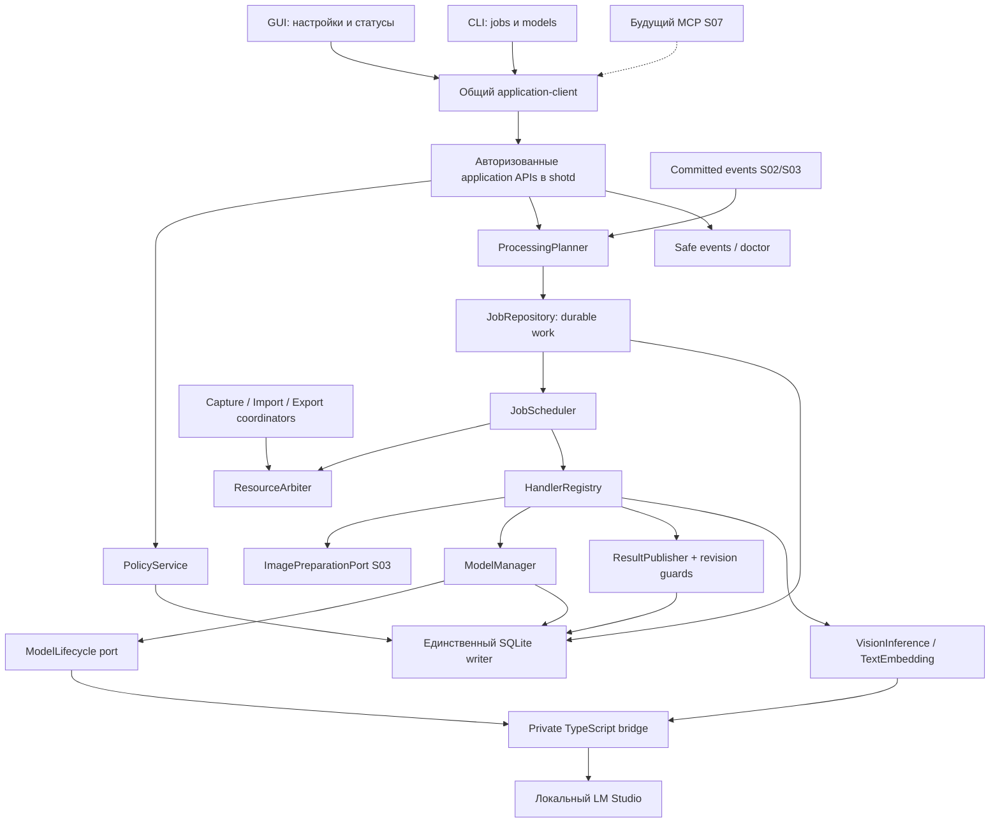
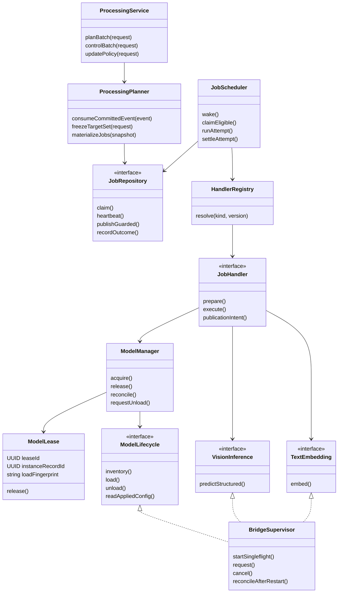
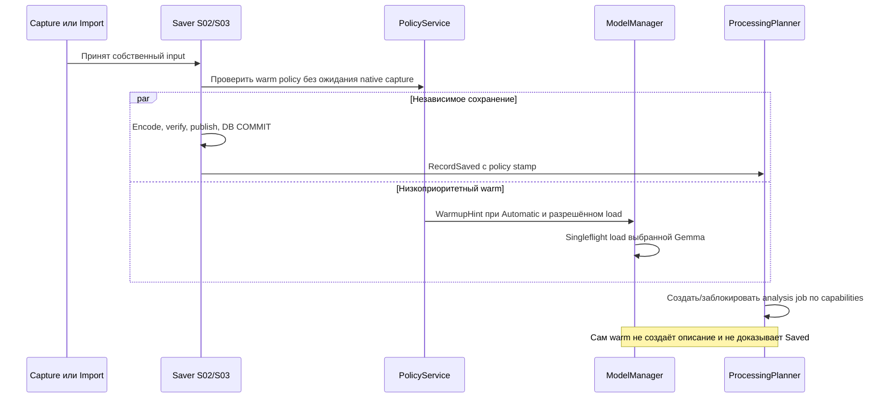
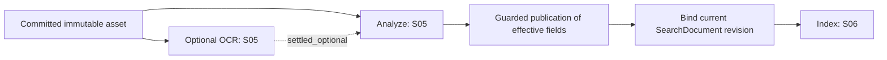
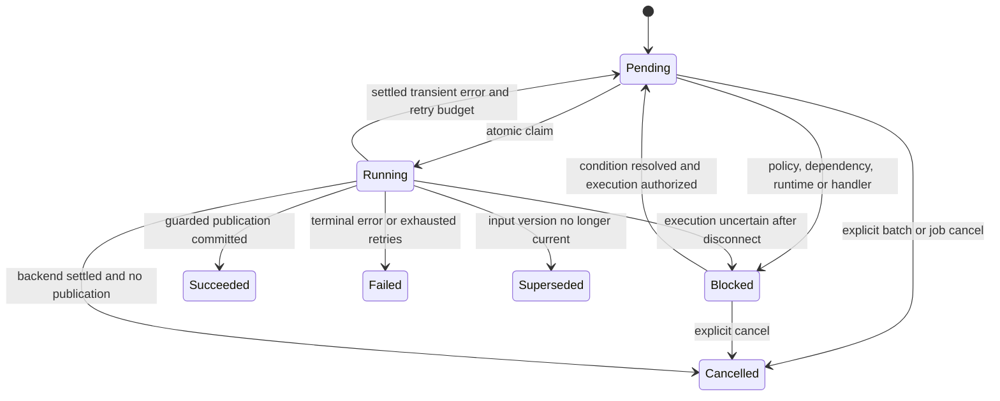
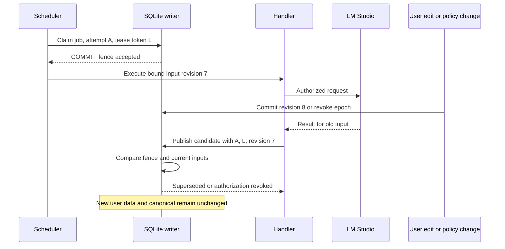
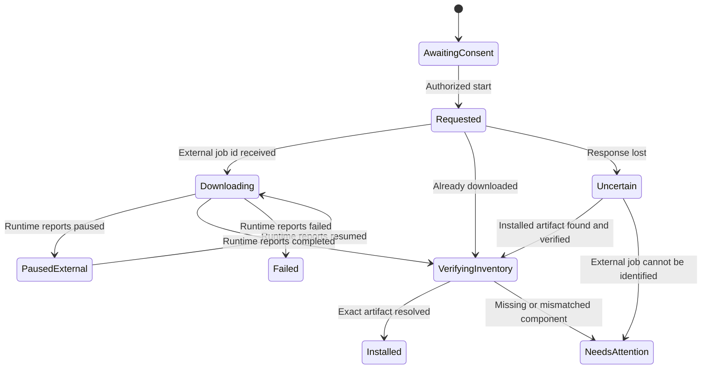
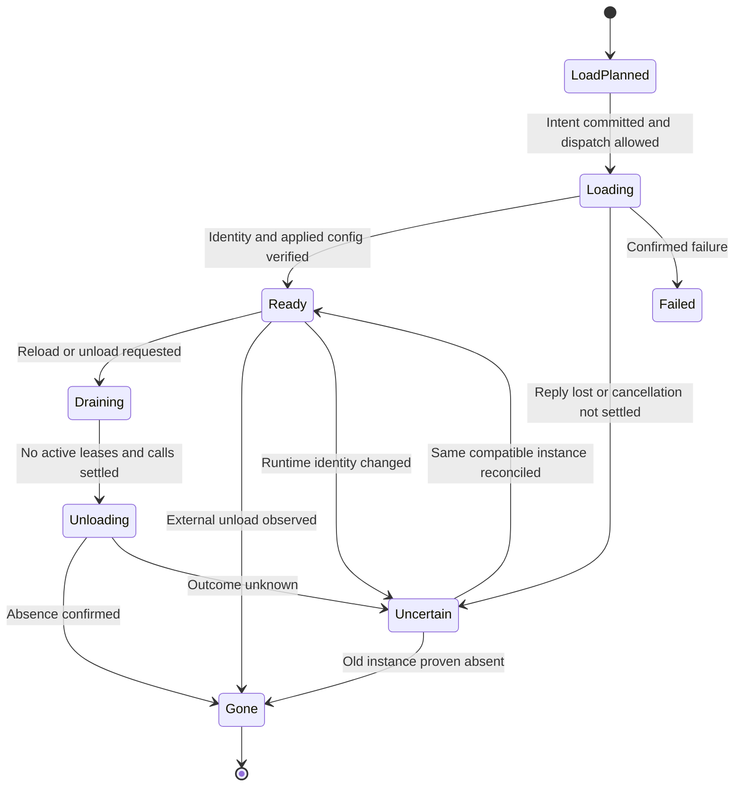

## S04: библиотека не ждёт модель, модель не распоряжается библиотекой ⚙️

Четвёртый этап добавляет управляемую фоновую работу к уже самостоятельной библиотеке изображений. Скриншоты, drop zone, WebP/AVIF, метаданные и экспорт остаются работоспособными без LM Studio. Новый слой умеет поставить работу в очередь, соблюдать разрешения и режим обработки, выбрать и загрузить нужную модель, выполнить ограниченный запрос, обработать отмену или сбой и безопасно освободить ресурсы.

Основной результат — **один работающий механизм очереди и один менеджер моделей в `shotd`**, независимые от открытого GUI. Полноценные поисковые описания появятся на S05, а векторный индекс и выдача — на S06. На S04 настоящий runtime проверяется синтетическими vision/embedding-запросами, а публикация результатов в библиотеку — контролируемыми тестовыми обработчиками. Поддельные AI-описания в пользовательские записи не добавляются.

Это **документ 4 из 8**. Внутренние задачи `S04-T01…S04-T15` не являются новыми крупными этапами. Подготовка этого файла не означает выполнения S01–S03: перед реализацией проверяются их фактические контрольные точки и отчёты.

> [!important] Спецификация, внешние источники и исполнение
> Прочитаны относящиеся к S04 разделы master v3, контракты S01/S02 и входы S03; проверены официальные материалы LM Studio и исходники SDK. Приведённые API ScreenMemory, таблицы, бюджеты и задачи — проектные решения. Windows, модели и само приложение при подготовке документа не запускались. Возможности в Git `main` или на фиксированном source SHA не объявляются автоматически доступными в установленном npm-пакете.

### Навигация 📚

| Раздел | Назначение |
|---|---|
| [1. Scope и входы](#scope) | Границы S04, обязательные результаты и связь с предыдущими этапами |
| [2. Проверенные предпосылки](#external) | Что действительно предоставляют SDK/API и где остаётся capability gate |
| [3. Архитектура и ownership](#architecture) | Компоненты, structs/traits, процессы и межмодульные связи |
| [4. Политики обработки](#policy) | Automatic/Manual/Off, ранняя загрузка, поиск, пауза и восстановление |
| [5. Контракты приложения](#contracts) | DTO, сигнатуры, права, версии, snapshots и ошибки |
| [6. Schema 4](#database) | Durable jobs, попытки, batches, профили, вызовы runtime и миграции |
| [7. Планирование и исполнение](#scheduler) | События, claim, lease, зависимости, идемпотентность и публикация |
| [8. Каталог и скачивание](#download) | Gemma/Qwen, разрешение артефактов, consent, progress и recovery |
| [9. Настройки моделей](#profiles) | Load/prediction/lifecycle, KV-cache, контекст, 4000/100 и applied config |
| [10. Production SDK bridge](#bridge) | Private Node, протокол, mapping SDK, локальность и секреты |
| [11. Inference-порты](#inference) | Изображения S03, structured output, embeddings и технический self-test |
| [12. Менеджер моделей](#lifecycle) | Singleflight, ownership, память, TTL и смена выбранной модели |
| [13. Сбои и отмена](#recovery) | Timeout, uncertain backend, restart, sleep и безопасное завершение |
| [14. GUI и CLI этого этапа](#interfaces) | Реальные настройки/статусы и управляющие команды без второй логики |
| [15. Логи и диагностика](#observability) | События, метрики, redaction, doctor и privacy |
| [16. Тесты и fixtures](#testing) | AAA-сценарии, fake/live suites, fault/mutation и compatibility matrix |
| [17. Задачи и коммиты](#tasks) | Пятнадцать исполняемых шагов с проверяемыми результатами |
| [18. Приёмка](#acceptance) | Команды, gates, checklist, отчёты и промежуточная демонстрация |
| [19. Передача и трассируемость](#handoff) | Входы S05–S08, requirement → task → test → evidence |
| [20. Источники](#sources) | Прочитанные планы и первичные технические материалы |

<a id="scope"></a>
## 1. Граница S04 и входные обязательства 🎯

### 1.1. Что должно работать в `runtime-processing-alpha` 📦

После этапа приложение сохраняет прежние возможности S02/S03 и получает настройки обработки, наблюдаемую очередь, управление установленными и загруженными моделями, скачивание по согласию, профили и технические self-tests. Закрытие поискового окна не останавливает принятую работу. Отключение AI запрещает новые inference/load-вызовы и применение отозванных результатов, но не портит собственные изображения.

| Входит в S04 | Остаётся соседнему этапу |
|---|---|
| Durable AI jobs/batches, claim/lease, retries, pause/cancel/recovery | Прикладной алгоритм OCR/PromptBuilder/AiRun — S05 |
| Automatic/Manual/Off и отдельные права загрузки для background/query | Реальный semantic query и sqlite-vec — S06 |
| Production bridge вне WebView, локальный LM Studio, SecretStore | OpenAI-compatible и Unsloth adapters — будущие версии |
| Каталог трёх Gemma QAT и одного Qwen0.6B; Download/load/unload | Ансамбли моделей, Qwen4B/8B, scheduler по времени — не V1 |
| Профили context/K/V/FA/offload, max4000, capability-gated budget100 | Автоматический подбор «лучшей» модели и обещания качества без измерений |
| Sequential/co-resident, ownership, idle/AfterBatch/KeepLoaded | Полный ресурсный менеджер чужих приложений — не цель продукта |
| Настройки и status в базовом GUI/CLI | Полировка всего интерфейса, MCP transport и permissions UX — S07 |
| Fake-handler tests и live synthetic requests | Успешный анализ реальных записей до появления production handler не имитируется |

**При отсутствии handler** `analyze`/`index` запрос не возвращает фиктивный успех. Явная работа может быть сохранена со статусом `blocked: handler_unavailable`, а интерфейс показывает владельца следующего этапа. Автоматическая обработка до регистрации production-пайплайна не создаёт бесконтрольную очередь пустых задач.

### 1.2. Входной manifest 🧷

| Вход | Проверяется до изменения реализации |
|---|---|
| Master v3, S01–S03 | Версии и hashes, указанные в YAML; существенные расхождения оформлены change note |
| Accepted code checkpoint S03 | Реальные binary/commit и отчёт, не просто скачанный план |
| Schema 3 | `records/assets`, `ingest_operations`, `library_events`, import/export tables и миграции |
| Протокол | Application 1.2, отдельные bridge 1.0 и image-worker 1.0, asset transfer 1 |
| Сохранность | Saved после canonical+DB commit; recovery snapshots не являются кешем |
| Image service | `PreparedInferenceImage`/lease, PNG 1024/2048, отсутствие обращения к внешнему source |
| Host | Один writer, worker для SQLite, native thread, named pipe, principal/scopes |
| Runtime proof S01 | Приватный Node/SDK, реальные model keys и известные ограничения |
| Ресурсы S03 | Image worker, memory/codec permits, резерв capture, безопасная отмена |
| Quality | Redacted tracing, fake clock/runtime, schema fixtures и Windows verify scripts |

Отсутствующий вход получает `BLOCKED` или `NOT_RUN`. Переименование файла плана в «готовую основу» не даёт права объявить работающим SDK или кодек.

### 1.3. Что нельзя переписать ради новой очереди 🔒

`ImportBatch` S03 остаётся импортной сессией, `ExportOperation` — экспортной операцией, `ingest_operations` — журналом собственных файлов. Они **не превращаются** в AI-batch с ещё одним независимым состоянием Saved. Capture до durable staging не отправляется ждать модельной очереди.

S04 вводит общий **планировщик ресурсов и исполнения**, но не требует, чтобы все состояния продукта хранились в одной таблице. Файловые coordinators используют общий `ResourceArbiter`; durable AI-работы хранятся в `processing_jobs`. Их state machines различаются по смыслу. Будущий перенос отдельного file work unit под scheduler выполняется через существующий operation ID и его идемпотентный commit, а не созданием второй копии операции.

Старые receipts, sequence событий, права на пути, исходный/текущий asset, WebP/AVIF и политика хранения S03 сохраняются. Потеря LM Studio не вызывает reimport, повторный capture или удаление canonical.

<a id="external"></a>
## 2. Проверенные внешние возможности и пределы обещаний 🔬

### 2.1. SDK — средство управления, не готовый ProcessingManager 📘

Официальный SDK различает `.load(key)`, создающий новый instance, и `.model(key)`, способный получить уже загруженную модель **или загрузить отсутствующую**. Поэтому `.model(key)` не используется как безобидная проверка inventory. Для перечисления используются `client.system.listDownloadedModels()`, `client.llm.listLoaded()` и `client.embedding.listLoaded()`. [SRC-01], [SRC-02]

В исследованном `ModelNamespace.ts` explicit load принимает identifier, config, signal, ttl и progress callback. В нём также присутствует выбор `deviceIdentifier`: `null` означает local-only, а пропуск может допускать каскадное разрешение по устройствам. **Локальный адрес сервера сам по себе не доказывает, что LM Studio не направит работу на другое устройство.** [SRC-03]

Возможность `createDynamicHandle(identifier)` не означает привязки навечно к одному физическому instance: после внешней выгрузки и загрузки handle может разрешиться заново. Read-only inventory, specific handle и проверка identity выполняют разные функции. [SRC-03]

### 2.2. Таблица использования API 🧰

| Возможность | Подтверждённая поверхность | Решение ScreenMemory |
|---|---|---|
| Inventory диска | SDK `system.listDownloadedModels()` | Фильтрация local device и известных artifacts |
| Inventory RAM/VRAM | SDK `llm.listLoaded()` / `embedding.listLoaded()` | Отдельный статус loaded, не вывод из download-файла |
| Новый instance | SDK `.load(key, options)` | Только через ModelManager с persisted load intent |
| Config readback | `getLoadConfig()` в исходниках LLM/embedding handles | `reported_applied`; это не автоматический аппаратный benchmark |
| KV types | SDK `llamaKCacheQuantizationType` / `llamaVCacheQuantizationType` | Независимые поля, validation и live compatibility |
| Reasoning budget | Экспериментальное `reasoningBudget` в prediction types | Capability-gated; source support ≠ published package ≠ runtime effect |
| Idle TTL | SDK load option `ttl`, секунды простоя | Native safety + собственный lease-aware lifecycle, без TTL=0 догадок |
| Structured vision | `.respond()` + image handle + JSON schema | Проверка завершённости, schema и stop reason |
| Embedding | `.embed(text)` у embedding handle | Технический вектор; публикация индекса остаётся S06 |
| Download | REST `POST /api/v1/models/download` и status endpoint | Узкий HTTP adapter **внутри того же bridge**, не свой downloader |
| Cancel load/prediction | AbortSignal / `OngoingPrediction.cancel()` | Запрос отмены и отдельное подтверждение завершения |

Источники для таблицы: [SRC-01]–[SRC-10]. Имена в собственной схеме ScreenMemory не отправляются в REST механическим преобразованием в `snake_case`.

### 2.3. Что запрещено предполагать 🛑

Наличие `reasoningBudget` в Git-исходнике не позволяет использовать `as any` и утверждать, что установленный SDK его применил. Наличие статуса Download `paused` не подтверждает существование команды Pause. Совпадение названия модели не подтверждает совпадение quant, vision-компонента и tokenizer. Успешный SDK call не подтверждает, что K/V действительно имеют требуемый формат.

Не обещаются ни «все флаги llama.cpp доступны через LM Studio», ни неизменность его внешних API, ни отсутствие сторонней выгрузки. В отчёте перечисляются конкретные проверенные связки SDK/runtime/backend/model/device. Обнаруженное ограничение отображается как `unsupported` или `not_verifiable`, а не как скрытый fallback.

### 2.4. Известные уточнения относительно ранней переписки 🧾

**4000** — общий предел генерации, включая reasoning, а не 4000 финального JSON плюс размышления сверху. **100** — желаемый budget reasoning только в режиме Budget и при подтверждённой поддержке. `reasoningBudget=false` означает отсутствие лимита, а не выключение thinking. [SRC-05]

Structured output может оказаться неполным при отмене или лимите токенов; поэтому JSON Schema не отменяет проверку исхода запроса. [SRC-07]

Native TTL не является механизмом владения: LM Studio не знает о наших DB job leases, immutable asset leases и правах MCP. Эти правила реализуются в host. Новый semantic query тоже требует embedding, но get/list/export и lexical search — нет; полноценная поисковая реализация остаётся S06. [PLAN-M], [SRC-06], [SRC-09]

<a id="architecture"></a>
## 3. Архитектура: один host и отдельный runtime adapter 🧱

### 3.1. Компонентная схема 🔗



Frontend не импортирует SDK и не запускает модели через `useEffect`. CLI не создаёт параллельную queue. Bridge выполняет адаптацию API, но не выбирает категорию, не решает, разрешена ли фоновая обработка, и не меняет SQLite.

### 3.2. Структуры и интерфейсы 🧬



Диаграмма показывает Rust traits и ownership, не объектное наследование сервисов. `ModelLease` — внутреннее право использования. JSON клиента с похожими полями не становится действительным lease.

### 3.3. Два разных lease и один внешний вызов 🧷

**Job lease** даёт конкретному worker право применить результат одной попытки. **Model lease** запрещает нашему менеджеру выгрузить instance, пока он нужен разрешённому consumer. **RuntimeCall** фиксирует факт возможной внешней работы, которая может пережить потерю bridge-соединения.

Истечение job lease снимает право публикации, но **не доказывает завершение inference**. Освобождение model lease не следует только из timeout клиента. Для этих состояний существуют разные таблицы, события и тесты.

### 3.4. Дельта структуры репозитория 📂

```text
crates/application/src/
  processing/{service,policy,planner,scheduler,handlers,publication}.rs
  runtime/{model_manager,catalog,profiles,downloads,capabilities}.rs
  ports/{jobs,runtime,clock,resources,results}.rs
crates/infrastructure/src/
  sqlite/{job_repository,runtime_repository,processing_migrations}.rs
  runtime/{bridge_client,supervisor,endpoint_config}.rs
crates/domain/src/
  processing/{jobs,batches,policy,revisions}.rs
  runtime/{profiles,instances,leases,capabilities}.rs
crates/protocol/src/
  processing.rs / models.rs / runtime_bridge.rs
packages/lmstudio-bridge/src/
  inventory.ts / lifecycle.ts / downloads.ts / config-mapping.ts
  vision.ts / embeddings.ts / capability-probe.ts / dispatch.ts
app/frontend/src/features/
  processing/ / models/ / settings/ai/
migrations/0004_processing_runtime.sql
catalog/lmstudio-v1.json
schemas/processing-policy-v1.json
schemas/model-profile-v1.json
schemas/runtime-capabilities-v1.json
tests/{processing,runtime,contracts,faults,windows}/
docs/progress/S04/
```

Используются composition root и worker boundaries S01–S03. Новый отдельный daemon для каждой модели, Redis, брокер сообщений, Docker или системная Windows Service не вводятся.

<a id="policy"></a>
## 4. Политики обработки и точный смысл кнопок 🚦

### 4.1. Настройки и исходные значения 🎛️

| Поле | Значения | Начальное правило |
|---|---|---|
| `ai_enabled` | true/false | false до осознанного включения |
| `processing_mode` | automatic/manual | automatic после включения AI |
| `warm_vision_on_ingest` | true/false | true, но действует только в Automatic |
| `background_model_loading` | allow/forbid | allow после согласия на AI |
| `query_model_loading` | ask/allow/forbid | ask; query intent должен быть явным |
| `queue_paused` | true/false | false; относится к фоновым AI-jobs |
| `ocr_enabled` | true/false | Наследуется, не подменяется `ai_enabled` |
| `memory_mode` | sequential/co_resident | sequential |
| `vision_retention` | idle/after_batch/keep_loaded | idle900 секунд |
| `embedding_retention` | idle/after_batch/keep_loaded | idle300 секунд |
| `resume_interrupted_ai` | ask | При новом запуске host не начинать неожиданную модельную нагрузку |

Последнее правило конкретизирует master: открытие программы само по себе не загружает модели. Recovery восстанавливает учёт и безопасные состояния; продолжение прерванного AI-batch требует Resume. Повторное открытие **GUI при живом host** не считается restart и не приостанавливает уже работающий batch. Будущий OnStartup создаст отдельный разрешённый запуск, а не подменит это правило.

`background_model_loading=forbid` разрешает допустимому job использовать уже загруженный совместимый **собственный** instance, но запрещает загрузить новый. Это не полное выключение AI. `ai_enabled=false`, напротив, запрещает оба действия.

### 4.2. Матрица действий 📋

| Действие | Automatic + AI on | Manual + AI on | AI off |
|---|---|---|---|
| Принято новое изображение | Возможен ранний warm; анализ только после Saved | Нет warm и автоматического AI | Нет warm/load/inference |
| Новый record committed | Planner создаёт разрешённый план | Сохраняется статус необработанности | Сохраняется статус необработанности |
| Ручная правка описания S05 | FTS сразу; Index по policy | FTS сразу; Index ожидает ручного запуска | FTS сразу; никаких model calls |
| Process selected | Явный batch | Явный batch | `AI_DISABLED`, предложение включить |
| Index only | Только embedding, без vision | То же по явному запросу | Запрещено |
| Новый semantic query S06 | Inference по query policy | Inference по отдельной query policy | Semantic выключен |
| List/get/export/пустая строка поиска | Без моделей | Без моделей | Без моделей |
| Settings/status/обычный doctor | Read-only диагностика | То же | То же |
| Явный Download | Отдельное согласие | Отдельное согласие | Разрешим download на диск без включения inference |
| Paused AI queue | Не брать новые background jobs | То же | Запрет сохраняется |

Явный `RunNow` не означает разрешения обойти `AI off`, scopes или запрет загрузки. Если модели нет в памяти, запрос содержит разрешение на load либо получает объяснимый blocked outcome. Кнопка Resume не превращает отсутствие модели на диске в согласие скачать её.

### 4.3. Ранний warm-up без задержки скриншота 📸

Для capture ранний сигнал появляется **после mouse-up/принятия crop**, когда исходный frozen desktop уже не нужен native overlay. Для импорта — после durable source snapshot и дешёвой проверки поддержанного статического изображения, а не на drag-enter или обходе каждого файла.

`WarmupHint` содержит только ingest operation ID, policy revision и выбранный профиль; пиксели и EXIF менеджеру загрузки не нужны. Hint низкоприоритетный, дедуплицируется по instance/load fingerprint, не запускается в native thread и не блокирует сохранение. Он не прерывает активный запрос Qwen ради загрузки Gemma.



Esc до принятия crop не грузит модель. Ошибка сохранения отзывает неиспользованный warm intent; уже загруженная собственная модель освобождается по политике, а orphan AI-job не создаётся. Тысяча импортируемых файлов создаёт максимум один совместимый load flight, не тысячу отдельных моделей.

Warm reservation ограничена 60 секундами ожидания потребителя и не держит модель бесконечно. Она не вызывает фиктивные prompts для сброса TTL. Перед настоящим inference instance всё равно перепроверяется.

### 4.4. Изменение политики и отзыв разрешений 🔐

У политики есть **revision** для редактирования настроек и **authorization epoch** для отзыва вычислительных полномочий. Включение Off, отзыв principal, запрет загрузки/передачи, смена endpoint на несовместимый и другие ограничивающие изменения повышают epoch. Изменение только длительности idle не обязано инвалидировать уже выполненное описание.

Host получает короткий admission gate, сохраняет новую policy, обновляет in-memory snapshot **до освобождения gate**, затем отменяет соответствующие in-flight intents. Новое решение dispatch проходит тот же gate. Сетевое выполнение уже разрешённого вызова не удерживает его; факт admission до отзыва означает in-flight request, подлежащий последующей отмене, а не новую авторизацию после Off. Worker проверяет её перед acquire, непосредственно перед dispatch и перед публикацией. Начавшийся до отзыва внешний вызов невозможно «сделать не происходившим»; его cancel имеет отдельное состояние, а поздний результат старого epoch не применяется.

Одна проверка `if ai_enabled` при enqueue недостаточна. Нельзя также держать mutex политики весь период сетевой генерации: короткий admission gate сериализует решение о dispatch с изменением policy, после отправки управление переходит к cancellation/epoch guard.

Automatic→Manual прекращает **новое** автоматическое исполнение; уже начатый разрешённый запрос может завершиться, если AI не выключен. Отдельная кнопка Cancel прерывает и его. Off — более сильное действие: инициирует отмену текущего AI и запрещает публикацию отозванного результата.

### 4.5. История не обрабатывается без запроса 🕰️

Включение AI, смена Gemma, увеличение контекста и установка S04 не запускают обработку всех старых файлов. Новый record получает policy stamp в момент commit. Planner использует этот stamp и актуальные разрешения, поэтому отставший event consumer не превращает вчерашний Manual-import в сегодняшнюю автоматическую обработку.

Для существующего backlog доступны «Обработать ожидающие» и выбор конкретных записей. Набор фиксируется на момент нажатия и не пополняется бесконечно новыми изображениями. Эффект переключения Automatic распространяется на новые события, а продолжение ранее остановленных jobs выполняется отдельным Resume.

### 4.6. AI-пауза не блокирует файловую библиотеку 🗃️

`queue_paused` приостанавливает старт background AI jobs. Capture persistence, импорт/экспорт S03 и чтение файлов остаются под собственными controls и guards. Их отдельные Pause/Cancel сохраняются. Управление общими ресурсами не превращает кнопку «Пауза AI» в запрет сделать скриншот.

Для явного semantic query используются отдельная query-policy и очередь интерактивного runtime intent. Запрос не исполняется через неявный Resume всего backlog. Правило исключает неожиданную обработку сотен картинок после одного поиска.

<a id="contracts"></a>
## 5. Контракты S04: не строковые команды, а типизированные действия 📐

### 5.1. Версии и правила сериализации 🔌

Application protocol расширяется с **1.2 до 1.3**. Новые capabilities: `processing_jobs_v1`, `processing_policy_v1`, `model_profiles_v1`, `model_lifecycle_v1`, `runtime_self_test_v1`. Asset transfer остаётся version 1, image worker — 1.0. Приватный bridge расширяется до **1.1**, независимо от application protocol.

Совместимость определяется handshake и capabilities, не правилом «любой minor выше подходит». Методы capture/import/export S02/S03 не меняют семантику. UUID — строки; revision/epoch/sequence/byte counters — decimal strings с проверяемым диапазоном. Enums сериализуются закрытым словарём, неизвестные поля запросов отклоняются.

Приведённые ниже signatures — **собственные контракты ScreenMemory**, не методы Inspector или SDK. Общие `RequestContext`, `AppError`, `BatchReceipt`, `JobReceipt`, `NativePathDto`, `PreparedInferenceImage` и IDs импортируются из уже согласованных модулей. Реализация должна компилировать эти объявления и проверять сгенерированные JSON Schema/TypeScript fixtures.

### 5.2. Политика и управление batch 🧩

```rust
use async_trait::async_trait;
use serde::{Deserialize, Serialize};
use tokio_util::sync::CancellationToken;
use uuid::Uuid;

#[derive(Clone, Copy, Serialize, Deserialize)]
#[serde(rename_all = "snake_case")]
pub enum ProcessingMode { Automatic, Manual }

#[derive(Clone, Copy, Serialize, Deserialize)]
#[serde(rename_all = "snake_case")]
pub enum LoadPermission { Allow, Forbid }

#[derive(Clone, Copy, Serialize, Deserialize)]
#[serde(rename_all = "snake_case")]
pub enum QueryLoadPolicy { Ask, Allow, Forbid }

#[derive(Clone, Copy, Serialize, Deserialize)]
#[serde(rename_all = "snake_case")]
pub enum MemoryMode { Sequential, CoResident }

#[derive(Clone, Serialize, Deserialize)]
#[serde(tag = "kind", rename_all = "snake_case", deny_unknown_fields)]
pub enum RetentionPolicy {
    Idle { seconds: u32 },
    AfterBatch,
    KeepLoaded,
}

#[derive(Clone, Serialize, Deserialize)]
#[serde(deny_unknown_fields)]
pub struct ProcessingPolicy {
    pub ai_enabled: bool,
    pub processing_mode: ProcessingMode,
    pub warm_vision_on_ingest: bool,
    pub background_model_loading: LoadPermission,
    pub query_model_loading: QueryLoadPolicy,
    pub queue_paused: bool,
    pub memory_mode: MemoryMode,
    pub vision_retention: RetentionPolicy,
    pub embedding_retention: RetentionPolicy,
}

#[derive(Clone, Serialize, Deserialize)]
pub struct ProcessingPolicyView {
    pub revision: String,
    pub authorization_epoch: String,
    pub value: ProcessingPolicy,
}

#[derive(Clone, Serialize, Deserialize)]
#[serde(deny_unknown_fields)]
pub struct UpdateProcessingPolicy {
    pub operation_id: Uuid,
    pub expected_revision: String,
    pub value: ProcessingPolicy,
}

#[derive(Clone, Copy, Serialize, Deserialize)]
#[serde(rename_all = "snake_case")]
pub enum ProcessAction { AnalyzeOnly, IndexOnly, AnalyzeThenIndex }

#[derive(Clone, Serialize, Deserialize)]
#[serde(tag = "kind", rename_all = "snake_case", deny_unknown_fields)]
pub enum ProcessSelection {
    Selected { record_ids: Vec<Uuid> },
    PendingSnapshot { filter: PendingFilter },
    FailedSnapshot { previous_batch_id: Option<Uuid> },
}

#[derive(Clone, Serialize, Deserialize)]
#[serde(deny_unknown_fields)]
pub struct PendingFilter {
    pub source_kind: Option<String>,
    pub application_id: Option<Uuid>,
    pub ingested_from_utc: Option<String>,
    pub ingested_to_utc: Option<String>,
}

#[derive(Clone, Serialize, Deserialize)]
#[serde(deny_unknown_fields)]
pub struct ProcessBatchRequest {
    pub operation_id: Uuid,
    pub selection: ProcessSelection,
    pub action: ProcessAction,
    pub force_new_analysis: bool,
    pub expected_policy_revision: String,
    pub allow_model_load: bool,
    pub model_load_consent_id: Option<Uuid>,
}

#[derive(Clone, Copy, Serialize, Deserialize)]
#[serde(rename_all = "snake_case")]
pub enum BatchControl { Pause, Resume, Cancel }

#[derive(Clone, Serialize, Deserialize)]
#[serde(deny_unknown_fields)]
pub struct ControlBatchRequest {
    pub batch_id: Uuid,
    pub expected_revision: String,
    pub control: BatchControl,
}

#[async_trait]
pub trait ProcessingApi: Send + Sync {
    async fn policy(&self, ctx: RequestContext)
        -> Result<ProcessingPolicyView, AppError>;
    async fn update_policy(&self, ctx: RequestContext, req: UpdateProcessingPolicy)
        -> Result<ProcessingPolicyView, AppError>;
    async fn process_records(&self, ctx: RequestContext, req: ProcessBatchRequest)
        -> Result<BatchReceipt, AppError>;
    async fn batch(&self, ctx: RequestContext, id: Uuid)
        -> Result<ProcessingBatchView, AppError>;
    async fn jobs(&self, ctx: RequestContext, req: JobsPageRequest)
        -> Result<JobPage, AppError>;
    async fn control_batch(&self, ctx: RequestContext, req: ControlBatchRequest)
        -> Result<ProcessingBatchView, AppError>;
    async fn cancel_job(&self, ctx: RequestContext, req: JobControlRequest)
        -> Result<JobView, AppError>;
    async fn retry_job(&self, ctx: RequestContext, req: JobControlRequest)
        -> Result<JobView, AppError>;
}
```

`PendingFilter.source_kind` ограничен существующим enum S02/S03; String в эскизе не означает произвольный SQL. `Selected` содержит 1…512 уникальных UUID. Большая библиотека выбирается серверным snapshot, а не десятками мегабайт IDs в IPC. Предел одного ручного batch первоначально 20 000 записей; превышение требует явного более узкого выбора или подтверждённой настройки, а не молчаливого усечения.

`force_new_analysis=true` допустим только для action с Analyze. Он создаёт новый run intent и не снимает пользовательские overrides. Смена модели в настройках сама по себе этот флаг не выставляет. Reindex не вызывает vision.

### 5.3. Состояния и результаты 📊

```rust
#[derive(Clone, Copy, Serialize, Deserialize)]
#[serde(rename_all = "snake_case")]
pub enum JobState {
    Pending, Blocked, Running, Succeeded, Failed, Cancelled, Superseded,
}

#[derive(Clone, Copy, Serialize, Deserialize)]
#[serde(rename_all = "snake_case")]
pub enum JobPhase {
    Waiting, PreparingInput, AcquiringModel, Executing,
    CancelRequested, SettlingBackend, Publishing, Finished,
}

#[derive(Clone, Serialize, Deserialize)]
pub struct JobView {
    pub job_id: Uuid,
    pub batch_id: Uuid,
    pub record_id: Option<Uuid>,
    pub kind: String,
    pub state: JobState,
    pub phase: JobPhase,
    pub revision: String,
    pub attempt_count: u16,
    pub retry_count: u16,
    pub not_before_utc: Option<String>,
    pub blocked_reason: Option<String>,
    pub safe_error_code: Option<String>,
    pub cancel_requested: bool,
    pub backend_outcome: String,
}

#[derive(Clone, Serialize, Deserialize)]
pub struct ProcessingBatchView {
    pub batch_id: Uuid,
    pub revision: String,
    pub state: String,
    pub total_records: String,
    pub succeeded_records: String,
    pub pending_records: String,
    pub running_records: String,
    pub blocked_records: String,
    pub failed_records: String,
    pub cancelled_records: String,
    pub superseded_records: String,
    pub available_handlers: Vec<String>,
}

#[derive(Clone, Serialize, Deserialize)]
#[serde(deny_unknown_fields)]
pub struct JobControlRequest {
    pub job_id: Uuid,
    pub expected_revision: String,
}

#[derive(Clone, Serialize, Deserialize)]
#[serde(deny_unknown_fields)]
pub struct JobsPageRequest {
    pub batch_id: Option<Uuid>,
    pub state: Option<JobState>,
    pub limit: u16,
    pub cursor: Option<String>,
}

#[derive(Clone, Serialize, Deserialize)]
pub struct JobPage {
    pub items: Vec<JobView>,
    pub next_cursor: Option<String>,
    pub event_sequence: String,
}
```

Точные словари строковых `kind`, batch state, phase reason и backend outcome фиксируются schema. Phase не считается вторым независимым состоянием job: валидатор разрешает только осмысленные пары. Например `succeeded + executing` невозможны. `backend_outcome=unknown` не выдаётся как «готово».

Batch progress считает **records**, а не только число низкоуровневых шагов. Счётчики pending/running/blocked/failed/cancelled/superseded/succeeded взаимно исключаются; их сумма равна total. Для частично выполненной цепочки приоритет состояния: failed → cancelled → superseded → blocked → running → pending → succeeded. Точный rollup проверяется по обязательным шагам; optional OCR в нём не подменяет обязательный исход. AnalyzeThenIndex для 50 записей не превращается в «100 изображений». Отдельно можно показать выполненные steps. Record считается succeeded, когда успешны все запрошенные для него обязательные шаги. Ошибка необязательного OCR сама по себе не делает vision проваленным.

### 5.4. Runtime API и model operations 🔧

```rust
#[derive(Clone, Copy, Serialize, Deserialize)]
#[serde(rename_all = "snake_case")]
pub enum ModelRole { Vision, Embedding }

#[derive(Clone, Serialize, Deserialize)]
#[serde(deny_unknown_fields)]
pub struct SetSelectedProfileRequest {
    pub operation_id: Uuid,
    pub role: ModelRole,
    pub profile_id: Uuid,
    pub expected_profile_revision: String,
    pub expected_selection_revision: String,
    pub apply: ProfileApplyMode,
}

#[derive(Clone, Copy, Serialize, Deserialize)]
#[serde(rename_all = "snake_case")]
pub enum ProfileApplyMode { FutureWork, ReloadWhenIdle }

#[derive(Clone, Serialize, Deserialize)]
#[serde(deny_unknown_fields)]
pub struct ModelLoadRequest {
    pub operation_id: Uuid,
    pub profile_id: Uuid,
    pub expected_profile_revision: String,
    pub consent_id: Option<Uuid>,
}

#[derive(Clone, Serialize, Deserialize)]
#[serde(deny_unknown_fields)]
pub struct ModelUnloadRequest {
    pub operation_id: Uuid,
    pub instance_record_id: Uuid,
    pub when_idle: bool,
}

#[derive(Clone, Serialize, Deserialize)]
#[serde(deny_unknown_fields)]
pub struct DownloadRequest {
    pub operation_id: Uuid,
    pub catalog_id: String,
    pub catalog_revision: String,
    pub consent_id: Uuid,
}

#[async_trait]
pub trait ModelControlApi: Send + Sync {
    async fn catalog(&self, ctx: RequestContext) -> Result<ModelCatalogView, AppError>;
    async fn inventory(&self, ctx: RequestContext) -> Result<ModelInventoryView, AppError>;
    async fn profiles(&self, ctx: RequestContext) -> Result<Vec<ModelProfileView>, AppError>;
    async fn update_profile(&self, ctx: RequestContext, req: UpdateModelProfileRequest)
        -> Result<ModelProfileView, AppError>;
    async fn select_profile(&self, ctx: RequestContext, req: SetSelectedProfileRequest)
        -> Result<SelectionReceipt, AppError>;
    async fn start_download(&self, ctx: RequestContext, req: DownloadRequest)
        -> Result<ModelOperationReceipt, AppError>;
    async fn load(&self, ctx: RequestContext, req: ModelLoadRequest)
        -> Result<ModelOperationReceipt, AppError>;
    async fn unload(&self, ctx: RequestContext, req: ModelUnloadRequest)
        -> Result<ModelOperationReceipt, AppError>;
    async fn operation(&self, ctx: RequestContext, id: Uuid)
        -> Result<ModelOperationView, AppError>;
    async fn self_test(&self, ctx: RequestContext, req: RuntimeSelfTestRequest)
        -> Result<BatchReceipt, AppError>;
}
```

`ModelOperationReceipt` содержит operation ID, вид, текущее состояние и event sequence; он не утверждает, что Download или Load уже завершились. `ModelOperationView` раскрывает безопасный progress, outcome, причины, actual instance и применённые поля. Edit/Select использует expected revisions; данные, обновлённые другим клиентом, не затираются.

`RuntimeSelfTestRequest` ссылается на **фиксированную synthetic fixture** и конкретный profile revision, включает `allow_load` и действующий consent. Он не становится публичным chat endpoint для произвольных файлов и prompts. Сами `ModelProfile`, capability vocabulary и schema проверки раскрыты в §9.

### 5.4a. Недостающие управляющие DTO и выдача consent 🧾

`ModelProfileView` содержит UUID профиля, роль, revision, catalog ID, исходную конфигурацию, fingerprints и capability report. `UpdateModelProfileRequest` содержит operation ID, profile UUID, expected revision и целиком валидированную **собственную** конфигурацию §9; SDK objects или произвольный internal KVConfig не допускаются. В JSON-примере §9 указан демонстрационный UUID, а не готовая запись пользовательской БД.

```rust
#[derive(Clone, Serialize, Deserialize)]
#[serde(rename_all = "snake_case")]
pub enum RuntimeFixture {
    SyntheticMenuV1,
    EmbeddingTextV1,
}

#[derive(Clone, Serialize, Deserialize)]
#[serde(deny_unknown_fields)]
pub struct RuntimeSelfTestRequest {
    pub operation_id: Uuid,
    pub profile_id: Uuid,
    pub expected_profile_revision: String,
    pub fixture: RuntimeFixture,
    pub allow_load: bool,
    pub consent_id: Uuid,
}

#[derive(Clone, Serialize, Deserialize)]
#[serde(tag = "kind", rename_all = "snake_case", deny_unknown_fields)]
pub enum ApprovalPurpose {
    Download { catalog_id: String, catalog_revision: String },
    Load { profile_id: Uuid, profile_revision: String },
    SelfTest { profile_id: Uuid, profile_revision: String, fixture: RuntimeFixture },
    ProcessingLoad { processing_operation_id: Uuid, request_fingerprint: String },
}

#[derive(Clone, Serialize, Deserialize)]
#[serde(deny_unknown_fields)]
pub struct AuthorizeModelActionRequest {
    pub endpoint_id: Uuid,
    pub expected_endpoint_revision: String,
    pub purpose: ApprovalPurpose,
    pub lifetime_seconds: u16,
}

#[derive(Clone, Serialize, Deserialize)]
pub struct ModelActionConsent {
    pub consent_id: Uuid,
    pub principal_id: Uuid,
    pub expires_at_utc: String,
    pub authorization_epoch: String,
}
```

В `ModelControlApi` добавляется async `authorize_action(ctx, req: AuthorizeModelActionRequest) -> Result<ModelActionConsent, AppError>`. Это owner/настроенная локальная управляющая capability; обычный агент с `run_ai` не получает право сам выдать себе любое согласие. GUI/CLI выполняет её только после явно подтверждённого действия пользователя. Host сверяет purpose с actual catalog/profile/request, а fingerprint из клиента не считается авторитетным без пересчёта.

Consent ограничен 1…300 секундами, endpoint revision, principal, purpose и epoch; расходуется при принятии одной логической operation. Replay этой operation не требует повторного расходования consent и не создаёт новую нагрузку. Restart не переносит ephemeral consent. Для ProcessBatch дальнейшие разрешённые calls опираются на сохранённое конкретное намерение пачки и текущие проверки, а не на пяти минутный срок dialog-consent: долгий batch не останавливается лишь из-за истечения UI-grant. Off или отзыв прав, напротив, отзывает его исполнение.

Этот сервис не является доказательством физического клика на недоверенной машине и не защищает от скомпрометированного owner-процесса. Он предотвращает скрытое расширение прав обычного MCP/read-only клиента. Узкое foundation probe authorization S01 маршрутизируется сюда без второго набора действующих разрешений.

### 5.5. Внутренний контракт работы и результата 🧰

```rust
pub enum AuthorizationDomain { Ai, NativeOcr }

pub struct ExecutionFence {
    pub job_id: Uuid,
    pub attempt_id: Uuid,
    pub owner_host_id: Uuid,
    pub lease_token: Uuid,
    pub authorization_epoch: i64,
    pub authorization_domain: AuthorizationDomain,
}

pub struct InputVersion {
    pub record_id: Option<Uuid>,
    pub asset_id: Option<Uuid>,
    pub asset_revision: Option<i64>,
    pub content_revision: Option<i64>,
    pub input_fingerprint: String,
    pub handler_version: String,
}

pub struct LeasedJob {
    pub fence: ExecutionFence,
    pub input: InputVersion,
    pub invocation: JobInvocation,
}

#[async_trait]
pub trait JobHandler: Send + Sync {
    fn kind(&self) -> JobKind;
    fn version(&self) -> &'static str;
    async fn prepare(&self, job: &LeasedJob, cancel: CancellationToken)
        -> Result<PreparedWork, WorkError>;
    async fn execute(&self, input: PreparedWork, cancel: CancellationToken)
        -> Result<ComputedWork, WorkError>;
    fn publication(&self, output: ComputedWork)
        -> Result<PublicationIntent, WorkError>;
}

// Вызывается только на SQLite writer; никакого network/codec IO.
pub trait JobPublicationRepository {
    fn publish_guarded(&mut self, fence: &ExecutionFence, intent: PublicationIntent)
        -> Result<PublicationReceipt, StorageError>;
}
```

`PreparedWork` владеет lease на проверенную inference-производную S03 и versioned request; `ComputedWork` — bounded output и usage, не полномочиями записи в БД. `PublicationIntent` — закрытый enum доверенных внутренних операций. Не допускаются closures из IPC, произвольный SQL или `serde_json::Value`, по которому bridge выбирает таблицу.

S04 реализует техническую result-publication для probes в отдельном diagnostic store и fake handlers в тестах. S05 добавит вариант принятия `AiRun`, S06 — публикацию vector. Их domain changes и `job.succeeded` должны фиксироваться одной writer-транзакцией. Общая проверка fence уже существует и не копируется в каждый GUI handler.

### 5.6. Права и ограничения доступа 🔐

| Scope | Разрешённые действия |
|---|---|
| `read_processing` | Свои/разрешённые batches, jobs и безопасные причины |
| `run_ai` | Явный Analyze/Index либо authorized self-test; без автоматического права load |
| `model_load` | Создание собственного instance при AI on и разрешённой policy |
| `manage_models` | Edit/select profile, разрешённый unload **своих** instance |
| `download_models` | Download с consent, без изменения inference policy |
| `manage_processing` | Policy, pause/resume/cancel, повтор своих/разрешённых работ |
| `read_runtime_inventory` | Inventory и capability report; без model calls |
| `run_runtime_self_test` | Синтетический тест выбранной связки с явной нагрузкой |

Background job действует с persisted principal/permission intent и текущими проверками доступа, а не с безграничным системным owner только потому, что остался в очереди. Ни MCP, ни callback модели не может повысить scope. Права S02/S03 на paths/images/source metadata не включаются автоматически.

Основные новые errors: `AI_DISABLED`, `BACKGROUND_LOAD_FORBIDDEN`, `QUERY_LOAD_CONFIRMATION_REQUIRED`, `HANDLER_UNAVAILABLE`, `DEPENDENCY_FAILED`, `POLICY_CHANGED`, `MODEL_NOT_INSTALLED`, `MODEL_CONFIG_UNSUPPORTED`, `MODEL_CONFIG_MISMATCH`, `MODEL_OUT_OF_MEMORY`, `MODEL_INSTANCE_LOST`, `RUNTIME_STATE_UNKNOWN`, `RESULT_SUPERSEDED`, `DOWNLOAD_STATE_UNKNOWN`, `CONSENT_EXPIRED`, `PROFILE_REVISION_CONFLICT`. Они входят в единый safe error envelope S01.

<a id="database"></a>
## 6. Schema 4: durable задания и наблюдаемое владение 🗄️

### 6.1. Миграция не переписывает историю S03 🧱

Добавляется `0004_processing_runtime.sql`. Миграции 0001–0003 и их checksums не меняются. Существующие canonical paths, origins, import receipts, export jobs и sequence `library_events` остаются прежними. Миграция не загружает SDK, не скачивает модели и не создаёт AI-jobs для старой библиотеки.

Новые processing events хранятся **отдельно**: таблица `library_events` S03 привязана к ingest operation и image asset, поэтому `model.loaded` или `job.retry_scheduled` не вставляются туда с выдуманным image ID.

DDL ниже — конкретная основа для migration fixture. SQLite worker и transaction wrapper наследуются. Проверяемые UUID, длины, enums JSON-полей и fingerprints дополнительно валидируются protocol/domain схемами. Примеры SQL не являются выполненной миграцией пользовательской библиотеки.

### 6.2. Таблицы политики, batch и job 💾

```sql
-- S04-MIGRATION-CORE: внутри транзакции существующего migrator.
CREATE TABLE processing_policy_versions (
    revision             INTEGER PRIMARY KEY CHECK (revision > 0),
    authorization_epoch  INTEGER NOT NULL CHECK (authorization_epoch > 0),
    policy_json          TEXT NOT NULL CHECK (json_valid(policy_json)),
    created_at_utc       TEXT NOT NULL
);

CREATE TABLE processing_policy_head (
    singleton            INTEGER PRIMARY KEY CHECK (singleton = 1),
    revision             INTEGER NOT NULL REFERENCES processing_policy_versions(revision)
);

CREATE TABLE processing_batches (
    id                   TEXT PRIMARY KEY,
    operation_id         TEXT NOT NULL UNIQUE,
    principal_id         TEXT NOT NULL,
    request_fingerprint  TEXT NOT NULL,
    trigger_kind         TEXT NOT NULL CHECK (trigger_kind IN
                         ('automatic','manual','self_test')),
    action               TEXT NOT NULL CHECK (action IN
                         ('analyze_only','index_only','analyze_then_index','self_test')),
    state                TEXT NOT NULL CHECK (state IN
                         ('pending','running','paused','blocked','cancelling',
                          'completed','completed_with_errors','cancelled','interrupted')),
    revision             INTEGER NOT NULL DEFAULT 1 CHECK (revision > 0),
    policy_revision      INTEGER NOT NULL REFERENCES processing_policy_versions(revision),
    selection_json       TEXT NOT NULL CHECK (json_valid(selection_json)),
    allow_model_load     INTEGER NOT NULL CHECK (allow_model_load IN (0,1)),
    membership_complete  INTEGER NOT NULL DEFAULT 0 CHECK (membership_complete IN (0,1)),
    created_at_utc       TEXT NOT NULL,
    updated_at_utc       TEXT NOT NULL
);

CREATE TABLE processing_batch_items (
    id                   TEXT PRIMARY KEY,
    batch_id             TEXT NOT NULL REFERENCES processing_batches(id),
    ordinal              INTEGER NOT NULL CHECK (ordinal >= 0),
    record_id            TEXT REFERENCES records(id),
    selected_asset_id    TEXT REFERENCES assets(id),
    item_kind            TEXT NOT NULL CHECK (item_kind IN ('record','fixture')),
    fixture_id           TEXT,
    selection_json       TEXT NOT NULL CHECK (json_valid(selection_json)),
    UNIQUE(batch_id, ordinal),
    CHECK ((item_kind = 'record' AND record_id IS NOT NULL AND fixture_id IS NULL) OR
           (item_kind = 'fixture' AND record_id IS NULL AND fixture_id IS NOT NULL))
);

CREATE TABLE processing_jobs (
    id                   TEXT PRIMARY KEY,
    item_id              TEXT NOT NULL REFERENCES processing_batch_items(id),
    step_key             TEXT NOT NULL,
    kind                 TEXT NOT NULL CHECK (kind IN
                         ('ocr','analyze','index','probe_vision','probe_embedding')),
    state                TEXT NOT NULL CHECK (state IN
                         ('pending','blocked','running','succeeded','failed','cancelled','superseded')),
    phase                TEXT NOT NULL,
    revision             INTEGER NOT NULL DEFAULT 1 CHECK (revision > 0),
    idempotency_key       TEXT NOT NULL UNIQUE,
    input_json           TEXT NOT NULL CHECK (json_valid(input_json)),
    input_fingerprint    TEXT,
    binding_state        TEXT NOT NULL CHECK (binding_state IN ('unbound','bound')),
    handler_version      TEXT NOT NULL,
    priority             INTEGER NOT NULL CHECK (priority BETWEEN 0 AND 100),
    authorization_epoch  INTEGER NOT NULL CHECK (authorization_epoch > 0),
    authorization_domain TEXT NOT NULL DEFAULT 'ai' CHECK (authorization_domain IN ('ai','native_ocr')),
    attempt_count        INTEGER NOT NULL DEFAULT 0 CHECK (attempt_count >= 0),
    retry_count          INTEGER NOT NULL DEFAULT 0 CHECK (retry_count BETWEEN 0 AND 3),
    manual_retry_generation INTEGER NOT NULL DEFAULT 0 CHECK (manual_retry_generation >= 0),
    repair_spent         INTEGER NOT NULL DEFAULT 0 CHECK (repair_spent IN (0,1)),
    not_before_ms        INTEGER NOT NULL,
    lease_token          TEXT,
    lease_owner_host_id  TEXT,
    lease_expires_at_ms  INTEGER,
    cancel_requested     INTEGER NOT NULL DEFAULT 0 CHECK (cancel_requested IN (0,1)),
    blocked_reason       TEXT,
    safe_error_code      TEXT,
    result_ref_json      TEXT CHECK (result_ref_json IS NULL OR json_valid(result_ref_json)),
    created_at_utc       TEXT NOT NULL,
    updated_at_utc       TEXT NOT NULL,
    UNIQUE(item_id, step_key),
    CHECK ((binding_state = 'bound') = (input_fingerprint IS NOT NULL)),
    CHECK ((state = 'running' AND lease_token IS NOT NULL AND lease_owner_host_id IS NOT NULL
                             AND lease_expires_at_ms IS NOT NULL AND binding_state = 'bound') OR
           (state != 'running' AND lease_token IS NULL AND lease_owner_host_id IS NULL
                              AND lease_expires_at_ms IS NULL)),
    CHECK (state != 'succeeded' OR result_ref_json IS NOT NULL)
);

CREATE TABLE processing_job_dependencies (
    job_id               TEXT NOT NULL REFERENCES processing_jobs(id),
    predecessor_id       TEXT NOT NULL REFERENCES processing_jobs(id),
    requirement          TEXT NOT NULL CHECK (requirement IN ('success','settled_optional')),
    PRIMARY KEY(job_id, predecessor_id),
    CHECK (job_id != predecessor_id)
);

CREATE TABLE processing_attempts (
    id                   TEXT PRIMARY KEY,
    job_id               TEXT NOT NULL REFERENCES processing_jobs(id),
    attempt_no           INTEGER NOT NULL CHECK (attempt_no > 0),
    manual_retry_generation INTEGER NOT NULL DEFAULT 0 CHECK (manual_retry_generation >= 0),
    lease_token          TEXT NOT NULL UNIQUE,
    owner_host_id        TEXT NOT NULL,
    authorization_epoch  INTEGER NOT NULL CHECK (authorization_epoch > 0),
    authorization_domain TEXT NOT NULL DEFAULT 'ai' CHECK (authorization_domain IN ('ai','native_ocr')),
    state                TEXT NOT NULL CHECK (state IN
                         ('running','succeeded','failed','cancelled','superseded','interrupted','uncertain')),
    started_at_utc       TEXT NOT NULL,
    settled_at_utc       TEXT,
    safe_error_code      TEXT,
    UNIQUE(job_id, attempt_no)
);

CREATE TABLE processing_events (
    sequence             INTEGER PRIMARY KEY AUTOINCREMENT,
    event_kind           TEXT NOT NULL,
    batch_id             TEXT REFERENCES processing_batches(id),
    job_id               TEXT REFERENCES processing_jobs(id),
    entity_revision      INTEGER,
    payload_json         TEXT NOT NULL CHECK (json_valid(payload_json)),
    occurred_at_utc      TEXT NOT NULL
);

CREATE TABLE processing_control_receipts (
    operation_id        TEXT PRIMARY KEY,
    principal_id        TEXT NOT NULL,
    control_kind        TEXT NOT NULL CHECK (control_kind IN ('policy_update','profile_update','profile_select')),
    request_fingerprint TEXT NOT NULL,
    result_json         TEXT NOT NULL CHECK (json_valid(result_json)),
    created_at_utc      TEXT NOT NULL
);

CREATE TABLE processing_consumer_offsets (
    consumer_key         TEXT PRIMARY KEY,
    last_library_sequence INTEGER NOT NULL CHECK (last_library_sequence >= 0),
    updated_at_utc       TEXT NOT NULL
);

CREATE TABLE processing_ingest_stamps (
    library_sequence     INTEGER PRIMARY KEY REFERENCES library_events(sequence),
    policy_revision      INTEGER NOT NULL REFERENCES processing_policy_versions(revision),
    authorization_epoch  INTEGER NOT NULL CHECK (authorization_epoch > 0),
    automatic_intent     INTEGER NOT NULL CHECK (automatic_intent IN (0,1)),
    plan_version         TEXT NOT NULL,
    created_at_utc       TEXT NOT NULL
);

CREATE INDEX processing_jobs_ready ON processing_jobs(state, priority DESC, not_before_ms);
CREATE INDEX processing_jobs_item ON processing_jobs(item_id, state);
CREATE INDEX processing_attempts_job ON processing_attempts(job_id, attempt_no);
CREATE INDEX processing_events_batch ON processing_events(batch_id, sequence);
CREATE INDEX processing_events_job ON processing_events(job_id, sequence);
```

Важные межтабличные проверки: выбранный asset принадлежит record; jobs одного item образуют ацикличный DAG; dependencies не пересекают разные principals/batches; self-test не ссылается на пользовательский record; `result_ref` разрешённого вида соответствует handler. Эти проверки выполняются в writer-транзакции и negative tests, а не предоставляются честности frontend.

### 6.3. Endpoints, версии профилей, instance и внешние вызовы 🧷

```sql
-- S04-MIGRATION-RUNTIME: продолжение той же миграции.
CREATE TABLE runtime_endpoints (
    id                   TEXT PRIMARY KEY,
    adapter_kind         TEXT NOT NULL CHECK (adapter_kind = 'lm_studio'),
    config_revision      INTEGER NOT NULL CHECK (config_revision > 0),
    connection_json      TEXT NOT NULL CHECK (json_valid(connection_json)),
    secret_ref           TEXT,
    local_only           INTEGER NOT NULL CHECK (local_only = 1),
    updated_at_utc       TEXT NOT NULL
);

CREATE TABLE model_profiles (
    id                   TEXT PRIMARY KEY,
    role                 TEXT NOT NULL CHECK (role IN ('vision','embedding')),
    current_revision     INTEGER NOT NULL CHECK (current_revision > 0),
    display_name         TEXT NOT NULL
);

CREATE TABLE model_profile_versions (
    profile_id           TEXT NOT NULL REFERENCES model_profiles(id),
    revision             INTEGER NOT NULL CHECK (revision > 0),
    catalog_id           TEXT NOT NULL,
    profile_json         TEXT NOT NULL CHECK (json_valid(profile_json)),
    load_fingerprint     TEXT NOT NULL,
    prediction_fingerprint TEXT NOT NULL,
    lifecycle_fingerprint TEXT NOT NULL,
    created_at_utc       TEXT NOT NULL,
    PRIMARY KEY(profile_id, revision)
);

CREATE TABLE runtime_selections (
    role                 TEXT PRIMARY KEY CHECK (role IN ('vision','embedding')),
    profile_id           TEXT NOT NULL,
    profile_revision     INTEGER NOT NULL,
    revision             INTEGER NOT NULL CHECK (revision > 0),
    FOREIGN KEY(profile_id, profile_revision)
        REFERENCES model_profile_versions(profile_id, revision)
);

CREATE TABLE model_instance_records (
    id                   TEXT PRIMARY KEY,
    endpoint_id          TEXT NOT NULL REFERENCES runtime_endpoints(id),
    endpoint_revision    INTEGER NOT NULL CHECK (endpoint_revision > 0),
    role                 TEXT NOT NULL CHECK (role IN ('vision','embedding')),
    artifact_fingerprint TEXT NOT NULL,
    load_fingerprint     TEXT NOT NULL,
    requested_identifier TEXT NOT NULL,
    observed_identifier  TEXT,
    observed_instance_ref TEXT,
    device_identity      TEXT,
    ownership            TEXT NOT NULL CHECK (ownership IN ('owned','borrowed','unverified')),
    state                TEXT NOT NULL CHECK (state IN
                         ('load_planned','loading','ready','draining','unloading','gone','uncertain','failed')),
    creator_host_id      TEXT NOT NULL,
    applied_json         TEXT CHECK (applied_json IS NULL OR json_valid(applied_json)),
    last_observed_utc    TEXT,
    last_use_finished_utc TEXT,
    created_at_utc       TEXT NOT NULL,
    UNIQUE(endpoint_id, requested_identifier)
);

CREATE TABLE model_leases (
    id                   TEXT PRIMARY KEY,
    instance_record_id   TEXT NOT NULL REFERENCES model_instance_records(id),
    owner_host_id        TEXT NOT NULL,
    job_id               TEXT REFERENCES processing_jobs(id),
    consumer_kind        TEXT NOT NULL CHECK (consumer_kind IN
                         ('job','interactive_query','manual_load','warmup','self_test')),
    consumer_id          TEXT NOT NULL,
    state                TEXT NOT NULL CHECK (state IN ('active','releasing','released','abandoned')),
    acquired_at_utc      TEXT NOT NULL,
    released_at_utc      TEXT
);

CREATE TABLE runtime_calls (
    id                   TEXT PRIMARY KEY,
    endpoint_id          TEXT NOT NULL REFERENCES runtime_endpoints(id),
    endpoint_revision    INTEGER NOT NULL CHECK (endpoint_revision > 0),
    instance_record_id   TEXT REFERENCES model_instance_records(id),
    job_attempt_id       TEXT REFERENCES processing_attempts(id),
    model_operation_id   TEXT REFERENCES model_operations(id),
    model_lease_id       TEXT REFERENCES model_leases(id),
    call_kind            TEXT NOT NULL CHECK (call_kind IN ('load','unload','vision','embedding')),
    dispatch_host_id     TEXT NOT NULL,
    dispatch_bridge_id   TEXT NOT NULL,
    authorization_epoch INTEGER NOT NULL CHECK (authorization_epoch > 0),
    state                TEXT NOT NULL CHECK (state IN
                         ('prepared','dispatching','acknowledged','cancel_requested',
                          'succeeded','failed','cancelled','uncertain')),
    request_fingerprint  TEXT NOT NULL,
    usage_json           TEXT CHECK (usage_json IS NULL OR json_valid(usage_json)),
    safe_error_code      TEXT,
    started_at_utc      TEXT NOT NULL,
    settled_at_utc      TEXT
);

CREATE TABLE model_operations (
    id                   TEXT PRIMARY KEY,
    principal_id         TEXT NOT NULL,
    operation_kind       TEXT NOT NULL CHECK (operation_kind IN ('download','load','unload','self_test')),
    endpoint_id          TEXT NOT NULL REFERENCES runtime_endpoints(id),
    request_fingerprint  TEXT NOT NULL,
    request_json         TEXT NOT NULL CHECK (json_valid(request_json)),
    state                TEXT NOT NULL CHECK (state IN
                         ('pending','running','awaiting_confirmation','paused_external',
                          'succeeded','failed','cancelled','uncertain')),
    revision             INTEGER NOT NULL DEFAULT 1 CHECK (revision > 0),
    external_job_id      TEXT,
    downloaded_bytes    INTEGER CHECK (downloaded_bytes >= 0),
    total_bytes         INTEGER CHECK (total_bytes >= 0),
    result_json         TEXT CHECK (result_json IS NULL OR json_valid(result_json)),
    safe_error_code     TEXT,
    created_at_utc      TEXT NOT NULL,
    updated_at_utc      TEXT NOT NULL
);

CREATE INDEX model_instances_role ON model_instance_records(endpoint_id, role, state);
CREATE INDEX model_leases_active ON model_leases(instance_record_id, state);
CREATE INDEX runtime_calls_unsettled ON runtime_calls(endpoint_id, state);
CREATE INDEX model_operations_status ON model_operations(state, updated_at_utc);
```

`model_profiles.current_revision` проверяется репозиторием на существование соответствующей version в той же транзакции; старые versions неизменяемы. Jobs хранят snapshot выбранных profile revisions и не читают произвольный новый dropdown в середине попытки. Чужой model instance не получает ownership `owned` только из совпадения identifier.

**В БД нет API keys, image bytes и полного reasoning.** RuntimeCall хранит fingerprint и технический исход. Полные descriptions и vector snapshots появятся в их владельцах S05/S06. Если self-test требуется сохранить ответ, он размещается в отдельном ограниченном diagnostic artifact, не в operational log.

### 6.4. Seeds и совместимость с foundation policy 🔄

`processing_control_receipts` обеспечивает replay операций Policy/Profile, которые несут operation ID: результат и изменение состояния фиксируются в одной транзакции. При повторе сначала проверяется principal/fingerprint, затем возвращается исходный receipt без повторной смены epoch. Job/batch controls без operation ID используют expected revision: повтор не может молча примениться к более новому состоянию.

Migration4 переносит текущее значение `ai_enabled` из settings S01 в начальную policy revision1 и делает новый PolicyService единственным владельцем этой настройки. Старые foundation methods либо маршрутизируются в него, либо отклоняются capability-контрактом; две независимые переменные `ai_enabled` запрещены.

Если ранее AI был выключен, миграция не включает его. Начальные profile manifests могут присутствовать без установленной модели. Точные model keys не выдумываются и не получают статус installed. Отсутствующая модель не мешает открыть schema 4.

`processing_consumer_offsets` получает текущий high-water mark `library_events` при первом включении нового consumer в миграции. Для старых events stamps отсутствуют и **не восстанавливаются задним числом как Automatic**. Ручное ProcessPending отдельно выберет существующие записи.

### 6.5. Транзакции, которые должны быть атомарными 🔐

| Операция | В одной writer-транзакции | Вне транзакции |
|---|---|---|
| Update policy | Expected revision, новая version/head, epoch, безопасное событие | Cancel dispatch в живых workers после фиксации gate |
| Plan batch | Operation replay, membership snapshot, items/jobs/dependencies, receipt | Model load и image prep |
| Consume event | Stamp check, idempotent plan, advance cursor | Ни один network request |
| Claim | CAS job state, attempt, token/expiry, событие | Подготовка input и inference |
| Publish | Fence, current inputs/policy, domain changes, job outcome и событие | Вычисление и filesystem encode |
| Model load intent | Planned ownership/identifier, runtime call | SDK load |
| Model observed | Applied info, state, operation receipt | Hardware measurements вне writer |

`not_before_ms=0` означает готовность без отложенного срока; остальные значения — epoch milliseconds. В SQL это NOT NULL; nullable `not_before_utc` в view представляет отсутствие задержки, а не NULL в таблице.

`BEGIN IMMEDIATE` используется там, где нужен короткий согласованный переход; SQLite допускает одного writer. Значение, возвращённое `RETURNING`, ещё не означает COMMIT. Work dispatch выполняется после успешного commit и закрытия cursor/statement. [SRC-11]

### 6.6. Проверка миграции 🧪

Обязательны upgrade из schema 3 с реальными capture/import/export fixtures, повторный запуск, неизвестная более новая schema, неверный checksum, DDL failure rollback, сохранение library ID и AI policy. После миграции hashes канона и количество origins совпадают с исходными. Новые jobs не появляются для всех старых records.

Foreign keys остаются ON. В schema 4 нет причины отключать их ради новых таблиц. При аварии между созданием таблиц и регистрацией migration version rollback возвращает целую schema 3, а не полусозданную очередь.

<a id="scheduler"></a>
## 7. Планировщик: от события до проверенного результата 🧵

### 7.1. Событие библиотеки не равно разрешению считать 📬

`ProcessingPlanner` получает события S02/S03 из существующего durable feed. В транзакцию нового `record.saved` добавляется запись `processing_ingest_stamps`: действующие policy revision/epoch, признак разрешённого автоматического намерения и версия планировщика. Это небольшой локальный write в том же SQLite worker; он не выполняет SDK-вызов и не задерживает freeze.

Consumer читает события после своего cursor, проверяет stamp и в **одной** транзакции создаёт идемпотентный processing plan и передвигает cursor. Если host падает до COMMIT, событие обрабатывается повторно без второго batch. Если после COMMIT — план уже существует. Событие без stamp не интерпретируется по сегодняшней политике.

| Событие | Поведение S04 |
|---|---|
| Новый `record.saved` с automatic stamp | Создать цепочку доступных обработчиков либо сохранить blocked plan с точной причиной |
| `record.saved` из Manual/AI off | Не начинать вычисления; запись остаётся доступной ручному выбору |
| Старое событие до установки S04 | Не запускать обработку задним числом |
| `record.origin_linked` при точном дубликате | Не создавать повторное описание: новый исторический путь не меняет пиксели и effective text |
| `asset.version_added`, версия не стала current | Не переанализировать текущую карточку |
| `asset.current_changed` | Инвалидировать прежнюю актуальность; планировать только по явному принятому intent, не потому что открывался редактор |
| Повторная доставка любого события | Тот же idempotency key, без повторного model call |

S05 добавит событие изменения эффективных полей и собственный transaction hook для Index. Оно не должно притворяться `record.saved` с выдуманным `ingest_operation_id`: существующая таблица `library_events` имеет конкретные FK и словарь. Для новых событий S05 оформляет миграцию/контракт либо вызывает общий planner в своей writer-транзакции. S04 не ломает действующие FK, чтобы сделать универсальную шину любой ценой.

### 7.1a. Native OCR не подчиняется общему запрету модельного AI 👁️

`kind=ocr` резервируется под S05, но его eligibility не должен случайно требовать LM Studio. Тип handler задаёт закрытый `authorization_domain`: `ai` для Analyze/Index/model probes и `native_ocr` для локального OCR. Domain сохраняется в job/attempt/fence и не выбирается произвольным клиентом.

Для `ai` проверяется текущий AI epoch и соответствующие scopes/loading policy. Для `native_ocr` проверяются `ocr_enabled`, право обработки изображения и отдельная revision OCR-политики из существующих settings; переход AI Off не является отзывом OCR-разрешения. Отмена конкретной batch может отменить и её optional OCR, но это другое действие. У OCR нет ModelLease и RuntimeCall к LM Studio.

Поле `authorization_epoch` в таком fence означает поколение **выбранного authorization domain**, а не обязательно global AI epoch. Publisher и recovery выбирают проверку по domain; перенос одной безусловной проверки `ai_enabled` на все kinds запрещён. Пока native OCR handler S05 не установлен, он остаётся unavailable; S04 проверяет доменную маршрутизацию тестовым native handler без модельных вызовов.

### 7.2. Пачка фиксирует намерение и набор объектов 📋

Ручной запрос сначала проверяет replay operation ID, principal, fingerprint и policy. Повтор известной операции возвращает прежнюю пачку **без нового сканирования selection**. Новый запрос фиксирует membership и порядок items на writer snapshot. «Все ожидающие» — конечный набор, а не подписка на все будущие изображения.

До S05/S06 полнота описания/индекса определяется capability владельца стадии. Отсутствие этих обработчиков не превращается в «всё уже проиндексировано». Для каждой выбранной записи явно отражается `HANDLER_UNAVAILABLE`; синтетические probes имеют `item_kind=fixture` и не ссылаются на пользовательские assets.

Исходный набор до 20 тысяч записей материализуется ограниченными metadata-операциями без загрузки пикселей. Если атомарная транзакция membership на контрольном стенде выходит за принятый бюджет отклика writer, реализация использует зафиксированную staging-selection с `membership_complete=false`, затем атомарно публикует весь план. Исполнение запрещено до `membership_complete=true`. Обрыв такой подготовки не создаёт частично исполняемую «успешную пачку».

Фильтр, критерий Pending и выбранные profile revisions входят в request snapshot. Он не меняется при переходе на следующую страницу GUI или выборе другой Gemma в настройках. Пропавшая/удалённая запись получает item outcome, а не заменяется соседней.

### 7.3. Зависимости и позднее связывание Index 🧩

Сценарий `AnalyzeThenIndex` нельзя реализовать двумя независимыми одновременно готовыми jobs: embedding иначе рассчитает старое описание. План задаёт направленный ациклический граф и две фазы input binding.



`analyze` получает привязанный asset/profile input. `index` в той же пачке первоначально имеет `binding_state=unbound`, `input_fingerprint=null`. После успешной публикации анализа writer связывает его с **действительным effective document** и content revision, предоставленными S05/S06. Существующие ручные overrides учитываются именно здесь: новый AI-текст не означает, что пользовательская версия изменилась.

Optional OCR не блокирует vision навечно. У зависимости `settled_optional` допускаются succeeded/failed/cancelled/superseded с известным terminal outcome; handler получает соответствующее отсутствие OCR. Неработающий или отсутствующий OCR-handler не оставляется вечным predecessor без исполнителя: optional-step не создаётся либо явно закрывается как skipped с причиной.

При permanent failure обязательного Analyze зависимый Index получает `blocked:DEPENDENCY_FAILED`. Он не индексирует старый текст, выдавая это за завершение нового AnalyzeThenIndex. Пользователь может отдельно выполнить IndexOnly по имеющимся эффективным полям. Цикл зависимостей, связь с другой пачкой или другим principal отвергаются до commit.

### 7.4. Claim, attempt и heartbeat 🔐

Scheduler пробуждается по событию enqueue/изменения policy/освобождения permit или ближайшему `not_before`. Постоянный горячий SQL polling на пустой очереди не нужен. Периодические задачи есть только для действительно активных leases, ожидаемых retries и внешних загрузок.

Проверка готовности включает membership, batch control, права, актуальную policy, handler/version, связанные inputs, зависимости и состояние runtime lane. После выдачи resource reservation выполняется короткий writer claim: состояние ещё pending, срок наступил, версия совпадает. В той же транзакции создаётся attempt и событие.

```sql
-- Фрагмент внутри writer transaction; candidate eligibility проверяется повторно.
UPDATE processing_jobs
SET state = 'running',
    phase = 'preparing_input',
    revision = revision + 1,
    attempt_count = attempt_count + 1,
    lease_token = :lease_token,
    lease_owner_host_id = :host_id,
    lease_expires_at_ms = :expires_at_ms,
    updated_at_utc = :now_utc
WHERE id = :job_id
  AND revision = :expected_revision
  AND state = 'pending'
  AND binding_state = 'bound'
  AND cancel_requested = 0
  AND not_before_ms <= :now_ms
RETURNING id, attempt_count;
```

Ноль строк — гонка/изменившееся условие, не разрешение всё равно начать работу. Результат `RETURNING` считывается и statement закрывается; затем создаётся `processing_attempts` и выполняется COMMIT. Только после этого handler получает `ExecutionFence`. SQLite не предоставляет семантику PostgreSQL `SKIP LOCKED`, и она не имитируется неработающим SQL. [SRC-11]

Lease действует 60 секунд, heartbeat — каждые 15. Продление требует совпадения `job_id`, token, owner host и состояния running. Runtime ожидание не держит writer connection. Ошибка heartbeat отзывает право публикации; она не становится причиной немедленно начать ещё один запрос к той же модели.

### 7.5. Состояние job и фаза исполнения — разные измерения 🚦



Внешние фазы `cancel_requested` и `settling_backend` показывают, что работа ещё могла не закончиться. `Cancelled` нельзя поставить только потому, что UI отправил cancellation. Job, чей результат уже committed, остаётся Succeeded; поздний Cancel возвращает «операция уже завершена» и не откатывает данные.

### 7.6. Публикация с защитой от позднего результата 🛡️

Результат handler сначала проверяется вне транзакции: структура, размер, формат, stop reason и допустимые значения. Затем `ResultPublisher` на writer проверяет fence, текущие input revisions/fingerprint, principal permissions, authorization epoch и отсутствие tombstone.

В одной транзакции применяются **все** разрешённые domain changes, ссылка на результат, job/attempt outcome и processing event. Authorization-domain проверяется по §7.1a; выключение модельного AI не отклоняет разрешённый native OCR-результат. Для будущего S05 это AiRun/effective fields; для S06 — vector projection и snapshots. Сетевые запросы, чтение внешнего source и ресайз внутри этой транзакции запрещены.



Проверка версии выполняется **после** вычисления, а не только перед ним. Если результат устарел, его публикация прекращается; source asset и последняя хорошая пользовательская версия не удаляются. Повтор доставки уже принятого candidate возвращает прежний outcome по attempt/result identity.

### 7.7. Retry не должен умножать расходы незаметно 🔁

Для transient failures разрешены три повтора: 5, 30 и 120 секунд с ограниченным jitter. Счётчик retry относится к логической job и сохраняется после restart. Повтор не сбрасывает профиль, входы или idempotency key. Missing model, unsupported config, AI off, нехватка места и OOM переводятся в blocked/failed с действием пользователя.

Сетевая ошибка с неизвестным завершением inference **не является обычной безопасной transient-ошибкой**: сначала reconciliation §13. Парсерный repair S05 имеет отдельный предел — не более одного дополнительного запроса на логическую job. Начальный общий потолок запросов prediction для job: четыре основные попытки плюс один repair; nested retry SDK/HTTP отключается или явно учитывается. Нельзя получить шестнадцать генераций из «трёх повторов» двух вложенных слоёв.

Явный пользовательский Retry после terminal failure проверяет expected job revision и действующие права, увеличивает `manual_retry_generation`, сохраняет новый authorization epoch, сбрасывает только счётчик автоматических retries/repair этого явно разрешённого цикла и оставляет общий `attempt_count` и все прежние attempts. Attempt хранит свою manual retry generation. В immutable `input_json` не меняются модель и входы: Retry с другим профилем требует нового plan. Неоднозначный внешний call не становится retry-ready от одной кнопки. Он не притворяется автоматическим сетевым retry. Re-analyze, напротив, создаёт новый run intent; подробная версия результата остаётся ответственностью S05.

### 7.8. Приоритеты без остановки файлового слоя ⚖️

`ResourceArbiter` разделяет CPU/image permits S03 и модельные lane permits. Host, SQLite, native capture и IPC не ожидают освобождения GPU для обычного status/get/save. Принятые файлы не стоят в одной очереди с запросом «описать 20 тысяч изображений».

Предварительная последовательность приоритетов: безопасность и durable save → управляющий cancel/status → явный runtime/query intent → ручная пачка → автоматическая обработка → speculative warm. Идущая неделимая генерация не обрывается при каждом новом query. Между запросами работает bounded fairness: после четырёх обслуженных интерактивных запросов даётся возможность одному готовому background шагу, если нет запрещающей policy. Это начальное правило измеряется на S04; оно не гарантирует фиксированное время ответа медленной модели.

Ни global pause AI, ни master Off не освобождают input snapshots посредством удаления. Существующие import/export coordinators получают ресурсы через общий арбитр и сохраняют собственные state/receipts. Их дальнейшее объединение не является задачей переписать работающий S03.

<a id="download"></a>
## 8. Каталог моделей и управляемое скачивание 📦

### 8.1. Каталог продукта и фактический артефакт 🧾

В приложении видны три vision-профиля и один embedding-профиль. Название в dropdown не используется как нечёткий запрос «найти что-нибудь похожее».

| Product catalog entry | Исходная точка разрешения | Роль |
|---|---|---|
| Gemma 4 E2B QAT | `google/gemma-4-e2b-qat` в каталоге LM Studio | Vision |
| Gemma 4 E4B QAT | `google/gemma-4-e4b-qat` | Vision; исходное предложение onboarding |
| Gemma 4 12B QAT | `google/gemma-4-12b-qat` | Vision |
| Qwen3-Embedding-0.6B | Конкретный совместимый GGUF-артефакт, выбранный и закреплённый в S01/S04 | Embedding, 1024 измерения |

Наличие трёх Gemma entries подтверждается каталогом LM Studio. Характеристики исходного Qwen берутся из официальной model card. Эти источники не заменяют проверку конкретной GGUF-квантовки и комплектации на Windows. [SRC-14], [SRC-15]

`catalog/lmstudio-v1.json` хранит `catalog_revision`, product ID, provider locator, role, формат GGUF, сведения о QAT/quant весов, source revision при доступности, ожидаемые model metadata, зависимости vision, license URL и compatibility status. После разрешения фиксируются **полный local model key** и наблюдённая artifact identity.

Для Qwen нельзя выдумывать короткий LM Studio catalog ID. Исполнитель использует проверенный GGUF locator из foundation evidence и заносит его в manifest. До подтверждения существует `unresolved`, а не зелёный Installed. Каталог не объявляется полностью принятым S04, пока не закреплён рабочий артефакт каждой рекламируемой модели.

### 8.2. Установлен, загружен и проверен — три разных состояния 🧩

`installed` означает наблюдаемую доступность полного артефакта на диске runtime. `loaded` означает существование подходящего instance в памяти. `verified` означает выполненную проверку определённой runtime/model/config связки. Один статус не выводится из другого.

Комплектность vision проверяется не только булевым полем `vision`: требуется настоящий synthetic image request. Нужные projector/vision-файлы могут поставляться runtime как комплект; приложение не угадывает название `mmproj` по соседнему файлу. Если inventory не раскрывает все компоненты, эта часть evidence остаётся ограниченной до live-probe.

Размер Download не выдаётся за необходимый объём VRAM. Artifact checksum, вычисленный приложением/подтверждённый manifest, и просто полученное API-имя различаются в provenance. Если runtime не даёт требуемый hash/revision, нельзя написать `checksum_verified=true` после одного успешного inventory.

### 8.3. Подтверждение скачивания 🔐

Перед стартом показываются выбранная модель, источник, условия артефакта, предполагаемый размер либо «размер неизвестен» и endpoint. Host создаёт ограниченный consent, связанный с principal, catalog revision, artifact locator и endpoint revision. Случайный `consent_id` клиента не считается согласием.

Download разрешается независимо от включения inference: можно заранее скачать модель при AI off. Это действие не включает `ai_enabled`, не прогревает модель и не меняет обработку старых изображений. Никакой weight download не выполняется из обычного `doctor`, открытия Settings или CI без live consent.

Для явного старта используется документированный `POST /api/v1/models/download`. Поле `model` принимает catalog ID или точную Hugging Face ссылку; `quantization` документировано для Hugging Face locator, а не произвольного catalog ID. Запрос адаптируется в bridge, не конструируется из невалидированной строки GUI. [SRC-08]

### 8.4. Progress и ограничения API 📊



`already_downloaded` может не содержать `job_id`; такой ответ не отправляется в status endpoint с пустым ID. При неизвестном total UI показывает bytes/indeterminate progress, а не вычисляет процент из выдуманного размера. Сообщённые `paused` и `failed` сохраняются как внешние состояния. [SRC-08]

Наличие status endpoint не подтверждает наличие Pause/Resume/Cancel API. Пока выбранная версия не предоставляет проверенное действие, GUI предлагает **«перестать ожидать»**, а не «скачивание остановлено». `model_operations.id` равен operation ID управляющего запроса; внутренние runtime_calls связываются с ним через `model_operation_id`. `model_operations` сохраняет внешний job ID, чтобы повторное открытие окна могло продолжить наблюдение.

Начальные интервалы status polling: 2 секунды при открытом progress, 5 секунд для скрытой активной загрузки, bounded backoff до 30 секунд при недоступности runtime. Один observer на external job; GUI и CLI не делают собственные независимые polling loops. Progress публикуется не чаще одного события в секунду, terminal status — сразу.

### 8.5. Повтор, неоднозначный ответ и изменение каталога 🔁

Перед POST сохраняется `model_operations` с operation ID и fingerprint. При обрыве после возможного принятия запроса runtime статус становится uncertain. Повтор API-клиента возвращает эту операцию и запускает reconciliation inventory/status, а не второй POST вслепую.

Если API не позволяет обнаружить неизвестный external job, приложение сообщает ограничение и предлагает проверить LM Studio/повторить явно. Нельзя обещать exactly-once download на внешнем сервере без его idempotency contract. На начальном этапе приложение одновременно инициирует одну собственную загрузку; это не запрещает пользователю скачивать другие модели вручную в LM Studio.

Плавающий alias каталога может начать разрешаться в другой artifact. После загрузки фиксируются фактические сведения и проверяется соответствие approved manifest. Несовпадение требует нового согласования, не тихой подмены E4B/квантовки. При этом приложение не удаляет скачанный файл runtime для «отката»: управлять чужим хранилищем весов оно не уполномочено.

### 8.6. Приёмка каталога 📋

Для каждой из четырёх entries нужны: действительный locator, inventory resolution, тип модели, подтверждённая комплектность, сведения о лицензии, published SDK/runtime combination, один успешный technical request и результат cleanup собственного instance. Пользовательские модели, не входящие в каталог V1, не удаляются и не переименовываются.

Отдельный GUI dropdown полностью готов на S07, но базовый список, выбранная модель, кнопка Download и честный progress нужны на S04 для выполнения и проверки lifecycle. Полноценный маркетплейс моделей в scope этапа не входит.

<a id="profiles"></a>
## 9. ModelProfile: загрузка, генерация и удержание отдельно 🎛️

### 9.1. Версионируемый профиль приложения 📐

Профиль — собственная типизированная конфигурация ScreenMemory. Он не является набором произвольных CLI-флагов llama.cpp и не отправляется в SDK без адаптации. Изменение сохраняет новую immutable revision; история jobs продолжает ссылаться на прежнюю.

```json
{
  "schema_version": 1,
  "profile_id": "01900000-0000-7000-8000-000000000401",
  "profile_revision": "1",
  "role": "vision",
  "catalog_id": "gemma4-e4b-qat",
  "load": {
    "context_length": 8192,
    "gpu_offload": {"kind": "auto"},
    "flash_attention": true,
    "offload_kv_cache_to_gpu": true,
    "eval_batch_size": 256,
    "k_cache_type": "f16",
    "v_cache_type": "f16",
    "desired_parallel_requests": 1
  },
  "prediction": {
    "max_generation_tokens": 4000,
    "reasoning": {"mode": "off", "budget_tokens": 100},
    "temperature": 0.2,
    "top_p": 0.95,
    "top_k": 40,
    "context_overflow": "stop_at_limit"
  },
  "lifecycle": {
    "retention": {"kind": "idle", "seconds": 900}
  }
}
```

Это исходный проектный preset для измерений, не результат уже выполненного бенчмарка. Runtime policy определяет sequential/co-resident и размер группы; эти параметры не копируются независимо в каждый профиль. При наличии разных сохранённых lifecycle settings precedence фиксирован: профиль задаёт исходный preset, текущая role retention из PolicyService является действующей политикой; в execution snapshot записывается итоговое resolved значение.

Для предотвращения двух источников истины UI «удерживать модель» редактирует PolicyService, а сохранение профиля не меняет policy незаметно. `lifecycle_fingerprint` относится к resolved policy snapshot. Устаревшее поле profile preset сохраняется как предложение, не как второй действующий таймер.

### 9.2. Mapping в официальный SDK 🔌

| Поле приложения | Mapping/правило адаптера | Требует нового instance? |
|---|---|---|
| `context_length` | `contextLength` | Да |
| `gpu_offload` | Проверенное представление `gpu`; Auto — намерение приложения, не придуманный SDK literal | Да |
| `flash_attention` | `flashAttention` | Да |
| `offload_kv_cache_to_gpu` | `offloadKVCacheToGpu`, если опубликованная версия предоставляет поле | Да |
| `eval_batch_size` | `evalBatchSize` | Да |
| `k_cache_type` | `llamaKCacheQuantizationType` | Да |
| `v_cache_type` | `llamaVCacheQuantizationType` | Да |
| `max_generation_tokens` | `maxTokens` | Нет |
| `reasoning.mode=budget` | `reasoningBudget`, только при подтверждённой поддержке | Обычно нет; шаблон/runtime могут требовать отдельный load profile |
| `reasoning.mode=off` | Проверенный model/runtime-specific control; не `reasoningBudget=false` | Зависит от реального control |
| sampling | Типизированные поддержанные prediction fields | Нет |
| `retention=idle` | Positive native `ttl` и host lifecycle | Не всегда; live изменение поддерживается только если проверено |
| `desired_parallel_requests=1` | Собственный dispatch concurrency; backend slots проверяются отдельно | Не обещается управление slots без API |

Документированные load-поля и source types служат основой mapping, но список доступных свойств проверяется по **установленной опубликованной** версии. Применение неизвестного поля через `as any`, raw внутренний KVConfig или shell-команду не допускается. [SRC-04], [SRC-05], [SRC-16]

Auto GPU может означать пропуск явного override с последующим readback, если это выбранный проверенный путь. Тогда effective policy помечается backend-selected; приложение не утверждает, что оно само подобрало оптимальный offload. Передача старого `useFp16ForKVCache` одновременно с отдельными K/V-полями запрещена как неоднозначная конфигурация.

### 9.3. Validation до загрузки 🧪

Схемы валидируют положительный context, целые batch/token limits, finite sampling values и закрытые enums. Начальные UI-границы: context 1024…262144 с дополнительным максимумом выбранной модели/runtime; eval batch 1…2048; output 1…4000; temperature 0…2; top-p 0…1; top-k неотрицательный. Границы приложения не означают, что backend принимает любую комбинацию внутри них: его более строгие ограничения имеют приоритет.

Для Budget требуются целый budget ≥0 и budget меньше общего generation limit; сохранённые 100 в Off не применяются. Число 0 в режиме Budget не переименовывается в Off: отсутствие reasoning-токенов и изменение chat-template — не обязательно одно действие. Нулевой TTL не используется; Idle принимает 1…86400 секунд, а AfterBatch и KeepLoaded — отдельные варианты.

Профиль не может включить tools, код, shell args, произвольный prompt template из изображения или удалённое устройство. Advanced `extensions` возможен только как versioned allowlist собственных полей адаптера с отдельными тестами. Неизвестное свойство вызывает validation error, а не тихо исчезает.

### 9.4. KV-cache: QAT весов не заменяет K/V policy 🗜️

Поддерживаемый словарь типов берётся из закреплённого SDK: F32, F16, Q8_0, Q5_0, Q5_1, Q4_0, Q4_1, IQ4_NL. K и V выбираются независимо. Рабочими пресетами исходно считаются **кандидаты** F16/F16 и Q8/Q8; слово «проверенный» появляется только после live corpus соответствующей модели.

Если V использует квантованный тип, приложение требует совместимый Flash Attention и проверяет принятие backend. Схема конфигурации не доказывает наличие реализации каждого сочетания. Для отключённых/унаследованных значений хранится `backend_default`, а не ложное точное F16. [SRC-04], [SRC-16]

В UI отображаются отдельные уровни доказательства:

| Статус | Что известно |
|---|---|
| `requested` | Параметр сохранён приложением |
| `reported_applied` | Runtime вернул соответствующее значение |
| `verified_behavior` | Тест подтвердил наблюдаемое поведение связки |
| `unsupported` | Параметр отсутствует/отклонён |
| `not_verifiable` | Нет достаточного readback/метрики для проверки |
| `mismatch` | Запрошенное и фактическое различаются |

Несовпадение важного load-параметра не закрывается зелёным «модель загружена». Задание блокируется до явного выбора подтверждённого профиля. Качество текста при Q4/Q8 оценивается отдельно на S05: удачная загрузка cache format не является доказательством качества описания.

### 9.5. Предел 4000 и reasoning Budget100 🧠

`maxTokens` ограничивает всю генерацию. В Budget100 размышление расходует часть 4000. `reasoningBudget=false` означает неограниченное reasoning, а не выключение. Source API описывает budget как экспериментальный chat-параметр, зависящий от runtime/template; raw `.complete()` не является нужным путём. [SRC-05]

Стартовая настройка Off принимается как effective только при проверенном control данной Gemma и engine. Если он недоступен, UI не запускает молча BackendDefault и не утверждает «reasoning выключен». Предлагается явно принять BackendDefault с общим ограничением или совместимый runtime. То же относится к Budget100: поддержка записывается как результат теста, а не из наличия поля в TypeScript.

Технический self-test должен соединять **изображение + JSON Schema + выбранный K/V + max4000 + Off/Budget100** в одном запросе. Проверяются stop reason и раздельный usage, когда он доступен. При отсутствии счётчика reasoning бюджет нельзя объявить измеренно соблюдённым. Генерация, завершённая max-limit, не публикуется как успешное описание только потому, что её начало похоже на JSON.

### 9.6. Context budget и подготовка изображения 📏

Политика input budget общая с master:

```text
system + user_preferences + categories + metadata + OCR + image_tokens
+ max_generation_tokens + safety_margin(256)
<= actual_loaded_context_length
```

S04 реализует проверку технических входов и API оценки; S05 добавит содержательный PromptBuilder. Объявленная длина контекста берётся из actual load readback, а не только Settings. Если token API не учитывает multimodal expansion, оценка явно помечается как estimate с консервативным запасом. Одна и та же картинка 2048 может стоить иначе у другой модели.

При превышении бюджета нет скрытого `truncateMiddle`: запрашивается сокращение необязательного OCR/context, меньший inference derivative либо явно больший context. Канонический asset остаётся полноразмерным. Нельзя снова делать screenshot, чтобы подогнать размер входа.

### 9.7. Изменение профиля во время работы 🔄

`FutureWork` сохраняет новую revision и selection для следующих операций. Текущий in-flight request остаётся связан с прежним instance/profile; он не получает новый temperature в середине генерации. `ReloadWhenIdle` прекращает выдачу новых leases старому selected instance и меняет его после безопасного завершения потребителей.

Pending batch сохраняет свои profile snapshots. Чтобы сменить профиль уже запланированной пачки, требуется явное перепланирование с новыми job/run identities и supersession старых, а не перезапись `input_json`. Если пользователь запретил продолжение старого профиля, такие jobs блокируются с `PROFILE_RETIRED`.

Смена Gemma не меняет embedding space и не запускает автоматически Re-analyze всей коллекции. Смена Qwen artifact, даже той же размерности, потребует нового embedding fingerprint и процедуры S06. Advanced для embedding не получает LLM K/V knobs, если embedding load config их не поддерживает.

<a id="bridge"></a>
## 10. Production SDK bridge вне GUI 🔌

### 10.1. Что наследуется, что добавляется 🧱

S01 уже доказал запуск приватного Node, framing, безопасное окружение, supervisor и probe. S04 расширяет тот же bridge, а не запускает второй SDK из React. Основная разница — работа с реальными model leases, runtime call IDs и типизированными requests от production application services.

| Метод собственного bridge 1.1 | Назначение | Побочные эффекты |
|---|---|---|
| `bridge.hello` | Versions и проверенные protocol capabilities | Нет model calls |
| `runtime.inventory` | Downloaded/loaded local observations | Только чтение |
| `runtime.capabilities` | Отчёт совместимости и конфигурации | Не запускает self-test автоматически |
| `download.start` / `download.status` | Узкий REST adapter | Только подтверждённый Download пишет веса |
| `model.load_owned` | Exact model key, profile, planned identifier | Load только при разрешённом intent |
| `model.observe` | Состояние и load config известного handle/instance | Не `.model()` с возможным JIT |
| `model.unload_owned` | Управляемая выгрузка известного экземпляра | Не чужие модели и не их процессы |
| `vision.predict_structured` | Технический multimodal inference | Только предоставленная схема, без tools |
| `embedding.embed` | Векторы переданных текстов | Без категорий/SQL/поиска |
| `request.cancel` / `request.status` | Управление собственным вызовом | Status не обещает introspection всех работ LM Studio |
| `bridge.shutdown` | Завершение собственного child | Не завершает LM Studio |

Имена таблицы — API ScreenMemory, не публичные названия SDK. `ModelManager` в host принимает решения о ресурсах, TTL и разрешениях; bridge хранит лишь живые SDK handles и техническую корреляцию. После его падения этот реестр может исчезнуть, поэтому источник ownership находится в host/SQLite.

### 10.2. Локальность endpoint и устройства 🏠

В V1 endpoint ограничивается проверенным loopback-адресом, портом и поддержанными transport schemes. REST URL и SDK connection URL — разные значения адаптера, связанные с одним endpoint revision; суффикс `/v1` из OpenAI-compatible API не добавляется к WebSocket URL SDK автоматически.

При load/resolve используется local-only selection, если она доступна в закреплённом SDK, в исследованном source — `deviceIdentifier: null`. Если старая опубликованная версия не имеет такого контроля, её приёмка требует доказать отсутствие remote resolution на выбранной конфигурации. Недоказанная локальность блокирует передачу изображений, а не получает допущение «сервер ведь localhost». [SRC-03]

Bridge не использует preferred remote device, LM Link cascading или автоматический cloud fallback. Изменение endpoint отзывает прежний epoch; незавершённые вызовы старого endpoint сначала согласуются. Нельзя начать новую работу на другом сервере и забыть старую только потому, что изменилось поле URL.

### 10.3. Секреты и запуск приватного runtime 🔑

`LMStudioClient` поддерживает явный `apiToken`, также SDK умеет читать `LM_API_TOKEN` из environment. ScreenMemory использует **явное получение из SecretStore**, а наследование случайного токена окружения отключает. Это собственная privacy policy поверх доступного API. [SRC-13]

Ключ не входит в ModelProfile, log, argv, Download URL или SQL result. Host передаёт его по приватному initialization message. Node environment фильтруется, включая `NODE_OPTIONS`, `NODE_PATH` и неожиданные provider variables. Runtime path и bridge entrypoint берутся из проверенного package manifest, не из текущего каталога импортируемого файла.

Inherited framing/limits S01 сохраняются: 4 MiB обычный frame, строгая схема, ограниченная очередь, отдельный serial writer. SDK logger направляется в safe stderr; произвольный `console.log` не допускается в stdout. Frame с неизвестной method, глубиной/размером сверх лимита или неправильным epoch отвергается до обращения к SDK.

### 10.4. Собственный typed adapter вместо SDK-объектов в домене 📐

Ниже показан внутренний TypeScript-контракт. `ResolvedLoadPlan`, `InstanceObservation`, `PredictionEnvelope` и остальные типы генерируются/сверяются со schema bridge; они не содержат SecretStore token. SDK handles не сериализуются через IPC.

```typescript
export interface RuntimeAdapter {
  inventory(signal: AbortSignal): Promise<RuntimeInventory>;
  loadOwned(
    request: ResolvedLoadPlan,
    signal: AbortSignal,
    onProgress: (progress: LoadProgress) => void,
  ): Promise<InstanceObservation>;
  observe(reference: RuntimeInstanceReference): Promise<InstanceObservation>;
  unloadOwned(
    reference: RuntimeInstanceReference,
    signal: AbortSignal,
  ): Promise<RuntimeSettlement>;
  predictStructured(
    request: VisionDispatch,
    signal: AbortSignal,
  ): Promise<PredictionEnvelope>;
  embed(
    request: EmbeddingDispatch,
    signal: AbortSignal,
  ): Promise<EmbeddingEnvelope>;
}
```

`RuntimeInstanceReference` содержит opaque handle ID bridge, instance observation и identity fingerprint, не путь, выбранный моделью. `RuntimeSettlement` различает settled/uncertain, а не возвращает один boolean «отменено». Наружный signal означает запрос отмены; adapter обязан сообщить фактический предел подтверждения.

Конкретные SDK calls располагаются только в `sdk-adapter.ts` и компилируются против pinned package. Для explicit load используется форма `.load(exactKey, {identifier, config, signal, ttl, ...})`, подтверждённая источником; `verbose:false` и safe progress включаются явно. [SRC-03]

### 10.5. Handles после restart и readback 🧷

В живом bridge предпочтителен specific model handle, полученный после успешного explicit load. Для read-only observe используются inventory и доступный `getLoadConfig()`. В source присутствуют соответствующие LLM/embedding методы; фактическая комплектация установленного SDK проверяется compile fixture. [SRC-17]

Dynamic handle может перепривязаться после внешнего unload/reload. Поэтому перед использованием восстановленного handle сравниваются artifact, identifier, runtime reference и device, а не только display name. Низкоуровневые source APIs, помеченные alpha/deprecated, не используются незаметно вместо отсутствующей стабильной функции. Ограничение фиксируется в compatibility report и может потребовать blocked reconciliation. [SRC-03]

`request.status` отвечает только о вызовах, которые bridge сам наблюдает. После restart он не должен возвращать «завершено», если прежний внешний запрос неизвестен. Собственный request ID ScreenMemory не обязательно является job ID LM Studio.

### 10.6. Управление каналом и восстановление supervisor 🧯

Долгий load/prediction не блокирует чтение управляющих сообщений. Inventory, cancel и status имеют отдельную ограниченную обработку, но не обходят политику concurrent inference. На уровне SDK все callbacks коррелируются `runtime_call_id` и bridge generation.

Повтор supervisor ограничен бюджетом S01. После нового `bridge.hello` host согласует незавершённые `runtime_calls` и owned instance intents. Автоматический restart **не повторяет** неизвестно завершившуюся генерацию. Несовпадение protocol/SDK manifest — видимый `RUNTIME_COMPATIBILITY_CHANGED`, не попытка «как-нибудь распарсить» другой формат.

<a id="inference"></a>
## 11. Граница inference и технические проверки S04 🧠

### 11.1. Два независимых вычислительных порта 🔧

Порт генерации принимает подготовленный запрос и lease, но не читает библиотеку сам. Embedding-порт принимает набор текстов с profile fingerprint; он ничего не знает о FTS5 или SQL. Смысловой PromptBuilder и индексный publisher появятся на S05/S06.

```rust
#[async_trait::async_trait]
pub trait VisionInference: Send + Sync {
    async fn predict_structured(
        &self,
        dispatch: AuthorizedVisionDispatch,
        cancel: tokio_util::sync::CancellationToken,
    ) -> Result<PredictionEnvelope, RuntimeError>;
}

#[async_trait::async_trait]
pub trait TextEmbedding: Send + Sync {
    async fn embed(
        &self,
        dispatch: AuthorizedEmbeddingDispatch,
        cancel: tokio_util::sync::CancellationToken,
    ) -> Result<EmbeddingEnvelope, RuntimeError>;
}
```

`Authorized*` создаёт host после проверки прав и действующего ModelLease; эти типы не Deserialize из произвольного client JSON. Они содержат call ID, instance binding, authorization epoch, profile revisions, bounded inputs и cancellation context. Дублирование этих портов внутри GUI запрещено.

### 11.2. Состав результатов без ложных метрик 📊

| Envelope | Обязательное содержимое |
|---|---|
| `PredictionEnvelope` | Call ID, effective instance/profile fingerprint, complete content либо отсутствие результата, stop reason, structured validation outcome, usage с nullable значениями, elapsed time |
| `EmbeddingEnvelope` | Call ID, profile fingerprint, ordered item IDs, массивы finite floats, наблюдённая размерность, usage при доступности, settlement |
| `RuntimeError` | Safe code, phase, retry class, settled/uncertain, provider error category без private содержимого |

Полученный текст ограничен frame/output budget. Исходный предел финального content — 128 KiB; превышение означает `RUNTIME_OUTPUT_LIMIT`, а не silent truncation валидного JSON. Reasoning text не возвращается в обычный пользовательский result и не логируется. Счётчик отсутствующих reasoning tokens — null, не ноль.

Общий usage и stop reason сохраняются для проверки 4000/100. Неполный JSON после `maxPredictedTokensReached`, `userStopped` или transport truncation не становится валидированной карточкой. Конкретные SDK stop reasons отображаются в закрытый словарь приложения, исходный безопасный enum сохраняется для диагностики. [SRC-05], [SRC-07], [SRC-10]

### 11.3. Изображение для LM Studio — производный PNG 📷

Host получает `PreparedInferenceImage` и lease от S03. Он проверяет asset identity/revision, checksum, размеры, policy и принадлежность производного файла библиотеке. Передаётся PNG 1024/2048 без private EXIF/GPS. AVIF-канон не отправляется в SDK на основании предположения, что runtime обязательно понимает AVIF: официальная инструкция image input перечисляет JPEG, PNG и WebP. [PLAN-3], [SRC-12]

Bridge вызывает `client.files.prepareImage()` для **разрешённого host пути**, затем `.respond()` с image handle. Пользовательский filename, OCR или tool arguments не могут указать другой файл. Подготовка картинки в LM Studio может иметь собственное серверное хранение/кеш; удаление нашего derivative не доказывает очистку всех внутренних данных runtime. Эта граница отражается в privacy notes, без выдуманных обещаний zero-retention. [SRC-12]

Лизинг производного файла снимается после подтверждённого завершения его использования. После uncertain call файл не удаляется только из-за истечения UI timeout. На restart не создаётся вечный in-memory reader lease, но reconciler удерживает требуемый artifact до решения состояния вызова.

### 11.4. Реальный минимальный vision self-test 🧪

Fixture содержит синтетическую страницу настроек с известными читаемыми полями, например `Context 8192`, `K cache F16`, `V cache F16`. Техническая схема ответа:

```json
{
  "type": "object",
  "additionalProperties": false,
  "required": ["title", "description", "category_id"],
  "properties": {
    "title": {"type": "string", "minLength": 1, "maxLength": 160},
    "description": {"type": "string", "minLength": 1, "maxLength": 8000},
    "category_id": {"type": ["string", "null"], "enum": ["technical-fixture", null]}
  }
}
```

`technical-fixture` — **тестовый** enum, не production CategoryId и не запись категории в БД. Production UUID/membership validation принадлежит S05. Self-test не создаёт `ImageRecord`, AiRun или embeddings пользовательской библиотеки.

Проверяются действительный image input, JSON completeness, основные видимые поля, stop reason, requested/applied configuration и наличие/ограниченность usage. Точное совпадение естественного языка не требуется. Для интеграции важен работающий multimodal+structured путь; измерение качества описаний на корпусе — отдельная работа S05.

### 11.5. Embedding self-test и передача контракта S06 🔢

Вызывается выбранная Qwen0.6B через embedding handle, не через chat completion с просьбой «верни вектор». Проверяются количество ответов, соответствие item IDs, длина 1024, finite values и ненулевая норма. Реальная retrieval-подготовка query/document и нормализация фиксируются S06; S04 не добавляет префикс второй раз, не обрезает вектор и не объявляет любой полученный массив совместимым индексом. [SRC-09], [SRC-15]

Начальный wrapper принимает до 16 текстов суммарно в пределах установленного input budget; если закреплённый SDK не предоставляет подтверждённую batch форму, он последовательно вызывает `.embed(text)` и сохраняет порядок. Эта реализация не выдаётся за hardware batch. Лимит на один документ уточняется actual model context и будущим SearchDocument contract, исходный product budget — 2048 токенов на документ.

Если embedding API не подтверждает cancellation, wrapper прекращает выдавать **следующие** элементы, но текущий вызов остаётся settling. Нельзя освободить runtime lane и начать новый load, пока неизвестно, завершилась ли работа.

### 11.6. Таймауты по фазам ⏱️

| Фаза | Начальный budget ожидания | Поведение по истечении |
|---|---|---|
| Health/probe соединения | 3 секунды | Runtime unavailable, library продолжает работать |
| Inventory | 10 секунд | Неизвестная/устаревшая observation |
| Model load | 120 секунд | Cancel request, затем reconciliation результата |
| Один vision request | 120 секунд | Cancel request; нет публикации частичного JSON |
| Один embedding call | 30 секунд | Cancel/settling по фактической capability |
| Image preparation | Deadline image service S03 | Нет произвольного внешнего reread или бесконечного worker |
| Download | Отдельное наблюдение progress | Не общий 120-секундный предел на многогигабайтную загрузку |

Это настраиваемые product defaults, а не обещание скорости CPU/GPU. Deadline запроса и время ожидания CLI `--wait` независимы. Увеличение лимита владельцем должно сохраняться как явная настройка, а не происходить после каждого timeout автоматически.

<a id="lifecycle"></a>
## 12. ModelManager: владение, память и выгрузка 🧷

### 12.1. Создание собственного instance без дубликатов 🔄

Ключ singleflight включает endpoint revision, local device identity, role, artifact fingerprint и effective load fingerprint. Десять одновременных acquire одного ключа присоединяются к одному flight. Отмена одного waiter не отменяет загрузку, нужную другим; последний waiter снимает спрос и разрешает bounded cancellation.

До SDK dispatch writer сохраняет `load_planned` и уникальный requested identifier, выведенный из library/instance UUID. После load возвращённый identifier/artifact сверяются, readback фиксируется, запись переводится Ready. Identifier collision не разрешается автоматическим использованием чужого экземпляра. У `.load()` есть явный identifier-контракт; его ошибки остаются видимыми. [SRC-01], [SRC-03]

```mermaid
sequenceDiagram
    participant A as Background job A
    participant B as Explicit job B
    participant M as ModelManager
    participant D as SQLite
    participant S as SDK bridge
    A->>M: Acquire same load fingerprint
    M->>D: Persist unique load intent
    B->>M: Acquire same fingerprint
    M->>M: Join existing flight
    M->>S: One explicit load
    S-->>M: Actual instance and load config
    M->>D: Persist observed identity and applied config
    M-->>A: Own lease A
    M-->>B: Own lease B
    Note over M,S: One instance, two consumers; execution permits remain separate
```

Borrowed instance допускается только при явной политике и достаточной проверке совместимости; исходный безопасный путь S04 использует собственные экземпляры. Даже при borrowing приложение не меняет чужой TTL/profile и не выгружает его. Дефицит памяти не расширяет ownership.

### 12.2. Состояния instance 🚦



Готовность instance и занятость runtime lane учитываются отдельно: Ready может иметь несколько зарегистрированных leases, но начальный dispatch concurrency остаётся один. Наличие handle не означает, что он свободен или что прежний внешний вызов закончился.

### 12.3. Последовательное размещение и co-resident ⚖️

Ожидающий job не получает model lease заранее на всю очередь. Сначала scheduler допускает конкретный исполняемый шаг, затем он получает lease; очередь спроса не равна active consumers. Иначе сотня заранее выданных Gemma leases заблокирует переключение на Qwen даже при наличии приоритета.

Default — Sequential: в каждый момент допускается одна собственная рабочая модель vision/embedding. Scheduler обрабатывает до восьми готовых описаний на Gemma, затем отпускает её при отсутствии активных leases и выполняет подготовленные Index jobs на Qwen. Отсутствующие S05/S06 handlers не заменяются fake циклом для демонстрации этой стратегии.

Co-resident допускает одну Gemma и один Qwen при ресурсной возможности. Это разрешение держать две модели в памяти, **не** автоматическое разрешение одновременно отправить четыре inference. Собственный concurrency1 остаётся исходным; backend parallel slots учитываются как отдельно наблюдаемая конфигурация.

При явном query runtime intent Qwen имеет приоритет перед следующей background job. Он не требует unload Gemma в середине генерации. На S04 очередь проверяется synthetic interactive embedding; полноценный SearchService подключается на S06. Fairness §7 защищает background от бесконечного голодания и не создаёт load/unload на каждую букву будущего поиска.

### 12.4. Idle, AfterBatch и KeepLoaded 🕒

**Idle(N)** отсчитывает host idle от завершения последнего собственного использования при отсутствии active leases. Inventory/Settings/обычный status таймер не сбрасывают. Положительный native TTL задаётся при load, когда этот путь прошёл тест; он полезен при потере host, но не заменяет host lease checks. LM Studio описывает свой idle как отсутствие выполняемой работы; наше ожидание preprocessing или удержание lease не обязано быть для него работой. [SRC-06]

**AfterBatch** выгружает собственный экземпляр после завершения конечной группы потребителей. Для ручной batch — после её relevant jobs; в sequential режиме смена роли может произойти раньше окончания полной AnalyzeThenIndex пачки. Для одиночного явного load без последующих jobs граница — конец соответствующей управляющей операции; UI не должен обещать оставить модель навсегда при этой политике.

**KeepLoaded** запрещает наш собственный idle unload. Оно не подавляет внешнее действие пользователя/runtime и не означает `keepModelInMemory`: последнее load-свойство относится к удержанию страниц RAM, а не к жизненному циклу модели. [SRC-04]

Глобальные TTL/JIT/Auto-Evict настройки LM Studio не меняются автоматически. При непроверенном поведении отсутствующего `ttl` приложение сообщает, что внешняя retention policy не подтверждена. Live self-test должен установить, что KeepLoaded не выгружается самим ScreenMemory; абсолютное бессрочное существование instance не обещается.

### 12.5. Когда таймер и новый acquire пересекаются 🔐

Unload decision и acquire сериализуются коротким ModelManager state gate. Timer сначала проверяет ownership, состояние, отсутствие consumers/unsettled calls и неизменность idle deadline, затем переводит instance в Draining. Новый acquire до этого перехода отменяет idle intent; после перехода ждёт завершения unload либо получает новый flight после подтверждённого Gone.

Нельзя сначала отпустить mutex, а потом без повторной проверки выгрузить модель, которую уже получил новый job. Сам SDK unload выполняется вне state/DB-lock. После timeout unload instance остаётся uncertain, не освобождённой памятью на бумаге.

Изменение Idle duration применяет новую host deadline. Если native TTL невозможно изменить без reload, это показывается в applied lifecycle и синхронизируется при следующем безопасном load. Не допускается обещать новое значение как уже установленное в runtime, просто изменив Settings.

### 12.6. OOM, внешние модели и пользовательская работа 🧯

При OOM новый job блокируется. Менеджер предлагает меньшую Gemma/контекст или проверенный cache preset, но не меняет качество и конфигурацию без решения. Чужие instances и процессы пользователя не выгружаются «для удобства».

Application RAM, image-worker buffers, bridge RSS и LM Studio RAM/VRAM — отдельные измерения. Оценка памяти модели, если API доступно, является estimate с указанным context/profile; она не гарантирует успешный load. Неизвестный доступный VRAM не превращается в ноль или «точно хватит».

Управляющая выгрузка и safety cleanup не являются новым inference/load и разрешаются собственным manage/ownership контролем даже при `ai_enabled=false`; иначе Off оставлял бы ненужную модель в памяти навсегда.

После Master Off сначала отзываются вызовы/спрос, затем собственные idle instances могут быть выгружены как часть явного выключения AI, только после settlement. Этот reason отличается от TTL. Если сторонний runtime продолжает неизвестный вызов, UI показывает это; приложение не завершает весь LM Studio.

<a id="recovery"></a>
## 13. Отмена, неопределённый исход и восстановление 🛠️

### 13.1. Четыре разных конца операции ⏳

**Клиент перестал ждать**, **host запросил отмену**, **backend подтвердил окончание**, **результат опубликован** — разные события. Они не сводятся к `Promise.race(timeout)` с последующим освобождением всех ресурсов.

| Событие | Что прекращается | Что ещё может продолжаться |
|---|---|---|
| Закрыт GUI / Ctrl+C у `--wait` | Ожидание/подписка клиента | Durable batch и внешний запрос |
| `jobs cancel` | Право продолжать соответствующую работу; отправляется cancel | Непрерываемый backend-call до подтверждения |
| Timeout SDK-wrapper | Разрешённое ожидание | LM Studio мог не прекратить вычисление |
| Получен окончательный `userStopped`/settlement | Конкретный backend-call | Другие разрешённые jobs |
| DB COMMIT результата | Пользовательский результат принят | Доставка UI event/cleanup |

SDK описывает отмену prediction через signal/объект ongoing prediction. Для модели и runtime, где подтверждение не наблюдается, результат отмечается uncertain. Cancellation одной операции не завершает общий процесс LM Studio. [SRC-10]

### 13.2. Fencing не является убийством внешнего вычисления 🔒

При потере job heartbeat или смене host попытка теряет право публикации. Её `processing_attempts` помечается interrupted/uncertain, а job — blocked с причиной внешнего состояния. Lease-поля job очищаются только через guarded переход; `runtime_calls` и model-instance record продолжают хранить неопределённость.

Новый worker **не** начинает автоматически второй inference лишь потому, что в SQLite истекли 60 секунд. Сначала устанавливается, что старый call завершён/отменён либо старый instance действительно исчез. Если доступный API не позволяет это узнать, требуется явное разбирательство; ожидание произвольных 120 секунд не считается доказательством.

Запоздалый callback старого bridge/host generation содержит старые attempt/lease/epoch. Publisher отвергает его даже после того, как job уже запущена заново. Технический outcome может помочь settlement-реестру, но не даёт права применить устаревший результат.

### 13.3. Recovery order после запуска host 🔄

Сначала выполняются root lock, migrations и файловое recovery S02/S03. Затем reconciler проверяет незавершённые processing attempts, persisted runtime-call intents и owned model observations. Он использует inventory **без JIT load** и не начинает новый Analyze только из-за запуска программы.

Порядок согласования:

1. Установить новый host instance ID; прежние in-memory permissions/consents и leases не считать действующими.
2. Найти jobs с владельцем предыдущего host; отозвать publication fence и сопоставить их с `runtime_calls`.
3. Сверить собственные planned/observed instance с inventory точного endpoint/device; сопоставить идентификаторы, artifact/load fingerprint и доступные instance references.
4. Для подтверждённо законченных вызовов завершить технический outcome; уже committed domain publication не повторять.
5. Неопределённые вызовы оставить blocked и показать оператору; eligible незавершённые AI-batches оставить interrupted до Resume.
6. Файловые операции восстанавливаются своим координатором независимо от ModelManager; они не требуют запуска модели.

`model_leases` прошлого host получают abandoned/released после reconciliation, не воскрешаются как вечные active leases. При этом наличие unsettled runtime call само по себе продолжает удерживать модель от нашей выгрузки и повторного использования.

### 13.4. Потерянный ответ на Load 🔍

```mermaid
sequenceDiagram
    participant H as Host
    participant D as SQLite
    participant B as SDK bridge
    participant L as LM Studio
    participant R as Reconciler
    H->>D: Persist load intent and unique requested identifier
    H->>B: Dispatch load with call ID
    B->>L: Explicit load
    L->>L: Instance created
    Note over B,H: Connection lost before load result is committed
    R->>D: Read planned identity and uncertain call
    R->>L: Read-only inventory
    alt Exact compatible owned candidate proven
        R->>D: Record observed identity; require safe settlement
    else Ambiguous or missing observation
        R->>D: Mark uncertain or gone with evidence
        R-->>H: No blind second load and no foreign unload
    end
```

Совпавший namespace/prefix — подсказка, не доказательство ownership. Идентичность server session не выдумывается из новой websocket-сессии. Если runtime не выдаёт стабильную identity поколения, это ограничение отражается явно; приложение не заявляет защиту от замены чужой моделью по одному похожему имени.

### 13.5. Смена policy, профиля и endpoint во время запроса 🚦

Off отзывает epoch, отменяет допустимые in-flight действия и блокирует применение старого результата. Повторное включение AI не делает результат от старого epoch автоматически разрешённым. Новый запуск создаётся/подтверждается отдельно. Это защищает ситуацию «выключили AI на чувствительной картинке, затем включили для другой».

Редактирование только idle timeout не отбрасывает хороший результат анализа. Смена выбранного профиля для будущей работы не обязательно отменяет текущий запрос. Смена endpoint/device или отзыв доступа требуют settlement старого внешнего состояния прежде, чем исполнение переедет в другую среду.

Отдельный `runtime.reconcile` выполняет только проверки. Действие «повторить несмотря на неизвестный исход» требует явного подтверждения риска повторного вычисления; по умолчанию оно не разрешает параллельно использовать тот же uncertain instance. Не существует скрытой кнопки force, которая просто меняет SQL state на ready.

### 13.6. Sleep/resume, часы и shutdown 💤

Длительности измеряются монотонными часами, UTC timestamps хранятся для отчёта/restart. Перевод системного времени не сбрасывает retry budget и не доказывает истечение active inference. После выхода из сна heartbeat/TTL пересчитываются с согласованием host generation и внешнего состояния, не только по одному wall-clock сравнению.

При полном shutdown прекращается claim новых jobs. Активные SDK calls получают cancel, затем bounded drain. Volatile/staged capture сохраняются по более строгим правилам S02: модельная остановка не отбирает writer, пока accepted file saver ещё пишет. Состояния unresolved calls сохраняются как uncertain; остановка собственного bridge выполняется по handle, не по имени процесса.

Собственный Node можно завершить после bounded drain, но это **не** свидетельство прекращения вычисления в LM Studio. Собственный image worker S03 и SDK bridge имеют разные lifecycle; завершение одного не используется как общий «kill AI» всей машины.

### 13.7. Обязательные точки fault injection 🧪

| Failpoint | Проверяемый исход |
|---|---|
| F01: event stamp committed, consumer ещё не обработал | После повторного чтения один plan; исходная Manual/Automatic policy сохранена |
| F02: batch частично подготовлен, membership не опубликован | Ни один job не исполнялся; повтор завершает/отклоняет тот же snapshot |
| F03: claim COMMIT, dispatch ещё не сделан | Recovery не считает это готовым inference; попытка согласуется по runtime intent |
| F04: load intent записан, ответ SDK потерян | Нет второго случайного instance; используется reconciliation |
| F05: prediction dispatched, bridge погиб | Job blocked uncertain, нет немедленного нового compute и публикации |
| F06: результат готов, до publisher изменён epoch | Canonical и user fields не затронуты; результат отклонён |
| F07: результат готов, изменилась content/asset revision | Superseded; новый документ не заменяется старым |
| F08: ошибка внутри publication transaction | Domain updates и Succeeded откатываются вместе |
| F09: COMMIT успех, ответ/event клиенту потерян | Replay возвращает прежний result reference без второго AiRun/vector |
| F10: TTL истёк одновременно с новым acquire | Либо выдан lease и unload отменён, либо ожидается согласованный reload |
| F11: unload timeout | Instance uncertain, следующая загрузка не предполагает освобождённую память |
| F12: restart при Manual/Off | Нет model load/inference; изображения и файловое recovery доступны |
| F13: внешний source удалён после S03 import | Inference input получается из канона; source не перечитывается |
| F14: вернулся старый worker после повторного claim | Старый token не публикует результат |
| F15: OOM/unsupported model | Blocked без бесконечных повторов и без выгрузки чужой модели |

Каждый тест проверяет не только конечный error, но и counts вызовов, число records/assets, канонические checksums, текущие revisions и сохранность accepted snapshots. Здесь не выполняются destructive испытания на реальной личной библиотеке.

<a id="interfaces"></a>
## 14. Интерфейсы S04: управлять и наблюдать, не дублировать логику 🖥️

### 14.1. Минимальные GUI-поверхности этапа 🪟

Полная поисковая оболочка остаётся S07. На S04 в уже рабочей библиотеке появляются настоящие Settings/Processing/Models, нужные для проверки новой логики. Никакого локального `useEffect`, который загружает Gemma при монтировании компонента.

| Поверхность | Обязательное содержание |
|---|---|
| AI processing | Automatic / Manual / AI off; отдельные warm/background/query loading policies |
| Models | Три Gemma и Qwen; Installed и Loaded отдельно; selected revision, реальный endpoint |
| Download | Locator/условия/размер, подтверждение, progress, already-installed, uncertain/error |
| Advanced profile | Context, K/V, FA, GPU/cache placement, output/reasoning, sampling и ограничения |
| Applied profile | Requested против reported/measured; неподдержанное не отмечено применённым |
| Processing | Конечный batch, counts records/steps, blocked reason, pause/resume/cancel/retry |
| Runtime status | Owned/borrowed/uncertain; last-use и причина unload, а не только цвет точки |
| Self-test | Фиксированная synthetic fixture, выбранный профиль и явная нагрузка |

Для последующих S05/S06 handler недоступен — это отдельное состояние UI. До их реализации production кнопка «проанализировать» не выдаёт synthetic result за настоящий анализ. При этом Runtime self-test и все операции библиотеки S03 доступны и проверяемы.

### 14.2. Что показывается после скриншота 📸

После Saved preview сохраняет своё прежнее ненавязчивое поведение. При Automatic и доступном handler добавляется состояние «ожидает обработки»/«модель загружается». При Manual — «сохранено, автоматический анализ выключен». При AI off нет крутящегося бесконечно индикатора отсутствующей модели.

На S04 ранний warm разрешён только при наличии зарегистрированного реального потребителя. До S05 user-image hints фиксируются как `HANDLER_UNAVAILABLE` без бесполезного load; порядок раннего запуска проверяется synthetic pipeline и adapter spies. Это ограничение незавершённого этапа, не отмена обязательного warm-up в полном V1.

Закрытие окна обработки не отменяет batch. Кнопка «Отменить обработку» — отдельное действие с описанием: сохранённые изображения остаются, текущий непрерываемый backend может ещё завершать работу. «AI выключен» показывает возможный `settling` вместо ложного «GPU уже освобождён».

### 14.3. CLI как настоящий второй вход 💻

Команды ниже — целевой контракт этого этапа, не утверждение об уже установленной программе. Параметры `PROFILE_ID`, `BATCH_ID` и `OPERATION_ID` обозначают реальные IDs, полученные из предыдущего CLI/API ответа; они не являются готовыми UUID.

```powershell
shot processing policy --json
```

```powershell
shot processing set --mode manual --expected-revision 3 --json
```

```powershell
shot processing set --ai-enabled false --expected-revision 4 --json
```

```powershell
shot models catalog --json
```

```powershell
shot models status --json
```

```powershell
shot models profiles --json
```

```powershell
shot models download --catalog gemma4-e4b-qat --confirm --json
```

```powershell
shot models load --profile PROFILE_ID --expected-profile-revision 2 --confirm --json
```

```powershell
shot models operation --id OPERATION_ID --json
```

```powershell
shot models unload --instance INSTANCE_RECORD_ID --when-idle --json
```

```powershell
shot process --pending --action analyze-then-index --confirm-model-load --json
```

```powershell
shot jobs list --batch BATCH_ID --json
```

```powershell
shot jobs watch --batch BATCH_ID --jsonl
```

```powershell
shot processing cancel --batch BATCH_ID --expected-revision 5 --json
```

```powershell
shot processing resume --batch BATCH_ID --expected-revision 6 --json
```

```powershell
shot runtime self-test --profile PROFILE_ID --fixture synthetic-menu-v1 --confirm-model-load --wait --json
```

CLI `--confirm` является явным действием локального авторизованного оператора: он сначала получает разрешённый план/locator и создаёт связанный consent через host. Это не универсальный обход policy для любого principal. Отсутствие required scope приводит к отказу независимо от флага.

`models download` alias catalog преобразуется в entry/revision текущего manifest. `processing set` читает/изменяет типизированную policy с ожидаемой revision; не выполняет произвольный SQL или загрузку JSON без схемы. При отсутствии Analyze/Index-handler соответствующая Process-команда возвращает truthful blocked plan, а не success с пустым описанием.

### 14.4. Результаты, exit codes и паритет 🔄

`--json` — один документ stdout; progress/logs — stderr. Наблюдение потока использует отдельный `--jsonl`. Command receipt означает принятую operation; `--wait` проверяет её финальный исход. Blocked/failed final result не превращается в exit0 только потому, что сервер корректно вернул JSON.

Коды наследуются из master: 0 — успешная операция/принятый receipt; 2 — аргументы; 3 — не найдено; 4 — host/runtime недоступен; 5 — конфликт revision; 6 — policy/permissions; 7 — processing failure или blocked final batch; 8 — истёкло ожидание, работа может продолжаться. Причина unknown/partial всегда присутствует в typed result.

`Ctrl+C` у watch/wait отписывает клиента. Batch cancel — отдельный API. Новый CLI процесс не загружает собственный SDK и не читает production SQLite. GUI и CLI должны показать одинаковые policy revision, instance identities и outcome, если обращаются к одному host.

### 14.5. Контракт для будущего MCP 🤖

S04 не создаёт новый MCP-сервер. S07 получает ProcessingApi/ModelControlApi, стабильные scopes, event stream и безопасные receipts. MCP не получает owner credential и не становится скрытым загрузчиком моделей от имени GUI.

Будущему semantic search передаётся отдельный runtime-intent API с query-load policy и приоритетом. Пустой запрос и lexical-only не должны обращаться к этому API. Реальные image/resource/path ответы уже опираются на S03 transfer, а не на stdout bridge с base64.

<a id="observability"></a>
## 15. Логи, метрики и самопроверка 📊

### 15.1. События для диагностики, а не копия личной библиотеки 🔒

Наследуются JSONL, redaction, rotation и bounded async sink S01. Событие содержит UTC timestamp, component/event, correlation/request/operation/job/attempt IDs, authorization epoch, profile fingerprints, duration/outcome и safe code. Длительность измеряется монотонно. Неизвестные usage/RAM/VRAM остаются null.

| Группа | Обязательные события |
|---|---|
| Policy | `processing.policy_changed`, `processing.permission_revoked`, `processing.resume_required` |
| Planner | `processing.event_consumed`, `processing.batch_planned`, `processing.duplicate_intent`, `processing.handler_unavailable` |
| Job | `job.claimed`, `job.heartbeat_lost`, `job.blocked`, `job.retry_scheduled`, `job.cancel_requested`, `job.settled`, `job.published`, `job.superseded` |
| Runtime | `runtime.inventory`, `runtime.call_dispatched`, `runtime.call_settled`, `runtime.call_uncertain`, `runtime.capability_changed` |
| Models | `model.load_planned`, `model.load_joined`, `model.loaded`, `model.config_mismatch`, `model.lease_released`, `model.unload_requested`, `model.unloaded` |
| Download | `model.download_authorized`, `model.download_progress`, `model.download_uncertain`, `model.download_verified` |
| Ресурсы | `resource.wait`, `resource.granted`, `model.oom_blocked`, `model.warm_skipped`, `model.retention_applied` |
| Recovery | `processing.recovered`, `runtime.reconciled`, `runtime.reconciliation_blocked`, `processing.stale_result_rejected` |

В ordinary DEBUG/TRACE нет картинок/base64, OCR, prompt, reasoning text, описаний, полного query, source path, GPS, API key, credential/consent secret или nonce. Наличие tracing span не разрешает `#[instrument]` сериализовать весь request автоматически. SDK exception проходит safe mapper до sink.

### 15.2. Пример безопасного события 🧾

```json
{
  "timestamp": "2026-09-27T12:00:00Z",
  "level": "WARN",
  "component": "runtime",
  "event": "runtime.call_uncertain",
  "job_id": "01900000-0000-7000-8000-000000000041",
  "attempt_id": "01900000-0000-7000-8000-000000000042",
  "runtime_call_id": "01900000-0000-7000-8000-000000000043",
  "authorization_epoch": "3",
  "duration_ms": 120000,
  "safe_code": "RUNTIME_STATE_UNKNOWN",
  "cancel_requested": true,
  "settled": false
}
```

Это демонстрационный формат, не реальный incident. IDs не являются секретными access grants. Причина `uncertain` не содержит сырой provider exception с URL/ключом. Числа токенов не записываются как нули при отсутствии измерения.

### 15.3. Метрики этапа ⏱️

Измеряются queue wait, preparation, cold load, warm generation, embedding, settlement и publish отдельно. Для memory mode фиксируются число loads/unloads на batch, concurrent own instances, число external-unknown и задержка интерактивного intent перед следующим разрешённым шагом.

Наблюдаемость включает **отрицательные** метрики: число запрещённых model calls при Off/Manual, foreign unload attempts, duplicate loads одного fingerprint, невалидных публикаций, потерянных lease, dropped log events. Для guards ожидается ноль нарушений, а не «маленький процент».

При нагрузке сравнивается capture latency S02 до/после включения runtime. Framebuffer path не ждёт telemetry, disk log или GPU API. Warm hint может пропускаться по backpressure; это безопаснее задержки freeze ради фоновой оптимизации.

### 15.4. Doctor без скрытого включения AI 🩺

Обычный doctor проверяет schema 4, целостность jobs/dependencies, version references, застрявшие attempt states, event-consumer cursor, наличие package/bridge resources и безопасный runtime inventory по разрешению. **Он не вызывает `.model()`, load или inference.**

Deep-проверка сравнивает leases/calls/ownership и журналы без изменения пользовательских данных. Исправление blocked state или retry требует отдельного разрешённого действия. `doctor --ai-probe` использует только fixed synthetic fixtures, actual profile, explicit load consent и существующие application ports.

Диагностический отчёт различает: runtime отсутствует, token неверен, package mismatch, model missing, handler not installed, unsupported flag, unknown call, OOM, нет доступной метрики. Не все эти случаи означают «приложение не работает»: capture/import/export обязаны продолжать обычную работу.

### 15.5. Ограничение логов и support evidence 🗃️

Сохраняются общие пределы operational logs: пять файлов по 10 MiB и максимум 14 дней; это upper bounds, не гарантия удержания всей истории. Progress ограничен одним событием/секунду; пофайловые результаты и попытки находятся в соответствующих reports/БД, не в огромном stdout.

Content diagnostics включается отдельно и ограниченно, как в master. Synthetic runtime answers допустимы в test evidence. Реальные screenshots, preferences и prompts не попадают в support bundle без отдельного выбора. Перед экспортом показывается состав. Отправка разработчику автоматически не выполняется.

<a id="testing"></a>
## 16. Тестирование: доказать политику, а не только получить ответ 🧪

### 16.1. Уровни и тестовые двойники 🧬

Общий набор тестов не требует сети, GPU или установленных весов. Fake runtime умеет контролируемо: задерживать load, терять ответ после принятия, отдавать partial JSON, игнорировать cancel, внешне выгружать instance, возвращать mismatched config, OOM и неправильный embedding. Fake clock управляет TTL/retry/leases отдельно от UTC.

Repository integration использует временные SQLite-файлы schema 3→4 и реальные transaction/reopen. Runtime integration без GUI запускает настоящий bundled Node/bridge с fake adapter. Live runtime suite отдельно использует закреплённый LM Studio и synthetic fixtures по подтверждению. Fake handler запрещён в production composition root; тест проверяет этот запрет.

| Suite | Среда | Что она доказывает |
|---|---|---|
| `processing-unit` | Pure Rust, fake clock | Policies, DAG, snapshots, retry и rollup |
| `processing-storage` | Реальные temp SQLite и failpoints | Migration, claim/fence, атомарность и recovery |
| `runtime-contract` | Node/TS + fake SDK, protocol fixtures | Mapping, ограничения, cancellation и safe output |
| `runtime-host-integration` | Host/client/private bridge | Единый owner, отсутствие зависимости от GUI |
| `runtime-windows-live` | Windows x64, LM Studio, выбранные models | Настоящие load/config/vision/embedding/TTL |
| `processing-ui-cli` | Shared fixture host | Правдивые статусы, machine output, parity |
| `runtime-package-clean` | Чистая Windows без dev PATH | Поставка Node, bridge и целостность resources |

### 16.2. Policy и ранняя загрузка 🚦

В таблицах ниже каждый ID имеет префикс `S04-`. Это **план Arrange/Act/Assert**, не отчёт о выполненных тестах.

| Case | Вход и действие | Наблюдаемый результат |
|---|---|---|
| POL-01 | AI off; новый capture/import; подождать fake scheduler | Ноль load/vision/embed calls; canonical и record сохранены |
| POL-02 | Manual; новая запись, GUI открыть/закрыть | Нет warm/automatic calls; pending доступен ручному выбору |
| POL-03 | Automatic, warm on, установленный handler; принять crop | Warm начинается после acceptance, до готовности OCR; save не ждёт load |
| POL-04 | Открыть region overlay и Esc | Ни одного model load и лишнего record |
| POL-05 | Drag-enter и обход неподдержанных файлов | Нет warm по одному событию UI/discovery |
| POL-06 | `background_model_loading=forbid`, совместимая собственная модель loaded / absent | Первый разрешённый job использует её; второй blocked без load |
| POL-07 | Manual + query-load forbid / allow | Synthetic interactive embedding следует отдельной policy; backlog не запускается |
| POL-08 | Off между prepare и dispatch | Отправка не происходит, epoch guard работает |
| POL-09 | Off во время долгого prediction, затем снова On | Старый ответ не публикуется; старый consent не возрождается |
| POL-10 | Изменить только idle duration во время prediction | Валидный разрешённый результат не теряется только из-за revision |
| POL-11 | После миграции/смены модели включить Automatic | Исторические records не получают скрытый массовый Analyze |
| POL-12 | Restart host с running batch, затем reopen GUI при живом host | В первом случае Resume требуется; во втором работа не дублируется и не останавливается |
| POL-13 | Пауза AI во время file import/export | Файловые операции продолжаются под controls S03 |
| POL-14 | Не установлены handlers S05/S06 | Нет fake description/vector и бессмысленного production warm; truthful blocked |
| POL-15 | Native test handler, OCR on, затем AI Off | Native OCR-политика независима; model calls ноль, глобальный AI epoch не подменяет OCR generation |

### 16.3. Планирование, SQL и публикация 🔐

| Case | Arrange / Act | Assert |
|---|---|---|
| JOB-01 | Дважды доставить stamped `record.saved` | Один batch/item/job-набор, cursor продвинут корректно |
| JOB-02 | Manual stamp, позже policy Automatic, consumer отстал | Старый event не исполняется как новый Automatic |
| JOB-03 | Два процесса-клиента одновременно Process с тем же operation | Один receipt и прежняя membership; разные параметры дают conflict |
| JOB-04 | Batch pending-snapshot, затем добавить новые records | Новые IDs не расширяют уже принятую пачку |
| JOB-05 | AnalyzeThenIndex, fake analysis меняет effective revision | Index связывается после публикации и получает именно новую effective версию |
| JOB-06 | Analyze failure и optional OCR failure | Обязательная зависимость блокирует Index; optional OCR не блокирует vision |
| JOB-07 | DAG содержит цикл или predecessor другой пачки | План отвергнут без частичного execution |
| JOB-08 | Два claim-кандидата одного job | Один token/attempt dispatch; CAS проигравшего возвращает no-op |
| JOB-09 | Heartbeat со старым token/host | Продления нет; такой worker не публикует |
| JOB-10 | Lease expired, backend ещё считает | Нет второго inference; uncertain state удерживает lane |
| JOB-11 | Transient error, clock до/после 5/30/120 | Не больше трёх retries, backoff сохранён через restart |
| JOB-12 | Невалидный JSON + сетевые retries | Repair/total-call budget не размножается вложенными retries |
| JOB-13 | Две content/asset правки во время вычисления | Применяется только разрешённая текущая версия; старый candidate superseded |
| JOB-14 | Failpoint между domain write и job succeeded | Откат обоих; нет успешного job без domain result |
| JOB-15 | COMMIT успешен, ответ потерян, replay | Тот же result ref, нет второй публикации |
| JOB-16 | Cancel pending/running/completed | Pending не dispatch; running ждёт settlement; completed не откатывается |
| JOB-17 | Закрыть GUI/оборвать CLI watch | Durable job живёт; новых queues/writers нет |
| JOB-18 | Cancel batch с shared load flight | Не отменяется работа другого разрешённого consumer |
| MIG-01 | Upgrade schema 3 с capture/import/export fixtures | Library ID, receipts, origins, hashes и AI off сохранены |
| MIG-02 | DDL failure / checksum mismatch / newer schema | Rollback или отказ; база не пересоздана пустой |
| MIG-03 | Новый event при migration high-water boundary | Нет пропуска нового stamped event и нет backfill старых |
| MIG-04 | Phase/state, foreign key и input-binding invalid cases | Constraints/validators отвергают недопустимые состояния |

### 16.4. ModelManager и внешние вызовы 🧷

| Case | Arrange / Act | Assert |
|---|---|---|
| MOD-01 | 50 одновременных acquire одного fingerprint | Ровно один load, leases разные, instance один |
| MOD-02 | Отменить одного/всех waiters load | Один waiter не ломает остальных; последний отзывает спрос без чужого unload |
| MOD-03 | Foreign instance с похожим именем | Не присваивается owned, не меняется config/TTL |
| MOD-04 | Коллизия requested identifier | Контролируемый error; не подхватывается чужая модель |
| MOD-05 | Load success, bridge crash до DB observation | Reconciliation по persisted intent; нет blind second load |
| MOD-06 | External unload/reload под прежним identifier | Старый handle перепроверяется; mismatched instance не используется |
| MOD-07 | Idle timeout против acquire в один момент | Нет unload нового активного consumer |
| MOD-08 | Долгая prediction + короткий native TTL | Рабочая комбинация проверена; неподдержанное поведение отражено, не потерян lease |
| MOD-09 | AfterBatch/KeepLoaded/Idle отдельно | Правильные причины и время unload; нет TTL=0 догадки |
| MOD-10 | Sequential group 8 и interactive Qwen intent | Нет двух собственных resident ролей, query обслужен на safe boundary |
| MOD-11 | Co-resident | Не более одной выбранной Gemma+Qwen; dispatch concurrency не растёт скрыто |
| MOD-12 | 12B OOM при загруженных чужих моделях | Blocked с советом сменить profile; чужих unload calls ноль |
| MOD-13 | Off во время load | Cancel/settlement; появившийся поздний owned instance согласован и безопасно освобождён |
| MOD-14 | Unload timeout | Не предполагается Gone; следующая load не нарушает memory policy |
| MOD-15 | Один runtime call uncertain после restart | Новые calls не обходят quarantine; scope блокировки явно наблюдаем |
| MOD-16 | Live SDK JIT Auto-Evict enabled | Наш explicit path не инициирует чужой JIT eviction; внешнее вмешательство диагностируется |

### 16.5. Профили, Download и transport 🔧

| Case | Arrange / Act | Assert |
|---|---|---|
| CFG-01 | F16/F16 → Q8/Q8 → custom | Точный SDK mapping, разные load fingerprints, readback |
| CFG-02 | Quantized V + FA off | Отказ до load либо отдельное явное изменение; не silent FA override |
| CFG-03 | SDK package не знает поле из Git source | Compile/capability gate; нет `as any` и ложного applied |
| CFG-04 | Requested 8192, readback иной context | Mismatch видим; budget не считается по неправильному числу |
| CFG-05 | Vision+schema+Off/Budget100+max4000 вместе | Actual stop/usage/profile записаны; unknown отдельно от zero |
| CFG-06 | Budget false/0/100 и Off | Режимы не перепутаны; unlimited не становится Off |
| CFG-07 | Input2048 не помещается в 8192 вместе с output | Явный budget outcome, canonical checksum прежний |
| CFG-08 | Смена selected profile во время batch | Старые snapshots не мутируют; новый work получает новую revision |
| CFG-09 | Неверный type/range/unknown flag/shell string | Validation до SDK, отсутствие shell execution |
| DL-01 | Нет consent/scope | POST не выполняется |
| DL-02 | AI off + явный разрешённый Download | Модель скачивается на диск; inference остаётся off |
| DL-03 | Already downloaded без job ID | Inventory verify, нет запроса status с пустым ID |
| DL-04 | Total неизвестен / paused external | Indeterminate/paused UI, без фиктивного процента и кнопки несуществующего API |
| DL-05 | Ответ POST потерян | Uncertain и reconciliation; нет автоматического второго POST |
| DL-06 | Catalog alias изменил artifact | Manifest mismatch и новое согласование |
| DL-07 | Веса есть, vision-компонент отсутствует | Не получает verified vision capability |
| DL-08 | Закрыть Download GUI и открыть CLI | Тот же model operation/status observer |
| BRG-01 | Private Node без PATH и dev node_modules | Пакет работает либо явный integrity error без fallback |
| BRG-02 | `NODE_OPTIONS`/LM_API_TOKEN подставлены извне | Запуск фильтрует environment; секрет только выбранный |
| BRG-03 | Логи/баннер попали в stdout | Protocol failure, не попытка игнорировать мусор |
| BRG-04 | Большой/malformed frame и duplicate request ID | Bounded rejection; нет SDK side effect |
| BRG-05 | SDK endpoint предлагает remote device | Local-only подтверждается либо image dispatch блокируется |
| BRG-06 | Bridge restart со старым callback | Generation/fence не позволяют применить старый результат |

### 16.6. Inference, интерфейсы и приватность 🖼️

| Case | Arrange / Act | Assert |
|---|---|---|
| INF-01 | Синтетический PNG 1024/2048 через производную S03 | Реальный image request, правильный lease; AVIF-канон не пересылается ошибочно |
| INF-02 | Partial/oversized/invalid JSON и truncation | Нет technical PASS или пользовательской публикации |
| INF-03 | Embedding 1024 / 1023 / NaN / Inf / нулевая норма | Допускается только валидный вектор; mismatch не нормализуется в «успех» |
| INF-04 | Batch embeddings с ответами в разном порядке | Item IDs/порядок восстановлены или весь нарушенный ответ отклонён |
| INF-05 | Непрерываемый embedding и timeout | Следующие элементы не стартуют; lane held до settlement |
| INF-06 | Source-файл удалён, canonical остался | Работа читает разрешённый canonical derivative, не исходный путь |
| API-01 | Одинаковые policy/jobs через GUI и CLI | Одни revisions и side effects, общий host |
| API-02 | Read-only principal пытается Download/load/Cancel чужую batch | Отказ без побочных эффектов |
| API-03 | `--json`, `--jsonl`, fail/blocked/timeout | Чистый stdout и правильные exit codes |
| API-04 | Базовый library workflow без LM Studio | Capture/import/get/export работают, fake indexed не появляется |
| LOG-01 | Test key/path/GPS/prompt в SDK exception | Ни одно чувствительное значение не попало в operational logs |
| LOG-02 | Progress storm и ротация | Bounded log queue, dropped counter, отсутствие блокировки native capture |
| DOC-01 | Обычный doctor, AI off / runtime missing | Ноль load/inference; optional runtime warning не ломает library |
| DOC-02 | Привилегированный ai-probe | Только synthetic fixture и выбранный profile, отдельный consent |
| PKG-01 | Запуск комплекта на чистой Windows | Работают host/CLI/GUI/bridge и inherited image worker |
| PKG-02 | Старый клиент/protocol minor либо повреждённый package | Понятный отказ, не второй owner и не тихая загрузка чужого EXE |

### 16.7. Обязательная live-матрица 🪟

Для каждой заявленной Gemma E2B/E4B/12B QAT: exact installed artifact, F16 baseline, Q8/Q8 при доступности, image1024 и2048, structured complete response, Off и отдельно Budget100 с реальным outcome, unload/reload. Для Qwen — технический embedding с размерностью 1024, cold/warm, разрешённая загрузка и отказ при запрете.

Все эти модели не обязаны одновременно помещаться в память. Матрица выполняется последовательно на подходящем стенде и фиксирует профиль/контекст/драйвер. Если 12B не запускается на конкретном стенде, это `BLOCKED_ENVIRONMENT`, не доказательство непригодности всех 12B и не PASS. Рекламируемый вариант V1 требует подтверждения на заявляемом поддержанном классе оборудования.

Experimental Budget100 может получить `UNSUPPORTED`/`NOT_VERIFIABLE` с точной связкой. Такой результат закрывает **диагностику ограничения**, но не помечает сам бюджет VERIFIED. Выпуск не обещает неподтверждённую возможность; обязательство master отражается в явном compatibility exception/review, а не удаляется из таблицы требований.

### 16.8. Нагрузки, mutation и критерии измерения ⚖️

Контрольные нагрузки: 1000 fake jobs с ограниченным числом workers; серия 50 acquire-races; 100 повторов timer/acquire boundary; 50 bridge crash/restart сценариев; пять длинных batch с interactive intents; stress прогресса и загрязнённых сообщений. Сравниваются записи/попытки/вызовы, а не только отсутствие panic.

Регрессия capture проверяется на одном мониторе и двух 4K: ориентиры master p95 hotkey→freeze150/300ms остаются исходными целями, runtime warm не включается в critical path. CPU/RAM простоя, bridge RSS, модельные VRAM и time-to-first-job измеряются отдельно. Hardware manifest, sample count и сырые timings обязательны.

Mutation/failpoint минимум: отключить epoch check, lease token check, ownership guard, stamp check и публикационную транзакцию. Соответствующий тест обязан стать красным. Если мутированный guard не влияет на результат, тест не доказывает заявленную защиту.

Live-тесты не запускаются на личных изображениях по умолчанию. Все неисполненные сценарии остаются NOT_RUN; число написанных test-функций не выдаётся за число пройденных проверок.

<a id="tasks"></a>
## 17. Пятнадцать задач внутри одного этапа 🚧

### S04-T01. Принять входы и закрепить runtime compatibility baseline 📌

**Зависимость:** принятые S01–S03. Проверяются code commits, schema 3, protocol1.2, image transfer, budgets, Node/SDK manifest и реальный runtime. Источники текущего SDK сверяются с опубликованным пакетом; новая возможность Git source не подменяет установленную.

| Контроль | Результат |
|---|---|
| Изменения | Input manifest, scope, source/API map, inherited regression list |
| Проверки | Старый capture/import/export smoke; package identity; versions/hashes |
| Логи | Safe runtime inventory; никаких load без согласия |
| Evidence | `input-manifest.json`, `runtime-baseline.json`, список блокеров |
| Коммит | `docs(runtime): pin S04 inputs and compatibility baseline` |

**Готово:** у исполнителя нет предположения «S03 наверняка уже работает»; зафиксированы настоящий checkpoint и обязательные изменения.

### S04-T02. Зафиксировать DTO, policy и permission semantics 📐

**Зависимость:** T01. Добавляются enums, API1.3, bridge1.1 schemas, capability dictionary и PolicyService. Различаются Automatic/Manual/Off, query load, warm, background pause, revision и authorization epoch. S01 `ai_enabled` переводится на один владеющий сервис.

| Контроль | Результат |
|---|---|
| Изменения | `protocol/processing`, `protocol/models`, policy schemas и generated TS |
| Проверки | POL-01…14, CFG-09, API-02 на pure/fake границе |
| Логи | Policy change/revocation без private конфигурации |
| Evidence | Schema diff, negative fixtures и матрица разрешений |
| Коммит | `feat(processing): define policy and versioned runtime contracts` |

**Готово:** все controls имеют одно значение; неизвестный field и поддельный scope не доходят до SDK.

### S04-T03. Добавить schema 4 и repository guarded transitions 💾

**Зависимость:** T02. Создаются таблицы jobs/batches/attempts, offsets/stamps, profiles/instances/calls. Реализуются migration seeds, constraint validators и worker-facing транзакционные методы. Старые receipts и canonical paths не меняются.

| Контроль | Результат |
|---|---|
| Изменения | `0004_processing_runtime.sql`, JobRepository, RuntimeRegistryRepository |
| Проверки | MIG-01…04, JOB-08/09/14/15 |
| Логи | Migration outcome, claim/publication с IDs |
| Evidence | Upgrade/rollback DB fixtures и reference checks |
| Коммит | `feat(storage): persist processing jobs and runtime ownership` |

**Готово:** migration повторно открывается; claim и publish имеют атомарные guards, а не разрозненные SQL вызовы UI.

### S04-T04. Реализовать planner, policy stamps и batch snapshots 📬

**Зависимость:** T03. В durable commit S02/S03 подключается локальная stamp-запись. Consumer планирует новые events идемпотентно и продвигает cursor в одной транзакции. Membership фиксируется; duplicate origin не запускает анализ повторно. Зависимый Index остаётся unbound до настоящего effective result.

| Контроль | Результат |
|---|---|
| Изменения | ProcessingPlanner, event consumer, snapshot/DAG builder |
| Проверки | JOB-01…07, MIG-03, POL-11 |
| Логи | Event consumed, duplicate intent, batch planned |
| Evidence | Replay/crash traces и snapshots target sets |
| Коммит | `feat(planner): schedule stamped events and finite processing batches` |

**Готово:** включение AI не начинает старый backlog, а два события не создают две одинаковые цепочки.

### S04-T05. Реализовать scheduler, handlers и fenced publisher 🧵

**Зависимость:** T03–T04. Реализуются claim/heartbeat, dependency eligibility, retries, pause/cancel, handler registry и publication guard. Fake handlers размещаются только в test-support; production отсутствие S05/S06 отражается как blocked.

| Контроль | Результат |
|---|---|
| Изменения | Scheduler, WorkerContext, ResultPublisher, RetryPolicy |
| Проверки | JOB-08…18, POL-08/09/14, mutation lease/epoch |
| Логи | Job lifecycle, retry, superseded, uncertain |
| Evidence | Fake-clock cases, publish rollback и call budgets |
| Коммит | `feat(jobs): add lease-aware execution and fenced publication` |

**Готово:** временно живой старый worker не может записать результат после потери права; SQL-lock не охватывает вычисления.

### S04-T06. Расширить приватный bridge и закрепить local-only transport 🔌

**Зависимость:** T02, foundation S01. Реализуются production allowlist, typed SDK adapter, endpoint/SecretStore mapping, request IDs и generation. Сохраняются clean stdout, inherited limits, private Node и отсутствие GUI dependency.

| Контроль | Результат |
|---|---|
| Изменения | Bridge1.1, SDK adapter, runtime client, capability mapper |
| Проверки | BRG-01…06, CFG-03, LOG-01 |
| Логи | Safe call dispatch/settlement, protocol mismatch |
| Evidence | Protocol fixtures и запуск с очищенным PATH/environment |
| Коммит | `feat(runtime): extend private SDK bridge with local-only operations` |

**Готово:** управление доступно при закрытом GUI; вредная environment-подстановка и remote resolution не обходят policy.

### S04-T07. Добавить каталог, consent и Download lifecycle 📦

**Зависимость:** T03/T06. Реализуются четыре manifest entries, точное разрешение local keys, explicit Download request/status, проверка комплектации и uncertain recovery. Неподтверждённые pause/cancel commands не добавляются.

| Контроль | Результат |
|---|---|
| Изменения | CatalogService, DownloadService, согласование consent и inventory |
| Проверки | DL-01…08, API-02 |
| Логи | Authorized/progress/uncertain/verified download |
| Evidence | Locator/version/license manifest, interrupted/installed cases |
| Коммит | `feat(models): add consented catalog downloads and honest progress` |

**Готово:** загрузка весов не равна включению AI; completed проверяется, а потерянный POST не повторяется вслепую.

### S04-T08. Реализовать acquire/release и реестр собственных instances 🧷

**Зависимость:** T03/T06/T07. Создаются persisted load intent, unique identifier, singleflight, actual identity/readback и model leases. Native JIT convenience calls не используются вместо контролируемого load.

| Контроль | Результат |
|---|---|
| Изменения | ModelManager, ModelLifecycle adapter, ownership registry |
| Проверки | MOD-01…06/15/16, JOB-18 |
| Логи | Load planned/joined/observed, lease/reconciliation |
| Evidence | 50-acquire race и чужой-instance negative cases |
| Коммит | `feat(models): manage owned instances and shared load flights` |

**Готово:** один профиль не порождает модель на каждый screenshot; foreign instance никогда не получает destructive management.

### S04-T09. Реализовать профили, KV-cache, reasoning и readback 🎛️

**Зависимость:** T02/T06/T08. Добавляются typed profile versions, load/prediction separation, F16/Q8 presets, Advanced enum и 4000/100 capability tests. Requested/reported/measured различаются в API.

| Контроль | Результат |
|---|---|
| Изменения | ProfileValidator, SDK config mapping, AppliedProfileReport |
| Проверки | CFG-01…09, live combined vision/schema/reasoning probe |
| Логи | Profile changed/config mismatch/unsupported |
| Evidence | Config snapshots с SDK/backend/artifact fingerprints |
| Коммит | `feat(profiles): validate KV cache and bounded generation settings` |

**Готово:** ни одно обещанное applied значение не выводится только из сохранённого request.

### S04-T10. Подключить warm, память, TTL и интерактивный приоритет ⚖️

**Зависимость:** T05/T08/T09. Реализуются low-priority hints, cooldown/idle policy, AfterBatch/KeepLoaded, sequential группы и co-resident. Capture/image permits S03 остаются защищены, а interactive Qwen intent не запускает backlog.

| Контроль | Результат |
|---|---|
| Изменения | ResourceArbiter, RetentionCoordinator, runtime intent queue |
| Проверки | POL-03…07/13/14, MOD-07…14 |
| Логи | Wait/grant/warm-skipped/unload reason |
| Evidence | Timeline batch8, timer races, OOM и capture regression |
| Коммит | `feat(runtime): coordinate memory warmup and lease-safe retention` |

**Готово:** модели освобождаются по понятной причине, но незавершённое вычисление не считается остановленным ради свободного permit.

### S04-T11. Завершить inference ports и synthetic end-to-end 🧠

**Зависимость:** T05/T06/T09/T10. Подключаются PreparedInferenceImage S03, scoped file preparation, JSON Schema response, usage/stop mapping и embedding port. Self-test идёт через обычные policy/ownership правила.

| Контроль | Результат |
|---|---|
| Изменения | VisionInference, TextEmbedding, TechnicalProbeHandler |
| Проверки | INF-01…06, CFG-05/07, live four-entry smoke |
| Логи | Prediction/embedding settlement без текста |
| Evidence | Synthetic responses, vector validation, exact profiles |
| Коммит | `feat(inference): expose structured vision and embedding runtime ports` |

**Готово:** настоящая модель вызывается без GUI; пользовательские AiRun/vector tables ещё не подделываются техническим probe.

### S04-T12. Реализовать отмену, uncertainty и restart recovery 🛠️

**Зависимость:** T05/T08/T10/T11. Вводятся runtime-call quarantine, interrupted resume, revoke guards, безопасный shutdown и reconciliation. Отдельно тестируется потеря bridge при продолжающем считать LM Studio.

| Контроль | Результат |
|---|---|
| Изменения | RuntimeReconciler, AttemptRecovery, ShutdownCoordinator |
| Проверки | F01…F15, JOB-10/13…18, MOD-05/13…15 |
| Логи | Call uncertain, recovered, stale result rejected |
| Evidence | Fault manifest и twice-recovery traces |
| Коммит | `fix(runtime): reconcile uncertain calls and fence interrupted workers` |

**Готово:** после crash нет автоматического повторного capture, чужого unload или публикации старой версии.

### S04-T13. Добавить минимальные GUI/CLI управления 🖥️

**Зависимость:** T07–T12. Выполняются Settings/Models/Processing и target CLI commands §14. Все действия обращаются к application-client; long operations возвращают receipts и доступны после reconnect.

| Контроль | Результат |
|---|---|
| Изменения | Processing/models UI, CLI commands/help, event subscriptions |
| Проверки | API-01…04, DOC-01/02, UI pending/blocked/uncertain states |
| Логи | Request completion, без model calls из React |
| Evidence | GUI/CLI parity, JSON stdout fixtures, closed-GUI workflow |
| Коммит | `feat(interfaces): expose processing and model controls through shared core` |

**Готово:** есть реальные кнопки и commands для проверки этапа, а не только backend traits.

### S04-T14. Выполнить regression, live matrix и независимый self-review 🧪

**Зависимость:** T01–T13. Запускаются все обязательные suites, mutation и failpoint cases, Windows staging package, реальный SDK/model corpus и inherited capture/import/export. Performance report отделяет cold/warm и приложение/runtime.

| Контроль | Результат |
|---|---|
| Изменения | Исправления обнаруженных дефектов, reproducible verify scripts |
| Проверки | Полный manifest §16, PKG-01/02, no-secret scan |
| Логи | Safe evidence для каждого failure; scripts non-zero при провале |
| Evidence | `checks.json`, `fault-results.json`, Windows/model matrix |
| Коммит | `test(processing): verify runtime policy recovery and Windows integration` |

**Готово:** NOT_RUN не спрятан среди PASS, live evidence относится к текущему candidate commit.

### S04-T15. Принять контрольную точку и передать контракты S05 🧾

**Зависимость:** T14. Сверяются requirements/tasks/tests, схемы, runtime manifests, исходные hashes, commits, capability exceptions и reviewer decision. Отчёт перечисляет, что технически готово, а что остаётся будущим description/search stage.

| Контроль | Результат |
|---|---|
| Изменения | Result.md/json, handoff, обновлённые ADR и compatibility inventory |
| Проверки | Все G01…G10; ссылки на evidence существуют и соответствуют SHA |
| Логи | Только итоговый stage summary, без личного содержимого |
| Evidence | Один reproducible accepted checkpoint либо точный BLOCKED report |
| Коммит | `docs(progress): record S04 runtime evidence and S05 handoff` |

**Готово:** следующий этап получает пригодные handlers/ports/guards и реальные ограничения вместо обещания «AI теперь просто подключить».

<a id="acceptance"></a>
## 18. Приёмка, команды, коммиты и промежуточный отчёт ✅

### 18.1. Десять обязательных gates 🚪

| Gate | Условие принятия | Доказательство |
|---|---|---|
| **G01 — Входы и совместимость** | Приняты S01–S03; actual SDK/Node/runtime/артефакты закреплены | Input и compatibility manifests |
| **G02 — Политика** | Automatic/Manual/Off, query-load, warm и pause не противоречат матрице | Adapter-spy counts и POL cases |
| **G03 — Durable queue** | Snapshot, DAG, claim/lease/retry и fenced publication проверены | Job/storage/failpoint reports |
| **G04 — Каталог и Download** | Четыре entry разрешены, consent/progress/recovery корректны | Inventory/Download evidence |
| **G05 — Ownership и память** | Singleflight, foreign safety, sequential/co-resident и lease-safe unload | MOD cases, timelines и runtime-call ledger |
| **G06 — KV/reasoning** | Config mapping/readback и combined запрос проверены; unsupported честно отражён | Requested/applied/probe matrices |
| **G07 — Runtime ports** | Настоящие vision и embedding работают без GUI; synthetic данные отделены | Live request/usage и closed-GUI demonstration |
| **G08 — Отказы и сохранность** | Crash/cancel/late response не теряют файлы и не обходят guards | F01…F15 + inherited S02/S03 regression |
| **G09 — Интерфейсы и диагностика** | Реальные GUI/CLI controls, safe logs, doctor без load, clean package | Parity/CLI/stdout/privacy/package reports |
| **G10 — Передача этапа** | Reports, commits, evidence и reviewer complete | Accepted checkpoint либо явный BLOCKED |

У G06 `UNSUPPORTED` является корректным capability outcome, но не подтверждает работоспособность неподдержанного значения. Для обязательной продуктовой функции применяется явная compatibility exception с причиной и решением reviewer; она остаётся видимой в master traceability. Нельзя сделать весь gate зелёным одним успешным F16-запросом, забыв проверку Budget100 или Q8.

### 18.2. Единые Windows-команды проверки 💻

Ниже перечислены **скрипты, которые нужно создать/расширить в T14**, а не уже существующие артефакты. Они используют только выделенные test data roots и возвращают non-zero при обязательной ошибке. Общие `verify.ps1`/contract tooling наследуются из S01.

```powershell
cargo fmt --all -- --check
```

```powershell
cargo clippy --workspace --all-targets --locked -- -D warnings
```

```powershell
cargo test --workspace --locked
```

```powershell
pnpm typecheck
```

```powershell
pnpm lint
```

```powershell
pnpm test
```

```powershell
pwsh -File scripts/verify-contracts.ps1
```

```powershell
pwsh -File scripts/verify-processing.ps1 -Suite AllOffline
```

```powershell
pwsh -File scripts/verify-runtime-contracts.ps1 -Mode Fake
```

```powershell
pwsh -File scripts/verify-runtime-live.ps1 -DataDir "D:\ScreenMemory-Test\S04" -Manifest "tests/runtime/live-manifest.json" -ConfirmModelLoad
```

```powershell
pwsh -File scripts/verify-runtime-package.ps1 -PackageDir "artifacts\runtime-processing-alpha" -NoDevPath
```

```powershell
pwsh -File scripts/verify-stage-gates.ps1 -Stage S04 -ReportDir "docs\progress\S04"
```

В live manifest содержатся реальные resolved model keys и profiles; secret хранится отдельно. `-ConfirmModelLoad` допускает нагрузку в указанной тестовой библиотеке, но не разрешает автоматически скачивать недостающие веса или читать личные изображения. Download suite имеет отдельный явно подтверждённый режим.

PowerShell wrapper проверяет exit code каждого native command. Одного `$ErrorActionPreference='Stop'` недостаточно как договорённости на все subprocess cases; тест специально запускает failing child и проверяет, что aggregate script не возвращает success. Логи команд имеют cwd, versions, exit code и test counts.

### 18.3. Отчёт этапа и manifests 🧾

В `docs/progress/S04/` при исполнении создаются:

```text
result.md / result.json
input-manifest.json
schema-manifest.json / protocol-changes.md
catalog-manifest.json
runtime-compatibility.json
requested-applied-profiles.json
policy-call-matrix.json
job-recovery-results.json
model-lifecycle-timelines.json
fault-results.json
windows-runtime-matrix.csv
capture-runtime-regression.csv
redaction-report.json / cli-parity.json
package-manifest.json
handoff.md
```

Это доказательства реализации, **не дополнительные детальные планы**. Принятый проект по-прежнему состоит из master и восьми планов этапов. Private content artifacts не публикуются вместе с общим report без выбора пользователя.

```json
{
  "schema_version": 1,
  "stage": "S04",
  "plan_document": "ScreenMemory_S04_Processing_LMStudio.md",
  "status": "NOT_STARTED",
  "expected_checkpoint": "runtime-processing-alpha",
  "master_sha256": "c238bcf79f8ceb907060599649b823c72cffa1d3b39f6f14f66664b7537398a6",
  "s03_plan_sha256": "4d5a35030693df674f6c70a9a00ca7ef6bc8711ede5258894b4d46c32a12845b",
  "s03_accepted_code_commit": null,
  "candidate_code_commit": null,
  "accepted_code_commit": null,
  "environment_manifest": null,
  "gates": [],
  "checks": [],
  "measurements": [],
  "compatibility_exceptions": [],
  "artifacts": [],
  "known_limitations": [],
  "blockers": [],
  "review": {"status": "NOT_RUN", "evidence": null},
  "handoff": {"next_stage": "S05", "contracts": [], "notes": []}
}
```

Пустые массивы — шаблон, не отчёт об успехе. Реальные `checks[]` содержат case ID, fixture, expected/observed, команду, cwd, versions, exit code, outcome и evidence checksum. `measurements[]` включает samples и метод, а `compatibility_exceptions[]` — конкретную неподдержанную связку и влияние на заявляемые функции.

Для runtime compatibility фиксируются отдельно: source SHA SDK, **published package version/integrity**, actual LM Studio/backend, model artifact/quant/revision, local device, driver, full requested profile, returned applied fields, какие параметры проверены поведением. Строки «latest» и «Gemma 4» без этих сведений не закрывают gate.

### 18.4. Ожидаемая демонстрация контрольной точки 🎬

Сначала в AI off создаются screenshot и file import; они открываются и экспортируются при отсутствующем LM Studio. Затем в Manual показывается, что новые записи сами не грузят модели. На синтетической runtime fixture явно запускаются load и structured vision с проверенным профилем; после него выполняется Qwen embedding.

Во время длинного fake/live запроса GUI закрывается, а CLI подключается к тому же host и видит ту же работу. Затем демонстрируются batch pause/cancel, отдельный запрет query load, timer unload, protected foreign instance и преднамеренная потеря bridge. После recovery существующие изображения и descriptors остаются доступными; late result не перезаписывает новый snapshot.

Это **сценарий будущего исполнения**. При написании этого документа ни один такой запуск не считается выполненным. В report каждый шаг должен иметь наблюдение и ссылку на evidence.

### 18.5. Self-review перед checkpoint 🔍

- [ ] В production нет fake Analyze/Index success и вызова SDK из React.
- [ ] Каждое разрешение проверяется при dispatch и publication, а не только enqueue.
- [ ] Cancel/timeout/lease expiry не трактуются как физическая остановка LM Studio.
- [ ] Singleflight и owned-instance guards покрыты гонками и negative tests.
- [ ] Старые events, profile changes и duplicate origins не запускают скрытый full-library processing.
- [ ] Index после Analyze получает actual effective content revision, а не старый текст.
- [ ] Сохранённые файлы, import snapshots и export receipts не зависят от AI states.
- [ ] Логи, stack traces и stdout не раскрывают картинки, токены доступа и личные метаданные.
- [ ] Scoped live suite использует синтетику и не скачивает модели без разрешения.
- [ ] Windows/package cases действительно выполнены либо помечены NOT_RUN/BLOCKED.
- [ ] Readback и source-only API support не называются измеренной runtime-совместимостью.
- [ ] Reviewer проверил текущий diff и evidence, а не пересказ исполнителя.

### 18.6. Коммитная дисциплина 📝

Используется Conventional Commits. Изменение схемы, model lifecycle и UI не объединяется в один огромный commit без объяснения. Допускаются промежуточные TDD-коммиты в рабочей ветке, но accepted checkpoint проходит обязательные suites. Push, удалённый release и публикация updater выполняются только отдельным разрешённым действием.

```text
fix(runtime): fence late prediction results after policy revocation

Stage: S04
Task: S04-T12
Requirements: JOB-02, RT-04, API-01
Tests: S04-POL-09, S04-JOB-13, S04-MOD-15

Changes:
- reject publication from a revoked authorization epoch
- keep unresolved external calls out of retry-ready state

Verification:
- exact commands and reports referenced in docs/progress/S04/result.md
```

Commit message не подменяет execution report; тест, который не запускался, не перечисляется как passed. Schema4 после успешной миграции не откатывается простым возвратом старого EXE: rollback следует checkpoint/restore-правилам master.

<a id="handoff"></a>
## 19. Контракты следующих этапов и трассируемость 📤

### 19.1. Минимальный внутренний lifecycle port 🔧

Следующие signatures уточняют ownership-границу и входят в implementation contracts S04. Это не SDK API и не новый публичный endpoint, разрешающий клиенту сочинить lease.

```rust
pub struct ModelAcquireIntent {
    pub consumer_id: uuid::Uuid,
    pub role: ModelRole,
    pub profile_id: uuid::Uuid,
    pub profile_revision: i64,
    pub authorization_epoch: i64,
    pub allow_load: bool,
    pub priority: RuntimePriority,
}

pub enum RuntimePriority { Interactive, ManualBatch, Automatic, Warmup }

pub struct ModelLeaseHandle {
    pub lease_id: uuid::Uuid,
    pub instance_record_id: uuid::Uuid,
    pub artifact_fingerprint: String,
    pub load_fingerprint: String,
    // В implementation закрытые поля; клиент не может создать этот объект из JSON.
}

pub enum Settlement {
    Confirmed,
    Uncertain { safe_code: String },
}

#[async_trait::async_trait]
pub trait ManagedModels: Send + Sync {
    async fn acquire(
        &self,
        intent: ModelAcquireIntent,
        cancel: tokio_util::sync::CancellationToken,
    ) -> Result<ModelLeaseHandle, RuntimeError>;

    async fn release(
        &self,
        lease: ModelLeaseHandle,
        settlement: Settlement,
    ) -> Result<(), RuntimeError>;
}
```

`ManagedModels` — application-facing ModelManager facade. Более низкий `ModelLifecycle` общается с SDK и не принимает продуктовую `allow_load` как окончательную авторизацию. `ModelAcquireIntent` формируется из проверенного ctx/job, profile revision берётся из snapshot, а не произвольного external JSON.

`Drop` handle не вызывает async unload. Он только сигнализирует owner об утрате consumer; explicit release/settlement решает жизненный цикл. В production поля handle приватны и его создание ограничено ModelManager. Цикл ожидания предотвращается порядком: admission/resource reservation → acquire → dispatch → settlement → release; job не удерживает чужой роль-permit, ожидая переключения модели. Warm lease отзывается перед необходимой безопасной сменой роли.

### 19.2. Что получает S05 🧠

| Компонент | Обязательный контракт передачи |
|---|---|
| JobHandler и HandlerRegistry | Registration version, prepare/execute/publication, явная handler unavailable |
| ExecutionFence и ResultPublisher | Attempt/lease/epoch, короткая атомарная публикация вместе с job outcome |
| VisionInference | Bounded structured image request, actual instance/config, stop reason/usage/settlement |
| ModelManager | Selected profile snapshots, owned leases, load/retention, отсутствие GUI dependency |
| ImagePreparationPort S03 | PNG 1024/2048, immutable asset revision и reader lease |
| ProcessingPlanner | Manual/Automatic/Off, committed event stamps, finite batches, optional OCR dependency |
| Tests | Synthetic runtime fixture, fake uncertainty/cancel/OOM, model compatibility matrix |

S05 реализует настоящий OCR handler, PromptBuilder, CategoryService и AiRun/publication, но не переписывает scheduler. Он должен включить профиль/prompt/category/preferences revisions в input fingerprint и сохранить user overrides. Регистрация новых handlers не запускает старые blocked jobs тайно: для исторических interrupted/manual plans требуется прежняя авторизация/Resume.

### 19.3. Что получают S06–S08 🔎

**S06** получает TextEmbedding, exact artifact identity, query-load policy, interactive runtime lane, IndexOnly semantics и позднее связывание Index после Analyze. Он создаёт нормализацию/query formatting, FTS/vec migrations и semantic search, не собственный load manager.

**S07** получает реальные API1.3, typed model/processing views, scopes, stable errors и CLI semantics. MCP становится адаптером этих правил. Он не превращает `run_ai` в право на arbitrary model download, filesystem или owner credentials.

**S08** получает migration4, owned-instance/runtime-call ledger, bounded cancellation, packaging resources и fault corpus. Backup/restore должен учитывать pending authorizations как историю, но не переносить живые leases, секреты и grants на другой компьютер как действительные полномочия. После restore модель отсутствует — это обычное состояние, не потеря канона.

### 19.4. Master requirement → задача → проверка 🔗

В таблице сокращён префикс S04 у задач/cases. Частичное выполнение не окрашивает весь master ID в VERIFIED.

| Master ID | Закрываемый объём S04 | Tasks | Cases / evidence |
|---|---|---|---|
| RT-01 | Production SDK вне GUI и private package | T01, T06, T11, T14 | BRG-01…06, PKG-01/02 |
| RT-02 | Одна выбранная Gemma, Qwen отдельно, каталог четырёх entries | T07–T11 | Live model matrix, INF-03 |
| RT-03 | Consent, Download/status, installed/uncertain | T07 | DL-01…08 |
| RT-04 | Controlled load/unload, reuse, ownership | T08/T12 | MOD-01…06/13…16 |
| RT-05 | Context/offload/FA/batch/K/V mapping | T09 | CFG-01…04/07/09 |
| RT-06 | Общий4000, Off/Budget100 capability | T09/T11 | CFG-05/06, combined live cases |
| RT-07 | Requested/applied/unsupported/not-verifiable | T06/T09/T13 | Capability reports и GUI state fixtures |
| RT-08 | Early warm после acceptance без задержки capture | T04/T10 | POL-03…05/14, capture regression |
| RT-09 | Idle/AfterBatch/KeepLoaded и отсутствие foreign unload | T08/T10/T12 | MOD-03/07…09/14 |
| RT-10 | Sequential/co-resident и bounded interactive priority | T05/T10 | MOD-10…12, runtime timelines |
| JOB-01 | Политики и ручное Process/Index/Analyze | T02/T04/T05/T13 | POL-01…14, API-01…04 |
| JOB-02 | Durable queue, cancel/retry/recovery/idempotent publication | T03–T05/T12 | JOB-01…18, F01…F15 |
| JOB-03 | Query-load boundary; настоящий search остаётся S06 | T02/T10/T11 | POL-07, synthetic interactive test |
| API-01 | Все управления проходят один host | T06/T13 | BRG-01, API-01, closed-GUI demonstration |
| SEC-01 | Runtime-specific scopes/local-only/secret handling; полный MCP позже | T02/T06/T13/T14 | API-02, BRG-02/05, LOG-01 |
| OPS-01 | Логи, doctor, проверки, self-review и evidence | Все | LOG/DOC cases, non-zero wrapper, reviewer report |
| OPS-02 | Только staging package compatibility; полный installer S08 | T14 | PKG-01/02 |

AI descriptions/categories/overrides, качество retrieval, production sqlite-vec projection и полный MCP не получают VERIFIED на основании S04 technical probe. Их будущие владельцы остаются прежними.

### 19.5. Решения, требующие ADR и явного изменения master 🧭

Внутренние уточнения S04: Policy revision против authorization epoch; `processing_jobs` отдельно от file coordinators; late-bound Index; persisted runtime calls; local-only SDK; independent Download adapter; interrupt recovery с Resume; truthful unsupported capabilities. Они оформляются приложениями к существующим ADR-006/009/010 и runtime decision note, не дополнительными крупными этапами.

Изменение единственного host, возврат SDK в React, скрытый cloud fallback, удаление канона, замена обещанного выбора Gemma или отказ от согласованных KV controls требует изменения master и review. Оно не прячется в сообщении «упростили реализацию».

OnStartup/Scheduled резервируются как будущие trigger types, но не принимаются как активные настройки V1 и не создают Windows Tasks. OpenAI-compatible provider позднее реализует VisionInference/TextEmbedding и SecretStore, не обязан имитировать локальный Download/Unload. Unsloth adapter требует собственного capability audit. Ничего из этого не расширяет текущий S04 незаметно.

<a id="sources"></a>
## 20. Источники, факты и статус проверки 🔗

### 20.1. Внутренние источники требований 📘

| ID | Документ | Использованная часть |
|---|---|---|
| PLAN-M | `ScreenMemory_Full_Development_Plan_v3.md`, версия 3.0 | Восемь этапов, процессы, policies, runtime defaults, RT/JOB IDs и критерии качества |
| PLAN-1 | `ScreenMemory_S01_Foundation_Architecture.md`, версия 1.0 | Host/protocol, SecretStore, private Node, SDK proof, CI и logging |
| PLAN-2 | `ScreenMemory_S02_Capture_Library.md`, версия 1.0 | Durable capture, schema2, assets, события, immutable файловые гарантии |
| PLAN-3 | `ScreenMemory_S03_Import_Images_Export.md`, версия 1.0 | Schema3, import/export coordinators, metadata, PNG derivatives, grants и resource guards |

Hashes входных документов находятся в YAML. Состояние их реализации определяется code/evidence manifests при исполнении, а не существованием планов. Ссылки на будущие S05–S08 обозначают обязательства передачи, не готовые компоненты.

### 20.2. Проверенные первичные материалы 📚

Источники изучались при подготовке 27 сентября 2026 года. Документация и source-SHA описывают доступные интерфейсы; конкретные published versions и installed runtime фиксируются исполнителем. Собственные SQL/DTO, timers, concurrency и алгоритмы в этом документе являются **решениями проекта**, а не утверждениями о внутреннем устройстве LM Studio.

| ID | Первичный источник | Для чего использован |
|---|---|---|
| SRC-01 | [LM Studio — Manage Models in Memory](https://lmstudio.ai/docs/typescript/manage-models/loading) | Различие model/load, identifier, unload и TTL |
| SRC-02 | [List Local Models](https://lmstudio.ai/docs/typescript/manage-models/list-downloaded), [List Loaded Models](https://lmstudio.ai/docs/typescript/manage-models/list-loaded) | Read-only inventory диска и памяти |
| SRC-03 | [SDK — ModelNamespace.ts, pinned SHA](https://github.com/lmstudio-ai/lmstudio-js/blob/d733f45b41f96143a460b0bcdf74e8b1f1c82fb2/packages/lms-client/src/modelShared/ModelNamespace.ts) | Load options, signal/progress, local device selection, dynamic handles и get-or-load |
| SRC-04 | [LLMLoadModelConfig](https://lmstudio.ai/docs/typescript/api-reference/llm-load-model-config) | Публичные load knobs, K/V/Flash Attention; keepModelInMemory не lifecycle |
| SRC-05 | [SDK — LLMPredictionConfig.ts, pinned SHA](https://github.com/lmstudio-ai/lmstudio-js/blob/d733f45b41f96143a460b0bcdf74e8b1f1c82fb2/packages/lms-shared-types/src/llm/LLMPredictionConfig.ts) | maxTokens, экспериментальный reasoningBudget и его ограничения |
| SRC-06 | [Idle TTL and Auto-Evict](https://lmstudio.ai/docs/developer/core/ttl-and-auto-evict) | Внешнее понимание idle, JIT и auto-eviction |
| SRC-07 | [Structured Response](https://lmstudio.ai/docs/typescript/llm-prediction/structured-response) | JSON Schema и ограничения неполной/прерванной генерации |
| SRC-08 | [Download a model](https://lmstudio.ai/docs/developer/rest/download), [Get download status](https://lmstudio.ai/docs/developer/rest/download-status) | Request/status, optional job ID, already_downloaded и progress |
| SRC-09 | [Embedding](https://lmstudio.ai/docs/typescript/embedding) | Отдельный embedding handle и вызов embed |
| SRC-10 | [Cancelling Predictions](https://lmstudio.ai/docs/typescript/llm-prediction/cancelling-predictions) | Signal/ongoing prediction и наблюдение stop reason |
| SRC-11 | [SQLite Transactions](https://www.sqlite.org/lang_transaction.html), [RETURNING](https://www.sqlite.org/lang_returning.html) | Короткие writer-транзакции и граница результата/COMMIT |
| SRC-12 | [Image Input](https://lmstudio.ai/docs/typescript/llm-prediction/image-input) | prepareImage, image handle и документированные input formats |
| SRC-13 | [SDK Authentication](https://lmstudio.ai/docs/typescript/authentication) | Явный apiToken и автоматическое чтение LM_API_TOKEN |
| SRC-14 | [LM Studio Gemma4 catalog](https://lmstudio.ai/models/gemma-4) | Наличие E2B/E4B/12B QAT entries; не evidence аппаратной совместимости |
| SRC-15 | [Qwen3-Embedding-0.6B model card](https://huggingface.co/Qwen/Qwen3-Embedding-0.6B) | Текстовая embedding-модель и максимальная размерность1024 |
| SRC-16 | [SDK — LLMLoadModelConfig.ts, pinned SHA](https://github.com/lmstudio-ai/lmstudio-js/blob/d733f45b41f96143a460b0bcdf74e8b1f1c82fb2/packages/lms-shared-types/src/llm/LLMLoadModelConfig.ts) | Типы cache quantization и дополнительные load fields |
| SRC-17 | [LLMDynamicHandle.ts](https://github.com/lmstudio-ai/lmstudio-js/blob/d733f45b41f96143a460b0bcdf74e8b1f1c82fb2/packages/lms-client/src/llm/LLMDynamicHandle.ts), [EmbeddingDynamicHandle.ts](https://github.com/lmstudio-ai/lmstudio-js/blob/d733f45b41f96143a460b0bcdf74e8b1f1c82fb2/packages/lms-client/src/embedding/EmbeddingDynamicHandle.ts) | Наличие getLoadConfig в source handles; published package проверяется отдельно |

### 20.3. Проверки самого документа 🔍

При подготовке отдельно проверены YAML и hashes входных файлов, ссылки навигации, завершённость fenced blocks и синтаксис JSON-примеров. DDL-фрагменты S01→S02→S03→S04 последовательно открыты в отдельной SQLite fixture; проверены foreign keys, базовый claim, отклонение повторного claim по старой revision и запрет Succeeded без result reference.

Это проверка **согласованности примеров документа**, не исполнение production migrations ScreenMemory, не запуск Rust/TypeScript приложения и не Windows/LM Studio тест. Реальные acceptance cases §16 остаются NOT_RUN до выполнения соответствующего этапа.

### 20.4. Ожидаемый итог S04 🎯

После принятого этапа сохранение изображений остаётся быстрым и независимым, а AI становится управляемой подсистемой: очередь переживает сбои, модель загружается только по разрешённому намерению, параметры проверяются, пользовательские ресурсы не присваиваются, а таймер выгрузки не уничтожает работающий запрос. GUI и CLI управляют одной логикой.

S05 сможет сосредоточиться на качестве описания и ручных исправлениях. S06 — на поиске. Им не придётся заново решать, кто владеет моделью, как отличить отменённое ожидание от завершённого вычисления и почему открытие поискового окна не должно молча начинать обработку всей библиотеки.
