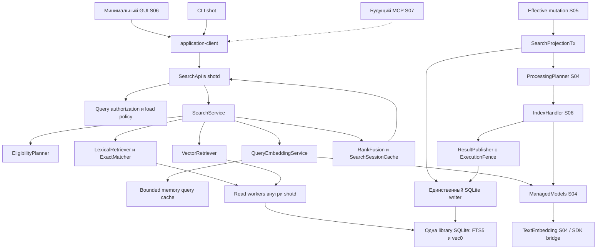
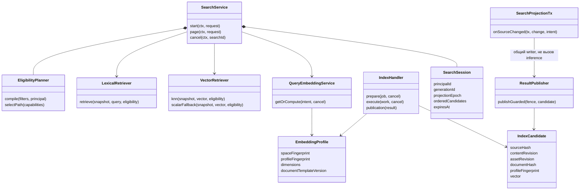
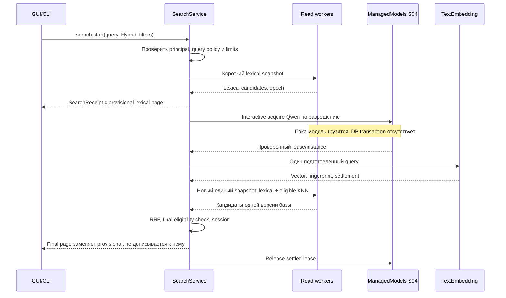
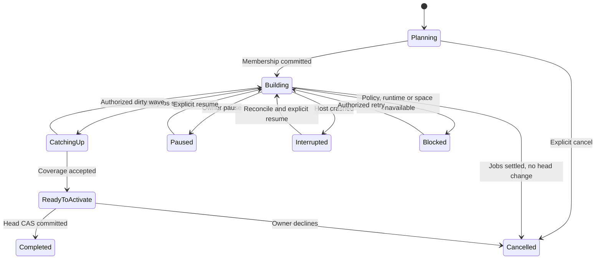
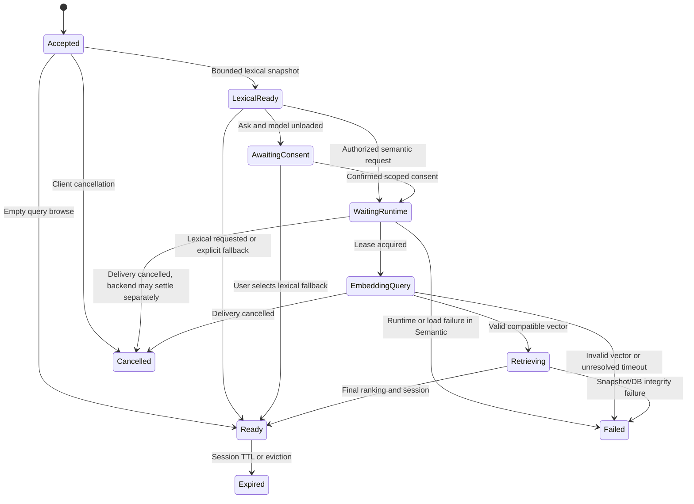

## S06: сохранённое изображение можно найти по смыслу и точным деталям 🔎

Шестой этап превращает библиотеку описанных изображений в работающий поисковый инструмент. Запрос «где выбирался большой контекст локальной модели» должен находить подходящие карточки, а `0xc0000005`, `q8_0` и название файла — не теряться из-за приблизительного смыслового сходства. Фильтр приложения ограничивает сам поиск, а не убирает неподходящие строки из уже полученного глобального top-20.

Поиск строится поверх **действительных эффективных полей S05**: ручная версия имеет приоритет над AI, OCR используется как дополнительный текст, а данные происхождения сохраняют свой смысл. Скриншот и импортированный файл одинаково участвуют в библиотеке. Канонические WebP/AVIF, исходные пути, экспорт и сохранность файлов не меняются ради индекса.

Это **документ 6 из 8**. Внутренние задачи `S06-T01…S06-T15`, SQL-миграции, ADR и отчёты не создают новых крупных этапов. S06 реализует поисковую логику, её базовый GUI/CLI и проверяемые контракты. Полировка интерфейса и полноценный MCP остаются S07; окончательная поставка и эксплуатационная приёмка — S08.

> [!important] План, проверка примеров и реализация продукта различаются
> При подготовке сверены master v3, входные контракты S03–S05 и официальные материалы SQLite, sqlite-vec, Qwen и LM Studio. Приложение не разрабатывалось и не запускалось на Windows; реальные embeddings, качество retrieval и аппаратные задержки не измерялись. Ограниченная проверка отдельных примеров описана в конце документа и не заменяет ни одного продуктового gate. Все будущие результаты исполнения остаются `NOT_RUN` до получения evidence.

### Навигация 📚

| Раздел | Назначение |
|---|---|
| [1. Scope и входы](#scope) | Обязательства S06 и принимаемые результаты S01–S05 |
| [2. Технические предпосылки](#sources-status) | Что подтверждено документацией и что проверяется на закреплённой связке |
| [3. Инварианты](#invariants) | Совместимость векторов, сохранность правок, фильтры, приватность |
| [4. Архитектура](#architecture) | Компоненты, structs/traits, worker ownership и последовательности |
| [5. Публичные контракты](#contracts) | Поиск, страницы, согласия на загрузку, reindex и rebuild |
| [6. Исходный поисковый документ](#source-document) | Поля, нормализация, идентификаторы и синхронная проекция |
| [7. Qwen и подготовка текста](#embedding-profile) | Профиль, токены, query/document, валидация векторов |
| [8. Schema 6](#database) | DDL, источники истины, snapshots, поколения и миграция |
| [9. Строгая фильтрация](#eligibility) | Одинаковый eligibility для FTS и vector, права и даты |
| [10. Lexical и semantic retrieval](#retrieval) | FTS5, exact identifiers, vec0 и корректный fallback |
| [11. Гибрид и страницы](#ranking) | RRF, ограниченное окно кандидатов, стабильность и cursors |
| [12. IndexHandler и публикация](#indexing) | Очередь S04, revisions, reindex, поздние ответы |
| [13. Перестройка поколений](#rebuild) | Snapshot, dirty catch-up, переключение и восстановление |
| [14. Жизненный цикл запроса](#query-lifecycle) | Offline, query-load, cancellation, cache и приоритеты |
| [15. Минимальные GUI/CLI](#interfaces) | Сквозной пользовательский сценарий и вход будущего MCP |
| [16. Логи и диагностика](#observability) | События, doctor, приватность, измерения и budgets |
| [17. Тесты и evaluation](#testing) | Fixtures, Arrange/Act/Assert, fault/mutation и качество поиска |
| [18. Задачи и коммиты](#tasks) | Пятнадцать исполняемых шагов и промежуточные результаты |
| [19. Приёмка и передача](#acceptance) | Gates, команды, отчёт, checklist, CN и трассируемость |
| [20. Источники](#references) | Проверенные первичные материалы и статус проверок документа |

<a id="scope"></a>
## 1. Граница S06 и входные обязательства 🎯

### 1.1. Что должно работать в `search-beta` 📦

| Входит в S06 | Не реализуется заново |
|---|---|
| FTS5, точные идентификаторы, semantic и hybrid | Capture, импорт, WebP/AVIF, resize и export S02/S03 |
| Qwen3-Embedding-0.6B, 1024 float32, один проверенный профиль | Каталог моделей, загрузчик, TTL, владение instance и SDK bridge S04 |
| Query embeddings и их разрешённая загрузка | Отдельный runtime в GUI, CLI или поисковом модуле |
| Атомарное обновление lexical-проекции вместе с effective fields | Effective resolver, категории, ручные overrides и AiRun S05 |
| Версионированный vector index, reindex и новое поколение | Вторая persistent очередь помимо ProcessingPlanner/Scheduler S04 |
| Фильтры приложения, категории, даты, источника и состояния | LLM-парсер произвольных запросов «вчера в PyCharm» |
| Защита от stale results, cursor replay, graceful degradation | Облачный fallback, reranker, HNSW/DiskANN, визуальные embeddings |
| Минимальное поисковое окно и CLI, связанные с одним SearchService | Полная UX-полировка, все MCP tools и release installer S07/S08 |
| Корпус релевантности, производительность, failure tests | Объявление качества по одному удачному запросу |

В V1 смысловой поиск **текстовый**: векторизуются описание, название, допустимые метаданные и ограниченная часть OCR. Поиск похожей картинки по композиции или по загруженному изображению не обещается. И Gemma, и Qwen остаются внешними моделями LM Studio; sqlite-vec не выполняет inference.

После принятого S06 человек должен выполнить полный сценарий: создать или импортировать изображение → получить/написать описание → найти его по смыслу → уточнить приложение → изменить описание → сразу найти новую формулировку lexical-поиском → отдельно дождаться либо запустить семантическую переиндексацию. Отключённый AI не мешает ручному редактированию и текстовому поиску.

### 1.2. Входной manifest и запрет предполагать готовность 🧷

| Вход | Требуемое доказательство исполнителя |
|---|---|
| Master v3 и S05 | Hashes из YAML либо согласованные изменения контракта |
| Принятые code checkpoints S01–S05 | Реальные commits и reports; наличие файлов планов не считается выполнением |
| Один `shotd` | Root lock, один writer, application-client, auth/scopes, protocol1.4 |
| SQLite/vec proof S01 | Фактические SQLite/vec версии, MSVC build, registration, reopen tests |
| Библиотека S02/S03 | Stable UUID/record_pk, asset revisions, app relations, primary origin, даты, schema3 |
| Runtime S04 | `TextEmbedding`, `ManagedModels`, local-only binding, `ExecutionFence`, settlement, policy, job DAG |
| Knowledge S05 | `KnowledgeSourceDocument`, source hashes, scopes, `SearchProjectionTx`, projection debts |
| Версии изображения и текста | Различие record/content/asset revisions и применимого OCR/AI |
| Тестовая основа | Fake clock/runtime, readonly principal, fixtures, faultpoints, redacted logs |
| Состояние migrations | Schema5 с исходными checksums; отсутствие неучтённых локальных изменений |

При отсутствии accepted S05 исполнитель может готовить чистые builders и tests, но не объявляет интеграцию завершённой. Каждое несовпадение schema/API фиксируется до новой migration, а не исправляется удалением старой библиотеки.

### 1.3. Передаваемые обязанности остальных этапов 🧭

S06 наследует автоматический, ручной и полностью отключённый AI-режимы; настройку предварительной загрузки Gemma; query-load policy Qwen; выгрузку по таймеру; одиночную либо совместную загрузку моделей. Никакое удобство поиска не отменяет этих правил.

В S06 не меняются максимальный размер картинки для модели, формат канона или правила выдачи путей. Результат поиска содержит record/asset descriptors. Получить PNG не больше 1000 пикселей, canonical path либо реальное изображение агент сможет через уже определённые get/export/transfer. SearchService не создаёт свой image converter.

<a id="sources-status"></a>
## 2. Проверенные возможности и границы документации 🔬

### 2.1. Внешние факты, существенные для решения 📘

| Компонент | Подтверждённая предпосылка | Следствие для проекта |
|---|---|---|
| Qwen0.6B | Модельная карточка описывает размерность 1024, retrieval-инструкцию на query-side, last-token pooling и нормализацию | Нужно проверить именно такую подготовку, а не принять любой массив из 1024 чисел. [SRC-01] |
| LM Studio SDK | Embedding handle предоставляет `.embed()`, а tokenizer доступен и embedding-модели | Используется порт S04; token counting нельзя вызывать через первую случайную LLM. [SRC-02], [SRC-03] |
| sqlite-vec | Доступны vec0 KNN и scalar-distance над обычными таблицами | Сложный фильтр имеет корректный exact fallback, без глобального top-k до фильтра. [SRC-04] |
| Metadata vec0 | Поддержан ограниченный набор сравнений; arbitrary SQL и scalar functions внутри metadata-условий не универсальны | Query planner выбирает проверенный SQL-path, а не пересылает пользовательский фильтр в vec0. [SRC-05] |
| FTS5 | `bm25()` сортируется меньшим значением вверх; `unicode61` не является русской морфологией | Нельзя складывать raw BM25 с cosine similarity или обещать поиск по всем склонениям. [SRC-06] |
| SQLite | WAL даёт snapshot-чтение; длительный reader удерживает своё представление базы | Read-транзакция закрывается до model load; долгие запросы измеряются и отменяются. [SRC-07], [SRC-08] |

### 2.2. Не подменять закреплённую зависимость текущим сайтом 📌

В просмотренном release list sqlite-vec присутствуют стабильная ветка `v0.1.9` с исправлением DELETE и отдельные `0.1.10-alpha` с новыми ANN-возможностями. Поэтому фраза «sqlite-vec в принципе не поддерживает ANN» больше не годится как универсальное описание. **Проект сознательно выбирает flat/exact vec0**, без экспериментальных ANN-настроек. Доказательство выбранного пути — locked версия из S01 и повторные tests S06, а не автоматическое обновление до alpha. [SRC-09]

До принятия S06 compatibility manifest фиксирует crate/source revision, `sqlite_version()`, `vec_version()`, feature flags, CPU architecture и результаты delete/reinsert/rollback. Если старая зафиксированная версия содержит релевантный дефект, её обновление — отдельный совместимый patch с migration/reopen regression; не побочный эффект `cargo update` всего workspace.

### 2.3. Что требуется доказать собственными тестами 🧪

Документация не доказывает, что конкретный GGUF в LM Studio применил нужный pooling, что quant-веса дают достаточную релевантность, что установленный tokenizer не добавил query prefix второй раз или что фильтр корректно работает через выбранный SQL planner. Эти проверки входят в обязательные gates. Отсутствие readback отмечается `NOT_VERIFIABLE`; качественный corpus test не подменяет проверку идентичности артефакта.

<a id="invariants"></a>
## 3. Инварианты поиска и индекса 🔒

### 3.1. Источник истины не меняется 🗄️

Источники истины — канонические изображения, provenance, применимые AI/OCR results и пользовательские overrides. `knowledge_source_documents` — согласованный источник поисковой проекции S05. FTS, exact-term rows, embeddings, memberships и query cache восстанавливаемы. Они не получают права менять изображение, удалять источник или «исправлять» описание под найденный результат.

**Индексируется effective source, а не последний AiRun.** Если пользователь заменил описание, новый embedding строится по его тексту. Если AI ответил позднее, но все поля перекрыты overrides, одинаковый effective source не создаёт бесконечную переиндексацию.

### 3.2. Совместимость и актуальность — разные проверки 🧬

Для каждого vector проверяются две независимые группы условий. Совместимость означает правильный embedding space/profile. Актуальность означает совпадение record, content revision, source hash, asset identity/revision и правил чтения с текущим source. Совместимый старый vector всё равно не является актуальным.

Новый query никогда не сравнивается с векторами от другого профиля просто потому, что длина совпала. При недоступном профиле ответ — явный `SEMANTIC_UNAVAILABLE` либо lexical fallback в Hybrid. Смена выбранной Gemma не меняет пространство Qwen, пока effective text не изменился.

### 3.3. Фильтр применяется до выбора ближайших результатов 🎯

Приложение, категория, дата, source kind, состояние записи и права входят в **eligibility set**. Top-k определяется внутри этого множества. Глобальный `LIMIT 100`, затем отбрасывание 99 чужих приложений, не является корректной оптимизацией.

Оба канала используют одну нормализованную спецификацию фильтров и одно поколение source snapshot. Результаты не дублируются из-за нескольких `record_applications`. Слабая релевантность не разрешает нарушить строгий фильтр.

### 3.4. Нет скрытой нагрузки и утечки через производные данные 🛡️

Пустая строка, lexical search, list/get и export не загружают модель. Query embedding требует разрешённого `run_ai`; новый model load — дополнительного права и query policy. `AI off` выключает semantic-канал целиком, включая использование старого query cache, по master v3.

Известная чувствительность source S05 наследуется в FTS/vector eligibility. Недоступная запись не может раскрыться через snippet, count, exact-term подсказку, ranking explanation или отладочный log. Это контроль известных меток, не обещание универсальной DLP и не защита от процесса, уже владеющего правами того же Windows-пользователя.

### 3.5. Ошибка не превращается в пустой успешный поиск 🚦

Ноль совпадений, нет актуальных векторов, модель выключена, таймаут, запрещённый load и повреждённый индекс — разные состояния. Hybrid может выдать полезный lexical результат с `degraded=true`; Semantic не маскирует отсутствие embedding ответом `items=[]` с общим успехом.

<a id="architecture"></a>
## 4. Архитектура: общий SearchService и единственный writer 🧱

### 4.1. Компоненты и направления зависимостей 🔗



GUI/CLI/MCP не читают production SQLite и не объединяют два списка своими алгоритмами. Возвращаемая выдача уже имеет одну определённую семантику. Клиент отвечает только за показ, пользовательский intent и отмену своего запроса.

### 4.2. Reader workers не нарушают one-writer 🧵

Для поиска в host добавляются **два выделенных read workers**, каждый с собственным SQLite connection, открытым read-only к основному файлу. Это контролируемое уточнение `CN-S06-01`: writer остаётся единственным, клиенты не получают соединений. Нативные callbacks и Tokio executor не выполняют длинный SQL.

Extension registration выполняется до открытия readers тем же безопасным способом S01. На reader включается `query_only=ON`; примерные query-пути ниже не требуют TEMP INSERT. Connection принадлежит одному исполняемому запросу до освобождения всех statement/cursor. Его `interrupt` не должен случайно отменить следующий запрос из пула. SQLite допускает прерывание через соответствующий API; реакция конкретного extension loop всё равно измеряется. [SRC-10]

Во время загрузки Qwen никакой read transaction не держится. Для итогового retrieval открывается короткий snapshot, в котором читаются head поколения, source epoch, eligibility, lexical и vector candidates. После получения bounded кандидатов transaction закрывается. На публикации ответа повторно проверяется доступ и согласованность snapshot.

### 4.3. Структуры и интерфейсы 🧬



`IndexCandidate` не содержит SQL, название произвольной таблицы или право переключить поколение. Полномочия определяются внутренним `ExecutionFence` S04 и зарегистрированным видом публикации.

### 4.4. Успешный поиск с холодной embedding-моделью 🔄



### 4.5. Дельта структуры проекта 📂

```text
crates/application/src/
  search/{service.rs, query.rs, filters.rs, eligibility.rs, ranking.rs, sessions.rs}
  indexing/{handler.rs, profiles.rs, documents.rs, generation.rs, intents.rs}
crates/domain/src/search/{values.rs, fingerprint.rs, vector.rs}
crates/infrastructure/src/sqlite/
  search/{projection.rs, fts.rs, exact.rs, vec0.rs, fallback.rs, reads.rs}
  indexing/{snapshots.rs, memberships.rs, rebuild.rs}
crates/infrastructure/src/runtime/embedding_adapter.rs
crates/protocol/src/{search.rs, indexing.rs}
packages/lmstudio-bridge/src/embeddings.ts       # расширение существующего адаптера
app/frontend/src/features/search/             # базовое окно, не новая бизнес-логика
migrations/0006_index_search.sql
schemas/{search-v1.schema.json, embedding-profile-v1.schema.json}
tests/{search/, indexing/, eval/retrieval/, faults/search/}
scripts/{verify-search.ps1, verify-search-live.ps1, evaluate-retrieval.ps1}
```

Отдельные новые crates не нужны, пока module boundaries и тестируемость обеспечиваются существующим workspace. В S06 не появляется второй daemon, HTTP vector server или Python-сервис поиска.

<a id="contracts"></a>
## 5. Контракты поиска и управления индексом 📐

### 5.1. Версии, IDs и границы результата 🔌

Application protocol расширяется **с 1.4 до 1.5**. Capabilities: `search_v1`, `index_status_v1`, `index_rebuild_v1`, `search_sessions_v1`. Asset transfer остаётся 1, production bridge — 1.1, если его подтверждённых embedding/tokenization методов достаточно. Добавление отсутствующего метода bridge оформляется совместимым minor change с fixtures; предполагаемое имя SDK-метода не становится контрактом нашего protocol.

UUID передаются строками; revision, sequence и byte counters — decimal strings signed SQLite диапазона. Счётчики небольшой страницы и размерность вектора могут быть ограниченными JSON integers. Никакие готовые векторы не принимаются от обычного клиента как доверенный способ добавить индекс.

Ниже определены **собственные целевые типы**, не уже существующие методы Inspector или LM Studio. Общие `RequestContext`, `AppError`, `ProcessBatchRequest`, `BatchReceipt`, `ProjectionState`, `KnowledgeSourceDocument` и `ExecutionFence` импортируются из предыдущих этапов.

### 5.2. Поисковый запрос и фильтры 🔧

```rust
use async_trait::async_trait;
use serde::{Deserialize, Serialize};
use tokio_util::sync::CancellationToken;
use uuid::Uuid;

#[derive(Clone, Copy, Serialize, Deserialize)]
#[serde(rename_all = "snake_case")]
pub enum SearchMode { Lexical, Semantic, Hybrid }

#[derive(Clone, Serialize, Deserialize)]
#[serde(tag = "kind", rename_all = "snake_case", deny_unknown_fields)]
pub enum ApplicationFilter {
    Any,
    Unattributed,
    AnyOf { ids: Vec<Uuid> },
}

#[derive(Clone, Serialize, Deserialize)]
#[serde(tag = "kind", rename_all = "snake_case", deny_unknown_fields)]
pub enum CategoryFilter {
    Any,
    Uncategorized,
    AnyOf { ids: Vec<Uuid> },
}

#[derive(Clone, Copy, Serialize, Deserialize)]
#[serde(rename_all = "snake_case")]
pub enum DateAxis { Ingested, Captured, Taken }

#[derive(Clone, Serialize, Deserialize)]
#[serde(tag = "kind", rename_all = "snake_case", deny_unknown_fields)]
pub enum DateFilter {
    Any,
    UtcRange {
        axis: DateAxis,
        from_inclusive: String,
        to_exclusive: String,
    },
    TakenOffsetUnknown,
    TakenAbsent,
}

#[derive(Clone, Copy, Serialize, Deserialize)]
#[serde(rename_all = "snake_case")]
pub enum SemanticRecordState { Current, Missing, Stale, Blocked, Failed }

#[derive(Clone, Serialize, Deserialize)]
#[serde(deny_unknown_fields)]
pub struct SearchFilters {
    pub application: ApplicationFilter,
    pub category: CategoryFilter,
    pub date: DateFilter,
    pub source_kind: Option<crate::library::SourceKind>,
    pub semantic_state: Option<SemanticRecordState>,
    pub has_ocr: Option<bool>,
    pub has_applied_ai: Option<bool>,
}

#[derive(Clone, Serialize, Deserialize)]
#[serde(deny_unknown_fields)]
pub struct SearchRequest {
    pub search_id: Uuid,
    pub text: String,
    pub mode: SearchMode,
    pub filters: SearchFilters,
    pub limit: u16,
    pub candidate_depth: u16,
    pub allow_model_load: bool,
    pub model_load_consent_id: Option<Uuid>,
}
```

`SourceKind` — существующие `Screenshot/ImportedImage` S02, не новый enum. Полный путь crate в примере адаптируется к accepted workspace. ID приложений/категорий разрешаются по справочникам, а не пересылаются в SQL как названия столбцов. `AnyOf` допускает 1…32 уникальных IDs; внутри группы — OR, между разными фильтрами — AND.

`text` ограничен 1024 Unicode scalar values и 4096 UTF-8 bytes. Пустая/пробельная строка означает browse по фильтрам и не требует модели даже при `mode=semantic`. Непробельный, но непригодный для FTS текст не превращается в скрытый browse: lexical возвращает `NO_LEXICAL_TERMS`, semantic при разрешении обрабатывает исходный текст.

`limit`: 1…200, default30. `candidate_depth`: default100, минимум `max(100, limit)`, максимум 2000; значение фиксируется на весь search session. Диапазоны дат имеют корректный RFC3339 offset и преобразуются в UTC; `from < to`. `TakenOffsetUnknown` означает известное local taken time без offset, а `TakenAbsent` — вообще нет времени съёмки. Подмена отсутствующей Taken датой импорта запрещена.

`allow_model_load=true` — **намерение**, не авторизация. Требуются scopes S04, действующая query policy, существующий профиль и, при Ask, действительный consent для principal/profile. Search ID используется для дедупликации в рамках жизни host. Изменённые параметры под тем же ID дают конфликт. После перезапуска host поисковая сессия не восстанавливается как durable batch.

### 5.3. Состояние запроса и страница 📊

```rust
#[derive(Clone, Copy, Serialize, Deserialize)]
#[serde(rename_all = "snake_case")]
pub enum SearchPhase {
    Accepted, LexicalReady, AwaitingConsent, WaitingRuntime,
    EmbeddingQuery, Retrieving, Ready, Failed, Cancelled, Expired,
}

#[derive(Clone, Copy, Serialize, Deserialize)]
#[serde(rename_all = "snake_case")]
pub enum SemanticChannelState {
    NotRequested, NotNeeded, Ready, Cached, PartialIndex,
    AiDisabled, LoadForbidden, ConsentRequired, RuntimeUnavailable,
    ProfileUnavailable, NoCurrentVectors, Pending, Failed,
}

#[derive(Clone, Copy, Serialize, Deserialize)]
#[serde(rename_all = "snake_case")]
pub enum MatchChannel { ExactIdentifier, Lexical, Semantic }

#[derive(Clone, Serialize, Deserialize)]
pub struct SearchHit {
    pub record_id: Uuid,
    pub asset_id: Uuid,
    pub content_revision: String,
    pub asset_revision: String,
    pub title: String,
    pub excerpt: Option<String>,
    pub category_id: Option<Uuid>,
    pub application_ids: Vec<Uuid>,
    pub matched_by: Vec<MatchChannel>,
    pub position: u32,
    pub relative_score: Option<f64>,
    pub semantic_state: SemanticRecordState,
}

#[derive(Clone, Serialize, Deserialize)]
pub struct SearchPage {
    pub search_id: Uuid,
    pub phase: SearchPhase,
    pub requested_mode: SearchMode,
    pub effective_mode: String,
    pub provisional: bool,
    pub semantic: SemanticChannelState,
    pub items: Vec<SearchHit>,
    pub generation_id: Option<Uuid>,
    pub projection_epoch: String,
    pub candidate_depth: u16,
    pub window_truncated: bool,
    pub next_cursor: Option<String>,
    pub degraded: bool,
    pub warnings: Vec<String>,
}

#[derive(Clone, Serialize, Deserialize)]
pub struct SearchReceipt {
    pub search_id: Uuid,
    pub phase: SearchPhase,
    pub initial_page: Option<SearchPage>,
    pub expires_at_utc: String,
}

#[derive(Clone, Serialize, Deserialize)]
#[serde(deny_unknown_fields)]
pub struct SearchPageRequest { pub cursor: String }

#[async_trait]
pub trait SearchApi: Send + Sync {
    async fn start_search(&self, ctx: RequestContext, req: SearchRequest)
        -> Result<SearchReceipt, AppError>;
    async fn search_status(&self, ctx: RequestContext, search_id: Uuid)
        -> Result<SearchPage, AppError>;
    async fn search_page(&self, ctx: RequestContext, req: SearchPageRequest)
        -> Result<SearchPage, AppError>;
    async fn cancel_search(&self, ctx: RequestContext, search_id: Uuid)
        -> Result<SearchCancellationReceipt, AppError>;
}

#[derive(Clone, Serialize, Deserialize)]
pub struct SearchCancellationReceipt {
    pub search_id: Uuid,
    pub delivery_cancelled: bool,
    pub backend_settled: bool,
    pub safe_code: Option<String>,
}
```

`effective_mode` имеет закрытый vocabulary `browse/lexical/semantic/hybrid`, не произвольную строку. `relative_score` — относительная оценка выбранного алгоритма, не вероятность. Raw BM25/cosine и hidden-corpus counts в обычный DTO не включаются; диагностическое объяснение разрешено только отдельным owner-only действием над синтетическими/разрешёнными данными.

В выдаче нет автоматических абсолютных путей и image bytes. Карточка запрашивается общим get S05; чтение изображения — S02/S03; преобразование 1000 — ExportService. Даже `read_metadata` вместе с Search не означает `read_images/read_paths`.

Provisional page — ранняя lexical выдача без окончательного hybrid ranking. У неё нет cursor продолжения, её позиции временные. Final page заменяет её целиком. Клиент не должен склеивать оба массива и создавать дубликаты.

### 5.4. Reindex и rebuild: существующая очередь, новые намерения 🔁

Обычные команды Reindex используют **существующий** `ProcessingApi.process_records(action=IndexOnly)` S04. Повторный Analyze не требуется. Для перестройки всего пространства добавляется узкий контрольный API, который создаёт generation и те же index work units, а не свой executor.

```rust
#[derive(Clone, Serialize, Deserialize)]
#[serde(deny_unknown_fields)]
pub struct RebuildIndexRequest {
    pub operation_id: Uuid,
    pub embedding_profile_fingerprint: String,
    pub expected_head_revision: String,
    pub expected_policy_revision: String,
    pub allow_model_load: bool,
    pub model_load_consent_id: Option<Uuid>,
}

#[derive(Clone, Copy, Serialize, Deserialize)]
#[serde(rename_all = "snake_case")]
pub enum RebuildState {
    Planning, Building, CatchingUp, ReadyToActivate,
    Paused, Interrupted, Blocked, Completed, Cancelled, Failed,
}

#[derive(Clone, Serialize, Deserialize)]
pub struct RebuildView {
    pub rebuild_id: Uuid,
    pub generation_id: Uuid,
    pub revision: String,
    pub state: RebuildState,
    pub initial_members: String,
    pub current_members: String,
    pub pending_members: String,
    pub failed_members: String,
    pub dirty_members: String,
    pub batch_ids: Vec<Uuid>,
}

#[derive(Clone, Serialize, Deserialize)]
#[serde(deny_unknown_fields)]
pub struct ActivateGenerationRequest {
    pub operation_id: Uuid,
    pub rebuild_id: Uuid,
    pub expected_rebuild_revision: String,
    pub expected_head_revision: String,
    pub allow_pending: bool,
}

#[derive(Clone, Copy, Serialize, Deserialize)]
#[serde(rename_all = "snake_case")]
pub enum RebuildControl { Pause, Resume, Cancel }

#[derive(Clone, Serialize, Deserialize)]
#[serde(deny_unknown_fields)]
pub struct ControlRebuildRequest {
    pub operation_id: Uuid,
    pub rebuild_id: Uuid,
    pub expected_revision: String,
    pub control: RebuildControl,
}

#[derive(Clone, Serialize, Deserialize)]
pub struct IndexStatus {
    pub generation_id: Option<Uuid>,
    pub head_revision: String,
    pub lexical_ready: bool,
    pub lexical_build_pending: String,
    pub semantic_current: String,
    pub semantic_missing: String,
    pub semantic_stale: String,
    pub semantic_blocked_or_failed: String,
    pub profile_fingerprint: Option<String>,
    pub warnings: Vec<String>,
}

#[async_trait]
pub trait IndexAdminApi: Send + Sync {
    async fn index_status(&self, ctx: RequestContext)
        -> Result<IndexStatus, AppError>;
    async fn rebuild_index(&self, ctx: RequestContext, req: RebuildIndexRequest)
        -> Result<RebuildView, AppError>;
    async fn rebuild_status(&self, ctx: RequestContext, id: Uuid)
        -> Result<RebuildView, AppError>;
    async fn activate_generation(&self, ctx: RequestContext, req: ActivateGenerationRequest)
        -> Result<IndexStatus, AppError>;
    async fn control_rebuild(&self, ctx: RequestContext, req: ControlRebuildRequest)
        -> Result<RebuildView, AppError>;
}
```

Pause/Resume/Cancel rebuild оборачивают управляющие операции S04 для связанных batches и обновляют только состояние rebuild coordinator. Отдельный контрольный request имеет operation ID, expected rebuild revision и enum action; его receipt идемпотентен. Ни одна управляющая кнопка не удаляет canonical или старое принятое поколение.

IndexStatus и coverage считаются только по разрешённым этому principal записям. Полный размер библиотеки/индекса доступен владельцу диагностики, но не возвращается read-only агенту как побочный канал информации о скрытых карточках.

### 5.5. Ошибки и права 🔐

| Код | Значение | Поведение |
|---|---|---|
| `SEARCH_QUERY_TOO_LARGE`, `INVALID_DATE_RANGE` | Невалидный запрос | Отказ до SQL/runtime |
| `UNKNOWN_FILTER_ID`, `AMBIGUOUS_FILTER_NAME` | Не найден/неоднозначен фильтр | Не заменять его на Any |
| `SEMANTIC_UNAVAILABLE` | Канал не может исполниться | Semantic — явный отказ; Hybrid — обозначенный fallback |
| `QUERY_LOAD_CONFIRMATION_REQUIRED` | Нет согласия Ask | Не запускать Qwen; показать lexical |
| `EMBEDDING_PROFILE_MISMATCH` | Другое пространство/артефакт | Вектор не сравнивать и не публиковать |
| `EMBEDDING_INVALID_VECTOR` | NaN/Inf/ноль/длина/format | Отклонить без усечения или заполнения нулями |
| `INDEX_REBUILD_REQUIRED`, `INDEX_INTEGRITY_FAILED` | Проекция не соответствует контракту | Источники сохраняются; repair/rebuild только явно |
| `SEARCH_SNAPSHOT_CHANGED` | Изменилась обязательная версия во время поиска | Ограниченный restart либо предложение повторить |
| `SEARCH_CURSOR_EXPIRED`, `SEARCH_CURSOR_INVALID` | Сессия истекла/чужая/повреждённая | Нет угадывания offset и silent restart |
| `SEARCH_WINDOW_EXHAUSTED` | Исчерпано фиксированное окно кандидатов | Предложить явный расширенный новый поиск |
| `RESULT_SUPERSEDED` | Индексный кандидат устарел | Не применять к текущей версии |
| `REBUILD_NOT_READY` | Нет безопасного условия переключения | Старый head остаётся активным |

`read_metadata` позволяет lexical/browse разрешённых карточек. Semantic дополнительно требует `run_ai`; model load — `model_load` и query policy. Для явной перестройки/активации используется `manage_index` плюс права S04 на требуемые model calls. Новый scope не выдаётся существующим read-only credentials автоматически. Общие `read_source_metadata/read_paths` проверяются по inherited sensitivity источника.

<a id="source-document"></a>
## 6. От effective source к lexical-проекции 📝

### 6.1. Единственный источник полей 📦

`KnowledgeSourceDocument v1` S05 предоставляет record/asset IDs, content и asset revisions, title/description, category ID/label, application IDs/labels, window title, primary filename, применимый OCR, три вида времени и required read scopes. S06 **не повторяет** логику выбора AI/ручной версии и не читает внешний файл ради текста.

| Поле | FTS / exact | Embedding text | Правило |
|---|---|---|---|
| Effective title | Полностью | Да, с высоким приоритетом | Не последний сырой AI-title |
| Effective description | Полностью в cap S05 | Да, ограниченный токенами | Пустая ручная строка допустима |
| Category label | Да | Да | ID используется для фильтра, не как смысловой текст |
| App labels, window title | Да | Да при наличии | Только подтверждённая атрибуция, imported photo не получает Explorer |
| Primary filename | Да | Да | Secondary origin не меняет primary автоматически |
| OCR | В пределах storage cap S05 | Не больше 512 токенов внутри 2048 | Не выдаётся за vision-описание |
| Capture/ingest/taken times | Нормализованные фильтры | По умолчанию нет | Даты не подменяют друг друга |
| Absolute paths, PID, GPS, raw geometry | Не добавляются отдельными полями | Не добавляются | Известная чувствительность текста всё равно наследуется |

В FTS не попадают historical AiRuns, OCR от прежней редакторской версии и скрыто сохранённый полный desktop. Их чтение — отдельная история, не default search по текущей карточке.

### 6.2. Три разных нормализатора 🧩

**Storage text** сохраняет читаемое исходное написание effective fields. Допустимы нормализация переводов строк и NFC по согласованной source version; содержательные числа, знаки, регистр кода и пробелы внутри значимых значений не переписываются ради удобства.

**Lexical query builder** делает безопасное выражение FTS. Слова `OR`, `NEAR`, кавычки и звёздочки из пользовательского запроса не становятся операторами по умолчанию. Начальная логика — OR по не более 64 безопасно заключённым в кавычки atoms; технический atom вроде `django.db` передаётся одной quoted phrase, а точный идентификатор обрабатывается параллельно. Пользователь видит ordinary search, не полноценный язык FTS.

**Exact identifier normalizer** использует NFC и закреплённое Unicode case-folding для сравнительного ключа, сохраняет исходную строку для показа. Не выполняются транслитерация, `ё→е`, замена кириллических букв похожими латинскими и морфологический stemming. Версия Unicode/библиотеки входит в lexical fingerprint.

SQLite `lower()` не используется как замена выбранному Unicode-нормализатору. Весь exact key создаётся одним Rust-модулем и одинаково для query/source.

### 6.3. Точные коды без отдельной LLM 🔢

Сканер извлекает максимальные технические atoms: буквы/цифры с внутренними `_ . : + # -`, а также bounded filename. Начальный максимум одного ключа 128 scalar values. Atom признаётся техническим, если содержит цифру либо один из этих внутренних знаков; отдельные обычные слова остаются FTS. Набор исключений и снятие завершающей пунктуации задаются fixture, не «умным» удалением всех символов.

| Вход | Exact key / ожидаемая семантика |
|---|---|
| `Q8_0` | `q8_0`, не `q8` |
| `0xc0000005` | Полный код, не совпадение с `0xc00000050` |
| `django.db` | Полная цепочка с точкой |
| `v1.2.3` | Версия с точками, не десятичное число |
| `C++`, `C#` | Значимые знаки сохраняются |
| `settings.json` | Полное filename |
| `128K` | Регистр сравнивается нормализованно, число не исчезает |
| `С:\private\photo.jpg` в отдельном stored path | Не добавлять в индекс по одному факту наличия path |

Если такой текст уже виден в разрешённом OCR/description, он рассматривается как содержимое изображения со своими sensitivity labels. Это не автоматический запрет поиска любого пути в скриншоте и не обещание обнаружить в pixels все секреты.

Максимум 4096 различных exact keys на record. При переполнении индексируются keys в порядке title → description → window → filename → category/app → OCR, фиксируется `exact_terms_truncated`; FTS сохраняет допустимый полный текст. Для обычного cap S05 этот предел должен проверяться на worst-case OCR, а не считаться недостижимым.

### 6.4. Синхронный hook S05 🔗

`SearchProjectionTx.on_source_changed(tx, change, intent)` исполняется в **той же writer-транзакции**, что и effective mutation. Последовательность: проверить source/revisions → обновить `search_documents` → удалить/вставить соответствующую FTS-row → заменить exact keys → инвалидировать semantic memberships затронутой записи → отметить dirty для разрешённого rebuild → сохранить Index intent через S04 → увеличить projection epoch.

Здесь нет tokenizer SDK, model load, файловых reads или ожидания IO. Hook использует уже подготовленный bounded source. Отсутствующая модель — pending/blocked intent, не причина откатить ручное описание. Ошибка обязательной SQL-проекции — rollback всей mutation и явный отказ Save; нельзя показать успех с половиной обновлённых данных.

Если source hash и content revision не изменились, повтор доставки hook идемпотентен. Изменение только прав видимости должно немедленно обновить eligibility и session epoch; оно не ждёт Qwen. При сомнении старый vector снимается с current, но last-good snapshot не уничтожается.

<a id="embedding-profile"></a>
## 7. Профиль Qwen, токены и векторизация 🧠

### 7.1. Один embedding-профиль V1 📌

S06 использует **тот Qwen3-Embedding-0.6B artifact, который принят на S04**. Поисковый модуль не скачивает второй файл с похожим названием. Размерность 1024, float32, cosine distance; усечение Matryoshka, int8/binary vectors и модели 4B/8B не входят в этот этап.

Различаются три fingerprint:

| Fingerprint | Содержимое | Что меняется при несовместимости |
|---|---|---|
| `space_fingerprint` | Точный artifact/revision/quant, tokenizer/special-token policy, pooling, output dimension, normalization и проверенная adapter-семантика | Query и documents нельзя смешивать |
| `profile_fingerprint` | Space + query instruction/format + document template/budget/serialization version | Требуется новое поколение поискового индекса |
| `runtime_observation` | LM Studio/backend/SDK/driver, effective load, время теста | Требуется compatibility check; не всякая смена TTL требует reindex |

Контекст, TTL, GPU offload и имя загруженного instance не меняют текстовое пространство автоматически. Но изменение backend, способное изменить pooling/tokenization/output, не принимается как совместимое без повторного manifest-test. Hash каждого artifact хранится отдельно от human-readable model key.

### 7.2. Query и document имеют разные форматы 📝

Начальный query template проекта:

```text
Instruct: Retrieve saved image descriptions that match the user's question, including relevant application settings, visible text, and captured facts.
Query:{normalized_query}
```

Это собственная task instruction ScreenMemory в форме retrieval-инструкции Qwen, не цитата о гарантированном качестве. Сам query не переводится в английский. Для русского запроса сохраняется русский текст; межъязычность проверяется корпусом. **Document не получает `Instruct/Query` prefix.** Официальные примеры Qwen разделяют эти два режима. [SRC-01]

Document template:

```text
Title: <effective title>
Description: <effective description>
Category: <effective category label>
Application: <deduplicated confirmed application labels>
Window: <observed window title>
Filename: <primary filename>
Visible text: <bounded OCR excerpt>
```

Пустые поля опускаются. Порядок app labels детерминирован: по стабильным application IDs, а не случайному порядку SQL JOIN. Один label не повторяется несколько раз из-за нескольких окон. Labels `Title/Description/...` входят в template version.

Ни system/user chat wrapper Gemma, ни её category prompt не применяются к Qwen. Вызов `.embed()` выполняется на embedding handle. Создать embedding просьбой к chat-модели «верни JSON с 1024 числами» запрещено.

### 7.3. Token budget без синхронной загрузки при Save 🧮

Исходные пределы: **document≤2048 tokens**, OCR excerpt≤512 внутри этого лимита; query вместе с инструкцией≤512 tokens. Общий фактический вход должен помещаться в loaded context с учётом специальных токенов. Для embedding не резервируются 4000 output tokens: этот лимит относится к Gemma, не к Qwen.

Для V1 выбран измеряемый путь: token counting выполняется через **уже разрешённо приобретённый embedding handle S04**, а не при writer hook. SDK документирует `.tokenize()`/`.countTokens()` для embedding-моделей; фактический подсчёт special tokens проверяется на runtime fixture. [SRC-03]

`IndexHandler.prepare()` читает source и строит ограниченный кандидат текста; `execute()` получает ModelLease, завершает token-budget preparation и затем вызывает embedding. Поэтому ручной Save без LM Studio остаётся быстрым и не требует локальной установки tokenizer. Pure CPU tokenizer может быть будущей оптимизацией с parity-test, но не второй неопределённой обязательной технологией.

Правила сокращения document:

1. Сохранить title и доступные короткие context labels. Заголовок и служебные labels входят в общий бюджет.
2. Ограничить OCR512 токенами, затем уменьшать его до полного удаления, если основной документ не помещается.
3. При оставшемся переполнении сократить длинные description/window/filename по установленному порядку, сохраняя валидную Unicode-строку и отмечая каждое сокращение.
4. Повторно проверить **целый окончательный текст**, включая labels и separators. Нельзя суммировать приблизительные счётчики отдельных полей и считать это точным total.

Алгоритм сокращения не предполагает строгой монотонности BPE count по произвольным char prefixes. Допускается bounded поиск подходящего prefix, но окончательный кандидат обязательно пересчитывается; если budget всё ещё нарушен, уменьшается ещё. Верхний предел 32 технических count-вызовов на preparation, затем `EMBEDDING_INPUT_BUDGET_FAILED`. Обычные короткие карточки проходят одним count. Полный source/описание в БД **не обрезается**.

Query не сокращается молча: превышение 512 tokens возвращает `SEARCH_QUERY_TOO_LARGE`. Загруженный Qwen не даёт права выполнить inference, если policy была отозвана во время counting.

### 7.4. Подготовленный вход и журнал происхождения 🧾

До `.embed()` сохраняется immutable `IndexPreparation`: source/asset revisions, profile и template hashes, окончательный input hash, token count, applied truncations и ссылка на job attempt. Содержимое текста допустимо в закрытой индексной БД как часть воспроизводимости, но не в operational log. Query preparations долговременно не записываются; query cache — только память.

Job input fingerprint определяется source hash + target generation/profile + handler version. После tokenization derived document hash добавляется к preparation, а не переписывает bound input job. При retry source/profile не меняются незаметно. Результат должен соответствовать конкретной preparation и runtime call.

### 7.5. Проверка результата и нормализация 🔢

Принимается ровно 1024 чисел, каждое finite и приводимое к float32 без переполнения. Перед нормализацией считается L2-норма в f64 с устойчивой к диапазону арифметикой. Нулевая/слишком малая норма (`≤1e-12`) — ошибка; не деление на ноль и не «пустой vector». После нормализации значения снова проверяются, а норма float32 должна отклоняться от 1 не более `1e-5` в fixture-тесте.

```rust
pub fn normalize_embedding(input: &[f64]) -> Result<Vec<f32>, VectorError> {
    if input.len() != 1024 { return Err(VectorError::WrongDimension); }
    if input.iter().any(|x| !x.is_finite() || x.abs() > f32::MAX as f64) {
        return Err(VectorError::NonFiniteOrOverflow);
    }
    let max_abs = input.iter().map(|x| x.abs()).fold(0.0_f64, f64::max);
    if max_abs == 0.0 { return Err(VectorError::ZeroNorm); }
    let scaled_sum: f64 = input.iter().map(|x| (x / max_abs).powi(2)).sum();
    let norm = max_abs * scaled_sum.sqrt();
    if !norm.is_finite() || norm <= 1e-12 { return Err(VectorError::ZeroNorm); }
    let output: Vec<f32> = input.iter().map(|x| (x / norm) as f32).collect();
    let check: f64 = output.iter().map(|x| f64::from(*x).powi(2)).sum::<f64>().sqrt();
    if output.iter().any(|x| !x.is_finite()) || (check - 1.0).abs() > 1e-5 {
        return Err(VectorError::InvalidNormalizedVector);
    }
    Ok(output)
}

#[derive(Debug)]
pub enum VectorError {
    WrongDimension, NonFiniteOrOverflow, ZeroNorm, InvalidNormalizedVector,
}
```

Этот pure helper — собственный контракт для tests. Adapter дополнительно проверяет response order/item IDs, effective artifact/profile и settlement S04. Уже нормализованный backend vector может быть нормализован повторно допустимо; этот postprocess имеет свою версию. В SQL blob записывается фиксированный little-endian float32, 4096 bytes, через проверенный serializer. Не используется platform-dependent reinterpretation неизвестного буфера.

Cosine distance вычисляется расширением по согласованному профилю. Незначительный floating error учитывается oracle tolerance; NaN не участвует в сортировке и не превращается в лучшее совпадение. Обещание cosine score как «процент правильности» запрещено.

<a id="database"></a>
## 8. Schema 6: lexical, snapshots и поколения 🗄️

### 8.1. Что меняется и что остаётся прежним 🧱

Добавляется `0006_index_search.sql`. Migrations0001–0005 не переписываются. Records/assets, origin occurrences, knowledge source, overrides, processing jobs и runtime calls остаются в прежних таблицах. Миграция не запускает Qwen/Gemma, не переводит Manual в Automatic и не разрешает незавершённым историческим jobs стартовать без Resume.

Схема разделяет **текстовую проекцию**, **неизменяемые векторные snapshots**, **указатель актуального snapshot на запись в поколении** и **ускоряющую vec0-проекцию**. Это намеренное дублирование производных данных ради проверяемого last-good и восстановления. Размер этого дублирования измеряется, а не скрывается.

Примеры ниже — DDL-основа для existing migrator. UUID/hash/JSON/fingerprint также проверяются application schemas. SQLite foreign keys остаются ON; сложная перестройка прежних таблиц для этих новых сущностей не требуется.

### 8.2. Текстовые таблицы и FTS 💾

```sql
-- S06-DDL-TEXT
CREATE TABLE search_category_keys (
    category_key INTEGER PRIMARY KEY AUTOINCREMENT,
    category_id TEXT NOT NULL UNIQUE REFERENCES categories(id)
);

CREATE TABLE search_documents (
    record_pk INTEGER PRIMARY KEY REFERENCES records(record_pk),
    record_id TEXT NOT NULL UNIQUE REFERENCES records(id),
    source_asset_id TEXT NOT NULL,
    asset_revision INTEGER NOT NULL CHECK (asset_revision > 0),
    content_revision INTEGER NOT NULL CHECK (content_revision > 0),
    source_version TEXT NOT NULL,
    source_sha256 TEXT NOT NULL CHECK (length(source_sha256) = 64),
    lexical_fingerprint TEXT NOT NULL,
    title TEXT NOT NULL,
    description TEXT NOT NULL,
    category_text TEXT NOT NULL,
    application_text TEXT NOT NULL,
    window_title TEXT NOT NULL,
    filename TEXT NOT NULL,
    ocr_text TEXT NOT NULL,
    category_key INTEGER REFERENCES search_category_keys(category_key),
    source_kind INTEGER NOT NULL CHECK (source_kind IN (1,2)),
    ingested_at_ms INTEGER NOT NULL,
    captured_at_ms INTEGER,
    taken_at_ms INTEGER,
    taken_time_state TEXT NOT NULL CHECK (taken_time_state IN ('known_utc','local_unknown_offset','absent')),
    required_scope_mask INTEGER NOT NULL CHECK (required_scope_mask IN (1,3,5,7)),
    has_applied_ai INTEGER NOT NULL CHECK (has_applied_ai IN (0,1)),
    has_ocr INTEGER NOT NULL CHECK (has_ocr IN (0,1)),
    is_deleted INTEGER NOT NULL DEFAULT 0 CHECK (is_deleted IN (0,1)),
    updated_at_utc TEXT NOT NULL,
    FOREIGN KEY(record_id, source_asset_id) REFERENCES assets(record_id, id),
    CHECK ((taken_time_state = 'known_utc') = (taken_at_ms IS NOT NULL))
);

CREATE VIRTUAL TABLE image_fts USING fts5(
    title, description, category_text, application_text,
    window_title, filename, ocr_text,
    tokenize = 'unicode61'
);

CREATE TABLE search_exact_terms (
    record_pk INTEGER NOT NULL REFERENCES search_documents(record_pk),
    term_key TEXT NOT NULL CHECK (length(term_key) BETWEEN 1 AND 128),
    field_mask INTEGER NOT NULL CHECK (field_mask > 0),
    PRIMARY KEY(record_pk, term_key)
);
CREATE INDEX exact_term_lookup ON search_exact_terms(term_key, record_pk);
CREATE INDEX search_dates_ingested ON search_documents(ingested_at_ms, record_pk);
CREATE INDEX search_dates_captured ON search_documents(captured_at_ms, record_pk);
CREATE INDEX search_dates_taken ON search_documents(taken_at_ms, record_pk);
CREATE INDEX search_categories ON search_documents(category_key, record_pk);

CREATE TABLE search_projection_meta (
    singleton INTEGER PRIMARY KEY CHECK (singleton = 1),
    projection_epoch INTEGER NOT NULL CHECK (projection_epoch > 0),
    lexical_state TEXT NOT NULL CHECK (lexical_state IN ('building','ready','failed','repairing')),
    lexical_fingerprint TEXT NOT NULL,
    bootstrap_before_pk INTEGER,
    updated_at_utc TEXT NOT NULL
);
```

Для простоты и проверяемости V1 используется **обычная contentful FTS5**, не external-content/contentless. Это расход дополнительного места, зато не нужны специальные delete-команды со старым содержимым или скрытая синхронизация триггеров external-content. Единственный application hook выполняет обычный `DELETE ... WHERE rowid=:pk` и `INSERT` в общей транзакции. Нельзя применять одновременно автоматические triggers и ручное обновление той же FTS-row. Особенности вариантов хранения FTS документированы отдельно. [SRC-06]

`image_fts.rowid` равен `records.record_pk`; UUID остаётся внешним ID. Вход в FTS — семь ровно перечисленных полей. `category_key=NULL` означает отсутствие категории в обычной таблице; для vec0 adapter преобразует его в sentinel0. Положительный category key выдаётся локальной map-таблицей, не хешируется с риском коллизий.

`record_pk` и `record_id` в projection обязаны принадлежать одной записи; это проверяется repository validator. Mask1 — `read_metadata`, bit2 — `read_source_metadata`, bit4 — `read_paths`. Неизвестный бит — отказ, а не игнорирование. Это внутренний versioned mapping, не публичная универсальная ACL-модель.

### 8.3. Профили, поколения и сохранённые vectors 🧬

```sql
-- S06-DDL-VECTOR-METADATA
CREATE TABLE search_embedding_profiles (
    profile_fingerprint TEXT PRIMARY KEY CHECK (length(profile_fingerprint) = 64),
    space_fingerprint TEXT NOT NULL CHECK (length(space_fingerprint) = 64),
    artifact_fingerprint TEXT NOT NULL,
    dimensions INTEGER NOT NULL CHECK (dimensions = 1024),
    profile_json TEXT NOT NULL CHECK (json_valid(profile_json)),
    created_at_utc TEXT NOT NULL
);

CREATE TABLE embedding_generations (
    generation_pk INTEGER PRIMARY KEY AUTOINCREMENT,
    id TEXT NOT NULL UNIQUE,
    profile_fingerprint TEXT NOT NULL REFERENCES search_embedding_profiles(profile_fingerprint),
    state TEXT NOT NULL CHECK (state IN ('building','active','retired','cancelled','failed')),
    created_at_utc TEXT NOT NULL,
    activated_at_utc TEXT,
    validation_json TEXT CHECK (validation_json IS NULL OR json_valid(validation_json))
);

CREATE UNIQUE INDEX one_active_embedding_generation
    ON embedding_generations(state) WHERE state = 'active';

CREATE TABLE search_index_head (
    singleton INTEGER PRIMARY KEY CHECK (singleton = 1),
    active_generation_pk INTEGER REFERENCES embedding_generations(generation_pk),
    revision INTEGER NOT NULL CHECK (revision > 0)
);

CREATE TABLE index_preparations (
    id TEXT PRIMARY KEY,
    job_id TEXT NOT NULL REFERENCES processing_jobs(id),
    attempt_id TEXT NOT NULL REFERENCES processing_attempts(id),
    generation_pk INTEGER NOT NULL REFERENCES embedding_generations(generation_pk),
    record_pk INTEGER NOT NULL REFERENCES records(record_pk),
    source_asset_id TEXT NOT NULL REFERENCES assets(id),
    asset_revision INTEGER NOT NULL CHECK (asset_revision > 0),
    content_revision INTEGER NOT NULL CHECK (content_revision > 0),
    source_sha256 TEXT NOT NULL CHECK (length(source_sha256) = 64),
    document_sha256 TEXT NOT NULL CHECK (length(document_sha256) = 64),
    input_text TEXT NOT NULL,
    input_tokens INTEGER NOT NULL CHECK (input_tokens BETWEEN 1 AND 2048),
    preparation_json TEXT NOT NULL CHECK (json_valid(preparation_json)),
    created_at_utc TEXT NOT NULL
);

CREATE TABLE embedding_snapshots (
    snapshot_id INTEGER PRIMARY KEY AUTOINCREMENT,
    generation_pk INTEGER NOT NULL REFERENCES embedding_generations(generation_pk),
    record_pk INTEGER NOT NULL REFERENCES records(record_pk),
    preparation_id TEXT NOT NULL REFERENCES index_preparations(id),
    content_revision INTEGER NOT NULL CHECK (content_revision > 0),
    asset_revision INTEGER NOT NULL CHECK (asset_revision > 0),
    source_asset_id TEXT NOT NULL REFERENCES assets(id),
    source_sha256 TEXT NOT NULL CHECK (length(source_sha256) = 64),
    document_sha256 TEXT NOT NULL CHECK (length(document_sha256) = 64),
    vector BLOB NOT NULL CHECK (typeof(vector) = 'blob' AND length(vector) = 4096),
    vector_sha256 TEXT NOT NULL CHECK (length(vector_sha256) = 64),
    required_scope_mask INTEGER NOT NULL CHECK (required_scope_mask IN (1,3,5,7)),
    runtime_observation_json TEXT NOT NULL CHECK (json_valid(runtime_observation_json)),
    created_at_utc TEXT NOT NULL,
    UNIQUE(generation_pk, record_pk, content_revision, source_sha256, document_sha256)
);

CREATE TABLE embedding_memberships (
    membership_id INTEGER PRIMARY KEY AUTOINCREMENT,
    generation_pk INTEGER NOT NULL REFERENCES embedding_generations(generation_pk),
    record_pk INTEGER NOT NULL REFERENCES records(record_pk),
    last_good_snapshot_id INTEGER REFERENCES embedding_snapshots(snapshot_id),
    state TEXT NOT NULL CHECK (state IN ('missing','current','stale','blocked','failed')),
    target_content_revision INTEGER NOT NULL CHECK (target_content_revision > 0),
    target_source_sha256 TEXT NOT NULL CHECK (length(target_source_sha256) = 64),
    updated_at_utc TEXT NOT NULL,
    UNIQUE(generation_pk, record_pk),
    CHECK (state != 'current' OR last_good_snapshot_id IS NOT NULL)
);
CREATE INDEX memberships_lookup ON embedding_memberships(generation_pk, state, record_pk);
CREATE INDEX snapshots_record ON embedding_snapshots(record_pk, generation_pk, snapshot_id);

CREATE TRIGGER embedding_profiles_no_update
BEFORE UPDATE ON search_embedding_profiles
BEGIN SELECT RAISE(ABORT, 'EMBEDDING_PROFILE_IMMUTABLE'); END;

CREATE TRIGGER index_preparations_no_update
BEFORE UPDATE ON index_preparations
BEGIN SELECT RAISE(ABORT, 'INDEX_PREPARATION_IMMUTABLE'); END;

CREATE TRIGGER embedding_snapshots_no_update
BEFORE UPDATE ON embedding_snapshots
BEGIN SELECT RAISE(ABORT, 'EMBEDDING_SNAPSHOT_IMMUTABLE'); END;
```

Profiles, snapshots и preparations неизменяемы обычным UPDATE; устанавливаются immutable triggers. Корректирующий результат создаёт новую строку, а не перезаписывает прежние vector bytes. При повторной публикации того же логического результата repository переиспользует уже подтверждённый snapshot после проверки ключей; это не `INSERT OR REPLACE`, которое могло бы уничтожить старый ID.

Межтабличные guards проверяют: snapshot принадлежит membership record/generation; preparation принадлежит правильному attempt/job; source asset — той же записи; profile совпадает с generation; current membership соответствует live source. Foreign key на snapshot ID сам по себе не доказывает эти условия.

В `state=stale` прежний last-good snapshot сохраняется, но не участвует в current semantic search. Это не повод показать старый текст в новом запросе. Состояния blocked/failed уточняются текущей Index job S04; membership хранит projection state, а не второй независимый scheduler.

### 8.4. Рабочая vec0-проекция 🧰

```sql
-- S06-DDL-VEC0: выполняется только с зарегистрированным реальным sqlite-vec.
CREATE VIRTUAL TABLE image_vec_1024 USING vec0(
    membership_id INTEGER PRIMARY KEY,
    generation_key INTEGER PARTITION KEY,
    embedding FLOAT[1024] distance_metric=cosine,
    category_key INTEGER,
    ingested_at_ms INTEGER,
    source_kind INTEGER,
    needs_source_metadata BOOLEAN,
    needs_paths BOOLEAN
);
```

В эту таблицу попадают **только current и не удалённые** membership rows. При invalidation строка vec0 удаляется в той же транзакции, но snapshot остаётся. Публикация нового current удаляет прежнюю projection-row, вставляет новую и обновляет membership атомарно. `DELETE/reinsert/rollback` тестируется на закреплённой версии; наличие расширения не доказывает корректность этих операций.

Generation key — partition key одного из нескольких поколений, а не отдельная партиция на каждый screenshot или категорию. Метаданные vec0 здесь числовые/boolean; длинные descriptions, paths и категории текстом не копируются в vector table. У схемы нет универсального application_key: многоприложенные записи фильтруются через правильный ordinary-table path §9.

Два источника vector bytes — immutable snapshot и current vec0 — должны совпадать по ID/hash/длине. При несовпадении doctor не меняет checksum «на тот, что сейчас есть», а предлагает восстановление projection из проверенного snapshot. Утрата vec0 не означает утрату изображений.

### 8.5. Rebuild metadata и события 📬

```sql
-- S06-DDL-REBUILD
CREATE TABLE index_rebuilds (
    id TEXT PRIMARY KEY,
    operation_id TEXT NOT NULL UNIQUE,
    principal_id TEXT NOT NULL,
    request_fingerprint TEXT NOT NULL,
    generation_pk INTEGER NOT NULL UNIQUE REFERENCES embedding_generations(generation_pk),
    expected_head_revision INTEGER NOT NULL CHECK (expected_head_revision > 0),
    revision INTEGER NOT NULL DEFAULT 1 CHECK (revision > 0),
    state TEXT NOT NULL CHECK (state IN
        ('planning','building','catching_up','ready_to_activate','paused',
         'interrupted','blocked','completed','cancelled','failed')),
    selection_upper_pk INTEGER NOT NULL,
    membership_complete INTEGER NOT NULL DEFAULT 0 CHECK (membership_complete IN (0,1)),
    request_json TEXT NOT NULL CHECK (json_valid(request_json)),
    created_at_utc TEXT NOT NULL,
    updated_at_utc TEXT NOT NULL
);

CREATE TABLE index_rebuild_targets (
    rebuild_id TEXT NOT NULL REFERENCES index_rebuilds(id),
    record_pk INTEGER NOT NULL REFERENCES records(record_pk),
    desired_content_revision INTEGER NOT NULL CHECK (desired_content_revision > 0),
    desired_source_sha256 TEXT NOT NULL CHECK (length(desired_source_sha256) = 64),
    state TEXT NOT NULL CHECK (state IN ('pending','current','dirty','blocked','failed','removed')),
    PRIMARY KEY(rebuild_id, record_pk)
);

CREATE TABLE index_rebuild_batches (
    rebuild_id TEXT NOT NULL REFERENCES index_rebuilds(id),
    batch_id TEXT NOT NULL UNIQUE REFERENCES processing_batches(id),
    PRIMARY KEY(rebuild_id, batch_id)
);

CREATE TABLE index_control_receipts (
    operation_id TEXT PRIMARY KEY,
    principal_id TEXT NOT NULL,
    operation_kind TEXT NOT NULL,
    request_fingerprint TEXT NOT NULL,
    result_json TEXT NOT NULL CHECK (json_valid(result_json)),
    created_at_utc TEXT NOT NULL
);

CREATE TABLE index_events (
    sequence INTEGER PRIMARY KEY AUTOINCREMENT,
    event_kind TEXT NOT NULL,
    record_pk INTEGER REFERENCES records(record_pk),
    generation_pk INTEGER REFERENCES embedding_generations(generation_pk),
    content_revision INTEGER,
    payload_json TEXT NOT NULL CHECK (json_valid(payload_json)),
    occurred_at_utc TEXT NOT NULL
);
```

Targets — desired revision и отчёт покрытия rebuild, **не очередь исполнения**. Все вычисления получают обычные S04 jobs/attempts/fences. `index_events` — события индекса с правильными FK, не фиктивные `record.saved` в ingest event feed. Payload содержит безопасные IDs/statuses, не тексты запросов и векторы.

### 8.6. Миграция, bootstrap и repair 🛠️

DDL и запись schema6 выполняются existing migrator. Затем немодельный lexical bootstrap проходит records ограниченными пачками до 500, получая missing knowledge source через resolver S05. Source/hash сверяются перед записью. До полного покрытия `lexical_state=building`; list/get доступны, поиск сообщает неполноту, а не обещает поиск по всей коллекции.

Новые mutations уже идут через S06 hook, поэтому bootstrap не должен переписать более новую revision. Cursor обхода и progress сохраняются; после crash продолжение не требует модели. По завершении сравниваются eligible records/source/FTS counts, row mapping, контрольные query и projection hashes; затем `lexical_state=ready` одним COMMIT.

Семантическая история **не заполняется при upgrade**. Проверенный профиль S04 разрешается зарегистрировать и связать с пустым начальным поколением без model calls; это только metadata bootstrap. Альтернативно первый такой head создаётся при первом разрешённом Reindex или новом Automatic intent. В обоих случаях исторические records остаются missing, `coverage=0` не называется успешной индексацией всей библиотеки. Новые разрешённые automatic jobs могут заполнять это поколение постепенно; явный Rebuild всегда создаёт отдельное building-поколение.

Старые projection debts S05 не считаются сегодняшним согласием на model load. Их исходная policy и Resume semantics S04 сохраняются. Automatic после включения действует на новые разрешённые изменения, не на всю историческую коллекцию.

Lexical repair отделён от model rebuild: он не вызывает Qwen. В простом варианте V1 выполняется maintenance-процедура с явным `lexical_state=repairing` и проверкой исходников; partial index не маркируется ready. Полная семантическая перестройка сохраняет прежний active generation до переключения. Это различие фиксируется в UI и runbook, а не скрывается под одной кнопкой «починить всё».

<a id="eligibility"></a>
## 9. Eligibility: приложение, категория, дата и права до top-k 🎯

### 9.1. Единая фильтрационная спецификация 🧭

`EligibilitySpec` создаётся из валидированных filters и аутентифицированного principal. В неё входят разрешённые record IDs/корни доступа при наличии такой политики, tombstone, sensitivity mask, category/application IDs, source kind, date axis и status. Произвольный SQL/regex из клиента не принимается.

Права source S05 наследуются консервативно на **всю searchable row**: если principal не имеет любого обязательного scope, эта row не участвует ни в одном канале. Персональная partial-field проекция потребовала бы отдельного индекса и не вводится скрыто. Обычный get может иметь свою безопасную краткую карточку; это не разрешение ранжировать её по закрытому описанию.

Authoritative record deletion и asset applicability проверяются вместе с projection. Membership со старым source hash/revision не считается current даже если его флаг повреждён или остался после неполного repair.

### 9.2. Приложения и категории 🏷️

Application AnyOf использует `EXISTS` по `record_applications`, а не JOIN с умножением строк. Если Region затрагивает два подтверждённых приложения, запись доступна по каждому. `Unattributed` означает отсутствие подтверждённых associations, а не display name `Unknown`. Imported photo без реальной app attribution не находится по Explorer только потому, что была перетащена из его окна.

Category AnyOf использует stable IDs. Архивная категория остаётся назначенной старым records и может участвовать в фильтре. Deleted category, уже очищенная S05, не оживает из исторического AiRun. Uncategorized — NULL assignment; это не строка «Other» и не semantic similarity к слову «прочее».

### 9.3. Даты и состояния 🕒

По умолчанию date axis — Ingested. Для Captured подходят записи с capture time; для Taken — известное UTC taken time. EXIF без timezone не получает timezone компьютера. `TakenOffsetUnknown` позволяет найти такие фотографии отдельно. Все интервалы `[from,to)`, precision — milliseconds для фильтра; raw/subsecond metadata остаются в provenance.

Поле SemanticRecordState — состояние **активного поколения**. При отсутствии head все подходящие записи Missing. Фильтр Stale/Missing обычно используют с Lexical/browse: Semantic по ним закономерно не получает current vectors. UI показывает «нет актуальных векторов в этом фильтре», а не меняет фильтр на Current.

`has_applied_ai` означает применимую AI-версию текущего asset, а не наличие любого исторического AiRun. `has_ocr` — непустой применимый текст, не просто успешно завершившийся OCR без текста.

### 9.4. Ordinary SQL как oracle и универсальный путь 🔍

Ниже показан фрагмент exact-fallback для фильтра приложения. Остальные условия добавляются компилятором спецификации; параметры всегда bind. Пример предполагает, что caller имеет read_metadata и не имеет private source/path scopes.

```sql
-- S06-QUERY-ELIGIBLE-DISTANCE
WITH eligible AS MATERIALIZED (
    SELECT d.record_pk, d.record_id, d.content_revision,
           d.asset_revision, d.source_asset_id, d.source_sha256,
           d.ingested_at_ms
    FROM search_documents d
    JOIN records r ON r.record_pk = d.record_pk AND r.id = d.record_id
    WHERE r.deleted_at_utc IS NULL
      AND d.is_deleted = 0
      AND (d.required_scope_mask & :granted_mask) = d.required_scope_mask
      AND d.ingested_at_ms >= :from_ms
      AND d.ingested_at_ms < :to_ms
      AND EXISTS (
          SELECT 1 FROM record_applications ra
          WHERE ra.record_id = d.record_id
            AND ra.application_id = :application_id
      )
), current_vectors AS NOT MATERIALIZED (
    SELECT e.record_pk, e.record_id, e.ingested_at_ms, s.vector
    FROM eligible e
    JOIN embedding_memberships m ON m.record_pk = e.record_pk
        AND m.generation_pk = :generation_pk AND m.state = 'current'
    JOIN embedding_snapshots s ON s.snapshot_id = m.last_good_snapshot_id
        AND s.generation_pk = m.generation_pk AND s.record_pk = m.record_pk
    WHERE s.content_revision = e.content_revision
      AND s.asset_revision = e.asset_revision
      AND s.source_asset_id = e.source_asset_id
      AND s.source_sha256 = e.source_sha256
)
SELECT record_pk, record_id,
       vec_distance_cosine(vector, :query_vector) AS distance
FROM current_vectors
ORDER BY distance ASC, ingested_at_ms DESC, record_id ASC
LIMIT :candidate_depth;
```

Это **полный просмотр подходящих current vectors**, не ANN. Scalar function sqlite-vec работает над обычным BLOB, поэтому сложные eligibility conditions не приходится проталкивать в ограниченную grammar vec0. [SRC-04], [SRC-11]

Компактный набор eligibility можно материализовать, но целиком копировать все vector BLOB в промежуточную CTE для каждого запроса не требуется. `NOT MATERIALIZED` у current_vectors выражает предпочтение раскрыть этот CTE; фактический план и пиковая память проверяются отдельно. Это не жёсткая гарантия физического способа исполнения SQLite. [SRC-14] При неприемлемом плане используется разрешённый streaming exact adapter с ограниченным top-k heap, без усечения eligible множества.

Проверяется `EXPLAIN QUERY PLAN` и корректность against независимого Rust oracle. Даже если SQLite выбирает иной порядок физического вычисления, `LIMIT` находится после определения eligible/current набора; недопустимые записи не вытесняют допустимые из top-k. На больших подмножествах допускается Rust heap со streaming reader, но только с тем же exact distance, filter и tie-break; это отдельная измеренная оптимизация, не молчаливое усечение множества.

### 9.5. Когда разрешён быстрый vec0 path ⚡

Native vec0 используется только если planner доказал полную выразимость eligibility в доступных metadata/partition constraints: активное поколение, допустимые source/privacy/category/ingested условия, current-only проекция, без multi-application/status/date-axes, отсутствующих в vec0. При application filter V1 исходно выбирает scalar exact path.

```sql
-- S06-QUERY-NATIVE-KNN: пример для одного category и ограниченных scopes.
SELECT membership_id, distance
FROM image_vec_1024
WHERE embedding MATCH :query_vector
  AND k = :candidate_depth
  AND generation_key = :generation_pk
  AND category_key = :category_key
  AND ingested_at_ms >= :from_ms
  AND ingested_at_ms < :to_ms
  AND needs_source_metadata = false
  AND needs_paths = false;
```

Упоминание `LIKE`, `IS NULL`, bitwise scope check, arbitrary join или `IN` внутри native metadata query не означает их поддержки. Любой непроверенный predicate отправляет **весь** запрос в ordinary fallback, а не отбрасывается. Doc API описывает ограниченные сравнения; SQL examples сайта и actual installed release проверяются раздельно. [SRC-05]

Hydration native candidates сверяет member/source applicability. Если обнаружено несоответствие проекции, результат не «исправляется» удалением этих нескольких строк: выполняется bounded корректный fallback с тем же snapshot либо возвращается integrity/degraded status. Так устаревшая строка не крадёт место у подходящего record.

При точных distance ties native top-k может выбирать иной пограничный набор. Production adapter запрашивает **D+1 кандидатов** для требуемого окна D, если закреплённый vec0 допускает этот размер, и сортирует возвращённый набор по distance. Если граница D/D+1 принадлежит одной tie-группе с согласованной численной tolerance, выполняется полный scalar fallback в том же snapshot. Если D+1 недоступно из-за ограничения backend, сразу выбирается fallback. Оставшиеся ties внутри полного найденного окна сортируются по `(distance,date,id)`. Укороченный SQL-пример выше показывает лишь основу запроса; параметр `:candidate_depth` в production соответствует внутренней глубине D+1, а наружу возвращается окно D.

Это правило проверяется oracle cases с одинаковыми vectors, включая ситуацию, когда равноудалённых строк больше D. Нельзя заявлять полную детерминированность по SQL, который не рассмотрел все равные пограничные строки. Консервативный scalar fallback при близких, но не побайтно равных distances безопасен для корректности; его стоимость учитывается отдельно.

<a id="retrieval"></a>
## 10. Lexical, exact и semantic retrieval 🧰

### 10.1. Безопасный запрос к FTS5 📝

FTS5 получает созданное приложением выражение, например `"qwen" OR "128k"`, переданное bind-параметром. Экранирование SQL не заменяет экранирование FTS grammar. Пользовательская строка `x" OR *` не превращается в произвольный оператор. Пустой MATCH не выполняется.

```sql
-- S06-QUERY-LEXICAL: actual eligibility строится тем же planner.
WITH eligible AS MATERIALIZED (
    SELECT d.record_pk, d.record_id, d.ingested_at_ms
    FROM search_documents d JOIN records r ON r.record_pk = d.record_pk
    WHERE r.deleted_at_utc IS NULL AND d.is_deleted = 0
      AND (d.required_scope_mask & :granted_mask) = d.required_scope_mask
)
SELECT e.record_pk, e.record_id,
       bm25(image_fts, 6.0, 3.0, 1.0, 2.0, 2.0, 2.0, 1.0) AS lexical_cost
FROM image_fts
JOIN eligible e ON e.record_pk = image_fts.rowid
WHERE image_fts MATCH :fts_expression
ORDER BY lexical_cost ASC, e.ingested_at_ms DESC, e.record_id ASC
LIMIT :candidate_depth;
```

Веса — **исходная настройка проекта**, а не свойство или оптимум FTS5. Они соответствуют семи столбцам в определённом порядке. Изменение весов обновляет lexical/ranking configuration fingerprint и evaluation, но не требует пересчитать Qwen embeddings. Для скорости разрешён `rank MATCH` только с фиксированным выражением из проверенного allowlist, не пользовательской строкой. [SRC-06]

Сокращённый пример не содержит app/category/date; production query обязан включать все predicates запроса. SQL snippets в документации не подменяют generated query fixtures.

### 10.2. Exact candidates и единый lexical список 🔢

По technical keys выполняется bound-запрос к `search_exact_terms` **внутри того же eligibility**. При нескольких keys считается число совпавших разных ключей и признак `all_exact_terms_matched`. Полное совпадение кода имеет приоритет над частичным совпадением разбитых FTS tokens.

Итоговый lexical канал — union FTS и exact кандидатов, уникальный по record_pk. Порядок: `all_exact_terms_matched` у запросов с technical keys → число совпавших keys → BM25 для присутствующих FTS matches → выбранная дата → ID. У exact-only кандидата отсутствие BM25 — отдельное состояние, не 0, которое случайно окажется лучше отрицательных значений.

Этот приоритет применяется **внутри одного lexical канала**. RRF затем получает ровно lexical и semantic ranks, а не трижды учитывает одинаковое совпадение. При запросе без technical keys exact-компонент не повышает score случайным цифрам документа.

### 10.3. Snippet без HTML и раскрытия недоступных полей 🖼️

На первой реализации excerpt — безопасный plain-text фрагмент effective description, затем OCR при отсутствии полезного description. Максимум 320 scalar values. Неправильные/нечитаемые управляющие символы экранируются для UI/терминала, но исходный canonical/source не переписывается.

SQLite `snippet/highlight` могут добавлять маркеры; их вывод не помещается в `dangerouslySetInnerHTML`. Начальный путь обходится без HTML-маркеров. Если later добавлены диапазоны подсветки, offset encoding указывается явно и проверяется на кириллице/emoji. Highlight не должен возвращать скрытый OCR только потому, что он участвовал в ранжировании. [SRC-06]

### 10.4. Что делать с отсутствующей или неполной семантикой 🚦

Прежде чем загружать Qwen, SearchService проверяет, существует ли active профиль и хотя бы один eligible current vector. При нуле не выполняется бесполезный query inference. Hybrid возвращает lexical с `NoCurrentVectors`, Semantic — содержательный отказ/состояние с предложением Index.

Если часть подходящих документов не проиндексирована, semantic ищет только current subset и явно сообщает `PartialIndex`; lexical продолжает видеть весь разрешённый актуальный текст. Автоматически анализировать недостающие картинки в ответ на Search запрещено. Поисковый запрос не становится implicit ProcessAll.

Quality evaluation сравнивает lexical-only, semantic-only и hybrid на одинаковых фильтрах и текущей coverage. Улучшение результата от уменьшения множества скрытых/непроиндексированных документов не выдаётся за улучшение модели.

<a id="ranking"></a>
## 11. RRF, фиксированное окно и стабильные страницы 🧮

### 11.1. Правило объединения результатов 📊

Ranks в обоих каналах начинаются с 1. Начальный RRF проекта:

```text
score(record) = lexical_contribution + semantic_contribution
lexical_contribution  = 1 / (60 + lexical_rank), если record есть в lexical
semantic_contribution = 1 / (60 + semantic_rank), если record есть в semantic
```

Число 60 — зафиксированная исходная настройка. Вес обоих каналов 1. Отсутствующее совпадение даёт 0, не бесконечный rank и не штраф, который маскирует lexical-only находку. Один record имеет одну строку с union `matched_by`. Raw BM25 и cosine не складываются.

При равенстве итогового score используется выбранная ось даты по убыванию, затем record UUID по байтовому лексикографическому порядку. Для неизвестной даты значение находится после известных. В request без date filter ось сортировки — Ingested. Ranking version и weights входят в request/session fingerprint.

На lexical-only выдаче используется порядок lexical rank; значение `relative_score` может отсутствовать. На semantic-only — distance ordering, но наружу можно передать только позицию/relative score. Сравнивать score разных запросов или переводить его в «вероятность совпадения» запрещено.

### 11.2. Почему RRF top-100 не равен полному объединению всей БД 🔍

После top-100 каждого канала объединяется максимум 200 разных records. Полученный hybrid ranking точен **для этого candidate window**, но не является доказанным full-corpus RRF ranking. Например record с умеренным rank в обоих полных списках мог не попасть ни в один усечённый набор. Окно и его насыщенность записываются в ответ и evaluation.

`window_truncated=true`, если хотя бы один канал достиг candidate_depth и есть/может быть продолжение. Для unknown continuation допускается осторожное true. Это не `total_results`; KNN сам по себе не определяет, сколько результатов действительно релевантны.

### 11.3. Явное уточнение пагинации master — без пересортировки задним числом 📄

В master упомянуто увеличение глубины кандидатов для следующих страниц. Наивное увеличение top-k и повторный RRF способно изменить уже показанный первый экран. **S06 уточняет контракт `CN-S06-02`: в пределах одного search session окно фиксировано; увеличение candidate_depth создаёт новую сессию и новый первый экран.** Это сохраняет требование возможности более глубокого поиска, но не обещает невозможную стабильность наивной переоценки.

После final retrieval host материализует bounded ordered candidates. Страницы режут этот готовый список, а не повторяют запрос с меняющимся OFFSET поверх живого индекса. `next_cursor` содержит только opaque authenticated token; его смысл — session ID, позиция, principal/library identity, generation и projection epoch. Клиент не может подставить SQL/record IDs в base64.

У сессии default TTL5 минут; максимум 32 активные сессии на host и 4 на principal; суммарный бюджет candidate cache16 MiB. При вытеснении cursor истекает с объяснением. Кеш хранит IDs/ranks/revisions и безопасные flags, не полноразмерные screenshots. На выдаче страницы метаданные гидратируются с повторной проверкой прав.

При исчерпании окна GUI предлагает «Расширить поиск», а CLI принимает больший `--candidate-depth` для **нового** запроса. В API нет cursor, который молча означает переход к уже другому ранжированию. Если нужны строгие страницы по всей коллекции, это отдельный будущий exhaustive режим с собственными ресурсными бюджетами.

### 11.4. Изменение библиотеки между страницами 🔄

`projection_epoch` увеличивается при изменении searchable source/visibility, active vector membership, tombstone или head поколения. Сессия связана с конкретным epoch. При его изменении следующий cursor получает `SEARCH_SNAPSHOT_CHANGED`; UI сохраняет пользовательский query и предлагает/выполняет явный refresh с пометкой, а не смешивает старые ranks с новыми descriptions.

Это сознательный консервативный вариант V1. Во время массовой индексации страницы могут требовать обновления чаще. S07 может улучшить UX, но не отключает guards. Позднее per-record snapshot validation позволит реже инвалидировать сессии, если это подтверждено отдельными tests.

Права проверяются **перед каждой страницей**, независимо от epoch. Отозванное разрешение не действует до окончания TTL. Scope-фингерпринт, global principal security revision и library ID входят в session binding. Нельзя передать чужой cursor другому MCP-клиенту.

### 11.5. Final retrieval и race с query embedding 🧷

Ранняя lexical page может относиться к epochN. Пока Qwen загружался, появились новые карточки. Final retrieval заново читает оба канала в одном коротком snapshot; ранняя lexical page не используется как окончательный lexical список RRF.

Если active generation сменилось между формированием query vector и retrieval, старый query vector не используется с новым profile. Выполняется не более одного внутреннего restart при наличии актуального разрешения; при повторном churn возвращается `SEARCH_SNAPSHOT_CHANGED` с предложением повторить. Не запускается бесконечная цепь новых load.

После чтения и перед доставкой выполняется согласование source/security epoch. При смене прав ответ не отправляется, даже если SQL был корректен в момент начала. Абсолютной синхронности с будущим действием пользователя после отправки сетью не обещается; граница — проверка непосредственно перед публикацией ответа.

<a id="indexing"></a>
## 12. IndexHandler, ручная правка и атомарная публикация 🔁

### 12.1. Встраивание в S04, а не новый pipeline 🧩

Регистрируется production `JobKind::Index` с versioned handler. Применяется `AuthorizationDomain::Ai`, `ExecutionFence`, claim60 с/heartbeat15 с, retry и settlement S04. Устаревший worker не получает право публикации из одного факта завершения `.embed()`.

Для Index обязательны `InputVersion.record_id`, `asset_id`, `asset_revision`, **content_revision**, source/profile/generation fingerprint. В отличие от Analyze/OCR S05, content revision здесь действительно является входом. Общая `record_revision` не служит единственным guard: открытие истории или добавление secondary origin не требует новой векторизации неизменившегося source.

Внутренние структуры:

```rust
pub struct IndexJobInput {
    pub record_id: uuid::Uuid,
    pub record_pk: i64,
    pub asset_id: uuid::Uuid,
    pub asset_revision: i64,
    pub content_revision: i64,
    pub source_sha256: String,
    pub generation_id: uuid::Uuid,
    pub profile_fingerprint: String,
    pub template_version: String,
}

pub struct IndexCandidate {
    pub preparation_id: uuid::Uuid,
    pub input: IndexJobInput,
    pub document_sha256: String,
    pub vector: Vec<f32>,
    pub vector_sha256: String,
    pub required_scope_mask: u8,
    pub runtime_call_id: uuid::Uuid,
    pub runtime_observation: RuntimeObservation,
}

pub struct IndexPublication {
    pub fence: crate::processing::ExecutionFence,
    pub candidate: IndexCandidate,
}
```

`RuntimeObservation` — технический снимок approved artifact/instance/config/settlement S04, без текста reasoning. Типы создаёт host, не Deserialize произвольного пользовательского payload. Vector и content никогда не пишутся в операционный лог.

### 12.2. Алгоритм одного Index 🧵

Сначала scheduler проверяет разрешённый plan, policy и готовность dependency. Handler читает current source и сверяет bound input. Если оно уже устарело, job становится Superseded **до model load**. Для подходящего source проверяется существующий current snapshot того же поколения; при полном совпадении job может завершиться через безопасное переиспользование уже подтверждённого результата без повторной модели.

Далее получается runtime reservation/ModelLease Qwen через S04. Подготавливается document с actual tokenizer, сохраняется preparation, выполняется `.embed()`, проверяются ordered result, dimension, finite values, profile и settlement. Candidate создаётся вне writer. Lease освобождается согласно S04 после подтверждённого использования; timeout ожидания не освобождает неизвестно работающий backend.

Нормализация/serializer и source hashing выполняются на worker, а не в SQL-транзакции. SQL получает уже проверенные 4096 bytes и guard metadata. Если source изменился во время model load, перед `.embed()` повторяется лёгкая проверка актуальности; это снижает ненужную работу, но не заменяет финальный CAS после inference.

### 12.3. Публикация одной транзакцией 🔐

`ResultPublisher` сначала проверяет S04 fence: job/attempt/token/host, authorization domain/epoch, cancel, current permissions и состояние runtime call. Затем индексный publisher проверяет:

| Проверка | Условие успеха |
|---|---|
| Record | Существует, не tombstoned, доступен job principal |
| Source | content revision и source SHA совпадают с candidate |
| Asset | Тот же asset ID/revision и актуальная applicability |
| Generation | Существует и разрешено заполнение active/building; cancelled/retired не принимает новый job result |
| Profile | Generation fingerprint совпадает с candidate и runtime artifact binding |
| Preparation | Тот же job/attempt, document SHA, token budget и schema |
| Vector | Уже прошёл validation; длина 4096 и hash сверены |
| Visibility | Требуемые read scopes не ослаблены старым snapshot |

В одной короткой writer-транзакции: вставить/переиспользовать immutable snapshot → найти стабильный membership_id → удалить прежнюю vec0-row → вставить новую row → обновить membership current/targets → обновить target rebuild/debt → перевести job/attempt в succeeded и записать события → увеличить projection epoch → COMMIT.

Кандидат не публикуется частично. Failpoint после DELETE, перед INSERT или перед job.succeeded должен откатить все SQL-изменения. Pre-existing snapshot и пользовательский текст остаются. Если новое вычисление несовместимо/устарело, publisher возвращает Superseded/Blocked; он не меняет hashes старого snapshot под новые labels.

### 12.4. Правка во время векторизации ✏️

```mermaid
sequenceDiagram
    participant U as GUI/CLI
    participant K as KnowledgeService S05
    participant D as SQLite writer
    participant J as IndexHandler
    participant Q as Qwen через S04
    U->>K: Edit description, expected revision7
    K->>D: BEGIN: effective/source8, FTS8, stale, Index intent
    D-->>U: COMMIT: Saved, semantic pending
    J->>Q: Embed source8
    U->>K: Edit description, expected revision8
    K->>D: BEGIN: source9, FTS9, new desired intent
    D-->>U: COMMIT: Saved revision9
    Q-->>J: Vector source8
    J->>D: publish_guarded(fence, source8)
    D->>D: Compare with current source9
    D-->>J: Superseded; no current vector replacement
    Note over D: Ручной текст9 и FTS9 сохранены; old last-good остаётся историей
```

Обычный Save вызывает только knowledge/source transaction. В Automatic создаётся разрешённый Index intent, в Manual — pending, при AI off — blocked/stale без model calls. Недоступность модели не откатывает правку. Применение `RunNow` не обходит policy; receipt объясняет невозможность исполнить именно indexing, отдельно от успешного сохранения текста.

### 12.5. AnalyzeThenIndex и дедупликация работы 🧷

В S04 у Index после Analyze есть unbound input. S05 publication hook связывает его с **реальным effective source после overrides**. В S06 это продолжение той же batch, не отдельный автоматический job от duplicate knowledge event.

Повторная доставка одного event/planner intent не создаёт новый batch/model call. Однако два самостоятельных ручных batches могут иметь свои jobs и отменяться независимо. Их нельзя связать запрещённой cross-batch dependency. Допустима singleflight **вычисления** по `(principal, authorization epoch, generation, source SHA, profile)`; каждый подписчик имеет собственный fence и собственную публикационную проверку.

При уже готовом подходящем snapshot второй job проверяет его и завершает свой исход без inference. Это не exactly-once compute guarantee при crash: внешний runtime мог уже выполнить потерянный запрос. Reconciliation и bounded retry остаются S04. Отмена одного subscriber не отменяет чужое разрешённое вычисление; отзыв policy прекращает все относящиеся к ней deliveries.

### 12.6. Что не требует нового embedding 🧮

Same effective text/source и неизменившаяся visibility не создают новый content revision из-за record revision, времени просмотра, нового event ID или дополнительного AiRun, перекрытого overrides. Повторный Index при полностью current source возвращает already_current после guard.

После реального source change V1 консервативно инвалидирует vector. Если prepared document после token budget оказался побайтно равным прежнему, разрешено переиспользовать прежние **числа** только при одинаковом profile/generation и новых актуальных guards, создав соответствующую новую provenance-связь. Такая оптимизация не обязательна для первого рабочего среза; до её отдельного теста выполняется обычная разрешённая векторизация. В Manual этот факт не разрешает загрузить модель ради сравнения текста.

### 12.7. Видимость, удаление и категории 🛡️

Изменение sensitivity или tombstone немедленно исключает строку из retrieval. Существующий last-good не становится новым доказательством доступа. S08 получает обязательный lifecycle hook `on_record_visibility_changed` для trash/restore/purge; S06 тестирует его synthetic mutations, не реализуя весь UI удаления раньше своего этапа.

Переименование категории использует S05 atomic maintenance mutation: category label, source, FTS, exact keys и stale markers всех затронутых records меняются одним COMMIT. Модель не вызывается внутри barrier. На 10/50 тыс. карточек измеряются writer hold и реакция capture/save. Принятые snapshots не теряются во время maintenance. При превышении допустимого бюджета нужен согласованный generation-based metadata projection, а не скрыто частично обновлённый label.

Удаление категории не удаляет изображения и их AI-history. В уже существующих records применяется правило S05 (в том числе явное ручное None), а S06 лишь индексирует новый effective source.

<a id="rebuild"></a>
## 13. Перестройка поколений без потери рабочего индекса 🏗️

### 13.1. Reindex, rebuild и repair различаются 🧭

| Операция | Что выполняется | Что не выполняется |
|---|---|---|
| Reindex одного/выбранных | Актуализация snapshot в active generation по current source | Vision и изменение описания |
| Rebuild semantic generation | Новое поколение для profile/template либо явной полной проверки | Удаление старого head до приёмки нового |
| Repair lexical | Немодельное восстановление FTS/exact из current knowledge source | Загрузка Gemma/Qwen |
| Repair vec0 projection | Восстановление ускоряющей таблицы из проверенных snapshots/memberships | Выдумывание потерянных vectors |
| Re-analyze | Операция S05 с vision и новым предложением | Не является синонимом Reindex |

В V1 профиль модели один, но rebuild нужен при изменении шаблона, неподтверждённой совместимости артефакта, восстановлении или явном обслуживании. Это не причина открыть dropdown Qwen4B/8B раньше согласованного future scope.

### 13.2. Создание нового поколения 📦

Owner-only запрос проверяет policy, scopes, expected head revision, profile manifest, свободное место и consent load. Writer фиксирует operation replay, generation building и конечный набор initial targets на snapshot верхнего record_pk. При более 20 тыс. записей набор разбивается на bounded S04 batches с одним rebuild ID; это не миллион IDs в одном IPC.

Initial membership определяется разрешёнными живыми records. Каждая target row хранит desired content revision/source SHA. Jobs создаются как IndexOnly с target generation; никакой второй queue kind `rebuild_everything` не обходит fences.

Старый active generation остаётся доступен. Его query vector создаётся по его собственному profile, а building использует новый profile. Одновременная загрузка двух Qwen-вариантов не требуется: ModelManager планирует роли последовательно и соблюдает потребности интерактивного поиска.

### 13.3. Dirty catch-up 🧹

Каждая effective mutation через S06 hook помечает соответствующий initial target нового поколения dirty и сразу снимает устаревший current vector этой записи. Это маленькая metadata operation в той же transaction. При публикации нового snapshot target становится current только после совпадения desired source.

Записи, созданные **после snapshot начала rebuild**, не бесконечно расширяют согласованный initial batch. При Automatic они могут получить отдельный разрешённый intent на активное и при необходимости строящееся поколение; при Manual/AI off они остаются pending. Отчёт показывает initial coverage и новые неподготовленные записи отдельно. Нельзя незаметно обработать новый ручной снимок только потому, что идёт старый rebuild.

Rebuild coordinator проходит не более 3 catch-up волн подряд либо 60 секунд metadata-проверок между волнами; сами модельные работы имеют обычные S04 deadlines. Это предел безусловных повторных проходов, не лимит на обработку 20 тыс. изображений. При непрерывных правках rebuild переходит в `Blocked` с объяснением, а не крутится бесконечно. В schema используется `blocked` с `reason=continuous_changes` в status.

### 13.4. Условия переключения и частичная coverage 🔀

Default активации — все live initial targets current; удалённые из набора отмечены removed, а не failed. Новые после snapshot записи могут быть pending и явно учитываются. При оставшихся failed/stale initial targets automatic activation запрещена.

Отдельное подтверждение `allow_pending=true` допускает осознанное переключение с неполным semantic coverage. Перед нажатием показываются числа current/pending/failed и объясняется, что lexical продолжает работать. Snapshot со старой revision **не становится current** ради уменьшения pending. Это не «PASS полного rebuild»; report сохраняет partial acceptance пользователя.

```mermaid
sequenceDiagram
    participant U as Owner
    participant R as RebuildCoordinator
    participant D as SQLite writer
    participant Q as Index jobs S04/S06
    U->>R: Rebuild(profile, expected head)
    R->>D: COMMIT building generation и finite targets
    R->>Q: Bounded IndexOnly batches
    Note over D: Прежний head обслуживает поиск
    Q->>D: Guarded snapshots для building
    U->>D: Изменение описания; dirty target в той же txn
    R->>Q: Catch-up действительной revision
    Q->>D: Publish current candidate
    R->>D: BEGIN IMMEDIATE: проверить targets/head/политику
    D->>D: Old active -> retired; new -> active; head CAS; epoch++
    D-->>R: COMMIT нового head
    R-->>U: Completed с точной coverage
```

Переключение — короткая metadata transaction, без inference, read файла и DDL. `head.revision` защищает от двух конкурентных rebuild activation. Второй подтверждённый запрос не может вслепую заменить уже активированное иное поколение. Readers либо завершили snapshot прежнего head, либо начинают новый; responses проверяют generation и session epoch.

### 13.5. Отмена, перезапуск и старые поколения 🚦



После host restart живые leases не восстанавливаются как полномочия; действуют reconciliation/Resume S04. Смена лишь GUI-соединения не прерывает работу. Cancel не удаляет старый active head, snapshots или картинки; cancelled generation не участвует в поиске и не принимает поздние результаты.

Retired generations остаются до явного maintenance cleanup. Бесконечное создание новых поколений не лечится удалением канона: preflight предупреждает о месте и предлагает управляемую очистку **производных** generations после проверки readers/backup/pending jobs. Финальная retention/purge-политика S08 должна явно отличать их от canonical assets и last-good текущего поколения.

### 13.6. Сбой переключения и repair 🧯

При падении до COMMIT активен старый head; после COMMIT — новый. Reply loss возвращает прежний control receipt по operation ID. Не создаётся третье поколение из-за повторного нажатия клиента.

Для vec0 repair сохраняется тот же embedding space: валидные snapshot blobs, lengths/hashes, membership/source guards заново строят projection. Repair не запускает model inference без отдельного согласия. При повреждении snapshot нет автоматического «восстановления» случайным vector; запись становится pending для явной повторной индексации.

<a id="query-lifecycle"></a>
## 14. Query lifecycle, cache, offline и отмена ⏱️

### 14.1. Матрица поведения при разной доступности моделей 📋

| Ситуация | Lexical/browse | Semantic | Hybrid |
|---|---|---|---|
| AI off | Без моделей | Явно выключен, cache не используется | Lexical + AiDisabled |
| Manual, AI on, query разрешён | Без моделей | Query embedding по отдельному разрешению | Оба канала; новый Analyze не запускается |
| Qwen уже загружен, load запрещён | Без моделей | Разрешённый inference возможен с проверенным instance | Оба канала |
| Qwen unloaded, query load запрещён | Работает | Unavailable/LoadForbidden | Lexical, явный fallback |
| Ask без consent | Работает | AwaitingConsent | Provisional/final lexical с ConsentRequired |
| Нет installed artifact | Работает | ModelNotInstalled | Lexical; Download только отдельным действием |
| Нет eligible current vectors | Работает | NoCurrentVectors, без бесполезного inference | Lexical + предложение Index |
| Runtime недоступен, есть совместимый cache | Работает | Допустим cache при AI on и актуальных scopes/policy | Оба канала с Cached |
| Source изменён, vector stale | Видит новый текст | Эта запись пока исключена | Новый lexical, semantic partial |

Запрос не загружает Gemma ради «понимания вопроса». Естественный язык непосредственно векторизует Qwen. Отдельное распознавание приложений/дат из текста остаётся future: GUI/CLI передают явные фильтры.

### 14.2. QueryEmbeddingService и интерактивный приоритет 🧵

QueryService получает generation/profile binding, проверяет policy, затем cache. При miss создаётся разрешённый interactive runtime consumer S04. Он получает приоритет **перед следующей** background-job, не прерывает произвольно уже выполняемую Gemma и не выгружает чужую модель.

В Sequential mode ожидается безопасная смена собственной роли vision→embedding. Пока она идёт, lexical page уже доступна. Co-resident не разрешает бесконечный parallel embedding: исходный concurrency S04 сохраняется. Query deadline отдельно учитывает ожидание lane, load и сам embedding30 с; UI видит фазу, а не бесконечную «ищем».

При отсутствии model_load scope `allow_model_load=true` не повышает права. При запрете загрузки можно использовать только уже проверенный instance или совместимый query cache. Использование `.model(key)` как безобидного lookup опасно из-за возможного load; lookup/acquire выполняет только ModelManager S04. [SRC-12]

### 14.3. Query cache и singleflight 🗝️

Query cache хранится **только в памяти host**, LRU до 256 entries, TTL15 минут, общий budget2 MiB. Ключ: normalized query bytes/hash, profile fingerprint, query formatter version, principal/security-policy partition. Значение: validated normalized float32 vector и provenance. Текст запроса и vector не записываются в SQLite или логи по умолчанию.

Одинаковые concurrent misses одного principal/profile объединяются singleflight. Отмена одного waiter снимает только его подписку. Когда все подписчики ушли, запрашивается best-effort cancellation через S04; runtime lane освобождается только после settlement. Cached vector не становится разрешением отправить его в другой runtime или использовать в другом embedding space.

При AI off кеш не используется и очищается. Смена generation с тем же profile не обязательно меняет query vector, но session/ranking всё равно пересоздаётся. Смена profile/tokenizer/query instruction инвалидирует соответствующие entries. Ошибка/OOM не кешируется как успешный нулевой вектор.

### 14.4. Отмена SQL не должна сломать writer 🛑

Search cancellation имеет три эффекта: прекратить доставку ответа этому клиенту; прервать принадлежащий ему read statement; запросить отмену model call, если он больше никому не нужен. Ни один из этих эффектов не отменяет чужой capture или durable Index batch.

`sqlite3_interrupt` применяется только к connection текущего read worker с совпадающим request generation. Writer connection не прерывается. Connection возвращается в pool после завершения statement/reset и очистки cancellation state. Вызов interrupt после освобождения connection недопустим: он мог бы попасть в следующий запрос. [SRC-10]

Если native vec loop не проверяет interrupt достаточно часто, worker остаётся занят до фактического завершения. Создание нового бесконечного worker на каждый timeout запрещено. Bounded reader pool и query admission возвращают `SEARCH_BUSY` либо lexical/degraded по ситуации. Введение отдельного search subprocess допускается только новым ADR при измеренном дефекте, не как обязательная сложность V1.

### 14.5. Старый ответ не заменяет новый 🪟

GUI хранит локальный monotonic request sequence и соответствующий search_id. При вводе нового текста, смене фильтра или закрытии окна отменяет старую доставку. Ответ применяется только если search_id ещё текущий и snapshot разрешён. При большем server timestamp старый search_id всё равно не становится новым.

Lexical вызывается после debounce180 мс; semantic default — по Enter. Это предотвращает загрузку/инференс на каждую букву. Настройка «semantic после паузы» остаётся необязательной до S07 и не меняет backend policy. Нажатие Enter дважды с тем же активным search_id не создаёт два запроса к модели.

### 14.6. Query state machine 🚦



State `Cancelled` здесь относится к **поисковой доставке**. В `SearchCancellationReceipt.backend_settled` отдельно указано, прекратилось ли вычисление. Это не противоречит S04 job-state, где Cancelled ставится лишь после нужного settlement.

<a id="interfaces"></a>
## 15. Минимальные GUI и CLI: поиск уже можно использовать 🖥️

### 15.1. Поисковая поверхность S06 🔎

В существующую библиотеку добавляются строка поиска, переключатель Lexical/Hybrid/Semantic, фильтры app/category/date/source и список результатов с preview S02/S03. Это не полный редизайн Inspector: пользователь должен проверить retrieval сейчас, а не дождаться S07, чтобы впервые увидеть качество.

| Состояние | Что показывает интерфейс | Чего не делает |
|---|---|---|
| Пустая строка | Последние записи по filters | Не загружает модель |
| Набор текста | Lexical results после 180 мс | Не запускает Gemma для разбора запроса |
| Enter в Hybrid | Уже найденный текст + стадия semantic | Не очищает список на всё время model load |
| Qwen unloaded, Ask | Предложение загрузить конкретный профиль | Не считает нажатие Search согласием скачать гигабайты |
| Ready | Итоговые результаты и matched_by | Не называет RRF вероятностью |
| Partial index | Найденные записи + неполная semantic coverage | Не анализирует недостающие картинки скрыто |
| Старый cursor | Сообщение об изменившейся библиотеке | Не смешивает разные generations |
| AI off | Lexical/filters доступны | Не показывает вечный spinner |
| Edit description | Save и новый lexical result | Не запускает vision |
| Source отсутствует на внешнем диске | Обычная карточка из канона | Не перечитывает исходник ради поиска |

Небольшой `IndexStatus` блок показывает актуальные/ожидающие/неуспешные записи **в разрешённом scope** и кнопки «Индексировать выбранное»/«Индексировать ожидающее». Переключение модели Gemma, открытие окна или выбор фильтра не создают Rebuild.

`Preview` запрашивается отдельным asset service и не входит в SQL result bytes. Кнопка экспорта вызывает прежний `ImageExportApi`; при выборе PNG1000 используется S03. Путь к картинке берётся из get с `read_paths`, а не выводится из title.

### 15.2. CLI этого этапа 💻

Команды ниже — целевой контракт, который должен появиться в `--help`, parser и parity fixtures. Все они используют application-client и тот же host.

```powershell
shot search "где выбирался большой контекст модели" --mode hybrid --json
```

```powershell
shot search "0xc0000005" --mode lexical --json
```

```powershell
shot search "q8_0" --app "LM Studio" --mode hybrid --json
```

```powershell
shot search "ошибка миграции" --app-id APPLICATION_UUID --category-id CATEGORY_UUID --mode hybrid --json
```

```powershell
shot search "настройки" --date-axis ingested --from "2026-09-01T00:00:00+05:00" --to "2026-10-01T00:00:00+05:00" --json
```

```powershell
shot search "объектив" --source imported-image --taken-offset-unknown --mode lexical --json
```

```powershell
shot search "Qwen" --mode hybrid --no-model-load --candidate-depth 500 --limit 30 --json
```

```powershell
shot search "Qwen" --mode semantic --allow-model-load --model-load-consent-id CONSENT_UUID --json
```

```powershell
shot search page --cursor OPAQUE_CURSOR --json
```

```powershell
shot index status --json
```

```powershell
shot reindex --id RECORD_UUID --wait --json
```

```powershell
shot process --pending --action index-only --json
```

```powershell
shot index rebuild --profile-fingerprint PROFILE_SHA256 --expected-head-revision 2 --json
```

```powershell
shot index rebuild-status --id REBUILD_UUID --json
```

```powershell
shot index activate --rebuild-id REBUILD_UUID --expected-rebuild-revision 5 --expected-head-revision 2 --json
```

```powershell
shot get RECORD_UUID --include-paths --json
```

```powershell
shot export RECORD_UUID --format png --max-side 1000 --wait --json
```

CLI `search` по умолчанию ждёт final page в пределах explicit timeout, а не печатает provisional и final как два документа при `--json`. Для live прогресса существует отдельный `--jsonl`. В обычном `--json` прогресс/лог — stderr. `--no-model-load` запрещает загрузку, но не использование уже загруженного Qwen или разрешённого cache; `--mode lexical` гарантирует отсутствие model calls.

`--allow-model-load` не отменяет Ask/scopes. Owner может отдельно получить consent через существующий разрешённый S04 API; неавторизованный агент не может сочинить UUID. `--app`/`--category` разрешают имена только при однозначном совпадении; для automation предпочтительны IDs.

Partial Hybrid с полезным lexical result имеет exit0 и явный degraded/status. Неработоспособный запрошенный Semantic возвращает ненулевой код: 4 для runtime/model unavailable, 6 для запрещённой policy, 7 для invalid vector/index error, 8 для wait timeout. Пустой успешный результат при нуле совпадений — exit0. Ошибки аргументов —2; not-found ID —3; revision/cursor conflict —5 с safe code. Различия заносятся в contract tests.

### 15.3. Пример машинного final ответа 🧾

```json
{
  "search_id": "01900000-0000-7000-8000-000000000601",
  "phase": "ready",
  "requested_mode": "hybrid",
  "effective_mode": "hybrid",
  "provisional": false,
  "semantic": "ready",
  "items": [
    {
      "record_id": "01900000-0000-7000-8000-000000000001",
      "asset_id": "01900000-0000-7000-8000-000000000101",
      "content_revision": "9",
      "asset_revision": "1",
      "title": "Выбор Q8-кеша в настройках локальной модели",
      "excerpt": "В интерфейсе показаны параметры контекста и тип кеша.",
      "category_id": null,
      "application_ids": [],
      "matched_by": ["exact_identifier", "lexical", "semantic"],
      "position": 1,
      "relative_score": 0.03278688524590164,
      "semantic_state": "current"
    }
  ],
  "generation_id": "01900000-0000-7000-8000-000000000610",
  "projection_epoch": "42",
  "candidate_depth": 100,
  "window_truncated": false,
  "next_cursor": null,
  "degraded": false,
  "warnings": []
}
```

Это синтетический пример структуры, не результат выполненного поиска. Пустой `application_ids` не делает название приложения подтверждённым; реальная карточка использует source provenance. Число RRF в примере соответствует двум rank1 и не означает 98/99/100% правильности.

### 15.4. Передача в будущий MCP 🤖

S07 получит `SearchRequest/SearchPage`, effective modes, ошибки, query-load policy и cursor semantics. MCP tool `search_images` будет адаптером этих DTO. Он не вычисляет embedding отдельно и не открывает SQLite.

Search возвращает найденный record; `get_image/export_image` дают actual bytes/resource/path по прежним правам. Для клиента без доступа к Windows-диску один `C:\...` не считается доставленным изображением. Сами изображения и их размерная конверсия остаются S03/S07, а S06 не добавляет base64 в каждый поисковый hit.

<a id="observability"></a>
## 16. Логирование, doctor и измеримые бюджеты 📊

### 16.1. События без содержимого запросов 🔐

Сохраняется event schema S01: UTC timestamp, level, component, request/correlation/job/batch/record IDs, revisions, duration и safe code. В S06 добавляются search_id, generation_id, profile fingerprint, query length/token count, candidate counts, chosen query path и effective mode.

| Event | Когда возникает | Допустимые полезные поля |
|---|---|---|
| `search.requested` | Запрос прошёл schema/auth | search_id, mode, query_length, filter_kinds |
| `search.lexical_ready` | Получен bounded lexical result | epoch, count, duration_ms |
| `search.query_cache_hit` | Совместимый cache | profile, cache_age_ms, principal_partition_id |
| `search.query_embedding_started` | Разрешённый dispatch | runtime_call_id, generation, input_tokens |
| `search.semantic_ready` | Eligible KNN завершён | native/scalar path, candidate_count, duration_ms |
| `search.degraded` | Выбран явный fallback | requested/effective mode, safe reason |
| `search.cancelled` | Доставка отменена | backend_settled, read_worker_state |
| `search.cursor_invalidated` | Epoch/право/generation изменились | code, generation, без opaque secret |
| `index.prepared` | Token budget принят | content_rev, document_tokens, truncation_flags |
| `index.invalidated` | Current source изменён | previous/new content_rev, generation |
| `index.published` | Guarded COMMIT | snapshot_id, revision, job_id, duration |
| `index.superseded` | Кандидат устарел | guard_kind, target/current revisions |
| `index.rebuild_started` | Конечная цель зафиксирована | rebuild/generation IDs, target_count |
| `index.generation_activated` | Head switch COMMIT | old/new generation, coverage, head_revision |
| `index.integrity_failed` | Проекция расходится | safe invariant ID, object IDs |

Не логируются query text, excerpts, OCR, prompt, user description, filename, absolute paths, GPS, vector bytes, credentials и полные cursor/grant tokens. Обычный hash короткого query тоже может раскрывать его перебором: для корреляции достаточно search_id; query hash в operational log не требуется. Дамп runtime exception проходит existing redaction.

Progress ограничивается примерно одним событием в секунду на batch, terminal outcome публикуется сразу. Счётчик dropped events видим. Ротация наследуется S01/master, не создаётся отдельный безлимитный «поисковый лог».

### 16.2. Doctor без загрузки модели 🩺

Обычный doctor проверяет регистрацию FTS/vec, schema6, единственный active head, профили/размерность, lexical_state, source/membership coverage и безопасные invariants. Он **не вызывает embed/tokenize через unloaded model**, не строит индекс и не запускает Rebuild.

`doctor --deep` проходит hashes/blob lengths/references, FTS integrity и соответствие vec0 current membership с прогрессом и bounded reads. Для контрольных FTS-команд, которые оформлены как INSERT в служебный столбец, используется maintenance writer, а не read-only connection. Полное сканирование БД не выполняется при каждом открытии поиска.

`doctor --ai-probe` или профильный S06 live script — отдельно разрешённая операция с синтетическим retrieval corpus. Проверяет query/document formatting, dimension и ожидаемое относительное сходство. Она не индексирует пользовательские файлы и не скачивает веса без S04 consent.

### 16.3. Производительность: раздельные измерения ⏱️

| Метрика | Исходная цель/граница | Что исключается из измерения |
|---|---|---|
| Lexical query на 10 тыс. records | p95≤100 мс | Rendering, model load |
| KNN10 тыс.×1024 | p95≤200 мс | Query embedding, model load |
| Warm search window | p95≤300 мс | Холодный запуск ОС/LM Studio |
| Query embedding | Отдельный p50/p95 для cold/warm | Не смешивать с SQL |
| Source mutation с одним record | Снимать writer hold, baseline target≤100 мс | Модельная обработка отсутствует |
| Reader SQL budget | Исходно 2 с, configurable | Это timeout ожидания, не обещание немедленного interrupt |
| Interactive search wait | Исходно 180 с с фазами и cancellation | Не превращать в «запрос просто не нашёл» |
| Read workers |2, с общей bounded очередью 32 запросов | Не создавать thread на каждое нажатие |
| Query cache |256 entries,15 мин,2MiB | Только host memory |
| Search sessions |32 всего/4 на principal,5 мин,16MiB | Не хранить full descriptions/images в cache |
| Embedding document |2048 tokens, OCR≤512 | Canonical/source не уменьшаются |

Это проектные бюджеты, а не измерения выполненной программы. Native/scalar filtered paths измеряются отдельно, в том числе редкое приложение 1% коллекции. При корректном, но медленном fallback нельзя незаметно вернуться к глобальному top-k с постфильтрацией. Нужны измерение, оптимизация и повторная проверка равенства oracle.

Один 1024 float32 vector занимает 4096 bytes только чисел. Для 10 тыс. документов это 40 960 000 bytes (~39,1MiB) до SQLite/vec overhead. Наличие snapshots плюс vec0 даёт минимум две актуальные копии этого объёма; history и building generation увеличивают расход. В отчёте показываются DB/WAL/index/history bytes отдельно, а не только размер model file.

Длительные read snapshots могут удерживать WAL, поэтому readers завершаются до model load и между страницами. Никакой `BEGIN` не остаётся открытым на время, пока человек думает в поисковом окне. [SRC-08]

### 16.4. Security-проверки поискового канала 🛡️

При restricted source отсутствуют её ID/title/snippet/exact hits/counts в выдаче неподходящего principal. Consent и capability tokens не проходят в logs. Cached result другого пользователя/credential не выдаётся по совпавшему query. Известные sensitivity labels не снимаются ручной правкой «там вроде уже нет GPS».

FTS BM25 использует статистику общей локальной FTS-таблицы; план не заявляет формального отсутствия любых косвенных статистических side channels в ranking. V1 гарантирует фильтрацию результатов и известного содержимого, не многопользовательскую криптографическую изоляцию одного Windows-аккаунта. Raw corpus statistics не раскрываются внешнему клиенту. Более строгая изоляция потребовала бы отдельных per-security-domain индексов и отдельного проекта.

<a id="testing"></a>
## 17. Тесты, fault injection и проверка релевантности 🧪

### 17.1. Разделение fixtures и реально выполненных suites 📚

Unit/property tests используют заранее заданные vectors и synthetic sources. Integration tests работают с **настоящим SQLite и sqlite-vec** в временной библиотеке. Fake scalar function может проверять SQL-shape при написании документа, но не заменяет extension test. Live Qwen отдельно проверяет модельное поведение на закреплённой связке S04.

Fixtures создаются из проверенной schema5: screenshot с app, imported photo без app, запись с двумя app associations, category archived/null, time unknown, user override, current и historical AiRun, removed asset applicability и sensitivity-scoped description. Нельзя тестировать только таблицу из трёх векторов без жизненного цикла карточки.

Каждый case имеет Arrange/Act/Assert, requirement IDs, точную команду и observation. В таблицах ниже подразумевается префикс **S06-** у всех test IDs.

### 17.1a. Входные probes и контракты до прикладного кода 🧩

| Case | Arrange / Act | Assert |
|---|---|---|
| BASE-01 | Прочитать manifests S04/S05 и effective library/schema versions | Нет подмены accepted code плановым файлом; профиль и migrations однозначны |
| BASE-02 | Отдельная synthetic БД: FTS/vec0 insert/search/delete/rollback/reopen | Закреплённое расширение поддерживает нужный технический путь; это ещё не production IndexHandler |
| BASE-03 | Разрешённая synthetic пара query/document через S04 | Подтверждены ordered embeddings, размерность и доступный tokenizer; без обработки личной библиотеки |
| CON-01 | Сериализация всех variants SearchFilters/SearchMode | Rust/TS/schema совпадают, неизвестные variants/поля отклонены |
| CON-02 | Zero/oversized limit, candidate_depth, IDs и byte/scalar limits | Явный validation failure до SQL/runtime |
| CON-03 | Некорректный RFC3339, обратный интервал, конфликт Unknown/Range | Нет угаданного UTC, неверный фильтр не превращается в Any |
| CON-04 | Передать scope/principal/vector/fence в params | Дополнительные поля отклонены, полномочия не созданы |
| CON-05 | Final/provisional/cancel/degraded DTO | Только допустимые комбинации; provisional без cursor |
| CON-06 | Повтор request ID с другими filters/profile intent | Конфликт, не новое незаметное вычисление |

Passing BASE/CON закрывает только соответствующий probe/контракт. Например BASE-02 не поднимает весь SQL-01 migration или IDX-01 race до VERIFIED; они запускаются после реализации своих модулей.

### 17.2. Builders, tokens и vectors 🔢

| Case | Arrange / Act | Assert |
|---|---|---|
| DOC-01 | Source с user override и более поздним AiRun → build | В документе effective user text, не сырой AI |
| DOC-02 | Полностью перекрытый одинаковый AI-result | Source/hash/revision не вызывают лишний Index |
| DOC-03 | Пустые description/category/OCR | Пропущенные секции, не строки `None/null/undefined` |
| DOC-04 | Несколько app labels в разном SQL-порядке | Детерминированный текст и hash |
| DOC-05 | Огромный OCR и короткое значимое описание | OCR≤512, total≤2048, описание не вытеснено |
| DOC-06 | Кириллица/emoji/combining chars на границе сокращения | Валидный Unicode, final count соблюдён |
| DOC-07 | Count API с несовпадающим special-token policy | Profile blocked, не guessed budget |
| DOC-08 | Изменены только view time/record revision | Нет искусственного изменения embedding text |
| QRY-01 | Русский query → formatter | Одна instruction и один Query prefix, без перевода |
| QRY-02 | Уже настроенный runtime prefix пытается добавиться повторно | Compatibility failure либо один согласованный formatter |
| QRY-03 | Документ через query formatter | Negative test обнаруживает ошибку |
| QRY-04 | Query>512tokens/4096bytes | Явный отказ, без silent truncation |
| VEC-01 | Вектор длиной 1023/1025 | Отклонён до SQL |
| VEC-02 | NaN/Inf/overflow/нулевой vector | Отклонён, generation не меняется |
| VEC-03 | Большие/малые finite значения | Устойчивая норма и корректный float32 output |
| VEC-04 | Валидный normalized vector → serialize/reopen |4096bytes, little-endian, идентичность values/hash |
| VEC-05 | Другой artifact при той же dimension | Profile mismatch, никакого сравнения |
| VEC-06 | SDK вернул items в другом порядке | Mapping по IDs либо error; нельзя присвоить соседний vector |

### 17.3. SQL, source hook и правильность filters 🗄️

| Case | Arrange / Act | Assert |
|---|---|---|
| SQL-01 | Upgrade реальной schema5 →6, reopen | Все canonical hashes/records/overrides прежние; model calls0 |
| SQL-02 | Failpoint посреди migration6 | Вся schema5 сохранена; version6 не записана |
| SQL-03 | Изменить description при LM Studio down | Source и FTS обновлены одним COMMIT, vector stale |
| SQL-04 | Искусственная ошибка FTS INSERT | Rollback всей metadata mutation; нет ложного Save |
| SQL-05 | DELETE/reinsert vec0 и rollback | Старый current membership и vector остаются согласованы |
| SQL-06 | Поломанный snapshot/member record mapping | Guard не публикует current |
| SQL-07 | Reopen DB после extension registration | FTS и vec queries реально работают |
| SQL-08 | Legacy record без knowledge row → bootstrap | Fallback source без AI, ровно одна projection-row |
| FLT-01 | Самый близкий vector другого app, редкий app имеет далёкие | Top-k внутри app; не пустой postfilter |
| FLT-02 | Record связан с двумя приложениями | Находится по обоим, не дублируется |
| FLT-03 | Импорт из Explorer без attribution | Не найден по app Explorer; найден по source imported |
| FLT-04 | Uncategorized/archived/deleted categories | Семантика S05 и корректный NULL/sentinel |
| FLT-05 | Все 8 комбинаций scopes/known sensitivity | Нет недоступных hits/snippets/counts |
| FLT-06 | Taken с offset/без offset/absent | UTC range и unknown-фильтры не подменяют время |
| FLT-07 | Граница `[from,to)` с точным equality | Включён from, исключён to |
| FLT-08 | Только stale/missing filter в Semantic | Не загружать модель при нуле current subset; ясный status |
| FLT-09 | Native и scalar на одном supported filter | Одинаковое множество top-k и distance tolerance |
| FLT-10 | Unsupported vec0 predicate | Planner выбрал scalar; predicate не потерян |
| FLT-11 | Native projection-row не соответствует source | Rerun correct fallback/error, не просто короткая выдача |
| FLT-12 | Много равных vectors на границе k | Tie policy детерминирована либо scalar fallback |

### 17.4. Lexical, RRF и страницы 🔎

| Case | Arrange / Act | Assert |
|---|---|---|
| LEX-01 | Запрос `0xc0000005`, рядом `0xc00000050` | Exact full-code имеет правильный match |
| LEX-02 | `q8_0`, `django.db`, `C++`, `settings.json` | Пунктуация значима, ключи не разрушены |
| LEX-03 | `OR`, `NEAR`, кавычки, `*`, SQL-like string | Safe MATCH, нет query/operator injection |
| LEX-04 | Кириллица/ё/emoji/mixed scripts | Нормализация не создаёт confusable equivalence |
| LEX-05 | FTS weights и BM25 sign | Лучшее совпадение выше, не сортировка наоборот |
| LEX-06 | Exact и FTS нашли одну запись | Одна lexical rank, не двойной boost |
| RRF-01 | Известные два списка ranks | Точное совпадение с pure oracle formula |
| RRF-02 | Один канал недоступен | Lexical fallback с правильным mode, не фальшивый Hybrid |
| RRF-03 | Повторная запись/равные scores | Dedup и стабильный tie-break |
| PAG-01 | Две страницы одной session | Нет пересечений и пропусков внутри фиксированного window |
| PAG-02 | Увеличить candidate depth | Новый search_id и новый ranking, старые страницы не мутируют |
| PAG-03 | Vector/source поменялся между pages | Cursor invalidated, не смешанные snapshots |
| PAG-04 | Чужой/истёкший/tampered cursor | Отказ без утечки metadata |
| PAG-05 | Provisional затем final | Final заменяет provisional; UI не склеивает |
| PAG-06 | Exhausted saturated window | Window warning, не «больше ничего в базе нет» |

### 17.5. Reindex, права и конкурентные изменения 🛡️

| Case | Arrange / Act | Assert |
|---|---|---|
| IDX-01 | Edit revision8 → embed → edit9 → ответ 8 | Superseded, source/FTS9 целы |
| IDX-02 | Asset replaced во время query/document preparation | Старый candidate не current |
| IDX-03 | Lease expired, старый worker ответил после нового | Fence не допускает stale publication |
| IDX-04 | Policy AI off между dispatch/publish | Нет применения результата и новых calls |
| IDX-05 | Sensitivity стала строже во время Index | Новые scopes учитываются немедленно |
| IDX-06 | AnalyzeThenIndex + event consumer | Один binding effective source; не старый AI/raw text |
| IDX-07 | Два independent batches одинакового source | Нет cross-batch dependency; outcomes независимы |
| IDX-08 | Повтор publish после потерянного ответа COMMIT | Тот же snapshot/receipt, без второй записи |
| IDX-09 | Manual/MarkPending edit | FTS новый, model calls0 |
| IDX-10 | RunNow без права load | Текст сохранён, index blocked, не обход policy |
| IDX-11 | IndexOnly при загруженной Gemma | Vision calls0; ресурсами управляет S04 |
| IDX-12 | Same source уже current | No-op с доказанным snapshot, без нового embed |
| CAT-01 | Rename категории на множестве records | Все labels/source/FTS согласованы одним commit |
| CAT-02 | Fault во время rename hook | Всё rollback, ни одной наполовину изменённой карточки |
| CAT-03 | Concurrent user edit при maintenance preparation | Stale precomputed values не затирают новый текст |

### 17.6. Rebuild, offline и cancellation 🔁

| Case | Arrange / Act | Assert |
|---|---|---|
| REB-01 | Rebuild нового template при рабочем head | Старый поиск доступен до активации |
| REB-02 | Edit initial target во время rebuild | Dirty catch-up публикует актуальную revision |
| REB-03 | Новый Manual record после snapshot rebuild | Не индексируется без нового разрешения |
| REB-04 | Не все initial targets готовы | Default activation запрещена |
| REB-05 | Явный allow_pending | Partial coverage обозначена, stale vectors не current |
| REB-06 | Failpoint до/после head COMMIT | Ровно один активный head; replay того же receipt |
| REB-07 | Host crashed во время building | Interrupted, reconciliation и Resume по S04 |
| REB-08 | Cancel + поздний building result | Старый active цел, cancelled generation не принимает result |
| REB-09 | Two rebuild activation CAS | Второе изменение конфликтует, не переписывает новое head |
| REB-10 | Потерян vec0, snapshots целы | Repair без модели, exact oracle сохраняется |
| POL-01 | AI off, даже с cache | Semantic выключен; lexical/list/export работают |
| POL-02 | Manual+AIon+query consent | Только query embed, нет Analyze/Index коллекции |
| POL-03 | Ask/Forbid, model unloaded | Zero load, ясный fallback/consent |
| POL-04 | Loaded model, no-load request | Работа только с подходящим существующим instance |
| POL-05 | Нет eligible current vectors | Query embed0, NoCurrentVectors |
| CAN-01 | Отмена SQL и следующий запрос того же worker | Новый запрос не получает старый interrupt |
| CAN-02 | Query отменён, shared call нужен другому waiter | Другой waiter не теряет результат |
| CAN-03 | Timeout embedding без confirmed cancel | Runtime lane остаётся settling, не новый model storm |
| CAN-04 | Старый query завершился после нового | GUI использует только новый search_id |
| CAC-01 | Profile/instruction сменились | Query cache miss и правильное новое пространство |
| CAC-02 | Cache другого principal | Недоступен без совпадающего partition/auth |
| CAC-03 | Runtime down, совместимый cache, AIon | Допустимый cached search с явной provenance |

### 17.7. Faultpoints и mutation guards 🧯

| Faultpoint | Граница | Обязательная проверка после restart/rollback |
|---|---|---|
| F01 | Effective fields записаны, FTS ещё не обновлён | Незавершённая transaction целиком rollback |
| F02 | FTS заменён, stale vector ещё не снят | Ни mixed-current, ни false Save |
| F03 | Vec0-row удалена, новая не вставлена | Last-good и projection восстанавливаются rollback |
| F04 | Snapshot создан, job.succeeded ещё не записан | Одна атомарная publication либо нет принятого результата |
| F05 | Внешний embedding завершён, response потерян | S04 uncertain reconciliation, не слепой retry |
| F06 | Rebuild target updated, head ещё старый | Старый generation остаётся активным |
| F07 | Head COMMIT выполнен, reply потерян | Lookup возвращает тот же activation receipt |
| F08 | Bootstrap прерван на произвольной странице | Нет повторной модели; coverage восстановлена по revisions |
| F09 | Read transaction отменена | Writer и следующий reader продолжают работать |
| F10 | Страница закеширована, scopes отозваны | Нет выдачи stale private metadata |

Для основных guards выполняются mutation tests: отключить source revision check, scope predicate, `generation_key`, current predicate или safe query escaping — соответствующий тест обязан упасть. Тест, который проходит и с удалённой защитой, не является доказательством защиты.

### 17.8. Evaluation corpus: качество поиска, не только правильный SQL 📚

Базой служит обезличенный 80-image корпус S05, дополненный distractors и источниками с ручными правками. Для retrieval создаётся **не менее 120 запросов**: минимум 100 с размеченными релевантными records и минимум 20 negative/no-answer. Положительные группы: точные коды/имена, смысловые перефразировки, фильтры приложений/категорий, межъязычные запросы, импортированные фото/метаданные.

Каждая query fixture содержит query ID/text, режим и filters, роли principal, relevant record IDs с оценкой 0/1/2, ожидаемые запрещённые hits, expected availability и причину разметки. Gold relevance размечается человеком по изображению/карточке; другой LLM не является единственным судьёй. Query text corpus синтетический и может храниться в tests; реальные личные запросы не собираются автоматически.

Начальное разделение:70positive+10negative для tuning,30positive+10negative для held-out regression. Группы близких изображений/дубликатов распределяются вместе, чтобы почти одинаковая карточка не оказалась и в tuning, и в holdout. Итоговые метрики показываются отдельно по группам; общий средний показатель не скрывает провал точных кодов.

Определения:

```text
Recall@5(q) = |relevant(q) ∩ top5(q)| / |relevant(q)|
Hit@5(q)    = 1, если хотя бы один relevant попал в top5; иначе 0
MRR@10(q)  = 1 / position(first relevant), если relevant есть в top10; иначе 0
```

Recall и Hit не смешиваются. Основной @5-набор состоит из достаточно конкретных запросов, у которых полная независимая разметка выявила 1…5 релевантных результатов. Лишние релевантные records нельзя удалять из gold ради достижения цели: запросы с более 5 positives остаются в расширенном отчёте с полной разметкой, фактической верхней границей Recall@5 и дополнительным Recall@k с явно указанным k. Negative queries не включаются в знаменатель Recall с нулевым relevant set; для них отдельно анализируются false-positive confidence/UX и слабые результаты.

**Исходная цель master: macro Recall@5≥0,85 на положительном приёмочном наборе; нарушений строгих фильтров и scopes —0.** Дополнительно показываются Hit@5, MRR@10, nDCG@5, exact-code top1, coverage и latency. Это targets продукта, не заявленные заранее показатели Qwen.

Сравниваются Lexical, Semantic и Hybrid при одинаковом source snapshot и filters. Отдельно сравниваются generated descriptions против вручную исправленного корпуса: так ошибка vision не приписывается алгоритму поиска. Окна 100/500/2000 оцениваются как параметры retrieval, а не меняются по одному удачному примеру без отчёта.

### 17.9. Live Windows и performance suite 🪟

На Windows x64 запускается собранный `shotd/shot/GUI` с приватным bridge и отдельно установленным LM Studio. В approved manifest фиксируются Qwen artifact/quant, tokenizer/pooling evidence, SDK/backend версии, GPU/driver и размер корпуса. Единичное получение vector недостаточно: нужен хотя бы набор точных и semantic запросов с отрицательными distractors.

Performance-корпуса:10 тыс. и 50 тыс. synthetic source rows с 1024 float32. Correctness vectors можно задавать детерминированно без модели; quality corpus использует реальный Qwen. Снимаются p50/p95/min/max и sample count≥100 запросов после warm-up, cold отдельно. Операции category rename, simultaneous Index и retrieval, пустая очередь, cancelled queries и рост WAL измеряются отдельно.

Проверяется, что включённый поиск не ухудшил capture fast path S02: во время SQL/index нагрузки открыть native menu, сделать снимок, сохранить и экспортировать. Native Windows case не закрывается успешным unit test Linux.

### 17.10. Интерфейсы, диагностика и сборка 📋

| Case | Arrange / Act | Assert |
|---|---|---|
| API-01 | Один seed и запрос через application fixture, GUI handler и CLI | Одинаковые разрешённые IDs, порядок, filters и effective mode; различаются только request/session IDs |
| API-02 | `shot search --json`, пустая выдача, fallback, ошибка и timeout | Один валидный JSON в stdout, правильный exit; progress только stderr |
| API-03 | Ограниченный principal запрашивает search, затем get/path/export | Search не раскрывает pixels/paths; каждый следующий сервис проверяет свои scopes |
| API-04 | Закрыть GUI, выполнить query/reindex, открыть GUI | Один host, одна job, актуальная карточка и индекс без зависимости от React |
| API-05 | Старый клиент 1.4 и новый host 1.5 | Совместимые методы продолжают работать по capability negotiation; новая команда не угадывается |
| LOG-01 | Canary query, path, GPS и secret в fake SDK error | Содержимое отсутствует в operational logs, включая DEBUG и stderr bridge |
| LOG-02 | Большая серия query progress и отмен | Bounded log queue, ротация и dropped counter; нет бесконечного роста |
| LOG-03 | Обычный doctor и разрешённый deep index check | Никакого model load; результат различает missing/stale/corrupt/unavailable |
| PERF-01 | 10 тыс. records, warm lexical, 100+ запросов | p50/p95 и метод зафиксированы; цель p95≤100 ms оценивается отдельно от UI |
| PERF-02 | 10 тыс.×1024, native и сложный filtered exact path | p95≤200 ms — исходная цель retrieval без query embedding; качество фильтра не жертвуется ради скорости |
| PERF-03 | Индексация и SQL-нагрузка во время capture | Fast path, durable save и IPC не зависят от модельной очереди; показатели S02 сравниваются с baseline |
| PERF-04 | Тысячи search/cancel/reconnect и category maintenance | Sessions/read transactions/handles не растут линейно; WAL после снятия readers допускает checkpoint |
| PKG-01 | Собранный Windows-комплект без отдельного SQLite/sqlite-vec в PATH | Настоящие FTS5/vec0 и scalar distance доступны из приложения; bridge использует поставляемый runtime |

В предыдущих таблицах и этой таблице для краткости опущен общий префикс **`S06-`**. В тестовых manifests используются полные ID, например `S06-IDX-01` и `S06-PKG-01`. Case с настоящим sqlite-vec не подменяется fake SQL-функцией: такая подмена допустима лишь как отдельный тест маршрутизации, с другим названием и отдельной колонкой результата.

<a id="tasks"></a>
## 18. Исполняемые задачи, коммиты и промежуточные результаты 🚧

Внутри S06 выделяется **пятнадцать задач**. Это последовательность выполнения одного из восьми крупных этапов, а не ещё пятнадцать плановых документов. Каждая задача заканчивается проверяемым срезом, обновлением evidence и небольшим логическим commit. При изменении общего DTO сначала обновляются schema/fixtures, затем реализации клиентов.

### S06-T01. Принять входы и воспроизвести границы поиска 🔬

**Зависимость:** accepted checkpoint S05 и manifests S01–S04. **Результат:** подтверждённая исходная схема, source contract и реальный SQL/runtime baseline.

Исполнитель сверяет hashes планов, accepted code SHA, source projections, privacy labels, scheduler/fence и TextEmbedding. На временной библиотеке собирается minimal FTS/vec0 proof: insert, filtered query, delete/reinsert, rollback, reopen и scalar-distance fallback. Отдельно сверяются опубликованная версия sqlite-vec и effective SQLite version. Новая alpha с ANN не включается только ради совпадения с последней публикацией.

| Контроль | Содержание |
|---|---|
| Модули | `tools/probes`, dependency inventory, input manifest, выбранные runtime adapters |
| Проверки | BASE-01…03, ранний PKG-01; существующий S04 embedding smoke, без приписывания PASS ещё не реализованному IndexHandler |
| Логи | Версии, safe probe outcome, duration; без личного query или вектора |
| Evidence | `input-manifest.json`, `sqlite-compatibility.json`, `embedding-compatibility.json`, список блокеров |
| Коммит | `docs(search): pin S06 inputs and verify retrieval dependency contracts` |

**Готово:** понятен рабочий путь native KNN и правильный fallback. Отсутствие реальной Windows/LM Studio проверки не скрыто под утверждением «все зависимости уже умеют».

### S06-T02. Зафиксировать API1.5, eligibility и source contracts 📐

**Зависимость:** T01. **Результат:** единые typed запросы, результаты, scopes, ошибки и сериализация без параллельных словарей.

В `protocol` добавляются SearchRequest/SearchPage, фильтры, volatile search session API и rebuild control. В `application` определяются source/profile/input values и разрешённые операции. Согласуется `AuthorizedIndexIntent` S05 и binding S04: обычный запрос не может подставить готовый vector, principal, `ExecutionFence` или произвольную таблицу. Создаются positive/negative JSON fixtures для Rust и TypeScript.

| Контроль | Содержание |
|---|---|
| Модули | `protocol/search`, `application/search/ports`, generated TS, schema manifests |
| Проверки | CON-01…06, API-05; malformed enums, IDs, revisions и dates. Полная retrieval eligibility проверяется T08 |
| Логи | `search.rejected`, safe error code, request ID; без текста входа |
| Evidence | `protocol-changes.md`, schema diff, contract fixture report |
| Коммит | `feat(protocol): define permissioned search and index-management contracts` |

**Готово:** клиент и host одинаково понимают пустой запрос, unknown Taken, запрет load, provisional страницу и окончательный результат. Неопределённые `String`-поля эскизов получили закрытые runtime-схемы.

### S06-T03. Ввести schema6 и немодельный lexical bootstrap 🗄️

**Зависимость:** T01–T02. **Результат:** сохранная migration5→6, настоящая FTS-проекция и структуры для последующих vectors/generations.

Реализуются DDL §8, constraints, immutable triggers и индексы. Migration fixture содержит настоящие relationships S02–S05: capture/import assets, user overrides, categories, AiRun/OcrRun, pending jobs и knowledge debts. Source без knowledge row достраивается существующим resolver. Ограниченный bootstrap заполняет lexical-поля, не вызывает OCR/vision/Qwen и не превращает старый debt в разрешение на обработку.

| Контроль | Содержание |
|---|---|
| Модули | `migrations/0006_index_search.sql`, SQLite repository, lexical bootstrap coordinator |
| Проверки | SQL-01/02/07/08, F08, migration checksum/rollback, counts и canonical hashes; hook failure tests добавляются T04 |
| Логи | `index.schema_applied`, `index.lexical_bootstrap_progress`, `index.lexical_ready` |
| Evidence | Schema manifest, before/after counts, reopen и rollback report |
| Коммит | `feat(storage): add versioned search projections and safe lexical bootstrap` |

**Готово:** старую библиотеку можно открыть без LM Studio; число изображений/история/политики не изменились; partial bootstrap обозначается как partial, а не complete search.

### S06-T04. Подключить атомарный SearchProjectionTx 🔗

**Зависимость:** T02–T03. **Результат:** Save эффективных полей синхронно обновляет lexical-проекцию и объявляет vector неактуальным.

Подключается worker-only hook S05 в composition root host. Он обновляет search_documents, FTS/exact, visibility, membership/debts и epoch внутри **той же** writer transaction. Новые source events не создают отдельную модельную очередь. Изменение категорий проходит тот же hook для затронутых records. При наличии AnalyzeThenIndex связывается предусмотренный unbound step; новый независимый job не добавляется поверх него.

| Контроль | Содержание |
|---|---|
| Модули | `infrastructure/search/projection_tx`, S05 knowledge publisher, S04 planner integration |
| Проверки | SQL-03/04, CAT-01…03, F01/F02, no-model adapter spy; index-intent binding проверяется test handler, реальная публикация — T07 |
| Логи | `index.invalidated`, `index.intent_recorded`, `search.epoch_changed` |
| Evidence | Atomic edit trace, Manual/Off outcomes, category rollback fixtures |
| Коммит | `feat(indexing): update lexical projections atomically with effective fields` |

**Готово:** успешный Save нельзя наблюдать со старым FTS или с прежним current vector. Ошибка обязательной SQL-проекции откатывает всю mutation; отсутствие модели сохраняет текст с честным pending/blocked.

### S06-T05. Реализовать lexical и exact-identifier канал 📝

**Зависимость:** T02–T04. **Результат:** полезный поиск по тексту и кодам без моделей.

Создаются безопасный parser свободного текста, ограниченный FTS expression builder, exact normalizer и индекс значимых identifiers. FTS5 используется действительно, а не подменяется набором `LIKE`. Нормализация сохраняет различия `q8_0/q4_0`, версий, кода ошибки и имён файлов; не подменяет русскую морфологию обещанием «SQLite само поймёт». Сниппет формируется из разрешённого effective source, не сырого последнего AI-run.

| Контроль | Содержание |
|---|---|
| Модули | `application/search/query`, `search/lexical`, `search/exact`, `search/excerpt` |
| Проверки | LEX-01…06, DOC-01…05, QRY-01…04, FLT-04/09/10 |
| Логи | `search.lexical_ready`, matched count, candidate cap, safe parse warning |
| Evidence | Golden lexical queries и assertions кодов/пунктуации, FTS injection matrix |
| Коммит | `feat(search): add safe FTS5 and exact-identifier retrieval` |

**Готово:** `0xc0000005`, `q8_0`, `django.db` и обычные слова находят ожидаемые записи. Пустой запрос показывает browse без model calls, а непригодный FTS input не запускает произвольный SQL.

### S06-T06. Закрепить Qwen profile и подготовку query/document 🧠

**Зависимость:** T01–T02. **Результат:** одна проверенная схема retrieval formatting, токенов, размерности и нормализации.

Профиль связывается с точным артефактом Qwen0.6B из S04. Проверяются runtime pooling/template behavior и отсутствие двойной query instruction. Реализуются versioned DocumentBuilder, bounded truncation с точным счётом подготовленного текста, QueryBuilder и validate/normalize. Сеть, weight download и запуск моделей не добавляются в строковый builder или SQL hook.

| Контроль | Содержание |
|---|---|
| Модули | `domain/embedding_profile`, `application/indexing/document`, `search/query_embedding`, runtime token adapter |
| Проверки | DOC-01…08, QRY-01…04, VEC-01…06; approved live query/document smoke |
| Логи | `embedding.input_prepared`, dimension/token counts и truncated fields без текста |
| Evidence | Profile manifest, final formatted synthetic samples, tokenizer/pooling verification |
| Коммит | `feat(embeddings): bind Qwen retrieval templates and bounded vector preparation` |

**Готово:** индексируемый документ ограничен 2048 токенами, OCR внутри него —512; query prefix добавлен один раз; каждый vector имеет 1024 finite значения и проверенную норму. Непроверенное pooling не превращается в `verified=true`.

### S06-T07. Реализовать IndexHandler и fenced publication 🔐

**Зависимость:** T03–T04/T06. **Результат:** настоящая индексация через S04 без дублирования lifecycle моделей.

`IndexHandler` получает bound effective source, формирует preparation, приобретает разрешённый ModelLease, вызывает `TextEmbedding`, проверяет результат и передаёт PublicationIntent общему publisher. В одной writer transaction фиксируются snapshot, current membership/vec0, debt, job/attempt outcome и events. Проверяются asset/content/source/profile/generation и authorization fence после вычисления.

| Контроль | Содержание |
|---|---|
| Модули | `application/indexing/handler`, `infrastructure/indexing/publication`, HandlerRegistry S04 |
| Проверки | IDX-01…12, F02…F05, vectors rollback/replay, Manual/Off и permission cases |
| Логи | `index.prepared`, `index.published`, `index.superseded`, safe failure reason |
| Evidence | Concurrent-edit trace, lost-response replay, no-vision spy, snapshot checksums |
| Коммит | `feat(indexing): publish embeddings with source and execution fences` |

**Готово:** ручная правка не вызывает Gemma; поздний vector не становится current; ошибка расчёта не уничтожает last-good; завершение job и domain publication атомарны.

### S06-T08. Реализовать общий eligibility planner и два vector пути 🎯

**Зависимость:** T03/T06–T07. **Результат:** top-k вычисляется только среди допустимых records.

Планировщик строит один набор правил для lexical, exact и semantic. Простые подтверждённые predicates используют vec0; multi-application, сложные status/date/scopes и прочие неподдержанные условия — точный scalar-distance путь по заранее отфильтрованному набору ordinary tables. Read workers ограничены и принадлежат host. На одинаковых fixtures оба пути сравниваются с независимым brute-force oracle.

| Контроль | Содержание |
|---|---|
| Модули | `search/eligibility`, `search/vector_native`, `search/vector_exact`, `SearchReadPool` |
| Проверки | FLT-01…12, SQL-04…08, VEC-06; равные distances и boundary ties |
| Логи | `search.plan_selected`, predicate classes, duration, candidate count без private labels |
| Evidence | Query-plan compatibility matrix, oracle comparison, permission mutation tests |
| Коммит | `feat(search): enforce eligibility before native and exact vector top-k` |

**Готово:** редкое приложение не исчезает из выдачи из-за глобального top20; фото не получает фиктивное app; отозванные scopes и tombstones исключают запись до ranking.

### S06-T09. Объединить ranking и стабильные поисковые окна 🧮

**Зависимость:** T05/T08. **Результат:** предсказуемый Hybrid без сложения несопоставимых scores и без повторов страниц.

Lexical/exact собираются в один lexical rank; semantic даёт второй. RRF выполняется по уникальным RecordId с k60, tie-break и provenance каналов. Search session фиксирует candidate depth, generation, source epoch и authorization snapshot. Cursor является ссылкой на ограниченное серверное окно, не зашифрованной SQL-строкой. Расширение окна создаёт новый search, начиная с первой страницы.

| Контроль | Содержание |
|---|---|
| Модули | `search/ranking`, `search/session_store`, `search/pagination` |
| Проверки | RRF-01…03, PAG-01…06, FLT-09/10, F10 |
| Логи | `search.ranked`, window depth/truncation, cursor expired/stale |
| Evidence | Rank goldens, page concatenation/no-duplicates, cursor tampering tests |
| Коммит | `feat(search): merge retrieval ranks with bounded consistent search windows` |

**Готово:** окончательная выдача воспроизводима внутри неизменного окна. Provisional page не склеивается с final, а расширение кандидатов не меняет уже выданные страницы незаметно.

### S06-T10. Подключить query runtime, cache и cancellation ⏱️

**Зависимость:** T06/T08–T09 и runtime S04. **Результат:** интерактивный semantic query не нарушает режимы обработки и не блокирует библиотеку.

SearchCoordinator использует отдельную query-load policy, существующие scopes/consent и Interactive priority. Query cache/flight имеют principal/profile/epoch partition, ограниченную память и TTL. Пока Qwen загружается, можно показать provisional lexical результаты. Отмена читателя адресуется конкретному SQL-запросу; отмена общего embedding waiter не убивает других потребителей. Истёкшее ожидание и физическое завершение backend разделяются.

| Контроль | Содержание |
|---|---|
| Модули | `search/coordinator`, `search/query_cache`, `search/cancellation`, S04 runtime admission |
| Проверки | POL-01…05, CAN-01…04, CAC-01…03, API-04, F09/F10 |
| Логи | `search.semantic_pending`, `search.semantic_ready`, `search.degraded`, `search.cancelled` |
| Evidence | Runtime spy call matrix, fake clock/uncertain-backend traces, next-query interrupt test |
| Коммит | `feat(search): coordinate policy-aware query embeddings and safe cancellation` |

**Готово:** AI off означает ноль semantic/model calls даже при cache; Manual разрешает только отдельно одобренный query; загруженная чужая Gemma не выгружается поиском произвольно.

### S06-T11. Реализовать rebuild/catch-up/activation поколений 🏗️

**Зависимость:** T04/T07–T10. **Результат:** полная переиндексация не портит рабочую библиотеку и прежний индекс.

Создаются generation manifest, initial membership, target desired revisions, ссылки на ограниченные S04 batches и контролируемый catch-up. Новый index profile не применяется к старым vectors. Activation проверяет head/rebuild revisions, coverage и последнюю dirty-множину; меняет active pointer одной транзакцией. Cancel сохраняет старый head; repair vec0 из snapshots не вызывает модель.

| Контроль | Содержание |
|---|---|
| Модули | `indexing/rebuild`, generation repository, activation publisher, repair adapter |
| Проверки | REB-01…10, IDX-01/05, F06–F08; edits и deletion во время перестройки |
| Логи | `index.rebuild_started`, `index.rebuild_dirty`, `index.generation_activated`, coverage/warnings |
| Evidence | Rebuild state traces, activation CAS, snapshot/generation hashes, restart/Resume |
| Коммит | `feat(indexing): rebuild and activate generations without losing live search` |

**Готово:** новый head не объявлен complete со старыми revisions; historical Manual записи не обработаны без согласия; неизвестный runtime call не размножается после restart.

### S06-T12. Дать GUI и CLI рабочий поиск 🖥️

**Зависимость:** T05/T07–T11. **Результат:** пользователь уже может найти запись, исправить описание и получить изображение через существующие сервисы.

GUI получает минимальные search/filter/results и явные lexical/semantic/pending/degraded состояния. Полноценные layout/list-grid/a11y polishing остаются S07. CLI получает `search`, index status/reindex/rebuild и shared errors; новые flags включаются в help и fixtures. Получение пути и PNG1000 делается существующими get/export, а не повторным parser/resize в CLI.

| Контроль | Содержание |
|---|---|
| Модули | `frontend/features/search`, Tauri adapters, CLI args/output, application-client |
| Проверки | API-01…05, CAN-04, PAG-01/05/06, Manual edit→FTS и Reindex без vision |
| Логи | Correlation через UI/client/host; UI timing без текста запроса |
| Evidence | Interface parity, CLI stdout/exit samples, GUI state matrix и демонстрация |
| Коммит | `feat(ui): expose hybrid search and index controls through shared services` |

**Готово:** пользователь не обязан держать окно открытым ради индексации. Неполный или недоступный semantic канал не выглядит как успешно пустая библиотека.

### S06-T13. Измерить релевантность и закрепить настройки 📚

**Зависимость:** T12. **Результат:** reproducible retrieval evaluation и зафиксированные параметры, а не несколько удачных примеров.

Размечается корпус §17.8, выделяются tuning/held-out группы и сравниваются lexical/semantic/hybrid при одинаковой snapshot-библиотеке. Веса lexical, exact priority, candidate depth и query instruction изменяются только через новый versioned profile/normalizer с сравнением до/после. Качество AI-description и retrieval показывается раздельно.

| Контроль | Содержание |
|---|---|
| Модули | `tests/eval/retrieval`, corpus manifests, offline metric calculator |
| Проверки | Macro Recall@5, Hit/MRR/nDCG, exact-code cases, negative queries, violations scopes/filters0 |
| Логи | Только corpus query IDs, profile fingerprints и агрегированные показатели |
| Evidence | `retrieval-evaluation.json`, per-query results, reviewer notes, frozen corpus hash |
| Коммит | `test(search): establish labeled retrieval evaluation and quality baseline` |

**Готово:** цель Recall@5≥0,85 проверена на объявленном наборе либо stage report содержит конкретный quality blocker. Порог не снижается задним числом без change note и review.

### S06-T14. Пройти Windows, fault, privacy и performance regressions 🪟

**Зависимость:** T13. **Результат:** evidence текущей сборки, включая отказные ветки и взаимодействие с прежними стадиями.

Запускаются настоящие sqlite-vec/MSVC package tests, live Qwen queries, faultpoints, scopes mutation, category maintenance10/50k, query/cancel soak и S02–S05 regression. Проверяется именно release-like комплект, а не только интерпретатор со случайно установленной DLL. Runtime/кодеки/модели пользователя не перенастраиваются ради удобного зелёного теста.

| Контроль | Содержание |
|---|---|
| Модули | Windows verification scripts, packaging fixtures, faults/performance/security suites |
| Проверки | Все mandatory cases; LOG-01…03, PERF-01…04, PKG-01, native capture regression |
| Логи | Safe durations/counters/outcomes, redaction report и dropped events |
| Evidence | `windows-search-matrix.csv`, performance raw samples, fault report, binary hashes |
| Коммит | `test(windows): verify search correctness recovery and resource budgets` |

**Готово:** NOT_RUN указан явно и блокирует соответствующий gate. Производительность exact fallback измерена; при её проблемах нельзя заменить корректный фильтр постфильтрацией.

### S06-T15. Принять `search-beta` и передать интерфейсы S07 🧾

**Зависимость:** T14. **Результат:** один проверенный checkpoint либо подробный BLOCKED-report.

Reviewer сверяет requirement/task/test/evidence, accepted code SHA, profile/DDL/protocol manifests и итоговые scripts. Исправления review проходят повторные затронутые suites. В handoff записываются реальные limits, capabilities, cursor semantics, sensitive rows и сценарии будущего MCP. Никакие ещё не реализованные элементы S07/S08 не отмечаются как готовые.

| Контроль | Содержание |
|---|---|
| Артефакты | `docs/progress/S06/result.md`, `result.json`, handoff и manifests |
| Проверки | G01–G10, полнота evidence, hashes/версии, отсутствие секретов, reviewer decision |
| Логи | Итоговый stage summary, без содержания пользовательской библиотеки |
| Evidence | Candidate/accepted code SHA, command log, quality report, ограничения и блокеры |
| Коммит | `docs(progress): record S06 search evidence and interface-stage handoff` |

**Готово:** S07 получает работающий SearchService и общие контракты. Он не должен заново решать, как векторизовать запрос, применить app filter или не потерять правку пользователя.

### 18.1. Зависимости и контрольные демонстрации 🗺️


После T05 доступен настоящий немодельный поиск, уже полезный при выключенной LM Studio. После T07 конкретная вручную подписанная карточка индексируется Qwen без vision. После T10 работает полный interactive Hybrid с управляемым load и fallback. После T11 можно перестроить индекс без потери прежнего head. T12 делает этот путь доступным человеку, а T13–T15 доказывают качество и границы его надёжности.

Результат промежуточного task не называется принятым всем S06. Например passing vector insert/search не закрывает scopes, исправления, rebuild, query cancellation и Windows-поставку.

<a id="acceptance"></a>
## 19. Проверка исполнения, приёмка, отчёт и передача ✅

### 19.1. Команды проверки и значение их результата 💻

Скрипты ниже — **артефакты реализации S06**, а не утверждение, что они уже существуют в исходном Inspector. Они расширяют verification wrapper S01 и используют временные test roots. Каждый запуск записывает точную команду, cwd, code SHA, версии, exit code и путь к report. Ошибка дочернего процесса не теряется из-за последующего успешного `Write-Host` или другой команды.

Базовые проверки выполняются отдельно:

```powershell
cargo fmt --all -- --check
```

```powershell
cargo clippy --workspace --all-targets --locked -- -D warnings
```

```powershell
cargo test --workspace --locked
```

```powershell
pnpm typecheck
```

```powershell
pnpm lint
```

```powershell
pnpm test
```

Целевые специализированные scripts:

```powershell
./scripts/verify-contracts.ps1 -Stage S06
```

```powershell
./scripts/verify-search-offline.ps1 -OutputDirectory "./artifacts/S06/offline"
```

```powershell
./scripts/verify-search-faults.ps1 -OutputDirectory "./artifacts/S06/faults"
```

```powershell
./scripts/verify-search-windows.ps1 -OutputDirectory "./artifacts/S06/windows"
```

```powershell
./scripts/verify-search-performance.ps1 -CorpusSize 10000 -Samples 100 -OutputDirectory "./artifacts/S06/performance"
```

```powershell
./scripts/evaluate-retrieval.ps1 -CorpusManifest "./tests/eval/retrieval/corpus.json" -OutputDirectory "./artifacts/S06/evaluation"
```

Live suite требует отдельно утверждённый test root и реальный compatibility manifest:

```powershell
./scripts/verify-search-runtime-live.ps1 -TestLibrary "D:\ScreenMemory-Test\S06" -CompatibilityManifest "./artifacts/S04/runtime-compatibility.json" -ConfirmModelWork -OutputDirectory "./artifacts/S06/runtime-live"
```

Флаг подтверждает только описанную модельную нагрузку на тестовой библиотеке; он не скачивает веса автоматически, не включает AI в чужом data root и не выгружает произвольные модели. При незаполненных/несовместимых model keys suite завершает соответствующую проверку как BLOCKED. Если `evaluate-retrieval.ps1` использует заранее построенный index, это отражается в manifest; вычисление метрик без модели не доказывает, что сам corpus был действительно векторизован согласованным Qwen.

```powershell
./scripts/verify.ps1 -Stage S06 -OutputDirectory "./artifacts/S06/aggregate"
```

Aggregate wrapper не запускает неявно все live-модельные работы. Он объединяет результаты необходимых suites для того же candidate commit и проверяет их актуальность. `-Stage S06` нельзя считать accepted, если обязательный Windows/live результат отсутствует либо относится к прошлому binary. Конкретные имена параметров scripts закрепляются при реализации и должны совпадать с реальным help; команды в plan не заменяют исполняемые файлы.

### 19.2. Десять блокирующих gates 🎯

| Gate | Критерий приёмки | Минимальное доказательство |
|---|---|---|
| **G01 — Входы и совместимость** | Приняты контракты S05/S04, закреплены SQLite/vec/Qwen/SDK, нет скрытой замены архитектуры | Input/profile/compatibility manifests, реальный Windows probe |
| **G02 — API и privacy** | Типизированный API1.5, закрытые enums, scopes до кандидатов, отсутствие private bypass | Contract/FLT/API fixtures, negative/mutation suite |
| **G03 — Schema и lexical** | Migration/reopen/rollback, корректные FTS/exact и немодельный bootstrap | SQL/LEX reports, canonical hashes до/после |
| **G04 — Embedding contract** | Проверенные tokenizer/pooling/query prefix,2048/512 budgets,1024 finite normalized floats | DOC/QRY/VEC и approved live report |
| **G05 — Publication и edits** | FTS в том же commit, late-result guards, Manual/Off, last-good и job outcome | IDX/CAT/fault reports; ни одного потерянного override |
| **G06 — Retrieval и pages** | Exact oracle, фильтры до top-k, RRF, фиксированное окно, безопасные cursors | FLT/RRF/PAG, query-plan matrix, violations0 |
| **G07 — Rebuild и runtime lifecycle** | Head/catch-up/CAS, offline policy, cache partition, cancellation и Resume | REB/POL/CAN/CAC reports; runtime settling подтверждён |
| **G08 — Реальные входы** | GUI/CLI используют один host, работают при закрытом GUI, пути/экспорт через прежние services | API parity и end-to-end demonstration |
| **G09 — Качество и эксплуатационные свойства** | Размеченный retrieval corpus, принятые budgets либо согласованное решение, safe logs, Windows package | EVAL/PERF/LOG/PKG и S02–S05 regression manifest |
| **G10 — Независимая приёмка** | Все mandatory outcomes связаны с текущим commit, report и handoff завершены | Reviewer decision, result.md/json, checksums и commit manifest |

Неудачный mandatory test оставляет этап `BLOCKED/IN_PROGRESS`, даже если остальные прошли. Допустимое ограничение capabilities фиксируется отдельно от дефекта своей логики. Отсутствующий runtime feature нельзя отметить как PASS только потому, что приложение показало предупреждение, если без него не выполняется основной согласованный сценарий.

### 19.3. Финальный self-review checklist 🧷

- [ ] Реестр S06 сохраняет все master requirements IDX-01…05 и не добавляет девятый этап.
- [ ] Source берётся из effective resolver S05; новый vector не строится из сырого последнего AiRun.
- [ ] Согласованы artifact/tokenizer/pooling/query/document fingerprints и actual runtime evidence.
- [ ] После user Save lexical-проекция актуальна в той же transaction; model IO под DB-lock отсутствует.
- [ ] Каждая publication проверяет execution fence и текущие source/content/asset/profile/visibility.
- [ ] Фильтры приложения, категории, даты и scopes применяются до обоих candidate top-k.
- [ ] Векторы другого поколения не сравниваются; stale не выдаётся за current.
- [ ] Query cache/session/cursor не обходят отзыв прав, AI off и смену индекса.
- [ ] Reindex не вызывает vision; миграция/открытие приложения не индексирует историю через модель.
- [ ] Rebuild сохраняет прежний head, отслеживает dirty revisions и не пишет поверх новых полей.
- [ ] Read cancellation принадлежит конкретному запросу; timeout не освобождает runtime lane преждевременно.
- [ ] Не изменены canonical/EXIF/source files, импорт/export и правила удержания данных предыдущих этапов.
- [ ] Логи/stdout не содержат реальные query, private text, GPS, пути, ключи или полные vectors.
- [ ] Отчёты различают PASS/FAIL/NOT_RUN, fake/real backend, host/Windows и cold/warm measurements.
- [ ] Reviewer прочитал текущий diff, сценарии отрицаний и свидетельства, а не только итоговый пересказ исполнителя.

Для guards revisions/scopes/generation/current обязательны mutation/failpoint cases. Для продуктовой релевантности одного snapshot-теста JSON недостаточно. Для отсутствия потери данных недостаточно того, что GUI не упал.

### 19.4. Ожидаемый сценарий демонстрации 🔎

В тестовой библиотеке есть снимок настроек с `Q8_0`, изображение ошибки `0xc0000005`, импортированная фотография и несколько похожих distractors. У источников корректно различаются приложение, категория, дата добавления и дата съёмки. Одной карточке вручную исправляется описание.

Сначала при выключенной LM Studio выполняется lexical-запрос точного кода и проверяется фильтр приложения. Затем при разрешённом AI запускается Reindex выбранных карточек: Qwen загружается через S04, Gemma не вызывается. Semantic-запрос «где меняли размер контекста локальной модели» возвращает размеченный результат; Hybrid показывает одинаковые строгие фильтры.

Во время медленного embedding пользователь меняет description ещё раз. Старый ответ не становится current; FTS уже содержит новую версию. После ручного Reindex semantic снова актуален. Через CLI получается тот же RecordId, а существующий ExportService отдаёт PNG с максимальной стороной 1000. Удалённый внешний исходник импортированного изображения на этот путь не влияет.

Далее запускается rebuild нового **текстового профиля того же Qwen**, изменяется одна из initial members и проверяется catch-up. Старый head остаётся рабочим до activation. Прерывание перед/после activation COMMIT демонстрирует однозначное восстановление. Ограниченный клиент не видит специально помеченную sensitive карточку ни в results, ни через cursor.

Это **будущая приёмочная демонстрация**, не описание выполненного при подготовке файла теста. Отчёт реализации заменяет каждый абзац конкретными действиями, наблюдаемыми outcomes и evidence. Имена моделей в снимках корпуса не становятся разрешением скачивать или запускать соответствующие vision-модели.

### 19.5. Отчёт о промежуточном результате 🧾

Ожидаемый набор артефактов исполнения:

```text
docs/progress/S06/
├── result.md
├── result.json
├── input-manifest.json
├── schema-manifest.json
├── protocol-changes.md
├── embedding-profile.json
├── sqlite-compatibility.json
├── embedding-compatibility.json
├── query-plan-oracle.json
├── atomic-publication-report.json
├── rebuild-recovery-report.json
├── privacy-redaction-report.json
├── interface-parity.json
├── retrieval-evaluation.json
├── retrieval-per-query.csv
├── performance-samples.csv
├── windows-search-matrix.csv
├── fault-results.json
├── artifact-manifest.json
└── handoff.md
```

Это отчёты/fixtures конкретного выполнения, а не дополнительные детальные планы. Их объём может быть распределён по репозиторию и CI artifacts, если manifest хранит устойчивые ссылки и hashes. Private materials не отправляются в публичный release автоматически.

Шаблон результата:

```json
{
  "schema_version": 1,
  "stage": "S06",
  "plan_document": "ScreenMemory_S06_Index_Search.md",
  "status": "NOT_STARTED",
  "expected_checkpoint": "search-beta",
  "input_manifests": [],
  "s05_accepted_code_commit": null,
  "candidate_code_commit": null,
  "accepted_code_commit": null,
  "environment_manifest": null,
  "versions": {
    "application_protocol": "1.5",
    "schema": 6,
    "sqlite": null,
    "sqlite_vec": null,
    "embedding_profile_fingerprint": null
  },
  "gates": [],
  "checks": [],
  "evaluation": null,
  "measurements": [],
  "artifacts": [],
  "known_limitations": [],
  "blockers": [],
  "review": {"status": "NOT_RUN", "evidence": null},
  "handoff": {"next_stage": "S07", "contracts": [], "notes": []}
}
```

Пустые поля — только пример, не принятый report. Каждый `checks[]` содержит case ID, suite, expected/actual outcome, backend real/fake, command/cwd, exit, duration и evidence hash. Все G01–G10 присутствуют в фактическом `gates[]`. В evaluation отдельно отражаются dataset split, corpus/source/profile fingerprints, code SHA и все query-level результаты.

`result.md` объясняет user-visible изменения, схемы/signatures, найденные review-дефекты и их исправления, оставшиеся ограничения, применённые change notes и список commit SHA. Нельзя назвать коллекцию «на 100% проиндексированной», если denominator включает только те records, которые было удобно успешно обработать. Отдельно считаются live eligible source records, текущие vectors, stale, missing, blocked, failed и исключённые по privacy записи.

### 19.6. Коммитная дисциплина 📝

Conventional Commits связывают изменения с этапом и проверками. Само упоминание test ID в commit message не означает PASS. Accepted checkpoint должен соответствовать прогнанному коду; изменение после проверки требует повторения затронутых suites.

```text
fix(indexing): reject outdated embeddings without losing current user fields

Stage: S06
Task: S06-T07
Requirements: IDX-02, API-01, JOB-02
Tests: S06-IDX-01, S06-IDX-03, S06-IDX-08

Changes:
- validate source revision and execution fence at publication
- preserve last-good snapshots while invalidating stale projections
- commit result and job outcome through the shared writer

Verification:
- exact commands and evidence recorded in docs/progress/S06/result.md
```

Migration, ranking rules и UI redesign не объединяются в один бесконтрольный commit. Технически красные TDD-коммиты допустимы в рабочей ветке; принятая точка проходит gates. Push, публичный release, изменение пользовательского PATH и выполнение массовой обработки настоящей библиотеки требуют отдельного разрешения — они не выполняются при написании этого документа.

### 19.7. Трассируемость master → задача → тест 🔗

В колонках Tasks/Cases опущен повторяющийся префикс `S06-`. Для каждой строки при исполнении добавляются ссылки на фактические evidence и статус `IMPLEMENTED/VERIFIED/BLOCKED`, а не общий зелёный значок за наличие кода.

| Требование master | Закрываемый объём | Tasks | Cases / evidence |
|---|---|---|---|
| **IDX-01 / T-IDX-01** | Qwen profile, query/document binding,1024, validation и versioned index | T01/T06/T07 | DOC/QRY/VEC, profile/runtime manifest |
| **IDX-02 / T-IDX-02** | Atomic FTS, stale guard, last-good, no late overwrite | T03/T04/T07 | IDX-01…12, SQL rollback, F01…F05 |
| **IDX-03 / T-SEARCH-01** | Lexical/exact/semantic/Hybrid и RRF | T05/T08/T09/T13 | LEX/RRF, oracle и retrieval evaluation |
| **IDX-04 / T-SEARCH-02** | App/category/date/source/status и одинаковая eligibility | T02/T08 | FLT-01…12, violations0 |
| **IDX-05 / T-SEARCH-03** | Cold/warm, cancellation, generation rebuild, quality | T09–T14 | PAG/REB/CAN/CAC, performance и evaluation |
| **JOB-03 / T-SEARCH-04** | Query policy, no-load/offline/cache/AI off | T06/T10 | POL-01…05, CAN/CAC, adapter spies |
| **AI-05 / T-REV-01** | Поиск по актуальным overrides, не сырому AI-run | T04/T07 | DOC/IDX/CAT, concurrent edit trace |
| **AI-06 / T-REV-02** | Reindex без vision и без скрытого Re-analyze истории | T04/T07/T12 | IDX-09…12, POL-01/02, no-vision assertions |
| **JOB-01/02** | IndexHandler в прежней очереди, authorization/fence/Resume | T04/T07/T10/T11 | IDX/REB/fault suite, S04 regression |
| **API-01 / T-ARCH-01** | Общий SearchService, GUI/CLI через host, интерфейс для S07 MCP | T02/T12 | API-01…05; полный MCP parity остаётся S07 |
| **GUI-01/02** | Минимальный реально работающий поиск и состояния | T12 | Interface demo и state matrix; полноценный polish S07 |
| **SEC-01 / T-SEC-01** | Scopes до retrieval, cursor/cache privacy, no path/image bypass | T02/T08–T10/T14 | FLT-09…12, PAG/CAC, LOG-01, mutation tests |
| **LIB-01 / T-DATA-01** | Поиск/get/export не требуют внешнего source | T12/T14 | Удалённый source, working canonical/export сценарий S03 |
| **OPS-01 / T-OPS-01** | Логи, doctor, тесты, evidence и self-review | Все, особенно T01/T13–T15 | LOG, scripts failure checks, manifests и reviewer |
| **OPS-02 / T-REL-01** | Проверка retrieval/runtime resources Windows-пакета | T01/T14 | PKG-01; окончательный installer/upgrade остаётся S08 |

Будущие Qwen4B/8B и облачный embedding provider получают путь через новый fingerprint и generation, но **не реализуются на S06**. Наличие такой точки расширения не означает обязательную поддержку всех будущих моделей прямо сейчас.

### 19.8. Что передаётся S07 и S08 📤

| Получатель | Передаваемый компонент | Обязательство следующей стадии |
|---|---|---|
| **S07** | SearchApi1.5, filters, session/cursor и provisional/final semantics | Не писать собственный query parser, ranking или SQL в React/CLI/MCP |
| **S07** | Query consent, effective/degraded mode и runtime status | Не загружать модель на каждую букву; не скрывать lexical fallback |
| **S07** | Typed paths/get/export S03 и разрешённые RecordIds | Изображение/путь получать через соответствующий scope, не из search internals |
| **S07** | Index state/coverage, Reindex/Rebuild jobs/status | Не выдавать pending за готовый semantic индекс; не сбрасывать overrides |
| **S07** | Privacy labels, permitted counts и parity fixtures | Использовать ограниченный MCP principal и общий eligibility, не owner credential |
| **S08** | Schema6, profile/generation/snapshot manifests и immutable references | Согласованно сохранять индекс и его provenance либо явно перестраивать проекцию |
| **S08** | Repair/deep checks и fault corpus | Не удалять last-good/историю как мусор и не исправлять hash по повреждённому файлу |
| **S08** | Query/session caches и leases как transient state | Не переносить их в backup как действительные полномочия на другой компьютер |
| **S08** | Native/scalar compatibility и performance corpus | Переснять результаты release build и после upgrade/restore |

Backup S08 включает нужные source/history, profile/generation descriptions и библиотечные snapshots согласованной точки. Query text cache, sessions/cursors, live reader/model leases и consents по умолчанию не копируются. Восстановление не инициирует загрузку/переиндексацию модели автоматически. Совместимые FTS и snapshots допускают немодельный repair; несовместимый embedding-space требует явного решения, а не сравнения старых vectors с новой Qwen.

Функции удаления/отзыва visibility получают обязательный transactional hook S06. До внедрения полноценного purge S08 его воздействие проверяется synthetic repository-сценариями; это не разрешение добавлять незащищённый пользовательский endpoint `DELETE everything` на S06.

### 19.9. Change notes и границы согласования 📝

| Change note | Уточнение | Связь с предыдущими контрактами |
|---|---|---|
| **CN-S06-01** | Два bounded read workers внутри host, один writer | Уточнение S01 composition root; не второй владелец БД и не доступ клиентов к SQLite |
| **CN-S06-02** | Фиксированное candidate window на search session; расширение создаёт новый search с первой страницы | Конкретизирует master pagination и устраняет нестабильность RRF при углублении кандидатов |
| **CN-S06-03** | Schema6: source projections, immutable snapshots, memberships и active generation | Реализует S05 SearchProjectionTx и отделяет desired state от очереди S04 |
| **CN-S06-04** | Rebuild targets/dirty set исполняются через прежние S04 jobs | Не создаёт независимую очередь, сохраняет Manual/Off/Resume и idempotency |
| **CN-S06-05** | Точный token count выполняется вне transaction через подтверждённый adapter; runtime fingerprint отделён от retrieval profile | Уточняет prepare/execute границу S04 и не прячет autoload в Save |
| **CN-S06-06** | Privacy/currentness проверяются в eligibility и при выдаче каждой страницы; trash hook обязателен S08 | Продолжает taint/scopes S05 и не даёт последующим клиентам обходить ограничения |

Перед реализацией эти уточнения регистрируются в contract changelog/ADR с перечислением затронутых разделов master. Уже выпущенные Markdown-файлы не редактируются незаметно. Особенно для CN-S06-02 фиксируется отличие от неопределённого «увеличить кандидатов на следующей странице»: увеличение допускается, но с новым snapshot и сбросом pagination, а не изменением значений прежнего cursor.

Если реальный code checkpoint требует иного решения, сначала обновляются контракты, совместимость и связанные tests; затем код. Нельзя молча отменять строгие фильтры, WebP/AVIF, manual processing, одну embedding-модель либо общий host ради упрощения реализации поиска.

<a id="references"></a>
## 20. Источники и границы выполненной проверки 🔗

### 20.1. Внутренние источники требований 📘

| ID | Документ | Что использовано |
|---|---|---|
| **PLAN-M** | `ScreenMemory_Full_Development_Plan_v3.md`, v3.0 | Восемь этапов, IDX-01…05, query policy, FTS/vec, фильтры, quality gates и release boundaries |
| **PLAN-1** | `ScreenMemory_S01_Foundation_Architecture.md`, v1.0 | Один host/writer, protocol/schema generation, bounded IPC, SDK bridge, logging и verification |
| **PLAN-2** | `ScreenMemory_S02_Capture_Library.md`, v1.0 | UUID/record_pk, original/current assets, captured/ingested times, app relations и Saved semantics |
| **PLAN-3** | `ScreenMemory_S03_Import_Images_Export.md`, v1.0 | Import provenance, time axes, transforms, canonical independence, paths/exports и память |
| **PLAN-4** | `ScreenMemory_S04_Processing_LMStudio.md`, v1.0 | TextEmbedding, ModelManager, policies, query priority, jobs/fences, index binding и uncertain calls |
| **PLAN-5** | `ScreenMemory_S05_Description_Editing.md`, v1.0 | Effective resolver, KnowledgeSourceDocument, SearchProjectionTx, sensitivity, category lifecycle и user overrides |

Hashes master/S03/S04/S05 указаны в YAML; для полной цепочки используются входные manifests предыдущих стадий. Hash плана не является hash выполненной программы. Для подготовки S06 перечитаны необходимые контракты, схемы, правила актуальности и handoff предыдущих документов. Их accepted code state не предполагался существующим.

### 20.2. Проверенные первичные технические источники 📚

Дата сверки — **27 сентября 2026 года**. Страницы актуальной документации подтверждают доступные интерфейсы и ограничения; выбор конкретного опубликованного пакета и работоспособность Windows-комплекта подтверждаются только execution manifest. Все численные бюджеты S06, defaults ranking/cache и структуры таблиц являются **решениями проекта**, если прямо не указано иное.

| ID | Первичный источник | Для чего использован |
|---|---|---|
| **SRC-01** | [Qwen3-Embedding-0.6B — официальная модельная карточка](https://huggingface.co/Qwen/Qwen3-Embedding-0.6B) | Размерность, retrieval query instruction, last-token pooling и нормализация; runtime-связка требует самостоятельного теста |
| **SRC-02** | [LM Studio — Embedding](https://lmstudio.ai/docs/typescript/embedding) | Отдельная embedding-модель и получение векторов SDK |
| **SRC-03** | [LM Studio — Tokenization](https://lmstudio.ai/docs/typescript/tokenization) | Tokenize/countTokens и необходимость соответствовать фактическому входу модели |
| **SRC-04** | [sqlite-vec — KNN queries](https://alexgarcia.xyz/sqlite-vec/features/knn.html) | Vec0 KNN и ручной exact search через scalar distance |
| **SRC-05** | [sqlite-vec — vec0](https://alexgarcia.xyz/sqlite-vec/features/vec0.html) | Metadata/partition columns и ограниченность поддержанных KNN predicates |
| **SRC-06** | [SQLite — FTS5](https://www.sqlite.org/fts5.html) | Tokenizer/query syntax, направление BM25, column weights и варианты хранения FTS |
| **SRC-07** | [SQLite — Isolation](https://www.sqlite.org/isolation.html) | Snapshot чтения и согласованность транзакций |
| **SRC-08** | [SQLite — WAL](https://www.sqlite.org/wal.html) | Конкурентные readers/writer и влияние долгих reader transactions на checkpoint |
| **SRC-09** | [sqlite-vec — официальные releases](https://github.com/asg017/sqlite-vec/releases) | Различие стабильных и предварительных выпусков; наличие experimental ANN не меняет exact-выбор V1 |
| **SRC-10** | [SQLite — Interrupt](https://www.sqlite.org/c3ref/interrupt.html) | Отмена выполнения connection и необходимость корректного lifetime/cancellation ownership |
| **SRC-11** | [sqlite-vec — scalar API](https://alexgarcia.xyz/sqlite-vec/api-reference.html) | Векторные значения и cosine-distance primitives для fallback |
| **SRC-12** | [LM Studio — Managing models in memory](https://lmstudio.ai/docs/typescript/manage-models/loading) | Различия получения/загрузки model handle; не вводить неявный load из query helper |
| **SRC-13** | [sqlite-vec — Rust integration](https://alexgarcia.xyz/sqlite-vec/rust.html) | Встраивание расширения и native build path, который проверяется на MSVC |
| **SRC-14** | [SQLite — WITH и materialization hints](https://www.sqlite.org/lang_with.html) | Различие логического CTE и небезусловных указаний MATERIALIZED / NOT MATERIALIZED |

Документация расширения не заменяет `EXPLAIN/query correctness` выбранной сборки. Пример source `.embed()` не доказывает автоматически нужный pooling, normalization или отсутствие повторного query prefix в другом backend. Это специально включено в compatibility tests S06.

### 20.3. Проверка документа и проверка продукта — разные уровни 🧪

При подготовке файла выполнены **34 проверки документа и его изолированных примеров**: hashes входных планов, структура Markdown и ссылок на разделы, JSON-примеры, пятнадцать task IDs, набор диаграмм, DDL ordinary tables и FTS5. На SQLite **3.46.1** проверены создание таблиц, ограничение одного active generation, immutable UPDATE guards, filtered SQL с синтетической функцией расстояния, rollback FTS/source, reopen и foreign-key/integrity checks. Отдельно проверена арифметика RRF на коротких списках. Это не 34 продуктовых теста и не полный прогон schema5→6 настоящего приложения.

Реальное расширение sqlite-vec, Windows/MSVC, весь Rust workspace и LM Studio в этой среде не запускались. Mermaid-блоки проверены структурно; рендеринг движком Mermaid отдельно не выполнялся. Поэтому vec0 SQL, native/scalar equivalence настоящего расширения, pooling, latency, packaging и Windows regression остаются **NOT_RUN до исполнения этапа**. Синтетическая scalar функция в тесте eligibility, если используется, проверяет только выбор допустимых строк, а не объявляется реализацией или сертификацией sqlite-vec.

Собственный файл S06 — спецификация и план работ. Он не создаёт accepted S01–S05 code commits, не заполняет личную библиотеку векторами и не публикует релиз. Его итог — согласованные algorithms/contracts и путь проверки, по которому можно реализовать поиск без повторного изобретения сохранности, описаний и управления моделями.

**После принятого S06** пользователь находит изображение по коду, словам или смыслу; строгие фильтры и права соблюдаются; ручные правки сразу отражаются в текстовом поиске; семантическая актуальность восстановима и прозрачна. S07 завершает удобство трёх точек входа, а S08 подтверждает полный Windows-релиз и эксплуатацию этой же библиотеки.
