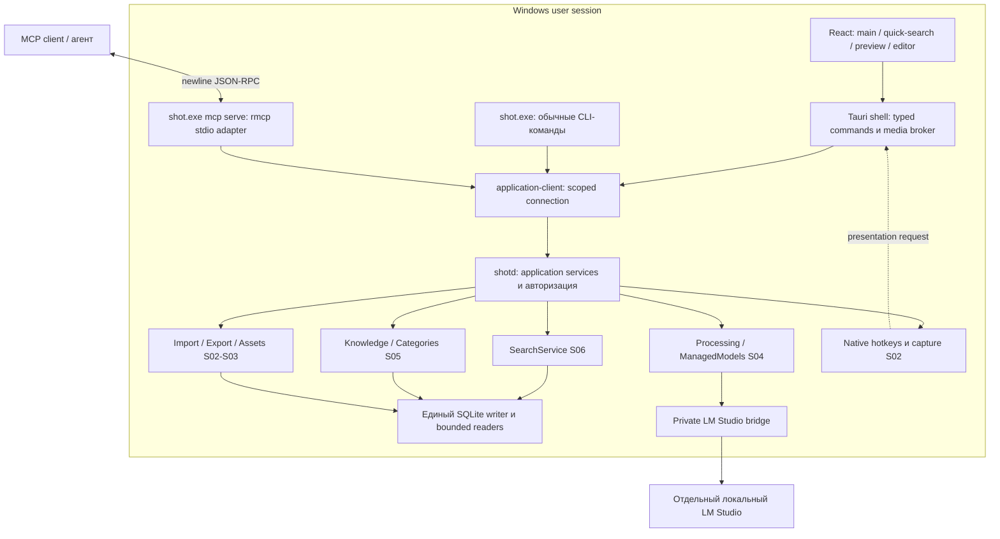
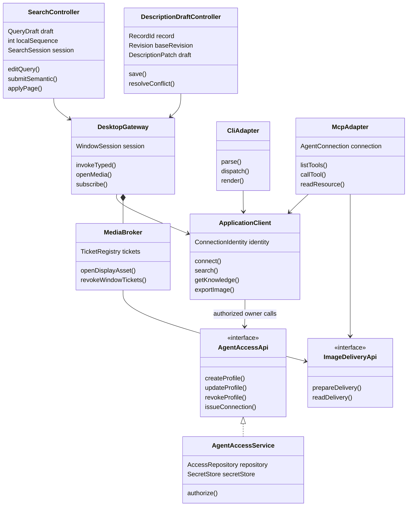
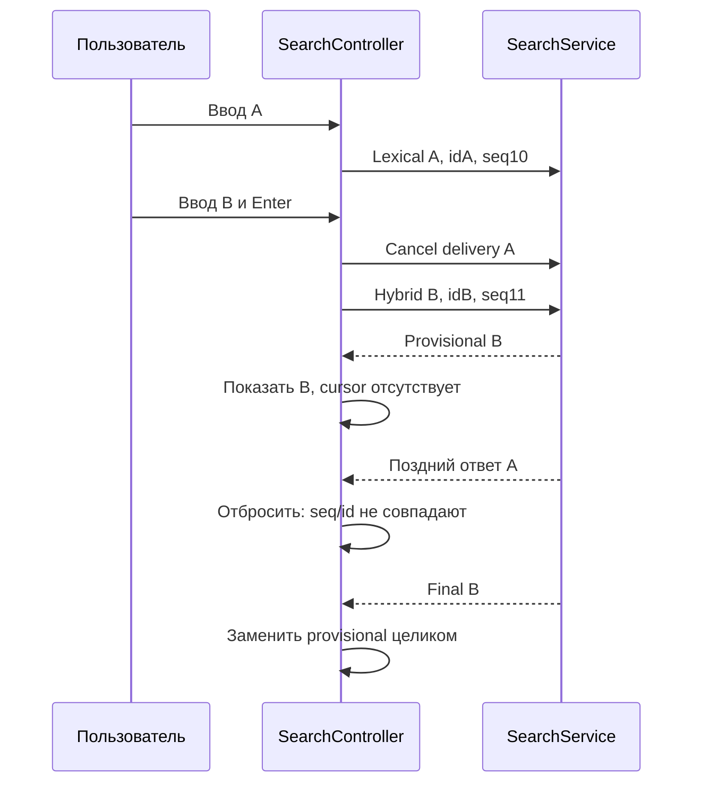
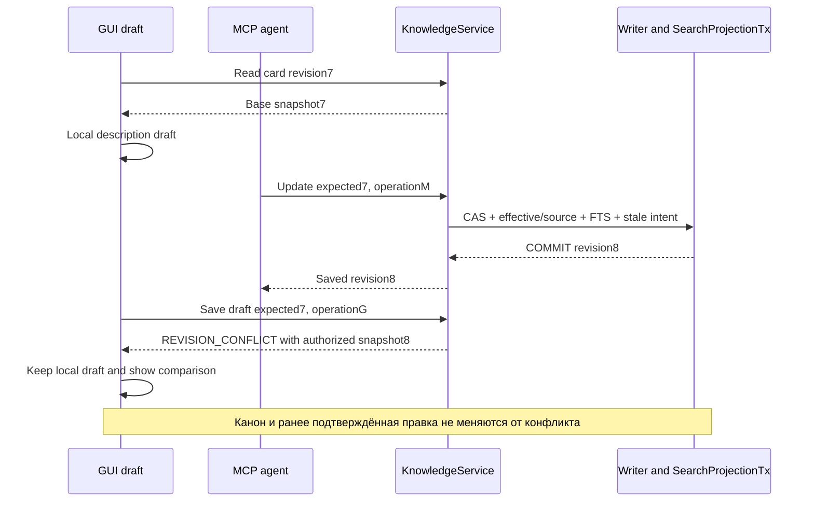
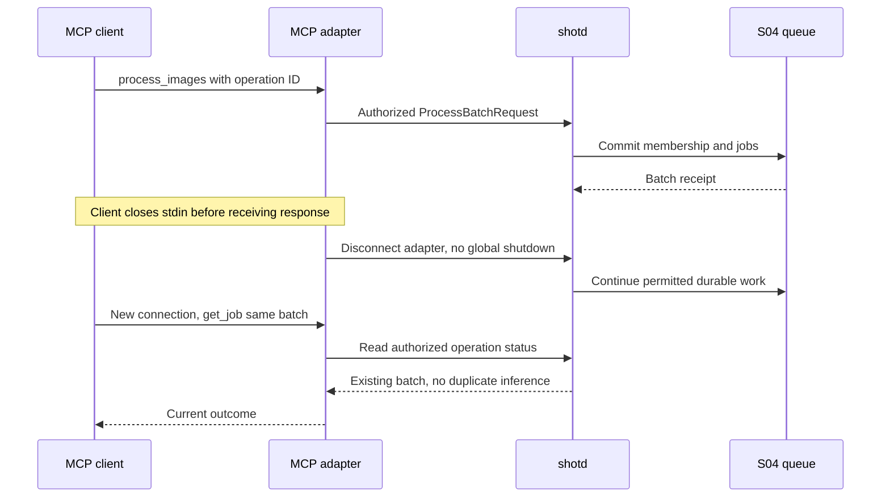
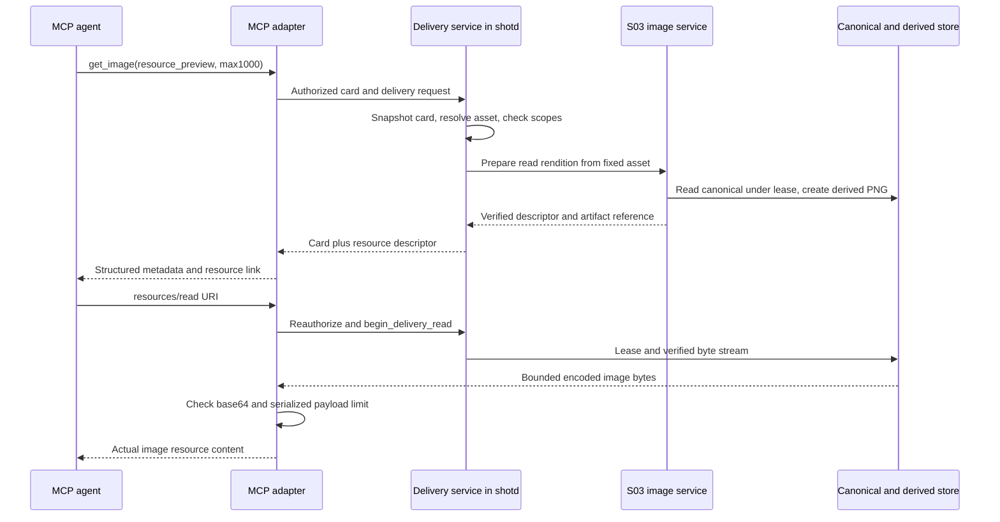
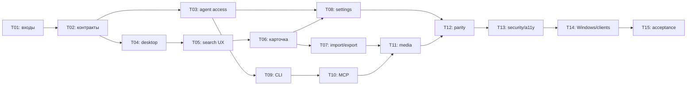

## S07: одна библиотека, три полноценных способа работы 🖥️

Седьмой этап завершает интерфейсы продукта. Человек открывает небольшое поисковое окно, находит изображение по словам или смыслу, просматривает его, исправляет описание и экспортирует подходящую копию. Командная строка делает те же действия через устойчивый машинный контракт. MCP-агент получает разрешённые карточки, пути или сами изображения — без собственной реализации поиска, конвертации и управления моделями.

Основной результат — **не три приложения, а три адаптера одной прикладной логики**. Захват, импорт, канонические WebP/AVIF, метаданные, очередь, LM Studio, описания и индекс уже имеют владельцев S02–S06. S07 объединяет их в законченные сценарии, устраняет интерфейсные пробелы и проверяет, что одинаковые действия дают одинаковые результаты независимо от точки входа.

Это **документ 7 из 8**. Задачи `S07-T01…S07-T15` — внутренние шаги одного этапа. Схемы, ADR, fixtures, manifests и отчёты ниже являются артефактами реализации, а не дополнительными крупными планами. Восьмой документ останется посвящён надёжности, эксплуатации и выпуску Windows-версии.

> [!important] Статус документа
> Сверены master v3, контракты и handoff S01–S06, официальные материалы Tauri, React, MCP и WAI-ARIA. Составлена спецификация, а не реализовано приложение. Наличие плана S06 не доказывает принятую сборку `search-beta`. Windows-проверки, реальные MCP-сессии, модели, installer и аппаратные измерения остаются `NOT_RUN` до появления evidence исполнения.

### Навигация 📚

| Раздел | Назначение |
|---|---|
| [1. Scope и входы](#scope) | Проверяемый результат этапа и границы ответственности |
| [2. Техническая сверка](#audit) | Контракты предыдущих стадий и актуальные особенности MCP/Tauri |
| [3. Архитектура](#architecture) | Процессы, адаптеры, classes/traits и ownership |
| [4. Общие контракты](#contracts) | Версии, DTO, согласованные чтения, события и ошибки |
| [5. Desktop lifecycle](#desktop) | Главное окно, быстрый поиск, hotkeys, preview и закрытие |
| [6. Поисковый интерфейс](#search-ui) | Запросы, фильтры, list/grid, provisional/final, клавиатура |
| [7. Карточка и библиотечные действия](#library-ui) | Правки, версии, импорт, экспорт и категории |
| [8. Onboarding и настройки](#settings) | Модели, режимы обработки, Advanced, OCR и диагностика |
| [9. Доступ агентов и schema 7](#access) | Ограниченные principals, credentials, roots, отзыв прав |
| [10. CLI](#cli) | Полный каталог команд, JSON/JSONL, exit codes и примеры |
| [11. MCP](#mcp) | Stdio, версии протокола, инструменты, результаты и lifecycle |
| [12. Изображения, ресурсы и пути](#media) | Настоящие pixels, ограниченный payload и resource delivery |
| [13. Конкурентность и паритет](#parity) | Reconnect, idempotency, отмена и одинаковые side effects |
| [14. Безопасность и доступность UI](#ui-quality) | CSP, команды Tauri, a11y, масштабирование и производительность |
| [15. Наблюдаемость](#observability) | События, безопасные логи, doctor и метрики |
| [16. Тесты](#testing) | Fixtures, negative cases, fault injection и live matrix |
| [17. Задачи и коммиты](#tasks) | Пятнадцать конкретных шагов и промежуточные результаты |
| [18. Проверка и приёмка](#acceptance) | Команды, gates, checklist, отчёт и демонстрация |
| [19. Передача S08](#handoff) | Трассируемость, изменения контрактов и release-обязательства |
| [20. Источники](#sources) | Прочитанные планы, первичные материалы и границы проверки |

<a id="scope"></a>
## 1. Граница S07 и входные обязательства 🎯

### 1.1. Что означает `feature-complete-beta` 📦

Контрольная точка означает завершение основных пользовательских и агентских сценариев. Она **не** означает уже подписанный installer, проверенные обновления или завершённую эксплуатационную приёмку S08.

| Обязательный результат S07 | Что не реализуется повторно |
|---|---|
| Главное поисковое окно, компактный поиск по hotkey, list/grid и доступная навигация | SQL, embeddings, RRF, фильтры и pagination S06 |
| Полная карточка: изображение, метаданные, эффективные поля, AI-история и ручные правки | Effective resolver, категории, CAS и AiRun S05 |
| Drop zone файлов/папок, per-file progress, retry и экспорт | Walker, EXIF, канонические форматы, resize и codecs S03 |
| Capture actions и корректный preview/pin/editor UX | Freeze, выбор цели, GDI, persistence/recovery S02 |
| Onboarding и рабочие настройки AI, моделей, OCR и обработки | SDK bridge, модельные leases, TTL, policy и scheduler S04 |
| Стабильные CLI-команды, help, JSON/JSONL и exit codes | Второй repository, второй dispatcher AI или обход host |
| MCP stdio с проверенными tools, scopes, paths и image/resource delivery | Собственная MCP-база или загрузка моделей из MCP-процесса |
| Ограниченный доступ агента, отзыв полномочий и allowed roots | Защита от произвольного malware с правами владельца ОС |
| Проверки паритета, Windows UI, реальных MCP-клиентов и закрытого GUI | Финальный installer, backup/restore/purge, signing и upgrade S08 |

В составе S07 сохраняются все ранее согласованные возможности: Windows-first; четыре capture-режима; сохранение меню; собственный полноразмерный канон; drop файлов и рекурсивных папок без RAW; WebP и AVIF; даты, EXIF/GPS и пути; PNG для анализа 1024/2048; экспорт с сохранением пропорций, в том числе не более 1000 по каждой стороне; категории; ручные исправления; семантический поиск; автоматическая, ручная и отключённая AI-обработка; загрузка/выгрузка моделей и Advanced. Их backend-поведение принадлежит соответствующим предыдущим стадиям. [PLAN-M], [PLAN-2]…[PLAN-6]

### 1.2. Что принимается от предыдущих этапов 🧷

| Вход | Что проверяется до начала интеграции |
|---|---|
| Master v3 и планы S01–S06 | Hashes в YAML совпадают либо оформлен явный change note |
| Accepted code checkpoint S06 | Реальный commit и report, не только Markdown-файл |
| Host foundation | Один `shotd`, user-session lock, один writer, безопасный `application-client` |
| Capture/library | Четыре режима, `SavedReceipt`, immutable assets, preview/editor, asset transfer 1 |
| Import/export | `NativePathDto`, origin metadata, PNG1024/2048, экспорт1000, leases и actual options |
| Runtime/processing | Policies, finite batches, requested/applied model config, consent, uncertainty и TTL |
| Knowledge | `FieldPatch`, effective fields, AiRun/OCR history, sensitivity и expected revisions |
| Search | `SearchApi`1.5, filters, provisional/final, epoch-bound cursor, degraded states |
| Build/quality | Locked dependencies, Windows staging, safe logs, test-support и verification scripts |

Начальная рабочая схема — **schema 6**, application protocol **1.5**, asset-transfer **1**, SDK bridge **1.1** с реально принятыми расширениями. Ни одна из этих версий не принимается по памяти: исполнитель читает environment/schema/protocol manifests принятого checkpoint.

Отсутствие реализации не мешает проектировать UI или fixtures, но блокирует приёмку сквозного сценария. Mock UI не выдаётся за работающий импорт; fake runtime не подтверждает реальное применение K/V; запуск браузерного теста не подтверждает поведение native hotkey на Windows.

### 1.3. Что сознательно остаётся вне S07 🧭

OpenAI-compatible cloud provider, Unsloth, новые embedding-модели, автоматическая обработка по расписанию/при старте, RAW, синхронизация и визуальный поиск по изображению не включаются «заодно». Точки расширения сохраняются, но UI не показывает работающие переключатели несуществующих функций.

Backup/restore, окончательный purge, secure erasure claims, installer/updater/signing и окончательная поставка OCR identity-компонента принадлежат S08. S07 предоставляет состояния и integration hooks для них, а также проверяет текущий staging-пакет. Неактивные release-функции не должны возвращать фиктивный успех ни в GUI, ни в CLI, ни в MCP.

<a id="audit"></a>
## 2. Техническая сверка и карта интеграции 🔬

### 2.1. Какие контракты уже определены 📘

| Источник | Используемая граница | Важное следствие для интерфейса |
|---|---|---|
| S01 §§4–8 | Host/client, framing, enrollment, bridge и SecretStore | Закрытый GUI не выключает библиотеку; SDK не импортируется в React |
| S02 §§3,5,8–11 | Capture intent, Saved, asset transfer, current/original и версии | Клик GUI не обещает сохранить меню, существовавшее до клика; preview не решает сохранность |
| S03 §§4,10–13 | Пути, import batches, export receipts, derivatives | Выдаваемый source path — история; конвертация не меняет canonical |
| S04 §§5,7,9–14 | Runtime API, policy, uncertainty, finite batches | Cancel ожидания не означает остановку GPU; loading требует полномочий |
| S05 §§5,12–14 | Keep/Inherit/Set, effective/source, категории и sensitivity | Пустое описание и наследование различаются; приватное AI-поле не раскрывается через обычную карточку |
| S06 §§5,11,14–15 | SearchRequest, SearchPage, epoch/cursor, query policy | Provisional page заменяется целиком; старый cursor не пересчитывается клиентом |

План S07 опирается на прочитанные контракты, а не на построчный аудит ещё не существующего ScreenMemory code checkpoint. При исполнении создаётся `interface-inventory.json`: реальный symbol/path, его schema, доступные scopes, тесты и расхождения с планом.

### 2.2. Существенное обновление MCP-протокола 🔌

На дату подготовки официальная документация обозначает **`2026-07-28`** текущей версией MCP. Она использует version metadata на каждом запросе и `server/discover`; старые версии, включая `2025-11-25`, используют initialization handshake. Это нельзя свести к замене одной строки даты. [SRC-01], [SRC-02]

**Решение S07:** поддержать два проверяемых режима одного stdio-адаптера: текущий `2026-07-28` и совместимость с `2025-11-25`. Официальный Rust SDK заявляет такую совместимость; конкретная опубликованная версия закрепляется и проходит собственные contract/live tests. Наличие поддержки в Git `main` не считается доказательством установленного crate. [SRC-03]

Это уточнение фиксируется как **CN-S07-01**. Состав продукта не расширяется до HTTP-сервера, OAuth-сервиса, MCP Apps, sampling, remote execution или ещё одной очереди Tasks. Публичные tools и application logic одинаковы в обоих режимах. Необязательные протокольные extensions не рекламируются до реализации.

### 2.3. Tauri: capabilities не заменяют все проверки 🪟

Tauri позволяет задавать capabilities для разных windows/webviews. Однако зарегистрированные собственные commands по умолчанию доступны окнам приложения, если не настроено их ограничение через app manifest/permissions. Поэтому одной записи `capabilities/main.json` недостаточно как доказательства, что preview не может вызвать административную команду. [SRC-04]

Обычные Tauri events предназначены для небольших сообщений и не дают полноценного разграничения содержимого через capability system. Содержательные данные, credentials и image bytes не передаются через общий `emit` на все окна. Для адресной доставки используется проверенный bridge в shell и targeted channels/commands. [SRC-05]

React StrictMode в development повторно проверяет setup/cleanup effects. Это выявляет двойные listeners, повторный drop и незакрытые subscriptions; отключать StrictMode ради исчезновения симптома нельзя. [SRC-08]

### 2.4. Карта изменений существующего кода 🗺️

| Область accepted S06 | Что делает S07 | Что запрещено |
|---|---|---|
| `app/frontend/features/search` | Полный layout, контроллер запроса, list/grid, keyboard | Второй ranking/normalizer/embedding formatter |
| `app/frontend/features/knowledge` | Draft/Conflict/History UX и доступный category picker | Last-write-wins вместо `expected_record_revision` |
| Tauri commands и media handler S02 | Window-scoped allowlist, bounded media broker, typed commands | `invoke_any(method, raw_json)` без allowlist или arbitrary file server |
| `crates/cli` | Полный parser, единые envelopes/error mappings, MCP serve mode | SQL, SDK или direct file conversion |
| `application-client` | Typed wrappers, events, operation lookup и controlled reconnect | Автоповтор неизвестно завершившейся мутации |
| Authorization foundation | Ограниченные persistent agent profiles и отзыв прав | Подстановка owner credential при ошибке агентского подключения |
| Host composition root | Регистрация новых adapters/API, desktop presentation broker | Перенос host в WebView или глобальный mutex на все операции |
| Donor React editor/preview | Доведение ранее перенесённых S02 инструментов | Возврат к temp/history-save semantics Inspector |

Исходный Inspector остаётся источником отдельных UX-компонентов, но S07 работает прежде всего с **принятым ScreenMemory checkpoint**, а не заново форкает актуальную ветку донора.

<a id="architecture"></a>
## 3. Архитектура трёх точек входа 🧱

### 3.1. Процессы и направления вызовов 🔗



MCP не использует SDK bridge как собственный server runtime. `shot.exe mcp serve` — Rust-процесс, запущенный MCP-клиентом; он подключается к `shotd` с ограниченной identity. Bundled Node остаётся только внутри LM Studio adapter S04. Завершение MCP-процесса не останавливает host, не выгружает чужие модели и не удаляет файлы.

### 3.2. Разделение ответственности 🧩

| Компонент | Владеет | Не владеет |
|---|---|---|
| `SearchController` frontend | Draft query, request sequence, selection, отображение server states | Search ranking и выдачей прав на query load |
| `DescriptionDraftController` | Незаписанным текстом, validation hints и конфликтом | Серверными revisions и решением, какие поля наследовать |
| `DesktopPresentationBroker` host | Одним GUI-сеансом, coalesced show requests, native presentation intent | React state или DB mutation изображения |
| `DesktopGateway` shell | Связью window ↔ authorized client, безопасными media URLs | SQL, моделью или категориями |
| `CliAdapter` | Parser, path resolution аргументов, wait/output | Вторым импортом, ресайзом или поиском |
| `McpAdapter` | MCP schema mapping, protocol lifecycle, bounded output | Доверенной авторизацией по строке `clientInfo` |
| `AgentAccessService` host | Профилями полномочий, roots, security revisions, отзывом | Настройками стороннего агента без согласия |
| `ApplicationHost` | Общими сервисами, проверками доступа и источниками истины | Форматированием таблиц терминала |

### 3.3. Structs/traits и зависимости 🧬



Это diagram structs/traits, а не требование наследовать один UI от другого. Реальные IDs/DTO импортируются из protocol S01–S06. Появление `ImageDeliveryApi` означает композицию разрешённых чтений и производных S03, не новый codec pipeline.

### 3.4. Дельта репозитория 📂

```text
crates/
  protocol/src/{presentation.rs, access.rs, delivery.rs, catalogs.rs}
  application/src/{presentation.rs, agent_access.rs, image_delivery.rs}
  application-client/src/{presentation.rs, access.rs, delivery.rs}
  infrastructure/src/{access/, presentation/}
  host/src/{desktop_broker.rs, dispatcher.rs}
  cli/src/
    args/{capture.rs, library.rs, models.rs, knowledge.rs, search.rs, access.rs}
    output/{human.rs, json.rs, jsonl.rs, exit_codes.rs}
    commands/                         # только адаптация application-client
  mcp-adapter/src/
    lib.rs
    server.rs
    catalog.rs
    tools/{search.rs, images.rs, mutations.rs, jobs.rs, filters.rs}
    resources.rs
    output.rs
    limits.rs
app/
  src-tauri/src/{commands/, desktop_session.rs, media_broker.rs, events.rs}
  src-tauri/capabilities/{main.json, quick-search.json, preview.json, editor.json}
  frontend/src/
    app/{routes.tsx, providers.tsx, window-entry.tsx}
    features/{search/, library/, knowledge/, import/, export/, processing/, models/, access/, settings/}
    shared/{ui/, gateway/, errors/, i18n/, accessibility/}
    generated/                        # protocol DTO и схемы, не ручные копии
schemas/{application-v1.6/, mcp-tools-v1/, access-v1/, ui-preferences-v1/}
migrations/0007_interfaces_access.sql
tests/{interface-parity/, mcp/, frontend/, windows-ui/, fixtures/}
scripts/{verify-interfaces.ps1, verify-mcp.ps1, verify-ui-windows.ps1}
docs/progress/S07/
```

Число физических crates может быть меньше дерева, если принятая структура уже объединяет внутреннюю infrastructure. Но `mcp-adapter` и CLI не получают dependency на repository implementation. `cargo metadata`/boundary tests проверяют это. Отдельный `shot-mcp.exe` не требуется: один существующий CLI-бинарник имеет строгий serve mode.

<a id="contracts"></a>
## 4. Общие контракты: тонкие интерфейсы без потери смысла 📐

### 4.1. Версии и совместимость 🔌

Application protocol расширяется **с 1.5 до 1.6**. Новые capabilities: `presentation_v1`, `agent_access_v1`, `image_delivery_v1`, `catalog_views_v1`, `operation_lookup_v1`. Asset-transfer остаётся **1**, bridge — **1.1**, image/OCR worker protocols не меняются без отдельного обоснования. Версия MCP (`2026-07-28` / `2025-11-25`) не является номером application protocol.

Существующие `SearchRequest/SearchPage`, `DescriptionPatch`, `ProcessBatchRequest`, `NativePathDto`, `ExportImageRequest` и model DTO сохраняют свой смысл. CLI aliases прошлых планов поддерживаются там, где они уже были реализованы. Изменение машинного output фиксируется как контрактная дельта, а не случайная «косметика».

UUID — строки; revisions/sequences/byte counts — проверенные decimal strings. Query, title и description имеют лимиты S05/S06. Presentation не снимает ограничения лишь потому, что textarea может вместить больше текста.

### 4.2. Общий каталог действий 🗂️

В `interface-action-manifest.json` каждому действию назначаются `action_id`, owner service, минимальные scopes, side-effect class, request/response schema IDs, availability capability и cancel semantics. Из manifest строятся проверки полноты UI/CLI/MCP mappings. Сам manifest **не** превращается в API произвольного исполнения методов по имени.

| Действие | Owner | Основные входы |
|---|---|---|
| `capture.create` | S02 `CaptureService` | Mode, operation ID, разрешённая target policy |
| `images.import` | S03 `ImageImportApi` | Roots, recursive, profile revision, duplicate policy |
| `images.read` | S02/S03 + S05 | Record/asset selector, права на fields/pixels/paths |
| `images.export` | S03 `ImageExportApi` | Format, dimensions, destination, metadata policy |
| `knowledge.update` | S05 `DescriptionApi` | FieldPatch, expected revision, index intent |
| `knowledge.reanalyze` | S04/S05 | Process action и новый analysis intent |
| `index.reindex` | S04/S06 | IndexOnly, выбранный набор, действующие permissions |
| `search.start/page/status` | S06 `SearchApi` | Query, filters, search ID, cursor, consent |
| `processing.control` | S04 | Batch/job ID, expected revision, action |
| `models.control` | S04 | Typed profile/download/load/unload requests |
| `access.manage` | S07 | Owner action, agent profile revision, scopes/roots |

Read каталога моделей не равен load; получить путь не равнозначно получить pixels; metadata edit не означает разрешение на model call. Эти различия остаются в action manifest и visible UX.

### 4.3. Согласованное чтение карточки и изображения 🖼️

Полная карточка объединяет S02 record/assets, S03 provenance, S05 knowledge и S06 index status. Если shell сделает четыре независимых запроса и назовёт их единым snapshot, он может показать новую картинку со старым описанием без предупреждения.

Поэтому host добавляет read-only композицию `ImageCardApi`. Она читает необходимые rows одним коротким согласованным DB snapshot, фиксирует выбранный asset ID/revision и возвращает applicability каждого текстового слоя. Чтение pixels выполняется позже по **этому конкретному** asset ID. Долгое чтение файла не удерживает транзакцию.

```rust
#[derive(Clone, Serialize, Deserialize)]
#[serde(deny_unknown_fields)]
pub struct ImageCardRequest {
    pub record_id: Uuid,
    pub asset: AssetSelection,                  // S03: current/original/explicit
    pub include_paths: bool,
    pub include_source_metadata: bool,
    pub include_ai_history: bool,              // только bounded первая страница
}

#[derive(Clone, Serialize, Deserialize)]
pub struct CardSnapshot {
    pub snapshot_id: Uuid,
    pub record_id: Uuid,
    pub record_revision: String,
    pub content_revision: String,
    pub resolved_asset_id: Uuid,
    pub asset_revision: String,
    pub library: RecordView,
    pub knowledge: KnowledgeView,
    pub source: Option<SourceMetadataView>,
    pub index: RecordIndexView,
    pub warnings: Vec<SafeWarning>,
}

#[async_trait]
pub trait ImageCardApi: Send + Sync {
    async fn get_card(&self, ctx: RequestContext, req: ImageCardRequest)
        -> Result<CardSnapshot, AppError>;
}
```

`SourceMetadataView` — существующая S03 фильтруемая проекция; `RecordIndexView` строит S06 из того же snapshot. В implementation все сокращённые типы имеют конкретную schema. Card snapshot не даёт новых прав: если requested sensitive fields недоступны, host возвращает явный forbidden outcome, а не незаметно подставляет owner-read.

Внешний источник не проверяется на существование при обычном get. `source_missing` появляется только после отдельной проверки либо из известного результата, а не из фонового обращения к отключённому сетевому диску.

### 4.4. Единый lookup долгих операций ⏳

GUI, CLI и MCP должны уметь различить import batch, processing job, capture operation и export. Один UUID без типа не является универсальным идентификатором «чего-то работающего».

```rust
#[derive(Clone, Serialize, Deserialize)]
#[serde(tag = "kind", rename_all = "snake_case", deny_unknown_fields)]
pub enum OperationRef {
    Capture { operation_id: Uuid },
    ImportBatch { batch_id: Uuid },
    ImportItem { item_id: Uuid },
    ByRequest { request_operation_id: Uuid, family: OperationFamily },
    Export { operation_id: Uuid },
    ProcessingBatch { batch_id: Uuid },
    ProcessingJob { job_id: Uuid },
    ModelOperation { operation_id: Uuid },
    IndexRebuild { rebuild_id: Uuid },
}

#[derive(Clone, Serialize, Deserialize)]
#[serde(deny_unknown_fields)]
pub struct LookupOperationRequest { pub operation: OperationRef }

#[derive(Clone, Serialize, Deserialize)]
#[serde(tag = "kind", rename_all = "snake_case")]
pub enum OperationView {
    Capture { value: CaptureOperationView },
    ImportBatch { value: ImportBatchView },
    ImportItem { value: ImportItemView },
    Export { value: ExportOperationView },
    ProcessingBatch { value: ProcessingBatchView },
    ProcessingJob { value: JobView },
    ModelOperation { value: ModelOperationView },
    IndexRebuild { value: RebuildView },
}
```

`OperationFamily` — закрытый enum `Capture/Import/Export/Processing/Model/IndexRebuild`, сериализуемый как snake_case. Вариант `ByRequest` нужен после потери первого receipt: он ищет только operation request аутентифицированного principal в соответствующем прежнем registry и возвращает обычный типизированный `OperationView`. Он не исполняет мутацию повторно. Неизвестный ID возвращает `OPERATION_STATE_UNKNOWN/NOT_FOUND` согласно owner contract, а не запускает новую операцию. Для немедленных knowledge/category mutations используется их собственный receipt/status API, не фиктивная processing job.

`OperationLookupApi.lookup(ctx, request)` маршрутизирует к прежним owner services и проверяет principal/права на соответствующую работу. Он не создаёт новую таблицу jobs. Returned view сохраняет исходное состояние, включая `uncertain`, `held_accepted`, `partial` и `interrupted`.

### 4.5. События UI и cursor разных потоков 📬

`library_events`, `knowledge_events` и `processing_events` имеют независимые sequence. Их нельзя сравнивать как одну глобальную шкалу. Presentation cursor содержит high-water каждого feed, host instance, library и security revision.

```rust
#[derive(Clone, Serialize, Deserialize)]
pub struct UiFeedCursor {
    pub host_instance_id: Uuid,
    pub library_id: Uuid,
    pub library_sequence: String,
    pub knowledge_sequence: String,
    pub processing_sequence: String,
    pub principal_security_revision: String,
}

#[derive(Clone, Serialize, Deserialize)]
#[serde(tag = "kind", rename_all = "snake_case")]
pub enum UiNotice {
    RecordChanged { record_id: Uuid, record_revision: String },
    ProcessingChanged { operation: OperationRef },
    CatalogChanged { catalog: CatalogKind, revision: String },
    SearchInvalidated { search_id: Uuid, safe_code: String },
    AccessChanged { security_revision: String },
    ResyncRequired { safe_code: String },
}
```

Notice — сигнал перечитать разрешённый snapshot, а не неограниченный контейнер descriptions/paths/GPS. Host фильтрует notices по principal; shell адресует их только связанному window session. Generic Tauri event payload не считается авторизованным источником state.

Bootstrap подписки: установить bounded subscriber → прочитать согласованный snapshot с high-water → отбросить дубли до high-water → применить следующие notices. При переполнении отправить `ResyncRequired`; потерю события нельзя исправить предположением «наверное всё актуально». Initial cursor после restart не переносится как действительная подписка.

### 4.6. Конфликт, отсутствие и отказ — разные результаты 🚦

Ошибки S01–S06 сохраняются. Добавляются `ACCESS_PROFILE_REVOKED`, `ACCESS_REVISION_CONFLICT`, `CONNECTION_NOT_ENROLLED`, `DELIVERY_TOO_LARGE`, `DELIVERY_EXPIRED`, `DESKTOP_SESSION_UNAVAILABLE`, `WINDOW_ACTION_FORBIDDEN`, `CATALOG_CURSOR_INVALID` и `MCP_VERSION_UNSUPPORTED` на соответствующих границах.

Нельзя вернуть пустую выдачу вместо `PERMISSION_DENIED`, чёрное изображение вместо integrity error, отключённый AI вместо runtime timeout или Saved вместо accepted operation. Presentation объясняет отказ и допустимое следующее действие, но не переписывает domain outcome ради зелёной галочки.

<a id="desktop"></a>
## 5. Desktop lifecycle: быстрый поиск не должен мешать захвату 🪟

### 5.1. Окна и их назначение 🗂️

| Window label | Назначение | Lifetime / исходные ограничения |
|---|---|---|
| `main` | Библиотека, карточка, обработка и настройки | Одно основное окно GUI-сеанса |
| `quick-search` | Быстрый запрос поверх текущей работы | Одно переиспользуемое окно без тяжёлых настроек/редактирования |
| `capture-preview` | Ненавязчивое подтверждение сохранённого снимка | Один preview; pin сохраняет конкретный asset S02 |
| `image-editor` | Annotation tools и сохранение новой версии | Один полноразмерный editor в исходной конфигурации |

Производственные labels закрыты allowlist. Тестовые окна имеют отдельный test namespace и не входят в release capability set. Привязку editor/preview к record/asset хранит Rust shell, а не только query string WebView.

Основной `main` открывается как обычное resizable окно. Исходный ориентир — 1180×760 DIP, но размеры ограничиваются фактической work area. При узком пространстве layout переходит в вертикальный режим. Нельзя навязать минимальную ширину, при которой приложение не помещается на экране с масштабом Windows 200%.

Быстрый поиск ориентирован на 760×520 DIP; размеры также ограничиваются work area. Позиционирование выполняется относительно монитора вызова, не абсолютной точки старого disconnected monitor. DPI-перевод выполняет один слой shell/platform; React не домножает размеры второй раз.

### 5.2. Один GUI-сеанс и живой host 🧷

`shotd` остаётся владельцем capture hotkeys и tray. Второй запуск `ScreenMemory.exe` не создаёт новый host, очередь или БД. Он соединяется с уже действующим host, передаёт разрешённое намерение показа и завершает лишний GUI-кандидат, если другой shell уже зарегистрирован.

GUI single-instance key учитывает library identity и пользовательскую сессию. Одного глобального process-name mutex недостаточно для независимых test roots. Production по-прежнему использует один выбранный root; поддержка переключения нескольких библиотек в UI не добавляется на S07.

`DesktopPresentationBroker` хранит shell PID/identity, generation, connection и окно, которому разрешено получать show requests. Регистрация проверяет источник соединения, а не строку `client_kind="gui"`. Старый shell generation после restart не может получать новые private notices.

### 5.3. Вызов быстрого поиска по хоткею ⌨️

Hotkey `OpenSearch` добавляется в тот же native registry S02. В onboarding предлагается свободная комбинация; она не назначается без проверки конфликта. Ранее встречавшийся `Ctrl+Shift+F` остаётся примером: захватывать привычный поиск IDE по умолчанию нежелательно.

Алгоритм вызова:

1. Native dispatcher фиксирует только намерение `present_search` и монитор вызова. Ни screenshot, ни model load не запускаются.
2. При активном выделении capture show request откладывается и объединяется с повторными; окно не забирает focus у overlay.
3. Если GUI-сеанс жив, broker адресно просит показать `quick-search`.
4. Если GUI отсутствует, запускается фиксированный установленный `ScreenMemory.exe` через безопасный locator S01. Startup args содержат только разрешённый режим/ID, не credentials или произвольный URL.
5. После подтверждения shell окно получает focus; внутри него input становится активным. Последний query может сохраняться **только в памяти текущего GUI-сеанса**; после полного restart default query пустой.

Повторный hotkey при уже видимом quick search возвращает focus в input, а не создаёт второе окно. Если системные правила Windows не разрешили foreground activation, интерфейс отражает реальный результат; synthetic клики и произвольное отключение защит не используются.

```mermaid
sequenceDiagram
    participant N as Native host thread
    participant B as DesktopPresentationBroker
    participant G as Tauri GUI
    participant Q as QuickSearchController
    participant S as SearchService
    N->>B: OpenSearch intent and monitor
    alt Capture selection is active
        B->>B: Coalesce request until selection settles
    end
    alt GUI absent
        B->>G: Spawn verified GUI executable
        G->>B: Register authorized shell generation
    end
    B->>G: Present quick-search
    G->>Q: Focus input, empty or in-memory draft
    Q->>S: Empty browse through application-client
    S-->>Q: Recent permitted records; no model calls
    Note over N,S: Никакой Gemma/Qwen только из-за показа окна
```

### 5.4. Hide, close и quit не взаимозаменяемы 🚪

| Действие | Поведение |
|---|---|
| Esc в quick search без открытого диалога | Скрыть quick search, прекратить доставку его search session |
| Esc внутри открытого dropdown/dialog | Сначала закрыть верхний локальный UI-слой |
| Blur quick search | Скрыть только если нет дочернего диалога, активного IME/drag или пользовательского действия выбора файла |
| Закрыть main | По default скрыть GUI-окно; host продолжает работать |
| «Закрыть интерфейс» | Завершить GUI-сеанс после решения dirty drafts; host остаётся |
| «Выйти полностью» | Owner request safe shutdown host; применяется S02/S04 drain/settlement |
| Закрыть/pin preview | Только presentation; канон и очередь не удаляются |
| EOF MCP / завершение CLI | Закончить свой adapter, не весь продукт |

В UI названия действий явно различаются. «Выйти полностью» не скрывает потерю ещё volatile capture: при `SHUTDOWN_PENDING_SAVE` показывает необходимость безопасно завершить сохранение. Текст «модели выгружены» не появляется до подтверждённого состояния S04.

### 5.5. Пассивный preview и пользовательский редактор 📸

Автопоказ preview после Saved не активирует main и не перехватывает клавиатурный ввод у внешнего приложения. Host может не показывать preview вообще по настройке. Сохранение без GUI остаётся полноценным сценарием.

Pin удерживает прежний `record_id/asset_id`; новый screenshot сохраняется независимо. Нажатие «Редактировать» — уже явное действие пользователя, открывающее editor с конкретным asset и revisions. Annotation Save создаёт новую immutable version через S02/S03; окно не пишет поверх исходного файла.

Проверяются стрелки, текст, фигуры, highlight, blur/pixelation/redact и undo/redo, фактически перенесённые из донора. Скрытый отказ отдельного инструмента не маскируется статусом «редактор готов». Blur не обозначается как удаление чувствительных данных из OCR/истории/backup; специальная очистка остаётся S08.

<a id="search-ui"></a>
## 6. Главное поисковое окно: интерфейс состояния, а не только строка ввода 🔎

### 6.1. Структура страницы и адаптивность 📐

В основном окне сверху расположены search input и mode selector. Ниже — компактные filters и строка реального состояния поиска. Слева/в центре отображаются results, справа — выбранная карточка. При недостаточной ширине detail становится отдельной pane с кнопкой возврата, сохраняя query, scroll и selection.

Навигация ограничена разделами **Библиотека, Категории, Обработка, Настройки**. Drop zone интегрирована в библиотеку, а не создаёт пятую независимую историю. Search и Library — одна поверхность: пустой текст показывает недавние изображения по выбранным фильтрам.

| Элемент | Контракт поведения |
|---|---|
| Search input | Ясная подпись, очистка, focus shortcut `Ctrl+L` внутри приложения |
| Mode | Lexical / Hybrid / Semantic, фактический режим виден отдельно от запрошенного |
| Filters | Приложение, категория, дата/ось даты, source, состояние индекса, OCR/AI признаки |
| Results list | Thumbnail, title, source/app, дата, category и реальные статусы |
| Grid | Те же records и порядок; не второй локальный поиск |
| Detail | Изображение, effective поля, происхождение, версии и разрешённые действия |
| Footer/status | Provisional/final, degraded, partial coverage, очередь query model и ошибки |

Исходный переключатель list/grid меняет только presentation. Backend candidate window, rank и cursor не пересоздаются ради CSS. SelectedRecordId сохраняется, если запись всё ещё в разрешённой выдаче; индекс массива не используется как identity.

### 6.2. Контроллер запроса и минимум локального state 🧠

Форма не хранит независимо двадцать booleans `isLoading/isLoaded/isPending/...`. Используется закрытая state machine и отдельные значения query draft, filters, selected record и view mode.

```typescript
// Собственные frontend-типы; SearchPage/SearchFilters генерируются из protocol.
export type SearchUiState =
  | { kind: "idle" }
  | { kind: "debouncing"; seq: number }
  | { kind: "loading"; seq: number; searchId: string }
  | { kind: "provisional"; seq: number; page: SearchPage }
  | { kind: "final"; seq: number; page: SearchPage }
  | { kind: "stale"; seq: number; previous: SearchPage; reason: string }
  | { kind: "failed"; seq: number; code: string; previous?: SearchPage };

export interface SearchUiModel {
  queryDraft: string;
  filters: SearchFilters;
  requestedMode: "lexical" | "hybrid" | "semantic";
  viewMode: "list" | "grid";
  selectedRecordId: string | null;
  localSequence: number;
  state: SearchUiState;
}
```

Ключи `request_id`, `search_id`, `localSequence` и `projection_epoch` не заменяют друг друга. Первый коррелирует transport; второй идентифицирует backend session; третий защищает frontend от поздних callbacks; четвёртый определяет актуальность поискового snapshot S06.

### 6.3. Набор текста и явный semantic submit ⌛

При изменении query/filter frontend увеличивает local sequence и отменяет прежнюю доставку. Через **180 ms** без нового ввода запускается Lexical request. Enter создаёт отдельный Hybrid/Semantic request с актуальным draft. Тот же search ID нельзя переиспользовать с другим mode/allow-load: S06 рассматривает это как конфликт.

Во время IME composition Enter не отправляет поиск и не открывает случайный результат. Сначала завершается composition. В search input Enter означает submit; когда focus находится в results, Enter открывает выбранную карточку. Это снимает конфликт двух привычных действий.

Повторный Enter для уже выполняемого эквивалентного semantic intent присоединяется к текущему ожиданию, а не создаёт второй model call. Новый осознанный refresh после завершения получает новый search ID.

**Автоматический semantic-поиск после паузы не входит в обязательный S07 default.** Его настройка может быть добавлена только с отдельными debounce/load-budget тестами. Базовое удобство не должно превращать каждый символ в загрузку Qwen.

### 6.4. Provisional, final и изменение индекса 🔁

Ранняя lexical page показывается с подписью «Текстовые результаты; смысловой поиск ещё выполняется». У неё нет cursor продолжения. Когда приходит final page, она **заменяет массив**, а не добавляется к нему. Selection сохраняется по record ID, если это допустимо.

Любой ответ применяется только при совпадении local sequence и search ID. Ответ прежнего query не принимается из-за более позднего времени сервера. При `SEARCH_SNAPSHOT_CHANGED` текущая страница помечается как устаревшая и больше не догружается прежним cursor.

Автоматический refresh после background Index не должен вызывать бесконечные semantic requests. Исходная политика S07: пометить «Библиотека обновилась» и предложить Refresh; для пустого browse допускается bounded немодельное обновление. После собственной успешно сохранённой правки карточки можно один раз обновить Lexical, сохранив query. Новый semantic submit — явное действие пользователя.



### 6.5. Фильтры и даты без угадывания 🌐

Приложение и категория выбираются по стабильным IDs из разрешённого каталога. `Any`, `Unattributed/Uncategorized` и `AnyOf` — разные значения. Несуществующее имя не превращается в «Все». При архивировании назначенная категория остаётся доступна как исторический фильтр; новые назначения следуют S05.

Дата по умолчанию означает **добавление в библиотеку**. Capture и Taken имеют отдельные подписи. В Calendar UI локальное начало/конец дня преобразуются в полуоткрытый UTC interval; исходная timezone выбора показывается. Для Taken без offset существует отдельный фильтр, а не ложная UTC-дата.

GUI не извлекает «вчера в PyCharm» через новую LLM. Текст остаётся текстом, filters — явными параметрами. CLI name-resolution использует тот же catalog resolver и возвращает неоднозначность, а не выбирает первый application label.

### 6.6. Страницы, выбор нескольких записей и доступность списка 📋

Candidate depth S06 фиксирован на session: default100, допустимое явное расширение до2000. `window_truncated=true` означает ограниченную глубину кандидатов, а не найдено ровно100 документов во всей библиотеке. «Показать глубже» создаёт новый search с первой страницы и предупреждает о пересчёте порядка.

Load-more использует только полученный cursor. При ошибке cursor интерфейс не декодирует base64 и не вычисляет SQL offset самостоятельно. Новая страница запрашивается один раз для одного активного cursor; повторный intersection event не дублирует запрос.

Multi-select хранит набор record IDs. «Выбрать всё загруженное» не подписывается как «вся библиотека». Массовые Analyze/Index используют snapshot selection S04 и показывают фактическое число выбранных записей. Смена query очищает прежнюю bulk selection либо требует явного подтверждения её сохранения; невидимые выбранные records не обрабатываются незаметно.

Для основной выдачи используется обычный семантический список с кнопками выбора и отдельными controls, а не `role=listbox` вокруг карточки с вложенными интерактивными кнопками. В quick search возможен настоящий single-select listbox без вложенных действий; keyboard/ARIA реализуются целиком по выбранному pattern. [SRC-10]

### 6.7. Смысловой поиск недоступен — библиотека доступна 🚦

| Состояние backend | Что показывается | Допустимое действие |
|---|---|---|
| AI off | «Смысловой поиск выключен», Lexical остаётся | Перейти в настройки AI либо продолжить без модели |
| Qwen не установлен | Нет embedding-модели | Отдельный Download consent, не автоматическое скачивание |
| Query load Ask | Название профиля, запрос загрузки | Подтверждение через S04 owner API; затем новый разрешённый search |
| Load forbidden | Модель нельзя загрузить этим действием | Lexical либо изменение политики владельцем |
| Runtime down | Реальная причина недоступности | Retry после подключения; никакого cloud fallback |
| NoCurrentVectors | Ещё нет актуального смыслового индекса | Index выбранного/ожидающего; без бесполезного query inference |
| PartialIndex | Часть записей доступна только текстово | Показать partial, не скрывать новые изображения |
| Invalid vector/index | Ошибка канала, не ноль совпадений | Диагностика; источники и описания сохраняются |

Ни поиск, ни его error dialog не загружают Gemma для «понимания вопроса». Семантическому запросу нужен Qwen через S04; обычным list/get/export — никакая модель.

<a id="library-ui"></a>
## 7. Карточка, правки, импорт и экспорт 🖼️

### 7.1. Что отображает карточка 🧾

Верх карточки содержит актуальное изображение/preview, title и основные действия. Ниже — description, category, источник, даты и сворачиваемые подробности. Полноразмерная картинка открывается отдельно по пользовательскому действию; список не скачивает по 4K-asset на каждую строку.

| Блок | Обязательная информация |
|---|---|
| Изображение | Asset ID/revision, размеры, current/original, явная производная при уменьшенном просмотре |
| Описание | Effective поля и источник каждого: User / AI / Fallback |
| История | Paged AiRun summaries, модель/профиль, applicable/proposal/stale |
| OCR | Состояние, текст при разрешении, language/engine; пустой результат отличается от отсутствующего |
| Screenshot metadata | Captured/ingested, app, window title и provenance; подробный EXE/path по отдельным правам |
| Imported metadata | Taken/created/modified/ingested, камера, EXIF/GPS и origins по scope |
| Пути | Canonical/current/source/export с ясными ролями, копирование только по действию |
| Индекс | Current/missing/stale/blocked/failed и отдельно lexical доступность |

Для imported photo не показывается Explorer как «приложение изображения». Неизвестная timezone не выводится как текущая. У source path статус `not_checked` не заменяется зелёной галочкой существования. Metadata не считаются инструкциями для интерфейса: filename с HTML/ANSI отображается как текст.

### 7.2. Черновик и защищённое сохранение ✏️

Форма получает base snapshot и хранит draft отдельно. Save строит `DescriptionPatch` S05: неотредактированные поля — Keep; явное значение — Set; возврат к AI — Inherit. Пустое описание `Set("")` и отсутствие категории `Set(null)` сохраняются как намеренные ручные значения.

Сохранение отправляет один operation ID и expected record revision. Пока запрос не получил подтверждение, состояние формы — `saving` либо `outcome_unknown`, не `saved`. Повтор после потери ответа использует тот же operation ID через receipt lookup; повтор с новыми значениями создаёт новый ID.

При `REVISION_CONFLICT` отображаются base / локальный draft / актуальный server snapshot. Никакой автоматической LLM-склейки или тихого overwrite. Пользователь выбирает поля заново, получая новый expected revision. Переключение карточки или закрытие editor требует решения dirty draft.



### 7.3. AI-history, Adopt и Re-analyze 🧠

«Использовать AI-версию» удаляет override конкретного поля. «Принять это предложение» копирует поле выбранного применимого AiRun в ручной Set. Эти кнопки не взаимозаменяемы и не скрываются за одним неопределённым Reset.

Re-analyze создаёт новый intent через S04/S05 с сохранением overrides. Reindex выполняет только embedding. Изменение Gemma, пожеланий или каталога категорий не запускает переобработку всей истории автоматически.

Если AI завершился при открытом dirty draft, серверное новое предложение показывается отдельно. GUI не заменяет введённые символы incoming event. Смена current pixels делает прежний OCR/AI неприменимым по правилам S05; карточка не должна выдавать историческое описание за описание новой редакторской версии.

### 7.4. Импорт и drop zone 📥

Drop overlay использует native файловые paths Tauri S03. Drag-enter/over только показывает состояние; импорт начинается на Drop. Subscription регистрируется ровно один раз на window lifecycle и очищается даже при асинхронной регистрации после unmount.

Один Drop создаёт один import operation ID. Несколько файлов/папок передаются общему `ImageImportApi`; рекурсия, duplicate policy, RAW/multiframe skips и source snapshots остаются S03. Ни React, ни CLI не строят собственный walker.

| Состояние | Видимая подпись / действие |
|---|---|
| Discovering | Найдено N; общий итог ещё неизвестен |
| Staged | Принято в собственный snapshot, ещё не Saved |
| SavedNew | Создана новая библиотечная запись |
| LinkedExisting | Найден точный duplicate; добавлено происхождение |
| Skipped | Формат/RAW/reparse/multiframe и конкретная причина |
| HeldAccepted / Recoverable | Вход сохранён; обработка остановлена/не завершена |
| Partial failure | Показать per-file report, не общий зелёный успех |

«Отменить обработку импорта» не удаляет already accepted input и canonical. Закрытие окна не отменяет batch. Смена storage profile во время работы влияет только на новые intents; retained attempt восстанавливается по своему snapshot.

### 7.5. Экспорт с понятным результатом 📤

Export dialog показывает source asset и размеры, формат, max-side либо width/height, no-upscale, quality только при применимости, alpha background, destination и metadata policy. Preview расчёт размеров использует shared pure contract S03, а actual result приходит от сервиса.

Preset «Не более 1000 по любой стороне» устанавливает `max_side=1000`. 4K3840×2160 превращается в1000×562 по правилу S03; canonical не меняется. Inference1024/2048 — отдельная настройка, не глобальная настройка хранения.

При экспорте без destination показывается срок временного файла. При явном destination приложение не обещает очищать этот файл. Existing destination требует разрешённого overwrite; canonical/source никогда не перезаписываются даже с флагом. «Открыть папку» использует проверенный path соответствующей роли, не произвольную shell-строку из title.

Успех отображает **actual** format/dimensions/bytes, source revision, warnings и paths по правам. Частичный metadata-sidecar export остаётся Partial. Уменьшение текста для модели не обосновывает уменьшение канона и не меняет сохранённую карточку.

### 7.6. Категории и групповая работа 🏷️

Category UI реализует create, edit name/description, archive/restore и логическое delete S05. Категория принадлежит пользователю; AI не создаёт новую taxonomy. При delete показывается число затронутых разрешённых записей и отличия от archive.

Массовая смена label может занимать writer maintenance S05/S06. UI отображает operation/status, не запускает по одной несогласованной mutation на каждую строку. В sidebar не используется приблизительное «всего» из ограниченного списка как глобальный count.

Bulk Analyze/Index применяется к snapshot выбранных ID. Bulk overwrite описаний, автоматическое назначение категорий по exe и удаление картинок не появляются без отдельного контракта. Сохранение форм категорий и моделей имеет expected revision и conflict UX, как обычная карточка.

<a id="settings"></a>
## 8. Onboarding и настройки: полезно без AI, управляемо с AI ⚙️

### 8.1. Первый запуск без принудительных зависимостей 🧭

Первый экран предлагает начать библиотеку без модели либо настроить локальный AI. Отказ от настройки LM Studio не запрещает capture/import, ручные описания, Lexical, просмотр и export. Empty state даёт два очевидных действия: «Сделать снимок» и «Добавить изображения/папку».

Onboarding AI разделён на проверяемые действия: endpoint/inventory → выбор vision preset и Qwen → показ sources/license/размера → Download consent → verified inventory → policy/load → короткий self-test. Неудача шага не откатывает созданную библиотеку и не включает cloud fallback.

Приложение не устанавливает LM Studio молча. URL сторонней документации открывается только явным действием через allowlisted HTTPS destination; WebView не загружает её как привилегированную внутреннюю страницу.

### 8.2. Структура настроек и владелец каждого значения 🗂️

| Раздел | Основные поля | Владелец |
|---|---|---|
| Capture | Четыре режима, hotkeys, preview/pin/clipboard preferences | S02 native/settings |
| Storage/Import | WebP lossless / AVIF quality, duplicate policy, лимиты/recursive | S03 profiles/policy |
| AI processing | Automatic / Manual / AI off, ранний warm, background/query load, pause | S04 ProcessingPolicy |
| Models | Выбранная Gemma, Qwen, inventory, Download/load/unload, profiles | S04 ModelControlApi |
| Description | Язык, пользовательские пожелания, OCR hints, PNG1024/2048 | S05 preferences + S03 transform |
| OCR | Включение, язык, availability/identity component | S05 OcrApi |
| Search | Mode preference, candidate depth, явная query-load policy | S06 + presentation defaults |
| Agent access | Connections, scopes, roots, revocation и инструкции подключения | S07 AgentAccessService |
| Diagnostics | Doctor, реальные версии и safe error codes | Общий diagnostics service |
| Appearance | Theme, layout, размер thumbnails, сохраняемые presentation preferences | S07 UI settings |

UI не создаёт вторую копию runtime settings в localStorage. Server values читаются через revisioned APIs; локальные поля формы являются только draft. При конфликте значения не затираются.

### 8.3. Выбор модели и реальные статусы 🧠

Vision dropdown содержит Gemma4 E2B QAT, E4B QAT и12B QAT из **подтверждённого каталога S04**; default onboarding предлагает E4B. На старте одна выбранная vision-модель, отдельный Qwen3-Embedding-0.6B. Нельзя обозначать конкретный preset сертифицированным, если S04/S05 оставили его NOT_VERIFIED.

| Статус | Что означает |
|---|---|
| Not installed | Артефакт отсутствует; ещё нужен Download |
| Downloading | Наблюдаемая загрузка на диск; known/unknown total |
| Installed | Файлы найдены; модель не обязательно в памяти |
| Loading | Выполняется разрешённый load |
| Ready | Instance наблюдён, binding и applied config проверены |
| Busy | Есть действующий consumer/вызов |
| Settling | Отмена/timeout ещё не подтвердили физическое завершение |
| Unloaded | Экземпляр не в памяти; скачанные веса остаются |
| Config mismatch / Not verifiable | Параметры не подтверждены полностью |

Cancel Download показывается только при фактической backend capability. «Перестать ждать» не называется отменой сетевого скачивания. Размеры моделей не зашиваются в макет выдуманными гигабайтами: они приходят из manifest/inventory либо отмечаются unknown.

### 8.4. Advanced без произвольной shell-строки 🎛️

Advanced редактирует тот же `ModelProfile` S04, а не отдельные скрытые flags. Все control values отображаются в типизированные параметры allowlist.

| Группа | Поля и поведение |
|---|---|
| Load | Context length, GPU offload, Flash Attention, KV on GPU, batch size, K/V cache types |
| Prediction | Max generation4000, Off/Budget100/BackendDefault, temperature/top-p/top-k |
| Lifecycle | Idle TTL отдельно для vision/embedding, AfterBatch, KeepLoaded, Sequential/CoResident |
| Applied | Requested / Applied / Unsupported / NotVerifiable с причиной |

F16/F16 — baseline; Q8/Q8 и custom варианты доступны по S04 capabilities. Нельзя автоматически подменить выбранный Q4 на F16 и оставить зелёный status. V-cache/FlashAttention конфликт разрешается явным действием. Reasoning100 входит в общий лимит4000 и не называется гарантированным без поддержанной runtime-связки.

Изменение Load profile предлагает «Для будущих задач» либо «Перезагрузить свой instance, когда свободен». Оно не выгружает чужую модель и не обрывает активный lease. Prediction settings применяются к будущим запросам без ненужного reload.

### 8.5. Режимы обработки и таймеры 🕒

Automatic после принятого изображения может начать ранний load по S04 policy, но screenshot freeze и durable save не ждут его. Manual не запускает warm или Analyze автоматически. AI off запрещает vision/embedding calls и model load, но не optional native OCR с отдельной политикой.

Idle TTL показывается как время бездействия соответствующего instance, а не обратный отсчёт, который гарантированно оборвёт active request. Sequential может выгрузить Gemma раньше idle TTL для запуска Qwen; UI объясняет причину освобождения памяти. KeepLoaded означает отсутствие инициируемой приложением idle-выгрузки, не запрет внешнего unload из LM Studio.

Открытие GUI не загружает модели и не обрабатывает историю. Restart host с interrupted batch требует правил Resume S04; повторное открытие GUI при живом host не останавливает и не дублирует batch. Future OnStartup/Scheduled не показаны как работающие radio buttons V1.

### 8.6. Состояния доступности OCR и будущих провайдеров 🧩

OCR UI различает disabled, language unavailable, package identity unavailable, ready, failed и timeout. Ошибка deployment worker не называется «нет языкового пакета». Проверка identity-компонента S05 передаётся S08 installer; S07 только отображает факты и разрешённые repair-инструкции.

OpenAI-compatible provider остаётся будущим adapter. Настройки V1 не содержат активного поля cloud API key, которое никуда не применяется. При этом endpoint/SecretStore abstraction S04 не зашивается в React; появление будущего provider потребует новых capabilities, consent и secret reference, а не перестройки всех интерфейсов.

<a id="access"></a>
## 9. Доступ агентов, credentials и schema 7 🔐

### 9.1. Одна прикладная логика не означает одинаковые полномочия 🧭

GUI владельца, обычный CLI владельца и ограниченный MCP-agent вызывают те же services. Но их `RequestContext` может содержать разные scopes. Паритет означает одинаковые правила при одинаковых входах **и полномочиях**, а не право каждого агента читать любую картинку.

Default agent profile получает только `read_metadata`: доступ к разрешённым карточкам и немодельному поиску. Пиксели, пути, sensitive source metadata, ручные правки, импорт, screenshot и AI включаются отдельно. Установка приложения не создаёт безусловный read-all-images credential.

> [!warning] Граница локальной защиты
> Ограничения MCP не являются sandbox для агента с неограниченным shell-доступом от имени владельца Windows. Такой процесс потенциально может напрямую прочитать пользовательские файлы, вызвать обычный owner CLI или обратиться к Credential Manager. S07 защищает собственные API, ошибочные интеграции и другие principals; полноценная изоляция враждебного same-user процесса здесь не обещается.

### 9.2. Профили, подключения и scopes 🗂️

`AgentProfile` определяет права и разрешённые filesystem roots. `AgentConnection` связывает конкретную конфигурацию подключения с profile/principal и ограниченным credential. Display name вроде «Мой агент» не является удостоверением личности.

| Группа прав | Разрешает | Не включает автоматически |
|---|---|---|
| `read_metadata` | Карточки/каталоги/поиск в допустимой видимости | Pixels, paths, GPS, inference |
| `read_images` | Разрешённые asset/preview bytes | Исторический source path и host filesystem |
| `read_paths` | Явно запрошенные canonical/current/source/export paths | Чтение любых EXIF/GPS или произвольных файлов |
| `read_source_metadata` | Разрешённые подробности происхождения и sensitive labels | Передачу pixels без `read_images` |
| `write_metadata` | Title/description/category через CAS S05 | Overwrite image file, delete/purge |
| `export_images` | Производный файл через S03 | Arbitrary destination вне root policy или overwrite canonical |
| `import_images` | Import разрешённых roots | Выход за roots, RAW, unlimited traversal |
| `capture_screen` | Явный capture разрешённых режимов | Continuous recording и скрытый мониторинг |
| `run_ai` | Разрешённый Analyze/Index/query | Model load/download без отдельного права |
| `model_load` | Load в рамках S04 policy/profile | Download, изменение чужого instance, отмену AI off |
| `read_processing` / `manage_processing` | Разрешённые status/control | Полный доступ к чужим batches и runtime keys |

Административные `ManageHost`, `manage_models`, `download_models`, `manage_index`, `manage_access` не входят в default MCP profile и не выставляются скрыто при создании connection. S07 MCP-каталог не предоставляет общий инструмент управления всеми настройками.

Sensitive labels S05/S06 проверяются до выдачи результатов. Даже при `read_metadata` документ, требующий дополнительных прав, не должен попасть в snippet, count, cursor или notification. Каталог приложений/категорий агента строится в его разрешённой видимости; скрытые labels и глобальные counts не раскрываются «для удобного dropdown».

### 9.3. Типы управления доступом 📐

```rust
#[derive(Clone, Serialize, Deserialize)]
#[serde(rename_all = "snake_case")]
pub enum AgentProfileState { Active, Disabled, Revoked }

#[derive(Clone, Serialize, Deserialize)]
#[serde(rename_all = "snake_case")]
pub enum RootPurpose { ImportRead, ExportWrite }

#[derive(Clone, Serialize, Deserialize)]
#[serde(deny_unknown_fields)]
pub struct AllowedRootSpec {
    pub root_id: Uuid,
    pub purpose: RootPurpose,
    pub path: NativePathDto,
    pub allow_network: bool,
}

#[derive(Clone, Serialize, Deserialize)]
#[serde(deny_unknown_fields)]
pub struct AgentAccessPolicy {
    pub scopes: Vec<ScopeId>,                    // общий закрытый словарь
    pub roots: Vec<AllowedRootSpec>,
    pub capture_modes: Vec<CaptureMode>,         // S02; пусто по умолчанию
    pub max_active_mutations: u8,
}

#[derive(Clone, Serialize, Deserialize)]
pub struct AgentProfileView {
    pub profile_id: Uuid,
    pub principal_id: Uuid,
    pub revision: String,
    pub security_revision: String,
    pub name: String,
    pub state: AgentProfileState,
    pub policy: AgentAccessPolicy,
}

#[derive(Clone, Serialize, Deserialize)]
#[serde(deny_unknown_fields)]
pub struct CreateAgentProfileRequest {
    pub operation_id: Uuid,
    pub name: String,
    pub policy: AgentAccessPolicy,
}

#[derive(Clone, Serialize, Deserialize)]
#[serde(deny_unknown_fields)]
pub struct UpdateAgentProfileRequest {
    pub operation_id: Uuid,
    pub profile_id: Uuid,
    pub expected_revision: String,
    pub name: String,
    pub policy: AgentAccessPolicy,
    pub state: AgentProfileState,
}

#[derive(Clone, Serialize, Deserialize)]
#[serde(deny_unknown_fields)]
pub struct IssueAgentConnectionRequest {
    pub operation_id: Uuid,
    pub profile_id: Uuid,
    pub expected_profile_revision: String,
    pub display_name: String,
}

#[derive(Clone, Serialize, Deserialize)]
pub struct AgentConnectionView {
    pub connection_id: Uuid,
    pub revision: String,
    pub profile_id: Uuid,
    pub principal_id: Uuid,
    pub state: String,                           // закрытый словарь enrollment/active states
    pub credential_ready: bool,
    pub configuration: McpLaunchDescriptor,     // без самого секрета
}

#[async_trait]
pub trait AgentAccessApi: Send + Sync {
    async fn list_profiles(&self, ctx: RequestContext)
        -> Result<Vec<AgentProfileView>, AppError>;
    async fn create_profile(&self, ctx: RequestContext, req: CreateAgentProfileRequest)
        -> Result<AgentProfileView, AppError>;
    async fn update_profile(&self, ctx: RequestContext, req: UpdateAgentProfileRequest)
        -> Result<AgentProfileView, AppError>;
    async fn issue_connection(&self, ctx: RequestContext, req: IssueAgentConnectionRequest)
        -> Result<AgentConnectionView, AppError>;
    async fn revoke_connection(&self, ctx: RequestContext, req: RevokeConnectionRequest)
        -> Result<AgentConnectionView, AppError>;
}
```

`RevokeConnectionRequest` содержит operation ID, connection ID и expected connection revision. `McpLaunchDescriptor` содержит абсолютный путь установленного `shot.exe`, массив args и protocol support summary. Это значения, подготовленные доверенным locator, не исполняемая строка из произвольного JSON.

Начальные ограничения: name1…80 Unicode scalar values, scopes без повторов из registry, roots до32, active mutations1…4 (default1), profiles до64, connections до128. Эти пределы не заменяют host-wide budgets S01/S04. Revoked profile не включается простым переключателем; повторное разрешение создаёт новый connection credential либо явную новую security version согласно owner action.

### 9.4. Хранение полномочий без plaintext-секретов 🗄️

Добавляется `0007_interfaces_access.sql`. Она не перестраивает records, canonical assets, FTS, vec0, knowledge или jobs. `library_id`, existing events, profile fingerprints и schemas0001–0006 не меняются. Если foundation implementation уже имеет persistent principal registry, новые agent profiles подключаются к ней, а не создают вторую независимую identity систему; это сверяется на T01.

DDL ниже — собственная основа для реализации при отсутствии эквивалентных таблиц. Идентификаторы общих principals связываются application validator с S01 authentication context. JSON policies проходят закрытые domain schemas.

```sql
CREATE TABLE agent_profiles (
    id TEXT PRIMARY KEY NOT NULL,
    principal_id TEXT NOT NULL UNIQUE,
    current_revision INTEGER NOT NULL CHECK (current_revision > 0),
    security_revision INTEGER NOT NULL CHECK (security_revision > 0),
    state TEXT NOT NULL CHECK (state IN ('active','disabled','revoked')),
    created_at_utc TEXT NOT NULL,
    updated_at_utc TEXT NOT NULL
);

CREATE TABLE agent_profile_versions (
    profile_id TEXT NOT NULL REFERENCES agent_profiles(id),
    revision INTEGER NOT NULL CHECK (revision > 0),
    display_name TEXT NOT NULL CHECK (length(display_name) BETWEEN 1 AND 80),
    policy_json TEXT NOT NULL CHECK (json_valid(policy_json)),
    policy_sha256 TEXT NOT NULL CHECK (length(policy_sha256) = 64),
    created_at_utc TEXT NOT NULL,
    PRIMARY KEY(profile_id, revision)
);

CREATE TABLE agent_connections (
    id TEXT PRIMARY KEY NOT NULL,
    profile_id TEXT NOT NULL REFERENCES agent_profiles(id),
    revision INTEGER NOT NULL CHECK (revision > 0),
    display_name TEXT NOT NULL CHECK (length(display_name) BETWEEN 1 AND 80),
    state TEXT NOT NULL CHECK (state IN ('enrolling','active','disabled','revoked','credential_missing')),
    credential_ref TEXT NOT NULL UNIQUE,
    credential_sha256 TEXT CHECK (credential_sha256 IS NULL OR length(credential_sha256) = 64),
    credential_generation INTEGER NOT NULL CHECK (credential_generation > 0),
    created_at_utc TEXT NOT NULL,
    updated_at_utc TEXT NOT NULL,
    CHECK (state != 'active' OR credential_sha256 IS NOT NULL)
);

CREATE TABLE agent_connection_enrollments (
    operation_id TEXT PRIMARY KEY NOT NULL,
    owner_principal_id TEXT NOT NULL,
    connection_id TEXT NOT NULL UNIQUE REFERENCES agent_connections(id),
    request_fingerprint TEXT NOT NULL CHECK (length(request_fingerprint) = 64),
    state TEXT NOT NULL CHECK (state IN ('planned','secret_stored','activated','blocked')),
    expected_credential_sha256 TEXT CHECK (
        expected_credential_sha256 IS NULL OR length(expected_credential_sha256) = 64),
    safe_error_code TEXT,
    created_at_utc TEXT NOT NULL,
    updated_at_utc TEXT NOT NULL
);

CREATE TABLE access_control_receipts (
    operation_id TEXT PRIMARY KEY NOT NULL,
    owner_principal_id TEXT NOT NULL,
    operation_kind TEXT NOT NULL CHECK (operation_kind IN
      ('create_profile','update_profile','issue_connection','revoke_connection','rotate_connection')),
    request_fingerprint TEXT NOT NULL CHECK (length(request_fingerprint) = 64),
    result_json TEXT NOT NULL CHECK (json_valid(result_json)),
    created_at_utc TEXT NOT NULL
);

CREATE TABLE access_events (
    sequence INTEGER PRIMARY KEY AUTOINCREMENT,
    operation_id TEXT NOT NULL,
    principal_id TEXT NOT NULL,
    profile_id TEXT NOT NULL REFERENCES agent_profiles(id),
    connection_id TEXT REFERENCES agent_connections(id),
    event_kind TEXT NOT NULL,
    security_revision INTEGER NOT NULL CHECK (security_revision > 0),
    occurred_at_utc TEXT NOT NULL,
    UNIQUE(operation_id, event_kind)
);

CREATE INDEX agent_connections_profile ON agent_connections(profile_id, state);
CREATE INDEX access_events_principal ON access_events(principal_id, sequence);

CREATE TRIGGER agent_profile_versions_immutable
BEFORE UPDATE ON agent_profile_versions
BEGIN
    SELECT RAISE(ABORT, 'ACCESS_HISTORY_IMMUTABLE');
END;
```

Current revision проверяется на существование version в той же writer-транзакции. Credential random token не находится в SQLite: сохраняется только digest высокоэнтропийного значения и ссылка на отдельный SecretStore namespace. Tokens генерируются CSPRNG, не из profile ID/времени. Constant-time verification выполняет выбранная проверенная библиотека.

UI preferences сохраняются в существующей revisioned `library_settings` под namespace `ui.v1.*`, а не в новой библиотечной БД. Допустимы theme/list-grid/split ratio/last section; query text, descriptions, GPS и draft content не сохраняются там по умолчанию. UI-settings migration не запускает моделей.

### 9.5. Enrollment: SecretStore и SQLite не имеют общей транзакции 🗝️

В первой writer-транзакции создаются `agent_connections(state=enrolling)` и `agent_connection_enrollments(state=planned)` с одним operation ID/fingerprint и фиксированным connection ID. Replay сначала проверяет этот journal, поэтому crash до окончательного receipt не создаёт второй connection. Финальный `access_control_receipts` появляется после activation; незавершённое enrollment имеет свой status, не ложный successful receipt.

Создание connection выполняется с operation ID и состоянием `enrolling`. Host записывает намерение и ожидаемый credential reference, сохраняет секрет через S01 SecretStore, затем подтверждает его наличие/возможность чтения и активирует connection с digest. Только `active` credential допускается к прикладным вызовам.

Перед записью SecretStore journal сохраняет ожидаемый digest созданного в памяти CSPRNG token, но не сам token. При restart найденный secret сверяется с digest; неизвестный или другой secret не активируется. Если token ещё не был сохранён, требуется явный owner retry; generation изменяется контролируемо, а не подменяет уже активное credential.

Если secret сохранён, но DB commit не завершился, recovery завершает **ту же** enrollment по operation/connection ID либо оставляет `credential_missing/enrolling` для owner. Нельзя возвращать новый token при каждом retry и считать старый автоматически отозванным. Receipt не содержит secret plaintext.

Default конфигурация MCP содержит только connection ID. `shot mcp serve --connection ID` читает строго связанный ограниченный secret reference. При ошибке он **не** читает owner credential и не делает новый пустой unrestricted profile. Same-user limitation из §9.1 остаётся явной.

Удаление/ротация сначала отзывает старую credential generation в host authority и DB, затем очищает соответствующий SecretStore slot. Оставшийся старый секрет после ошибки cleanup уже не авторизует запрос. SecretStore failure не даёт основания включить plaintext fallback.

### 9.6. Отзыв прав, кеши и выполняющиеся операции 🛑

Изменение effective scopes/roots/state увеличивает principal security revision. В этой же writer-операции фиксируется access event/receipt. Authorizer немедленно перестаёт принимать старые credentials или недопустимые scopes.

Существующие search sessions/cursors получают stale security binding; следующая page/read запрещается. Outstanding image tickets/grants отзываются до следующей выдачи bytes. Active model job проверяется S04/S05 publisher перед применением; withdrawal не означает убийство общего процесса LM Studio.

Уже отправленные bytes или выданный absolute path нельзя «забрать обратно» у внешнего клиента. GUI может закрыть own media view и очистить transient buffers, но приложение не обещает удалить копию в агенте или его облачном provider. Это отражается в тексте выдачи `read_images/read_paths`.

Расширение scopes не запускает прежние blocked jobs автоматически. Нужны прежние разрешённые intent/Resume или новый запрос. Отзыв прав агента не отменяет owner capture и не удаляет его изображения.

### 9.7. Allowed roots и безопасные файловые действия 📁

Root policy определяет допустимые источники ImportRead и destinations ExportWrite. Default списки пустые. Root approval выполняется владельцем через OS directory picker/CLI, нормализуется S03 с проверкой NTFS/UNC/identity и не передаётся в SQL как текстовое условие.

Проверка `starts_with("C:\\Allowed")` по строке недостаточна. Используется тот же handle/path resolver S03: absolute path, запрет device namespace/ADS/NUL, reparse/symlink/junction, final identity и разрешённый ancestor. Разрешённый root не делает безопасным подменённый junction внутри него.

MCP client roots, если они будут поддержаны, могут только дополнительно ограничить разрешённый набор. Они **не** выдают новые полномочия. S07 не требует roots callback для обычного поиска и не следует произвольным URI из tool arguments.

Для agent capture применяется отдельный allowlist modes, начальный лимит одна операция в секунду и не более10 в минуту, concurrency1. Лимит — safety/admission policy, не periodic scheduler. При превышении host возвращает `RATE_LIMITED`, не откладывает screenshot до другой сцены. Capture активность видна в tray; continuous recording не появляется.

<a id="cli"></a>
## 10. CLI: стабильный интерфейс для человека, скриптов и агентов 💻

### 10.1. Структура parser и режимы запуска 🧩

Обычный CLI и MCP serve используют один `shot.exe`, но взаимоисключающие output modes. Root parser на закреплённом `clap` формирует typed command enum; обработчики вызывают `application-client`. `mcp serve` передаёт stdout протоколу и не использует human/JSON renderers CLI. [SRC-21]

Общие flags: `--connection ID` для ограниченного профиля, `--no-start` для запрета autostart host, `--timeout SECONDS`, `--json` или `--jsonl` при поддержке команды. `--data-dir` — явная developer/test возможность S01 с validation; она не даёт MCP-профилю переключаться в чужую библиотеку.

Обычный owner CLI сохраняет поведение S01. **Агенты, которым требуется ограничение API, запускаются с connection profile.** Нельзя утверждать, что unrestricted shell-агент изолирован лишь потому, что у него настроен restricted MCP.

### 10.2. Полный каталог команд S07 📚

| Семейство | Обязательные команды/операции | Owner |
|---|---|---|
| Система | `--version`, `status`, `doctor`, `host stop` с правами | S01/S04 |
| Capture | `capture --mode region/window/monitor/desktop`, status по operation | S02 |
| Библиотека | `list`, `get`, `get --include-paths`, canonical-path-only, copy через разрешённый action | S02/S03/S05 |
| Import | `import --path`, status/items/pause/resume/cancel/retry/reprocess | S03 |
| Export | `export`, export status, actual path/format/size | S03 |
| Knowledge | `edit`, `reanalyze`, AiRun history/read/adopt, inherit/clear | S05 |
| Категории | list/create/update/archive/restore/delete, operation status | S05 |
| OCR | capabilities/status, policy, explicit run/result | S05 |
| Обработка | `process`, jobs list/status/watch/cancel/retry, batch pause/resume/cancel | S04 |
| Модели | catalog/inventory/profiles/status, Download/load/unload/select/self-test | S04 |
| Поиск | `search`, search status/page/cancel, filters | S06 |
| Индекс | status/reindex/rebuild/rebuild-status/activate/control | S06 |
| Доступ | profile list/create/update, connection issue/revoke/config/test | S07 owner-only |
| MCP | `mcp serve --connection`, configuration template/test | S07 |

Точные spelling ранее реализованных commands сохраняются; добавляемые короткие aliases имеют один parser mapping. `shot reindex ID` и исторический `shot reindex --id ID` могут сосуществовать, но одновременное указание двух различных ID отклоняется. То же правило применяется к `--expected-revision` как CLI-имени `expected_record_revision`.

Backup/restore/purge и полный support bundle S08 не рекламируются как готовые команды. Help может указать их как недоступные в `feature-complete-beta`, но dispatch обязан вернуть `METHOD_NOT_SUPPORTED`, если capability отсутствует. Пустая функция с exit0 запрещена.

### 10.3. JSON не должен ломаться от красивого терминала 🧾

`--json` выводит ровно один UTF-8 JSON document в stdout, без BOM, ANSI, banner и progress. Успешная команда сохраняет свой versioned result DTO — например `SearchPage` S06 или `ExportResult` S03; S07 не оборачивает все старые ответы новым несовместимым envelope ради унификации.

Для ошибок применяется общий безопасный error envelope из принятого CLI-контракта S01 с machine code и request/operation identity, где она существует. Command schema manifest фиксирует success/error shapes. Код завершения остаётся главным сигналом для shell; строка JSON с `error` не сопровождается exit0.

`--jsonl` — отдельный поток событий. Схема каждого элемента включает `kind`, локальный stream sequence, timestamp и typed payload. Terminal record имеет kind `result` либо `error`, ровно один на завершившееся ожидание. В JSONL нет image base64 и полного reasoning. Progress в stderr не дублируется в stdout обычного JSON.

```json
{"kind":"progress","stream_sequence":"1","timestamp":"2026-09-27T10:00:00Z","operation":{"kind":"processing_batch","batch_id":"01900000-0000-7000-8000-000000000701"},"phase":"running"}
```

Этот элемент — пример потока, не полный отчёт операции. Если пользователь прервал `watch`, terminal outcome означает окончание наблюдения, а не success самой batch.

### 10.4. Exit codes и деградация 🚦

| Exit | Значение | Пример |
|---|---|---|
| 0 | Успешный результат либо нормальная отмена interactive capture | Пустая выдача; Hybrid с явно обозначенным lexical fallback |
| 2 | Parser/schema/значение аргумента | Нулевой max-side; несовместимые output flags |
| 3 | Объект не найден | Нет разрешённого record ID |
| 4 | Host/runtime/model недоступны для запрошенной операции | Semantic при выключенном LM Studio и отсутствии cache |
| 5 | Revision/cursor conflict | Устаревший expected revision или search snapshot |
| 6 | Policy/permissions/consent | AI off, revoked agent, запрещённый destination |
| 7 | Processing/storage/index failure | Частично неуспешный import, invalid vector |
| 8 | Timeout ожидания | Durable job может ещё исполняться |
| 130 | Пользователь прервал только ожидание CLI через Ctrl+C | Добавление S07; состояние durable operation отдельно |

Exit130 — новая явная конвенция command runner, не обещание POSIX signal semantics Windows. Capture Esc по S02 по-прежнему exit0 с cancelled outcome. Error mappings тестируются на Windows subprocess, а не только unit-функцией.

`--mode semantic` не превращается в successful empty result при запрете модели. Hybrid может вернуть exit0 с `degraded=true`, `semantic=...` и полезным lexical result. `--require-semantic` допускается как явный CLI strictness flag: он проверяет итоговый channel и возвращает соответствующий nonzero код без нового запроса или изменения server result.

### 10.5. Idempotency, ожидание и повтор 🔁

Каждая CLI-mutation создаёт operation ID до отправки; `--operation-id` позволяет automation передать его явно. Долгие операции без `--wait` возвращают receipt после принятия. С `--wait` CLI ждёт финальный outcome в пределах timeout, выводя progress только в разрешённый канал.

При потере ответа CLI не повторяет мутацию с новым ID. Он выполняет разрешённый lookup/replay старого ID; `OPERATION_STATE_UNKNOWN` остаётся unknown. Новый capture для «восстановления» потерянного кадра запрещён. `Ctrl+C` завершает ожидание, а отмена batch/job — отдельная команда с expected revision.

Без TTY не показывается интерактивное подтверждение, которое зависнет навечно. Нужен существующий consent либо явный owner approval flow. `--yes` может подтверждать конкретно описанное локальное действие владельца, но не выдаёт scopes, не обходит AI off и не означает универсальное разрешение скачивать всё.

### 10.6. Ввод текста, пути и безопасный вывод 📁

Description принимается из одного источника: `--description`, `--description-file` либо `--description-stdin`. Для больших/сложных строк предпочтителен файл/stdin. Одновременные источники отклоняются. UTF-8 проверяется; text size соответствует S05, а контрольные escape-последовательности не исполняются терминалом.

CLI разрешает относительный path относительно собственного cwd и передаёт абсолютный `NativePathDto`. Drive-relative `C:images`, URL и неоднозначные пути не маскируются как абсолютные. `--canonical-path-only` несовместим с `--json/--jsonl`; выводит только путь и newline при разрешённом UTF-8. Для lossless Windows UTF-16 path, не представимого обычной строкой, нужен JSON DTO либо явный encoding error, а не обращение к другому файлу.

Human-output экранирует ANSI/OSC/control characters из названий файлов, OCR и titles. OSC8 hyperlinks не строятся из произвольного текста модели. Настоящие кликабельные пути, если реализованы, формируются только из разрешённых path descriptors и в явно выбранном режиме.

### 10.7. Примеры пользовательских сценариев 💻

Команды ниже — целевые S07 mappings. Они должны появиться в help и fixtures, а не оставаться только текстом документа. Демонстрационные UUID заменяются реальными IDs из ответов программы.

```powershell
shot search "где выбирался размер контекста" --mode hybrid --json
```

```powershell
shot search "0xc0000005" --mode lexical --json
```

```powershell
shot search "q8_0" --app "LM Studio" --no-model-load --json
```

```powershell
shot get 01900000-0000-7000-8000-000000000001 --include-paths --json
```

```powershell
shot export 01900000-0000-7000-8000-000000000001 --format png --max-side 1000 --wait --json
```

```powershell
shot edit 01900000-0000-7000-8000-000000000001 --description-file ".\description.txt" --expected-revision 8 --json
```

```powershell
shot reindex --id 01900000-0000-7000-8000-000000000001 --wait --json
```

```powershell
shot process --pending --action analyze-then-index --json
```

```powershell
shot import --path "D:\Images" --recursive --format avif --wait --json
```

```powershell
shot --connection 01900000-0000-7000-8000-000000000710 search "настройки" --mode lexical --json
```

```powershell
shot mcp serve --connection 01900000-0000-7000-8000-000000000710
```

Последняя команда ожидает протокол на stdin, а не читает человеческие вопросы. Проверка такого режима выполняется MCP-клиентом/harness, а не отправкой случайной строки в терминал.

<a id="mcp"></a>
## 11. MCP: протокол для агента поверх прежних сервисов 🤖

### 11.1. Исполняемый компонент и два поддерживаемых поколения протокола 🔌

MCP реализуется в Rust-адаптере, запускаемом командой `shot mcp serve --connection CONNECTION_ID`. Он использует закреплённый официальный `rmcp`, `application-client` и общие DTO. Отдельный Node для **MCP** не требуется; приватный Node остаётся принадлежностью LM Studio bridge S04. Feature flags crate ограничиваются используемыми server/stdio-возможностями и подтверждаются build manifest. Поддержка, описанная в README текущего SDK, проверяется именно у выбранного опубликованного пакета. [SRC-03]

Два обязательных interoperability-профиля S07:

| Профиль клиента | Начало работы | Проверка проекта |
|---|---|---|
| MCP `2026-07-28` | Современные version/capability metadata запроса и `server/discover` | Реальные discovery, tools и resource calls, без обязательного legacy initialize |
| MCP `2025-11-25` | `initialize` → ответ → `notifications/initialized` | Согласованный legacy lifecycle и те же прикладные tools |

Текущая документация MCP изменилась относительно ссылки master на версию 2025 года. S07 сохраняет legacy-совместимость и добавляет современный профиль, а не называет старую спецификацию последней. Различия wire/lifecycle обслуживаются SDK; два независимых набора бизнес-handler не создаются. [SRC-01], [SRC-02], [SRC-15]

Внешний stdio передаёт **один JSON-RPC JSON на строку** в UTF-8. Внутренний application pipe по-прежнему использует length-prefixed frames. Переводы строк внутри строк JSON экранируются сериализатором. Смешивать эти два framing-контракта или писать length prefix в MCP stdout запрещено. Диагностика направляется в stderr. [SRC-13]

### 11.2. Запуск, credential и независимость host 🧷

Startup adapter разбирает только известные аргументы, получает connection credential из своего SecretStore namespace и устанавливает аутентифицированное соединение с host. Отсутствующее/отозванное подключение завершает запуск безопасной ошибкой; переход к owner identity не допускается. Version discovery не раскрывает пути, список записей и inventory моделей до нужной авторизации.

`clientInfo`, имя агента, transport headers и protocol capabilities **не являются аутентификацией**. Principal получается только из разрешённого connection. Даже одинаковый `clientInfo.name` у двух процессов не объединяет их полномочия. Отдельные connection profiles могут иметь разные roots и права.

На Windows дочерний процесс способен унаследовать Job Object внешнего launcher. Поэтому просто создать `shotd` через обычный spawn недостаточно, чтобы гарантировать его независимость от закрытия MCP-клиента. Windows документирует наследование job и условия breakaway; запрет клиента нельзя обходить предположением, что любой флаг обязательно сработает. [SRC-23]

**Правило bootstrap S07:** сначала подключиться к существующему desktop host. Если его нет, разрешённый autostart проверяет containment и способен доказанно создать независимый user-session host. Проверенная breakaway-ветка применяется только там, где её допускает enclosing job. Если независимость обеспечить нельзя, возвращается `HOST_START_REQUIRES_DESKTOP` с предложением запустить установленное desktop-приложение отдельно. Запуск host с заведомо неверным lifetime не считается успешным workaround. Это уточнение bootstrap S01, не повод добавлять Windows Service, elevation или WMI-launcher.

Для теста внешний harness помещает MCP-процесс в kill-on-close Job Object, завершает его и проверяет: уже независимый host и принятый durable batch продолжают существовать. Отдельно проверяется отказ autostart при запрещённом breakaway. Библиотека не должна теряться даже при неожиданной смерти host; восстановление S02–S04 остаётся вторым рубежом, а не заменой правильного lifetime.

### 11.3. Настройка клиента без ключа в JSON 📋

GUI/CLI формируют config fragment из **фактического** пути установленного `shot.exe` и connection ID. Пример ниже показывает распространённый формат конфигурации клиента; конкретный клиент может использовать другое расположение файла/ключей. Поддержанные templates включаются в compatibility report, а не объявляются универсальными.

```json
{
  "mcpServers": {
    "screenmemory": {
      "command": "C:\\Apps\\ScreenMemory\\shot.exe",
      "args": [
        "mcp",
        "serve",
        "--connection",
        "01900000-0000-7000-8000-000000000710"
      ]
    }
  }
}
```

Путь в примере демонстрационный. Генератор не предполагает, что клиент расширит `%LOCALAPPDATA%` или `~`. Полный путь передаётся отдельным command value, аргументы — массивом без `cmd /c`. В fragment отсутствуют owner token, API key LM Studio, grant nonce и раскрытые roots. Connection ID сам по себе не заменяет credential.

Копирование config — не автоматическая правка настроек внешнего агента. Запись в другой продукт выполняется только отдельным выбранным действием с показом изменений. В S07 достаточно copy/export fragment и документации расположения исполняемого файла. Нельзя искать и переписывать все найденные конфиги по домашней папке.

### 11.4. Каталог инструментов: небольшой, но замкнутый по сценариям 🧰

Имена инструментов стабильны. Основные `*_images` соответствуют screenshot **и** импортированным изображениям. Legacy aliases `*_screenshots` не добавляются без реального клиента, которому нужны: ранние примеры переписки не являются уже опубликованным API.

| Tool | Вход / результат | Владелец прикладной логики | Основные права |
|---|---|---|---|
| `search_images` | Search request → page либо receipt с `search_id` | SearchApi S06 | `read_metadata`; отдельно `run_ai/model_load` |
| `search_status` | `search_id` → текущее состояние/страница | SearchApi | Те же права и привязка principal |
| `search_page` | Opaque cursor → final page | SearchApi | Повторная проверка scopes/epoch |
| `list_images` | Фильтры, limit/cursor → недавние записи | LibraryApi / browse SearchApi | `read_metadata` |
| `list_filters` | Вид app/category → permitted ID/name page | Справочники host | `read_metadata` и visibility |
| `get_image` | Record, asset selection, delivery → карточка и выбранная выдача | ImageCardApi + ImageDeliveryApi | Независимые metadata/images/paths/source scopes |
| `export_image` | Operation ID, options/destination → ticket/result | ImageExportApi S03 | `export_images`, destination roots; права на source metadata отдельно |
| `update_image` | Operation ID, expected revision, field patch → receipt | DescriptionApi S05 | `write_metadata`, право читать/изменять текущие sensitive fields |
| `process_images` | Operation ID, selection/action/policy → batch | ProcessingApi S04 | `run_ai`, отдельно `model_load` |
| `import_images` | Operation ID, roots/profile/duplicates → batch | ImageImportApi S03 | `import_images`, allowed roots |
| `capture_image` | Operation ID, mode → capture ticket/outcome | CaptureApi S02 и start facade S07 | `capture_screen`, allowed modes/rate |
| `get_job` | Типизированный OperationRef → статус | OperationLookupApi | Право на конкретную исходную операцию |
| `control_job` | OperationRef, expected revision, action → receipt | Существующий control API по виду | Manage scope соответствующей подсистемы |

Тринадцать tools — не тринадцать этапов проекта. Status/page/filter инструменты необходимы, чтобы агент не был вынужден читать SQL, угадывать UUID или повторно запускать долгую операцию. Category CRUD и model administration остаются доступны полному GUI/CLI, но не обязаны экспортироваться отдельными MCP-tools V1. Это не потеря функции продукта: MCP по умолчанию не становится административной консолью.

**Не создаются:** `run_command`, `execute_sql`, `read_any_file`, `call_any_method`, произвольный chat endpoint, выдача owner credentials, auto-download по тексту картинки и tool для отключения safety checks.

### 11.5. Единственная адаптация schema и ограниченные waits 📐

Tool inputs состоят из ранее согласованных DTO и небольших внешних оболочек. DTO не копируются вручную в ещё один JSON-файл с постепенно расходящимися именами. Registry компилирует input/output schema из общего source и проверяет их fixtures в обоих MCP-поколениях.

```rust
// Внешние MCP DTO: не новые реализации SearchService/ExportService.
#[derive(Clone, serde::Serialize, serde::Deserialize)]
#[serde(deny_unknown_fields)]
pub struct McpSearchInput {
    pub request: SearchRequest,
    pub wait_ms: u32,
}

#[derive(Clone, serde::Serialize, serde::Deserialize)]
#[serde(deny_unknown_fields)]
pub struct McpOperationStatusInput {
    pub operation: OperationRef,
}

#[derive(Clone, serde::Serialize, serde::Deserialize)]
#[serde(deny_unknown_fields)]
pub struct McpControlInput {
    pub operation_id: uuid::Uuid,
    pub target: OperationRef,
    pub expected_revision: String,
    pub action: OperationControl,
}

#[derive(Clone, Copy, serde::Serialize, serde::Deserialize)]
#[serde(rename_all = "snake_case")]
pub enum OperationControl { Pause, Resume, Cancel, Retry }
```

Импортируемые `SearchRequest`, `OperationRef` и прежние request structs сохраняют свой wire-контракт. `wait_ms` по умолчанию 1500, допустимый диапазон 0…5000. Это максимум ожидания **tool response**, не timeout model request. По истечении возвращается accepted/pending с ID, не успешный пустой список. Статус запрашивается отдельным tool; модель не запускается повторно ради ожидания.

Для restricted MCP в режиме query-load Ask сервер не открывает произвольный owner dialog по приказу агента и не передаёт ему owner consent. Возвращается `QUERY_LOAD_CONFIRMATION_REQUIRED`. Владелец может заранее загрузить нужный профиль либо осознанно разрешить query-load в политике при необходимых agent scopes. После этого выполняется новый запрос. Owner-GUI использует собственный S04 approval flow; grant одного principal не принимается другим. Delegated per-agent одноразовые approvals и MCP elicitation в V1 не реализуются.

У `control_job` допустимые комбинации проверяет closed dispatch table:

| OperationRef | Pause/Resume | Cancel | Retry |
|---|---|---|---|
| Processing batch | S04 control batch | S04, с settlement | Повтор конкретных failed jobs через разрешённый selection, не слепой новый batch |
| Processing job | Неприменимо; пауза у batch | S04 cancel_job | S04 retry_job с revision |
| Import batch/item | Через S03 соответствующий control | Accepted snapshots удержаны | Только S03 retry/reprocess contract; профиль сам не меняется |
| Export | Не объявляется без реализации S03 | До/после publish по исходной семантике | Тот же operation/recovery, без новой перезаписи destination |
| Capture operation | Неприменимо | Только активное непринятое выделение; после acceptance — отказ destructive трактовке | Recoverable save через S02, не новый снимок сцены |
| Rebuild | S06 coordinator | Не удаляет старое поколение | Только разрешённые S06/S04 recovery actions |
| Model operation | Только реально поддержанное API | Нельзя обещать остановку внешнего Download | S04 reconciliation, не универсальное повторение load |

Неосмысленная комбинация возвращает `CONTROL_NOT_APPLICABLE` до побочных эффектов. `get_job` не возвращает результат чужой операции, даже если известен её UUID.

### 11.6. Долгий capture не принадлежит времени жизни MCP callback 📸

У интерактивной области пользователь может долго выбирать прямоугольник. Чтобы не держать единственный tool response всё это время, вводится узкая host-фасада `capture.start`, возвращающая `CaptureTicket` после admission, с последующим status. Она вызывает существующий S02 CaptureService и не делает отдельный screenshot implementation.

```rust
#[derive(Clone, serde::Serialize, serde::Deserialize)]
pub struct CaptureTicket {
    pub operation_id: uuid::Uuid,
    pub state: CaptureOperationState, // alias S02 capture::OperationState
    pub durable_input: bool,
}

#[async_trait::async_trait]
pub trait CaptureControlApi: Send + Sync {
    async fn start_capture(
        &self, ctx: RequestContext, request: CaptureRequest,
    ) -> Result<CaptureTicket, AppError>;

    async fn cancel_unaccepted_capture(
        &self, ctx: RequestContext, operation_id: uuid::Uuid,
    ) -> Result<CaptureCancellationReceipt, AppError>;
}
```

`CaptureRequest` импортируется из S02, а `CaptureOperationState` — локальный alias его `capture::OperationState`, не второй enum; `CaptureCancellationReceipt` различает `selection_cancelled`, `already_accepted` и текущий operation status. Передача ticket подтверждает admission, **не** durable staging и не Saved. При обрыве MCP до принятия crop host отменяет принадлежащую этому invocation selection, чтобы не оставить бесхозный overlay. После acceptance save продолжает жить по S02, независимо от подключения.

Native hotkey остаётся fast path без roundtrip к самому себе. В context schema добавляется диагностический trigger `Mcp`; его назначает host adapter, а не поле `CaptureRequest`, и он не даёт дополнительных прав. Agent `window` снимает реально активное окно по определённой S02 семантике; «приложение агента» не угадывается по client name. Preview для агентского capture по умолчанию не раскрывает главное окно; отдельная настройка desktop UX принадлежит владельцу. Любой capture требует включённого scope, разрешённого режима и rate limit.

### 11.7. Tool responses: структура для агента, текст для совместимости 🧾

Возврат содержит объект `structuredContent` с типизированным payload. Для совместимости клиентов рядом допускается text content с сериализацией **того же безопасного объекта**, но не вторая противоречащая версия и не повтор base64. MCP описывает output schemas, structured content и отдельное обозначение ошибки исполнения tool; это используется на границе адаптера. [SRC-11], [SRC-14]

Собственный общий tagged outcome:

```json
{
  "outcome": "accepted",
  "operation": {
    "kind": "processing_batch",
    "batch_id": "01900000-0000-7000-8000-000000000720"
  },
  "state": "pending",
  "warnings": []
}
```

Это пример payload, а не полный JSON-RPC frame. Для каждого tool есть конкретный `outputSchema` с собственными `data/items/operation` types, полными bounds и `additionalProperties:false` там, где это допустимо протоколом. Внешние SDK metadata не отбрасываются только потому, что application DTO строгий: strict validation применяется на правильном уровне `arguments/result`, а protocol envelope разбирает SDK.

Ошибки аргументов JSON-RPC, неизвестный tool и ошибки самого MCP-протокола возвращаются как protocol errors. Ошибка выполнения корректно вызванного tool — типизированный payload с `isError:true`, безопасным code/message и при необходимости operation reference. Существование запрещённой записи не раскрывается подробным сообщением. У `isError:false` допускается accepted job; это не означает выполненную генерацию.

Text/image/resource содержимое картинки, filename, OCR и description — **данные**, не дополнительные инструкции сервера. Статические descriptions инструментов объясняют границы доверия. Приложение не предоставляет модели tool execution только потому, что скриншот содержит фразу «вызови export всех файлов».

### 11.8. Annotations, capabilities и сознательно отсутствующие возможности 🚦

Annotations помогают клиентскому UX, но не являются авторизацией. `get_image` без побочных пользовательских изменений может быть read-only, даже если создаётся внутренний ограниченный preview-cache. `search_images`, способный загрузить модель по разрешённой policy, не получает безусловное обещание отсутствия побочных действий. `idempotentHint` разрешается только для доказанного контракта повторной **той же** operation. Tool с new request ID и новым operation ID может сознательно выполнить новое действие.

В S07 не заявляются MCP sampling, server-initiated elicitation, prompts, HTTP hosting, OAuth server, Tasks, MCP Apps или general-purpose filesystem. Собственные batch tickets не называются MCP Tasks. Современные расширения не включаются «на всякий случай» через широкий feature set SDK. Legacy и modern capabilities отражают только реализованные surfaces.

Notifications/progress отправляются только при разрешённой конкретным профилем протокола связи с запросом, с ограниченной частотой и без личного текста. Нельзя отправить два final JSON-RPC response на один request. После завершения tool долгий batch наблюдается `get_job`, а не бесконечными notifications старого вызова. [SRC-13], [SRC-16]

### 11.9. Cancellation и EOF 🛑

`notifications/cancelled` отменяет обработку/доставку конкретного незавершённого MCP-запроса. Дальнейшая реакция зависит от уже пересечённой прикладной границы: отмена ожидания committed import не удаляет accepted snapshot, а отмена search прекращает его delivery и освобождает собственные waiters. Уведомление не заменяет `control_job` для остановки durable batch. [SRC-17]

EOF stdin завершает MCP adapter после bounded cleanup его соединений/streams. Он не вызывает `shot host stop`, не завершает LM Studio и не снимает leases чужих clients. Privileged host operation, уже committed до EOF, остаётся доступна по operation ID после повторного подключения. Незавершённый raw asset transfer закрывается и проверяется как неполный, а не выдаётся успешным image content.



Диаграмма предполагает, что клиент сохранил batch ID либо может найти receipt по **своему operation ID**. Потеря ответа до получения batch ID не оправдывает новый operation ID: интерфейс status поддерживает lookup собственных mutation receipts.

<a id="media"></a>
## 12. Изображения, resources и пути: реальная доставка без изменения канона 🖼️

### 12.1. Четыре разных вида ответа 📦

Запрос карточки не должен автоматически отправлять изображение агенту. Тип выдачи выбирается явно, а права проверяются независимо. Разные варианты полезны разным клиентам, но ни один не подменяет другой молча.

| Вариант | Что получает клиент | Условия |
|---|---|---|
| `metadata_only` | Разрешённая карточка и descriptor, без pixels/paths | Default; `read_metadata` и inherited sensitivity |
| `inline_preview` | Карточка и MCP ImageContent с PNG/JPEG уменьшенного изображения | `read_images`; явные параметры, payload guard |
| `resource_preview` | Descriptor и resource link; pixels получаются отдельным read | `read_images` проверяется при выдаче и повторно при чтении |
| `canonical_resource` | Resource для конкретного внутреннего asset без resize | `read_images`; MIME/size должны быть допустимы клиенту/пакету |

Пути добавляются отдельным `path_selection`. `canonical_path` — путь первоначального внутреннего asset; `current_path` — выбранной текущей версии; `source_paths` — исторические внешние originals; `export_path` — созданной производной. Для каждого действует `read_paths`, а для расширенных сведений о происхождении — `read_source_metadata`.

Путь `C:\...` сам по себе не является изображением для клиента, который не видит этот диск. Resource link сам по себе тоже не доказывает, что client получил pixels: он должен действительно вызвать `resources/read` либо запросить inline-вариант. MCP поддерживает image content и resources как разные формы данных; compatibility suite проверяет используемые формы у конкретного клиента. [SRC-11], [SRC-12]

### 12.2. Узкий host delivery service, а не второй converter 🧱

`ImageDeliveryApi` — composition adapter поверх S02 asset access и S03 transform/export producer. Он разрешает asset один раз, удерживает reader lease, формирует безопасную производную и выдаёт descriptor. Геометрия, ICC/alpha/кодек и checksum реализуются прежним image service.

Для `read_images` допускается ограниченная **read rendition**: управляемая временная копия для показа с очищенными приватными метаданными. Это не выдаёт право записать файл в произвольный destination. Внутренний producer использует существующий registry производных S03 и fixed temporary export role; его authorization intent `AgentPreviewRead` создаёт host, а не клиент. Общий внешний `export_image` по-прежнему требует `export_images` и разрешённый destination. Такое разделение позволяет read-only агенту увидеть разрешённую картинку без лишнего права записи пользовательских файлов.

```rust
#[derive(Clone, serde::Serialize, serde::Deserialize)]
#[serde(tag = "kind", rename_all = "snake_case", deny_unknown_fields)]
pub enum ImageDelivery {
    MetadataOnly,
    InlinePreview { max_side: u32, format: PreviewFormat },
    ResourcePreview { max_side: u32, format: PreviewFormat },
    CanonicalResource,
}

#[derive(Clone, Copy, serde::Serialize, serde::Deserialize)]
#[serde(rename_all = "snake_case")]
pub enum PreviewFormat { Png, Jpeg }

#[derive(Clone, serde::Serialize, serde::Deserialize)]
#[serde(tag = "kind", rename_all = "snake_case", deny_unknown_fields)]
pub enum SourcePathSelection {
    None,
    Primary,
    Selected { origin_ids: Vec<uuid::Uuid> },
}

#[derive(Clone, serde::Serialize, serde::Deserialize)]
#[serde(deny_unknown_fields)]
pub struct PathSelection {
    pub canonical: bool,
    pub current: bool,
    pub sources: SourcePathSelection,
}

#[derive(Clone, serde::Serialize, serde::Deserialize)]
#[serde(deny_unknown_fields)]
pub struct GetImageToolInput {
    pub record_id: uuid::Uuid,
    pub asset: AssetSelection,
    pub delivery: ImageDelivery,
    pub paths: Option<PathSelection>,
    pub include_source_metadata: bool,
}

#[derive(Clone, serde::Serialize, serde::Deserialize)]
pub struct DeliveryDescriptor {
    pub delivery_id: uuid::Uuid,
    pub record_id: uuid::Uuid,
    pub source_asset_id: uuid::Uuid,
    pub source_asset_revision: String,
    pub mime: String,
    pub width: u32,
    pub height: u32,
    pub byte_size: String,
    pub sha256: String,
    pub resource_uri: Option<String>,
    pub expires_at_utc: Option<String>,
    pub applied: AppliedTransform,
}

#[async_trait::async_trait]
pub trait ImageDeliveryApi: Send + Sync {
    async fn prepare_delivery(
        &self, ctx: RequestContext, req: GetImageToolInput,
    ) -> Result<PreparedDelivery, AppError>;
    async fn begin_delivery_read(
        &self, ctx: RequestContext, delivery_id: uuid::Uuid,
    ) -> Result<AssetReadGrant, AppError>;
}
```

`PreparedDelivery` содержит согласованный `CardSnapshot`, optional descriptor и разрешённые path views; bytes передаются прежним transfer, не Vec внутри карточки. `AppliedTransform` переиспользуется S03. Для metadata-only descriptor отсутствует; при direct canonical descriptor указывает, что resize/encode не выполнялись. `sources=None` не запрашивает внешние пути; `Primary` получает исторический основной origin; `Selected` содержит 1…32 уникальных origin IDs и проверяется на принадлежность record. Ни один вариант не означает скрытое «все пути без ограничения».

Default preview — PNG, `max_side=1000`, допустимый явный диапазон 1…2048. Маленькая картинка не увеличивается. JPEG использует согласованный S03 профиль/фон; потеря alpha не происходит без отражения applied options. Выходной format не выводится из пользовательского filename.

### 12.3. Согласованность карточки с pixels 🔗

При `get_image` host сначала формирует CardSnapshot и фиксирует `resolved_asset_id`. Затем derivative создаётся от этого asset. Если за это время current поменялся, response всё равно называет **прежний разрешённый** asset/revision и не смешивает его с новой карточкой. На позднем чтении resource metadata описывает фиксированный asset, а не переопределяет current заново.

В начале и перед выдачей повторно проверяются permissions и актуальная sensitivity. При отзыве прав prepared bytes отбрасываются, не возвращаются «потому что уже посчитали». Read grant связан с principal/connection security revision. Исчезновение external source не имеет значения; missing/mismatched canonical — явная integrity ошибка.

У изображения могут быть чувствительные пиксели, не распознанные никакой меткой. Разрешение `read_images` означает сознательную выдачу самих pixels, которые клиент-агент может передать своему облачному провайдеру. Локальный LM Studio не делает дальнейший агентский обмен локальным.

### 12.4. Размер MCP-payload проверяется после сериализации 📏

Начальные лимиты **нашего адаптера**, не универсальные ограничения стандарта:

| Объект | Предел | Причина / поведение |
|---|---|---|
| Входящий JSON-RPC frame | 1 MiB UTF-8 до JSON parse | Ограничить allocation; большой список roots отправляется отдельными явными batches |
| Итоговый исходящий frame | 4 MiB после сериализации | Включает JSON-RPC envelope, base64 и text/structured metadata |
| Сырые encoded image bytes inline/resource read | 2 MiB на изображение | Оставить запас на увеличение base64 и JSON metadata |
| Metadata object одного tool response | До 128 KiB перед совместимым text-дублированием | Bounded page/history, без всей коллекции |
| Число image content блоков | 1 на ответ V1 | Несколько изображений читаются отдельными запросами |
| Активных resource/image deliveries | 2 на MCP process, общий host budget остаётся прежним | Нет отдельного безлимитного канала поверх S02 |

Для `n` encoded bytes base64 занимает `4 * ceil(n/3)` байт ASCII. При `n=2 MiB` получается 2 796 204 байта, поэтому проверять только raw PNG length против 4 MiB неправильно. Перед записью final frame выполняется фактическая сериализация с ограниченным writer/buffer и проверка итогового размера.

Если preview не помещается, возвращается `DELIVERY_TOO_LARGE` с фактическими MIME/размерами и допустимыми вариантами нового явного запроса: меньший max-side, JPEG либо разрешённый путь локальному клиенту. Адаптер **не** пересчитывает PNG2048 в JPEG512 самостоятельно. Для отдельного Export API более крупные файлы допустимы по S03, но их inline MCP-чтение всё равно ограничено.

Resource read не обходит этот лимит: bytes и там кодируются в JSON. `canonical_resource` крупного 4K/5K asset может быть пригоден для metadata/path, но не для inline передачи в данном профиле. Range-download extension V1 не придумывается. Клиент должен выбрать допустимую производную или локальный путь по правам.

### 12.5. Resource URI, MIME и срок жизни 🗃️

URI принадлежит собственному scheme, не раскрывает filesystem path и не является capability-secret:

```text
screenmemory://library/<library-uuid>/records/<record-uuid>/assets/<asset-uuid>
```

```text
screenmemory://deliveries/<delivery-uuid>
```

Первый вид обозначает неизменяемую asset identity. Второй — зарегистрированную выдачу/производный artifact, с фиксированным source и сроком. Parser принимает только эти формы; произвольные relative segments, percent-encoded traversal, query с external URL и `file://` отвергаются. Resource mapping находится в host, а не строится конкатенацией URI с `C:\` в MCP-процессе.

Каждый `resources/read` снова аутентифицирует principal и проверяет read_images, sensitivity, tombstone, artifact expiry и integrity. Само знание URI не даёт доступа. Для временного artifact `expires_at` наследует S03, default24 часа; lease удерживается только во время реального чтения, а не бессрочно после выдачи ссылки.

`resources/list` возвращает ограниченный список разрешённых descriptors текущего connection или пустой список, если ничего не было выдано. Он не обязан перечислять всю библиотеку и не заменяет Search. Linked resource может быть доступен по выданной ссылке без присутствия в list; это поведение допускается MCP и проверяется клиентским сценарием. [SRC-12]

Истёкшая ссылка возвращает `DELIVERY_EXPIRED`, не создаёт незаметно новый файл. Новый `get_image`/`export_image` — отдельное действие, которое может переиспользовать безопасно эквивалентный существующий derivative. Metadata resource содержит MIME, dimensions, checksum и source revision; `image/png` не ставится на фактический AVIF.

### 12.6. Inline image и ресурс — два проверяемых пути 🧪



В отдельной негативной ветке доступ отзывается между выдачей URI и чтением. `resources/read` получает отказ; ранее созданная производная не удаляется как наказание клиенту и не раскрывается через альтернативный path response. Already delivered bytes нельзя отозвать из памяти агента — UI не даёт такого обещания.

Клиент, не умеющий автоматически открывать resource links, проверяется через `inline_preview`. Формат выдачи выбирается явно; отсутствие автоматического resource fetch не является основанием вернуть вместо картинки один local path и засчитать image test как успешный.

### 12.7. GUI-показ и собственный media broker 🪟

GUI использует прежний S02 asset transfer через Rust shell. React получает разрешённый window-bound presentation handle/URL, не `AssetReadGrant.nonce`, owner token или произвольный file path. Media broker проверяет window session, record/asset, principal revision и actual MIME.

Request от thumbnail renderer не может указать `D:\private.txt`. Cache ключ включает asset/hash/transform и security binding. Отзыв scope закрывает незавершённую доставку и инвалидирует соответствующие presentation handles. Пользовательский экспорт создаётся отдельной командой, а не сохранением кеша браузера под видом канона.

Для AVIF, не поддержанного конкретным WebView, показывается разрешённая PNG-производная; формат канона остаётся AVIF. В журнале отмечается выбранный display path без исходного содержимого. Full-resolution редактор получает только исходные pixels выбранной версии и сохраняет S02 revision guard.

<a id="parity"></a>
## 13. Конкурентность, reconnect и паритет трёх входов 🔄

### 13.1. Что означает одинаковое поведение 🧭

Паритет проверяется для **одинакового principal, policy, входных данных и версии библиотеки**. GUI владельца и read-only MCP намеренно имеют разные полномочия; требовать от них одинакового доступа к GPS или одинаковой возможности model load было бы ошибкой.

Сравниваются нормализованные application results и побочные эффекты: record/asset identity, effective поля, revisions, число новых operations/jobs, source/canonical checksums, выбранные параметры export и runtime calls. Transport request IDs, duration, случайный nonce и presentation layout не должны совпадать. Их нормализация перечисляется явно; нельзя исключить из сравнения inconvenient `degraded`, warnings или state.

| Сценарий | Общее ядро | Допустимое различие адаптеров |
|---|---|---|
| Search с одинаковым query/filter/profile | Одинаковая final выдача и semantics S06 | GUI сначала показывает provisional, CLI обычно ждёт final, MCP может вернуть ticket |
| Edit тех же полей на копиях одной fixture | Одинаковые overrides/source/FTS/debt и CAS | Form, flags либо JSON arguments |
| Export PNG1000 | Те же dimensions, MIME, metadata policy и source revision | Dialog, CLI result либо MCP resource |
| Process selected | Тот же конечный membership и job DAG | Разное отображение progress |
| Reindex | Нет vision, нет сброса overrides | Разные команды запуска и наблюдения |
| Forbidden sensitive field | Нет чтения/выдачи через любой вход | UI может показать кнопку запроса владельцу; MCP — safe error |

**Тест против дублирования:** runtime spy считает вызовы после одного действия в каждом интерфейсе. Общий service не должен вызываться дважды из-за UI effect, CLI retry, двух MCP layers или одновременно с event consumer.

### 13.2. Reconnect не является новым пользовательским намерением 🔌

ApplicationClient автоматически повторяет только безопасные reads в пределах собственного reconnect budget. Мутации повторяются исключительно с исходным operation ID и прежним fingerprint через owner-defined replay. Ошибка connection после отправки Edit не означает разрешение повторить правку на новой current revision.

GUI после reconnect перечитывает active record, queue snapshot и нужные справочники. Локальный draft остаётся на прежней base revision; если сервер ушёл вперёд, появляется conflict flow. Search session после restart host не восстанавливается как прежний живой cursor: query/filter остаются, создаётся новый явный search intent с новым ID.

Отдельно различаются reconnect GUI при живом host и настоящий host restart. Первый не прерывает batch. Второй включает recovery/Resume-правила S04; UI не нажимает Resume за пользователя ради исчезновения warning.

### 13.3. Отмена: одна таблица решений для всех адаптеров 🛑

| Объект | Прекратить ожидание | Явно отменить исполнение | Что остаётся |
|---|---|---|---|
| Search delivery | Отписать конкретного получателя, отменить его read/query waiter | `cancel_search`, backend settlement отдельно | Библиотека и durable jobs |
| Region selection до принятия | Связанный cancel закрывает overlay | `cancel_unaccepted_capture` | Прежние записи; нового saved image нет |
| Capture после acceptance | Можно закрыть клиент; save продолжается | Нельзя трактовать Cancel как удаление crop | Durable snapshot/канон по S02 |
| Import batch | Статусы доступны позже | S03 останавливает новые inputs, accepted держит | Saved records и held accepted input |
| Processing batch | Ctrl+C/EOF закрывают только waiter | S04 Cancel, возможно settling backend | Картинки, overrides и принятые результаты |
| Export до publish | Waiter можно закрыть | S03 cancel без изменения существующего destination | Канон и прежний destination |
| Export после publish | Получение receipt можно повторить | Не удалять созданный пользовательский файл | Опубликованный export и outcome |
| Model Download | Прекратить наблюдение | Только подтверждённая возможность runtime | Статус внешней загрузки может быть unknown |
| Preview/editor | Закрыть окно/черновик | Не операция purge | Saved asset; unsaved draft требует решения |

Дедлайны разных слоёв не сливаются. Tool `wait_ms`, CLI `--timeout`, runtime prediction timeout, срок grant и lease worker — отдельные величины. Короткий timeout MCP не уменьшает TTL модели и не даёт права пометить job как физически остановленную.

### 13.4. Гонки, которые UI обязан пережить 🧬

```mermaid
sequenceDiagram
    participant U as User
    participant V as GUI view model
    participant H as shotd / S06
    participant E as Query embedding
    U->>V: Query A, Enter
    V->>H: Start search A, local generation 10
    H->>E: Prepare query vector A
    H-->>V: Provisional lexical A
    U->>V: Change query to B
    V->>H: Cancel delivery A
    V->>H: Start lexical B, generation 11
    H-->>V: Final lexical B
    E-->>H: Late vector A, backend settled
    H-->>V: Late completion A, if already in transport
    V->>V: Reject by search_id/generation
    Note over V: B stays visible; no merge of A and B
```

Такая защита нужна даже при наличии server cancellation: уже отправленный frame может попасть в клиент позже. Сравнение только timestamp недостаточно. Аналогичная проверка применяется к detail requests: ответ для record A не рисуется в панели уже выбранного B.

При category rename S05 атомарно меняет affected source/FTS. S06 может инвалидировать текущий cursor. UI сохраняет query и выбранный record ID, отмечает изменение и предлагает refresh. Не допускаются бесконечные автоматические дорогостоящие restarts, пока batch индексирует каждую секунду. Разрешён один объединённый lexical refresh на idle паузе; semantic retry требует явного действия либо ранее включённой и ограниченной настройки.

### 13.5. Feed broker и согласование состояний 📬

Host events сигнализируют об изменении, а не заменяют authoritative reads. Для нового subscriber используются high-water каждого feed и согласованный snapshot §4. Потерянный event, переполненный buffer, смена host instance и смена security revision ведут к Resync, а не к сборке «приблизительно актуальной» карточки.

Медленный WebView не блокирует writer. Events coalesce по record/operation ID, terminal outcome не теряется без `ResyncRequired`. Если push недоступен, fallback status polling включается только для видимой активной операции: исходно 500 мс первые 5 секунд, затем 2 секунды с верхним пределом ожидания и остановкой при hidden/terminal/disconnect. Это project policy, а не обещание мгновенной доставки.

Общая AI очередь, импорт и экспорт не создаются заново при mount страницы «Обработка». Страница лишь читает существующие snapshots и отправляет явно выбранные control requests.

<a id="ui-quality"></a>
## 14. Безопасность интерфейса, доступность и скорость 🛡️

### 14.1. Tauri-команды: разрешение на окно и разрешение на данные 🪟

S07 строит две независимые границы. Tauri permission/capability ограничивает, **какие команды вообще доступны конкретному window/webview**. Host authorization определяет, **какие данные и действия разрешены principal**. Обе проверки обязательны.

| Window | Минимальные операции shell | Запрещённые shortcuts через shell |
|---|---|---|
| `main` | Read library/search, разрешённые mutations, owner settings/access после проверки | Универсальный `invoke_any`, прямой SQL и любой executable path |
| `quick-search` | Search, разрешённый preview, открыть record в main | Управление agent credentials, silent Download/AI on |
| `capture-preview` | Read конкретного asset, copy/pin/open editor, dismiss | Менять policy/models/roots или читать другой произвольный record |
| `image-editor` | Read разрешённого source, upload/commit edit, cancel draft | Каталог credentials, произвольный filesystem read/write |

Собственные команды задаются в app manifest/permissions и проверяются negative-вызовом из каждой недостаточно привилегированной поверхности. Само наличие `capabilities/*.json` не считается тестом. Shell определяет реальный window context, не принимает его из JavaScript-поля `window_label`. Превью получает собственный ограниченный presentation grant, не копию owner credential. [SRC-04]

Не допускается общий frontend command вида `host_call(method, arbitrary_json)` без window-specific allowlist. Допустим один технический dispatcher только если его серверная таблица разрешений ограничивает каждую пару window/action до передачи в host и покрыта проверкой всех methods.

### 14.2. CSP, текст и внешние адреса 🔐

В production CSP не остаётся `null` из донора. Конкретные Tauri IPC/asset origins фиксируются для целевой платформы и подтверждаются packaged WebView test. Нельзя вставить универсальный CSP из статьи, получить неработающий IPC и затем вернуть `*` ради зелёной сборки. Tauri описывает конфигурацию CSP и собственные механизмы безопасной загрузки ресурсов. [SRC-06]

Политика проекта: локальные bundled scripts/styles; без удалённых шрифтов, script CDN, неявного fetch из текстового поля и `unsafe-eval`. Требуемые style/asset исключения минимальны и оформляются в config inventory. Browser frontend не соединяется с LM Studio напрямую. Provider URL/key редактируются через разрешённый host API, а не из JavaScript, прочитавшего screenshot.

Названия, описания, OCR, EXIF и ошибки отображаются как текст. Не используются `dangerouslySetInnerHTML`, небезопасный markdown renderer с remote images или автоматические clickable commands из модели. В JSON view значения экранируются; bidi/control characters не должны маскировать системную подпись роли пути. Копирование текста и исполнение команды — разные операции.

Открытие внешней документации ограничено статическим allowlist HTTPS-адресов. «Открыть папку» работает по разрешённому реальному descriptor, через проверенный platform opener и отдельные аргументы. Внешний source не читается при простом hover карточки; startup не сканирует пользовательские папки ради красивых thumbnails.

### 14.3. Клавиатура и семантика accessibility ♿

Главные сценарии доступны клавиатурой: открыть поиск, ввести query, выбрать результат, открыть изображение, изменить поля, сохранить и экспортировать. Focus видим и не определяется только цветом. Кнопки имеют доступные имена, ошибки связываются с соответствующим полем, progress объявляется умеренно, а не каждый процент как новое громкое сообщение.

Modal dialog удерживает focus внутри, имеет имя и возвращает focus инициатору. Esc сначала закрывает верхний popover/dialog, затем решает судьбу draft, и только потом закрывает compact window. Это соответствует смыслу modal pattern WAI-ARIA; реализация проверяется настоящим keyboard flow. [SRC-09]

Quick results можно реализовать single-selection listbox, если внутри option нет самостоятельных интерактивных кнопок. Полная карточная сетка с кнопками использует семантически подходящую list/grid-композицию и обычный tab order, а не переименовывает любой `<div>` в listbox. При виртуализации active descendant остаётся смонтированным, иначе screen reader ссылается на отсутствующий элемент. [SRC-10]

Начальные клавиатурные решения:

| Контекст | Клавиша | Действие |
|---|---|---|
| Строка поиска, IME не composing | Enter | Запустить/подтвердить запрошенный search mode |
| Результаты | Up/Down; Left/Right для grid | Изменить selection без load full image каждой невидимой карточки |
| Результаты | Enter | Открыть выбранный record |
| Text edit | Ctrl+S | Save с expected revision; не срабатывает дважды из глобального listener |
| Modal/form | Esc | Закрыть верхний слой либо предложить discard draft |
| Большой preview | `+`, `-`, `0` при фокусе viewer | Zoom in/out/fit, без изменения файла |
| Quick window | Esc после закрытия внутренних слоёв | Скрыть quick-search, не shutdown host |

Hotkeys глобального capture/search переназначаемы и проверяют регистрацию. Не присваиваются все `Ctrl+Shift+...` сочетания браузера/IDE по умолчанию. Локальные shortcuts не перехватывают ввод в textarea или IME необдуманно.

### 14.4. Размеры, контраст и длинный русский текст 🎨

Начальный язык UI — русский с возможностью английского; keys i18n стабильны. Наиболее важные состояния и терминология едины в GUI/CLI: «сохранено», «принято», «ожидает модели», «неполный индекс», «неизвестный исход». Их нельзя переводить так, что `uncertain` выглядит как успешное завершение.

Проверяются Windows scaling100/150/200%, масштаб текста, светлая/тёмная/высококонтрастная темы, длинные имена моделей/категорий и кириллические paths. При узкой ширине detail превращается в последовательную поверхность, а не сжимает description до нескольких символов. Минимальные hit targets и интервалы задаются design tokens, а не случайными CSS numbers на каждой странице.

Reduced motion отключает необязательные анимации. Статусы имеют текст/иконку, а не только красный/зелёный кружок. Системные fonts и bundled icons исключают сетевую загрузку UI-ресурсов. Screenshot preview не растягивает пропорции ради заполнения карточки.

### 14.5. Performance budgets интерфейса ⏱️

| Метрика | Начальная проверяемая цель | Метод |
|---|---|---|
| Тёплый quick-search open → focus ready | p95 ≤300 мс на закреплённом Windows-стенде | Hotkey timestamps + WebView ready acknowledgement |
| Keystroke → обработка local input | Без тяжёлого synchronous IO/model call | Performance trace + runtime spy |
| Results DOM | До 80 карточек одновременно с overscan для основной fixture | Instrumented list/grid; active item не исчезает |
| Thumbnail decoded cache | До 64 MiB управляемых bitmap entries | Size accounting; фактический WebView RSS отдельно |
| Большой preview/editor | Bounded budget, исходно 256 MiB управляемых pixels | Refuse/placeholder при превышении, не скрытый resize канона |
| Asset transfers | Общий предел host2; UI не открывает отдельные неучтённые streams | Concurrent read harness |
| Scroll списка 10 тыс. records | Нет загрузки full-size всех изображений | Read counters и allocations |
| Idle main/quick hidden | Нет model inference и агрессивного status polling | 60-секундный idle trace |

Это цели реализации и пределы учёта, не измерения, выполненные при подготовке плана. RSS WebView, host, native workers и LM Studio измеряются отдельно. Снижение размера preview для отображения не влияет на полный файл библиотеки; режим 1:1 использует правильные pixels в пределах заявленного budget.

<a id="observability"></a>
## 15. Логирование, диагностика и наблюдаемое поведение 📊

### 15.1. Общая схема событий сохраняется 🧾

S07 расширяет safe event sink S01, а не создаёт несвязанный frontend log collector. Событие содержит UTC time, component, static event name, внутренний request/correlation ID, разрешённые entity IDs, duration, outcome, безопасный code и build/protocol version. Длительность измеряется монотонным таймером.

MCP JSON-RPC ID может быть строкой, предоставленной внешним клиентом. Он не записывается в operational log как произвольный текст. Adapter выдаёт внутренний случайный correlation ID, а внешний ID хранит только в bounded in-memory сопоставлении для ответа. Точно так же нельзя логировать tool arguments целиком «для удобства».

| Область | События | Полезные безопасные поля |
|---|---|---|
| Desktop | `desktop.show_requested`, `desktop.ready`, `desktop.focus_failed`, `desktop.host_start_blocked` | Surface enum, duration, safe reason |
| UI search | `ui.search_submitted`, `ui.search_rendered`, `ui.stale_response_dropped`, `ui.search_refresh_required` | Search ID, local generation, mode, count разрешённых hits |
| Card/edit | `ui.card_loaded`, `ui.edit_conflict`, `ui.edit_saved`, `ui.draft_discarded` | Record/revision, changed-field names, без значений |
| Import/export | `ui.import_attached`, `ui.export_ready`, `ui.operation_wait_stopped` | OperationRef, state, duration, actual dimensions |
| MCP | `mcp.connected`, `mcp.version_selected`, `mcp.tool_completed`, `mcp.frame_rejected` | Negotiated era, static tool name, code, byte counts |
| Delivery | `delivery.prepared`, `delivery.completed`, `delivery.denied`, `delivery.too_large`, `delivery.expired` | Asset/artifact ID, MIME, dimensions, bytes, no pixels |
| Access | `access.profile_changed`, `access.connection_enrolled`, `access.revoked`, `access.root_denied` | Profile/connection ID, security revision, scope names |
| Parity | `verification.parity_checked` | Case ID, result, evidence reference |

Ни в DEBUG, ни в stdout MCP не попадают query text, window title, description, raw OCR, full source path, GPS, camera serial, prompts, reasoning, API keys, credentials и grant nonces. Даже stderr может сохраняться внешним агентом, поэтому на нём остаётся тот же redacted operational уровень.

### 15.2. Объём, progress и диагностика содержимого 🔒

Ротация/retention наследуются S01/master: до пяти файлов по 10 MiB и максимальный возраст14 дней. UI/MCP progress coalesce примерно до одного события в секунду на активную операцию; terminal state проходит сразу. Переполнение очереди не блокирует capture; счётчик dropped events виден в диагностике.

Content diagnostics включается только осознанно, на ограниченное время, в отдельный каталог. Без такого режима ошибки сериализации записывают schema path/code/длину, не весь секретный payload. Support bundle S08 не включает content diagnostics автоматически. Перед экспортом отчёта интерфейс показывает, что будет включено.

Синтетические fixtures могут иметь сохранённые сообщения для проверки протокола. Такие transcript-файлы маркируются как test evidence, а не пример разрешения писать реальные пользовательские запросы во все логи.

### 15.3. Doctor и проверка MCP connection 🩺

Обычный `shot doctor` остаётся немодельным. S07 добавляет проверки зарегистрированных presentation capabilities, schema7, доступности connection credential, безопасных protocol resources и соответствия установленного executable manifest. Эти проверки не читают private изображения и не включают AI.

`shot mcp config --connection ... --check` проверяет возможность сформировать корректный launcher fragment и enrolled state. Он не редактирует внешний клиент и не отправляет тестовый screenshot. Отдельный verification script запускает synthetic MCP-сессию и фиксирует современные/legacy ответы; это не side effect обычного doctor.

GUI Diagnostics показывает connection/version mismatch, unavailable OCR identity, unknown runtime setting, pending/resume и `HOST_START_REQUIRES_DESKTOP`. Ни одна такая ошибка не исправляется скрытым запуском administrator shell, установкой сертификата, загрузкой модели или удалением БД.

### 15.4. Метрики, которые действительно помогают поддержке 📈

Измеряются: startup/focus cold/warm, search provisional/final render, число отброшенных stale replies, доля degraded semantic, visible thumbnail reads, transfer bytes, active streams, protocol failures по типам, denied actions и pending UI operations. Raw query/description в label метрики не допускаются.

Наличие метрик не означает отправку телеметрии. В V1 они остаются локальными и доступны через разрешённый diagnostic report. Пользовательский privacy profile не меняется при включении тёмной темы, открытии model settings или подключении второго агента.

<a id="testing"></a>
## 16. Тестовая стратегия: от reducer до настоящего MCP-клиента 🧪

### 16.1. Fixtures и независимые уровни проверки 🧰

Основная fixture-библиотека создаётся из migrations0001–0007 в отдельном временном root. В неё входят screenshots и imported images, WebP/AVIF, edited version, отсутствующий внешний source, категории active/archived/deleted, пустое/ручное/AI-описание, OCR, current/stale/missing vectors, private source-derived описание, pending/failed/uncertain jobs и истекающий export.

Для интерфейсных тестов используются детерминированные fake runtime/clock/dispatcher S01–S06. Для проверок межпроцессного взаимодействия запускаются **реальные** `shotd` и `shot.exe` из тестового staging, а не одна функция, которая якобы представляет три клиента. Личные изображения, домашние папки и production database не используются.

| Suite | Что подтверждает | Что не подтверждает |
|---|---|---|
| `s07-contracts` | DTO/schema/CLI mapping и оба MCP wire profiles | Реальные native окна |
| `s07-ui-components` | Reducers, forms, effects, keyboard semantics с mocks | Реальную регистрацию hotkey и WebView permissions |
| `s07-host-integration` | Schema7, scopes, coherent cards, operations, authorization | Установку финального NSIS |
| `s07-cli-process` | UTF-8/stdout/stderr/exits/replay настоящего процесса | Применение реальных K/V модели |
| `s07-mcp-protocol` | JSON-RPC stdio, versions, tools, resources и cancellation | Пользовательский UX всех сторонних агентов |
| `s07-windows-ui` | Настоящий Tauri/WebView2, focus, scaling, permissions | macOS/Linux production support |
| `s07-parity-faults` | Одинаковые side effects, disconnect/revoke/race | Защиту от malware с owner правами |
| `s07-live-clients` | Inspector и независимый клиент действительно читают tools/images | Универсальную совместимость любого будущего клиента |
| `s07-staging-clean` | Все S07 компоненты запускаются без dev PATH | Полный upgrade/signing/backup release gate S08 |

Frontend mocks могут использовать предусмотренные Tauri механизмы, но их результаты остаются unit/component outcomes. Windows E2E строится на поддержанном WebDriver-пути Tauri с соответствующим WebView2 driver. Версии driver/browser фиксируются; screenshot зелёной страницы в обычном Chrome не заменяет installed-app test. [SRC-07], [SRC-19]

### 16.2. Desktop и поисковый интерфейс 🪟

В таблицах далее ID имеют префикс `S07-`. Каждый case оформляется отдельным test record: Arrange, Act, Assert, fixture revision, actual command и evidence. Несколько строк одного case допустимы для разных режимов; одно удачное выполнение не закрывает все варианты.

| Case | Arrange / действие | Наблюдаемый результат |
|---|---|---|
| **DESK-01** | Host жив, GUI закрыт; нажать quick-search hotkey | Один GUI/quick window; focus в поиске; model calls0 |
| **DESK-02** | Во время старта GUI нажать hotkey десять раз | Один launch flight, один quick window, не десять processes |
| **DESK-03** | Выделяется region; поступает show-search | Freeze/selection не прерываются; показ после безопасной границы |
| **DESK-04** | Закрыть main при работающей batch | `shotd`/batch живы, повторное открытие показывает тот же ID |
| **DESK-05** | Pinned preview A; сделать screenshot B | A остаётся pinned, B saved в библиотеке, ни один asset не удалён |
| **DESK-06** | Переназначить hotkey на занятую комбинацию | Видимый conflict; старое рабочее назначение сохранено |
| **DESK-07** | MCP запущен под kill-on-close job; host независим | Выход клиента не завершает host; принятый save доступен |
| **DESK-08** | Нет host, enclosing job запрещает независимый запуск | `HOST_START_REQUIRES_DESKTOP`, нет ложного успешного host bootstrap |
| **DESK-09** | Explicit exit при unsaved editor draft/volatile capture | Осмысленный draft/save boundary flow; нет скрытой потери Saved |
| **GUI-01** | Ввести A, затем B; задержать ответ A | Видим B, A отброшен по search ID/generation |
| **GUI-02** | Hybrid query, холодный Qwen | Сначала lexical provisional, затем единая final page без дублей |
| **GUI-03** | Вводить 30 символов без Enter | Debounced lexical, никаких query embeddings на каждую букву |
| **GUI-04** | IME composing и Enter | Enter не создаёт преждевременную semantic operation |
| **GUI-05** | Переключить list/grid на выдаче | Query/filter/selection сохранились; нового model call нет |
| **GUI-06** | Изменить app/date/category | Новый search ID; filter semantics OR-внутри/AND-между сохранены |
| **GUI-07** | Перейти по cursor после изменения projection epoch | Snapshot warning/refresh, нет склейки несовместимых страниц |
| **GUI-08** | Исчерпать candidate window100 | Явное расширение создаёт новый поиск с первой страницы |
| **GUI-09** | AI off, runtime absent, пустой query | Browse/lexical работают, нет spinner ожидания модели |
| **GUI-10** | Выбран A; медленно загрузить его card; выбрать B | Поздняя card A не отображается поверх B |
| **GUI-11** | Hidden window и завершившаяся job | Нет постоянного polling; reconnect читает authoritative state |
| **GUI-12** | Private record недоступен агенту | Нет его title/count/snippet в карточках, filters и notices |

### 16.3. Правки, категории, импорт и настройки ✏️

| Case | Arrange / действие | Наблюдаемый результат |
|---|---|---|
| **FORM-01** | Изменить description и Save | Один mutation; override стал user; FTS актуален; vision calls0 |
| **FORM-02** | Set description пустым, затем Inherit | Два разных состояния и корректный effective value |
| **FORM-03** | Set category null | Категория не наследуется из AI незаметно |
| **FORM-04** | Два клиента редактируют одну revision | Второй получает conflict, draft не потерян, нет last-write-wins |
| **FORM-05** | AI ответ приходит при открытом unsaved draft | Сервер обновлён по S05; local draft не затирается |
| **FORM-06** | Adopt одно поле из AiRun | Поле становится manual Set; остальные не изменились |
| **FORM-07** | Rename категории, затем поиск | Новое label едино в cards/filter/FTS; старый cursor честно инвалидирован |
| **FORM-08** | Delete назначенной категории | Показ affected count; согласованное null/tombstone без удаления AiRun |
| **FORM-09** | Drop папки при React StrictMode setup/cleanup | Ровно один batch; нет дубля из второго listener |
| **FORM-10** | Import cancel после части durable snapshots | Saved остаются; accepted held отдельно от unaccepted cancelled |
| **FORM-11** | Export AVIF/WebP record в PNG1000 | Shared transform, правильные dimensions/checksum, канон неизменён |
| **FORM-12** | Исторический source удалён | Card/preview/export работают; ordinary get не читает внешний путь |
| **SET-01** | Первый запуск без LM Studio | Capture/import доступен, AI false, no download |
| **SET-02** | Переключить Automatic→Manual/Off | Сохраняются S04 policy semantics, не UI-only выключатель |
| **SET-03** | Задать несовместимый V-cache/FA | Validation до load; requested/applied не сливаются |
| **SET-04** | Изменить profile при running job | Старая job использует snapshot; новый выбор не переписывает её input |
| **SET-05** | Download с неизвестным total | Не показывается выдуманный процент; отмена wait не названа cancel download |
| **SET-06** | OCR identity отсутствует при AI on | OCR unavailable отдельно; vision может работать; installer не меняется скрыто |
| **SET-07** | Открыть Models/Diagnostics | Inventory/doctor не делают model load/inference |
| **SET-08** | Включить future provider/schedule через поддельный UI request | METHOD_NOT_SUPPORTED, нет скрытой функции по строке settings |

### 16.4. CLI и машинный контракт 💻

| Case | Arrange / действие | Наблюдаемый результат |
|---|---|---|
| **CLI-01** | Запустить все implemented `--help`/schema examples | Parse согласован с action manifest; нет команд с fake success |
| **CLI-02** | `search --json` с provisional+final | В stdout один final JSON; progress только stderr |
| **CLI-03** | `jobs watch --jsonl` | Каждая строка отдельно валидна; monotonic stream sequence, bounded output |
| **CLI-04** | Ошибка аргументов/ID/revision/policy/runtime | Expected exit2/3/5/6/4 и безопасный машиночитаемый error |
| **CLI-05** | Нет совпадений против pure semantic unavailable | Первый exit0 пустой ready; второй ненулевой, не пустой успех |
| **CLI-06** | Hybrid без Qwen, но есть lexical result | Exit0, `degraded=true`, причина видима |
| **CLI-07** | Ctrl+C ожидания processing batch | Exit130; batch не отменяется; отдельный get возвращает её |
| **CLI-08** | Потерять reply после Edit COMMIT и повторить operation ID | Одна revision change, прежний receipt, no duplicate Index intent |
| **CLI-09** | Название содержит ANSI/OSC/Bidi controls | Human output не исполняет escape; JSON корректно кодирует данные |
| **CLI-10** | `--description` вместе с file/stdin либо conflicting Inherit | Invalid arguments до IPC; поля не изменены |
| **CLI-11** | `--canonical-path-only` вместе с `--json` | Invalid arguments; не два формата в stdout |
| **CLI-12** | Restricted `--connection` credential missing | Нет owner fallback; exit6/4 по точной причине, без библиотечных данных |
| **CLI-13** | Cyrillic path, spaces и nonrepresentable UTF16 variant | Lossless NativePathDto либо явная encoding error, не другой файл |
| **CLI-14** | Non-TTY требует approval | Понятный consent-required, нет зависшего hidden prompt |

### 16.5. MCP-протокол и версия 🧩

| Case | Arrange / действие | Наблюдаемый результат |
|---|---|---|
| **MCP-01** | Legacy initialize/initialized → tools/list/call | Успешная версия2025-11-25 и реальные shared tools |
| **MCP-02** | Modern server/discover/request metadata → tools/call | Успешная версия2026-07-28 без требования legacy handshake |
| **MCP-03** | Неподдержанный protocol version | Ошибка до side effects; SDK не угадывает другую семантику |
| **MCP-04** | Разбить UTF-8 и JSON line на множество reads; несколько lines за read | Корректный framing, ровно ожидаемые replies |
| **MCP-05** | Length-prefixed internal frame вместо MCP JSON line | Controlled protocol rejection; нет доступа к host handlers |
| **MCP-06** | Banner/log в dependency stdout | Тест падает; нельзя «пропустить строку и продолжить» |
| **MCP-07** | Unknown tool / invalid schema / domain runtime error | Protocol error и `isError` различаются согласно профилю |
| **MCP-08** | Query медленнее wait1500 | Accepted/search ID, затем status; один query model call |
| **MCP-09** | Повтор mutation с тем же operation ID | Прежний результат; новые args → idempotency conflict |
| **MCP-10** | Cancel notification до final tool reply | Нет позднего неподходящего result; durable commit не удалён |
| **MCP-11** | EOF во время accepted import/process | Adapter освобождён, host не остановлен, job доступна later |
| **MCP-12** | Клиент прислал sampling/Tasks/произвольный extra feature | Не advertised; нет скрытого runtime/queue side effect |
| **MCP-13** | Подменить clientInfo/имя/claimed scopes | Principal/scopes прежние; отказ повышению прав |
| **MCP-14** | Слишком длинная строка/вложенный JSON/несогласованный message | Отказ до большого allocation, процесс/host остаются контролируемы |
| **MCP-15** | Оба режима SDK на одной fixture | Нормализованные domain results одинаковы; различается только protocol envelope |
| **MCP-16** | Неизвестный ticket ID другого family | Нет угадывания таблиц/чужого outcome; typed not-found/forbidden |

Внешний harness читает **все** stdout lines и разбирает их как JSON-RPC, включая ошибки/notifications. Он не проверяет только одну последнюю удачную строку. Stderr также сканируется на test secrets. Для каждого version profile сохраняются redacted synthetic transcripts и версии SDK/client/server.

### 16.6. Pixels, resources, path access и приватность 🖼️

| Case | Arrange / действие | Наблюдаемый результат |
|---|---|---|
| **MEDIA-01** | `get_image` default | Только metadata; bytes/path calls0 |
| **MEDIA-02** | Inline preview исходного 4K/5K | Actual PNG/JPEG decoded; обе грани≤1000; канон hash прежний |
| **MEDIA-03** | Resource link → реальный resources/read | Клиент получил pixels, MIME/hash/dimensions совпали |
| **MEDIA-04** | Клиент не читает resource links; запросить inline | Реальное ImageContent, не только C:\ path |
| **MEDIA-05** | Запросить canonical WebP/AVIF без resize | Bytes соответствуют выбранному internal asset; при oversized честный отказ |
| **MEDIA-06** | Encoded image близок к raw/payload границе | Учтён base64 overhead; serialized frame≤4MiB |
| **MEDIA-07** | Preview не помещается в лимит | `DELIVERY_TOO_LARGE`; нет скрытого JPEG512 |
| **MEDIA-08** | Истечь temp export, затем resource read | `DELIVERY_EXPIRED`, no silent re-export |
| **MEDIA-09** | Отозвать read_images между link и read | Ни одного нового блока pixels после проверки отзыва; safe refusal |
| **MEDIA-10** | Current поменялся во время delivery | Response назвал фиксированный asset/revision; картинка и card не смешаны |
| **MEDIA-11** | `read_images` без `export_images` | Только bounded temporary read rendition; arbitrary destination запрещён |
| **MEDIA-12** | Подменить resource URI на file/traversal/другую library | No arbitrary filesystem IO; no reveal of hidden existence |
| **MEDIA-13** | Оборвать asset stream / добавить лишние bytes | Не публикуется успешное изображение; lease освобождён |
| **MEDIA-14** | Preview WebView не понимает AVIF | PNG display derivative; canonical AVIF не перекодирован |
| **SEC-01** | Default read-only agent пробует edit/import/capture/AI | Host refusal до соответствующих side effects |
| **SEC-02** | Поиск private labeled description без scopes | Нет hit/snippet/count/filter leak |
| **SEC-03** | Экспорт за root либо через junction/ADS/device path | S03 resolver отказал; существующие файлы нетронуты |
| **SEC-04** | Сменить scopes/roots во время search/page/resource | Security revision инвалидирует старые grants/cursors |
| **SEC-05** | Crash между SecretStore write и active commit | Тот же connection остаётся recoverable; нет plaintext/fallback token |
| **SEC-06** | Revoke committed, cleanup SecretStore упал | Старый token уже не работает |
| **SEC-07** | Preview вызывает admin shell command напрямую | Tauri/window guard отказал; host command не выполнялся |
| **SEC-08** | Description содержит HTML, image URL, instruction выполнить command | Текст отображён без script/network/tool execution |
| **SEC-09** | Секреты в ошибке SDK/path/query/MCPid | Обычные logs/stderr/support metadata не содержат sentinel |
| **SEC-10** | Backed-up agent rows без локального credential | No active enrollment по одному DB record; S08 получает requirement |
| **SEC-11** | Agent capture превышает rate/allowed mode | `RATE_LIMITED/PERMISSION_DENIED`, никакой отложенной сцены |
| **SEC-12** | Known source-path ID без read_paths | Path не раскрыт ни в error, ни в resource descriptor |

### 16.7. Паритет, faults, accessibility и performance 🔬

| Case | Arrange / действие | Наблюдаемый результат |
|---|---|---|
| **PAR-01** | Search через GUI handler/CLI/MCP на одинаковой fixture | Одинаковая final выдача/filters/semantic state |
| **PAR-02** | Field edit через три входа на трёх копиях fixture | Одинаковые overrides/revisions/source/index state |
| **PAR-03** | ExportPNG1000 тремя входами | Одинаковые dimensions/MIME/pixel результат/applied options |
| **PAR-04** | Analyze/IndexOnly в трёх входах | Одинаковый DAG/permissions; IndexOnly vision0 |
| **PAR-05** | Scoped отказ во всех входах | Ноль side effects и одинаковый safe domain code |
| **FAULT-01** | Обрыв после COMMIT до reply | Receipt восстановлен без duplicate mutation |
| **FAULT-02** | Потеря feed events / overflow / host restart | Resync с новыми cursors, no guessed state |
| **FAULT-03** | Bridge/runtime умер при открытой библиотеке | Capture/import/get/export/lexical не сломаны |
| **FAULT-04** | Disk full при экспорте, GUI повторно открыт | Реальный failure/partial, no false Saved/no canonical loss |
| **A11Y-01** | Пройти core flow только клавиатурой | Focus видим; нет ловушки, все actions доступны |
| **A11Y-02** | Modal open/close и nested popover/Esc | Корректный focus trap/return; draft не удалён случайно |
| **A11Y-03** | Narrator + virtualized list/grid | Активный item и доступные имена корректны |
| **A11Y-04** | Scale100/150/200%, high contrast, длинный русский текст | Нет обрезанных controls/нечитаемых statuses |
| **PERF-01** | 100 тёплых quick openings | p50/p95 и sample method; p95≤300мс либо блокер/обоснованное изменение |
| **PERF-02** | 10тыс. records, scroll и переключение list/grid | DOM/bitmap budget соблюдены; full-size lazy reads |
| **PERF-03** | 60с idle hidden; затем 500 open/close cycles | Нет model calls, linear listener/handle/bitmap leak |
| **PKG-01** | Staging без Node/Python/Rust в PATH | GUI/CLI/MCP работают; приватные helpers по manifest |
| **PKG-02** | Изменить path package/cyrillic profile, убрать обязательный resource | Working relocated locator либо ясный package error, no PATH fallback |

### 16.8. Mutation tests и self-review защит 🧯

Минимальные мутации: убрать проверку search ID в reducer; разрешить admin command из preview; отключить повторную authorization resource read; подставить owner credential при missing connection; изменить max-size test на raw bytes без base64; повторить mutation с новым operation ID после timeout. **Каждая такая искусственная поломка должна уронить соответствующий тест.** Иначе suite проверяет только счастливый исход и не доказывает guard.

Self-review отдельно проверяет: новый SQL в UI/CLI/MCP; импорт SDK в React; hidden file path в events; broad CSP; unconditional `.model()` lookup; двойной drop listener; возможные unbounded image buffers; запись API keys в JSON config; reset draft по server update; потерянный alias CLI; игнорирование partial/degraded; callback с просроченными scopes.

### 16.9. Настоящие клиенты и границы live-приёмки 🌐

Внешний smoke проводится с **закреплённым MCP Inspector** и хотя бы одним независимо реализованным клиентом/официальным client SDK, а не двумя обёртками одного server test helper. Inspector предназначен для проверки MCP servers и предоставляет соответствующие режимы тестирования; его версия и выбранное поколение протокола записываются в report. [SRC-22]

Обязательные демонстрации: discovery/list → metadata search → `get_image` inline → resource read → разрешённый edit → export1000 → revoked access. Для legacy и modern фиксируются отдельные outcomes. Клиент, не имеющий filesystem access к библиотеке, должен получить декодируемые pixels. Отдельный local-agent flow проверяет path-only выдачу.

Live-runtime для S07 ограничен регрессией уже принятого S04–S06 пути: разрешённый холодный query load, manual processing и readback applied settings. Полный модельный benchmark не повторяется вместо интерфейсных tests. Никакая suite не скачивает модели или не обрабатывает личную библиотеку без отдельного согласия.

<a id="tasks"></a>
## 17. Исполняемые задачи, коммиты и промежуточные результаты 🛠️

Внутренние задачи образуют один этап S07. Каждая выполняется небольшими проверяемыми изменениями. Пример commit message ниже обозначает **планируемый логический commit**, не существующую историю Git. Изменение контрактов и механическое перемещение компонентов желательно разделять.

### S07-T01. Проверить входной checkpoint и зафиксировать поверхность интерфейсов 📋

**Вход:** принятый S06, master и планы S01–S06. **Результат:** interface inventory, manifests и список реальных gaps, без переработки поиска/AI.

Исполнитель сверяет hashes планов, code commit, migrations, application/bridge/asset protocol versions, действующие commands и capability registry. Сравнивает UI/CLI с требованиями master, отмечает неработающие кнопки, отсутствующие states и legacy aliases. Проверяет, где сейчас находится credential registry, чтобы schema7 не создала второй authorizer.

| Контроль | Конкретное содержание |
|---|---|
| Модули | `docs/progress/S07`, action manifest, schema inventory, dependency inventory |
| Проверки | PAR baseline, CLI help snapshot, MCP SDK published-version feasibility, S06 regression summary |
| Логи | Не меняются production events; audit использует безопасные refs |
| Evidence | `input-manifest.json`, `interface-inventory.json`, `compatibility-plan.json` |
| Коммит | `docs(interfaces): audit S06 contracts and pin S07 integration scope` |

**Готово:** у каждого входа есть owner service и конкретный code path либо обозначенный gap. Отсутствующий accepted S06 — BLOCKED, а не «предположим, всё уже написано».

### S07-T02. Закрепить DTO, schema7 и совместимый каталог действий 📐

**Зависимость:** T01. **Результат:** app1.6 и типизированные presentation/access/delivery contracts.

Добавляются coherent card read, OperationRef/lookup, catalog views, UiFeedCursor и необходимые capabilities. Создаётся migration0007 с tests upgrade schema6, повторного запуска и rollback. Rust→schema→TypeScript generation проверяется во временном output; ручные копии DTO не допускаются. Capability guards не снимаются для старого клиента без negotiated feature.

| Контроль | Конкретное содержание |
|---|---|
| Модули | `protocol`, `application/presentation`, `infrastructure/sqlite`, schema generator |
| Проверки | s07-contracts, old-client fixtures, zero unknown fields, schema rollback/FK, ID/revision bounds |
| Логи | `protocol.mismatch`, `migration.applied`, безопасные schema errors |
| Evidence | `protocol-changes.md`, schema manifest, generated-diff check, migration report |
| Коммит | `feat(protocol): define S07 presentation access and operation contracts` |

**Готово:** схемы компилируются, old calls сохраняют смысл, grants/secrets не появляются в metadata payload. Schema7 не трогает пиксели/FTS/vector generations.

### S07-T03. Реализовать ограниченные agent profiles и enrollment 🔐

**Зависимость:** T02. **Результат:** owner может создать connection, выдать scopes/roots и отозвать его без owner fallback.

AgentAccessService связывается с S01 principal registry и SecretStore. Добавляются CAS/idempotency, two-phase enrollment, security revision и немедленное invalidation поисковых/медиа grants. Default profile получает только metadata read. Same-user threat limitation отражается в UI текста подключения.

| Контроль | Конкретное содержание |
|---|---|
| Модули | `application/access`, `infrastructure/credentials`, root policy adapter, host authorizer |
| Проверки | SEC-01…06/10/12, credential_missing, crash enrollment/revoke cleanup, owner vs restricted |
| Логи | `access.connection_enrolled`, `access.profile_changed`, `access.revoked`, denied codes |
| Evidence | Access matrix, SecretStore fault report, schema7 validation, no-token scan |
| Коммит | `feat(access): enroll scoped agent connections with revocation guards` |

**Готово:** после revoke старый connection не получает ни новых страниц, ни resource bytes, ни полномочий на publication. Наличие старого secret-файла/slot не возвращает доступ.

### S07-T04. Завершить desktop lifecycle и переключение окон 🪟

**Зависимость:** T02; security integration T03. **Результат:** main/quick/preview/editor имеют предсказуемый owner и не вмешиваются в hotkey capture.

Реализуются singleflight GUI launch, native show request, WindowSession binding, focus acknowledgement, разрешённая last-window geometry и скрытие против полного выхода. Проверяется host bootstrap под Windows Job Object. Event loop не ждёт модели или filesystem export.

| Контроль | Конкретное содержание |
|---|---|
| Модули | Host desktop broker, platform-windows launcher, Tauri window-entry/session |
| Проверки | DESK-01…09, S02 menu/freeze subset, закрытый GUI и CLI status |
| Логи | Desktop show/ready/focus failure/host-start blocked |
| Evidence | Window lifecycle trace, process tree/Job Object report, hotkey matrix |
| Коммит | `feat(desktop): coordinate search windows without coupling host lifetime` |

**Готово:** закрытие GUI/MCP не завершает независимый host; показ поиска не разрушает выделяемое меню. При недоступном независимом autostart есть явный отказ.

### S07-T05. Довести поиск до законченного UX 🔎

**Зависимость:** T02/T04. **Результат:** quick и main search используют S06 с одинаковой семантикой, без новой retrieval logic.

Создаются view-model/reducer, filters, list/grid, keyboard selection, provisional/final transitions, stale reply rejection, cursor expiry/window exhaustion UX. Debounce и IME handling проверяются fake timers. Quick сохраняет query только в разрешённой transient сессии, не в постоянном analytics log.

| Контроль | Конкретное содержание |
|---|---|
| Модули | `frontend/features/search`, generated gateway, query controller |
| Проверки | GUI-01…12, PAR-01, query-load spy, cursor/epoch races |
| Логи | search submitted/rendered/stale dropped/refresh required |
| Evidence | State-transition coverage, event traces, keyboard demo, S06 parity |
| Коммит | `feat(gui): complete search modes filters and stable result navigation` |

**Готово:** ни одна буква не запускает скрытый Gemma/Qwen; старые ответы не возвращают прежнюю выдачу; final не дублирует provisional.

### S07-T06. Довести карточку, редактор описаний и категории ✏️

**Зависимость:** T02/T05. **Результат:** изображение, metadata, history и manual edits согласованы по версии.

Подключаются ImageCardApi, history pagination, draft/conflict workflow, Keep/Inherit/Set/Adopt и category lifecycle. Pixel editor продолжает S02 versioned upload; он не сохраняет bitmap поверх канона. Sensitive fields отображаются только по реальному разрешению, а не по скрытой кнопке.

| Контроль | Конкретное содержание |
|---|---|
| Модули | `frontend/features/library/knowledge/categories`, card composition adapter |
| Проверки | FORM-01…08/12, GUI-10, PAR-02, S05 revision races |
| Логи | card loaded/edit saved/conflict; field names без contents |
| Evidence | Coherent snapshot tests, draft conflict recording, category mutation report |
| Коммит | `feat(gui): expose version-safe cards edits history and categories` |

**Готово:** ручное описание переживает late AI/reconnect; пустое поле не превращается в Inherit; current pixels и displayed applicability не смешиваются.

### S07-T07. Завершить import/export workflow и выдачу paths 📁

**Зависимость:** T02/T06. **Результат:** drop папки и экспорт доступны без терминала, но исполняются теми же S03 сервисами.

Настраиваются native Drop hook с cleanup, per-file states/summary, controls, format selection, metadata display, экспортный dialog и paths по ролям. Import root не выводится из browser File.name. Mixed WebP/AVIF library, missing original, no-overwrite и 1000/1024/2048 показываются без противоречий.

| Контроль | Конкретное содержание |
|---|---|
| Модули | `frontend/features/import/export`, S03 UI gateway, path presenters |
| Проверки | FORM-09…12, PAR-03, export unsafe paths, StrictMode duplicate-drop |
| Логи | attached/import-progress/export-ready без source paths |
| Evidence | Drop/import states, actual PNG1000, canonical checksum before/after |
| Коммит | `feat(gui): complete durable import and aspect-preserving export flows` |

**Готово:** Cancel не удаляет accepted input; preview закрывается без потери файла; экспорт не меняет canonical или внешний source.

### S07-T08. Завершить onboarding, модели, обработку и Advanced ⚙️

**Зависимость:** T02/T03/T06. **Результат:** все runtime/policy настройки S04–S05 доступны и объясняют фактические состояния.

Создаются простые и advanced формы с общей моделью данных; Download approval, selected Gemma/Qwen status, requested/applied/not-verifiable, TTL, queue controls, OCR availability и preferences/privacy. Model config не хранится второй раз в localStorage. Future cloud/schedule не показываются рабочими.

| Контроль | Конкретное содержание |
|---|---|
| Модули | `frontend/features/settings/models/processing/access`, S04/S05 gateways |
| Проверки | SET-01…08, policy CAS, cancellation uncertainty, S04 no-load/ownership regressions |
| Логи | Только safe action IDs/profile refs/operation states |
| Evidence | Settings coverage matrix, manual/auto/off demo, requested/applied snapshots |
| Коммит | `feat(gui): complete local AI onboarding policies and model settings` |

**Готово:** отсутствие модели не мешает пользоваться библиотекой; открытие Settings не запускает inference; «AI выключен» не обещает мгновенный физический stop непрерываемого backend.

### S07-T09. Стабилизировать CLI и каталог команд 💻

**Зависимость:** T02/T03; пригодность owner services из S02–S06. **Результат:** командная строка пригодна для automation и ограниченного агента.

Parser/command catalog сверяются с ранее описанными флагами. Ввод текста/path, operation replay, JSON/JSONL, exit codes и Ctrl+C получают subprocess tests. Restricted `--connection` не читает owner credentials. Новые commands не открывают production SQLite напрямую.

| Контроль | Конкретное содержание |
|---|---|
| Модули | `cli/args`, `cli/commands`, output, application-client |
| Проверки | CLI-01…14, help snapshots, stdout parse all commands, parity subset |
| Логи | stderr safe; stdout только выбранный машинный формат |
| Evidence | CLI contract manifest, exit matrix, replay transcripts |
| Коммит | `feat(cli): stabilize command mappings structured output and wait semantics` |

**Готово:** `--json` всегда один документ, status/read не имеют скрытых model calls, потерянный reply не удваивает mutation.

### S07-T10. Реализовать MCP adapter и два protocol profiles 🤖

**Зависимость:** T02/T03/T09. **Результат:** настоящий stdio MCP-сервер в `shot.exe`, не CLI-output с похожим JSON.

Подключается закреплённый rmcp, создаётся tool catalog/closed dispatch, version compatibility и narrow status/control APIs. Serve-mode не использует human banners. Capture start ticket и typed receipt lookup закрывают долгие/потерянные response сценарии. Будущие Tasks/sampling не advertise.

| Контроль | Конкретное содержание |
|---|---|
| Модули | `mcp-adapter/server/catalog/tools/output/limits`, CLI serve entry |
| Проверки | MCP-01…16, protocol framing/unsupported version, wrong credential, no owner fallback |
| Логи | MCP events в stderr, внутренние correlation IDs |
| Evidence | Два synthetic protocol transcript, schemas и compatibility manifest |
| Коммит | `feat(mcp): expose scoped tools across modern and legacy protocol profiles` |

**Готово:** оба поколения вызывают один host, ошибки корректно различаются, stdout содержит только MCP messages.

### S07-T11. Реализовать настоящую media/resource delivery 🖼️

**Зависимость:** T03/T07/T10. **Результат:** агент получает pixels или путь согласно явно выбранному виду, не фиктивную замену.

Добавляются ImageDeliveryApi, resource parser/read, temporary read rendition через S03, payload budgets, fixed asset snapshot, expiry и повторная authorization. Проверяется actual decode bytes клиентом без library filesystem access. Canonical ресурс не конвертируется автоматически.

| Контроль | Конкретное содержание |
|---|---|
| Модули | Host presentation/delivery, MCP resources, Tauri media broker |
| Проверки | MEDIA-01…14, SEC-02/04/07/12, base64 boundary properties |
| Логи | Delivery prepared/completed/too-large/expired/denied |
| Evidence | Image descriptor/hash/decode proof, resource revocation matrix |
| Коммит | `feat(delivery): provide bounded image resources and explicit path access` |

**Готово:** один local path не засчитывается как image delivery; read-only preview не даёт arbitrary export rights; канон сохраняет прежний checksum.

### S07-T12. Проверить общие события, reconnect и паритет 🔄

**Зависимость:** T05–T11. **Результат:** действия всех входов одинаковы по доменным последствиям, reconnect безопасен.

Вводятся shared fixture сценарии и общий action/evidence manifest. Feed broker проверяет gaps/overflow/security changes. Сценарии выполняются на клонах одинаковой библиотеки; сравнение нормализует только допустимые случайные поля. Нет второго auto-index после edit и повторного AI после reconnect.

| Контроль | Конкретное содержание |
|---|---|
| Модули | UI feed broker, client reconnect, `tests/interface-parity` |
| Проверки | PAR-01…05, FAULT-01…04, GUI stale/race subset, S04 idempotency |
| Логи | Request/correlation связи, safe parity summary |
| Evidence | `parity-results.json`, normalized result diffs, side-effect counts |
| Коммит | `test(interfaces): enforce shared semantics through reconnect and concurrent edits` |

**Готово:** сравниваются не только returned JSON, но и records/revisions/jobs/файлы/model calls. Fault не замаскирован повторным успешным действием.

### S07-T13. Закрыть security, accessibility и performance gaps 🛡️

**Зависимость:** T12. **Результат:** интерфейсы не расширяют права и остаются управляемыми при реальном использовании.

Проверяются Tauri command manifests/window permissions, CSP, injection/terminal escape, scope revocation, resource path parser и same-user limitation текста. Выполняются keyboard/Narrator/scaling/high-contrast и больших списков проверки. Mutation tests доказывают, что guards реально наблюдаются suite.

| Контроль | Конкретное содержание |
|---|---|
| Модули | Shell capabilities, frontend shared UI/a11y, sanitization, diagnostic serializers |
| Проверки | SEC-01…12, A11Y-01…04, PERF-01…03, guard mutations |
| Логи | Rotation/redaction, dropped events, no query/pixels/secrets |
| Evidence | Security review, a11y matrix, cold/warm samples, mutation report |
| Коммит | `fix(interfaces): harden window permissions accessibility and bounded rendering` |

**Готово:** reviewer может показать конкретные denied calls и измерения, а не только утверждение «используется Tauri, значит безопасно».

### S07-T14. Проверить Windows staging и настоящие клиенты 📦

**Зависимость:** T13. **Результат:** интерфейсная beta действительно запускается комплектом, а не только в dev browser.

Собирается staging с GUI/shot/shotd и уже нужными helpers. На чистом Windows-стенде отсутствуют dev PATH/Node/Python/Rust. Выполняются установленные frontend WebDriver/Narrator checks, modern/legacy MCP с Inspector и независимым клиентом, закрытый GUI, Job Object launcher, explicit live Qwen query и scope tests.

| Контроль | Конкретное содержание |
|---|---|
| Модули | Verification/staging scripts, manifests, compatibility profiles |
| Проверки | PKG-01/02, MCP live matrix, DESK-07/08, S02–S06 regression subset |
| Логи | Только синтетические/redacted traces; client transcripts отдельно |
| Evidence | `windows-ui-matrix.csv`, `mcp-compatibility.json`, artifact checksums, regression manifest |
| Коммит | `test(windows): verify interface staging and real MCP client interoperability` |

**Готово:** NOT_RUN не превращён в PASS. Не прошедший required Windows/profile case блокирует gate, даже если unit suite зелёная. Signing/updater/backup-final остаются S08.

### S07-T15. Принять checkpoint и передать эксплуатационные контракты S08 🧾

**Зависимость:** T14. **Результат:** принятая `feature-complete-beta` либо честный BLOCKED-report.

Сверяются requirements, tasks, test cases, evidence, manifests и текущий code commit. Reviewer читает diff и результаты независимых негативных проверок. Все исправления review проходят затронутые suites повторно. Неисполненные S08 operations не включаются в список завершённых функций.

| Контроль | Конкретное содержание |
|---|---|
| Модули | `docs/progress/S07`, contract changelog, CN/ADR, release handoff |
| Проверки | Completeness G01…G10, hashes/evidence existence, no secrets, reviewer decision |
| Логи | Stage summary без личных сведений |
| Evidence | Result.md/json, accepted commit, handoff matrix и known limitations |
| Коммит | `docs(progress): record S07 interface evidence and release-stage handoff` |

**Готово:** S08 знает, какие binaries/schemas/identities/scopes/clients нужно упаковать и повторно проверить, а не получает расплывчатое «интерфейс готов».

### 17.1. Порядок зависимостей и вертикальные демонстрации 🗺️



После T05 человек пользуется законченным поиском. После T08 GUI покрывает основные функции продукта. После T10 агент получает карточки через настоящий протокол; T11 добавляет проверенную передачу изображения, а не только его пути. T12–T15 подтверждают одинаковую семантику, отрицательные сценарии и возможность передать beta на release-hardening.

<a id="acceptance"></a>
## 18. Команды, критерии приёмки и отчёт этапа ✅

### 18.1. Verification scripts — результат реализации, не существующее обещание 💻

Команды ниже задают **целевой интерфейс scripts S07**. Их необходимо создать/согласовать с существующим verification wrapper S01. До появления файла в принятом code checkpoint команда не обозначается как уже работающая. Каждый script останавливается с ненулевым exit при провале обязательной проверки и сохраняет JSON report.

Из корня репозитория, отдельными вызовами:

```powershell
cargo fmt --all -- --check
```

```powershell
cargo clippy --workspace --all-targets --locked -- -D warnings
```

```powershell
cargo test --workspace --locked
```

```powershell
pnpm install --frozen-lockfile
```

```powershell
pnpm typecheck
```

```powershell
pnpm lint
```

```powershell
pnpm test
```

Новые suites вызываются через единые wrappers; имена параметров входят в implementation contract T02/T14:

```powershell
pwsh -NoProfile -File .\scripts\verify-contracts.ps1 -Stage S07
```

```powershell
pwsh -NoProfile -File .\scripts\verify-interfaces.ps1 -Suite Offline -ReportDir .\artifacts\S07\offline
```

```powershell
pwsh -NoProfile -File .\scripts\verify-interfaces.ps1 -Suite Parity -ReportDir .\artifacts\S07\parity
```

```powershell
pwsh -NoProfile -File .\scripts\verify-mcp.ps1 -Protocol 2025-11-25 -SyntheticOnly -ReportDir .\artifacts\S07\mcp-legacy
```

```powershell
pwsh -NoProfile -File .\scripts\verify-mcp.ps1 -Protocol 2026-07-28 -SyntheticOnly -ReportDir .\artifacts\S07\mcp-modern
```

```powershell
pwsh -NoProfile -File .\scripts\verify-ui-windows.ps1 -InteractiveDesktop -ReportDir .\artifacts\S07\windows-ui
```

```powershell
pwsh -NoProfile -File .\scripts\verify-interfaces.ps1 -Suite StagingClean -ReportDir .\artifacts\S07\staging
```

`pnpm install` может потребовать заранее разрешённый dependency bootstrap; обычная test suite не меняет lock и не скачивает LLM-веса. Tests используют отдельный temporary root, определённый wrapper. `-InteractiveDesktop` — явное требование среды, а не магический способ сделать headless CI настоящим desktop.

Wrapper фиксирует actual command/cwd, tool versions, exit code, duration, числа passed/failed/not-run и пути evidence. PowerShell должен проверять выход **native subprocess**, а не только `$ErrorActionPreference`: упавший cargo/Node/driver не обязан превратиться в terminating exception сам по себе. Negative runner test намеренно запускает child с exit7 и требует провала всей обязательной suite.

### 18.2. Десять блокирующих gates 🚦

| Gate | Условие принятия | Доказательство |
|---|---|---|
| **G01 — Входы и contracts** | Принятый S06, migration7/app1.6 и совместимые DTO; никаких тихих изменений API | Input/protocol/schema manifests, contract tests |
| **G02 — Desktop** | Main/quick/pin/editor, hotkeys/focus, закрытый GUI и независимый host | DESK suite на Windows, process/Job Object evidence |
| **G03 — Search UX** | Query lifecycle, filters/list-grid/keyboard, stale/cursor/degraded handling | GUI tests, S06 parity, live UI demo |
| **G04 — Library UX** | Карточка/правки/categories/import/export/settings покрывают реальные states | FORM/SET suites, CAS/draft и PNG1000 checks |
| **G05 — CLI** | Полный help/mappings, JSON/JSONL/exits/replay/scoped mode | CLI subprocess reports, stdout parser |
| **G06 — MCP interoperability** | Работают current2026 и legacy2025 profiles, tools/status/errors/cancellation | Два protocol reports + настоящие клиенты |
| **G07 — Media** | Inline/resource дают pixels; пути разделены; limits/expiry/revoke соблюдены | MEDIA suite, decoded images и checksums |
| **G08 — Security/parity** | Scopes, roots, sensitivity, Tauri window guards и одинаковые side effects | SEC/PAR/fault/mutation manifests, reviewer |
| **G09 — A11y/качество пакета** | Keyboard/Narrator/scaling, bounded rendering, safe logs, clean staging | A11Y/PERF/PKG, redaction и regression evidence |
| **G10 — Передача** | Все mandatory checks выполнены, ограничения обозначены, handoff complete | Result.md/json, accepted commit, решение reviewer |

`PASS` возможен только для выполненного case на указанной среде. `NOT_RUN`, `BLOCKED`, `UNSUPPORTED` и `FAIL` не прячутся в общий процент «98% успешно». Если выбранный SDK не поддержал обязательное поколение MCP или реальный Windows media flow не прошёл, stage не становится Accepted по одному green unit job.

Согласованное ограничение стороннего необязательного параметра, например неподтверждённый custom KV, не автоматически блокирует **все** S07 интерфейсы; UI обязан правильно его показывать. Но обязательные scope-функции master не исчезают из приёмки под видом необязательных.

### 18.3. Итоговый сквозной сценарий 🎬

Демонстрация выполняется на synthetic fixture-библиотеке и фиксируется по шагам.

Сначала открывается известное меню native fixture, выполняется region hotkey и сохраняется screenshot. Главное окно не раскрывается само. Через quick search запись находится по уже подготовленному либо разрешённо полученному описанию; пользователь открывает card, меняет description, сохраняет и находит новую фразу lexical-поиском без vision. Затем перетаскивается папка с изображениями и подпапкой: результаты Saved/Linked/Skipped/Failed различимы, исходная папка удаляется вне приложения, внутренняя библиотека продолжает показывать картинки.

После этого owner создаёт ограниченный connection. Агент сначала может читать только metadata и получает отказ на pixels. Owner отдельно выдаёт read_images и write_metadata. MCP-клиент находит ту же запись, получает настоящий PNG preview, изменяет описание с expected revision; GUI получает notice и показывает новую server revision, не теряя локальный draft. CLI экспортирует PNG1000; обе грани не превышают1000, пропорции совпадают с S03, checksum canonical не изменился.

Далее тестируется resource flow: URI выдан, read_images отозван, последующий read отклонён. Второй connection не переиспользует чужой cursor/grant. Закрываются GUI и MCP adapter, а host и ранее принятая batch сохраняют правильный lifecycle. LM Studio останавливается отдельно: get/list/export/lexical остаются доступны, semantic отображает свой реальный unavailable/degraded state.

Это **сценарий будущего исполнения**, не описание уже выполненных действий. В отчёте каждое наблюдение связывается с конкретным build, test case и evidence.

### 18.4. Отчёт промежуточного результата 🧾

Ожидаемый каталог исполнения:

```text
docs/progress/S07/
  result.md
  result.json
  input-manifest.json
  interface-inventory.json
  action-coverage.json
  schema-manifest.json
  protocol-changes.md
  access-matrix.json
  enrollment-fault-results.json
  parity-results.json
  mcp-compatibility.json
  media-delivery-report.json
  windows-ui-matrix.csv
  accessibility-report.md
  performance-samples.csv
  redaction-report.json
  mutation-results.json
  artifact-manifest.json
  handoff.md
```

Эти файлы — evidence реализации, не новые самостоятельные планы этапов. Сырые transcripts/изображения — только синтетические либо отдельно разрешённые private artifacts. Отчёт не публикуется автоматически вместе с release.

```json
{
  "schema_version": 1,
  "stage": "S07",
  "plan_document": "ScreenMemory_S07_GUI_CLI_MCP.md",
  "status": "NOT_STARTED",
  "master_sha256": "c238bcf79f8ceb907060599649b823c72cffa1d3b39f6f14f66664b7537398a6",
  "s06_plan_sha256": "e7c8015aa1b1b1bf128495ff8620185ebddf6d4b6b996dc92fe28cb9b070d2e1",
  "s06_accepted_code_commit": null,
  "candidate_code_commit": null,
  "accepted_code_commit": null,
  "expected_checkpoint": "feature-complete-beta",
  "application_protocol": "1.6",
  "mcp_profiles": ["2026-07-28", "2025-11-25"],
  "environment_manifest": null,
  "gates": [],
  "checks": [],
  "measurements": [],
  "artifacts": [],
  "known_limitations": [],
  "blockers": [],
  "review": {"status": "NOT_RUN", "evidence": null},
  "handoff": {"next_stage": "S08", "contracts": [], "notes": []}
}
```

Шаблон не является заполненным report. В реальном `gates[]` присутствуют G01…G10; каждый check содержит case ID, expected/observed, exact command/cwd, exit, версия fixture, duration, outcome, evidence path/hash. Measurements имеют sample count, метод, cold/warm и аппаратное окружение. Пустой `checks[]` не подтверждает ни одну готовность.

`result.md` содержит scope, изменения, миграции/контракты, демонстрацию, прошедшие и непрошедшие cases, defects self-review и их исправления, ограничения, commits и handoff. Нельзя написать «MCP работает» без указания клиента, protocol version, transport и фактически полученного image.

### 18.5. Definition of Done и чеклист исполнителя 🧷

- [ ] Изменения соответствуют S07, а S02–S06 business logic не продублирована.
- [ ] GUI, CLI и MCP используют один application-client/host и аутентифицированный context.
- [ ] Search фильтры, provisional/final, revisions/epochs и query-load policy сохранены.
- [ ] Draft, Keep/Inherit/Set/Adopt и late AI/reconnect не теряют ручные изменения.
- [ ] Все доступные кнопки/flags вызывают настоящую операцию и показывают её реальные состояния.
- [ ] Drop/capture/export не меняют канон и не зависят от наличия внешнего source.
- [ ] Agent credentials не находятся в JSON config/argv/logs, owner fallback отсутствует.
- [ ] Современный и legacy MCP profiles проверены, неподдержанные extensions не advertised.
- [ ] Pixels доставлены реальному клиенту; local path не принят за image proof.
- [ ] Payload учитывает base64; resource/inline читаются с актуальными scopes/expiry.
- [ ] Отмена waiter, durable operation и физический backend settlement различаются.
- [ ] Tauri собственные commands ограничены по window; content не уходит в общий event broadcast.
- [ ] Keyboard, Narrator, scaling, high contrast и длинные русские строки проверены.
- [ ] stdout/stderr, redaction, limits, replay и guards имеют негативные/mutation tests.
- [ ] Windows/клиентские проверки выполнены либо обозначены NOT_RUN/BLOCKED без фиктивного PASS.
- [ ] Reviewer проверил текущий commit и evidence; S08 получает точный пакет обязательств.

### 18.6. Коммитная дисциплина 📝

Каждый логический шаг имеет scope и ссылку на stage/task/test IDs. Механическое переименование components, изменение schema и новый protocol era не смешиваются с массовым cosmetic diff без необходимости. Accepted checkpoint проходит mandatory CI; временные TDD red commits допустимы только в рабочей ветке.

```text
fix(delivery): revalidate agent access before reading linked resources

Stage: S07
Task: S07-T11
Requirements: API-01, SEC-01, GUI-02
Tests: S07-MEDIA-09, S07-SEC-04, S07-PAR-05

Changes:
- bind delivery to fixed asset and principal security revision
- reject resource reads after scope revocation
- preserve canonical data when delivery is denied

Verification:
- exact commands and evidence are recorded in docs/progress/S07/result.md
```

Tests в commit message не являются заявлением о PASS без report. Commit/push/публикация release/установка сертификата/изменение внешнего client config — разные разрешённые действия. Подготовка этого плана не выполняет их.

<a id="handoff"></a>
## 19. Передача S08, трассируемость и изменения контрактов 📤

### 19.1. Что получает финальный этап 📦

| Передаваемый объект | Что обязано быть зафиксировано | Обязанность S08 |
|---|---|---|
| Executables и resources | GUI, shot/shotd, private SDK bridge/Node, image/OCR helpers, schema/catalog/notice files | Упаковать и проверить из clean installer без dev PATH |
| App/MCP contracts | Application1.6, asset-transfer1, оба MCP profiles, JSON/CLI exit contract | Сохранить совместимость upgrade; проверить реальные client configs |
| Schema7/access | Profiles, versions, connections, receipts, SecretStore refs и security revisions | Backup/restore не переносит credential как живое право |
| Desktop lifecycle | Main/quick/preview/editor, hotkeys, Job Object behavior и independent host | Install/autostart/uninstall не меняют ownership и сохранность |
| Agent media delivery | Resource URI types, actual MIME, limits, expiry, reader leases и scope guards | Очистка/restore/purge не нарушают эти контракты |
| Search state | Cursor/epoch, query cache transient, partial/degraded и no hidden load | Не восстанавливать старый cursor/consent как действительный |
| Knowledge UI | Draft/CAS, sensitivity, history и current/original applicability | Privacy/purge удаляют согласованные данные, не только thumbnail |
| UI settings | Безопасные layout/theme preferences; без default query/draft persistence | Перенос не раскрывает содержимое и не сбрасывает AI policy |
| OCR deployment note | Package identity, signature/registration prerequisites и unavailable UI | Закончить согласованную поставку S05 без скрытого admin setup |
| Evidence | Windows/MCP compatibility, security/a11y/perf, fixture provenance | Переснять обязательный regression на release candidate |

После restore profiles могут сохраниться как **история настроек**, но connections без локального SecretStore credential переходят в disabled/credential_missing до осознанного reenrollment. Model/download consents, live grants, query cursors, child process identities и leases не импортируются как действующие полномочия.

Uninstall сохраняет canonical library по master. Удаление MCP config в чужом приложении не выполняется без отдельного решения. Обновление `shot.exe` не должно оставлять незаметно иной action catalog под прежней несовместимой schema; compatibility report и protocol negotiation обнаруживают такую ситуацию.

### 19.2. Requirement → task → test → evidence 🔗

| Master requirement / обязательство | Закрываемый объём S07 | Tasks | Cases / evidence |
|---|---|---|---|
| **GUI-01 / T-GUI-01** | Поисковое окно, hotkey, list/grid, preview, keyboard и правки | T04–T06/T13 | DESK, GUI, A11Y, live UI |
| **GUI-02 / T-GUI-02** | Import/progress, jobs, model states, settings, conflict/empty/error | T06–T08 | FORM/SET, state coverage |
| **API-01 / T-ARCH-01** | Один host, GUI/CLI/MCP adapters, закрытый GUI | T02/T04/T09–T12 | PAR, DESK-04/07/08, CLI/MCP |
| **T-API-01** | Строгий CLI stdout/JSONL и MCP framing | T09/T10 | CLI-01…14, MCP-01…16 |
| **T-API-02** | Одинаковые normalized results и side effects | T12 | PAR-01…05 + fault/replay |
| **T-API-03** | Scopes для path/image/resource и настоящие pixels | T03/T11/T14 | MEDIA-01…14, real-client proof |
| **SEC-01 / T-SEC-01** | Restricted agents, roots, sensitivity, revoke и window guards | T03/T10–T14 | SEC/mutation/access review |
| **IMG-04 / T-API-03** | Пути canonical/current/source/export по отдельным разрешениям | T07/T09/T11 | MEDIA-01/05/12, SEC-12, CLI-11/13 |
| **IMG-03 / T-EXP-01** | UI/CLI/MCP используют общий export1000, без нового resize | T07/T11/T12 | FORM-11, MEDIA/PAR-03, checksum |
| **AI-05/06 / T-REV-01/02** | Интерфейсы сохраняют overrides, Reindex≠Re-analyze | T06/T08/T12 | FORM, PAR-02/04, S05 regression |
| **IDX-04/05 / T-SEARCH-02…04** | Не нарушены filters, cursor, permissions и degraded query | T05/T10/T12 | GUI/search parity, SEC-02/04 |
| **JOB-01/02** | Controls/Cancel/Resume и truthful uncertainty во всех входах | T08–T12 | CLI-07, MCP-08…11, FAULT |
| **LIB-01/03** | View/export независимо от source; close не delete | T04/T07/T11 | DESK-05, FORM-10/12, MEDIA |
| **OPS-01 / T-OPS-01** | Logging, self-review, tests, evidence и commits | Все, особенно T13–T15 | LOG/redaction/runner/mutation manifests |
| **OPS-02** | Только staging/interoperability proof; release S08 | T14/T15 | PKG, compatibility и handoff |

Master test IDs выше не подменяют requirement IDs. Частичная регрессия S02 или S06 не позволяет S07 присвоить себе полную повторную сертификацию capture/retrieval. Scope проверки обозначается прямо в report.

### 19.3. Change notes, которые требуется зарегистрировать 📝

| Change note | Уточнение | Затронутые контракты |
|---|---|---|
| **CN-S07-01** | Текущий MCP2026-07-28 плюс legacy2025-11-25 | Master MCP reference, locked SDK, version/client tests |
| **CN-S07-02** | Agent profiles/connections, persistent access history и SecretStore enrollment | S01 authorizer/registry, S06 security revision, schema7 |
| **CN-S07-03** | Coherent ImageCard и ограниченная read rendition/resource выдача | S02 asset access, S03 derivative producer, S05 sensitivity |
| **CN-S07-04** | Application1.6, presentation capabilities, multi-feed notices и typed lookup | Protocol/client/generator, UI state bindings |
| **CN-S07-05** | `capture.start` ticket и cancel только до acceptance | S02 lifecycle/admission, MCP ожидание, CLI replay |
| **CN-S07-06** | Exit130 для Ctrl+C waiter; compatibility старых CLI DTO/aliases | CLI automation contract и subprocess tests |
| **CN-S07-07** | Проверка независимого host bootstrap при Windows Job Object containment | S01 bootstrap, S07 launcher, S08 installer/runbook |
| **CN-S07-08** | Собственные Tauri commands ограничиваются по window и host scopes | Shell app manifest, media broker и security tests |

Эти решения уточняют межэтапные границы, а не создают девятый этап. В реализации изменения заносятся в contract changelog/ADR с affected tests. Нельзя скрыто заменить единый host на GUI-local core, удалить AVIF, пропустить source metadata или ограничить MCP одним path-only ответом ради упрощения.

### 19.4. Что S07 не должен добавить «заодно» 🚫

Не добавляются cloud sync, новый runtime, HTTP-порт на всех interfaces, OAuth server, plugin marketplace, автоматическое чтение всех папок, continuous screen recording, general-purpose shell/SQL tools, незаявленные MCP extensions и обучение модели на библиотеке. Текст фотографии не может изменить permissions, provider endpoint, file path или instruction hierarchy.

Поддержка разных точек входа не означает равенства их прав по умолчанию. Смысл этапа — **общая бизнес-логика с ясным пользовательским управлением**, а не максимальное число открытых команд.

<a id="sources"></a>
## 20. Источники, происхождение решений и статус проверки 🔗

### 20.1. Внутренние документы 📘

| ID | Документ | Использованные обязательства |
|---|---|---|
| **PLAN-M** | `ScreenMemory_Full_Development_Plan_v3.md`, v3.0 | Восемь этапов, GUI/CLI/MCP, scope S07 и release boundary |
| **PLAN-1** | `ScreenMemory_S01_Foundation_Architecture.md`, v1.0 | Host/client, named pipe, principal/SecretStore, logs/build/fixtures |
| **PLAN-2** | `ScreenMemory_S02_Capture_Library.md`, v1.0 | Capture modes, Saved, immutable assets, preview/editor, transfer1 |
| **PLAN-3** | `ScreenMemory_S03_Import_Images_Export.md`, v1.0 | Drop/files/folders, metadata/paths, WebP/AVIF, derivatives и export |
| **PLAN-4** | `ScreenMemory_S04_Processing_LMStudio.md`, v1.0 | Policies/jobs, SDK/model management, consent, TTL и uncertainty |
| **PLAN-5** | `ScreenMemory_S05_Description_Editing.md`, v1.0 | Fields/categories/OCR, history/overrides, privacy/sensitivity и transaction hook |
| **PLAN-6** | `ScreenMemory_S06_Index_Search.md`, v1.0 | Search1.5, filters/cursor/session, embeddings policy и handoff S07 |

Hashes файлов находятся в YAML. Прочитаны релевантные контракты, scope и handoff; эти hashes идентифицируют **планы**, не принятые code checkpoints. Actual code baseline, dependency versions и runtime tests фиксируются при исполнении S07.

### 20.2. Проверенные первичные технические материалы 📚

Источники сверены 27 сентября 2026 года. `latest`-документация не заменяет закрепление опубликованного пакета и Windows live tests. Большинство решений документа — собственные продуктовые контракты; внешние источники подтверждают лишь конкретные механизмы/ограничения, а не факт реализации ScreenMemory.

| ID | Первичный источник | Использование |
|---|---|---|
| **SRC-01** | [MCP: versioning, текущая документация](https://modelcontextprotocol.io/docs/2026-07-28/learn/versioning) | Текущий профиль2026-07-28 и необходимость проверки версий |
| **SRC-02** | [MCP2026: protocol versioning](https://modelcontextprotocol.io/specification/2026-07-28/basic/versioning) | Современный version/discovery путь и совместимость |
| **SRC-03** | [Официальный Rust SDK MCP](https://github.com/modelcontextprotocol/rust-sdk) | Выбор rmcp и проверка modern/legacy реализации на закреплённом crate |
| **SRC-04** | [Tauri2: capabilities](https://v2.tauri.app/security/capabilities/) | Window/webview capabilities и ограничения собственных commands |
| **SRC-05** | [Tauri2: calling frontend](https://v2.tauri.app/develop/calling-frontend/) | Events/channels и границы адресной доставки |
| **SRC-06** | [Tauri2: Content Security Policy](https://v2.tauri.app/security/csp/) | Конфигурация production CSP |
| **SRC-07** | [Tauri2: WebDriver tests](https://v2.tauri.app/develop/tests/webdriver/) | Настоящий desktop E2E и platform requirements |
| **SRC-08** | [React: StrictMode](https://react.dev/reference/react/StrictMode) | Проверки effect setup/cleanup и защита от duplicate subscriptions |
| **SRC-09** | [WAI-ARIA: modal dialog pattern](https://www.w3.org/WAI/ARIA/apg/patterns/dialog-modal/) | Focus trap, доступное имя и возврат фокуса |
| **SRC-10** | [WAI-ARIA: listbox pattern](https://www.w3.org/WAI/ARIA/apg/patterns/listbox/) | Корректная семантика quick-results без вложенных интерактивных controls |
| **SRC-11** | [MCP2026: tools](https://modelcontextprotocol.io/specification/2026-07-28/server/tools) | Tool inputs/outputs, structured results и protocol surface |
| **SRC-12** | [MCP2026: resources](https://modelcontextprotocol.io/specification/2026-07-28/server/resources) | Resource links/read и различие URI и pixels |
| **SRC-13** | [MCP2026: stdio](https://modelcontextprotocol.io/specification/2026-07-28/basic/transports/stdio) | Newline JSON-RPC, stdout/stderr и lifecycle transport |
| **SRC-14** | [MCP2025: tools](https://modelcontextprotocol.io/specification/2025-11-25/server/tools) | Legacy structuredContent, text compatibility и tool errors |
| **SRC-15** | [MCP2025: lifecycle](https://modelcontextprotocol.io/specification/2025-11-25/basic/lifecycle) | Legacy initialize/initialized |
| **SRC-16** | [MCP2025: progress](https://modelcontextprotocol.io/specification/2025-11-25/basic/utilities/progress) | Корреляция progress с запросом legacy-клиента |
| **SRC-17** | [MCP2025: cancellation](https://modelcontextprotocol.io/specification/2025-11-25/basic/utilities/cancellation) | Отмена запроса; version-specific transport handling проверяется отдельно |
| **SRC-19** | [Tauri2: mocking](https://v2.tauri.app/develop/tests/mocking/) | Frontend mocks не заменяют live Windows acceptance |
| **SRC-21** | [clap: Rust command-line parser](https://docs.rs/clap/latest/clap/) | Typed parser/help и проверка фактических flags |
| **SRC-22** | [MCP Inspector](https://modelcontextprotocol.io/docs/2026-07-28/tools/inspector) | Независимая developer-проверка server/tools/resources |
| **SRC-23** | [Microsoft: Job Objects](https://learn.microsoft.com/en-us/windows/win32/procthread/job-objects) | Child containment, breakaway и lifecycle Windows-процессов |

Источник `main` SDK не гарантирует доступность всех объявленных возможностей в выбранной release-версии; execution manifest обязан содержать реальную версию и результаты.

### 20.3. Проверка самого документа и границы результата 🧭

Для этого файла локально проверены hashes семи входных планов, закрытие 52 fenced blocks, четыре JSON-примера, 20 внутренних anchors, ссылки на первичные источники и наличие пятнадцати task headings. DDL schema7 выполнена на временной SQLite-базе: проверены создание таблиц, запрет active credential без digest, immutable profile history, foreign keys и rollback. Отдельно проверена арифметика base64 для лимита2 MiB. Это **проверки спецификации и её отдельных примеров**, не migration0006→0007 на настоящем code checkpoint, не тест SecretStore и не подтверждение runtime-авторизации. Девять Mermaid-диаграмм проверены статически; визуальный рендеринг и компиляция Rust/TypeScript-контрактов как целого приложения не выполнялись.

Windows-приложение, Tauri/WebView permissions, реальные MCP-сессии, модели, code commits, signing и installer в рамках создания документа не запускались и не создавались. Все перечисленные stage gates до исполнения остаются `NOT_RUN`. Текст спецификации не выдаётся за проверенную production-реализацию.

**Смысл принятого S07:** человек и агент получают удобные и предсказуемые входы в одну библиотеку. Поиск не скрывает свои ограничения, ручные правки защищены, изображения действительно выдаются в нужном формате/размере, а права не исчезают между GUI, CLI и MCP. S08 остаётся завершить эксплуатационную надёжность и выпуск той же архитектуры, а не исправлять заново смысл её интерфейсов.
