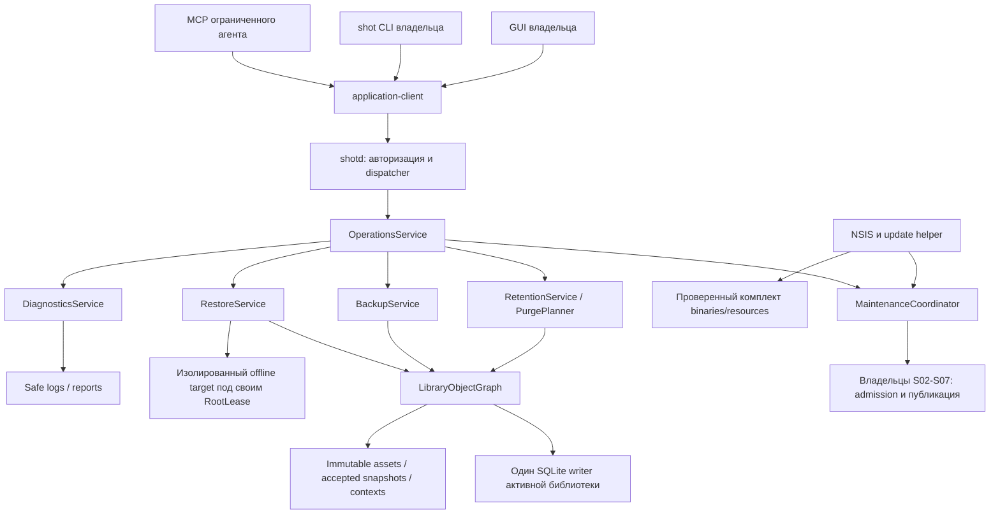
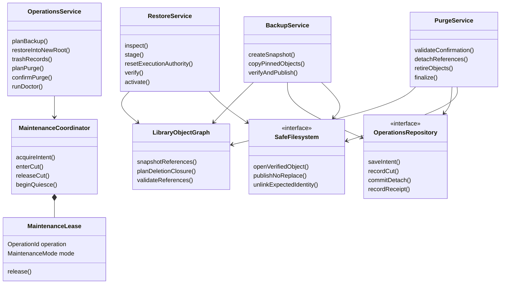
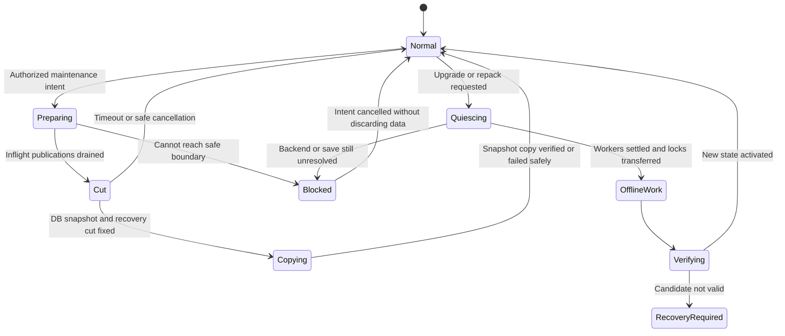
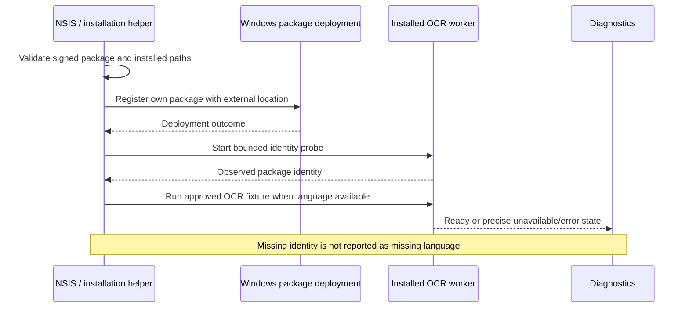
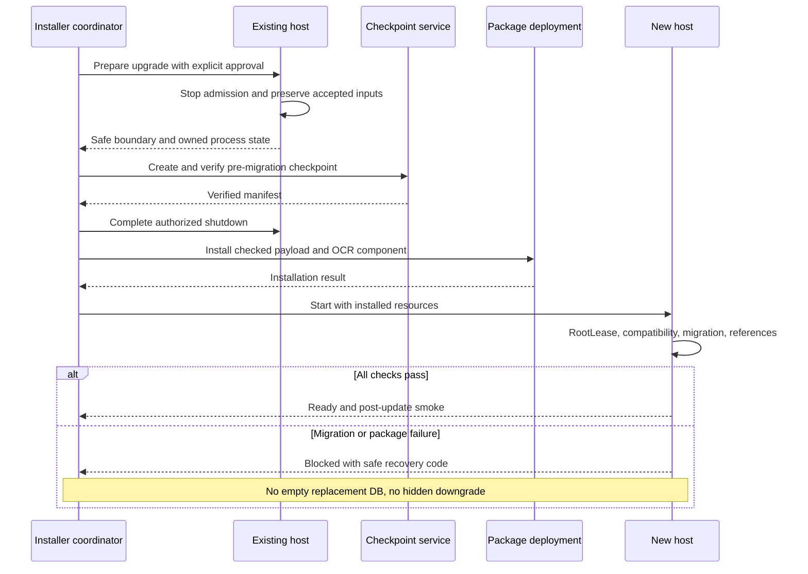
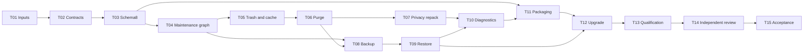

## S08: библиотека должна пережить не только удачную демонстрацию 📦

Восьмой этап завершает согласованную серию. После него приложение не просто делает скриншот и находит картинку: оно устанавливается на чистую Windows, корректно обновляется, сохраняет собственные файлы после сбоев и позволяет проверить резервную копию настоящим восстановлением. Неудачный запрос к модели, закрытое окно, удалённый внешний исходник и переполненный диск не должны превращаться в тихую потерю уже принятых данных.

Главная работа S08 — **довести готовые модули до проверяемого продукта и реализовать недостающие эксплуатационные операции**, а не ещё раз написать захват, импорт, поиск или LM Studio manager. Новыми прикладными возможностями являются управляемая корзина, явное окончательное удаление, согласованный backup/restore, глубокая диагностика и безопасная поставка.

Это **документ 8 из 8**. Задачи `S08-T01…S08-T15` — части последнего крупного этапа. Сценарии проверки, ADR, runbooks, manifests и release notes являются артефактами исполнения, а не девятым подробным планом. После этой стадии остаётся эксплуатация и отдельное согласование будущих версий, не скрытый «ещё один обязательный MVP».

> [!important] План, проверка спецификации и приёмка приложения — разные результаты
> Документ подготовлен по master v3 и релевантным контрактам S01–S07 с дополнительной сверкой официальных материалов SQLite, Tauri и Microsoft. Наличие семи предыдущих файлов не означает выполнение семи этапов. Приложение на Windows, установщик, подписи, OCR identity package, модели и реальные MCP-клиенты при написании плана не запускались. Фактические продуктовые gates остаются `NOT_RUN` до получения evidence.

### Навигация 📚

| Раздел | Назначение |
|---|---|
| [1. Scope и входы](#scope) | Что S08 завершает и какие результаты предыдущих стадий принимает |
| [2. Решения и инварианты](#invariants) | Сохранность, границы поддержки, версии и запреты скрытого поведения |
| [3. Архитектура эксплуатации](#architecture) | Maintenance coordinator, владельцы, блокировки, class/state diagrams |
| [4. Контракты API](#contracts) | Корзина, purge, backup, restore, doctor, поддержка и права |
| [5. Schema 8](#database) | Журнал обслуживания, lifecycle epochs, retirements, совместимость |
| [6. Корзина и retention](#retention) | Граф владения, удаление/восстановление записи, безопасная очистка кеша |
| [7. Purge и приватная очистка](#purge) | Подтверждение состава, ссылки, history/index, границы физического удаления |
| [8. Резервное копирование](#backup) | Согласованный cut, формат, staging, проверки и сбои |
| [9. Восстановление и перенос](#restore) | Проверка недоверенного backup, новый root, сброс полномочий, activation |
| [10. Recovery и диагностика](#diagnostics) | Безопасный запуск, doctor, repair и support bundle |
| [11. Windows-пакет](#packaging) | Бинарники, WebView2, OCR identity, подпись, лицензии |
| [12. Обновление и удаление приложения](#upgrade) | Quiescence, checkpoints, rollback, autostart и uninstall |
| [13. Полная регрессия и качество](#qualification) | Windows/runtime/MCP matrix, performance, нагрузка и privacy |
| [14. Логи и наблюдаемость](#observability) | События, метрики, redaction и ограничения диагностики |
| [15. Каталог тестов](#tests) | Arrange/Act/Assert, failpoints, mutation tests и fixtures |
| [16. Задачи и коммиты](#tasks) | Пятнадцать исполняемых задач и промежуточные результаты |
| [17. Команды и runbooks](#runbooks) | Verification scripts, пользовательские операции, разбор отказов |
| [18. Gates и выпуск](#acceptance) | DoD, release manifest, блокеры, публикация и handoff эксплуатации |
| [19. Трассируемость](#traceability) | Master requirements → задачи → тесты, CN и будущие возможности |
| [20. Источники и проверка документа](#sources) | Первичные материалы и границы выполненной проверки |

<a id="scope"></a>
## 1. Граница этапа и входные обязательства 🎯

### 1.1. Что должно работать после S08 📦

Исходная контрольная точка — принятая `feature-complete-beta` S07. Итог — `windows-v1-accepted` при пройденных обязательных gates либо `windows-v1-release-candidate` с конкретными блокерами. Слово «релиз» не подменяет отсутствие проверки.

| Обязательство S08 | Что переиспользуется | Что не создаётся повторно |
|---|---|---|
| Корзина, restore записи и подтверждённый purge | Record/asset graph S02/S03, hooks S05/S06 | Второе хранилище картинок и автономный очиститель файлов |
| Ручной backup и restore всей библиотеки | SQLite writer, immutable assets, staging manifests | Произвольное копирование открытого `library.sqlite3` |
| Диагностика, recovery и support bundle | Doctor/logging foundation, owner services | «Ремонт» путём удаления БД или замены checksum |
| Безопасное обновление | Lock, checkpoints, migrator, protocol versions | Автоматический запуск старой программы на новой схеме |
| Windows NSIS-пакет | Tauri shell, `shot`, `shotd`, helpers | Собственный inference engine или установка dev toolchain пользователю |
| OCR deployment | Решение identity worker S05 | Тихий переход на иной OCR или отключение фичи из-за неудобной подписи |
| Полная эксплуатационная приёмка | Все test IDs/fixtures S01–S07 | Новая произвольная трактовка требований |

Первый выпуск ориентирован на **Windows 11 x64 в интерактивной пользовательской сессии**. Конкретные поддерживаемые OS builds фиксируются в release manifest после проверки. Windows 10, ARM64, macOS и Linux не получают обещание полной поддержки из наличия кроссплатформенного донора. Расширение поддерживаемой матрицы возможно отдельно, без изменения структуры восьми этапов.

### 1.2. Что принимается от S01–S07 🧷

| Вход | Что требуется проверить |
|---|---|
| Master v3 и семь планов | Hashes из YAML, принятые change notes, отсутствие тихо потерянных требований |
| Code checkpoint S07 | Реальный SHA, clean/dirty state, reports и accepted gates |
| S01 | Root lock, один host/writer, package locator, SecretStore, safe logs, dependency locks |
| S02 | Capture matrix, immutable assets, `SavedReceipt`, staging v1, recovery, original/current revisions |
| S03 | WebP/AVIF, source snapshots/attempts, origins, derived/export registry, image worker и leases |
| S04 | Политики, durable jobs, fences, uncertain calls, instance ownership, private Node/bridge |
| S05 | OCR identity obligation, AiRun/OcrRun/history, context assets, overrides, sensitivity и source hook |
| S06 | FTS/vec schemas, поколения, snapshots, exact repair, filtered retrieval и transient sessions |
| S07 | GUI/CLI/MCP, schema 7/access, coherent CardSnapshot, resource delivery, action manifest |
| Evidence | Методы измерения, fixtures, результаты ранее выполненных проверок, открытые дефекты |

Ожидаемые исходные версии: schema **7**, application protocol **1.6**, asset-transfer **1**, SDK bridge **1.1** с принятыми расширениями. MCP-профили S07 — `2026-07-28` и `2025-11-25`. Исполнитель проверяет фактические manifests; номера в плане не заменяют прочтение собранного пакета.

S08 не объявляет прежний checkpoint принятым задним числом. Если S03 не доказал AVIF на Windows, S05 не проверил OCR deployment, а S06 не имеет relevance corpus, это входные блокеры соответствующих release gates. Исправления выполняются в модулях-владельцах и включаются в текущий review.

### 1.3. Что не включается в V1 «заодно» 🧭

Будущий OpenAI-compatible provider с ключами, Unsloth, другие embedding-модели, обработка по расписанию/при запуске, RAW, синхронизация, визуальный поиск по картинке и полное encryption-at-rest остаются вне V1. Для них сохраняются согласованные порты и политики. Кнопка с неработающей реализацией не считается поддержкой расширения.

Публичный автоматический updater **не обязателен для V1**: выбран контролируемый ручной upgrade новым подписанным NSIS-пакетом. В исходном форке удалены upstream endpoints; фоновых запросов обновления нет. Подключение собственного updater допускается позже только с проверяемой подписью, собственным источником и отдельным consent. [PLAN-M], [SRC-13]

### 1.4. Пользовательский критерий завершения 🔎

На чистой машине выполняется один сквозной сценарий: установка → скриншот раскрытого меню → импорт папки → обработка → поиск → ручная правка → переиндексация → экспорт PNG1000 → backup → установка обновления → восстановление копии в другом root → открытие картинки и lexical-поиск без LM Studio. Агент по разрешённому MCP получает реальные pixels, а не только путь недоступного ему диска.

Параллельно проверяется противоположный путь: AI выключен, OCR недоступен, внешний исходник удалён, GUI закрыт. Библиотека остаётся пригодной для сохранения, просмотра, ручных полей и экспорта.

<a id="invariants"></a>
## 2. Непереговорные решения и границы гарантий 🔒

### 2.1. Сохранность данных важнее косметического успеха 💾

**Saved** по-прежнему означает проверенный собственный файл и завершённую библиотечную транзакцию. **Backup complete** означает завершённый проверенный комплект, а не существование папки. **Restore complete** означает проверенную развёрнутую библиотеку, а не извлечение пары файлов. **Purge complete** означает удаление перечисленных управляемых объектов и живых ссылок, а не только исчезновение карточки из выдачи.

Корзина и canonical не очищаются автоматически по возрасту, лимиту истории, количеству изображений или нехватке места. Низкое место останавливает новый intake с понятной причиной; оно не выдаёт право удалить принятые snapshots. Закрытие preview, таймер выгрузки модели и uninstall по умолчанию не являются командами удаления библиотеки.

### 2.2. Разные состояния не склеиваются 🚦

| Состояние | Что означает | Чего не означает |
|---|---|---|
| Запись в корзине | Скрыта из обычного доступа; данные сохранены | Байты стёрты с диска |
| Purge начат | Состав подтверждён, операция имеет журнал | Все файлы уже удалены |
| Очистка кеша | Удалены допустимые производные без consumers | Удалены canonical, accepted input или пользовательские exports |
| Индекс repair | Немодельная проекция построена из проверенных источников | Новая Qwen совместима со старым embedding-space |
| Восстановлена копия | История и изображения доступны | Старые tokens/leases снова действительны |
| Подписан EXE | Подпись проверена по заданной политике | SmartScreen никогда не покажет предупреждение |
| Пройден fake test | Проверена логика отказа/перехода | Проверена реальная Windows, GPU или installed OCR |

Windows-подпись — отдельная проверяемая операция. Отсутствие предупреждений безопасности на одной машине не является универсальной гарантией поведения другой машины. Требования к certificate/trust и проверке подписи сверяются с официальной документацией, а не с видом значка установщика. [SRC-10], [SRC-11]

### 2.3. Согласованный backup не является копией одного файла 🧾

SQLite WAL содержит часть актуального состояния вне основного DB-файла. Для backup применяется API SQLite и отдельный manifest файлов; простое копирование `library.sqlite3` живой библиотеки запрещено. У Online Backup API завершение подтверждается `SQLITE_DONE` и корректным finish: один `backup_finish()==OK` не доказывает, что все страницы скопированы. [SRC-01], [SRC-02], [SRC-03]

Индексы считаются восстанавливаемыми проекциями, но descriptions, overrides, provenance, canonical assets и durable accepted input — пользовательские данные. Невозможность открыть `vec0` не даёт права потерять их вместе с индексом.

### 2.4. Privacy cleanup — не обещание физического стирания SSD 🛡️

Удаление строки, `PRAGMA secure_delete`, очистка FTS, VACUUM и удаление файла решают разные задачи. У FTS есть собственная история сегментов; обычный `secure_delete` сам по себе не является универсальным удалением следов виртуальных таблиц. План требует закрыть логические источники текста/векторов, затем выполнить проверяемую процедуру очистки собственной БД. Гарантия удаления из SSD wear-leveling, pagefile, Windows snapshots, чужих backups, clipboard и LM Studio cache не заявляется. [SRC-04], [SRC-05], [SRC-06]

### 2.5. Версии фиксируются, а не обновляются во время релиза 📌

На входе S08 закреплены Cargo/pnpm/native lockfiles, Node runtime, codec builds и SDK. Выпуск не сопровождается безотчётным обновлением всех пакетов на `latest`. Найденное обновление безопасности требует отдельного изменения, анализа затронутых модулей и повторных проверок. Исторический SHA донора остаётся источником происхождения, но build производится из принятого ScreenMemory commit.

<a id="architecture"></a>
## 3. Архитектура эксплуатации: один host, ограниченные служебные операции 🧱

### 3.1. Компоненты и владельцы 🔗



Служебные операции не получают второй scheduler для AI. `MaintenanceCoordinator` управляет admission и согласованными границами, а модельные jobs исполняет S04. Backup copy и deep scan используют ограниченный IO executor. Production CLI не открывает рабочую SQLite напрямую.

Offline restore работает с **новым, ещё не активным root** под отдельным `HostLease`. Это не второй writer той же библиотеки. Во время ремонта недоступной активной БД используется узкий recovery bootstrap того же host, а не SQL-консоль с полномочиями на произвольные файлы.

### 3.2. Дельта дерева проекта 📂

```text
crates/application/src/operations/
  mod.rs  maintenance.rs  trash.rs  purge.rs  backup.rs  restore.rs
  diagnostics.rs  support_bundle.rs  publication_guards.rs
crates/infrastructure/src/operations/
  object_graph.rs  snapshot.rs  manifests.rs  retirement.rs
  verification.rs  restore_bootstrap.rs  db_repack.rs
crates/platform-windows/src/operations/
  file_identity.rs  delete_handle.rs  installation.rs  shutdown.rs
crates/protocol/src/operations.rs
crates/host/src/maintenance_dispatcher.rs
app/frontend/src/features/operations/
  TrashView.tsx  BackupView.tsx  RestoreWizard.tsx  DiagnosticsView.tsx
migrations/0008_release_operations.sql
schemas/backup-manifest-v1.json
schemas/backup-inventory-entry-v1.json
schemas/operations-v1.json
packaging/windows/
  installer-hooks.nsh  package-manifest.json  ocr-identity/
scripts/
  verify-release.ps1  verify-recovery.ps1  verify-install-upgrade.ps1
  package-windows.ps1  verify-signatures.ps1
```

Физическое размещение согласуется с accepted repository. Не требуется создавать crate для каждого файла. FFI/file deletion, DB snapshot и signing scripts имеют собственные границы и review, поскольку их ошибка значительно дороже неверного отступа в интерфейсе.

### 3.3. Structs, traits и ownership 🧬



`MaintenanceLease` не является SQL-транзакцией. Он предотвращает конфликт владельцев и cleanup, но не позволяет держать DB transaction на всё время копирования гигабайтов. Reader lease, job lease, model lease и maintenance lease остаются разными сущностями.

### 3.4. Матрица совместимости служебных работ ⚖️

| Операция | Capture/intake | Обычные metadata writes | AI/OCR | Destructive cleanup |
|---|---|---|---|---|
| Обычный режим | Разрешены по budget | Разрешены | По S04/S05 policy | Только отдельное разрешённое действие |
| Backup cut | Краткий явный отказ новому intake; ранее accepted доводятся до безопасной границы | Приостановлены на время cut | Новые dispatch не стартуют; уже запущенные могут завершать compute, публикация ждёт | Запрещён |
| Backup copy после cut | Разрешены | Разрешены | По policy | Удаление объектов snapshot запрещено pin/lease |
| Deep doctor | Разрешены с учётом IO budget | Разрешены | По policy | Конфликтующие объекты закреплены reader lease |
| Trash transaction | Новые capture доступны | Короткий сериализованный write | Target results теряют право применения | Physical delete не выполняется |
| Purge detach | Capture может пройти staging; конечная запись ждёт writer | Сериализованы | Target consumers должны быть остановлены/settled | Только утверждённый plan |
| Upgrade/repack/root activation | Intake остановлен с явной причиной | Остановлены | Dispatch остановлен; settlement подтверждён либо операция blocked | Только собственные разрешённые шаги |

Backup cut **не держит freeze overlay открытым** и не ставит новый screenshot в очередь до другой сцены. На коротком запрете возвращается `MAINTENANCE_BUSY`. UI заранее показывает checkpoint; исходная цель cut на контрольной библиотеке — до двух секунд, hard wait по умолчанию пять секунд. Превышение прекращает попытку либо требует явного увеличения бюджета. Это проектная цель измерения, не обещание времени копирования любой БД.

### 3.5. Порядок приобретения ресурсов 🧵

Порядок фиксируется: permission/intent → maintenance admission → остановка новых операций выбранного класса → завершение активных publication sections → object pins → короткий writer transition → IO work. Нельзя удерживать writer transaction и ждать освобождения model lease. Нельзя удерживать asset read lease, затем ждать purge, который ждёт именно этот lease.

Остановка admission не равна отзыву принятых данных. Volatile crop уже внутри S02 получает приоритет staging. Если безопасная граница не достигнута, backup/upgrade блокируется, а не отбрасывает crop по таймеру. Непрерываемый codec или неизвестный backend call не считается завершённым из-за истечения ожидания.



<a id="contracts"></a>
## 4. Контракты S08: явные действия, результаты и разрешения 📐

### 4.1. Версии и совместимость 🔌

Application protocol расширяется с **1.6 до 1.7**. Новые capabilities: `library_trash_v1`, `library_purge_v1`, `library_backup_v1`, `library_restore_v1`, `deep_diagnostics_v1`, `support_bundle_v1`, `maintenance_status_v1`. Asset-transfer остаётся 1; bridge и MCP-профили S07 не меняются по факту добавления backup.

`OperationRef/OperationView` получают типизированные варианты Maintenance/Backup/Restore/Purge/Diagnostics только после negotiation capability. Старому клиенту не отправляется неизвестный enum без согласования. Search/Card/Get/Export не меняют прежний смысл. `NativePathDto`, IDs, `RequestContext`, errors и decimal-string revisions переиспользуются.

Сигнатуры ниже — **собственные целевые API ScreenMemory**, не готовые методы Tauri или SQLite. В implementation отдельные modules импортируют общие типы. Внешний request не принимает raw SQL, shell command, `ExecutionFence`, filesystem handle или флаг «считать пользователя владельцем».

### 4.2. Корзина и план окончательного удаления 🗑️

```rust
use async_trait::async_trait;
use serde::{Deserialize, Serialize};
use uuid::Uuid;

#[derive(Clone, Serialize, Deserialize)]
#[serde(deny_unknown_fields)]
pub struct RecordRevisionRef {
    pub record_id: Uuid,
    pub expected_record_revision: String,
}

#[derive(Clone, Serialize, Deserialize)]
#[serde(deny_unknown_fields)]
pub struct TrashRecordsRequest {
    pub operation_id: Uuid,
    pub records: Vec<RecordRevisionRef>,
}

#[derive(Clone, Serialize, Deserialize)]
#[serde(deny_unknown_fields)]
pub struct RestoreTrashRequest {
    pub operation_id: Uuid,
    pub records: Vec<RecordRevisionRef>,
}

#[derive(Clone, Serialize, Deserialize)]
#[serde(tag = "kind", rename_all = "snake_case", deny_unknown_fields)]
pub enum PurgeSelection {
    Records { records: Vec<RecordRevisionRef> },
    AcceptedInput { operation_ids: Vec<Uuid> },
}

#[derive(Clone, Serialize, Deserialize)]
#[serde(deny_unknown_fields)]
pub struct PlanPurgeRequest {
    pub operation_id: Uuid,
    pub selection: PurgeSelection,
}

#[derive(Clone, Serialize, Deserialize)]
pub struct DestructivePlanView {
    pub plan_id: Uuid,
    pub revision: String,
    pub plan_sha256: String,
    pub target_count: String,
    pub managed_file_count: String,
    pub managed_bytes: String,
    pub historical_rows_affected: String,
    pub held_by_consumers: String,
    pub external_copies_not_removed: bool,
    pub warnings: Vec<String>,
    pub expires_at_utc: String,
}

#[derive(Clone, Serialize, Deserialize)]
#[serde(deny_unknown_fields)]
pub struct ConfirmPurgeRequest {
    pub operation_id: Uuid,
    pub plan_id: Uuid,
    pub expected_plan_revision: String,
    pub expected_plan_sha256: String,
    pub consent_id: Uuid,
}

#[async_trait]
pub trait RetentionApi: Send + Sync {
    async fn trash_records(&self, ctx: RequestContext, req: TrashRecordsRequest)
        -> Result<MutationBatchReceipt, AppError>;
    async fn restore_records(&self, ctx: RequestContext, req: RestoreTrashRequest)
        -> Result<MutationBatchReceipt, AppError>;
    async fn plan_purge(&self, ctx: RequestContext, req: PlanPurgeRequest)
        -> Result<DestructivePlanView, AppError>;
    async fn confirm_purge(&self, ctx: RequestContext, req: ConfirmPurgeRequest)
        -> Result<MaintenanceReceipt, AppError>;
}
```

В одном прямом запросе — 1…512 уникальных records/operation IDs. Выбор «вся корзина» материализуется host в конечный plan с high-water, не передаётся строкой SQL и не расширяется новыми удалёнными записями после подтверждения. Исходный предел одного purge plan — 5000 records; большая коллекция разбивается на явные планы.

`MutationBatchReceipt` перечисляет per-record outcomes и новые revisions, а не скрывает конфликт одной записи за общим success. Прямой batch до 512 исполняется одной короткой metadata transaction с предварительной проверкой всех CAS; при конфликте transaction не применяет часть selection. Для большого materialized plan partial progress допускается только в явно отдельной maintenance operation с item report.

Планирование не удаляет данные и не выдаёт разрешение исполнителю. Consent создаёт существующий локальный owner-authority по показанному составу, principal, plan hash, library instance и сроку. Поле `consent_id` не является произвольным UUID, придуманным агентом.

### 4.3. Backup: подтверждённый комплект, не обещание папки 🧳

```rust
#[derive(Clone, Serialize, Deserialize)]
#[serde(deny_unknown_fields)]
pub struct CreateBackupRequest {
    pub operation_id: Uuid,
    pub destination_parent: NativePathDto,
    pub expected_storage_instance_id: Uuid,
    pub cut_timeout_seconds: u16,
}

#[derive(Clone, Serialize, Deserialize)]
pub struct SnapshotCut {
    pub cut_id: Uuid,
    pub started_at_utc: String,
    pub fixed_at_utc: String,
    pub source_library_id: Uuid,
    pub source_storage_instance_id: Uuid,
    pub schema_version: u32,
    pub feed_highwaters: Vec<FeedHighWater>,
    pub accepted_recovery_items: String,
}

#[derive(Clone, Serialize, Deserialize)]
pub struct BackupResult {
    pub backup_id: Uuid,
    pub operation_id: Uuid,
    pub backup_path: NativePathDto,
    pub format_version: u16,
    pub cut: SnapshotCut,
    pub manifest_sha256: String,
    pub database_sha256: String,
    pub file_count: String,
    pub verified_bytes: String,
    pub warnings: Vec<String>,
}

#[async_trait]
pub trait BackupApi: Send + Sync {
    async fn create_backup(&self, ctx: RequestContext, req: CreateBackupRequest)
        -> Result<MaintenanceReceipt, AppError>;
    async fn verify_backup(&self, ctx: RequestContext, req: VerifyBackupRequest)
        -> Result<MaintenanceReceipt, AppError>;
    async fn backup_status(&self, ctx: RequestContext, operation_id: Uuid)
        -> Result<MaintenanceOperationView, AppError>;
}
```

`VerifyBackupRequest` содержит operation ID, абсолютный backup path и ожидаемый format major; verifier не загружает произвольные extensions из backup. `FeedHighWater` — закрытые names `library/knowledge/processing/index/access/operations` и decimal-string sequence. Отсутствующий в старой схеме feed имеет явное `not_present`, а не выдуманное sequence0.

В V1 backup всегда включает обязательные canonical/edited/context и принятый незавершённый input. Опция «забыть pending snapshots» отсутствует. Backup plaintext, без credentials и transient caches; это отражается в диалоге. Отдельного облачного назначения или автоматического расписания нет.

### 4.4. Restore: сначала новая библиотека, потом переключение 📥

```rust
#[derive(Clone, Serialize, Deserialize)]
#[serde(deny_unknown_fields)]
pub struct InspectBackupRequest {
    pub backup_path: NativePathDto,
}

#[derive(Clone, Serialize, Deserialize)]
#[serde(deny_unknown_fields)]
pub struct RestoreBackupRequest {
    pub operation_id: Uuid,
    pub backup_path: NativePathDto,
    pub expected_manifest_sha256: String,
    pub target_parent: NativePathDto,
    pub target_directory_name: String,
}

#[derive(Clone, Serialize, Deserialize)]
pub struct RestoreResult {
    pub restore_id: Uuid,
    pub operation_id: Uuid,
    pub original_library_id: Uuid,
    pub target_storage_instance_id: Uuid,
    pub target_root: NativePathDto,
    pub source_schema: u32,
    pub target_schema: u32,
    pub verified_records: String,
    pub retained_inputs: String,
    pub lexical_ready: bool,
    pub semantic_state: String,
    pub activation_required: bool,
    pub warnings: Vec<String>,
}

#[derive(Clone, Serialize, Deserialize)]
#[serde(deny_unknown_fields)]
pub struct ActivateRestoredLibraryRequest {
    pub operation_id: Uuid,
    pub restore_id: Uuid,
    pub expected_restore_revision: String,
    pub expected_selected_root_revision: String,
    pub consent_id: Uuid,
}

#[async_trait]
pub trait RestoreApi: Send + Sync {
    async fn inspect_backup(&self, ctx: RequestContext, req: InspectBackupRequest)
        -> Result<BackupInspection, AppError>;
    async fn restore_backup(&self, ctx: RequestContext, req: RestoreBackupRequest)
        -> Result<MaintenanceReceipt, AppError>;
    async fn activate_restored(&self, ctx: RequestContext, req: ActivateRestoredLibraryRequest)
        -> Result<ActivationReceipt, AppError>;
}
```

`BackupInspection` сообщает формат, source schema, количество объектов, cut, encryption=false и возможность проверки; до full verification это не сертификат целостности. Target directory обязан отсутствовать. Нет `overwrite_active=true`. `ActivationReceipt` подтверждает выбор нового root в установочной конфигурации; успешный новый handshake/doctor проверяется отдельно.

Сохраняются логические library/record IDs, а **storage instance identity и execution authority создаются заново**. Восстановленная копия не может считаться прежним живым процессом на основании UUID из архива.

### 4.5. Жизненный цикл служебной операции ⏳

```rust
#[derive(Clone, Copy, Serialize, Deserialize)]
#[serde(rename_all = "snake_case")]
pub enum MaintenanceKind {
    Backup, VerifyBackup, Restore, Purge, PrivacyCleanup,
    DeepDoctor, SupportBundle, CacheCleanup, Repack,
}

#[derive(Clone, Copy, Serialize, Deserialize)]
#[serde(rename_all = "snake_case")]
pub enum MaintenanceState {
    Planned, AwaitingConfirmation, Preparing, Running,
    Verifying, Committing, Succeeded, Partial, Blocked,
    CancelRequested, Cancelled, Failed, Interrupted,
}

#[derive(Clone, Serialize, Deserialize)]
pub struct MaintenanceReceipt {
    pub operation_id: Uuid,
    pub kind: MaintenanceKind,
    pub state: MaintenanceState,
    pub revision: String,
}

#[derive(Clone, Serialize, Deserialize)]
pub struct MaintenanceOperationView {
    pub receipt: MaintenanceReceipt,
    pub phase: String,
    pub completed_units: String,
    pub total_units: Option<String>,
    pub completed_bytes: String,
    pub total_bytes: Option<String>,
    pub irreversible_boundary_passed: bool,
    pub safe_code: Option<String>,
    pub result: Option<MaintenanceResult>,
}
```

`MaintenanceResult` — tagged union соответствующих BackupResult/RestoreResult/PurgeResult/DoctorReport/SupportBundleResult, не unbounded JSON. `phase` имеет registry для каждого kind. `CancelRequested` после необратимой границы не превращается в «всё отменено»: итог становится partial/blocked с точными оставшимися шагами. `--wait` и Ctrl+C отменяют ожидание, не durable work; exit130 наследуется S07.

`MaintenanceControlRequest` содержит operation ID, expected revision, enum `Cancel/Resume/Retry` и новый control operation ID для идемпотентности. Retry не меняет destination, plan hash или состав удаления. Изменённое намерение требует новой операции.

### 4.6. Права и безопасные ошибки 🔐

| Scope и authority | Допустимые действия | Не выдаётся обычному MCP |
|---|---|---|
| LocalOwner + `manage_retention` | Trash/restore записи, осознанные политики cleanup | Да |
| LocalOwner + `purge_library` | Plan/confirm окончательного удаления | Да |
| LocalOwner + `privacy_cleanup` | Контролируемое удаление старых чувствительных слоёв | Да |
| LocalOwner + `manage_backups` | Полный backup/verification частной библиотеки | Да |
| LocalOwner + `manage_restore` | Restore в новый root и явная activation | Да |
| `run_deep_diagnostics` с разрешённой областью | Reference/checksum scan | Не предоставляется автоматически |
| LocalOwner + `export_support_bundle` | Экспорт выбранной диагностики | Да |
| LocalOwner + `maintain_application` | Quiesce для upgrade/repack | Да |

LocalOwner определяется проверенным S01/S07 authentication binding, а не строкой `client_kind=gui`. Default MCP tools остаются ограниченными S07; S08 не добавляет агенту инструмент «удалить всё» ради паритета. Паритет проверяет те же правила при одинаковых полномочиях, а не одинаковые права всех клиентов.

Основные новые codes: `MAINTENANCE_BUSY`, `MAINTENANCE_CUT_TIMEOUT`, `BACKUP_INCOMPLETE`, `BACKUP_INTEGRITY_FAILED`, `BACKUP_FORMAT_UNSUPPORTED`, `BACKUP_HAS_UNSAFE_PATH`, `RESTORE_TARGET_EXISTS`, `RESTORE_NOT_VERIFIED`, `RESTORE_ACTIVATION_CONFLICT`, `STORAGE_INSTANCE_MISMATCH`, `PURGE_PLAN_STALE`, `PURGE_HELD_BY_CONSUMER`, `PURGE_PARTIAL`, `RESULT_RETIRED`, `RECOVERY_REQUIRED`, `PACKAGE_INTEGRITY_FAILED`, `OCR_IDENTITY_UNAVAILABLE`, `UPDATE_BLOCKED_BY_ACTIVE_WORK`.

Error envelope S01 не меняется. Errors не содержат source paths, EXIF, descriptions или сырое исключение SDK. Успех Save/Backup/Restore не формируется из факта, что frontend перестал ждать.

### 4.7. Подтверждения, privacy и диагностика: недостающие управляющие типы 🧩

`PlanPurgeRequest.operation_id` создаёт **исходную** maintenance operation в AwaitingConfirmation. `ConfirmPurgeRequest.operation_id` — отдельный control-request ID для replay подтверждения. Confirm связывает план с его первоначальной operation, а не запускает вторую копию purge. Control receipt сохраняется в `lifecycle_write_receipts` с типизированным kind в результате; один consent расходуется на одно принятое намерение, replay его повторно не расходует.

```rust
#[derive(Clone, Serialize, Deserialize)]
#[serde(tag = "kind", rename_all = "snake_case", deny_unknown_fields)]
pub enum MaintenanceApprovalPurpose {
    ExecutePlan {
        plan_id: Uuid,
        expected_plan_revision: String,
        expected_plan_sha256: String,
    },
    ActivateRestore {
        restore_id: Uuid,
        expected_restore_revision: String,
        expected_root_selection_revision: String,
    },
    ExportContentDiagnostics {
        diagnostic_artifact_ids: Vec<Uuid>,
    },
}

#[derive(Clone, Serialize, Deserialize)]
#[serde(deny_unknown_fields)]
pub struct AuthorizeMaintenanceRequest {
    pub purpose: MaintenanceApprovalPurpose,
    pub expected_storage_instance_id: Uuid,
    pub lifetime_seconds: u16,
}

#[derive(Clone, Serialize, Deserialize)]
pub struct MaintenanceConsentReceipt {
    pub consent_id: Uuid,
    pub expires_at_utc: String,
    pub authority_epoch: String,
}

#[derive(Clone, Serialize, Deserialize)]
#[serde(deny_unknown_fields)]
pub struct VerifyBackupRequest {
    pub operation_id: Uuid,
    pub backup_path: NativePathDto,
    pub expected_format_major: u16,
}

#[derive(Clone, Serialize, Deserialize)]
#[serde(deny_unknown_fields)]
pub struct PlanPrivacyCleanupRequest {
    pub operation_id: Uuid,
    pub record_id: Uuid,
    pub expected_record_revision: String,
    pub expected_content_revision: String,
    pub expected_asset_revision: String,
    pub expected_lifecycle_epoch: String,
    pub retained_asset_id: Uuid,
    pub replacement_fields: DescriptionPatch,
    pub expected_privacy_revision: String,
}

#[derive(Clone, Copy, Serialize, Deserialize)]
#[serde(rename_all = "snake_case")]
pub enum MaintenanceControl { Cancel, Resume, Retry }

#[derive(Clone, Serialize, Deserialize)]
#[serde(deny_unknown_fields)]
pub struct MaintenanceControlRequest {
    pub control_operation_id: Uuid,
    pub target_operation_id: Uuid,
    pub expected_revision: String,
    pub action: MaintenanceControl,
}

#[derive(Clone, Copy, Serialize, Deserialize)]
#[serde(rename_all = "snake_case")]
pub enum SupportSection { Build, Environment, Capabilities, SafeLogs, SafeFailures }

#[derive(Clone, Serialize, Deserialize)]
#[serde(deny_unknown_fields)]
pub struct SupportBundleRequest {
    pub operation_id: Uuid,
    pub output_path: NativePathDto,
    pub sections: Vec<SupportSection>,
    pub log_from_utc: Option<String>,
    pub log_to_utc: Option<String>,
    pub diagnostic_artifact_ids: Vec<Uuid>,
    pub content_consent_id: Option<Uuid>,
}

#[async_trait]
pub trait MaintenanceApi: Send + Sync {
    async fn authorize(&self, ctx: RequestContext, req: AuthorizeMaintenanceRequest)
        -> Result<MaintenanceConsentReceipt, AppError>;
    async fn status(&self, ctx: RequestContext, operation_id: Uuid)
        -> Result<MaintenanceOperationView, AppError>;
    async fn control(&self, ctx: RequestContext, req: MaintenanceControlRequest)
        -> Result<MaintenanceOperationView, AppError>;
    async fn plan_privacy_cleanup(&self, ctx: RequestContext, req: PlanPrivacyCleanupRequest)
        -> Result<DestructivePlanView, AppError>;
    async fn confirm_privacy_cleanup(&self, ctx: RequestContext, req: ConfirmPurgeRequest)
        -> Result<MaintenanceReceipt, AppError>;
    async fn export_support_bundle(&self, ctx: RequestContext, req: SupportBundleRequest)
        -> Result<MaintenanceReceipt, AppError>;
}
```

Общий `ConfirmPurgeRequest` переиспользуется как форма подтверждения; handler **проверяет вид плана**, поэтому privacy-plan нельзя подтвердить обычным purge endpoint и наоборот. При переносе в код допустимо общее нейтральное имя `ConfirmDestructivePlanRequest` с совместимым alias. Replacement fields требуют явного Set всех трёх полей; Keep/Inherit отклоняются, чтобы старый AI-текст не вернулся после очистки. Title остаётся непустым, description может быть пустым, category — null.

Authority выдаёт consent только после проверки owner, актуального plan/snapshot и отдельного UI/CLI подтверждения; срок 1…300 секунд, instance/epoch/principal binding. На диске не хранится сам token. Consent, полученный до изменения targets/security revision, не даёт новых прав. Привилегированный same-user процесс не считается аппаратно доказанным человеческим кликом — ограничения модели угроз S07 сохраняются.

В `RetentionApi` добавляются `list_trash(ctx, request: TrashPageRequest) -> RecordPage` и `get_trashed_record(ctx, record_id) -> TrashedCardView`: это owner-scoped reuse coherent read S07, без расширения обычного agent `get_image`. Страница ограничена 1…200, cursor привязан к scope/instance. `TrashedCardView` включает CardSnapshot, deleted timestamp, lifecycle epoch и состояние pending purge. У `MutationBatchReceipt` есть operation ID и массив `{record_id, record_revision, lifecycle_epoch, disposition}`; conflict возвращает ошибку без частичного commit.

Deep doctor получает `start_deep_check(ctx, operation_id) -> MaintenanceReceipt`; его итог — прежний typed DoctorReport, расширенный coverage/scanned/changed counts. Независимого исполнительного ядра у diagnostics нет. `MaintenanceResult` в implementation перечисляет все девять видов результатов, включая Verification/CacheCleanup/Repack, с bounded schemas; незнакомый JSON не интерпретируется как успешный backup.

`maintenance_operations.request_json` не дублирует неограниченное содержимое карточек. Для PrivacyCleanup новое ручное содержимое хранится в ограниченном private plan capsule, связанном с записью и попадающем в тот же purge graph; журнал содержит ссылку/hash и технические параметры. После завершения/отмены capsule очищается по собственному reference rule. Immutable operational requests не используются как скрытый архив удалённых описаний.

<a id="database"></a>
## 5. Schema 8 и журнал эксплуатационных операций 🗄️

### 5.1. Миграция не меняет прошлые checkpoints 🧱

Добавляется `0008_release_operations.sql`. Checksums `0001…0007` остаются неизменными. Структуры capture/import/knowledge/search не заменяются новой упрощённой БД. Перед миграцией выполняются schema inventory, проверка места и согласованный pre-migration checkpoint. На первой установке создаётся сразу цепочка принятых migrations; на обновлении — только отсутствующие версии.

Существенные дополнения: отдельная identity физического экземпляра библиотеки, lifecycle epoch записи, журнал обслуживания и durable retirement ledger. Они необходимы, чтобы старый ответ не ожил после trash→restore, а старый ingestion manifest не создал удалённую запись заново.

DDL ниже — исполняемая основа **новых** таблиц. Seed UUID/UTC генерирует migrator; приложение валидирует enum payload, UUID, limits и paths отдельно. У неё нет произвольного отключения FK или редактирования `sqlite_schema`. Изменение существующих CHECK в будущих коррекциях использует принятую generalized migration процедуру, а не `writable_schema`. [SRC-07]

### 5.2. Новые таблицы и ограничения 💾

```sql
-- S08-DDL-BEGIN
ALTER TABLE records ADD COLUMN lifecycle_epoch INTEGER NOT NULL DEFAULT 1
    CHECK (lifecycle_epoch > 0);

CREATE TABLE library_runtime_identity (
    singleton INTEGER PRIMARY KEY CHECK (singleton = 1),
    storage_instance_id TEXT NOT NULL UNIQUE,
    security_epoch INTEGER NOT NULL CHECK (security_epoch > 0),
    restore_activation_pending INTEGER NOT NULL CHECK (restore_activation_pending IN (0,1)),
    created_at_utc TEXT NOT NULL,
    changed_at_utc TEXT NOT NULL
);

CREATE TABLE maintenance_operations (
    operation_id TEXT NOT NULL PRIMARY KEY,
    principal_id TEXT NOT NULL,
    storage_instance_id TEXT NOT NULL,
    kind TEXT NOT NULL CHECK (kind IN
        ('backup','verify_backup','restore','purge','privacy_cleanup',
         'deep_doctor','support_bundle','cache_cleanup','repack')),
    state TEXT NOT NULL CHECK (state IN
        ('planned','awaiting_confirmation','preparing','running','verifying',
         'committing','succeeded','partial','blocked','cancel_requested',
         'cancelled','failed','interrupted')),
    phase TEXT NOT NULL,
    revision INTEGER NOT NULL CHECK (revision > 0),
    request_fingerprint TEXT NOT NULL CHECK (length(request_fingerprint) = 64),
    request_json TEXT NOT NULL CHECK (json_valid(request_json)),
    irreversible_boundary_passed INTEGER NOT NULL DEFAULT 0
        CHECK (irreversible_boundary_passed IN (0,1)),
    owner_host_id TEXT,
    safe_error_code TEXT,
    result_json TEXT CHECK (result_json IS NULL OR json_valid(result_json)),
    created_at_utc TEXT NOT NULL,
    updated_at_utc TEXT NOT NULL,
    CHECK (state != 'succeeded' OR result_json IS NOT NULL)
);

CREATE TABLE maintenance_plans (
    plan_id TEXT NOT NULL PRIMARY KEY,
    operation_id TEXT NOT NULL UNIQUE REFERENCES maintenance_operations(operation_id),
    revision INTEGER NOT NULL CHECK (revision > 0),
    schema_version INTEGER NOT NULL CHECK (schema_version > 0),
    storage_instance_id TEXT NOT NULL,
    plan_sha256 TEXT NOT NULL CHECK (length(plan_sha256) = 64),
    plan_json TEXT NOT NULL CHECK (json_valid(plan_json)),
    expires_at_utc TEXT NOT NULL,
    created_at_utc TEXT NOT NULL
);

CREATE TABLE maintenance_targets (
    plan_id TEXT NOT NULL REFERENCES maintenance_plans(plan_id),
    ordinal INTEGER NOT NULL CHECK (ordinal >= 0),
    target_kind TEXT NOT NULL CHECK (target_kind IN ('record','accepted_input','database')),
    target_id TEXT NOT NULL,
    expected_revision INTEGER CHECK (expected_revision > 0),
    expected_lifecycle_epoch INTEGER CHECK (expected_lifecycle_epoch > 0),
    PRIMARY KEY(plan_id, ordinal),
    UNIQUE(plan_id, target_kind, target_id)
);

CREATE TABLE maintenance_target_outcomes (
    plan_id TEXT NOT NULL,
    ordinal INTEGER NOT NULL,
    state TEXT NOT NULL CHECK (state IN
        ('pending','blocked','detached','retiring','completed','cancelled','failed')),
    rows_detached INTEGER NOT NULL DEFAULT 0 CHECK (rows_detached >= 0),
    files_removed INTEGER NOT NULL DEFAULT 0 CHECK (files_removed >= 0),
    safe_error_code TEXT,
    outcome_json TEXT CHECK (outcome_json IS NULL OR json_valid(outcome_json)),
    updated_at_utc TEXT NOT NULL,
    PRIMARY KEY(plan_id, ordinal),
    FOREIGN KEY(plan_id, ordinal) REFERENCES maintenance_targets(plan_id, ordinal)
);

CREATE TABLE maintenance_object_pins (
    operation_id TEXT NOT NULL REFERENCES maintenance_operations(operation_id),
    object_key TEXT NOT NULL,
    object_role TEXT NOT NULL,
    relative_path TEXT NOT NULL,
    expected_sha256 TEXT NOT NULL CHECK (length(expected_sha256) = 64),
    expected_bytes INTEGER NOT NULL CHECK (expected_bytes >= 0),
    state TEXT NOT NULL CHECK (state IN ('held','released')),
    created_at_utc TEXT NOT NULL,
    PRIMARY KEY(operation_id, object_key)
);

CREATE TABLE retired_objects (
    retirement_id TEXT NOT NULL PRIMARY KEY,
    operation_id TEXT NOT NULL REFERENCES maintenance_operations(operation_id),
    object_key TEXT NOT NULL,
    object_role TEXT NOT NULL,
    relative_path TEXT NOT NULL,
    expected_sha256 TEXT NOT NULL CHECK (length(expected_sha256) = 64),
    expected_bytes INTEGER NOT NULL CHECK (expected_bytes >= 0),
    native_identity_json TEXT CHECK (native_identity_json IS NULL OR json_valid(native_identity_json)),
    state TEXT NOT NULL CHECK (state IN
        ('pending','held','removing','removed','missing_verified','blocked','mismatch')),
    safe_error_code TEXT,
    created_at_utc TEXT NOT NULL,
    updated_at_utc TEXT NOT NULL,
    UNIQUE(operation_id, object_key)
);

CREATE TABLE retired_entity_refs (
    entity_kind TEXT NOT NULL,
    entity_id TEXT NOT NULL,
    operation_id TEXT NOT NULL REFERENCES maintenance_operations(operation_id),
    reason TEXT NOT NULL CHECK (reason IN ('purged','privacy_replaced','accepted_input_discarded')),
    created_at_utc TEXT NOT NULL,
    PRIMARY KEY(entity_kind, entity_id)
);

CREATE TABLE backup_artifacts (
    backup_id TEXT NOT NULL PRIMARY KEY,
    operation_id TEXT NOT NULL UNIQUE REFERENCES maintenance_operations(operation_id),
    destination_json TEXT NOT NULL CHECK (json_valid(destination_json)),
    format_version INTEGER NOT NULL CHECK (format_version > 0),
    source_library_id TEXT NOT NULL,
    source_storage_instance_id TEXT NOT NULL,
    cut_json TEXT CHECK (cut_json IS NULL OR json_valid(cut_json)),
    manifest_sha256 TEXT CHECK (manifest_sha256 IS NULL OR length(manifest_sha256) = 64),
    state TEXT NOT NULL CHECK (state IN ('building','complete','failed','cancelled','unknown')),
    created_at_utc TEXT NOT NULL,
    completed_at_utc TEXT,
    CHECK (state != 'complete' OR
        (cut_json IS NOT NULL AND manifest_sha256 IS NOT NULL AND completed_at_utc IS NOT NULL))
);

CREATE TABLE restored_roots (
    restore_id TEXT NOT NULL PRIMARY KEY,
    operation_id TEXT NOT NULL UNIQUE REFERENCES maintenance_operations(operation_id),
    backup_manifest_sha256 TEXT NOT NULL CHECK (length(backup_manifest_sha256) = 64),
    target_root_json TEXT NOT NULL CHECK (json_valid(target_root_json)),
    target_storage_instance_id TEXT NOT NULL UNIQUE,
    state TEXT NOT NULL CHECK (state IN ('staging','verifying','verified','activated','failed','interrupted')),
    source_schema INTEGER NOT NULL CHECK (source_schema > 0),
    target_schema INTEGER NOT NULL CHECK (target_schema > 0),
    verification_sha256 TEXT CHECK (verification_sha256 IS NULL OR length(verification_sha256) = 64),
    created_at_utc TEXT NOT NULL,
    updated_at_utc TEXT NOT NULL,
    CHECK (state NOT IN ('verified','activated') OR verification_sha256 IS NOT NULL)
);

CREATE TABLE operations_events (
    sequence INTEGER PRIMARY KEY AUTOINCREMENT,
    operation_id TEXT NOT NULL,
    event_key TEXT NOT NULL UNIQUE,
    event_kind TEXT NOT NULL,
    entity_id TEXT,
    entity_revision INTEGER CHECK (entity_revision > 0),
    payload_json TEXT NOT NULL CHECK (json_valid(payload_json)),
    occurred_at_utc TEXT NOT NULL
);

CREATE TABLE lifecycle_write_receipts (
    operation_id TEXT NOT NULL PRIMARY KEY,
    principal_id TEXT NOT NULL,
    request_fingerprint TEXT NOT NULL CHECK (length(request_fingerprint) = 64),
    result_json TEXT NOT NULL CHECK (json_valid(result_json)),
    created_at_utc TEXT NOT NULL
);

CREATE INDEX maintenance_work ON maintenance_operations(state, kind, updated_at_utc);
CREATE INDEX pins_held ON maintenance_object_pins(object_key, state);
CREATE INDEX retirements_pending ON retired_objects(state, operation_id);
CREATE INDEX operations_events_entity ON operations_events(entity_id, sequence);

CREATE TRIGGER maintenance_plan_immutable
BEFORE UPDATE ON maintenance_plans
BEGIN
    SELECT RAISE(ABORT, 'MAINTENANCE_PLAN_IMMUTABLE');
END;

CREATE TRIGGER maintenance_request_immutable
BEFORE UPDATE OF operation_id, principal_id, storage_instance_id, kind,
                 request_fingerprint, request_json, created_at_utc
ON maintenance_operations
BEGIN
    SELECT RAISE(ABORT, 'MAINTENANCE_REQUEST_IMMUTABLE');
END;
-- S08-DDL-END
```

`maintenance_targets.target_id` и `retired_entity_refs.entity_id` намеренно **не имеют FK на удаляемый record**. Иначе удаление записи уничтожит или заблокирует собственный журнал запрета replay. Это ограниченные технические идентификаторы, не копия удалённого описания или исходного пути.

Plan immutable: изменение состава создаёт новый plan ID. `expected_plan_revision` защищает обмен request/response, но не разрешает редактору plan переписать утверждённое содержимое. Mutable progress хранится в operation и `maintenance_target_outcomes`, не в плановом manifest. Каждый target detach и его outcome обновляются одной транзакцией; сумма удалённых файлов выводится из retirement ledger, а не из ненадёжного инкремента в GUI.

### 5.3. Что не становится новым источником истины 🧭

`maintenance_object_pins` — временная защита конкретного backup/проверки, а не второй список «всех настоящих изображений». `retired_objects` — очередь завершения **уже разрешённого удаления**, не сканер, который может выбрать новые файлы. Действующие файлы по-прежнему определяются assets/context/staging registries предыдущих стадий.

Обычные `library_events` S03 не перепрофилируются под backup. У `operations_events` своя sequence. S07 `UiFeedCursor` расширяется отдельным operations high-water; числа независимых feeds не складываются и не сравниваются как общий timestamp.

### 5.4. Lifecycle fence и restore identity 🧷

Входы jobs, image read grants и record-scoped publication получают внутренний snapshot `storage_instance_id + lifecycle_epoch`. Trash, restore из корзины и privacy replacement повышают lifecycle epoch. Завершение старого Analyze/Index/OCR после trash→restore не становится допустимым только потому, что content revision вновь выглядит подходящей.

Существующие pending jobs без lifecycle binding не мутируются как будто так было всегда. При upgrade они получают `input_rebind_required` и остаются paused/blocked до разрешённого Resume/нового intent. Исторические completed runs сохраняют свой фактический provenance. Это миграционная обязанность handler versions, не причина выполнить всю историю заново.

Обычный update сохраняет `storage_instance_id`. Restore в новый root создаёт новый ID и security epoch, даже на той же машине. Credentials S07, разрешённые до восстановления, не должны оживать через совпадающий library UUID.

### 5.5. Проверки schema 7 → 8 🧪

Обязательны upgrade наполненной fixture schema7, повторный startup, rollback на каждом DDL failpoint, сохранение canonical checksums/record IDs/overrides/generation, отсутствие новых модельных jobs и неизвестная более новая schema. Проверяются FK, immutable guards и то, что failed migration не оставляет часть новых таблиц с отметкой версии 8.

Seed `library_runtime_identity` выполняется один раз. На старте не генерируется новый storage instance после любого сбоя: иначе каждое включение приложения отзывает все легитимные соединения. Новая identity нужна только новому root/restore либо отдельной утверждённой recovery-операции.

<a id="retention"></a>
## 6. Граф владения, корзина и очистка производных 🗂️

### 6.1. Реестр ролей файлов и зависимостей 🧭

S08 формирует `storage-object-contract.json` из accepted schema и сервисов. Каждый тип объекта имеет role, owner, immutable/mutable state, источник descriptor, retention, backup inclusion, delete guard и recovery rule. CI падает, если новая таблица/каталог с пользовательским содержимым не классифицированы.

| Класс | Источник descriptor | Backup | Автоматическая очистка |
|---|---|---|---|
| Original canonical | `assets(role=canonical)` | Обязательно, включая корзину | Никогда по возрасту |
| Edited versions | `assets(role=edited)` | Обязательно, пока явно не purged | Никогда как кеш |
| Retained context | `description_context_assets` | Обязательно | Только explicit privacy/purge |
| Accepted capture/edit staging | Manifest v1/S02 и ingest operation | Обязательно, если ещё нужен recovery | Только завершённый input после reference check |
| Accepted import snapshot | `source_snapshots/import_attempts`, manifest v2 | Обязательно при retained/accepted | Не по TTL; учитывать все attempts |
| Thumbnail/inference cache | `derived_artifacts` и reader registry | По умолчанию исключён | После expiry/lease check |
| Temporary exports | Managed export registry/group manifest | По умолчанию исключён | По expiry и leases |
| User destination exports | `external_path_json` как история | Файл не копируется как часть библиотеки | Никогда автоматически |
| AI/OCR/manual/source history | SQLite owners S03–S06 | Обязательно | Только явный соответствующий purge |
| Векторные snapshots/profiles | SQLite S06 | Включены в полный DB snapshot | Retired generations только отдельной maintenance policy |
| Credentials | OS SecretStore | Не включаются | Только отдельный revoke/uninstall action |
| Operational logs | Logging registry | Не часть обычного backup | Ротация 5×10 MiB/14 дней |
| Content diagnostics | Отдельный private registry | Только отдельный export по выбору | Не включаются автоматически |

В graph учитываются не только FK: paths и references внутри **собственных типизированных** manifests/JSON тоже являются рёбрами. Неизвестный payload нельзя считать «наверное ненужным». Он блокирует разрушительную обработку соответствующего объекта и попадает в doctor.

### 6.2. Корзина: короткая логическая мутация 🗑️

Порядок trash: replay request → проверить principal/CAS и весь выбранный набор → установить `deleted_at_utc` → увеличить record revision/lifecycle epoch → вызвать transaction hook S06 для немедленного исключения из lexical и semantic → отозвать record-scoped grants и право новых публикаций → записать lifecycle receipt/event → COMMIT.

Исторические описания, оригинальные pixels и категории не удаляются. Состояние внешнего inference может оставаться settling, но publisher уже не имеет права применить его к tombstoned record. Grant revocation и schema hooks проверяются до новой выдачи, а уже отправленные клиенту pixels не объявляются «отозванными».

Trash не вставляется в `library_events` с фиктивным ingest operation. S08 event feed и S06 projection epoch уведомляют GUI о необходимости перечитать список. Старые cursors не выдают удалённую карточку с cached snippet.

```mermaid
sequenceDiagram
    participant U as GUI или CLI
    participant A as RetentionService
    participant D as SQLite writer
    participant I as S06 projection hook
    participant G as Grants и consumers
    U->>A: Trash(record, expected revision)
    A->>D: BEGIN IMMEDIATE, replay и CAS
    D->>D: Tombstone, lifecycle epoch increment
    D->>I: Remove eligibility and invalidate sessions
    I-->>D: Projection updated in same transaction
    D->>D: Receipt and operations event
    D-->>A: COMMIT
    A->>G: Revoke new reads, cancel target work
    A-->>U: Trashed, original files retained
    Note over D,G: Publisher also checks DB tombstone and lifecycle; notification delay grants no rights
```

### 6.3. Восстановление записи из корзины ↩️

Restore из корзины проверяет, что purge detach не начат, canonical присутствует/проверен, expected revision совпадает. Затем очищается tombstone, повышается lifecycle epoch/record revision и пересобирается немодельная source/FTS проекция по действительным полям S05.

Семантическая проекция возвращается из прежнего snapshot только при совпадении space/profile, source hash, asset/content revisions и актуальной sensitivity. Иначе она остаётся missing/stale с видимой причиной. Ни vision, ни embedding не вызываются «заодно» при восстановлении. Ручной Reindex остаётся отдельным разрешённым действием.

Исторические jobs, отменённые из-за trash, не оживают автоматически. Пользователь выбирает новый Process/Resume с актуальным binding, а не случайно запускает старый запрос к другому изображению.

### 6.4. Cache cleaner не ходит по всей библиотеке с метлой 🧹

Cleaner выбирает только зарегистрированные managed derivatives с истёкшей политикой, проверяет reader lease, operation references и pin backup/diagnostics. Перед unlink повторно проверяются ожидаемые path/identity и отсутствие нового consumer. Lookup кэша и retirement синхронизируются одним host registry; гонка read→delete не решается задержкой «на всякий случай».

Неизвестный файл в canonical/staging не удаляется автоматически. Он становится diagnostic orphan candidate, затем проверяется против journals и всех owners. Папка внешнего export исключена из cleaner, даже если рядом лежит файл с похожим UUID. Остатки `*.tmp` удаляются только при доказанном ownership и отсутствии accepted snapshot, а не по расширению.

Исходный TTL temporary export —24 часа; активный read удерживает lease. После expiry receipt возвращает `DELIVERY_EXPIRED/EXPORT_EXPIRED`, а не путь следующего файла с тем же названием. Удаление cache не меняет asset_revision и не делает канон missing.

### 6.5. Retired index generations 🔎

Активный head S06 не удаляется очисткой. Старое поколение разрешено удалить только если оно не active/building/catching-up, не используется readers/backup и не содержит единственный нужный last-good snapshot текущей политики. Применяется owner-approved maintenance plan с количеством rows/bytes.

Ключи embedding-space и profiles, на которые ссылается сохранившаяся история, не удаляются из-за отсутствия текущей модели. Избавление от производной `vec0` projection не означает удаления canonical либо нового inference. `repair` использует проверенные snapshots, а `reindex` требует модели и разрешения.

<a id="purge"></a>
## 7. Окончательное удаление и очистка чувствительной истории 🛡️

### 7.1. Двухфазное разрешение: preview состава → подтверждение 🔐

Purge доступен владельцу для tombstoned records либо отдельно выбранного accepted input. Active record сначала переносится в корзину. Preview показывает количество изображений, версий, retained contexts, OCR/AI history, векторов, собственных staging/derivatives и приблизительный объём. Отдельно перечисляется **не удаляемое**: внешние источники, пользовательские exports, старые backups и копии агента.

Plan фиксирует schema version, storage instance, target revisions/lifecycle epochs, object identities, input operation refs и правила обработки shared references. Срок исходного plan —15 минут. Consent на commit — отдельное короткое разрешение до 300 секунд. Если состав изменился, `PURGE_PLAN_STALE`; кнопка не удаляет «то, что сейчас оказалось по этому ID».

Backup, который ещё копирует затрагиваемые данные, — блокер. Для privacy cleanup UI сначала предлагает отменить/завершить такой backup и объясняет последствия. Нельзя обещать уничтожение частной истории, одновременно молча заканчивая её новую резервную копию.

### 7.2. Reference closure на реальной schema, а не по одному FK 🧬

План удаления строится по schema manifest и typed payload registry. Основные группы:

| Группа | Действие для выбранной записи | Особенность |
|---|---|---|
| Search S06 | Удалить FTS/exact rows, membership всех поколений, её snapshots/preparations/targets | Учитываются inactive generations, не только active vec0 |
| Knowledge S05 | Убрать heads/source/effective/overrides, AiRun/OcrRun/preparations/intents/context | Снять циклические heads перед удалением history; immutable UPDATE не обходится |
| Processing S04 | Завершить/заблокировать target jobs, удалить их содержательные inputs/results | Живые runtime calls должны быть settled; неизвестные не «исправляются» force-флагом |
| Provenance S03 | Удалить origins/metadata и target import item payload | Shared import batch/root сохраняется для остальных items; приватный payload очищается по типизированному правилу |
| Assets S02/S03 | Запланировать canonical/edited/context/managed derivative unlink | Файлы не удаляются при наличии внешних к selection внутренних ссылок |
| Receipts/events | Удалить содержательные snapshots выбранного record; оставить минимальный retired ID marker | Old replay возвращает `RESULT_RETIRED`, не полный старый ответ |
| Исторические общие справочники | Сохранить используемые другими записями category/app/profile rows | Не обещать удалить один и тот же текст из несвязанных records |

`runtime_calls.job_attempt_id`, `model_leases.job_id`, rebuild targets, import attempts, `source_snapshots`, export receipts и JSON selection snapshots входят в inventory. Успешный `foreign_key_check` не доказывает, что текст не остался внутри `response_json` или cache.

Для shared batch после удаления части items сохраняется безопасная сводка «часть данных удалена» с числом retired items. Не подменяется исходный результат будто пачка всегда содержала меньше записей. Общий root path, ещё нужный другим imported records, относится к shared history и показывается как оставшийся вне удаления этой записи.

### 7.3. Metadata detach и physical unlink имеют разные границы 💾

После повторной проверки разрешения и consumers короткая writer transaction выполняет typed delete closure. В неё входят удаление текущих/исторических индексных данных записи, удаление её содержательных rows, запись `retired_entity_refs` и `retired_objects`, минимальный receipt и отметка необратимой границы.

Циклические references records/assets/heads разрываются в заранее описанном порядке с проверенными deferred constraints. Для этой контролируемой transaction допускается `PRAGMA defer_foreign_keys=ON` при **включённых** `foreign_keys`; перед COMMIT проверяется отсутствие незавершённых ссылок, после COMMIT повторяется `foreign_key_check`. Внутри этой транзакции запрещено переключать `defer_foreign_keys` обратно в OFF как способ очистить накопленные нарушения. Нельзя отключить все FK и считать отсутствие ошибки доказательством правильного удаления. Неизвестный новый FK/table блокирует closure до обновления registry. [SRC-04]

После COMMIT запись больше недоступна обычному API. Файлы удаляются вне SQL-транзакции по retirement ledger. На Windows adapter открывает объект по проверенному управляемому пути, сверяет file identity/hash и удаляет ожидаемый объект через проверенный handle-based путь. Подмена reparse point, hardlink/identity mismatch и sharing violation дают blocked outcome. `SetFileInformationByHandle` предоставляет механизм изменения disposition; пригодность выбранного wrapper проверяется в native tests. [SRC-15]

Ни `rm -rf`, ни рекурсивный `Remove-Item` по переданному пользователем пути, ни wildcard по названию screenshot не являются implementation purge. Повтор retirement с доказанно отсутствующим уже удалённым собственным объектом идемпотентен. Неизвестно пропавший файл до начала операции фиксируется как исходная integrity problem, не скрывается в счётчике успешного удаления.

```mermaid
sequenceDiagram
    participant U as Local owner
    participant P as PurgeService
    participant G as Object graph / readers
    participant D as SQLite writer
    participant F as File adapter
    U->>P: Confirm plan hash and consent
    P->>G: Verify closure, settle consumers, acquire exclusive target guard
    G-->>P: Safe targets or explicit blocker
    P->>D: BEGIN; CAS and remove data references
    D->>D: Add retirement ledger and replay tombstones
    D-->>P: COMMIT metadata detached
    Note over P,F: Crash here is irreversible but recoverable by ledger
    P->>F: Unlink exact managed identities
    F-->>P: Per-object removed / held / mismatch
    P->>D: Persist final or partial receipt
    P-->>U: Exact deletion result, external copies excluded
```

### 7.4. Отмена и сбои purge 🔁

До metadata detach Cancel не удаляет данные. После detach Cancel прекращает дальнейшее ожидание/допустимую работу, но не обещает вернуть уже удалённые rows. Операция остаётся partial/interrupted; следующие шаги завершаются по подтверждённому plan либо блокируются до решения владельца.

Перед выполнением нового ingestion/recovery старые operation IDs сверяются с `retired_entity_refs`. Иначе оставшийся input manifest способен воссоздать purged record. Retired markers не содержат caption/GPS/source path и переживают удаление соответствующих rows.

При crash во время удаления файла recovery не создаёт новый purge plan и не расширяет selection. Он сверяет retirement ledger и фактическое состояние expected objects. Принятый backup до purge может вернуть старые данные при сознательном restore; эта возможность явно указана, а приложение не изменяет чужую резервную копию задним числом.

### 7.5. Privacy cleanup с сохранением выбранного изображения 🩹

Для сценария «замазать секрет и убрать старые сведения» добавляется **отдельная разрушительная операция**, а не флаг обычного Save. Она сохраняет явно выбранную проверенную текущую картинку, но удаляет прежние versions/context/OCR/AI/preparations/source metadata/vector snapshots и связанные содержательные receipts выбранной записи. Пользователь видит состав и подтверждает его.

Контракт `PlanPrivacyCleanupRequest` содержит operation ID, record ID, expected record/content/asset/lifecycle revisions, `retained_asset_id`, новый явный `DescriptionPatch` и expected privacy policy. По умолчанию новое ручное описание пусто, category null, title — безопасная техническая подпись. Старый AI-текст не переносится «для удобства». Скопированный пользователем старый текст сохраняет sensitivity, пока не выполнено отдельно подтверждённое действие очистки/переоценки прав в этом workflow.

Алгоритм сохраняет **RecordId**, но создаёт новый AssetId для разрешённого изображения. Pixels/bytes берутся только из конкретного validated asset под lease, не из внешнего файла и не повторным capture. Новый immutable файл публикуется до удаления старых данных; новый asset имеет role canonical и становится original/current в специальной replacement transaction.

В transaction сначала проверяются все CAS и plan, удаляются старые heads/history/projections/asset rows по closure, затем вставляется новая canonical row и обновляются pointers records. Отложенные FK допускают такой порядок. Immediate unique `one_original_canonical_per_record` соблюдается удалением старой canonical row **до** insertion новой, а не попыткой незаметно изменить role immutable asset. Версии записи/content/asset/lifecycle только растут. Новые asset version numbers начинаются в явно новом lineage; lineage reset отражён в privacy receipt.

Это не нарушение неизменности файла: старый файл не переписывается, а удаляется **явно разрешённой** destructive-операцией. В ordinary edit такой переход невозможен. S02 оригинальный canonical остаётся до этой отдельной команды.

Source provenance очищается по подтверждённому набору. Для screenshot сохраняется минимальный валидный CaptureContext с известным временем/геометрией и пометкой sanitized, без старого window title/EXE/context image. Для imported image primary origin становится null; reader S03/S05 обязан поддержать состояние «происхождение удалено владельцем», а не придумать новый файл-источник. Операция не маскируется под обычный import. Эти изменения оформляются CN-S08-05.

После replacement новый source/FTS строится из разрешённых ручных полей и минимального provenance. Semantic остаётся missing; прежние vectors не переиспользуются. Автоматический Analyze/Index для этого действия выключен: новый запуск возможен только отдельно. Подтверждение «выбранные pixels очищены» — решение человека, не обещание автоматического обнаружения всех личных данных в картинке.

### 7.6. SQLite, FTS и физические следы 🗄️

В обычном purge источники и известные проекции выбранного record удаляются логически и файлово. Privacy cleanup дополнительно предлагает обязательную для его полного статуса **database sanitation**: временно остановить доступ, построить новую БД из разрешённых живых rows, пересоздать FTS/vec0 из оставшихся проверенных источников и заменить рабочий DB-файл только после полной валидации.

Исходный надёжный путь — **schema-aware logical repack**, а не побайтовое копирование shadow tables с удалёнными следами. Tables/indices/triggers создаются из закреплённых migrations приложения, live rows копируются по allowlist. FTS строится из разрешённых `search_documents`, vec0 — из валидных сохранённых snapshots текущих/сохраняемых поколений. Repack не вызывает Qwen. SQLite `VACUUM`/secure-delete могут быть дополнительными механизмами, но не заменяют проверку виртуальных проекций и reference graph. [SRC-04], [SRC-05], [SRC-06]

У нового DB сохраняются UUID, явные PK, high-water `sqlite_sequence`, revisions, settings, profiles и receipt неизменённых объектов. Нельзя превратить удаление одной фотографии в новую нумерацию всей библиотеки. Candidate проходит `integrity_check`, FK check, domain invariants, FTS/vec query и сравнение незатронутых rows/checksums.

Успешный atomic pointer/file switch выполняется при остановленных connections. Старый DB/WAL/SHM в quarantine является **остаточной копией**, а не безопасным кешем. Полный privacy outcome не достигается, пока он не удалён в рамках подтверждённого plan либо явно указан как retained residual. При сбое проверенная исходная БД сохраняется; результат `partial`, не «секрет точно удалён».

Перед окончательным privacy result закрываются собственные image delivery tickets, search sessions/cursors и связанные query-result caches; известные temporary derivatives/context/preparation capsules включаются в удаление. Полный RAM-zeroization чужих процессов не обещается. Исторические backup manifests и source paths общих объектов показываются как отдельные retained references, а не игнорируются.

Никакая процедура не обещает стирание Windows pagefile, облачных backups, чужого LM Studio cache и уже выданных MCP bytes. UI и receipt перечисляют известные исключения. Автоматический pre-privacy backup запрещён: он создал бы новую скрытую копию удаляемых данных.

<a id="backup"></a>
## 8. Резервное копирование: согласованный снимок базы и файлов 🧳

### 8.1. Формат V1: проверяемый каталог, а не непрозрачный архив 📂

Для первой версии выбран **каталог резервной копии формата `smbackup-v1`**. Его можно перенести обычными файловыми средствами, но приложение восстанавливает только проверенный комплект с manifest. ZIP/TAR, инкрементальные цепочки, дедупликация между backups и удалённый backup service не являются обязательствами V1.

```text
ScreenMemory-<utc>-<backup-uuid>.smbackup/
  manifest.json
  inventory.jsonl
  COMPLETE.json
  database/library.sqlite3
  library/assets/canonical/<prefix>/<asset-uuid>.webp|avif
  library/assets/edits/<prefix>/<asset-uuid>.webp|avif
  library/assets/context/<context-uuid>.webp|avif
  recovery/<capsule-uuid>/capsule.json
  recovery/<capsule-uuid>/payload/...
```

Пока копия создаётся, каталог называется `.partial-<backup-uuid>`. После успешной проверки все files flushed, публикуется manifest, затем `COMPLETE.json` с hash manifest, затем выполняется no-replace rename каталога в том же destination-parent. Наличие только manifest или папки без COMPLETE не считается complete backup.

Внешние filenames, EXIF title и AI description не становятся именами members. В inventory используются только проверенные относительные пути собственного layout и роли объектов. Это снижает число неоднозначных path-преобразований при переносе.

### 8.2. Что входит и что исключается 📋

Входит полная согласованная SQLite-копия с captions/overrides/provenance/categories/profiles/history, включая записи в корзине, и все обязательные immutable assets. Retained contexts включаются согласно их роли. Для незавершённых accepted capture/import/edit создаются recovery capsules с собственными bytes и сохранёнными profiles/IDs. Успешно retired source snapshots не копируются повторно.

Не входят OS SecretStore, API keys, model weights, установленный LM Studio, package executables, query caches, активные pipe/grant nonces, WebView session state, diagnostic content dumps и сами файлы внешних exports/source. Исторические source paths/EXIF **остаются в БД**, потому что это пользовательская история, а не runtime-secret. Диалог прямо предупреждает, что backup содержит частные данные и не зашифрован.

DB может содержать технические references/digests credentials и историю attempts. Это не действующие секреты; при восстановлении они дополнительно нейтрализуются. Нельзя оправдать копирование plaintext token словами «это же полный backup»: plaintext token изначально запрещён в DB.

### 8.3. Почему выбран короткий publication cut 🧭

Для V1 используется простой доказуемый алгоритм: **остановить admission/публикации только на время фиксации DB и recovery cut, затем копировать immutable files при работающем приложении**. Не требуется удерживать SQL snapshot на часы и надеяться, что ни один mutable manifest не изменился.

SQLite Backup API сам по себе обеспечивает согласованную БД, но не согласует её с внешними файлами. Кроме того, межшаговые записи могут перезапускать копирование. Поэтому точка приложения фиксируется собственным ограниченным barrier; «момент backup» не выводится из времени нажатия кнопки. [SRC-01], [SRC-02]

### 8.4. Алгоритм backup по шагам 🔐

**Подготовка.** Проверить replay operation ID, owner rights, target-parent, local source-root identity, место, отсутствие активного destructive/repack и размер выбранной библиотеки. Destination находится вне активной библиотеки, не совпадает с каталогом исходников/установки и не использует вложенный reparse. Создать уникальный partial directory и durable operation intent. Начать maintenance lease, запрещающий удаление объектов snapshot.

**Достижение границы.** Остановить новый intake/dispatch выбранных классов. Ранее принятые volatile crops/edits довести до durable staging. Дождаться завершения текущих коротких publication/manifest-update sections. Не ждать завершения внешней модели ради cut: её output может дождаться writer вне transaction, при bounded buffer. Если безопасная граница не достигается в budget, backup остаётся blocked/failed без потери input.

**Фиксация cut.** Запретить новые library/knowledge/index/access DB mutations; прогресс самого backup временно живёт в bounded памяти. Снять feed high-waters, schema/profile head и перечень accepted recovery units. Для mutable journals создать **неизменяемые recovery capsules на момент cut**. Пропущенная DB-регистрация staged файла не даёт права забыть его: безопасный скан собственных manifest directories дополняет DB registry. Любое расхождение отражается в cut report.

**Копия БД.** На отдельном maintenance connection запустить SQLite backup в новую destination DB. Использовать bounded page batches с cancellation и deadline; source/destination handles разные. Ни один другой поток не обращается к destination connection до finish. Успех требует достигнутого `SQLITE_DONE`, корректного finish и закрытых handles. Write barrier приложения не является открытой многосекундной SQL-транзакцией. [SRC-02]

**Manifest из копии.** Открыть уже завершённый snapshot read-only, проверить integrity/FK/schema, построить список mandatory immutable objects из **этой** БД и capsules. Зафиксировать их pins и descriptors. Cut содержит start/fixed UTC, source storage identity и отдельные feed high-waters. Необходимый `canonical_sha256` берётся из snapshot, не из сегодняшней карточки после возобновления работы.

После завершения SQLite backup технические записи pins/phase в live ledger допускаются как действия самого maintenance owner; они не меняют содержимое snapshot. До завершения копирования DB запрещены и такие записи. Barrier не снимается раньше, чем все snapshot-объекты защищены от cleanup.

**Освободить cut.** Разрешить обычные writes/intake и модельную публикацию. Maintenance pins продолжают запрещать удаление выбранных assets и accepted bytes. Cleanup завершившейся live операции учитывает backup pin; оригинальный snapshot не исчезает, пока копирование не закончено.

**Копировать данные.** Последовательно или с небольшим IO concurrency копировать каждый ожидаемый immutable object в backup. При чтении проверить path/identity/length, вычислить hash; при записи завершить и flush, после — сверить длину/hash. Не создавать hardlinks на live canonical: иначе модификация «резервной копии» могла бы изменить живой файл. По умолчанию один copy worker с блоками 1 MiB и общим buffer budget16 MiB.

**Проверить комплект.** Reopen snapshot, проверить schema/integrity/FK, обязательные references, inventory counts/hash и checksum каждого файла. Прогнать проверку recovery capsules и открыть representative WebP/AVIF через trusted codec. Полный checksum scan обязателен; sample decode не заменяет его.

**Публикация.** Записать inventory/header/COMPLETE, no-overwrite rename destination directory, commit `BackupResult` в live operation ledger и отпустить pins. Потеря ответа после rename восстанавливается по backup ID/manifest, а не созданием второй копии с новыми случайными IDs.

```mermaid
sequenceDiagram
    participant U as Owner
    participant B as BackupService
    participant M as MaintenanceCoordinator
    participant D as SQLite
    participant S as Assets and accepted staging
    participant T as New backup directory
    U->>B: Create backup operation
    B->>M: Acquire retention hold, enter cut
    M->>S: Drain accepted volatile input and settle manifest writes
    B->>D: Backup API under publication barrier
    D-->>T: Complete DB snapshot
    B->>S: Freeze recovery capsules and pin referenced objects
    B->>M: Release cut, keep snapshot pins
    Note over D,S: Normal capture/import/edits resume; new data belongs to next backup
    B->>S: Read immutable objects from snapshot inventory
    S-->>T: Copy, flush and verify hashes
    B->>T: Validate DB, references, inventory and payloads
    B->>T: Publish manifest, COMPLETE and final directory
    B->>D: Commit backup receipt
    B->>M: Release pins
    B-->>U: Backup complete with exact cut
```

### 8.5. Accepted input и recovery capsule 🧷

`RecoveryCapsuleV1` содержит library ID, original operation/record/asset IDs, source kind, accepted boundary, формат input (`rgba_capture_v1`, `png_edit_v1`, `source_snapshot_v2`), относительные payload refs, размеры/hash, сохранённый codec/profile fingerprint и необходимый metadata snapshot. Для imported item сохраняются active attempt, ссылки других удержанных attempts и исторический NativePathDto — как данные, не команда перечитать внешний диск.

В capsule **не переносятся** живой PID, model lease, foreign endpoint grant, pipe nonce и authorization token. Поле previous principal — история действия; после restore оно не выдаёт права новому процессу.

Старая операция может после cut успеть завершиться в live библиотеке, но snapshot всё равно содержит её как pending. Это корректно: restore доведёт именно состояние cut. Повторное восстановление capsule должно создать не более одного record и не конфликтовать с canonical, который уже попал в snapshot.

### 8.6. Структура manifest и целостность 🧾

```json
{
  "format": "smbackup",
  "format_version": 1,
  "backup_id": "01900000-0000-7000-8000-000000000801",
  "source_library_id": "01900000-0000-7000-8000-000000000001",
  "source_storage_instance_id": "01900000-0000-7000-8000-000000000802",
  "created_at_utc": "2026-09-27T12:00:00.000Z",
  "cut": {
    "cut_id": "01900000-0000-7000-8000-000000000803",
    "fixed_at_utc": "2026-09-27T11:59:50.000Z",
    "schema_version": 8,
    "highwaters": {
      "library": "120",
      "knowledge": "88",
      "processing": "201",
      "index": "75",
      "access": "9",
      "operations": "3"
    }
  },
  "database": {
    "path": "database/library.sqlite3",
    "sha256": "aaaaaaaaaaaaaaaaaaaaaaaaaaaaaaaaaaaaaaaaaaaaaaaaaaaaaaaaaaaaaaaa",
    "bytes": "1048576"
  },
  "inventory": {
    "path": "inventory.jsonl",
    "sha256": "bbbbbbbbbbbbbbbbbbbbbbbbbbbbbbbbbbbbbbbbbbbbbbbbbbbbbbbbbbbbbbbb",
    "entries": "3"
  },
  "encryption": "none",
  "credentials_included": false,
  "transient_caches_included": false,
  "recovery_capsules": "1"
}
```

Это схема-пример с фиктивными hashes, не созданный backup. Runtime validator требует настоящие SHA256 и проверяет фактические размеры. `COMPLETE.json` содержит backup ID, hash **байтов** manifest и verified timestamp; manifest не содержит собственный hash, чтобы не возникла циклическая зависимость.

Inventory — JSONL с одной записью на member: relative path, role, object ID, byte size, SHA256 и при необходимости source asset ID. Все роли закрыты. Список читается потоково; начальные limits: header1 MiB, entry16KiB, inventory256 MiB, до 200000 entries. Повышение этих guards требует явного preflight/подтверждения и resource test, не молчаливого обрезания коллекции. Проверяются сумма размеров, переполнение и доступное место.

SHA256 защищает от обнаружимого повреждения, но **не удостоверяет автора** backup: злоумышленник может поменять и файл, и manifest. Поэтому restore всегда рассматривает package как недоверенный input, проверяет пути/schema и не исполняет найденные scripts. Подписанный release installer и личный backup имеют разные trust models.

### 8.7. Ошибки, отмена и повтор 🔁

| Сбой | Состояние | Поведение |
|---|---|---|
| Нет места до cut | Backup не начат | Библиотека работает; intake не удаляется |
| Не удалось остановить publication | Нет согласованной точки | Отказ/blocked; старые данные нетронуты |
| Backup API не дошёл до DONE | Partial DB | Нет COMPLETE; не объявлять успешной копией |
| Пропал canonical из manifest | Integrity failure | Backup failed; не выпускать «полную копию без одного файла» |
| Snapshot accepted bytes уже удалены вопреки pin | Нарушение сохранности | Блокирующий дефект реализации |
| Ошибка записи member | Partial directory | Retry только того же cut при живых pins и валидном snapshot |
| Cancel во время копии | Незавершённый комплект | Live не изменяется; собственные partial outputs удаляются/оставляются по явному выбору |
| Final rename сделан, receipt потерян | Complete directory | Reconcile по ID/hash, вернуть исходный результат |
| Host упал | Pins/operation interrupted | Проверить partial package и held refs; не продолжать по новому live состоянию под старым cut |

После crash Copy может быть продолжен только если сохранённые snapshot/capsules/inventory проверены и их источники ещё удержаны. Иначе создаётся новая backup operation после сообщения об отказе прежней. Completed backups не перезаписываются; cleanup partial не затрагивает соседние backup directories.

<a id="restore"></a>
## 9. Восстановление: данные возвращаются, старые полномочия — нет 📥

### 9.1. Проверка недоверенного комплекта до activation 🔍

Restore не запускается в активном root и не затирает существующий каталог. Сначала проверяются `COMPLETE`, формат major, размеры manifest/inventory и expected hash. Затем каждый member разрешается относительно backup root с запретом абсолютных путей, `..`, ADS, device namespace, NUL, symlink/junction/reparse, неожиданных hardlinks и case-collision destination.

Нельзя доверять `relative_path` из SQLite только потому, что он находится внутри backup. Он сверяется с inventory и допустимым layout. Открытие файла производится после canonical path/handle identity проверки. Заявленный путь к внешнему фото остаётся историческим полем и никогда не читается в ходе restore.

DB проверяется закреплённой SQLite, без разрешения произвольного `load_extension`, со строгим schema inventory и defensive configuration. До исполнения migrations сравниваются таблицы/триггеры/virtual table modules с известной схемой соответствующей версии. Скрипты, SQL-текст или библиотеки из backup не исполняются. Неизвестная схема/неподдержанный extension — отказ либо явно ограниченный inspection, не автоматическое доверие.

### 9.2. Развёртывание в новый root 🗃️

В разрешённом local NTFS parent создаётся уникальная staging directory. Restore worker держит target RootLease. Файлы копируются по проверенному inventory с hash после записи, без hardlink к backup. База находится в отдельном target path; её schema upgrade выполняется существующим migrator приложения после preflight.

Восстановление поддерживает `smbackup-v1` для принятого schema8 и явно включённых в compatibility manifest схем предварительных версий. Нельзя обещать чтение любой будущей схемы. Более новый backup требует совместимой сборки; старый повреждённый backup не «лечится» принудительным schema number.

Файлы canonical/edited/context сохраняют свои UUID и bytes. Recovery payload размещается в собственном recovery namespace; при необходимости создаётся target-local manifest с теми же логическими IDs, но без прежних path authority/leases. Исторические source absolute paths остаются строками происхождения.

### 9.3. Нейтрализация execution state и credentials 🔐

Перед target status `verified` выполняется отдельная контролируемая restore-normalization transaction. Она не меняет изображение или ручное описание, но снимает недействительные полномочия.

| Перенесённое состояние | Состояние target | Почему |
|---|---|---|
| `library_id`, record/asset UUID | Сохраняются | Ссылки внутри истории остаются согласованными |
| `storage_instance_id` | Новый UUID | Другая физическая копия не является прежним host |
| Owner credential | Новое локальное enrollment | SecretStore не переносится как содержимое backup |
| Agent profile history | Сохраняется, без автоматического расширения прав | Это настройки, а не действующее соединение |
| Agent connections | Disabled/credential_missing, digest очищен, generation повышена | Даже на той же машине старый secret не должен ожить |
| Незавершённые enrollments | Blocked, без автоматической activation | Новый host не знает, кому выдавался token |
| Runtime endpoint secrets | References недействительны до повторной настройки | Никакого поиска подходящего ключа в ENV |
| Model instance records | Historical/unverified, не owned-live | Старый identifier не даёт права unload чужой instance |
| Active model leases | Abandoned/released как история | Process ownership не переживает перенос |
| Runtime calls незавершённые | Uncertain historical; автоматический replay запрещён | Source runtime мог продолжать работу на другой машине |
| Running AI/OCR/index batches | Interrupted/blocked, требуется явный Resume/новый intent | Restore не реализует будущий OnStartup processing |
| Query cache/cursors/grants | Не создаются | Это transient privileges и результаты старого snapshot |
| External exports pending | Interrupted, автоматический overwrite запрещён | Старый путь на новой машине может принадлежать другому файлу |
| Accepted capture/import input | Held/recoverable | Данные сохранены, обработка разрешается отдельным recovery action |

Текущее `ai_enabled` target устанавливается false новой policy version; прежний режим остаётся в истории/restore report. OCR auto-dispatch также не выполняется до подтверждения возобновления работы target. Это специальное правило **restore**, не сброс настроек обычным обновлением. Privacy flags и query-load policy не становятся более разрешающими.

Даже если backup взят на этой же машине и в Credential Manager сохранился прежний token, совпадение `library_id` не авторизует его. Новый storage instance участвует в credential namespace/handshake binding. Использование прежних connection IDs без reenrollment получает явный отказ. Сохранённый access receipt не может replay-активировать старое соединение: новые operation APIs сверяют instance/authority generation.

Из копии также нейтрализуются **maintenance operations/pins/enrollments** прежнего storage instance. Они остаются историческими/Interrupted, но не выполняют старый purge, backup, внешнее копирование или activation на новой машине. Immutable request identity не переписывается под новый storage ID. Restore operation текущего запуска принадлежит управляющему исходному host/локальному restore journal, а не старой операции, случайно найденной в copied DB.

Ссылки на исключённые transient derivatives помечаются missing/expired через их registry; completed export receipt сохраняет исторический исход, но не обещает наличие его файла на новом компьютере. Незавершённый external export не возобновляется автоматически. `Resume` создаёт новое target-local execution binding с актуальными permissions/fences, сохраняя исходную историю; он не воскрешает прежний ModelLease.

### 9.4. Проверка индекса после переноса 🔎

FTS/vec0 в backup открываются только с совместимой закреплённой связкой. Проверяются профили, dimension1024, lengths/hashes snapshots, membership/head consistency, tombstones и чувствительность источников. При корректной версии индекс доступен без нового inference; semantic query всё равно требует Qwen или допустимый cache после сознательного включения AI.

Если проекция повреждена, но источники/snapshots целы, допускается **немодельный repair** в target с отчётом. Неизвестные vec0 shadow tables не исправляются произвольным UPDATE. Используется схема S06 и пересоздание из валидных snapshots. Если совместимость не установлена, target может быть принят как data-restored/lexical-only с явной semantic-unavailable, но не как fully indexed.

Corrupt обязательный canonical или accepted input блокирует стандартный restore. Частичный salvage не маскируется под полное восстановление и не является скрытым автоматическим режимом V1. Его отдельное развитие не отменяет необходимости вернуть проверенный отказ сейчас.

### 9.5. Activation: переключается выбор, а не перезаписывается старая библиотека 🔄

После полного verification target получает собственный verification manifest. GUI показывает новый путь, cut, число records/retained inputs, reset credentials, AI off и known index limitations. Activation требует отдельного consent и expected revision текущего выбора root.

Процедура: остановить новое обслуживание прежнего root → довести accepted saves до durable boundary → прекратить старые sessions/dispatch → закрыть собственные connections/children по ownership → освободить прежний HostLease → атомарно записать новый выбранный root в установочный bootstrap config → запустить host target и проверить handshake/doctor.

Переключением управляет **фиксированный bootstrap launcher вне завершаемого host**: режим существующего `shot.exe`/installation helper, а не ещё один постоянно работающий сервис. До остановки старого host он получает короткоживущий подтверждённый activation ticket и записывает journal в отдельную собственную bootstrap-config область. Запрос возвращает accepted operation до возможного разрыва IPC; результат читается по этому journal и новому handshake. Завершаемый `shotd` не должен обещать отправить ответ после собственного выхода и не пишет в библиотеку после освобождения RootLease. Selection-file lock исключает двух одновременных launcher; journal содержит только собственные проверенные paths и checksum target verification.

Старый root не удаляется. Если target не стартовал, bootstrap сообщает failure и предлагает возврат к прежнему выбранному root; его данные не изменены. Возврат выбора не равен rollback уже выполненной миграции target.

```mermaid
sequenceDiagram
    participant U as Owner
    participant R as RestoreService
    participant V as Backup verifier
    participant T as New offline target
    participant A as Authority reset
    participant B as Bootstrap selector
    U->>R: Restore backup hash to new directory
    R->>V: Validate manifest, inventory, schema and paths
    V-->>R: Verified source or explicit rejection
    R->>T: Copy bytes and migrate own schema
    R->>A: Create new storage instance, disable old credentials and work
    A-->>T: Safe execution state
    R->>T: Integrity, reference and index checks
    R-->>U: Verified target; activation required
    U->>B: Confirm target and expected selection revision
    B->>B: Quiesce previous host and switch root selection
    B->>T: Start host and verify handshake
    T-->>U: Library available, AI off, agents require enrollment
```

### 9.6. Restoration idempotency и interrupted targets 🔁

Restore request snapshot включает original backup hash, operation ID, target parent/name и source schema. Replay возвращает тот же target/staging outcome; другой manifest или destination под тем же ID — `IDEMPOTENCY_CONFLICT`. Unknown outcome сначала проверяется по local operation journal, а не новым копированием в уже существующий каталог.

Если source backup изменён между inspection и copy, checksum validation прерывает операцию. Если target повреждён после verification и до activation, activation повторяет identity/manifest preflight и отказывает. Одной зелёной проверки час назад недостаточно.

Interrupted staging не объявляется установленной библиотекой. Его можно удалить как **собственный незавершённый restore output** только после проверки, что это не выбранный active root и нет пользовательских данных, добавленных после публикации. Cleanup не удаляет исходный backup и предыдущую библиотеку.

<a id="diagnostics"></a>
## 10. Recovery, doctor и диагностический комплект 🩺

### 10.1. Порядок безопасного startup 🧱

После root lock host сначала проверяет schema и storage identity, затем незавершённые maintenance transitions. Только после этого обычный scheduler получает право исполнения. Retired operation IDs и incomplete DB swap проверяются **раньше** ingestion recovery, чтобы уже удалённые данные не восстановились из старого manifest.

Порядок владельцев: bootstrap/update journal → migration/DB swap → retirement ledger → S02/S03 persistence reconciliation → S04 external-call reconciliation → S05/S06 applicability/projections → S07 access enrollment state. Это порядок контроля, а не требование завершить весь долгий checksum scan до появления UI.

Если для library writes нет доверенной DB/schema, host стартует в ограниченном `recovery_required` presentation mode: сведения о причине, безопасная диагностика, выбор проверенного backup. Он не создаёт новую пустую библиотеку на месте повреждённой и не включает models.

### 10.2. Обычный doctor и глубокая проверка 🔬

| Режим | Что проверяет | Чего не делает |
|---|---|---|
| `doctor` | Versions, locks, paths/rights, schema, modules, workers, basic refs, optional inventory | Нет model load, OCR corpus и full checksum |
| `doctor --deep` | Checksum всех mandatory assets/snapshots, FK, reference graph, FTS/vec integrity | Не «чинит» canonical и не удаляет orphan автоматически |
| `doctor --ai-probe` | Утверждённая синтетика через S04 consent/profile | Не скачивает веса и не анализирует личную библиотеку |
| `recovery inspect` | Ограниченный offline-read после RootLease | Не обходит lock и не исполняет SQL из повреждённой БД |
| `index repair` | S06 проекции из валидных источников/snapshots | Не запускает Qwen без отдельного Index intent |

Deep scan использует snapshots и bounded read leases. Изменившийся после начала scans record не помечается повреждённым только из-за иной revision: результат `changed_during_scan` требует повторной проверки. Image bytes hash берётся с verified handle. Directory mtime не заменяет checksum.

Проверка `PRAGMA integrity_check` дополняется `foreign_key_check`, domain constraints и собственными FTS/vec checks. SQLite-документация разделяет эти механизмы; одного слова `ok` недостаточно для графа внешних assets. [SRC-04]

### 10.3. Разрешённые repair-действия 🛠️

| Найденная проблема | Допустимый ремонт | Запрещённая «починка» |
|---|---|---|
| Missing thumbnail/inference cache | Пересоздать из текущего canonical | Перекодировать canonical ради placeholder |
| Stale FTS | Перестроить проекцию S06 из effective source | Переписать user text под старую FTS |
| Повреждён vec0, snapshots целы | Немодельный projection repair | Заполнить недостающие vectors нулями |
| Snapshot embedding повреждён | Mark pending и предложить Reindex | Считать его совместимым по одной размерности |
| Canonical checksum mismatch | Восстановить точные bytes из проверенного backup либо явно создать новую версию | Заменить ожидаемый hash текущим повреждённым |
| Accepted import incomplete | Сохранить retained input/report; retry той же attempt при возможности | Очистить staging из-за возраста |
| Running job после crash | S04 reconciliation и явный Resume по policy | Запустить второй неизвестно завершившийся запрос |
| Credential mismatch | Отзыв/повторное enrollment owner | Подставить owner token агенту |
| OCR package unavailable | Проверенная registration/repair installer | Переименовать ошибку в «нет языка» |

Repair имеет operation ID, ожидаемые версии, dry-run/plan и receipt. Действие с изменением данных не прячется внутри обычного `doctor`. Флаг `--fix-everything` в V1 отсутствует.

### 10.4. Support bundle: полезный, но не личный архив 📤

Диагностический комплект по умолчанию содержит app/build/protocol versions, schema/module/runtime capabilities, selected profile **без ключей**, OS/GPU class, safe recent errors, counters, redacted logs и execution trace IDs. Путь root, SID, window titles, запросы, descriptions, EXIF/GPS, prompts, image bytes и credential digests не включаются.

Решение о составе показывается до export. Content diagnostics из отдельного 15-минутного режима не добавляются автоматически; выбранные attachments показываются поимённо с предупреждением. Отправка разработчику не выполняется: создаётся локальный файл/каталог, дальнейшая передача — отдельное действие пользователя.

`SupportBundleRequest` содержит operation ID, destination, выбранные safe sections, временной диапазон логов и explicit diagnostic artifact IDs. Arbitrary filesystem paths не принимаются как attachments. Максимальный default bundle100 MiB, количество диагностических вложений 20, bounded archive entries и no-follow paths. Если формат ZIP используется **только для support bundle**, он не расширяет restore форматы; генератор пишет собственные известные filenames, не принимает архив для исполнения.

Перед final publish bundle проходит sentinel/redaction scan. Полные content artifacts допускаются только при отдельном consent; regex-redaction не называется доказательством отсутствия любой личной информации. Вывод предупреждает о пределах автоматической очистки. Обычный operational stderr придерживается той же content policy, что и log files.

### 10.5. Эксплуатационные операции в GUI и CLI 🖥️

S07-компоненты получают раздел «Хранение и восстановление», список корзины и панель активной maintenance operation. Это не новый UI framework и не самостоятельный controller файлов. Карточка корзины читает тот же coherent snapshot через owner-scoped API; обычные результаты поиска её не показывают.

| Поверхность | Что показывается | Что требует отдельного подтверждения |
|---|---|---|
| Корзина | Причина/время, версии, restore, статус purge | Окончательное удаление, не обычное закрытие preview |
| Purge preview | Targets, собственные файлы/история, shared blockers, внешние исключения | Точный план с hash и revisions |
| PrivacyCleanup | Выбранные сохраняемые pixels, новые ручные поля, удаляемые старые слои | Замена canonical lineage и sanitation DB |
| Backup | Состав, незашифрованные данные, destination, cut/copy/verify | Начало операции и раскрытие частных данных в копии |
| Restore | Cut, целостность, новый root, отключённые agents/AI | Activation отдельно от копирования |
| Diagnostics | Basic/deep/probe, coverage и safe errors | AI workload и content attachments отдельно |
| Update | Active work, checkpoint, меняющиеся components | Замена версии и допустимое закрытие черновиков |

Закрытие прогресса не отменяет операцию. Cancel-кнопка объясняет, достигнута ли irreversible boundary. Логи/проценты не являются источником итогового статуса; после reconnect читается ledger. Результат partial имеет список оставшихся задач и не исчезает за зелёным toast. Клавиатура, экранный диктор, длинные русские строки и 125/150/200% scaling проверяются тем же E2E-подходом S07.

<a id="packaging"></a>
## 11. Windows-пакет: все необходимые компоненты, ни одного dev-toolchain 🪟

### 11.1. Выбранный формат поставки 📦

Основной выпуск V1 — **один подписанный NSIS `setup.exe` для текущего пользователя, Windows x64**. MSI, portable-режим, установка для всех пользователей и ARM64 не добавляются в обязательную матрицу этого этапа. Возможность собрать Tauri через другие платформы не заменяет принятую нативную MSVC-сборку и проверку установленного продукта. Tauri документирует NSIS/WiX как отдельные варианты Windows-поставки. [SRC-08]

Дистрибутив содержит собственные executables, приватный Node и SDK bridge, кодеки, OCR identity-компонент и необходимые runtime resources. Он **не содержит** веса Gemma/Qwen, сам LM Studio, Rust, pnpm, Python, CMake, developer `node_modules` и секреты подписи. Скачивание моделей остаётся отдельным действием onboarding S04/S07.

| Состав пакета | Ответственность | Проверка после установки |
|---|---|---|
| `ScreenMemory.exe` | Tauri shell и локальные frontend assets | Открывается без dev server; CSP и window permissions действуют |
| `shotd.exe` | Единственный host и writer | Запускается независимо от GUI, удерживает правильный root lock |
| `shot.exe` | CLI и MCP stdio | JSON/JSONL, exit codes, оба protocol profiles S07 |
| `shot-image-worker.exe` | Bounded decode/normalize/encode | Реальные WebP/AVIF, metadata, 1024/2048/1000 |
| `shot-ocr-worker.exe` | Windows OCR в поддержанной identity | Сам worker подтверждает identity и распознаёт fixture |
| `resources/node/win-x64/node.exe` | Приватная среда SDK | PATH без Node не мешает разрешённому запросу |
| `resources/lmstudio-bridge/` | Закреплённый bundle и нужные runtime dependencies | Нет динамического обращения к developer checkout |
| `resources/ocr-identity/` | Подписанный package, manifest и нужные assets | Registration согласована с установленным external location |
| `resources/schemas/`, `catalog/`, `prompts/` | Собственные версионированные контракты | Hashes совпадают с runtime manifest |
| Native DLL/redistributables | Только фактически необходимые зависимости | Анализ imports и clean-machine запуск каждого helper |
| `THIRD_PARTY_NOTICES`, SBOM, build manifest | Происхождение и состав | Нет пропущенных native/Node/SDK компонентов |

Путь каждого ресурса разрешается относительно установленного package root. Ни текущая директория CLI, ни путь импортируемого файла, ни переменная `PATH` не определяют, какой `node.exe` или codec будет запущен. Проверенные правила S01/S03 наследуются, а не переписываются в installer script.

### 11.2. Конфигурация Tauri и комплектность ресурсов ⚙️

Следующий JSON — **минимальная проектная overlay-конфигурация**, а не полная замена `tauri.conf.json`. Он не отменяет ранее настроенные identifier, CSP, scopes, permissions, icons и frontend assets. Версия bundler из lockfile должна подтвердить поля своей schema. [SRC-09]

```json
{
  "bundle": {
    "active": true,
    "targets": ["nsis"],
    "createUpdaterArtifacts": false,
    "windows": {
      "allowDowngrades": false,
      "webviewInstallMode": {
        "type": "offlineInstaller"
      },
      "nsis": {
        "installMode": "currentUser",
        "languages": ["Russian", "English"]
      }
    }
  }
}
```

`resources`/`externalBin` заполняются из **фактического** staging manifest, а не универсальным wildcard по всему репозиторию. Если Tauri ожидает target-suffix у sidecar, staging-скрипт создаёт нужное имя, а runtime locator проверяет реальный installed path. Доставить resource через bundler и запустить child через GUI shell plugin — разные решения; владельцем helper остаётся host.

Набор VC runtime зависит от получившихся бинарников. Проверяются transitive DLL imports всех helpers, включая native codec и Node, и принимается один поддержанный способ поставки. Нельзя считать всё статически связанным только потому, что основной Rust executable собран с MSVC. Нельзя добавлять неизвестные DLL из каталога разработчика, чтобы clean smoke случайно стал зелёным.

### 11.3. WebView2 и автономная установка 🌐

Выбранная исходная политика — **встроенный offline installer Evergreen WebView2**. Она увеличивает дистрибутив, но не заставляет пользователя иметь доступ к сети ради первого открытия поискового окна. Это настройка установки runtime, не обещание, что будущий runtime никогда не обновится. Bootstrapper и offline installer — разные режимы; один небольшой bootstrapper внутри пакета не делает установку автономной. [SRC-08], [SRC-12]

Release manifest фиксирует встроенный installer/hash, минимально проверенную версию WebView2 и фактически использованную на каждом стенде. Не устанавливается произвольный `minimumWebview2Version` из примера документации. Проверяются уже имеющийся runtime, его отсутствие, недостаточная версия, offline environment и отказ установки.

При недоступном WebView2 CLI/host могут оставаться диагностически полезными, но GUI-выпуск не получает PASS. Installer сообщает конкретный результат, не открывает пустое окно с утверждением, что установка полностью завершена. Автоматический переход на системный браузер с доступом к библиотеке не используется как обход.

### 11.4. Завершение OCR deployment: identity действительно принадлежит worker 👁️

S05 установил важное deployment-условие: выбранному `Windows.Media.Ocr` требуется package identity. S08 завершает **тот же** путь — небольшой подписанный package с external location для OCR-компонента, основной продукт остаётся NSIS. Это не заменяется надеждой, что WinRT «и так работал на компьютере разработчика». [SRC-14], [SRC-16]

В release assets связываются package name, publisher и application ID с manifest `shot-ocr-worker.exe`. External location указывает на окончательный каталог установленного компонента. Наличие package в списке Windows недостаточно: запущенный helper должен вернуть свою фактическую identity и выполнить synthetic OCR. Ошибки регистрации, identity mismatch и отсутствие языкового пакета дают разные коды. [SRC-14]

Проектный lifecycle компонента:



Registration выполняется через выбранный фиксированный OS adapter, предпочтительно PackageManager API в installation helper. PowerShell допускается только как упакованный проверенный script с параметрами, без конкатенации пользовательских строк в `-Command`. Приложение не меняет глобальную execution policy. Install hooks не принимают manifest/command path из изображения или неизвестного JSON.

Для публичного пакета требуется подпись, которой доверяет целевая Windows. Production installer **не импортирует собственный self-signed сертификат в доверенные хранилища молча**. На отдельной dev-VM доверие тестовому сертификату допустимо как явная подготовка стенда, но такой тест не подтверждает production trust. Закрытый ключ не входит ни в installer, ни в support bundle. [SRC-10], [SRC-11], [SRC-14]

Отсутствие подготовленной production identity/signing-цепочки допускает выпуск внутреннего RC с названным блокером, но не формулировку «полная Windows V1 проверена». Избыточные capabilities не добавляются в package ради устранения ошибки без объяснения.

### 11.5. Подписи, manifests и порядок формирования артефактов 🔏

Подпись собственного executable, подпись identity package, подпись NSIS и подпись потенциального updater — разные поверхности. Authenticode-подпись не заменяет updater-signature, а поле SHA256 рядом с публичным файлом не заменяет доверенное происхождение. Для V1 updater отключён; будущая его реализация обязана сохранить проверку подписи обновления. [SRC-10], [SRC-11], [SRC-13]

Порядок release pipeline фиксируется: build из clean commit → статические и component tests → сборка ресурсов → подпись необходимых собственных PE/package → hashes **финальных подписанных** payload → runtime manifest → NSIS → подпись NSIS → package hash → установка и приёмка именно этих bytes. Manifest не должен хешировать сам себя циклически: payload manifest и внешний release manifest имеют разные роли.

Сторонний `node.exe` сохраняет проверенное происхождение и имеющуюся подпись; без необходимости его не переподписывают как собственный продукт. Приватный signer доступен только отдельному release job с минимальными правами. Обычные pull-request проверки не получают права выпускать обновления и не читают signing credentials.

Изменение одного payload после прохождения acceptance меняет его hash и требует повторной затронутой проверки. Пересобрать «те же исходники» после теста и публиковать другие неподтверждённые bytes нельзя. Наличие подписи само по себе не гарантирует отсутствие предупреждений всех политик Windows или антивирусов; результат конкретного стенда фиксируется без универсального обещания.

### 11.6. Supply chain и лицензии без случайных заимствований 📜

Исполнитель фиксирует Cargo/pnpm locks, Rust/Node/toolchain, native codec revisions, SDK crate/package, WebView2 installer и файлы identity. Inventory включает не только прямые зависимости, но и поставляемые бинарники/ресурсы. Для reused Inspector сохраняется MIT notice; это не означает автоматически одинаковые условия всех библиотек и моделей.

SBOM формируется в одном выбранном машиночитаемом формате с зафиксированной версией генератора. Внешние лицензии, notices, источники и условия redistribution проверяются по фактическому комплекту. Наличие модели в каталоге не разрешает включить её веса в setup; V1 их не переупаковывает.

Build scripts не скачивают незакреплённые файлы по `latest` во время подписания. Допустимые загрузки отделены от offline verification, имеют hashes и явные источники. В release tree отсутствуют `.env`, test credentials, PFX/private keys, личные screenshots, debug dumps и чужие конфигурации агентов.

<a id="upgrade"></a>
## 12. Обновление, автозапуск, удаление и откат 🔄

### 12.1. Две независимые версии: приложение и данные 🧬

Номер версии приложения, schema8, application protocol1.7 и версия backup-format не заменяют друг друга. Release manifest перечисляет минимальную/максимальную поддержанную schema, необходимые migrations, read/write compatibility, protocol capabilities и допустимый путь обновления.

Старая сборка не открывает слишком новую schema «на чтение с надеждой». Если безопасный read-only путь действительно существует, он имеет отдельную capability; по умолчанию происходит явный отказ. Кнопка «установить предыдущую версию» не является rollback данных.

### 12.2. Подготовка к замене бинарников 🛑

Перед upgrade installer обращается к собственному installation coordinator. Он определяет установленные paths, версию и активный host, затем просит **авторизованную** подготовку к обновлению. Нет `taskkill` по именам `node.exe` или `LM Studio.exe`; затрагиваются только собственные известные процессы. Унаследованные Windows Job Object ограничения учитываются в проверенном launcher/child lifecycle, а не обходятся убийством родительского агента. [SRC-17]

Новые capture/import intents временно не принимаются. Уже принятые volatile inputs переводятся в durable staging. Долгие AI-вызовы проходят S04 cancellation/settlement; неопределённый внешний inference не превращается в повторяемую задачу из-за обновления. Library jobs фиксируются как interrupted/paused для последующего осознанного Resume, а файлы остаются на месте.

GUI отдельно обрабатывает незаписанный черновик: предлагает сохранить либо отказаться от него. Installer не нажимает «отменить» за пользователя. Закрытие preview не удаляет canonical; pinned/editor windows освобождают свои handles после контролируемого закрытия.

Если агент-клиент удерживает запущенный `shot mcp serve`, он получает объяснимое завершение/необходимость reconnect; после замены executable клиент должен заново запустить процесс. Обновление не редактирует чужой MCP config и не подставляет новое неограниченное connection ID. Active stdio процесса и путь EXE в конфигурации — разные вещи.

### 12.3. До миграции существует проверяемый checkpoint 💾

Для обычного upgrade создаётся **согласованный предмиграционный checkpoint**, включающий БД и требуемые durable inputs, либо явно указанная полная резервная копия. Одно копирование `library.sqlite3` при живом WAL не засчитывается. Если места недостаточно или checkpoint не проверен, миграция блокируется с выбором пользователя; silent continue запрещён.

Первый переход **schema7 → schema8** требует отдельного bootstrap-пути: в schema7 ещё нет maintenance-таблиц S08. Поэтому минимальный `PreMigrationCheckpoint` выполняется **после RootLease и до изменения DDL**, работает с известной schema7 и filesystem recovery manifests S02/S03, пишет внешний checkpoint journal в собственном recovery-каталоге. Он не зависит от таблиц, которые сам только собирается создать. После успешной миграции checkpoint можно зарегистрировать в schema8 ledger. Неизвестная schema не обрабатывается этим способом наугад.

Обычный update сохраняет `library_id`, `storage_instance_id`, пользовательские категории, настройки storage/runtime и явно выключенный AI. Он не выполняет restore-neutralization §9 и не сбрасывает все agent connections просто из-за замены версии. Но если protocol/security migration действительно требует повторного enrollment, это отдельное явное изменение с объяснением; не последствие случайного нового namespace.

### 12.4. Установочные шаги и отказ на любой границе 🧯

В собственном installation journal хранятся install ID, old/new build IDs, paths, hashes payload и достигнутая стадия. Этот journal не находится в произвольном пользовательском export-каталоге. Installer не обещает общей атомарности замены нескольких EXE, регистрации identity и SQL migration.

| Граница | Поведение при успехе | При отказе |
|---|---|---|
| Preflight и quiescence | Данные дошли до безопасной границы | Обновление не начинается; прежняя версия остаётся работоспособной |
| Предмиграционный checkpoint | Проверен и имеет manifest | Нет изменения данных при недоказанной копии |
| Замена payload | Все обязательные hashes совпали | Installation repair/восстановление предыдущего payload; не частичный запуск |
| OCR package update | Версия/identity/path подтверждены | Конкретный component failure, прежняя registration не удаляется вслепую |
| Первый запуск/migration | Schema и references проверены | Host не входит в обычный Ready, старые файлы не удаляются |
| Post-update smoke | Card/export/FTS/CLI/MCP открываются | Версия остаётся RC/repair-required; rollback следует schema policy |

Физическое размещение V1 может оставаться обычным фиксированным NSIS install root. При необходимости rollback payload сохраняется во временном sibling-каталоге с проверенными hashes. Проект не вводит второй самописный updater с фоновым сервером. Главное — прекращение запуска смешанного комплекта после неполного обновления.



### 12.5. Rollback не обещает невозможную обратимость ↩️

Если schema не изменилась и предыдущий build поддерживает текущие данные, возврат payload возможен после тех же checks. После несовместимой миграции применяется восстановление **предмиграционного checkpoint в отдельный root** с совместимой версией приложения. Оно может не содержать изменения, сделанные уже после update; пользователь видит точку восстановления и потенциальный разрыв.

Автоматический downgrading installer выключен. Тест проверяет не только флаг bundler, но и startup refusal старого host. Копия старого `.exe` рядом с новой библиотекой не должна молча записать в несовместимые таблицы. Privacy cleanup, сделанный после backup, не «отменяется» безопасно: восстановление старой копии может вернуть удалённые данные, о чём нужно предупредить отдельно.

### 12.6. Автозапуск без запуска моделей и обработки истории ⏱️

Autostart — отдельная opt-in настройка запуска собственного host/tray при входе пользователя в Windows. По умолчанию она выключена. Её включение не создаёт `OnStartup` processing trigger, не сканирует старые папки и не загружает Gemma/Qwen.

Регистрация указывает на доверенный installed launcher/host path с корректными аргументами, а не shell-команду из settings. Повтор install/update не создаёт дубли. Disable удаляет только собственную регистрацию. Переход Windows sleep/resume также не интерпретируется как согласие на новый AI batch.

### 12.7. Uninstall: программа уходит, библиотека остаётся 🗃️

Default uninstall удаляет собственные installed binaries/resources, shortcuts/autostart и собственную OCR registration после безопасной остановки процессов. **Каноническая библиотека, её корзина и резервные копии сохраняются.** LM Studio и скачанные пользователем модели не удаляются. Чужие каталоги исходников, exports и MCP-конфигурации не изменяются.

Перед удалением показывается путь сохранённой библиотеки и возможность открыть инструкции повторной установки. Agent credentials отзываются или сохраняются только по явной выбранной политике; исходная безопасная политика — закрыть connections и удалить собственные secret slots, не удаляя историю profiles. Повторная установка требует осознанного reenrollment вместо скрытого возврата старых полномочий.

Полное удаление данных — отдельное подтверждённое действие с показом конкретного root, а не отмеченная заранее галочка. Оно использует library-purge/service contract, если библиотека корректно открывается. При неизвестной/повреждённой root identity uninstaller не выполняет `Remove-Item -Recurse` по недоверенной строке конфигурации. Оставшиеся locked файлы отображаются как остатки, а не считаются удалёнными по exit installer.

Добавление CLI в пользовательский PATH — отдельная opt-in install option. Uninstall удаляет только точно принадлежащую этому install запись, не переписывает весь PATH и не удаляет совпадающие строки других версий без проверки. Смена terminal PATH не считается завершённой, пока новый terminal/process не увидел ожидаемый `shot.exe`.

<a id="qualification"></a>
## 13. Квалификация полного продукта: проверить цепочку, а не только установщик 🧪

### 13.1. Стенды и неизменяемая среда проверки 🧷

Каждый live report содержит Windows build, архитектуру, locale, WebView2, GPU/driver, topology/DPI, filesystem, приложение/build hash, SDK/runtime/backend/model artifact fingerprints. Версии фиксируются фактически; поля неизвестного оборудования остаются null, не заполняются предположениями.

| Стенд | Назначение | Обязательность |
|---|---|---|
| Clean Windows11 x64, обычный user | Install/upgrade/uninstall без dev PATH, identity, CLI/MCP | Да |
| Интерактивный desktop, один SDR display | Focus, native menus, first drag, cancel, latency | Да |
| Два 3840×2160 SDR с mixed DPI | Negative origins,100/150/200%, virtual desktop, resources | Да |
| Windows + разрешённый LM Studio/GPU | Gemma/Qwen, KV, budgets, TTL, modes, descriptions/retrieval | Да |
| Ограниченные ресурсы/ошибки диска | Backpressure, retained inputs, recovery, большие коллекции | Да; часть сценариев воспроизводится harness |
| Независимый MCP client без прямого filesystem read | Actual image/resource, оба заявленных protocol profiles | Да |
| HDR/secure/elevated special cases | Границы поддержки, корректные warnings/отказы | Да как проверка заявленных ограничений, не обещание HDR-архива |

Windows VM пригодна для установки и многих fault-сценариев, но не заменяет реальную display/GPU-конфигурацию в тестах, зависящих от неё. Hosted CI без интерактивного desktop не подтверждает сохранение меню. Tauri Windows E2E использует проверенный WebDriver-путь; обычный Chromium-тест остаётся отдельным уровнем. [SRC-18]

### 13.2. Сквозная матрица согласованных возможностей 📋

| Цепочка | Что проверяется на release bytes | Недопустимое сокращение |
|---|---|---|
| Menu → capture → restart | Первый frozen frame, метаданные, собственный файл | Только «сделался PNG» без проверки меню |
| Window/monitor/desktop | Правильная цель, границы, DPI, время | Все режимы вызывают один crop primary monitor |
| Drop files/folder | Рекурсия, unsupported/RAW, source snapshots, per-file summary | Успех batch вместо результатов каждого файла |
| Canonical WebP/AVIF | Формат, размеры, alpha/color, provenance профиля | AVIF-пункт UI без decoder/encoder в пакете |
| External source deleted | View, Re-analyze, export работают из библиотеки | Скрытое чтение удалённого исходника |
| Inference1024/2048 и export1000 | Общая геометрия, no-upscale, неизменный canonical hash | Изменение самого канона ради LLM |
| OCR/AI/card edit | Structured JSON, user categories, wishes, metadata, overrides | Валидный JSON принимается за достоверность без corpus |
| Automatic/Manual/Off | Calls и загрузки строго соответствуют policy | Модель включается на открытии Settings |
| Model lifecycle | Download approval, K/V,4000/100, TTL, ownership, sequential | Неподдержанный knob рисуется applied |
| FTS/vec hybrid | Exact identifiers, фильтры до topK, current revisions | Глобальный top20 плюс postfilter |
| GUI/CLI/MCP | Те же service side effects, pixels/path permissions | MCP всегда отдаёт лишь локальный путь |
| Trash/restore/purge | Tombstone, отказ старых callbacks, references, receipts | Фоновая очистка всей старой истории |
| Backup/restore/upgrade | Cut, assets/staging, hashes, neutralized credentials | Copy main DB без WAL-согласования и files |

План S08 не переписывает implementation S02–S07. При провале теста исправление возвращается владельцу соответствующего модуля, получает отдельный commit и повторную затронутую regression suite. Изменение требований под проваленный тест без change note запрещено.

### 13.3. Model compatibility: заявляется только проверенный вариант 🧠

Все три рекламируемые Gemma QAT и Qwen0.6B проходят live smoke на закреплённой связке. Проверяются image + structured output + stop/usage в одном сценарии, параметры загрузки и отсутствие вмешательства в чужие instances. Каталожное имя без точного artifact/model key не получает отметку сертификации.

Исходный default F16/F16 и проверенный Q8/Q8 сравниваются на одном корпусе. Advanced combinations имеют свои `supported/unsupported/not_verifiable/mismatch`; release не обязан обещать поддержку каждой теоретической комбинации всех quant types. Но нельзя скрыть отсутствие заявленной самостоятельной настройки K/V или budget100, просто убрав её из отчёта. Ограничение фиксируется как capability outcome; недоступность обязательного основного сценария блокирует выпуск.

Cold load, warm describe и query embedding измеряются раздельно. AI off и Manual проверяются spies и фактическим inventory, а не только серым переключателем в GUI. Смена профиля не запускает всей библиотеке Re-analyze; Resume после crash не вызывается установщиком без пользователя.

### 13.4. Качество описаний и поиска 📚

Используются версии corpora S05/S06: не менее 80 обезличенных изображений и 100 размеченных запросов. На release-кандидате повторяются schema-valid, ключевые факты/числа, category/null, существенные выдумки, truncation и retrieval metrics. Результаты привязываются к model/prompt/index fingerprints.

Исходные цели master сохраняются: schema-valid ≥98% после не более одного разрешённого repair; сохранение читаемых контрольных фактов ≥90%; Recall@5 ≥0,85 на запросах с релевантными документами; нарушений строгих filters/permissions —0. Это **проектные пороги на фиксированном corpus**, не общая гарантия качества модели на любых фотографиях.

Известная критическая выдумка в regression case требует исправления/явного ограничивающего поведения и решения reviewer; её нельзя компенсировать улучшением среднего числа на других примерах. Blind review части результатов проводится человеком/независимым reviewer; второй LLM не является единственным судьёй качества первого.

### 13.5. Производительность, память и отсутствие деградации ⏱️

| Метрика | Бюджет или критерий | Методика |
|---|---|---|
| Hotkey→freeze, один SDR | p95 ≤150 ms | Не менее 100 captures; время выделения исключено |
| Hotkey→freeze, два 4K SDR | p95 ≤300 ms | Та же fixture и topology manifest |
| Тёплое поисковое окно | p95 ≤300 ms | Не менее 100 открытий, no model load |
| Lexical,10 тыс. записей | p95 ≤100 ms без presentation | Проверенный corpus, отдельный reader timing |
| KNN10 тыс.×1024 | p95 ≤200 ms без query embedding | Correct filtered path; fallback измерен отдельно |
| Capture/cancel500 циклов | Нет линейной утечки GDI handles/buffers | Samples до/после warm-up и по циклам |
| Import10 тыс. файлов | Bounded memory, progress/cancel живы | Фото/UI/ошибочные входы, один heavy worker |
| BackupCut | Цель ≤2s, исходный deadline5s | Cut отдельно от копирования assets; превышение видно |
| Backup/restore | Нет необъяснимого unbounded RSS | Throughput, bytes, storage profile, hash/decode отдельно |
| Idle10 мин. без jobs | Нет тяжёлого polling/inference | CPU/events/процессы до и после закрытия GUI |

p50/p95/max и sample count сохраняются вместе с raw samples. RAM host, image/OCR worker, Node и LM Studio; VRAM runtime; декодированные WebView images — разные статьи. Нельзя показать только маленький Rust-process и не учитывать скрытые helper allocations.

Политика бюджета сохраняет 96 MP/512 MiB входы и 1 GiB контролируемых decoded buffers S03, но не обещает успешность любого максимального изображения. Для backup используется потоковое копирование, а не загрузка всей библиотеки в память. Preview/cache cleanup проверяется при открытом reader, чтобы оптимизация не превратилась в use-after-delete.

<a id="observability"></a>
## 14. Наблюдаемость эксплуатации: объяснять исход, а не собирать содержимое 📊

### 14.1. Единые события S08 🧾

Словарь логов дополняет, а не заменяет S01–S07. Общие поля: UTC timestamp, monotonic duration, level/component/event, operation/request/correlation IDs, storage instance, phase, outcome, safe code, revision и build ID. Числа bytes/sequence на публичной wire-границе остаются decimal strings; внутренние metrics имеют проверенные числовые диапазоны.

| Семейство | Обязательные события | Безопасные измерения |
|---|---|---|
| Maintenance | `maintenance.admission_changed`, `maintenance.plan_created`, `maintenance.blocked` | Вид операции, wait/cut duration, число pins/targets |
| Trash/restore | `record.trashed`, `record.restored` | Record ID, lifecycle/content revisions, affected counts |
| Purge/privacy | `purge.detached`, `retirement.completed`, `privacy.repack_required`, `privacy.completed` | Количество удалённых/blocked объектов, stage, safe cause |
| Backup | `backup.cut_started`, `backup.cut_completed`, `backup.copy_progress`, `backup.verified` | Размер snapshot/manifest, bytes copied, duration, failures |
| Restore | `restore.inspected`, `restore.verified`, `restore.credentials_neutralized`, `restore.activated` | Backup ID/hash reference, counts, schema range, no secrets |
| Deployment | `install.component_checked`, `upgrade.prepared`, `migration.applied`, `upgrade.smoke_failed` | Old/new build, component, numeric error category |
| Diagnostics | `doctor.completed`, `support_bundle.created`, `recovery.action_required` | Check counts, outcome, attachment count/size |

Нельзя вставить реальные paths в `safe_message`, а затем считать лог обезличенным потому, что отдельного поля `path` нет. Redaction применяется до каждого sink, включая child stderr, installation helper и ошибки SQL/codec. Full SQL с параметрами, image bytes, старые descriptions и backup manifest с source paths не дублируются в operational log.

### 14.2. Прогресс и ограничения 📉

Progress ограничен примерно одним сообщением в секунду на активную операцию; terminal transition отправляется сразу. На snapshot/discovery стадии total может быть неизвестен. В таком случае показываются наблюдаемые counters и стадия, а не выдуманный процент/ETA. Backup verify100% отличается от copy100%.

Сохраняется ротация до пяти файлов по 10 MiB и максимальный возраст 14 дней одновременно. Переполнение log queue не блокирует capture: низкоприоритетные события агрегируются/отбрасываются со счётчиком. Для обязательного journaling операций используются транзакции/manifest, а **не** надежда на сохранение строки INFO.

По умолчанию нет query text, OCR, prompt, reasoning, window titles, EXIF/GPS, source paths, agent tokens и секретов. Отсутствующие usage/CPU/RAM/VRAM значения — null/unknown. Content diagnostics остаётся opt-in, ограниченным 15 минутами и отдельным хранилищем. S08 не превращает support bundle в скрытую телеметрию.

### 14.3. Diagnostic state не подменяет source of truth 🩺

Результат doctor содержит snapshot time, checks, scope, `passed/failed/blocked/not_run/unsupported` и observed versions. Старый успешный report не делает изменённую библиотеку снова verified. Прогресс operation определяется ledger/owner service, а не парсингом лога.

`maintenance_operation.succeeded` означает выполненную заявленную семантику. Для purge с blocked file остаётся partial/blocked; для privacy с неудалённой quarantined DB нет полного очищения; для restore с missing mandatory canonical нет корректной активации. UI и CLI показывают одинаковый outcome.

<a id="tests"></a>
## 15. Тестовая стратегия S08: доказательства для границ, на которых теряются данные 🧪

### 15.1. Fixtures и независимые оракулы 📦

Собирается versioned fixture library со всеми типами S02–S07: screenshot, imported image с несколькими origins, WebP/AVIF, edited current, retained context, ручные overrides, AiRun/OcrRun, FTS/vec generations, stale snapshot, interrupted import, accepted source snapshot, export receipt, agent profile/credential reference. Все изображения и тексты синтетические; реальные личные материалы не попадают в CI.

Fixture имеет эталонные RecordId/AssetId, raw file hashes, ожидаемые даты/provenance, отношения current/original, revisions, количество rows и high-water каждого event stream. Проверка использует **самостоятельный oracle**, а не ту же ошибочную функцию, которая построила backup. Для restore/переноса сравниваются logical library IDs и данные; новые storage/authority IDs ожидаемо различаются.

Отдельный hostile corpus содержит traversal, absolute/device/ADS paths, case collisions, junction/hardlink, неверные sizes/checksums, truncated JSONL/DB, чужие manifests, неизвестную schema, поддельные receipt, compressed bombs для необязательных упаковщиков и некорректный UTF-16. Они не исполняются через общий shell и не получают доступ к настоящей библиотеке.

### 15.2. Миграции, ownership и maintenance admission 🔐

В таблицах `Given/When/Then` ниже ожидаемые результаты — задания тестам, не выполненные проверки.

| Case ID | Исходные условия и действие | Обязательная проверка |
|---|---|---|
| **S08-MIG-01** | Schema7 со всеми fixtures → migration8 | IDs/hashes/receipts сохранены, FK и новые constraints верны |
| **S08-MIG-02** | Повторно открыть schema8 | Нет второй migration, смены storage ID и новых AI jobs |
| **S08-MIG-03** | Неизвестная более новая schema/checksum mismatch | Отказ до записи; не создана пустая библиотека |
| **S08-MIG-04** | Ошибка на середине DDL до COMMIT | Открывается прежняя schema7 целиком |
| **S08-MIG-05** | Предмиграционный checkpoint при schema7 | Не обращается к ещё не созданным maintenance tables |
| **S08-MNT-01** | BackupCut пересекается с capture до acceptance | Новый intent отклонён/повтор явно, не queued screenshot другой сцены |
| **S08-MNT-02** | Есть accepted volatile capture перед cut | Сначала durable staging, затем snapshot boundary |
| **S08-MNT-03** | AI/result publication пересекает cut | Результат либо до cut, либо после, без половины записи |
| **S08-MNT-04** | Backup держит pins, запускается purge | Destructive action blocked; pins не обходятся TTL |
| **S08-MNT-05** | Cut превышает deadline | Нет false complete; admission корректно восстановлен |
| **S08-MNT-06** | Два maintenance writer intents | Сериализация/понятный conflict без deadlock |
| **S08-MNT-07** | Чужой principal/поддельный consent | Нет мутации, чтения snapshot или расширения scopes |
| **S08-MNT-08** | Host умер с owned maintenance lock/pins | OS lock освобождён, journal сверяется, pins не становятся вечными |

### 15.3. Backup и целостность снимка 💾

| Case ID | Исходные условия и действие | Обязательная проверка |
|---|---|---|
| **S08-BAK-01** | Полная fixture → backup → verify | Все mandatory assets/staging присутствуют и совпадают по hashes |
| **S08-BAK-02** | После cut добавить record и изменить описание | Копия соответствует cut, а не смешению двух состояний |
| **S08-BAK-03** | Accepted input есть в manifest, но ещё нет DB row | Recovery capsule включён и может быть разобран при restore |
| **S08-BAK-04** | Во время копирования live import завершил/убрал staging | Прикопленный capsule/pin не потерян |
| **S08-BAK-05** | Canonical missing/mismatch | Backup не получает Complete; старые данные не «исправлены» |
| **S08-BAK-06** | SQLite backup BUSY/LOCKED и отдельная fatal ошибка | Bounded retry только разрешённого класса; DONE обязателен |
| **S08-BAK-07** | `backup_finish` успешен без достигнутого DONE | Операция не названа успешной |
| **S08-BAK-08** | Disk full на database/assets/manifest/final publish | Состояние partial/failed, live library неизменна |
| **S08-BAK-09** | Повтор operation после потери финального ответа | Тот же backup/result, не новая полная копия |
| **S08-BAK-10** | Cancel во время копирования | Нет COMPLETE, pins освобождены только после безопасного прекращения |
| **S08-BAK-11** | Destination junction/canonical/source directory | Отказ до копирования по неподходящему назначению |
| **S08-BAK-12** | Одинаковый source/destination через alias/hardlink | Нет самокопирования и изменения исходной библиотеки |
| **S08-BAK-13** | Изменить target file после copy, до seal | Final hash verification обнаруживает изменение |
| **S08-BAK-14** | Backup с trashed records и retired generations | Состав соответствует policy, корзина не теряется молча |
| **S08-BAK-15** | Unknown schema/module/object role в inventory | Отказ/явный blocker, не пропуск неизвестных данных |

### 15.4. Restore, перенос и отключение старых полномочий 🧳

| Case ID | Исходные условия и действие | Обязательная проверка |
|---|---|---|
| **S08-RST-01** | Restore полной копии в новый root | Logical IDs/hashes/overrides/provenance восстановлены |
| **S08-RST-02** | Источники изображений удалены | Card/export1024/1000 работают из канона |
| **S08-RST-03** | Manifest path `../`, absolute, ADS, device или case collision | Отказ до записи вне target |
| **S08-RST-04** | Mandatory asset повреждён | Target не активируется как verified |
| **S08-RST-05** | Старые agent credentials есть на этой же машине | Восстановленная копия их не принимает без reenrollment |
| **S08-RST-06** | Backup содержит owned instance/lease/call | Нет unload чужой модели и автоматического повторного inference |
| **S08-RST-07** | Копия содержит running/manual batches | Interrupted/held, Resume требуется; AI off после restore |
| **S08-RST-08** | Unknown/future schema | Старый продукт не мигрирует/не исполняет её наугад |
| **S08-RST-09** | Vec projection недоступна, snapshot пригоден | Явный немодельный repair либо ограниченное состояние, не ложный semantic ready |
| **S08-RST-10** | Restore target совпал с active/source/backup root | Отказ; ни один существующий root не перезаписан |
| **S08-RST-11** | Crash во время copy/verify/activation | Выбран прежний root либо подтверждённый новый, не половина |
| **S08-RST-12** | Повтор Activate с прежней selection revision | Replay либо conflict; не перезаписывает новый выбор пользователя |
| **S08-RST-13** | Source содержит неожиданные triggers/extensions/schema objects | Не исполняются произвольные SQL/расширения |
| **S08-RST-14** | В copied DB external export ещё pending | Внешнее назначение не перезаписывается после restore |
| **S08-RST-15** | Unknown timezone EXIF, secondary origins и archived category | Значения/nullable/история сохранены без новой интерпретации |

### 15.5. Корзина, purge и удаление чувствительной истории 🗑️

| Case ID | Исходные условия и действие | Обязательная проверка |
|---|---|---|
| **S08-DEL-01** | Trash разрешённых records с ожидаемыми revisions | Исключены из обоих search channels одним committed изменением |
| **S08-DEL-02** | Один target имеет stale revision | Весь атомарный direct-request отклонён без частичного trash |
| **S08-DEL-03** | Поздний AI/Index/capture-derived callback после tombstone | Не публикует актуальные поля/вектор заново |
| **S08-DEL-04** | Restore из корзины | Life epoch новый, FTS актуален, новые model calls отсутствуют |
| **S08-DEL-05** | Purge plan устарел до подтверждения | Нужен новый plan, нет удаления расширившегося набора |
| **S08-DEL-06** | Активный reader/model/preparation/backup pin | Физическое удаление blocked до освобождения/settlement |
| **S08-DEL-07** | Shared snapshot/asset reference за пределами selection | Нужный другому объект удержан; нет случайной потери |
| **S08-DEL-08** | SQL detach успешен, file delete sharing violation | Journal и partial state сохраняются, retry не создаёт record |
| **S08-DEL-09** | Старый ingest manifest найден после purge | Retired entity ledger предотвращает resurrection |
| **S08-DEL-10** | Managed path подменён на junction/другой file identity | Отказ, чужой файл не удалён |
| **S08-DEL-11** | Cache cleanup с активным derivative lease | Файл остаётся до release; canonical/staging не затронуты |
| **S08-DEL-12** | Purge accepted source при нескольких attempts | Input не удалён, пока есть другой живой consumer |
| **S08-PRV-01** | Privacy replacement approved edited asset | Старые pixels/OCR/AI/vector/context исключены; новый канон проверен |
| **S08-PRV-02** | Обычный blur без PrivacyCleanup | UI не утверждает удаление старой истории |
| **S08-PRV-03** | Sentinel в metadata/receipt/job input/FTS remnants | Logical repack не переносит старое содержимое и shadow copies |
| **S08-PRV-04** | Crash между DB candidate verify и swap | Восстановление по journal, ни одна БД не выбрана по одному имени |
| **S08-PRV-05** | Старую quarantined DB удалить не удалось | Полная privacy-cleanup не отмечена завершённой |
| **S08-PRV-06** | Старый внешний backup/export содержит удалённый контент | Предупреждение; внешние файлы не удаляются автоматически |
| **S08-PRV-07** | Неправильный retained asset/expected revision | Нет destructive application, исходный canonical сохранён |

### 15.6. Диагностика, упаковка и обновления 🪟

| Case ID | Исходные условия и действие | Обязательная проверка |
|---|---|---|
| **S08-DGN-01** | `doctor` при AI off/LM Studio absent | Нет load/inference, базовая библиотека диагностируется |
| **S08-DGN-02** | `doctor --deep` при меняющейся библиотеке | Snapshot/changed-during-scan различимы, нет ложной порчи |
| **S08-DGN-03** | Секретные sentinels в child/SDK/path errors | Logs/stdout/support не содержат private values |
| **S08-DGN-04** | Support export без content consent | Нет изображения, query, OCR, GPS или private attachments |
| **S08-DGN-05** | Debug logging flood и rotation | Пределы соблюдены, capture не блокируется |
| **S08-PKG-01** | Чистая Windows, без Rust/Node/Python/pnpm | Все установленные бинарники запускаются |
| **S08-PKG-02** | Offline install без WebView2 | GUI работает после поддержанной установки runtime |
| **S08-PKG-03** | Удалить resource/private Node/codec из пакета | Понятный integrity failure, нет fallback к PATH |
| **S08-PKG-04** | Кириллица/пробелы в user/install/data paths | Host, OCR, bridge, export и MCP работают |
| **S08-PKG-05** | Signed OCR identity на чистой Windows | Helper подтверждает identity; synthetic OCR проходит |
| **S08-PKG-06** | Identity absent/mismatch/no-language | Три разных truthful outcomes, capture/vision живы |
| **S08-PKG-07** | Неверная подпись/setup payload hash | Верификация провалена; release не публикуется как accepted |
| **S08-UPG-01** | Предыдущий принятый build → RC с рабочей библиотекой | Данные/settings/policies и agent semantics сохранены |
| **S08-UPG-02** | Upgrade при accepted capture/import и active AI | Нет потери данных, нет неизвестного replay |
| **S08-UPG-03** | Failure payload/identity/migration на каждой границе | Journal позволяет repair/rollback по schema rules |
| **S08-UPG-04** | Установить старую версию поверх новой schema | Запрет downgrade либо безопасный startup refusal |
| **S08-UPG-05** | Uninstall по умолчанию | Canonical/backup/source/LM Studio models остаются |
| **S08-UPG-06** | Uninstall при повреждённой root config | Нет recursive delete по недоверенному пути |
| **S08-UPG-07** | Opt-in autostart, повтор update, disable | Одна собственная запись, никакого model warm по login |
| **S08-UPG-08** | MCP-клиент удерживает старый процесс | Явное завершение/reconnect; новый процесс совместим |

### 15.7. Full regression, parity и сценарии аппаратного отказа 🔬

| Case ID | Проверка | Ожидаемое доказательство |
|---|---|---|
| **S08-REG-01** | Полная master capture/import/image/context matrix | Обязательные test IDs S02/S03 пройдены на RC |
| **S08-REG-02** | Automatic/Manual/Off, warm, load policy, TTL | S04 negative spies + live outcomes, чужие instances неизменны |
| **S08-REG-03** | AI/card/category/override races | S05 schema/quality/late-result protections |
| **S08-REG-04** | Exact/lexical/semantic/filters/rebuild | S06 correctness и relevance corpus |
| **S08-REG-05** | GUI/CLI/MCP при равных scopes | Нормализованные effects/receipts совпадают |
| **S08-REG-06** | MCP2026 и legacy2025, реальные images без filesystem | Оба принятых S07 client profiles работают |
| **S08-REG-07** | E2B/E4B/12B QAT и Qwen0.6B | Artifact-specific compatibility records всех заявленных вариантов |
| **S08-PERF-01** | Capture/search budgets §13 | Raw samples, p50/p95, baseline comparison |
| **S08-PERF-02** | 500capture/cancel и 10 тыс.import | Bounded handles/memory/workers, нет линейной утечки |
| **S08-PERF-03** | Backup/restore/purge50 тыс.records | Cut, throughput, writer responsiveness и retained inputs |
| **S08-FAIL-01** | Host/worker/bridge crash в отмеченных failpoints | Идемпотентный recovery, no data loss/no duplicate calls |
| **S08-FAIL-02** | Sleep/resume, внешний unload/LM Studio restart | Uncertain/settled различимы, policy соблюдена |
| **S08-FAIL-03** | Disk full/permission denied/removed destination | Partial report, no false Saved/BackupComplete |
| **S08-RUN-01** | Один child test завершился nonzero | Главный verify и stage gate тоже nonzero |
| **S08-RUN-02** | Не выполнен обязательный Windows/live case | `NOT_RUN/BLOCKED`, а не исключение из знаменателя |
| **S08-RUN-03** | Evidence от другого hash/build | Gate отклоняет устаревший отчёт |

Модельные/Windows тесты выполняются только на разрешённой синтетике. Прерывание процесса в harness проверяет crash-модель, но не доказывает поведение любого накопителя при физической потере питания. При наличии отдельного аппаратного fault-стенда его методика и результаты выделяются явно.

### 15.8. Failpoints и mutation-проверки 🧨

Каждая irreversible boundary имеет именованный failpoint: до/после tombstone; после publication fence revoke; после durable input до registry; после DB snapshot; после pins до release cut; середина copy; после verify до seal; после final rename до receipt; после SQL detach до unlink; после repack-candidate до DB swap; после root-selection update до host start; после payload replacement до migration.

Для каждого failpoint проверяются повторный запуск **дважды**, прежние checksums, число records/origins, наличие accepted input, отсутствие resurrection и отсутствие model calls без нового intent. Одного `assert process did not crash` недостаточно.

Минимальные mutation cases: отключить lifecycle guard → late-publication test должен упасть; убрать pin check → backup/purge test должен упасть; пропустить DONE → backup-completeness test должен упасть; вернуть старые credentials после restore → authority test должен упасть; разрешить traversal → hostile-restore test должен упасть. Эти проверки подтверждают, что suite действительно замечает отсутствие защиты.

<a id="tasks"></a>
## 16. Пятнадцать исполняемых задач, коммиты и промежуточные результаты 🛠️

Задачи этого раздела не добавляют новых крупных этапов. Каждая выполняется над проверенным code checkpoint, имеет требования, tests и evidence. Механическое перемещение файлов, изменение схемы, destructive algorithm и cosmetic GUI diff не объединяются в один непрозрачный commit.

### S08-T01. Принять входы и составить release-gap inventory 🧭

**Зависимость:** принятый S07 либо явный список блокеров. Исполнитель сверяет master requirements, планы, CN-S05/S06/S07, schema7, фактические binaries/resources и stage reports. Отдельно обнаруживаются обещанные, но не реализованные методы, неподтверждённые API/runtime combinations и Windows cases со статусом NOT_RUN.

| Контроль | Конкретный результат |
|---|---|
| Изменения | `docs/progress/S08/input-manifest.json`, `release-gaps.md`, реестр требований и test manifest |
| Контракты | Ожидаемые версии, ownership и состав пакета не меняются без CN |
| Проверки | Hash/commit/schema/lockfile consistency, наличие mandatory evidence S01–S07 |
| Логи | Начальный безопасный build/environment snapshot |
| Evidence | Gap → owner module → task/test → критерий устранения |
| Коммит | `docs(release): establish S08 inputs and qualification gaps` |

**Готово:** известно, что требуется завершить, а не только сколько Markdown-файлов уже написано. Обязательные отсутствующие результаты не объявлены готовыми по описанию прежнего этапа.

### S08-T02. Ввести maintenance-контракты и согласовать destructive permissions 📐

**Зависимость:** T01. Формируются API1.7, operation types, consent purposes, lifecycle epoch, read-grant binding и closed errors. Протокол генерируется прежним pipeline. Default агент не получает новых полномочий на backup/purge; GUI owner и CLI owner используют одни services.

| Контроль | Конкретный результат |
|---|---|
| Модули | `domain/maintenance`, `protocol/operations`, `application/ports`, `application-client` |
| Правила | Неизвестный enum/consent/instance отклоняется; mutation replay не повторяет side effect |
| Проверки | S08-MNT-07, DEL-05, protocol schema positive/negative fixtures |
| Логи | `permission.denied`, `maintenance.plan_created` без private payload |
| Evidence | DTO/schema diff, permission matrix, compatibility fixture1.6→1.7 |
| Коммит | `feat(operations): define permissioned maintenance and lifecycle contracts` |

**Готово:** интерфейсы не принимают raw SQL/path-to-delete/execute-shell и не имеют флага обхода owner checks. Необходимые новые сигнатуры действительно компилируются в принятом workspace.

### S08-T03. Добавить schema8 и журналы операций 🗄️

**Зависимость:** T02. Реализуется migration0008, seed storage instance, plans/targets/outcomes, pins, retirement ledger и receipts. Проверяются upgrade с реальной schema7 fixture, immutable request fields, FK и отсутствие потерянных event high-water marks.

| Контроль | Конкретный результат |
|---|---|
| Модули | Migrator, `infrastructure/sqlite/operations`, migration0008, schema manifest |
| Правила | Старые migrations не редактируются; успешная операция требует typed result |
| Проверки | S08-MIG-01…05, rollback на каждом новом DDL участке |
| Логи | `migration.applied/failed`, safe phase и schema version |
| Evidence | Before/after counts/hashes, negative constraints, checksum manifest |
| Коммит | `feat(storage): add maintenance journals and library lifecycle epochs` |

**Готово:** schema8 не появляется наполовину. Предмиграционный checkpoint не зависит от ещё не созданной schema8. Старые capture/import/export/knowledge/search данные читаются после миграции.

### S08-T04. Реализовать MaintenanceCoordinator и граф объектов 🔗

**Зависимость:** T03. Общий coordinator получает admission, cut, quiescence, pins и conflict rules. Object graph строится по реальным tables/manifests и владельцам S02–S07. Native capture остаётся вне тяжёлого IO; принятый input получает приоритет сохранения.

| Контроль | Конкретный результат |
|---|---|
| Модули | `application/maintenance`, `infrastructure/object_graph`, интеграция host lifecycle |
| Правила | Нет SQL-lock на время copy/model; нет бесконечной блокировки очереди |
| Проверки | S08-MNT-01…08, граф shared references, unknown object role |
| Логи | Cut/admission/wait/pins, причина блокировки |
| Evidence | Sequence traces, deadlock/fault fixtures, время cut |
| Коммит | `feat(maintenance): coordinate snapshot cuts and protected object references` |

**Готово:** backup не гоняется с cleaner, purge не игнорирует активного reader, а неожиданный maintenance не снимает экран с другой сцены после отложенного ожидания.

### S08-T05. Завершить корзину, restore записи и cache retention 🗑️

**Зависимость:** T04. Добавляются transactional tombstone/restore, lifecycle guard в publication и read grants, source/FTS/vec invalidation hooks. Cache cleaner использует registry/lease, а не возраст любого файла в AppData.

| Контроль | Конкретный результат |
|---|---|
| Модули | RetentionService, S05 projection hooks, S06 eligibility, media grant checks |
| Правила | Trash не удаляет bytes; restore не запускает модель и не возвращает старый lease |
| Проверки | S08-DEL-01…04/11, late AI/index publish, reader revoke |
| Логи | `record.trashed/restored`, `index.invalidated`, cleaner counts |
| Evidence | Две поисковые выдачи до/после, checksums, no-model-call assertions |
| Коммит | `feat(retention): add transactional trash restore and lease-aware cache cleanup` |

**Готово:** обычное удаление обратимо, очистка производных не затрагивает canonical/accepted staging, а tombstone невозможно обойти поздним callback.

### S08-T06. Реализовать plan/confirm purge и безопасное физическое удаление 🔥

**Зависимость:** T05. Создаются graph closure, preview affected data, per-target detach transactions, retirement journal, file-identity checks и idempotent finalization. Общие snapshots сохраняются до окончания всех ссылок; внешние source/export не удаляются.

| Контроль | Конкретный результат |
|---|---|
| Модули | PurgePlanner, PurgeService, ManagedUnlinker, retired entities, operation status |
| Правила | Consent/hash/CAS повторно проверяются; no overwrite/no resurrection |
| Проверки | S08-DEL-05…10/12, SQL-detach/unlink failpoints, stale plan |
| Логи | `purge.detached`, `retirement.completed/blocked`, безопасные counts |
| Evidence | Before/after object graph, blocked sharing violations, повтор recovery |
| Коммит | `feat(retention): implement confirmed purge with recoverable object retirement` |

**Готово:** после SQL detach остаётся проверяемое задание на удаление файла; ошибочный unlink не превращается в «полностью удалено». Старый ingest manifest не восстанавливает явно purged запись.

### S08-T07. Добавить PrivacyCleanup и логическую перепаковку БД 🛡️

**Зависимость:** T06. Реализуется явно подтверждённая замена истории записи approved current pixels, очистка связанных private rows и projection remnants, новый canonical lineage и trusted-schema repack. Общий editor Save не меняет своего недеструктивного смысла.

| Контроль | Конкретный результат |
|---|---|
| Модули | PrivacyPlanner, PrivacyCleanupService, RepackService, DB swap recovery |
| Правила | Нет silent declassification, нет автоматического pre-cleanup backup, нет обещания SSD erasure |
| Проверки | S08-PRV-01…07, FK graph closure, file/WAL/snapshot sentinels |
| Логи | Только фазы/счётчики, без удаляемого текста и исходных paths |
| Evidence | Sentinel scan новой логической БД, retained asset hash, остатки quarantined DB |
| Коммит | `feat(privacy): remove superseded sensitive history through verified repack` |

**Готово:** операция различает очищенную действующую библиотеку, ещё не удалённые собственные остатки и внешние копии, которые приложение не контролирует. Статус честно отражает это различие.

### S08-T08. Реализовать полный согласованный backup 📦

**Зависимость:** T04 и принятые retention guards T05/T06. Добавляются format1, snapshot cut, SQLite backup adapter, immutable recovery capsules, inventory/pins, потоковое копирование, verification/seal и replay receipt.

| Контроль | Конкретный результат |
|---|---|
| Модули | BackupService, BackupFormatV1, SnapshotCutCoordinator, BackupVerifier |
| Правила | DONE+finish, all mandatory objects, no hardlinks/no hidden partial success |
| Проверки | S08-BAK-01…15, concurrent capture/import/AI around cut |
| Логи | Cut/copy/verify/seal phases и actual byte counts |
| Evidence | Backup manifest/inventory, independent checksum report, cut trace |
| Коммит | `feat(backup): create verified database and immutable asset snapshots` |

**Готово:** наличие папки backup не является единственным доказательством. Незавершённый accepted input включён, а копия действительно открывается verifier без исходного приложения.

### S08-T09. Реализовать restore, neutralization и activation нового root 🧳

**Зависимость:** T08. Проводится validation недоверенного backup, восстановление в новый root, проверка всей library graph, новый storage identity, сброс execution authority и отдельное переключение выбранной библиотеки.

| Контроль | Конкретный результат |
|---|---|
| Модули | RestoreInspector, RestoreService, AuthorityReset, LibraryActivationCoordinator |
| Правила | Старые tokens/leases/cursors не активны, old root не overwrite, AI не стартует |
| Проверки | S08-RST-01…15, activation crash/selection CAS, same-machine credential collision |
| Логи | `restore.verified`, `restore.credentials_neutralized`, activation result |
| Evidence | Logical data comparison, новый instance/authority, source-independent export |
| Коммит | `feat(restore): verify new roots and reset execution authority before activation` |

**Готово:** restore проверен запуском приложения, просмотром, экспортом и FTS, а не только распаковкой файлов. Восстановление в другой root не захватывает старый runtime instance пользователя.

### S08-T10. Завершить doctor, recovery и support bundle 🩺

**Зависимость:** T05–T09. Диагностика получает уровни checks, operation-aware recovery, явно отделённые repair и безопасный bundle. Startup сначала согласует retirements/DB swap, затем обычные ingest/jobs, чтобы исключить resurrection.

| Контроль | Конкретный результат |
|---|---|
| Модули | DiagnosticsService, RecoveryOrchestrator, SupportBundleService, CLI/UI adapters |
| Правила | Doctor read-only по смыслу, AI probe отдельно, safe bundle без contents по default |
| Проверки | S08-DGN-01…05, poison metadata/log sentinel, no-model-call |
| Логи | Check summaries, recovery blockers и dropped-event counts |
| Evidence | Redaction report, безопасный bundle manifest, before/after repair outputs |
| Коммит | `feat(diagnostics): add deep integrity checks and scoped support exports` |

**Готово:** отказ можно воспроизвести и объяснить без доступа разработчика ко всем пользовательским картинкам. `doctor` не «лечит» проблему удалением доказательств.

### S08-T11. Собрать installer и production OCR identity chain 🪟

**Зависимость:** T01–T03; итоговая упаковка после T10. Формируется exact staging tree, private Node/SDK/image/OCR ресурсы, WebView2 policy, notices/SBOM, подпись payload/package/setup и clean install.

| Контроль | Конкретный результат |
|---|---|
| Модули | Tauri bundle config, NSIS hooks, installation helper, resource locator/manifests |
| Правила | Per-user, нет dev PATH и скрытого trust-store изменения |
| Проверки | S08-PKG-01…07, readonly resource integrity, actual OCR worker identity |
| Логи | Component/deployment statuses без signing secrets |
| Evidence | Подписанный candidate checksum, installed inventory, clean-machine logs |
| Коммит | `build(windows): package verified runtimes codecs and OCR identity` |

**Готово:** работает установленный комплект, а не только `pnpm dev`. Отсутствующий signer/identity trust остаётся blocker production gate, а не скрытой ручной инструкцией «отключить защиту».

### S08-T12. Проверить update, rollback, autostart и uninstall 🔄

**Зависимость:** T08–T11. Реализуется installation state journal, safe shutdown, предмиграционный checkpoint, payload/identity update, post-update smoke и сохранение данных при uninstall. Подготовленные MCP configs продолжают ссылаться на установленный CLI без смены прав.

| Контроль | Конкретный результат |
|---|---|
| Модули | UpgradeCoordinator, pre-migration checkpoint, bootstrap selection, install hooks |
| Правила | Нет фонового updater, downgrade данных не маскируется заменой EXE |
| Проверки | S08-UPG-01…08, S08-MIG-05, active/locked process cases |
| Логи | Upgrade phases/checkpoint IDs; precise failure codes |
| Evidence | Old→new→recovery walkthrough, uninstall-retained library, PATH/autostart delta |
| Коммит | `feat(deployment): preserve library state across update and uninstall` |

**Готово:** протестирована не только свежая установка, но и старая библиотека с pending input, AI off, агентскими profiles и изменёнными настройками.

### S08-T13. Выполнить полную функциональную и нагрузочную квалификацию 🔬

**Зависимость:** T05–T12. Выполняются Windows/menu/DPI/runtime/MCP/corpus suites именно для candidate bytes. Проверяются one-host, offline usability, все форматы, фильтры, overrides, workloads и resource accounting.

| Контроль | Конкретный результат |
|---|---|
| Модули | Test harness, fixture manifests, perf/evaluation scripts; fixes возвращаются owner-модулям |
| Правила | Failure исправляется в коде, не удалением обязательного case |
| Проверки | S08-REG-01…07, PERF-01…03, FAIL-01…03; весь mandatory master manifest |
| Логи | Test evidence отдельно от operational diagnostics |
| Evidence | Matrix, raw measurements, corpus metrics, actual model compatibility |
| Коммит | `test(release): qualify complete Windows workflows and recovery limits` |

**Готово:** показатели получены на указанной среде; непроверенные платформы/модели не представлены как гарантированно поддержанные. Нет зеленого общего gate при красном подкомпоненте.

### S08-T14. Провести независимый review и закрыть release blockers ✅

**Зависимость:** T13. Reviewer проверяет destructive paths, SQL/FS boundaries, restore authority, privacy, signatures, installer, MCP scopes, фактические outputs и test runners. Проводятся negative/mutation проверки защитных условий.

| Контроль | Конкретный результат |
|---|---|
| Модули | Затронутые fixes и regression cases, release decision draft |
| Правила | Findings имеют owner/severity/evidence; unknown не превращается в success |
| Проверки | S08-RUN-01…03, mutation set §15.8, no-secret scan, consistency текущего build hash |
| Логи | Redacted review summary и результаты повторных suites |
| Evidence | Review findings → исправление → rerun, unresolved risks и решение |
| Коммит | `fix(release): close verified reliability and deployment blockers` |

**Готово:** reviewer видел diff и воспроизводимые evidence, а не только пересказ исполнителя. Подписанные bytes после исправлений прошли необходимую повторную проверку.

### S08-T15. Оформить окончательную приёмку и передачу в эксплуатацию 📋

**Зависимость:** T14. Формируется result.md/json, release manifest, checksums, SBOM/notices, known limitations, runbooks и матрица всех требований. Решение имеет одно из состояний accepted/RC/blocked с объяснимыми критериями.

| Контроль | Конкретный результат |
|---|---|
| Артефакты | `docs/progress/S08/`, `docs/operations/`, `release/manifest.json`, локальный candidate package |
| Правила | Создание package не равно разрешению публиковать release; upload/signing permissions отдельны |
| Проверки | Все G01…G10, valid evidence paths/hashes, отсутствие confidential payload |
| Evidence | Один accepted code/build/package checkpoint или подробный BLOCKED report |
| Коммит | `docs(release): record V1 acceptance evidence and operational runbooks` |

**Готово:** эксплуатация получает конкретный установщик, восстановимую библиотеку, проверенные команды и известные ограничения. Восьмой этап не заканчивается обещанием ещё одной обязательной стадии.

### 16.1. Граф зависимостей и вертикальные результаты 🗺️



После T05 уже проверяется обратимая корзина. После T08 существует не просто папка, а проверенный snapshot. После T09 выполняется реальное восстановление в новый root с отключёнными старыми полномочиями. После T11 продукт работает из installer. T12–T15 отделяют удачную демонстрацию от принятого выпуска.

<a id="runbooks"></a>
## 17. Команды исполнения и эксплуатационные инструкции 💻

### 17.1. Verification scripts — результат разработки, не существующая магия 🧰

Скрипты ниже должны быть созданы/дополнены в S08 и отражены в `package.json`/CLI help. Они не объявляются установленными на машине читателя. Запуск идёт из root принятого репозитория на указанной Windows; параметры fixture root исключают работу с реальной личной библиотекой.

```powershell
.\scripts\verify.ps1 -Stage S08 -Suite Offline
```

```powershell
.\scripts\verify-contracts.ps1
```

```powershell
.\scripts\verify-maintenance.ps1 -FixtureRoot "D:\SM-Test\S08" -Failpoints
```

```powershell
.\scripts\verify-backup-restore.ps1 -FixtureRoot "D:\SM-Test\S08" -HostBinary ".\dist\shotd.exe"
```

```powershell
.\scripts\verify-windows-live.ps1 -Stage S08 -FixtureRoot "D:\SM-Test\S08"
```

```powershell
.\scripts\verify-runtime-live.ps1 -Stage S08 -FixtureRoot "D:\SM-Test\S08" -ConfirmModelWork
```

```powershell
.\scripts\package-windows.ps1 -ReleaseCandidate -OutputRoot ".\dist\candidate"
```

```powershell
.\scripts\verify-installation.ps1 -Installer ".\dist\candidate\ScreenMemory-setup.exe" -FixtureRoot "D:\SM-Test\Install"
```

```powershell
.\scripts\verify-upgrade.ps1 -PreviousInstaller ".\dist\previous\ScreenMemory-setup.exe" -CandidateInstaller ".\dist\candidate\ScreenMemory-setup.exe" -FixtureRoot "D:\SM-Test\Upgrade"
```

Имена installer в командах являются **аргументами примера**. Реальное имя с версией/архитектурой берётся из build manifest; скрипт не ищет первый попавшийся `*setup.exe`. `-ConfirmModelWork` разрешает только обозначенную live нагрузку и не означает согласия скачать отсутствующие веса.

Скрипт сохраняет argv без секретов, cwd, tool versions, start/end, exit code, case counts, outcomes и evidence paths. Native executable nonzero проверяется явно; успешное создание JUnit/XML не перекрывает ошибку дочернего процесса. `NOT_RUN` обязательного suite возвращает блокирующий статус агрегатора. Ctrl+C ожидающего CLI имеет exit130 по S07; это не доказательство отмены durable операции.

### 17.2. Повседневная диагностика и backup 📦

Команды — целевой CLI S08; все mutating операции идут через host и shared services. `--json` остаётся одним документом stdout, progress — stderr. Placeholder IDs заменяются фактическими значениями receipt.

```powershell
shot doctor --json
```

```powershell
shot doctor --deep --wait --json
```

```powershell
shot backup create --destination "D:\ScreenMemory Backups" --wait --json
```

```powershell
shot backup verify --path "D:\ScreenMemory Backups\BACKUP_DIRECTORY" --wait --json
```

```powershell
shot maintenance status --operation OPERATION_ID --json
```

```powershell
shot support export --output "D:\Support\screenmemory-support.zip" --wait --json
```

`backup create` создаёт собственный уникальный подкаталог; путь назначения не становится именем существующего backup для overwrite. `--wait` не смешивается с гарантиями завершения: timeout8 содержит operation ID для status. В обычной удачной команде все request revisions/instance берутся типизированным клиентом из текущего разрешённого status; stale значения обнаруживаются host.

### 17.3. Корзина и окончательное удаление 🗑️

```powershell
shot trash add --id RECORD_ID --expected-revision 12 --json
```

```powershell
shot trash restore --id RECORD_ID --expected-revision 13 --json
```

```powershell
shot purge plan --id RECORD_ID --expected-revision 13 --json
```

```powershell
shot maintenance authorize --plan PLAN_ID --expected-plan-revision 1 --expected-plan-hash PLAN_SHA256
```

```powershell
shot purge confirm --plan PLAN_ID --expected-plan-revision 1 --expected-plan-hash PLAN_SHA256 --consent-id CONSENT_ID --wait --json
```

`maintenance authorize` — **локальное owner-действие с показом плана и подтверждением**, не инструмент MCP для самовыдачи прав. В noninteractive сценарии отдельная заранее выданная управляющая политика/consent требуется явно; общий `--yes` не делает read-only principal владельцем. Consent не выводится в operational logs и не передаётся в публичный report. В машинном stdout разрешён только intended caller receipt.

Уже purging record нельзя восстановить из корзины без разрешения текущей операции. Его состояние, blocked files и факт irreversibility видны в status. Cancel ожидания не откатывает удалённые bytes.

### 17.4. Восстановление в новый root и переключение 🧳

```powershell
shot restore inspect --backup "D:\ScreenMemory Backups\BACKUP_DIRECTORY" --json
```

```powershell
shot restore create --backup "D:\ScreenMemory Backups\BACKUP_DIRECTORY" --expected-manifest-hash BACKUP_SHA256 --target-parent "D:\Libraries" --target-name "ScreenMemory-Restored" --wait --json
```

```powershell
shot restore activate --restore-id RESTORE_ID --expected-restore-revision 3 --expected-root-selection-revision 4 --consent-id CONSENT_ID --json
```

Target обязан быть новым. Restore не включает чужие credentials и не загружает модель. После activation выполняются `doctor`, открытие контрольной записи и export; эти действия входят в runbook, а не заменяются сообщением «скопировано успешно».

При отказе обычного host запуститься предлагается отдельный `shot recovery inspect --data-dir ... --json`. Он получает exclusive RootLease и не открывает вторую writable connection параллельно с живым host. Repair/select/restore выполняются только поддержанным конкретной версией offline coordinator; универсальный `--ignore-lock` не добавляется.

### 17.5. Runbooks для типовых отказов 🩺

| Ситуация | Первое безопасное действие | Дальнейшее разрешённое действие | Что запрещено |
|---|---|---|---|
| «Скрин сохранён», затем нет thumbnail | Get canonical descriptor/checksum | Пересоздать derivative | Удалять record или переименовывать hash |
| Import stopped: disk full | Остановить новый intake, прочитать retained report | Освободить место вне accepted input, Retry по той же attempt | Удалить всю staging по возрасту |
| Backup incomplete | Проверить operation и COMPLETE | Retry валидной операции/создать новый snapshot по явному запросу | Переименовать `.partial` в complete вручную |
| Restore checksum failed | Не активировать target | Использовать другую проверенную копию/диагностику | Переписать manifest под повреждённые bytes |
| Model call uncertain | S04 runtime/status reconciliation | Явный Resume только после допустимого settlement | Немедленно повторить неизвестный inference |
| Purge sharing violation | Прочитать remaining objects/owner leases | Закрыть собственный reader, bounded retry unlink | Убить все `node.exe` или удалить wildcard |
| OCR unavailable | Проверить identity и language отдельно | Installer component repair/установка языка по выбору | Скрыто заменить движок/повысить привилегии |
| Update migration failed | Сохранить журнал и checkpoint | Вернуть совместимый payload/data через проверенный путь | Создать новую пустую БД по тому же имени |
| Семантика после restore отсутствует | Проверить fingerprint/snapshots | Немодельный repair либо явный Reindex | Сравнивать incompatible vectors |
| Отозван агент, но уже получил path | Закрыть будущие API/grants | Сообщить границу контроля внешней копии | Обещать удаление bytes у чужого клиента |
| Privacy cleanup partial | Проверить quarantined DB/remainingfiles | Закончить собственную retire/repack cleanup | Объявить физическое стирание SSD |

Runbook заканчивается **проверкой результата**: повторный doctor/get/verify/status с нужными hashes и отсутствием unintended calls. Он не считается выполненным от одного успешного shell-command exit, если доменная операция ещё partial.

<a id="acceptance"></a>
## 18. Gates, отчёт и решение о выпуске ✅

### 18.1. Десять обязательных gates S08 🚦

| Gate | Что должно быть доказано | Блокирующее отклонение |
|---|---|---|
| **G01 — Входы и supply chain** | Accepted checkpoints, requirements, pinned dependencies, полный payload/SBOM inventory | Неизвестные bytes/версии, потерянное требование |
| **G02 — Schema и контракты** | Migration7→8, rollback, API1.7, ownership и consent проверены | Частичная миграция, обход revision/permissions |
| **G03 — Retention и privacy** | Trash/restore/purge, pins, no resurrection, privacy history/repack | Неявное удаление канона, late publication, ложная privacy-complete |
| **G04 — Backup** | Cut+БД+assets+accepted staging, все hashes и seal | Пропущенный input/asset, complete без DONE/verification |
| **G05 — Restore и authority** | Новый root, logical data сохранены, старые права не активны, activation CAS | Перезапись active root, принятие старого token/lease |
| **G06 — Диагностика** | Doctor/repair distinctions, safe support/logs, точные outcomes | Секреты в bundle, скрытые model calls, destructive doctor |
| **G07 — Clean Windows package** | Подписанный комплект без dev PATH, WebView2, WebP/AVIF и OCR identity | Нужна ручная dev-среда, неправильный package trust/identity |
| **G08 — Update/uninstall** | Checkpoint, старые данные, rollback policy, autostart и сохранение библиотеки | Потеря при update/uninstall, silent AI re-enable |
| **G09 — Полная функциональность** | Master matrix, модели, GUI/CLI/MCP, оба protocol profiles, offline modes | Missing обязательный сценарий или NOT_RUN нужного стенда |
| **G10 — Качество и release evidence** | Corpus/performance, independent review, current-byte manifests/runbooks | Неизмеренные claims, устаревший report, скрытый blocker |

Gates не компенсируют друг друга средним процентом. Девять PASS и один обязательный BLOCKED — не `windows-v1-accepted`. Ошибка security/data-loss не переводится в «мелкое ограничение» только потому, что интерфейс красивый.

Capability-gated experimental settings могут иметь `UNSUPPORTED/NOT_VERIFIABLE`, если это прямо предусмотрено master и корректно отображается пользователю. Такое outcome **не** разрешает отсутствие работающего основного runtime или исчезновение фичи из scope. Решение по конкретному исключению сохраняется в release manifest с влиянием на обещания продукта.

### 18.2. Итоговые артефакты исполнения 🗂️

```text
docs/progress/S08/
├── result.md / result.json
├── input-manifest.json
├── requirements-verification.json
├── schema8-migration-report.json
├── maintenance-faults.json
├── backup-restore-evidence/
├── retention-privacy-evidence/
├── windows-installation-matrix.csv
├── upgrade-uninstall-matrix.csv
├── runtime-compatibility.json
├── mcp-interoperability.json
├── quality-evaluation.json
├── performance-samples/
├── redaction-report.json
├── review-findings.md
├── artifact-manifest.json
└── release-decision.md

docs/operations/
├── backup-restore.md
├── recovery-and-diagnostics.md
├── upgrade-and-rollback.md
├── data-retention-and-privacy.md
└── known-limitations.md

release/
├── manifest.json
├── SHA256SUMS
├── SBOM.json
├── THIRD_PARTY_NOTICES.md
├── release-notes.md
└── ScreenMemory-<version>-x64-setup.exe
```

Эти файлы — результаты **будущей реализации**, а не дополнительные плановые документы, созданные сейчас. В public evidence используются синтетические данные и redacted environment. Private corpus, credentials, exact user paths и content diagnostics не публикуются вместе с release.

Пример структуры отчёта:

```json
{
  "schema_version": 1,
  "stage": "S08",
  "status": "NOT_STARTED",
  "plan_document": "ScreenMemory_S08_Release_Operations.md",
  "master_sha256": "c238bcf79f8ceb907060599649b823c72cffa1d3b39f6f14f66664b7537398a6",
  "s07_plan_sha256": "50711350f855130ca03c33c2dae66811ea474ab56ea618b7f1fa830e9dfbe210",
  "s07_accepted_code_commit": null,
  "candidate_code_commit": null,
  "accepted_code_commit": null,
  "candidate_installer_sha256": null,
  "environment_manifests": [],
  "gates": [],
  "checks": [],
  "measurements": [],
  "artifacts": [],
  "known_limitations": [],
  "blockers": [],
  "review": {"status": "NOT_RUN", "evidence": null},
  "release": {"decision": "NOT_DECIDED", "published": false},
  "handoff": {"next_stage": null, "destination": "operations", "runbooks": []}
}
```

Пустые arrays здесь являются **шаблоном**. Реальный report содержит все G01…G10, case IDs, exact command/cwd, versions, expected/observed outcome, exit code, duration и evidence/hash. Code commit, signed payload hash и installer hash — три разных привязки. Исполнение теста на одной сборке не подтверждает другую.

### 18.3. Сквозная финальная демонстрация 🎬

На чистой Windows устанавливается candidate из manifest. Без LM Studio создаются screenshot с выпадающим меню, active-window capture и import вложенной папки с WebP/AVIF/EXIF/RAW fixture. По final report видно, что сохранено, что linked и что пропущено. Внешний source удаляется; изображения и экспорт PNG1000 остаются доступны.

После явного подключения runtime выполняются описание, ручная правка и Index; поиск находит данные словами и по смыслу. AI выключается — lexical/get/export продолжают работать. Агент с ограниченными scopes сначала получает отказ на pixels, затем после owner action получает разрешённую PNG rendition и не получает GPS/source paths сверх выданных прав.

Создаётся и проверяется backup при наличии accepted, ещё не завершённого input. Одна запись отправляется в корзину и восстанавливается; отдельная synthetic запись проходит purge с injected sharing violation и успешным retry. Privacy fixture доказывает отсутствие старого sentinel в новой логической библиотеке, не заявляя физического стирания внешних копий.

Выполняется update с сохранением policy/данных. Backup восстанавливается в **новый** root; старый agent token не действует, model calls отсутствуют до нового согласия, canonical и FTS открываются. Default uninstall сохраняет библиотеку. Повторная установка снова открывает сохранённые данные после соответствующего enrollment.

Это ожидаемый сценарий приёмки. В отчёте каждый переход заменяется конкретным наблюдением, ID, checksum и test evidence; он не становится выполненным от того, что записан в плане.

### 18.4. Definition of Done и self-review 🧷

- [ ] Ни один обязательный source/input/asset не потерян между Saved, backup, restore и update.
- [ ] File/DB/SecretStore boundaries имеют journal, replay и negative tests.
- [ ] Очистка канона и истории возможна только по явному проверенному намерению.
- [ ] Retired entity guards исключают resurrection; старые credentials не оживают после restore.
- [ ] Runtime uncertainty, leases, Manual/Off и чужие модели трактуются одинаково во всех входах.
- [ ] Фактический installed package запускается без dev PATH и подтверждает OCR identity.
- [ ] WebP/AVIF, inference1024/2048, export1000 и metadata проверены на RC.
- [ ] Полные capture/search/AI/GUI/CLI/MCP regressions и quality budgets имеют evidence.
- [ ] Логи/support/private diagnostics не раскрывают неразрешённое содержимое автоматически.
- [ ] Подписи/hashes относятся к тем же bytes, которые проверены и предлагаются к выпуску.
- [ ] NOT_RUN, unsupported и known limitations названы явно, без фиктивных PASS.
- [ ] Независимый reviewer прочитал diff, запустил ключевые negative cases и дал решение.

### 18.5. Коммиты, публикация и отсутствие фоновых обещаний 📝

Каждый commit имеет Conventional Commit type/scope, stage/task/requirement/test IDs и ссылку на evidence. Исполнитель не пишет «passed», если соответствующая команда не запускалась. Accepted checkpoint clean и содержит согласованные migrations/protocol/generated schemas.

```text
fix(restore): invalidate inherited execution authority before activation

Stage: S08
Task: S08-T09
Requirements: LIB-04, SEC-01, OPS-02
Tests: S08-RST-05, S08-RST-06, S08-RST-07, S08-RST-12

Changes:
- generate a new storage instance and authority epoch
- disable inherited agent connections and live leases
- require explicit activation and processing resume

Verification:
- commands, fixture hashes and observed results recorded in S08 report
```

Локальный commit, подпись, загрузка installer, публикация GitHub release и изменение update endpoint — разные действия. План не разрешает их автоматически. После acceptance можно подготовить локальный release bundle; его внешняя публикация выполняется только отдельным разрешённым действием.

Для V1 автоматический updater остаётся выключенным. Release notes честно описывают manual update, scope Windows, OCR prerequisites, experimental model settings и privacy/backup ограничения. Нельзя писать «полностью безопасно» или «все меню любых программ гарантированы», если доказана лишь конкретная matrix.

<a id="traceability"></a>
## 19. Трассируемость требований и завершение восьми этапов 🔗

### 19.1. Requirement → задача → тест → evidence 📋

| Master requirement / группа | Объём S08 | Задачи | Cases / evidence |
|---|---|---|---|
| **LIB-04 / T-DATA-04** | Новые trash/restore/purge, backup/restore и privacy integrity | T02–T10 | DEL, PRV, BAK, RST; object graph/hashes |
| **LIB-02 / T-DATA-02** | Сохранность accepted input через maintenance/upgrade/recovery | T04/T08/T09/T12/T13 | MNT-02/03, BAK-03/04, FAIL |
| **LIB-03 / T-DATA-03** | Нет автоматического удаления канона/корзины | T05/T06/T12/T13 | DEL-07/11, UPG-05/06 |
| **LIB-01 / T-DATA-01** | Работа после удаления внешнего source и переноса | T09/T13 | RST-02/15, REG-01 |
| **OPS-02 / T-REL-01** | Clean installer, подпись/identity, update/rollback/uninstall | T11–T15 | PKG/UPG, installation manifests |
| **OPS-01 / T-OPS-01** | Логи, doctor, support, self-review, runners, commits | Все, особенно T10/T14/T15 | DGN/RUN, review/evidence manifests |
| **CAP-01…06 / T-CAP-01…06** | Release-regression native capture/menu/DPI/preview/editor | T13/T14 | REG-01, PERF-01/02, Windows matrix |
| **CTX-01…03 / T-META-01 / T-AI-04** | Время/provenance/context/privacy переживают backup/restore | T08/T09/T13 | BAK/RST, REG-01/03 |
| **ING-01…04 / T-ING-01…04** | Рекурсивный импорт, source snapshots и outcomes | T08/T09/T13 | BAK-03/04, RST-15, REG-01 |
| **META-01…03 / T-META-02/03** | Абсолютные пути, EXIF/GPS, nullable TZ и normalization сохраняются при переносе | T08/T09/T13 | RST-02/15, REG-01, source metadata hashes |
| **IMG-01…04 / T-IMG-01/02 / T-EXP-01** | Все форматы/ресайзы/пути реально работают из installer | T11/T13 | PKG-01/04, REG-01/05/06 |
| **RT-01…10 / T-RT-01…08** | Complete runtime matrix, роли/профили/TTL/ownership | T11/T13/T14 | REG-02/07, FAIL-01/02, runtime evidence |
| **JOB-01…03 / T-JOB-01/02 / T-SEARCH-04** | Maintenance/restore не обходят policy/fences/Resume | T04/T06/T09/T12/T13 | MNT, DEL-03, RST-06/07, REG-02 |
| **AI-01…06 / T-AI-01…04 / T-REV-01/02** | История/overrides/categories, privacy, quality regression | T07/T09/T13 | PRV/RST, REG-03, corpus metrics |
| **IDX-01…05 / T-IDX-01/02 / T-SEARCH-01…04** | Projection integrity, snapshots, filtered retrieval, no stale restore | T05/T07/T09/T13 | RST-09, DEL-01/03, REG-04 |
| **GUI-01/02 / T-GUI-01/02** | Maintenance UI и весь installed-app UX | T10–T13 | Windows E2E, state/keyboard matrix |
| **API-01…03 / T-ARCH-01 / T-API-01…03** | Один host, shared services, stable CLI/MCP после upgrade | T02/T10/T12/T13 | REG-05/06, UPG-08, protocol parity |
| **SEC-01 / T-SEC-01** | Authority reset, hostile paths, safe deletion, no secret bundle | T02/T06/T07/T09/T10/T14 | MNT-07, RST-03/05/13, DEL-10, DGN |

Сокращённые группы requirements сверяются с **точным реестром master** при T01; это не разрешение придумать новые ID. В `requirements-verification.json` каждой конкретной строке присваивается владелец, code commit, tests и outcome. S08 не пересматривает значение прежних ID ради красивого финального отчёта.

### 19.2. Изменения общих контрактов, которые надо зарегистрировать 📝

| Change note | Уточнение S08 | Затронутые владельцы |
|---|---|---|
| **CN-S08-01** | Schema8, lifecycle epoch, maintenance journal и API1.7 | S01 host/protocol, S02 records, S04 publisher, S07 clients |
| **CN-S08-02** | BackupCut с кратким admission barrier и pinned immutable recovery capsules | S02/S03 durable input, S04 publication, S08 snapshot |
| **CN-S08-03** | Restore сохраняет logical library IDs, но создаёт новый storage/authority instance | S01 root/credentials, S04 leases, S06 sessions, S07 access |
| **CN-S08-04** | Двухфазный purge и retired-entity guard против resurrection | S02/S03 recovery, S05 history, S06 projections |
| **CN-S08-05** | Явная privacy replacement + trusted-schema repack, без physical erase claim | S02 canonical lineage, S05 sensitivity, S06 vectors/FTS |
| **CN-S08-06** | Один NSIS per-user, offline WebView2, завершённая OCR identity цепочка | S01 packaging, CN-S05-01, S07 deployment hooks |
| **CN-S08-07** | Manual signed upgrade и pre-migration checkpoint до schema8 | Bootstrap/migrator, installer, operations runbooks |
| **CN-S08-08** | Независимый operations event feed и typed operation lookup для maintenance | S07 presentation cursor/operation families, S08 status |

Эти уточнения не меняют число этапов и не разрешают выкинуть AVIF, семантический поиск или CLI. Если реальная реализация требует иного scope/межэтапного контракта, обновляются master/change log и затронутые tests, а не только приватные заметки одного агента.

### 19.3. Что получает эксплуатация 📤

После принятого этапа передаются проверенный installer, manifest/hashes/signatures, known limitations, backup/restore runbook, recovery decision tree, инструкции подключения LM Studio и агентов, privacy пояснения и minimal support workflow. Оператор знает, какие данные не зашифрованы, какие copies вне контроля приложения, как проверить backup и как не повторить uncertain inference.

Pending jobs после аварии или восстановления не считаются мусором. Они имеют видимое состояние и допустимое действие Resume/Retry/Cancel. Модель может отсутствовать — библиотека остаётся полезной. Отключение AI не уничтожает результаты прошлой работы и не мешает capture/import/export/lexical.

### 19.4. Будущее остаётся отдельным осознанным развитием 🧩

MacOS, OpenAI-compatible provider с ключами, Unsloth, новые embedding-модели, обработка по расписанию/при старте, RAW, синхронизация, полноценное encryption-at-rest и HDR-архив не внедряются как скрытый хвост S08. Для них уже существуют ports, schemas и policy boundaries. Новая версия получает собственные требования и compatibility tests, не вторую бизнес-логику внутри MCP или React.

**Восемь этапов заканчиваются одним продуктом:** изображение быстро принимается, живёт собственным файлом, необязательный AI помогает его описать, поиск находит действительную версию, человек и агент получают разрешённое представление, а обновление/ошибка/backup не нарушают владение данными.

<a id="sources"></a>
## 20. Источники, версии и границы выполненной проверки 🔗

### 20.1. Внутренние документы и приоритет требований 📘

| ID | Документ | Использованные обязательства |
|---|---|---|
| **PLAN-M** | `ScreenMemory_Full_Development_Plan_v3.md`, v3.0 | Scope S08, восемь этапов, LIB/OPS requirements, retention/backup/release gates |
| **PLAN-1** | `ScreenMemory_S01_Foundation_Architecture.md`, v1.0 | One host/writer, locks, paths, protocol, private runtime, logging/CI |
| **PLAN-2** | `ScreenMemory_S02_Capture_Library.md`, v1.0 | Saved/staging, canonical lineage, immutable assets, read leases, capture contracts |
| **PLAN-3** | `ScreenMemory_S03_Import_Images_Export.md`, v1.0 | Accepted snapshots/attempts, origins, source metadata, codecs/derivatives/export |
| **PLAN-4** | `ScreenMemory_S04_Processing_LMStudio.md`, v1.0 | Jobs/fences, runtime ledger, policies, uncertainty, leases, resume/ownership |
| **PLAN-5** | `ScreenMemory_S05_Description_Editing.md`, v1.0 | OCR identity, AI/OCR history, user overrides, context, sensitivity/source |
| **PLAN-6** | `ScreenMemory_S06_Index_Search.md`, v1.0 | FTS/vec snapshots/generations, visibility, filtered retrieval, repair/backup handoff |
| **PLAN-7** | `ScreenMemory_S07_GUI_CLI_MCP.md`, v1.0 | Access schema7, credentials, coherent reads, media resources, CLI/MCP и release handoff |

Hashes входных файлов указаны в YAML. Они идентифицируют документы, **не принятые code checkpoints**. При подготовке прочитаны релевантные scope, контракты, таблицы, алгоритмы и handoff. Фактические symbols/dependencies/version ranges сверяются с accepted кодом во время исполнения.

### 20.2. Первичные технические материалы 📚

Материалы сверены при подготовке 27 сентября 2026 года. Документация задаёт внешние механизмы; большинство algorithm/policy решений этого плана являются **собственной спецификацией ScreenMemory** и требуют перечисленных tests. Ссылка на `main` не заменяет закреплённый опубликованный пакет.

| ID | Первичный источник | Что использовано |
|---|---|---|
| **SRC-01** | [SQLite: Online Backup API](https://www.sqlite.org/backup.html) | Согласованный snapshot БД, не произвольное копирование live файла |
| **SRC-02** | [SQLite: backup_init/step/finish](https://www.sqlite.org/c3ref/backup_finish.html) | DONE, finish, connections, BUSY/LOCKED и ошибки |
| **SRC-03** | [SQLite: Write-Ahead Logging](https://www.sqlite.org/wal.html) | WAL и требования согласования живой БД |
| **SRC-04** | [SQLite: PRAGMA reference](https://www.sqlite.org/pragma.html) | Integrity/FK checks, secure_delete и проверка фактических настроек |
| **SRC-05** | [SQLite FTS5: secure-delete](https://www.sqlite.org/fts5.html#the_secure_delete_configuration_option) | Ограничения удаления поисковых следов и compatibility |
| **SRC-06** | [SQLite: VACUUM](https://www.sqlite.org/lang_vacuum.html) | Перепаковка/освобождение места не заменяют весь privacy workflow |
| **SRC-07** | [SQLite: ALTER TABLE](https://www.sqlite.org/lang_altertable.html) | Контролируемые изменения схемы без writable_schema |
| **SRC-08** | [Tauri: Windows Installer](https://v2.tauri.app/distribute/windows-installer/) | NSIS и политика поставки WebView2 |
| **SRC-09** | [Tauri: Configuration reference](https://v2.tauri.app/reference/config/) | currentUser, allowDowngrades, bundle/resource settings |
| **SRC-10** | [Tauri: Windows Code Signing](https://v2.tauri.app/distribute/sign/windows/) | Поверхность подписи Windows-пакета |
| **SRC-11** | [Microsoft: SignTool](https://learn.microsoft.com/en-us/windows/win32/seccrypto/signtool) | Подписание и проверка подписей инструментами SDK |
| **SRC-12** | [Microsoft: Distribute WebView2](https://learn.microsoft.com/en-us/microsoft-edge/webview2/concepts/distribution) | Развёртывание runtime отдельно от dev tools |
| **SRC-13** | [Tauri: Updater](https://v2.tauri.app/plugin/updater/) | Подписи обновлений; V1 не включает этот канал автоматически |
| **SRC-14** | [Microsoft: package identity with external location](https://learn.microsoft.com/en-us/windows/apps/desktop/modernize/grant-identity-to-nonpackaged-apps) | Согласованные identity attributes, registration и доверенная подпись |
| **SRC-15** | [Microsoft: SetFileInformationByHandle](https://learn.microsoft.com/en-us/windows/win32/api/fileapi/nf-fileapi-setfileinformationbyhandle) | Работа с конкретным файловым handle, в том числе disposition |
| **SRC-16** | [Microsoft: WinRT support in desktop apps](https://learn.microsoft.com/en-us/windows/apps/desktop/modernize/winrt-api-desktop-app-support) | Ограничения package identity у выбранного Windows OCR |
| **SRC-17** | [Microsoft: Job Objects](https://learn.microsoft.com/en-us/windows/win32/procthread/job-objects) | Жизненный цикл собственных helpers и границы child containment |
| **SRC-18** | [Tauri: WebDriver tests](https://v2.tauri.app/develop/tests/webdriver/) | Нативная Windows E2E-проверка, не только браузерные mocks |

MCP modern/legacy и LM Studio contracts в S08 не переписываются: они принимаются из verified manifests S04/S07 и повторно проверяются соответствующими live cases. Изменение внешних API после подготовки плана требует обновления adapter/compatibility report, не изменения хранимых изображений.

### 20.3. Проверка самого файла и ограничения результата 🧭

Локально сверены SHA256 восьми входных документов, YAML-метаданные, 20 внутренних anchors, 15 задач S08-T01…T15 и 10 gates. Проверены закрытие 46 fenced blocks и корректность трёх JSON-примеров. В каталоге описаны 98 самостоятельных приёмочных cases; это **перечень будущих проверок**, а не 98 уже выполненных тестов приложения.

Новая DDL-часть выполнена на временной SQLite 3.46.1 с минимальной совместимой таблицей-предшественником. Проверены ограничения successful result, immutable request/plan, положительный lifecycle epoch, связь target outcomes, сохранность retired marker после удаления record, требования к complete backup/verified restore и rollback DDL при намеренной ошибке. На отдельных временных файлах проверен небольшой WAL→backup пример: завершённая копия сохраняет прежние rows после последующей записи в источник. Всего выполнено 12 ограниченных проверок примеров. Это **не полная миграция schema7→8 продукта**, не Windows flush/rename test и не проверка его реального backup coordinator.

Десять Mermaid-диаграмм проверены структурно как часть Markdown. Их визуальный рендеринг и компиляция приведённых Rust-контрактов в составе приложения не выполнялись. Ссылки на источники и requirement groups сверены; фактические code/dependency/runtime manifests должны появиться при исполнении S08.

Подготовка документа не выполняла приложение, миграцию настоящей пользовательской библиотеки, Windows installer, OCR registration, подписывание, MCP-клиентов, модели и hardware benchmarks. Product outcomes остаются `NOT_RUN` до исполнения. Статическая проверка схемы/Markdown не является прохождением ни одного полного Windows release gate.

**Смысл завершённого S08:** все ранее созданные возможности объединены в проверяемую поставку, принятые данные защищены от случайной потери, восстановление не возвращает старые полномочия, диагностика не раскрывает библиотеку, а обещания выпуска подтверждены конкретными доказательствами. Это последний из восьми подробных планов.
